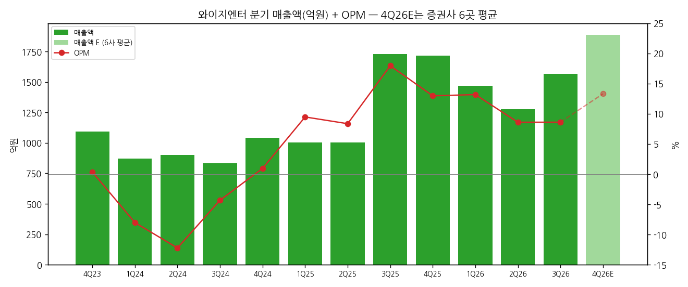
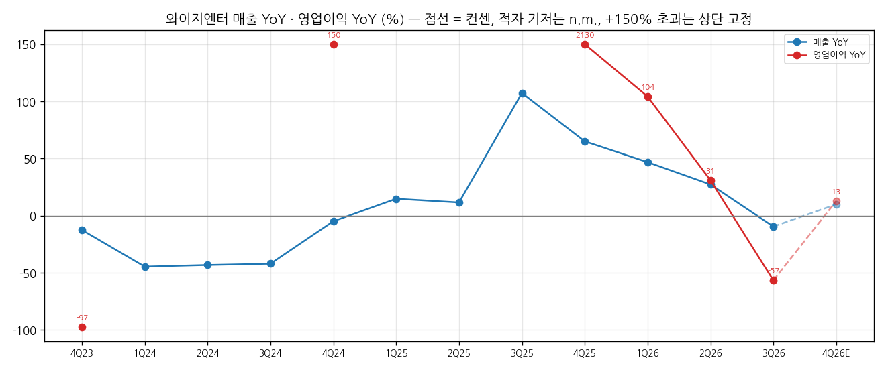
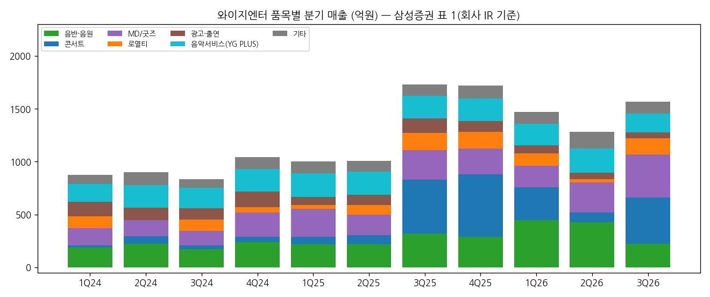

> 모드: 실적 리뷰 (v11)
> 종목: 와이지엔터 (122870)
> 섹터: 엔터
> 서브섹터: 기획사
> 분기: 2026-Q3
> 발표일: 2026-11-09 (잠정실적·IR 3Q26 Earnings Presentation) / 분기보고서 2026-11-16 제출 (확정 — 매출 1,567.3억·영업이익 134.5억으로 잠정과 동일, OpenDART 접수 20261116000477)
> 작성 시각: 2026-11-23 00:30 KST
> 분석 소스: 와이지엔터 3Q26 Earnings Presentation(2026-11-09) + OpenDART 분기 재무(company-data MCP `dart_financials`·`dart_quarterly_summary`) + 셀사이드 6건 — 하나(11/10)·키움(11/10)·삼성(11/10)·다올(11/10)·KB(11/12, 2027 업종 전망 내 종목 페이지)·교보(11/17). 같은 폴더 `company-overview/와이지엔터_기업개요.md` 시계열 재사용
> 리뷰 깊이: 풀 | 리서치 첨부 7건 (IR 1 + 증권사 6)
> 비영업 요인: 고기저(3Q25 BLACKPINK 월드투어 — 콘서트 508억·MD 281억, OPM 18.0%) · 일회성 비용(3Q26 YG PLUS 빅뱅 MD 매출채권 대손상각 약 20억, 빅뱅 월드투어 미주·유럽 구간 초기 운영비) · 투자 자회사 기타영업손익 감소(YG인베스트먼트 3Q26 11억 vs 3Q25 76억)

# 와이지엔터 3Q26 실적 리뷰

## 0. 한 줄 판정

> 성장 델타: 꺾임 | 내러티브: 약화 → 매매 제외 구간 (영업이익 YoY +31.2% → −56.6%로 마이너스 전환, 컨센 200억 대비 −32%. 4Q26은 빅뱅 아시아 투어로 YoY +13% 회복이 컨센이지만 2027년은 매출 −12%·영업이익 −7% 역성장 컨센 — 신인 2팀 데뷔 전까지는 성장 스토리가 비어 있다)

> ⚠ 비영업 요인 플래그: 3Q26 영업이익 YoY −56.6%(−176억)는 ① 3Q25 BLACKPINK 투어 고기저 ② 일회성 비용(대손상각 약 20억 + 빅뱅 투어 미주·유럽 구간 베뉴·운반·판매수수료) ③ 투자 자회사 기타영업손익 −65억(76억 → 11억)이 겹친 결과. 본업 영업이익(다올·KB 분리치)만 봐도 235억 → 123억, **−48%** — 기타손익을 빼도 꺾임 판정은 같다. 대손상각은 채권 회수 시 환입 가능(삼성)

→ 숫자: 매출액 1,567억 (−9.4% YoY, +22.7% QoQ), 영업이익 135억 (−56.6% YoY, OPM 8.6%). 매출 YoY 46.9%(1Q26) → 27.2% → **−9.4%**, 영업이익 YoY 103.9% → 31.2% → **−56.6%** — 3개 분기 연속 둔화 후 마이너스 전환
→ 컨센 대비: 매출 −4.0%, 영업이익 −32.5% (FnGuide 컨센 매출 1,632억·영업이익 200억, 삼성·다올·하나·키움 인용) — 미스의 원천은 비용(대손·빅뱅 투어 초기 운영비)과 투자 자회사 손익, 매출은 MD가 받쳤다
→ 쟁점 ①: **3Q 미스는 일회성인가** — 6건 모두 "4분기부터 비용 부담 완화"에 동의, 4Q26E 영업이익 평균 252억(224\~278억, YoY +12.8%)
→ 쟁점 ②: **MD 406억(+44%) 분기 최대** — 블랙핑크 투어가 있던 3Q25(281억)를 빅뱅·베이비몬스터·트레저로 넘었다. IP 사업 확장이 구조적인지가 2027년 이익 방어의 관건
→ 다음 분기 관건: 4Q26 영업이익 252억(YoY +13%) 회복 여부 + 신인 보이그룹(5인)·걸그룹 데뷔 일정(1H27) 공식화 — 2027E 매출 역성장 컨센을 뒤집을 유일한 변수

## 1. 숫자

① 연결 분기 표 (억원, K-IFRS 영업이익. 3Q26은 분기보고서 확정, 4Q26E는 국내 증권사 6곳 평균 — 하나·키움·삼성·KB·다올·교보)

| 항목 (억원) | 4Q23 | 1Q24 | 2Q24 | 3Q24 | 4Q24 | 1Q25 | 2Q25 | 3Q25 | 4Q25 | 1Q26 | 2Q26 | **3Q26** | 4Q26E (6사 평균) |
|---|---|---|---|---|---|---|---|---|---|---|---|---|---|
| 매출액 | 1,094 | 873 | 900 | 835 | 1,041 | 1,002 | 1,004 | 1,731 | 1,718 | 1,471 | 1,278 | 1,567 | 1,888 |
| 영업이익 | 4 | -70 | -110 | -36 | 10 | 95 | 84 | 311 | 223 | 194 | 110 | 135 | 252 |
| OPM | 0.4% | -8.0% | -12.2% | -4.3% | 1.0% | 9.5% | 8.4% | 18.0% | 13.0% | 13.2% | 8.6% | 8.6% | 13.3% |
| 매출 YoY | -12.5% | -44.6% | -43.1% | -42.0% | -4.8% | +14.8% | +11.6% | +107.3% | +65.0% | +46.8% | +27.3% | -9.5% | +9.9% |
| 영업이익 YoY | -97.5% | n.m. | n.m. | n.m. | +150.0% | n.m. | n.m. | n.m. | +2130.0% | +104.2% | +31.0% | -56.6% | +12.8% |
| **매출 YoY 델타** | n.m. | -32.1%p | +1.4%p | +1.1%p | +37.2%p | +19.6%p | -3.2%p | +95.7%p | -42.3%p | -18.2%p | -19.5%p | -36.8%p | +19.4%p |
| **영업이익 YoY 델타** | n.m. | n.m. | n.m. | n.m. | n.m. | n.m. | n.m. | n.m. | n.m. | -2025.8%p | -73.3%p | -87.5%p | +69.4%p |

→ (출처: OpenDART 분기 재무, 4Q = 연간 − 3Q 누적. 4Q26E는 각 리포트 추정)
→ 컨센 대비: 매출 −4.0%, 영업이익 −32.5% (FnGuide 컨센 매출 1,632억·영업이익 200억 — 삼성·다올 인용)
→ [판단] 영업이익 YoY의 정점은 4Q25(+2,146%, 2024년 적자 기저)·1Q26(+104%)이고, 2026년 들어 3개 분기 연속 둔화 끝에 3Q26 마이너스로 전환했다. 4Q26E는 +12.8%로 반등하지만 이는 빅뱅 아시아·일본 투어(24회, 하나)에 따른 일시 회복이고, 컨센이 그리는 2027년 연간 영업이익은 641억(−7.1%) — **YoY 정점은 이미 지났다**

→ (출처: OpenDART, 4Q26E는 증권사 6곳 평균)

→ (출처: 같은 자료로 계산. 점선 = 컨센, 2024년 적자 기저 분기는 n.m. — ±150% 초과는 상하단 고정)

② 품목별 매출·영업이익 (억원, 사업부별 영업이익은 회사 미공시 — 본업/기타 영업손익 분리는 다올·KB 추정)

| 품목 (억원) | 3Q25 | 4Q25 | 1Q26 | 2Q26 | **3Q26** | QoQ | YoY | 3Q26 비중 |
|---|---|---|---|---|---|---|---|---|
| 앨범/DVD | 118 | 88 | 252 | 193 | 32 | −83.4% | −72.9% | 2.0% |
| 디지털 콘텐츠(음원) | 202 | 200 | 196 | 233 | 191 | −18.0% | −5.4% | 12.2% |
| MD/굿즈 | 281 | 241 | 205 | 282 | **406** | +44.0% | **+44.5%** | 25.9% |
| 콘서트 | 508 | 593 | 309 | 94 | 439 | +367.0% | −13.6% | 28.0% |
| 로열티 | 163 | 157 | 116 | 34 | 153 | +350.0% | −6.1% | 9.8% |
| 광고 | 92 | 86 | 66 | 39 | 40 | +2.6% | −56.5% | 2.6% |
| 출연료 | 45 | 18 | 9 | 18 | 15 | −16.7% | −66.7% | 1.0% |
| 음악서비스(YG PLUS) | 212 | 216 | 205 | 231 | 181 | −21.6% | −14.6% | 11.6% |
| 기타 수수료 | 110 | 118 | 113 | 155 | 111 | −28.4% | +0.9% | 7.1% |
| **매출액** | **1,731** | **1,718** | **1,471** | **1,278** | **1,567** | +22.7% | −9.4% | 100% |
| 영업이익 — 본업 [추정] | 235 | 159 | 180 | 99 | 123 | +24.2% | −47.7% | |
| 영업이익 — 기타영업손익 [추정] | 76 | 64 | 14 | 11 | 11 | 0.0% | −85.5% | |
→ (출처: 품목 매출 삼성증권 표 1(회사 IR 기준), 본업/기타 분리는 다올 Fig.2·KB 실적 추정 — "본업 = 연결 영업이익 − YG인베스트먼트 투자수익(기타영업수익)")

→ (출처: 삼성증권 표 1, 회사 IR)

→ 델타를 끄는 것: **MD**(+125억 YoY, 분기 최대). 로열티 153억 안에도 일본 MD·라이선싱 약 50억이 들어 있어 실질 MD는 약 456억으로 추정(키움)
→ 꺾이는 것: **음반**(실물 신보 부재, 빅뱅 디지털 싱글만 — −73%), **광고·출연**(−56\~−67%), 그리고 **콘서트**(블랙핑크 3Q25 고기저 −14%). 콘서트는 빅뱅 8회(미주·유럽)·베이비몬스터 14회·트레저 팬콘 19회로 QoQ +367%
→ 이익: 매출총이익률 31.9%(3Q25 33.0%, KB) — 빅뱅 투어에서 YG PLUS가 MD 유통·현장 운영을 직접 맡으며 베뉴 비용·판매수수료·운반비가 늘었고, 미주·유럽 구간은 회차가 적어 원가 분산이 안 됐다(키움). 판관비에는 빅뱅 MD 매출채권 대손상각 약 20억(삼성·하나·키움)

③ 연간 (억원)

| 항목 | 2022 | 2023 | 2024 | 2025 | 2026E (6사 평균) | 2027E (6사 평균) | 9M26 | 9M25 |
|---|---|---|---|---|---|---|---|---|
| 매출액 | 3,912 | 5,692 | 3,649 | 5,455 | 6,204 | 5,465 | 4,316 | 3,737 |
| 영업이익 | 466 | 870 | −206 | 713 | 690 | 641 | 439 | 490 |
| OPM | 11.9% | 15.3% | −5.6% | 13.1% | 11.1% | 11.7% | 10.2% | 13.1% |
| 매출 YoY | | +45.5% | −35.9% | +49.5% | +13.7% | −11.9% | +15.5% | |
| 영업이익 YoY | | +86.7% | 적전 | 흑전 | −3.2% | −7.1% | −10.4% | |
→ (출처: OpenDART 연간·분기 합산, 2026E·2027E는 하나·키움·삼성·KB·다올·교보 평균 [계산])
→ 발표 전 → 후 연간 컨센: FnGuide 컨센(하나 인용, 발표 전) 2026E 영업이익 745억·2027E 728억 → 발표 후 6사 평균 690억(−7.4%)·641억(−12.0%) [계산]. 하향 폭은 2027E가 더 크다 — 3Q 미스보다 **2027년 라인업 공백**을 반영한 하향

## 2. 시장 쟁점

① 지난 분기 체크

→ 첫 리뷰 — 직전 체크 없음 (2026-Q2 리뷰 미작성)

② 이번 분기 쟁점 (리포트 6건 + IR 기준)

(1) **3Q 이익 미스는 일회성인가** — 6건 전부. 4Q 비용 정상화 폭이 관건
(2) **MD 분기 최대 — IP 사업이 구조적으로 커지나** — 6건
(3) **2027년 라인업 공백과 매출 역성장** — 5건. 블랙핑크 투어 종료 후 트레저·베이비몬스터·빅뱅 중심
(4) **신인 보이그룹·걸그룹 데뷔(1H27)가 리레이팅 트리거가 될 수 있나** — 6건
(5) **빅뱅 월드투어 확대 가능성** — 4건 (하나·삼성·교보·다올)

③ 쟁점별 분해

(1) **3Q 이익 미스는 일회성인가**

(1-1) 회사 설명(IR): 빅뱅 2026\~2027 월드투어 <XX : COSMOS>는 19개 도시 39회, 공개 회차 전부 돔(13)·스타디움급(26). "공연 규모 확대를 기반으로 공연·MD 등 실적 기여" — 비용 구조에 대한 별도 설명은 없음
(1-2) 증권사별 해석

| 증권사 | 3Q 비용 원인 | 4Q26E 영업이익 | 논리 |
|---|---|---|---|
| 키움 (11/10) | 대손 20억 + YG PLUS 투어 직접 운영(베뉴·수수료·운반비) + 미주·유럽 구간 원가 분산 실패 + YG인베 기타손익 감소 | **278억** | 공연이 동남아·일본으로 이동하고 회차가 늘면 같은 운영비가 더 큰 매출에 분산 → 4Q 레버리지 "이미 확인 가능한 구조" |
| 하나 (11/10) | YG PLUS 대손 20억 + 빅뱅 베뉴·판매수수료, 4Q 아시아 투어 비용 일부 선반영 | 270억 | 빅뱅 24회·베몬 11회 반영, "비용 부담 완화" |
| 다올 (11/10) | 대손 20억 + 빅뱅 서구권 초기 제반 비용 집중 | 272억 (직전 304억) | 4Q는 회차·회당 모객 확대로 레버리지, 다만 추정은 소폭 하향 |
| 삼성 (11/10) | 대손 20억(회수 시 환입 가능) + 빅뱅 투어 운영비·판매수수료 | 234억 | 공연 규모 확대로 이익 개선, 2027E 수익성은 하향 |
| 교보 (11/17) | 대손 20억 + YG PLUS 공연 중심 사업 확대 초기 제반 비용 | 231억 | 4Q는 초기 비용 완화 + 빅뱅 지역·회차 증가 |
| KB (11/12) | (업종 전망 — 원인 언급 없음) | 224억 | 본업 영업이익 204억 + 기타 20억 |

(1-3) 공통 결론: 3Q 미스의 대부분은 4Q부터 소멸하는 비용 — **6건 모두 4Q26 YoY 플러스 회복**(+0.4%\~+24.7%). 갈리는 지점: 4Q 레버리지 크기(키움·하나·다올 270억대 vs 삼성·교보·KB 220\~230억대). 차이는 빅뱅 아시아 회차·회당 모객 가정
(1-4) [판단] 대손 20억과 기타영업손익 감소(−65억 YoY)를 모두 더해도 85억 — 3Q 이익 감소폭(−176억)의 절반이다. 나머지는 본업 마진 자체(블랙핑크 고기저 + 빅뱅 투어 원가 구조)라 "전부 일회성"은 아니다. 4Q26 본업 영업이익이 200억 이상(다올 267억·KB 204억 추정)으로 나와야 일회성 설명이 성립

(2) **MD 분기 최대 — IP 사업이 구조적으로 커지나**

(2-1) 회사 설명(IR): "간접 매출 강화 — 비활동기에도 수익 창출이 가능한 IP Biz 확대, 아티스트 직접 활동 없이도 지역·사업 영역 확장". 간접 매출(디지털·MD/굿즈·로열티)은 2025년 2,000억대로 2016년 이후 최대(IR 차트 기준)
(2-2) 증권사별 해석

| 증권사 | MD 해석 | 2026E / 2027E MD 매출 |
|---|---|---|
| 하나 | 블랙핑크 70만 명 투어가 있던 3Q25(281억)를 크게 상회, 역대 최대 분기 | (MD 상품 외) 1,230 / 1,100 |
| 키움 | 로열티 내 MD·라이선싱 약 50억 포함 시 실질 MD 456억. 투어 연계 기획 상품 수요 동반 확대 | 1,400 / **1,554** (유일하게 2027E 증가) |
| 삼성 | IP 사업 확대·굿즈 카테고리 다변화로 성장 지속 | 1,267 / 1,061 |
| 다올 | 블핑 투어 MD 부재에도 빅뱅·베몬 기획 MD·트레저 팬콘 MD로 YoY 성장 | 1,360 / 974 |
| 교보 | MD 매출 시장 기대 상회 | 1,327 / 913 |
| KB | — | 1,337 / 1,017 |

(2-3) 공통 결론: 3Q MD의 질(투어 연계 + 기획 상품)은 모두 긍정. 갈리는 지점: **2027년 지속성** — 키움만 2027E MD 증가(+11%), 나머지 5곳은 −11\~−31% 감소(투어 규모 축소 연동)
(2-4) [판단] MD는 투어와 함께 움직이는 매출이라 2027년 투어 규모(빅뱅 추가 회차·베이비몬스터 돔 확대)가 결정한다. 키움의 MD 성장 가정이 맞으려면 비활동기 IP 상품(라이선싱·팝업)이 별도 매출로 확인돼야 한다

(3) **2027년 라인업 공백과 매출 역성장**

(3-1) 사실: 2027E 매출 6사 평균 5,465억(−11.9%), 영업이익 641억(−7.1%). 하나 "2027년은 사실상 트레저와 베이비몬스터 활동이 대부분일 정도로 라인업 부족", 키움 "메가 IP 활동 가시성 제한으로 매출 역성장 불가피, 데뷔 비용을 보수적으로 반영하면 시장 추정치 하회 여지"
(3-2) 증권사별 2027E 영업이익: 키움 724억 > KB 684억 > 삼성 679억 > 교보 615억 > 하나 605억 > 다올 537억 — 범위 537\~724억(폭 35%)
(3-3) 갈리는 지점: 빅뱅 2027년 투어 기여(39회 중 2027년 분량)와 신인 데뷔 비용. 다올은 2027E 영업이익 −24.3%로 가장 보수적(본업 517억)
(3-4) [판단] 블랙핑크 그룹 활동이 2027년 컨센에 거의 없다는 점에서 하방은 제한적이지만, 상방은 신인과 빅뱅 회차 추가에만 걸려 있다. 매출 성장 스토리가 없는 해 — 모멘텀 매매 관점에서 2027년 상반기 신인 지표 전까지 '대기'

(4) **신인 보이그룹·걸그룹 데뷔(1H27)가 리레이팅 트리거가 될 수 있나**

(4-1) 사실: 신인 보이그룹(5인) 데뷔가 당초 4Q26 → 1H27로 이동, 회사는 걸그룹(3명 공개)과 동시 공개까지 검토(키움). 다올 가정: 보이그룹 1Q27·걸그룹 3Q27. IR 포트폴리오 표에 "NEXT BOY, GIRL — TBA"
(4-2) 증권사별 해석

| 증권사 | 신인 가정·논리 |
|---|---|
| 하나 | 코르티스 400만 장 흥행·JYP·SM 동시기 보이그룹 준비 — 강한 경쟁이 오히려 흥행에 긍정적. 성공 시 2027E P/E 17배(시총 8,000억 내외)에서 높은 상승 모멘텀, 업종 차선호주 |
| 키움 | 시장 추정치에 신인 기여는 낮게 반영 — 베이비몬스터 수준의 초기 지표 확인 시 2027\~28E 즉시 상향. "내년 신인 모멘텀을 기다릴 시점" |
| 다올 | 베몬 데뷔 초기 흥행과 유사하면 디싱 후 피지컬 발매 방식, 베몬 대비 75% 흥행 가정 시 추가 상향 여지 |
| KB | 대형사 중 Hit-ratio가 높아 흥행 기대, 저연차 중심 포트폴리오로 실적 변동성 완화 기대 |
| 교보 | 아티스트 포트폴리오 다변화에 따른 매출 확대 기대, 메가 IP 활동 확대 시 추정 상향 |
| 삼성 | 2027년 차기 보이·걸그룹 순차 데뷔 추진, 베이비몬스터 중심 IP 수익화로 이익 체력 강화 |

(4-3) 공통 결론: 6건 모두 신인을 핵심 변수로 지목하고, **추정치에는 신인 기여를 낮게 반영**했다. 갈리는 지점은 타이밍뿐(1Q27 vs 1H27 동시 데뷔 vs 3Q27 걸그룹)
(4-4) [판단] 신인 흥행은 추정 상향으로 바로 이어지는 '옵션'이지만 숫자(초동·스트리밍)가 나오기 전까지는 판정에 반영할 수 없다. 데뷔 일정 공식 발표 → 초동 판매량이 순서대로 확인 포인트

(5) **빅뱅 월드투어 확대 가능성**

(5-1) 사실(IR): 빅뱅 19개 도시 39회 전 회차 돔·스타디움급, 3Q26 8회·4Q26 24회(하나). 블랙핑크 DEADLINE 투어는 33회로 BORN PINK(66회)보다 회차는 절반이지만 스타디움급 28회로 회당 모객 확대
(5-2) 해석: 하나 "빅뱅 월드투어가 발표된 일정보다 추가될 가능성이 높아 내년 상반기까지는 빅뱅 매니지먼트 기반 안정적 호실적", 교보 "빅뱅 공연 추가 회차 공개 가능성", 삼성·다올 4Q 일본·아시아 회차 증가
(5-3) [판단] 빅뱅 추가 회차는 2027년 컨센 하방을 받치는 요인 — 다만 빅뱅은 전속 재계약이 아닌 매니지먼트 형태(하나 도표 "재계약X")라 이익 기여율은 자체 IP보다 낮을 수 있다 [판단]

④ 낙관 vs 보수

→ 가장 낙관: **키움**(TP 70,000원, 2027E 영업이익 724억·지배순이익 579억) — 3Q는 비용 인식 구조 문제일 뿐, 4Q 레버리지 확인 가능, MD 2027년에도 성장, Target P/E 22.5배(업종 멀티플 −10%). **하나**(63,000원) — 신인 흥행 시 높은 상승 모멘텀, 업종 차선호주
→ 가장 보수: **KB**(50,000원) — 2027년 저연차 중심 전환기, 추정은 중간이지만 TP가 가장 낮음. **다올**(60,000원, 2027E 영업이익 537억 — 가장 낮음) — 2027년 실적은 빅뱅과 베몬에 기대, 모멘텀은 신인. **삼성**(56,000원, 유일한 하향) — 2027E 수익성 하향, 최근 5년 저점 평균 P/E 20배
→ 다르게 가정한 것: 2027년 MD 지속성(키움 +11% vs 나머지 감소)과 신인 데뷔 비용 반영 강도, 적용 멀티플(키움 22.5배 vs 하나 17배 vs 삼성 20배)
→ 셀사이드 vs 시장: 실적 발표일(11/9) 40,500원 → 11/11 41,100원 → 11/16 43,500원(+7.4%) — 컨센 −32% 미스에도 주가는 상승. 52주 최고 76,500원 대비 여전히 −43%로, 시장은 3Q를 '바닥 확인'으로 읽는 분위기 [판단]

⑤ 추정치·TP 변화

| 증권사 | 직전 TP | 현재 TP | 4Q26E 영업이익 | 2026E / 2027E 영업이익 | 핵심 변화 한 줄 |
|---|---|---|---|---|---|
| 키움 (11/10) | 70,000 | 70,000 | 278 | 716 / 724 | 연간 추정 직전과 사실상 동일, 신인 기여 미반영 |
| 하나 (11/10) | 63,000 | 63,000 | 270 | 708 / 605 | 2027년 라인업 공백, 신인 흥행 시 상승 모멘텀 |
| 다올 (11/10) | 60,000 | 60,000 | 272 (직전 304) | 713 / 537 | 4Q26E −10.5%, 1Q27E −6.6% 하향 |
| 교보 (11/17) | 60,000 | 60,000 | 231 | 669 / 615 | 기존 IP 성장 + 신인 = 2027년 성장 동력 |
| 삼성 (11/10) | 61,000 | **56,000 ↓** | 234 | 672 / 679 | 2026E EPS −32.1%, 2027E −8.3%, 2026E 영업이익 793 → 672억 |
| KB (11/12) | 미기재 | 50,000 | 224 | 663 / 684 | 2027 업종 전망 — 저연차 중심 포트폴리오 전환 |
→ (출처: 각 리포트. 2026E 영업이익 단위 억원)
→ 현재 TP 6사 평균 **59,800원**. 직전 TP가 확인되는 5사 평균 62,800원 → 61,800원(**−1.6%**) — 하향 1(삼성)·유지 4·신규/미기재 1(KB) [계산]. 삼성 인용 FnGuide 컨센 TP 60,889원(18사)
→ TP 하향의 원인: 유일한 하향인 삼성은 **실적 하향**(2026E EPS −32%, 2027E 순이익 −8%) — 멀티플은 P/E 20배 유지. 나머지 5곳은 TP를 유지했지만 2027E 영업이익을 600억 안팎으로 둔 채 신인 옵션을 근거로 버티는 구조

## 3. 내러티브 점검

→ 성장 스토리: **블랙핑크 재계약·월드투어로 만든 이익 레벨을 빅뱅(매니지먼트)·베이비몬스터·트레저가 이어받고, 신인 2팀으로 다음 사이클을 여는 기획사** — 2025년 흑자 전환 이후 시장이 와이지를 보는 이유
→ 이번 분기: 블랙핑크 투어 종료 후 첫 분기에서 영업이익이 반 토막(−57%) 났고, 본업만 봐도 −48%. MD 분기 최대·베이비몬스터 돔 진입은 긍정이지만, 성장 스토리의 다음 장(신인)은 아직 숫자가 없고 2027년 컨센은 역성장 → **델타 꺾임 + 내러티브 약화 → 매매 제외 구간**
→ 다시 강하게 만들 트리거: 신인 보이그룹·걸그룹 데뷔 일정 공식화와 초동(베이비몬스터 데뷔 수준) / 빅뱅 2027년 추가 회차 공개 / 블랙핑크 그룹 활동(앨범·투어) 2027년 재개 발표
→ 깨뜨릴 리스크: 4Q26 영업이익이 230억 아래(본업 마진 회복 실패) / 신인 데뷔 추가 지연(2H27 이후) / 빅뱅 투어 원가 구조가 아시아 구간에서도 개선되지 않음

## 4. 향후 봐야 할 것

① **4Q26 영업이익 252억(컨센 평균, YoY +12.8%) 달성과 본업 마진** — 본업 영업이익 200억 이상이면 3Q 비용이 일회성이었다는 설명이 성립, 230억 미만이면 꺾임 지속 / 4Q26 잠정실적·IR / 2027년 2월 말
② **신인 보이그룹(5인)·걸그룹 데뷔 일정 공식 발표** — 1H27 동시 데뷔 여부, 이후 초동(베이비몬스터 데뷔 수준과 비교) / 회사 공지·써클차트·한터 / 1H27
③ **빅뱅 월드투어 추가 회차** — 39회 → 추가 공개 여부, 2027년 분량(델타 하방 지지) / 투어 공지·예매 / 4Q26\~1Q27
④ **MD 매출의 비활동기 지속성** — 4Q26 MD 340\~510억(증권사 추정 범위) 이상, 2027년 1Q MD가 투어 공백에도 200억대 유지하는지 / 분기 IR 품목별 매출 / 2027년 2월·5월
⑤ **대손상각 환입·YG인베스트먼트 기타영업손익** — 빅뱅 MD 채권 회수 시 환입(삼성), 투자수익 변동이 분기 이익을 흔드는 정도 / 분기보고서 / 분기별
