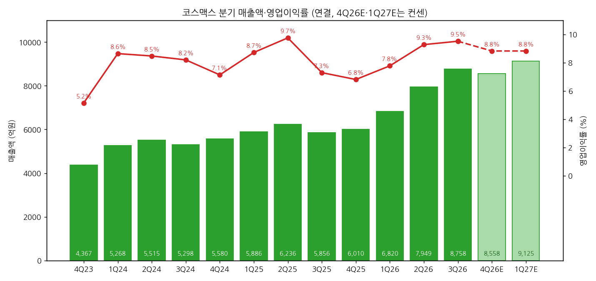
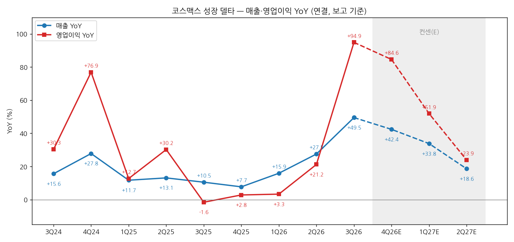
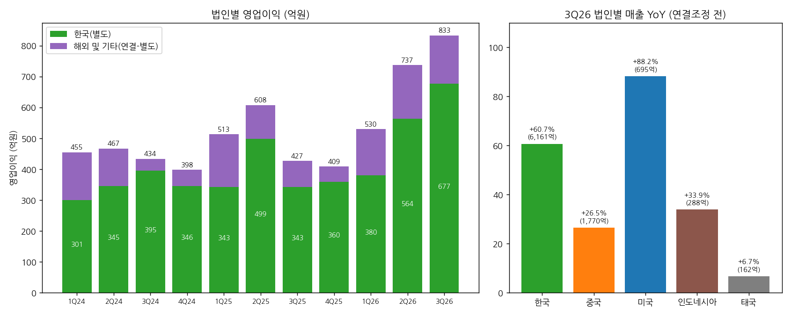

> 모드: 실적 리뷰 (v11)
> 종목: 코스맥스 (192820)
> 섹터: 뷰티
> 서브섹터: ODM
> 분기: 2026-Q3
> 발표일: 2026-11-11 (IR「2026 3분기 경영실적」 + 컨퍼런스콜, 분기보고서 2026-11-13)
> 작성 시각: 2026-11-22 20:40 KST
> 분석 소스: 회사 IR「2026 3분기 경영실적」(2026-11-11) + 셀사이드 첨부 7건 전부 코스맥스 리포트(첫 페이지로 종목 확인) — 씨티(11/11), JP모건(11/11), DB증권(11/12), IBK투자증권(11/12, Spot Comment), NH투자증권(11/12), 하나증권(11/12), 교보증권(11/16). 과거 분기 숫자·법인별 시계열은 코스맥스 기업개요(2026-11-15, OpenDART 연결·별도 분기 시계열 + IR 지역별 실적)로 교차검증. 웹서치 보완 없음. 컨콜 트랜스크립트 원본은 없고, 회사 설명은 IR 자료와 증권사 컨콜 정리(씨티·JPM·하나·IBK)로 구성
> 리뷰 깊이: 풀 | 리서치 첨부 7건 (7개 증권사)
> 비영업 요인: 일회성(한국 대손상각비 환입 +54억원·상여 충당금 -50억원, 영업이익 순효과 약 +4억원) · 저기저(3Q25 영업이익 -1.6% YoY, 관세·고객사 재고조정) · 영업외 외화 관련 손실 277억원·CB 조기상환 파생상품거래이익 79억원(순이익만 영향) — 판정은 보고 기준 그대로

# 코스맥스 3Q26 실적 리뷰 — 비수기가 사라졌다, 영업이익 YoY +21% → +95%

> 성장 델타: 가속 | 내러티브: 강화 → 델타 가속 + 내러티브 강화 → 적극 구간 (단, 컨센 경로상 영업이익 YoY 정점은 3Q26 — 4Q26E +85%, 1Q27E +52%로 내려오는 경로이고, 하강 속도는 캐파 증설이 결정)
>
> ⚠ 비영업 요인 플래그: 가속의 주된 원인은 영업이다 — 한국 법인 매출 +60.7%, OPM +2.1%p. 영업이익 안의 일회성은 한국 대손상각비 환입 +54억원과 상여 충당금 -50억원으로 순효과 약 +4억원(YoY 기여 약 +1%p)이다. 씨티처럼 환입만 빼도 779억원, YoY +82%다. 3Q25 기저는 약했다(영업이익 -1.6% YoY, OPM 7.3% — 관세 우려·브랜드 재고조정). 다만 2년 전 같은 분기 대비로도 +92%(3Q24 434억원 → 833억원)이고, 이 값이 1Q26 +16% → 2Q26 +58% → 3Q26 +92%로 커지고 있어 저기저만으로 만든 가속은 아니다 ([계산], 참고). 영업외 외화 관련 손실 277억원·이자비용 138억원·CB 조기상환 파생상품거래이익 79억원은 순이익(445억원)만 움직였다 — 판정과 무관

→ **숫자**: 매출 8,758억원(+49.5% YoY, +10.2% QoQ), 영업이익 833억원(+94.9% YoY, +13.0% QoQ), OPM 9.5%(+2.2%p YoY). 분기 매출·영업이익 모두 사상 최대다. 영업이익 YoY는 1Q26 +3.3% → 2Q26 +21.2% → 3Q26 +94.9%로 두 분기 연속 확대됐다(델타 +73.7%p). 매출 YoY도 +27.5% → +49.5%로 커져 "강한 가속"이다. FnGuide 컨센(매출 8,228억원·영업이익 782억원) 대비 각각 +6.4%·+6.5% 상회
→ **쟁점 ①**: 한국 법인이 비수기 없이 분기 매출 6,161억원(+61%)을 냈다. 스킨케어가 약 +100% YoY(교보)이고, 국내 인디·해외 인디·글로벌 MNC 물량이 동시에 늘었다. 7곳 모두 "계절성 소멸"을 첫 줄에 썼고, 4Q 국내 매출 YoY 추정은 +43%(JPM)~+69%(NH)로 갈린다
→ **쟁점 ②**: 성장의 상한은 수요가 아니라 캐파다. 국내 가동률은 85% 이상(하나)·high-80%(JPM)로 사실상 풀가동이고, 평택 1공장 증설분이 1Q27까지 들어오면 국내 캐파가 +10% 늘어난다. JPM은 이것과 "OPM 확장 여력 제한"을 이유로 중립(TP 23.9만원)을 유지했고, 하나는 "P와 Q가 모두 늘었다"며 TP를 42만원으로 올렸다
→ **쟁점 ③**: 미국 법인이 두 번째 엔진으로 올라왔다. 매출 695억원(+88%), 순손실 -26억원(3Q25 -74억원)으로 영업이익은 약 35~50억원(OPM 5~7%, 하나·DB·NH 추정)이다. 회사의 2026년 미국 OPM 가이던스는 6개월 만에 "손익분기 → 낮은~중간 한 자릿수 → 중간 한 자릿수"로 두 번 올라갔다(씨티). TP는 7곳 중 4곳 상향, 2곳 유지(IBK 제외), 평균 +5.4%
→ **다음 분기 관건**: 4Q26 컨센 영업이익 755억원(6곳 평균)은 YoY +84.6%로, 이대로면 판정은 "둔화"다. "가속"을 이어가려면 4Q 영업이익이 약 797억원(YoY +94.9%)을 넘어야 하는데, 6곳 중 DB(870억원) 1곳만 그 위다. 4Q 국내 매출 YoY +45% 이상·국내 OPM 11% 유지, 그리고 평택 증설 램프업 일정이 핵심이다

---

## 1. 숫자

① 연결 기준 분기 표 (단위: 억원, %)

| 항목 | 4Q23 | 1Q24 | 2Q24 | 3Q24 | 4Q24 | 1Q25 | 2Q25 | 3Q25 | 4Q25 | 1Q26 | 2Q26 | **3Q26** | 4Q26E | 1Q27E |
|---|---|---|---|---|---|---|---|---|---|---|---|---|---|---|
| 매출액 | 4,367 | 5,268 | 5,515 | 5,298 | 5,580 | 5,886 | 6,236 | 5,856 | 6,010 | 6,820 | 7,949 | **8,758** | 8,558 | 9,125 |
| 영업이익 | 225 | 455 | 467 | 434 | 398 | 513 | 608 | 427 | 409 | 530 | 737 | **833** | 755 | 805 |
| OPM | 5.2 | 8.6 | 8.5 | 8.2 | 7.1 | 8.7 | 9.7 | 7.3 | 6.8 | 7.8 | 9.3 | **9.5** | 8.8 | 8.8 |
| 매출 YoY | +9.0 | +30.6 | +15.1 | +15.6 | +27.8 | +11.7 | +13.1 | +10.5 | +7.7 | +15.9 | +27.5 | **+49.5** | +42.4 | +33.8 |
| 영업이익 YoY | +837.5 | +229.7 | +1.5 | +30.3 | +76.9 | +12.7 | +30.2 | -1.6 | +2.8 | +3.3 | +21.2 | **+94.9** | +84.6 | +51.9 |
| **매출 YoY 델타 (%p)** | -6.5 | +21.6 | -15.6 | +0.5 | +12.2 | -16.0 | +1.3 | -2.5 | -2.8 | +8.2 | +11.6 | **+22.0** | -7.1 | -8.6 |
| **영업이익 YoY 델타 (%p)** | +768.5 | -607.8 | -228.2 | +28.8 | +46.6 | -64.1 | +17.4 | -31.8 | +4.4 | +0.5 | +17.9 | **+73.7** | -10.3 | -32.7 |
| (참고) 2년 전 동분기 대비 영업이익 증가율 | | | | | | | | | | +16.5 | +57.8 | +91.9 | +89.7 | +76.9 |
| (참고) 대손상각비 환입 54억원 제외 영업이익 / YoY | | | | | | | | | | | | 779 / +82.4 | | |

→ (출처: 4Q23~2Q26 = OpenDART 연결(코스맥스 기업개요 분기 시계열, 4Q = 연간 − 3Q 누적), 3Q26 = 회사 IR(2026-11-11)·분기보고서(2026-11-13) 확정치. 4Q26E = DB·NH·교보·하나·JPM 분기 추정 + 씨티 연간 추정에서 3Q 누적(매출 2조 3,527억원·영업이익 2,101억원)을 뺀 내재치, 6곳 단순평균(IBK는 추정 미제시). 1Q27E = NH 단독 추정(분기 추정 공개 1곳뿐 — 소수 의견 좌우 가능))
→ **YoY 계산 기준**: K-IFRS 연결 보고 영업이익, DART 원공시 대 원공시(재작성 없음). 3Q26 YoY는 회사 IR 발표치(+49.5%·+94.9%, 원 단위 계산)를 썼다 — 억원 반올림 숫자로 다시 계산하면 +49.6%·+95.1%로 0.1~0.2%p 차이가 난다. 다른 분기는 억원 숫자로 계산. 연결 범위: Cosmax California가 2024-08 편입(미국 법인 YoY 3Q24~2Q25에 일부 편입 효과), 이탈리아 케미노바(지분 51%)는 지분법이라 매출·영업이익에 들어오지 않는다. 4Q23 +838%는 4Q22 영업이익 24억원(대손) 저기저 탓이다
→ 3Q26 서프라이즈: 매출 컨센 대비 +6.4%, 영업이익 +6.5% (FnGuide 컨센 매출 8,228억원·영업이익 782억원, NH·하나 인용). 블룸버그 컨센(매출 8,180억원·영업이익 774억원, 씨티) 대비 +7%·+8%, IBK 집계 컨센(8,180억원·794억원) 대비 +7.1%·+4.9%. 씨티는 대손 환입을 뺀 "기초 영업이익 780억원은 컨센 부합"으로 본다
→ 위치: 영업이익 YoY는 2025년 내내 0~30%대에서 흔들리다(3Q25 -1.6%가 바닥) 2026년 들어 +3% → +21% → +95%로 가파르게 올라왔다. 1~3Q 누적 영업이익 YoY는 +35.7%(2,101억원 vs 1,548억원) ([계산])
→ 컨센 경로: 4Q26E +84.6%(4Q25 409억원, OPM 6.8%로 기저 역시 약함) → 1Q27E +51.9%(NH) → 2Q27E +23.9% → 3Q27E +12.7%(NH). **보고 기준 YoY 정점은 3Q26**이고, 컨센은 4Q26부터 2개 분기 연속 둔화를 그린다. 2027년 연간 영업이익 컨센은 +26.7%(6곳 평균)다. JPM의 투자 논거("높아진 기저에서 매출 성장 둔화")가 바로 이 경로다
→ **[판단] 델타 = 가속**: 영업이익 YoY가 직전 분기보다 73.7%p 커졌고 매출 YoY도 22.0%p 커졌다. 2개 분기 연속 확대다. 비영업 요인(일회성 순효과 약 +4억원)이 판정을 바꾸지 않는다. 다만 4Q26 컨센이 그대로 나오면 다음 분기 판정은 "둔화"(+85%, 여전히 고성장)이고, 1Q27까지 둔화가 이어지면 "2개 분기 연속 둔화 + YoY 정점 통과"로 꺾임 조건의 절반이 채워진다

→ (출처: OpenDART 연결(기업개요 시계열), 3Q26 IR·분기보고서. 4Q26E = 증권사 6곳 평균, 1Q27E = NH투자증권. 연한 막대·점선 = 추정)

→ (출처: 동일. 2Q27E = NH투자증권 단독. 점선·회색 구간 = 컨센(E))

② 법인별 매출·영업이익

(1) 한국(별도) / 해외 및 기타 — 회사 공시 (단위: 억원, %)

| 구분 | 항목 | 1Q25 | 2Q25 | 3Q25 | 4Q25 | 1Q26 | 2Q26 | **3Q26** |
|---|---|---|---|---|---|---|---|---|
| 한국 | 매출 | 3,628 | 4,205 | 3,835 | 3,597 | 4,232 | 5,184 | **6,161** |
| 한국 | 매출 YoY | +15.0 | +20.8 | +10.3 | +3.9 | +16.7 | +23.3 | **+60.7** |
| 한국 | 영업이익 | 343 | 499 | 343 | 360 | 380 | 564 | **677** |
| 한국 | OPM | 9.5 | 11.9 | 8.9 | 10.0 | 9.0 | 10.9 | **11.0** |
| 한국 | 영업이익 YoY | +14.0 | +44.6 | -13.2 | +4.0 | +10.8 | +13.0 | **+97.1** |
| 해외 및 기타 | 매출 (연결 − 한국 별도) | 2,258 | 2,031 | 2,021 | 2,413 | 2,588 | 2,765 | **2,597** |
| 해외 및 기타 | 영업이익 | 170 | 109 | 84 | 49 | 150 | 173 | **156** |
| 해외 및 기타 | OPM | 7.5 | 5.4 | 4.2 | 2.0 | 5.8 | 6.3 | **6.0** |
| 해외 및 기타 | 영업이익 YoY | +10.4 | -10.7 | +115.4 | -5.8 | -11.8 | +58.7 | **+86.0** |
| 영업이익 기여 (3Q26) | | | | | | | | 한국 81% / 해외 및 기타 19% |

→ (출처: 회사 IR(3Q26 4·6쪽), OpenDART 별도·연결(기업개요 분기 시계열). 해외 및 기타 = 해외 법인 + 국내 기타 자회사(코스맥스네오 등) + 연결조정, 매출은 연결 − 별도로 [계산]. 3Q26 한국 YoY는 IR 발표치)
→ **델타를 끈 쪽은 한국**: 한국 매출 YoY가 +16.7% → +23.3% → +60.7%로, 영업이익 YoY가 +10.8% → +13.0% → +97.1%로 커졌다. 전사 영업이익 증가분 406억원(427 → 833억원) 중 334억원(82%)이 한국에서 나왔다 ([계산]). 한국 영업이익 증가분 334억원 중 대손 환입·상여 충당금 순효과는 약 +4억원뿐이다
→ 해외 및 기타도 영업이익 +86%(84 → 156억원), OPM 4.2% → 6.0%로 개선했다. 다만 QoQ로는 173억원 → 156억원으로 줄었다(중국 매출 QoQ -10%, 태국 -35%). 해외의 개선 동력은 미국이다(아래 (3))

(2) 해외 법인별 매출 — 회사 IR·증권사 표 (단위: 억원, %, 연결조정 전)

| 법인 | 1Q25 | 2Q25 | 3Q25 | 4Q25 | 1Q26 | 2Q26 | **3Q26** | 3Q26 YoY | 3Q26 QoQ | 비중 |
|---|---|---|---|---|---|---|---|---|---|---|
| 중국 합산 | 1,627 | 1,486 | 1,400 | 1,814 | 1,947 | 1,974 | **1,770** | +26.5 | -10.3 | 20% |
| 　상해 | 약 1,090 | 약 1,090 | 약 910 | 약 1,170 | 1,350 | 1,446 | **1,265** | +39.0 | -12.5 | |
| 　광저우(이센 JV 포함) | 약 490 | 약 410 | 약 455 | 약 530 | 558 | 489 | **505** | +11.0 | +3.3 | |
| 미국 | 287 | 300 | 369 | 370 | 420 | 538 | **695** | +88.2 | +29.2 | 8% |
| 인도네시아 | 약 300 | 209 | 215 | 약 260 | 227 | 289 | **288** | +33.9 | -0.3 | 3% |
| 태국 | 약 240 | 231 | 152 | 약 110 | 243 | 249 | **162** | +6.7 | -34.9 | 2% |
| 한국 (참고) | 3,628 | 4,205 | 3,835 | 3,597 | 4,232 | 5,184 | **6,161** | +60.7 | +18.9 | 70% |
| 연결조정·기타 | | | | | | | **-318** | | | |

| 법인 매출 YoY | 1Q25 | 2Q25 | 3Q25 | 4Q25 | 1Q26 | 2Q26 | **3Q26** |
|---|---|---|---|---|---|---|---|
| 중국 | +3.4 | +0.7 | +22.4 | +17.0 | +19.7 | +32.8 | **+26.5** |
| 미국 | -26.0 | -16.7 | +13.5 | +24.2 | +46.3 | +79.3 | **+88.2** |
| 인도네시아 | +22.8 | -17.7 | -33.4 | -18.2 | -23.3 | +38.3 | **+33.9** |
| 태국 | +151.6 | +124.3 | +36.9 | -11.9 | +1.7 | +7.8 | **+6.7** |

→ (출처: 3Q25·3Q26 = 회사 IR 4·7·8쪽. 1Q25~2Q26 = NH 표3·DB 도표 2·하나 도표 1·씨티 Figure 1·JPM Table 2(모두 회사 지역별 공시를 십억원 단위로 옮긴 값). "약"은 십억원 단위 반올림값(DB·씨티·JPM)이라 ±5억원 오차. 비중은 IR "연결 조정 전 법인별 매출 비중". 연결조정·기타 = 연결 매출 − 5개 법인 합 [계산]. 중국 2Q26 YoY는 하나·교보 +32.8%, DB +30.2%로 증권사마다 다르다 — 하나·교보 값 사용)
→ 미국은 6개 분기 연속 매출 YoY가 커졌다(-26% → +88%). 중국은 +20~30%대를 유지했지만 3Q는 QoQ -10%다(상해 대형 색조 고객사 발주 시점). 인도네시아는 주요 고객사 턴어라운드로 2개 분기 연속 +30%대다. 태국은 현지 통화 기준 두 자릿수 성장이지만 환율과 일부 출하 지연으로 원화 +7%에 그쳤다(IR·IBK)

(3) 해외 법인별 영업이익 — 회사 미공시, 증권사 추정·순이익 역산 (단위: 억원, %)

| 법인 | 3Q26 순이익 (IR) | 3Q25 순이익 (IR) | 영업외 주요 항목 (IR·IBK) | 순이익 + 영업외 비용 역산 [계산] | DB 추정 OP (OPM) | 하나 추정 OP (OPM) | NH 추정 |
|---|---|---|---|---|---|---|---|
| 중국 | -65 | -17 | CB 이자 54·CB 파생손실 40·이자 11·외화손실 37 | 약 +77 (4.4%) | 120 (6.7) | 104 (5.9) | — |
| 미국 | -26 | -74 | 이자비용 약 70 | 약 +44 (6.3%) | 50 (7.3) | 35 (5.0) | 약 49 (7%) |
| 인도네시아 | -1 | 6 | 이자 약 7·외화손실 약 25 | 약 +31 (10.8%) | 20 (6.2) | 동남아 합 45 (10.0) | — |
| 태국 | 5 | 8 | — | — | 10 (6.1) | (동남아 합에 포함) | — |
| 한국 (참고) | 211 | 276 | 외화손실 472·파생이익 118 | — | 영업이익 677 (공시) | | |

→ (출처: 순이익·영업외 항목 = 회사 IR 4·7·8쪽, IBK(인도네시아 영업외). 역산 = 순이익 + 열거된 영업외 비용, 법인세·기타 영업외는 무시한 근사치 — 회사 공시 아님. DB 도표 2 "국가별 영업이익 당사 추정", 하나 도표 1 "해외법인 영업이익률은 당사 추정", NH 본문 "영업이익 약 49억원(OPM 7%) 추산". 모두 [추정])
→ 미국 영업이익은 35~50억원(OPM 5~7%)으로 세 곳의 추정과 역산이 같은 범위에 있다. 2Q26에 첫 분기 영업흑자를 낸 뒤 한 분기 만에 OPM이 2.9~4.0%에서 5~7%로 올라왔다(DB·하나 2Q26 추정 기준)
→ 중국은 매출 +27%에도 순손실이 -17억원에서 -65억원으로 커졌다. CB 관련 이자·파생손실 94억원 때문이다. 이 CB는 3Q26 중 조기상환됐다(분기보고서 — 기업개요 인용). 4Q부터 이 비용이 빠지면 중국 순이익은 흑자 전환이 가능한 구조다(NH 4Q26E 중국 순이익 +80억원)
→ 순이익 기준으로 해외 4개 법인 합은 -87억원(3Q25 -77억원)이다. 해외 법인은 영업이익으로는 좋아지고 있지만, 차입 이자 때문에 순이익 기여는 아직 마이너스다

(4) 한국 법인 세부 — 카테고리·생산 (회사 IR·증권사 서술)

| 항목 | 3Q25 | 3Q26 | 출처 |
|---|---|---|---|
| 기초(스킨케어) : 색조 매출 비중 | 57 : 43 | 70 : 30 | JPM(3Q25), 회사 IR 11쪽(3Q26) |
| 스킨케어 매출 YoY | | 약 +100% | 교보 (비중 역산 시 약 +97% [계산]) |
| 색조 매출 YoY | 역성장 | +10% 안팎 (성장 전환) | NH 그림3·IBK(두 자릿수) |
| 겔마스크 OPM | | 한 자릿수 중반 (약 5%) | NH·하나 |
| 국내 가동률 | | 85% 이상 / high-80% | 하나 / JPM(회사 가이던스 인용) |
| 국내 생산능력 | 10.2억개 (2025) | 연말 11억개 (+10%), 평택 1공장 증설분 1Q27까지 램프업 | 하나 / JPM / 기업개요 |
| 대손상각비 / 상여 충당금 | | 환입 +54억원 / 추가 -50억원 | 회사 IR 6쪽 |

→ 한국 OPM +2.1%p의 원천은 회사 설명 기준 "제품 믹스 개선 + 고마진 카테고리 볼륨 확대에 따른 규모의 경제"다(IR 6쪽). 에센스·미스트 등 고마진 스킨케어 비중이 커졌고, 마진이 낮던 겔마스크가 OPM 5%대로 안정됐다(NH·하나)
→ 전사 매출총이익률은 16.9%로 QoQ -1%p 낮아졌고, 판관비는 QoQ -6% 줄었다(하나). 하나는 GPM 하락을 "충당금 반영", 판관비 감소를 "대손상각비 환입 영향"으로 설명한다. 즉 3Q의 마진 개선은 원가율이 아니라 판관비 레버리지(매출 +50% vs 판관비 +18%, IR 10쪽)에서 나왔다

→ (출처: 회사 IR, OpenDART 별도·연결(기업개요 시계열). 해외 및 기타 영업이익 = 연결 − 별도 [계산])

③ 연간 (단위: 억원, %)

| 항목 | 2021 | 2022 | 2023 | 2024 | 2025 | 2026E | 2027E |
|---|---|---|---|---|---|---|---|
| 매출액 | 15,915 | 16,001 | 17,775 | 21,661 | 23,988 | 32,086 | 38,331 |
| 영업이익 | 1,226 | 531 | 1,157 | 1,754 | 1,958 | 2,855 | 3,618 |
| OPM | 7.7 | 3.3 | 6.5 | 8.1 | 8.2 | 8.9 | 9.4 |
| 매출 YoY | +15.1 | +0.5 | +11.1 | +21.9 | +10.7 | +33.8 | +19.5 |
| 영업이익 YoY | +84.1 | -56.7 | +117.9 | +51.6 | +11.6 | +45.8 | +26.7 |

→ (출처: 2021~2025 OpenDART 연결(기업개요). 2026E·2027E = 씨티·JPM·DB·NH·하나·교보 6곳 단순평균. 2026E 영업이익 범위 2,780~2,970억원, 2027E 3,250(JPM)~3,927억원(교보))
→ 발표 전 → 발표 후 연간 영업이익 컨센: 2026E 2,723억원 → 2,855억원 (+4.9%), 2027E 3,422억원 → 3,618억원 (+5.7%). 발표 전은 하나증권 표지의 컨센서스(발간 시점 집계, 증권사 수 미표기), 발표 후는 첨부 6곳 평균이라 집계 모집단이 다르다. 증권사별 자체 수정폭은 2027E 영업이익 +6%(씨티)~+13%(JPM)

---

## 2. 시장 쟁점

① 지난 분기 체크
→ 첫 리뷰 — 직전 체크 없음 (2026-Q2 코스맥스 리뷰·팔로업 미작성)

② 이번 분기 쟁점 5개

| # | 쟁점 | 언급 증권사 수 |
|---|---|---|
| (1) | 한국 법인 "비수기 소멸" — 수요는 어디서 오고, 4Q에도 이어지나 | 7/7 |
| (2) | 국내 OPM 11.0% — 일회성을 빼면 몇 %이고, 앞으로 더 오를 수 있나 | 7/7 |
| (3) | 캐파 — 가동률 85%+ 풀가동, 평택 증설 전까지 성장의 상한인가 | 5/7 (JPM·하나·DB·NH·교보) |
| (4) | 미국 법인 — 흑자 안착과 OPM 가이던스 상향, 두 번째 엔진이 되나 | 7/7 |
| (5) | 순이익 — 영업이익 +95%인데 왜 세전이익은 +21%인가 (외화손실·중국 CB·차입) | 6/7 (교보 제외) |

③ 쟁점별 분해

(1) 한국 법인 "비수기 소멸" — 수요는 어디서 오고, 4Q에도 이어지나

(1-1) 회사 설명 (IR 4·6쪽, 컨콜 — JPM·씨티·IBK 정리)
→ "분기 매출 사상 최초로 6천억원 돌파", "K-뷰티 수출은 견조한 온라인 수요와 오프라인 채널 확장에 힘입어 성장 견인. K-뷰티 고객사 뿐 아니라 직수출에서도 스킨케어 카테고리 고성장. 색조 카테고리 신제품 런칭 및 프로모션 효과로 성장세 회복" (IR 6쪽). 주요 기여 고객사로 아누아·메디큐브·바이오던스를 적었다
→ 4Q 국내 가이던스는 내지 않았지만 "신규 수주 유입에 둔화가 없다"(JPM 정리), "4Q 한국 법인은 계절성의 부정적 영향이 작을 것"(씨티 정리)이라고 했다. 해외 법인도 3Q 강세가 4Q로 이어진다고 했다(JPM)

(1-2) 증권사별 해석 편차

| 증권사 | 4Q26E 국내 매출 (YoY) | 핵심 가정·논리 |
|---|---|---|
| NH | 6,082억원 (+69%) | 한국 화장품 수출(HS 3304) 10월 +57%, 11월 1~10일 +64%로 상반기보다 강하다. 3Q 수주를 감안하면 4Q 별도 매출은 기존 추정을 크게 웃돈다. "2027년은 분기 매출 9,000억원 시대" |
| 하나 | 5,792억원 (+61%) | 상위 브랜드 신제품 수요가 "폭발적", 글로벌 MNC가 색조(아이·립·쿠션) 중심에서 기초로 카테고리를 넓히고 있다 |
| DB | 5,740억원 (+60%) | 고객사 온라인 프로모션·해외 채널 확장, 스킨케어 중심 직수출 오더 증가, 색조 신제품. 수익성 높은 인디 중심으로 고객 믹스 변화 |
| 교보 | 5,575억원 (+55%) | 국내 상위 인디는 상반기보다 하반기 오더 볼륨이 커졌고 히어로 SKU 리오더·신제품 오더 모두 견조. 서구권 인디·MNC 스킨케어 오더 확대 |
| 씨티 | +53% (약 5,500억원 [계산]) | 회사의 "4Q 계절성 영향 축소" 코멘트를 반영해 국내 매출 추정 상향(2026E +5%) |
| JPM | 5,160억원 (+43%) | 신규 수주는 강하지만 캐파 제약이 성장률을 정한다. 가장 보수적 |
| IBK | 추정 미제시 | 주요 고객사 성장이 상반기 대비 가속, 기존 제품 리오더와 신규 제품 개발이 동시에 증가. 미국·유럽 인디 브랜드 직수출 고성장 |

(1-3) 공통 결론 vs 갈리는 지점
→ 공통: 7곳 모두 3Q가 비수기인데도 2Q(5,184억원)보다 +19% QoQ 늘어난 것을 "계절성 소멸"로 읽는다. 수요 원천은 세 갈래 — 국내 인디(메디큐브·아누아 등)의 해외 판매, 미국·유럽 인디의 직수출, 글로벌 MNC의 스킨케어 오더 — 로 모두 같다
→ 갈림: 4Q 국내 매출 YoY가 +43%(JPM)~+69%(NH)로 26%p 벌어진다. 차이는 수요 판단이 아니라 **캐파를 얼마나 제약으로 보느냐**다. 4Q25 국내 매출(3,597억원)이 약한 기저라 6곳 모두 +40% 이상이다

(1-4) **[판단]** — 숫자로 분해
→ 3Q 국내 매출 증가 2,326억원(3,835 → 6,161억원) 중 스킨케어 증가가 약 2,127억원(비중 57% → 70% 역산), 색조 증가가 약 200억원이다 ([계산], JPM 3Q25 비중 기준). 성장은 거의 전부 스킨케어 — 그중에서도 고객사 수출용 물량 — 에서 나왔다
→ 이 수요의 선행지표인 한국 화장품 수출(HS 3304)은 7월 +36%, 8월 +53%, 9월 +30%, 10월 +57%(잠정)다(NH 표5, TRASS). 3Q 평균 +38%보다 10월이 강하다. 4Q 수요 쪽 근거는 충분하다
→ 그래서 4Q 숫자를 가르는 변수는 생산 쪽(쟁점 (3))이다. 3Q 매출 6,161억원을 4Q에 유지만 해도 YoY +71%인데, 6곳 평균(약 5,640억원, 씨티는 +53%로 환산)은 QoQ -8%를 가정한다. 컨센은 4Q 계절성을 여전히 일부 남겨 두고 있다 [판단]
→ 결론이 바뀌는 조건: 11~12월 한국 화장품 수출이 +30% 아래로 내려가거나, 메디큐브(에이피알) 등 상위 고객사의 4Q 매출 가이던스가 꺾이면 수요 쪽 해석을 다시 봐야 한다

(2) 국내 OPM 11.0% — 일회성을 빼면 몇 %이고, 앞으로 더 오를 수 있나

(2-1) 회사 설명 (IR 6·10쪽)
→ 제품 요인: "① 제품 믹스 개선으로 영업 레버리지 효과 확대 ② 고마진 카테고리 볼륨 확대에 따른 규모의 경제 시현". 비용 요인: "대손상각비 54억원 환입, 상여 충당금 50억원 추가 인식" (IR 6쪽)
→ 연결 판관비 647억원(+18.3% YoY)이 매출(+49.5%)보다 훨씬 덜 늘었다 (IR 10쪽)

(2-2) 증권사별 해석 편차

| 증권사 | 일회성 처리 | 4Q26E 국내 OPM / 2027E 국내 OPM | 논리 |
|---|---|---|---|
| 씨티 | 환입 54억원만 제외 → 국내 기초 OPM 약 10% | — / 10.6% (국내 OP 2,590억원) | "환입을 빼도 YoY 마진 확장" |
| JPM | 환입 약 50억원을 개선 요인 중 하나로 열거 | — | OPM +2%p는 "낮은 기저(3Q25)에서"의 확장. 스킨케어 믹스·가동률 레버리지는 인정하나 OPM 확장 경로는 제한적 — 중립 유지의 핵심 근거 |
| NH | 환입과 상여 충당금이 상쇄 → "기존 추정치에 부합한 마진" | 10.0% / 10.4% | 겔마스크 이익률 안정화, 색조 성장 전환, 에센스·미스트 생산 효율 |
| 하나 | GPM -1%p는 충당금, 판관비 -6% QoQ는 환입 영향 | 10.8% / 10.5% | "P와 Q가 모두 증가". 고마진 기초 확대 + 글로벌 MNC 수출 급증 |
| DB | 환입·충당금 병기 | 10.9% / 10.6% | 수출 타깃 제품 판매 호조로 +2%p |
| 교보 | 별도 언급 없음 | 11.0% / 11.0% | 비수기 계절성이 사라진 업황 → 프리미엄 밸류 정당화 |
| IBK | 환입·충당금 병기 | — | 에센스·미스트 등 고마진 제품 증가 |

(2-3) 공통 결론 vs 갈리는 지점
→ 공통: 일회성 순효과는 작다(환입 +54억원 vs 상여 -50억원). 국내 기초 OPM은 10~11%이고, YoY 개선은 진짜다. 개선 원천은 스킨케어 믹스와 고정비 레버리지라는 데 7곳이 같다
→ 갈림: 2027년 국내 OPM이 더 오르느냐. 6곳의 2027E 국내 OPM은 10.4~11.0%로 모두 3Q26 수준(11.0%) 이하다. 낙관론자도 OPM 상승이 아니라 매출 성장으로 이익을 늘린다고 본다. JPM은 여기에 "증설 초기 감가상각비 부담"을 더한다

(2-4) **[판단]**
→ 3Q 국내 OPM 11.0%는 상여 충당금을 비용으로 넣은 값이고, 환입과 거의 상쇄되므로 정상 마진으로 봐도 된다. 다만 2Q25(11.9%)·3Q24(11.4%)에도 비슷한 수준이 있었다 — 국내 OPM은 "새 레벨"이라기보다 과거 고점권(11~12%)에 다시 올라온 것이다
→ 그래서 이익 성장의 축은 마진이 아니라 매출이다. 컨센이 2027년 국내 OPM을 10%대 중반으로 둔 것은 합리적이다. BT 관점에서는 "OPM이 11%를 지키면서 매출 +40% 이상"이 4Q 델타의 조건이다 [판단]
→ 결론이 바뀌는 조건: 4Q 국내 OPM이 10% 아래(4Q25 10.0%)로 내려가면 3Q의 마진은 믹스 효과의 일시적 고점이었다는 JPM 해석이 맞다. 반대로 증설 감가상각이 시작된 1Q27에도 10%대 후반을 지키면 레벨업이다

(3) 캐파 — 가동률 85%+ 풀가동, 평택 증설 전까지 성장의 상한인가

(3-1) 회사 설명 (컨콜 — JPM·하나 정리)
→ 3Q 국내 가동률은 high-80% 수준이다. ODM은 일반적으로 80% 이상이면 풀가동이다. 평택 1공장 신규 캐파가 1Q27에 가동되면 캐파가 약 10% 늘어난다 — "현재로서는" (JPM 정리)
→ 국내 가동률 85% 이상, 초과근무와 아웃소싱 물량도 작지 않다. 평택 1공장 증설이 절반 정도 끝나 3Q 말 가동을 시작했다. 연말 국내 생산 캐파는 11억개(+10% YoY)다 (하나 정리)
→ 태국 신공장은 인허가 완료·설비 이관 중이며 연내 가동 목표(IR 8쪽), 12월부터 본격 가동 예정(IBK). 태국 디자인 캐파 1억 → 2.3억개, 인도네시아 신공장은 2027 하반기 완공(2.3억 → 6억개) (NH 표4)

(3-2) 증권사별 해석 편차

| 증권사 | 캐파 해석 | 결론 |
|---|---|---|
| JPM | 매출 지속성은 캐파 증설에 달렸고, 증설은 초기 감가상각비 증가를 동반한다. 캐파 타이트함이 성장 수준을 정하는 주요 요인 | 중립 유지. 캐파와 마진 경로를 확인한 뒤 재검토 |
| 하나 | 캐파 부족을 미리 인지하고 초과근무·아웃소싱·설비 효율화를 진행해 "경쟁사들과 달리 성장성과 수익성을 모두 제고". 중장기 계획을 상당히 앞당길 것 | 캐파 증설에 초점. 매수, TP 상향 |
| DB | 연중 평택 공장 증설로 빠르게 늘어나는 수주에 생산 대응이 가능했다 | 매수 |
| NH | 2026년 말 평택 증설로 별도 캐파 +10% (표4 주1) | 4Q 국내 +69%로 가장 낙관 — 캐파 제약을 가장 가볍게 본다 |
| 교보 | "일감 넘치는 한국 법인: 해외 고객사까지 몰려온다" | 매수 |

(3-3) 공통 결론 vs 갈리는 지점
→ 공통: 국내는 사실상 풀가동이고, 다음 캐파 증분은 +10%(평택)다. 증설 일정(연말~1Q27)도 같다
→ 갈림: 캐파 +10%로 매출 +40~60%를 어떻게 만드느냐. 하나·NH는 아웃소싱·교대·효율화와 단가(P) 상승으로 넘어선다고 보고, JPM은 이것이 2027년 성장 둔화의 원인이 된다고 본다

(3-4) **[판단]**
→ 3Q 국내 매출 +61%는 생산량보다 단가·믹스가 크게 기여했다는 뜻이다. 2025년 캐파 10.2억개에 연간 생산 5.9억개(가동률 58%, NH 표4 — 디자인 캐파 기준)였는데 회사·증권사가 말하는 "가동률 85%+"는 실제 인력·교대 기준이라 두 숫자의 정의가 다르다. 3Q26 누적 국내 기초 생산량이 이미 2025년 연간을 넘었다(기업개요) — 물량도 크게 늘었다
→ 캐파 +10%라는 숫자만 보면 2027년 국내 매출 +20~30%(컨센)는 단가·믹스·아웃소싱이 계속 받쳐야 가능하다. 따라서 **이 종목의 다음 델타 판정은 수요가 아니라 증설 속도와 아웃소싱 마진에 달려 있다**. JPM의 우려가 컨센 경로(1Q27E YoY +52% → 3Q27E +13%)와 일치한다 [판단]
→ 결론이 바뀌는 조건: 4Q 실적 때 회사가 평택 2단계 또는 추가 증설 계획(캐파 +20% 이상)을 내면 2027년 성장 상한이 올라간다. 반대로 4Q 국내 매출이 QoQ 감소(6,161억원 미만)하고 회사가 "캐파 부족으로 오더를 돌려보냈다"고 하면 캐파가 상한이라는 해석이 맞다

(4) 미국 법인 — 흑자 안착과 OPM 가이던스 상향, 두 번째 엔진이 되나

(4-1) 회사 설명 (IR 8쪽, 컨콜 — 씨티·IBK·하나 정리)
→ "제품 볼륨과 라인업 동시 확장으로 외형성장 가속화 및 영업 레버리지 효과 확대. 고객사별 맞춤형 대응 전략 및 본사 협업 강화로 리드타임 단축. 인디사들의 괄목할만한 성장세로 매출 기여도 확대", 영업외 이자비용 약 70억원 (IR 8쪽)
→ 미국 OPM 가이던스: 6개월 전 "2026년 손익분기" → 3개월 전 "2026년 낮은~중간 한 자릿수" → 이번 "2026년 중간 한 자릿수". 2027년은 인디 수요가 이어지면 "높은 한 자릿수"가 가능하고 두 자릿수 가능성도 배제하지 않는다 (씨티 정리)
→ 기존 예상을 웃도는 리오더, 일부 인디 고객사는 세 자릿수 성장으로 대형 고객사 성장을 넘어섰다. 크림·에센스·마스크·선케어 개발 의뢰 증가, 제안 제형 채택률이 높다 (IBK 정리). 주요 현지 인디 브랜드 매출이 YoY +100% 이상, 글로벌 MNC도 미국 생산에 관심 (하나 정리)

(4-2) 증권사별 해석 편차

| 증권사 | 3Q26 미국 OP (OPM) | 2026E / 2027E 미국 OP | 논리 |
|---|---|---|---|
| 씨티 | 순차적 마진 개선 (수치 미제시) | 80억원 / 180억원 (2027E +82% 상향) | 미국 OPM 가이던스 상향이 이번 TP 상향의 핵심. 코스맥스가 한국뿐 아니라 미국에서도 "인디 브랜드 확대의 프록시"로 평가받으며 멀티플에도 긍정적 |
| DB | 50억원 (7.3%) | 110억원 / 220억원 | 성장 잠재력 높은 브랜드사 영업 강화, 국내 법인 협업으로 리드타임 단축, 신제품 채택률 상승 |
| NH | 약 49억원 (7%) | — (미국 순이익 2027F -109억원, 적자 축소 지속) | 리오더·신제품 수주 급증에 따른 레버리지. 미국 로컬 고객사의 K-뷰티 제형 개발 의뢰 증가 |
| 하나 | 35억원 (5.0%) | 74억원 / 138억원 | 가동률 상승에 따른 빠른 수익성 개선. 2026 하반기 OPM 5%, 2027 7~8%, 중장기 10% 초반 |
| 교보 | — | 미국 매출 2027E +60% | 성장률 1Q 46% → 2Q 79% → 3Q 88%로 가속, 인디 비중이 레거시를 크게 상회 |
| JPM | — | — | 리스크 요인에 "미국 사업의 큰 손실 지속"을 하방, "빠른 턴어라운드"를 상방으로 열거 — 이번 리포트에서 미국 추정 변화는 미공개 |

(4-3) 공통 결론 vs 갈리는 지점
→ 공통: 미국은 흑자 전환을 넘어 OPM 5~7%로 올라왔고, 원인은 인디 브랜드 리오더 + 국내 본사 협업(리드타임)이다. 3분기 연속 매출 성장률 가속이라는 점도 같다
→ 갈림: 2027년 미국 OPM. 하나 7~8%, DB 7.6%, 씨티 약 7%(180억원/2,660억원)로 회사의 "높은 한 자릿수" 가이던스 하단에 몰려 있다. 4Q 미국 매출은 하나 469억원(+27%)~DB 710억원(+91%)으로 크게 갈린다 — 하나는 4Q 미국 매출 QoQ -33%를 가정한다

(4-4) **[판단]**
→ 미국의 이익 기여는 아직 작다(3Q 약 35~50억원, 전사 영업이익의 4~6%). 그러나 전사 델타 관점에서 미국은 "YoY 증가분" 기여가 크다 — 3Q25 미국 영업이익이 약 -18~-20억원(DB·하나 추정)이었으므로 YoY 증가분이 약 50~70억원, 전사 증가분 406억원의 13~17%다 ([계산], 추정 기반)
→ 미국 순이익은 이자비용(분기 약 70억원) 때문에 영업이익이 70억원을 넘어야 흑자가 된다. 2027년 미국 OPM 7%·매출 2,700~3,000억원이면 분기 영업이익 약 50억원으로 순이익은 여전히 적자다 — 미국 턴어라운드는 영업이익에는 이미 반영되고, 순이익·밸류에이션에는 2027년 하반기 이후 문제다 [판단]
→ 결론이 바뀌는 조건: 4Q 미국 매출이 하나 가정(469억원)처럼 QoQ로 크게 빠지면 3Q는 리오더 몰림이었다는 뜻이다. 4Q 600억원 이상·영업이익률 5% 이상이면 가이던스 "중간 한 자릿수"가 연간으로 확인된다

(5) 순이익 — 영업이익 +95%인데 왜 세전이익은 +21%인가

(5-1) 회사 설명 (IR 4·10쪽)
→ 영업외손익 -349억원(3Q25 -27억원): 외화 관련 손실 277억원, 이자비용 138억원, CB 조기상환에 따른 파생상품거래이익 79억원, 법인세 39억원. 세전이익 484억원(+21.0%), 순이익 445억원(+317.7%), 지배주주순이익 426억원(+375.5%) (IR 4·10쪽)
→ 순이익 YoY가 큰 것은 3Q25 법인세 281억원(세무조사 비용 106억원 포함, 기업개요) 고기저 영향이다

(5-2) 증권사별 해석

| 증권사 | 지배순이익 대비 | 해석 |
|---|---|---|
| DB | 컨센 450억원 대비 -4.3% | 영업이익은 상회, 순이익은 하회 |
| 씨티 | 컨센 460억원 대비 -7%, 세전이익 컨센 대비 -24% | 외화 손실. FY26~28 순이익 +4~7% 상향은 영업 추정 상향 덕 |
| JPM | 블룸버그 대비 -3% | — |
| NH | 컨센 445억원 대비 -4% | 2026E 지배순이익 1,908억원(EPS +3.1% 상향)으로 영업이익 상향폭(+6.0%)보다 작다 |
| 하나 | — | 외환 관련 손실 277억원, CB 파생이익 79억원 명시 |
| IBK | — | 인도네시아 외화손실 약 25억원 등 법인별 영업외 명시 |

(5-3) **[판단]**
→ 영업외 손실은 원화 약세·강세에 따른 외화 차입·채권 평가 문제이고 판정(영업이익)과 무관하다. 한국 법인 단독 외화 관련 손실이 472억원으로(IR 6쪽), 매출이 늘수록 외화 매출채권·차입이 커져 순이익 변동성이 커지는 구조다
→ 순차입금 1조 1,213억원·부채비율 286%(3Q26, 기업개요)는 증설 CapEx(3Q 누적 2,600억원)를 차입으로 조달한 결과다. 중국 CB 조기상환으로 분기 약 94억원의 CB 관련 비용이 빠지는 것은 4Q 순이익에 플러스다. 순이익 컨센 하회는 TP·추정치 방향을 바꾸지 않았다 — 시장은 영업이익을 본다

④ 낙관 vs 보수 — 논리 대비
→ **가장 낙관 (하나 TP 42만원, 교보 41만원)**: 하나는 2027E 영업이익 3,818억원(+34%)에 12MF PER 18배, 중장기 PER 20배 이상 리레이팅을 본다. 핵심 가정은 "캐파 부족을 아웃소싱·효율화로 넘어서며 P와 Q가 함께 증가" — 2027E 국내 매출 2조 7,781억원(+30%). 교보는 2027E 매출 4조 1,382억원(+29%)·영업이익 3,927억원(+36%)으로 6곳 중 가장 높고, 현재 12MF PER 13배를 "현저한 저평가"로 본다
→ **가장 보수 (JPM 중립 TP 23.9만원, 씨티 2027E 영업이익 3,330억원)**: JPM은 2027E 매출 3조 5,690억원(+13%)·영업이익 3,250억원(+16%)으로 낙관론보다 영업이익을 약 600억원 낮게 본다. "높아진 기저에서 매출 둔화 + OPM 확장 제한 + 캐파 의존"으로 목표 PER을 14배(과거 고점 부근, 지역 브랜드사 대비 약 30% 할인)에 둔다. 씨티는 매수(TP 39만원)지만 2027E 영업이익 +20%로 성장률 가정은 JPM과 가깝다. 대신 목표 PER 19배(10년 평균 -0.5SD)로 멀티플을 높게 준다 — 씨티와 JPM의 TP 차이(15.1만원)는 대부분 멀티플이다
→ 셀사이드 vs 시장: 발표일(11/11) 주가는 +9%(KOSPI +3%, JPM), 11/13 종가 280,500원(교보)이다. 발표 전 한 달 -14%(DB, 11/11 기준) 조정 후 반등이지만 10/07 52주 고점 308,500원보다는 -9% 낮다. 6곳 평균 TP 36.9만원 대비 상승여력 +32%, 네이버 컨센 TP 385,150원(11/12, 기업개요). 시장은 "3Q 서프라이즈"는 반영했지만 "고점 경신"까지는 가지 않았다 — 컨센이 그리는 YoY 정점(3Q26)을 의식하는 것으로 읽힌다 [판단]

⑤ 추정치·TP 변화 (단위: 원, 억원)

| 증권사 (발간일) | 직전 TP | 현재 TP | 4Q26 영업이익 E | 2026 / 2027 영업이익 E | 핵심 변화 한 줄 |
|---|---|---|---|---|---|
| 씨티 (11/11) | 370,000 | 390,000 (+5.4%) | 약 680 [계산] | 2,780 / 3,330 | 미국 OPM 가정·국내 매출 상향, OP +7%/+6%, NP +4~7%. 2027E PER 19배. 한국 소비재 Top Pick |
| JPM (11/11) | 200,000 | 239,000 (+19.5%), 중립 유지 | 약 690 [계산] | 2,790 / 3,250 | 2027E 매출/OP +11%/+13% 상향, 12MF PER 14배 유지 |
| DB (11/12) | 370,000 | 370,000 (유지) | 870 | 2,970 / 3,820 | "지속되는 추정치 상향", 2027E PER 13배로 매력, 적극 비중 확대. 4Q 국내 OP 620억원 |
| IBK (11/12) | 250,000 (이력표) | 250,000 (이력표, 확인 필요) | 미제시 | 미제시 | Spot Comment — 투자의견 매수, 추정치·TP 본문 미제시 |
| NH (11/12) | 370,000 | 385,000 (+4.1%) | 762 | 2,862 / 3,560 | 2026E/2027F OP +6.0%/+9.1%, 매출 +5.4%/+7.3%. 12MF PER 17배 |
| 하나 (11/12) | 380,000 | 420,000 (+10.5%) | 749 | 2,850 / 3,818 | 2026F/2027F OP +5.9%/+8.4%, 4Q 매출 +49%. 12MF PER 18배 |
| 교보 (11/16) | 410,000 | 410,000 (유지) | 777 | 2,878 / 3,927 | 2027E 매출 +29%·OP +36%로 최고치. 12MF PER 13배 저평가 |

→ 평균 TP (IBK 제외 6곳): 35.0만원 → 36.9만원 (+5.4%). 상향 4건(씨티·JPM·NH·하나), 유지 2건(DB·교보), 하향 0건. IBK는 리포트 말미 이력표에 TP 250,000원(2026-07-31·2026-11-12 동일)으로만 나오고 본문에 TP가 없다 — 현재가(263,000원)보다 낮아 매수 의견과 맞지 않으므로 표기 오류이거나 미갱신일 수 있다 (불확실)
→ 연간 컨센: 2026E 영업이익 2,723억원 → 2,855억원 (+4.9%), 2027E 3,422억원 → 3,618억원 (+5.7%). 발표 전은 하나 표지의 컨센서스, 발표 후는 6곳 평균
→ TP 상향 원인: **실적 상향이다**. 목표 멀티플을 올린 곳은 없다(JPM 14배, NH 17배, 하나 18배 모두 유지 [판단 — 직전 리포트 미첨부, 각 리포트의 "유지·상향" 서술 기준]). TP 상향폭(+4~+20%)이 2027E EPS·순이익 상향폭(+6~+14%)과 비슷하다
→ 씨티·JPM의 4Q E는 2026E 영업이익에서 3Q 누적 2,101억원을 뺀 값이다 ([계산])

---

## 3. 내러티브 점검

① 성장 스토리 정의
→ "K-뷰티 인디 브랜드 수출 사이클의 곡괭이 — 국내 인디·해외 인디·글로벌 MNC 물량이 세계 1위 ODM의 한국 공장에 몰리고, 만년 적자였던 미국 법인이 인디 수요로 흑자 전환하며 두 번째 엔진이 되는 이익 고성장주". 시장은 이 종목을 개별 브랜드 흥행이 아니라 "K-뷰티 수출 총량"에 베팅하는 수단으로 산다(씨티: "인디 브랜드 확대의 프록시")

② 이번 분기가 스토리에 준 영향
→ **강화된 부분**: (1) 한국 매출 +61%로 비수기가 사라졌다 — 수출 사이클이 "상반기 몰림"이 아니라 연중 수요라는 증거 (2) 미국 OPM 가이던스가 6개월 새 두 번 올라갔다 (3) 해외 전 법인(중국 +27%, 인니 +34%, 태국 현지 통화 두 자릿수)이 동시에 성장했다 (4) 추정치 상향(2027E 영업이익 +6~13%)과 TP 상향(4/6곳)이 동반됐다
→ **약화·미확인 부분**: (1) 국내 OPM 11%는 과거 고점권 복귀이지 레벨업은 아직 아니다 (2) 캐파가 다음 분기 성장의 상한이다 (3) 순이익은 외화손실·이자로 영업이익 성장을 따라가지 못한다 (4) JPM은 여전히 중립이다
→ **판정 = 강화**: 스토리의 두 축(한국 수출 물량, 미국 턴어라운드)이 모두 숫자로 확인됐고, 추정치·TP 상향이 이어졌다. 약화 요인은 "속도 제약"(캐파)이지 "전제 훼손"이 아니다

③ 국면
→ 델타 가속(영업이익 YoY +21% → +95%, 매출 YoY +28% → +50%) + 내러티브 강화 → **적극 구간**. BT가 찾는 "탄탄한 분기 실적 + 고성장 델타"의 전형이고, 일회성 순효과도 작다
→ 다만 이번 분기가 보고 기준 YoY의 정점일 가능성이 높다. 컨센은 4Q26 +85% → 1Q27 +52% → 2Q27 +24%로 내려오는 경로다. 성장률이 높은 채로 내려오는 "고성장 둔화" 구간에 곧 들어간다. 적극 구간을 연장하려면 4Q 영업이익이 컨센(755억원)보다 확실히 높아(797억원 이상) 가속을 한 분기 더 이어가거나, 캐파 증설로 2027년 컨센 경로 자체를 올려야 한다 [판단]

④ 트리거와 리스크
→ **트리거 (스토리 재강화)**: (1) 4Q 영업이익 800억원 이상 — "가속" 연장 (2) 추가 캐파 증설 계획(평택 2단계·해외 공장 활용 등) 발표로 2027년 성장 상한 상향 (3) 미국 2027년 OPM "두 자릿수" 가이던스 또는 글로벌 MNC 미국 생산 수주
→ **리스크 (스토리 훼손)**: (1) K-뷰티 수출 둔화 — 월간 화장품 수출 YoY +20% 아래, 상위 고객사(메디큐브 등) 실적 둔화 (2) 증설 지연 또는 아웃소싱 비용 증가로 국내 OPM 10% 하회 (3) 고객 집중 — 한국 별도 대표 품목이 에이피알 메디큐브 겔마스크일 만큼 상위 인디 의존도가 커졌다(기업개요). 인디 브랜드의 재고조정(3Q25 관세 사례)이 다시 오면 기저 효과와 겹쳐 델타가 빠르게 꺾인다

---

## 4. 향후 봐야 할 것

(1) **4Q26 영업이익 797억원 돌파 여부 — "가속"이냐 "고성장 둔화"냐** — 델타 판정 1순위
→ 무엇을: 4Q 영업이익이 약 797억원(YoY +94.9%)을 넘으면 가속, 컨센 755억원(+84.6%)이면 둔화. 4Q 국내 매출 YoY +45% 이상(6곳 평균 약 +57%)·QoQ 감소폭, 국내 OPM 11% 유지 여부(4Q25 10.0%)
→ 어떤 데이터로: 4Q26 IR·분기 실적, 증권사 4Q 프리뷰(1~2월), 한국 화장품 수출(관세청 11·12월, 월초 10일·20일 잠정)
→ 언제: 2027-02-23 전후 예상 (실적 캘린더 추정, 확정 일정 미확인)

(2) **캐파 — 평택 1공장 증설 램프업과 추가 증설 계획**
→ 무엇을: 연말 국내 캐파 11억개 달성, 1Q27 평택 증설분 가동, 가동률 85%+ 지속 여부, 추가 증설(캐파 +20% 이상) 발표, 증설 감가상각비가 국내 OPM에 주는 부담
→ 어떤 데이터로: 4Q 실적 IR·컨콜 코멘트, 2026 사업보고서 「생산능력·생산실적」(2027-03), 뉴스 키워드 "코스맥스 평택 증설"
→ 언제: 2월(4Q 실적) / 3월 중순(사업보고서)

(3) **미국 법인 — 4Q 매출 600억원·OPM 5% 이상, 2027년 OPM 가이던스**
→ 무엇을: 4Q 미국 매출(하나 469억원 ~ DB 710억원 범위의 어느 쪽인지), 2026 연간 OPM "중간 한 자릿수" 확인, 2027년 가이던스가 "높은 한 자릿수"에서 두 자릿수로 올라가는지, 미국 순손실 축소(분기 이자 약 70억원 대비)
→ 어떤 데이터로: 4Q IR 미국 페이지, 씨티·하나 컨콜 정리, 미국 K-뷰티 인디 브랜드 실적·아마존 순위(블랙프라이데이)
→ 언제: 2월(4Q 실적)

(4) **K-뷰티 수출 총량 — 수요 선행지표**
→ 무엇을: 한국 화장품 수출(HS 3304) 월간 YoY +30% 이상 유지(10월 +57%, 11월 1~10일 +64%), 상위 고객사(에이피알·더파운더즈 등)의 4Q 실적과 2027 가이던스, 경쟁 ODM(한국콜마·코스메카코리아) 4Q 국내 성장률
→ 어떤 데이터로: 관세청 수출입 통계(매월 1일·11일·21일), 무역협회 TRASS, 피어 실적
→ 언제: 12/1, 1/1 월간 수출 / 2월 피어 실적

(5) **해외 법인 순이익과 영업외 — 중국 CB 상환 효과, 외화손실**
→ 무엇을: 중국 법인 순이익 흑자 전환(3Q -65억원 → NH 4Q26E +80억원), 연결 외화 관련 손익(3Q -277억원), 태국 신공장 12월 가동, 순차입금 1.1조원 추이
→ 어떤 데이터로: 4Q IR 법인별 순이익, 원/달러 환율(분기말), 분기보고서 차입금 주석
→ 언제: 2월(4Q 실적), 분기말 환율은 12/31
