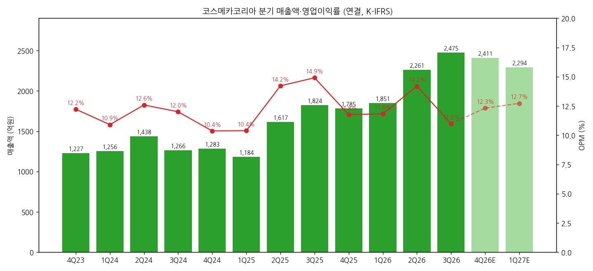
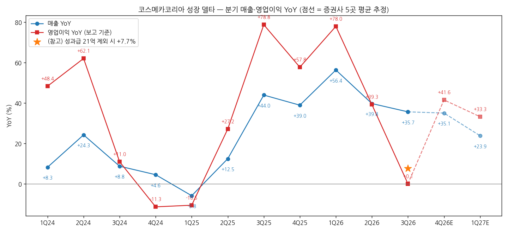
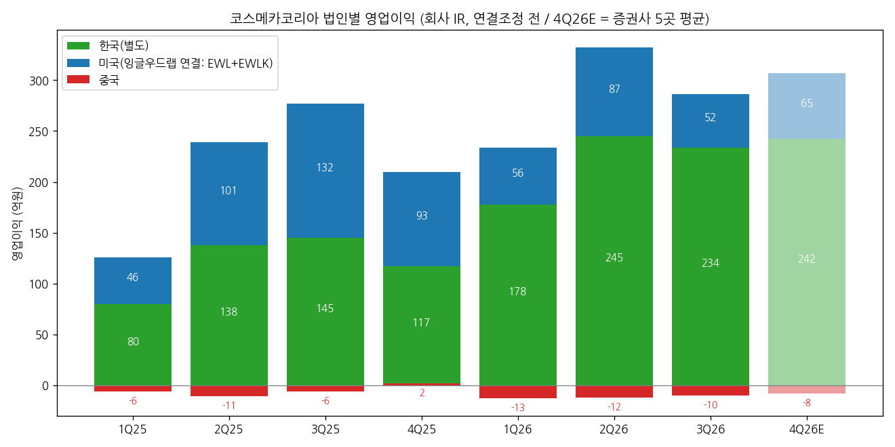

> 모드: 실적 리뷰 (v11)
> 종목: 코스메카코리아 (241710)
> 섹터: 뷰티
> 서브섹터: ODM
> 분기: 2026-Q3
> 발표일: 2026-11-06 (연결 잠정실적 공시 + IR「2026년 3분기 경영실적」) / 분기보고서 2026-11-13 (확정치, OpenDART rcept_no 20261113001568)
> 작성 시각: 2026-11-22 20:50 KST
> 분석 소스: 회사 IR「2026년 3분기 경영실적」(파일명 20261106, 법인별 분기 시계열) + 셀사이드 5건 첨부 — NH투자증권(11/09), 다올투자증권(11/09, 이미지 PDF — 페이지 판독), 메리츠증권(11/09), 하나증권(11/09), 상상인증권(11/11). 과거 분기 숫자는 OpenDART 연결 분기 시계열(dart_quarterly_summary, 2026-11-22 생성)과 코스메카코리아 기업개요(2026-11-15, 법인별 39분기 시계열)로 교차검증. 컨퍼런스콜 트랜스크립트 미확보 — 회사 설명은 IR 자료 + 증권사 리포트의 회사 코멘트 인용. 웹서치 보완 없음
> 리뷰 깊이: 풀 | 리서치 첨부 5건
> 비영업 요인: 일회성(상반기 초과실적 성과급·인센티브 약 21~30억원, 영업이익 반영) · 고기저(3Q25 잉글우드랩코리아 특정 고객 대량 물량) · 영업외 외화환산손실(약 103억원, 순이익만 -35%, 영업이익 무관) — 판정은 보고 기준 그대로

# 코스메카코리아 3Q26 실적 리뷰 — 한국이 더 번 89억원을 미국이 80억원 까먹었다, 영업이익 YoY +39% → +0.1%

> 성장 델타: 꺾임 | 내러티브: 유지 → 델타 꺾임 + 내러티브 유지 → 관망 구간 (4Q26 영업이익 300억원 안팎 재가속 + 별도 원가율 회복 확인 전까지)
>
> ⚠ 비영업 요인 플래그: 3Q26 보고 영업이익 272억원에는 상반기 초과실적 성과급·인센티브가 일시 반영됐다(다올: 일회성 성과급 21억원 제외 시 293억원 / NH: 인센티브 충당금 9억 + 성과급 21억 = 30억원 / 메리츠: 연결 OPM -0.8%p / 상상인: 상여금 30억원). 21억원을 더한 조정 영업이익 293억원의 YoY는 +7.7%다 ([계산], 참고). 조정치로 봐도 2Q26(+39.3%)보다 31.6%p 낮아 판정은 같다. 미국법인 영업이익 -61% YoY는 3Q25 잉글우드랩코리아 특정 고객 대량 물량에 따른 고기저 영향이 주요(NH·하나). 순이익 104억원(-53.5% YoY, 지배 109억원 -35%)은 원/달러 환율 하락에 따른 별도·잉글우드랩코리아 외화환산평가손실 약 103억원(NH·다올)이 끌어내린 것으로 영업이익 판정과는 무관하다

→ **숫자**: 매출 2,475억원(+35.7% YoY, +9.5% QoQ, 분기 최대), 영업이익 272억원(+0.1% YoY, -15.1% QoQ), OPM 11.0%(-3.9%p YoY). 영업이익 YoY는 1Q26 +78.0% → 2Q26 +39.3% → 3Q26 +0.1%로 2개 분기 연속 둔화했다. FnGuide 컨센(매출 2,212억원·영업이익 312억원) 대비 매출 +11.9%, 영업이익 -12.8%로 "매출 서프라이즈 + 이익 미스"
→ **쟁점 ① (5/5)**: 한국(별도) 매출 2,011억원(+54.9%)으로 첫 2천억원 돌파, 영업이익 234억원(+61.3%). 그러나 OPM은 13.7% → 11.6%로 내려왔다. 수주가 생산능력을 넘어 충진·포장 외주와 특근을 늘렸고(별도 매출원가율 80.3%, +1.7%p QoQ), 성과급이 겹쳤다. 수요 문제가 아니라 공급(캐파) 병목이라는 데 5곳 모두 동의
→ **쟁점 ② (5/5)**: 연결 영업이익 증감을 법인별로 쪼개면 한국 +89억원, 미국 -80억원(EWLK -60억·EWL -17억), 중국 -4억원이다. 잉글우드랩 회복은 1Q27 대형 고객 발주 재개(하나·다올)가 전제다
→ **쟁점 ③ (5/5)**: 2027년 이익 추정이 갈렸다. 다올은 외주비를 반영해 2027E 영업이익을 -14% 내려 1,301억원, 하나는 +8% 올려 1,636억원. TP는 하나 상향(14.7 → 15.5만원)·다올 하향(15 → 14만원)·3곳 유지로 평균 -0.3%. 주가는 고점(8/28 153,900원) 대비 -41%(11/13 90,900원)
→ **다음 분기 관건**: 4Q26 영업이익 컨센(5곳 평균 297억원, YoY +41.6%)이 나오면 보고 기준 "가속"으로 돌아간다. 다만 1Q27E는 +33%(3곳)로 다시 낮아져 컨센 경로상 YoY 정점(1Q26 +78%)은 이미 지났다. 4Q 별도 매출원가율이 2Q 수준(78.6%)으로 돌아오는지가 "병목 비용이 일시적"이라는 논리의 첫 검증이다

---

## 1. 숫자

① 연결 기준 분기 표 (단위: 억원, %)

| 항목 | 4Q23 | 1Q24 | 2Q24 | 3Q24 | 4Q24 | 1Q25 | 2Q25 | 3Q25 | 4Q25 | 1Q26 | 2Q26 | **3Q26** | 4Q26E | 1Q27E |
|---|---|---|---|---|---|---|---|---|---|---|---|---|---|---|
| 매출액 | 1,227 | 1,256 | 1,438 | 1,266 | 1,283 | 1,184 | 1,617 | 1,824 | 1,785 | 1,851 | 2,261 | **2,475** | 2,411 | 2,294 |
| 영업이익 (보고 기준) | 150 | 137 | 181 | 152 | 133 | 123 | 230 | 272 | 210 | 219 | 321 | **272** | 297 | 292 |
| OPM | 12.2 | 10.9 | 12.6 | 12.0 | 10.4 | 10.4 | 14.2 | 14.9 | 11.8 | 11.8 | 14.2 | **11.0** | 12.3 | 12.7 |
| 매출 YoY | +15.3 | +8.3 | +24.3 | +8.8 | +4.6 | -5.8 | +12.5 | +44.0 | +39.0 | +56.4 | +39.8 | **+35.7** | +35.1 | +23.9 |
| 영업이익 YoY | +300.1 | +48.4 | +62.1 | +11.0 | -11.3 | -10.5 | +27.2 | +78.8 | +57.8 | +78.0 | +39.3 | **+0.1** | +41.6 | +33.3 |
| **매출 YoY 델타 (%p)** | +2.9 | -7.0 | +16.0 | -15.5 | -4.2 | -10.4 | +18.3 | +31.5 | -5.0 | +17.4 | -16.6 | **-4.1** | -0.6 | -11.2 |
| **영업이익 YoY 델타 (%p)** | -66.6 | -251.7 | +13.7 | -51.1 | -22.3 | +0.8 | +37.7 | +51.6 | -21.0 | +20.2 | -38.7 | **-39.2** | +41.5 | -8.3 |
| (참고) 3Q26 성과급 21억원 제외 영업이익 | | | | | | | | | | | | 293 (YoY +7.7) | | |
| (참고) 지배주주순이익 | | | | | | 76 | 93 | 167 | 118 | 173 | 181 | 109 (YoY -34.7) | 194 | |

→ (출처: 4Q23~3Q26 = OpenDART 연결 분기 시계열(1~3Q = 3개월 금액, 4Q = 연간 − 3Q 누적), 3Q26은 2026-11-13 분기보고서 확정치로 11/06 잠정치와 동일. 4Q26E = NH·다올·메리츠·상상인·하나 5곳 평균(매출 2,411억원·영업이익 297억원), 1Q27E = NH·메리츠·다올 3곳 평균(1Q27을 분기로 제시한 곳만). 지배순이익은 증권사 표(메리츠·하나) 인용)
→ **YoY 계산 기준**: K-IFRS 연결 **보고 기준 영업이익**, 당분기 3개월(3Q26, 2026-11-13 분기보고서 확정치) 대 전년 동분기 3개월(3Q25 보고치) 단순 비교. 회계기준 변경·재작성·연결범위 단절 없음(소주법인 7/3 청산은 매출 미미 — 중국법인 숫자에 흡수). 3Q26 영업이익은 272억원으로 3Q25(272억원)와 억원 단위 반올림값이 같아, YoY +0.1%는 OpenDART 원 단위 금액 기준이다(NH·메리츠·상상인 동일). 4Q는 연간 − 3Q 누적이라 4Q25 YoY는 연간 공시 기준
→ 3Q26 서프라이즈: 매출 컨센 대비 +11.9%, 영업이익 -12.8% (FnGuide 컨센 매출 2,212억원·영업이익 312억원 — NH·메리츠·다올·상상인 인용, 집계 증권사 수 미기재. 하나는 시장 기대 영업이익 300억원 표기). 5곳 자체 추정 대비 영업이익 -10~-14%
→ 영업이익 YoY의 정점은 3Q25(+78.8%)·1Q26(+78.0%)였다. 이후 +39.3% → +0.1%로 2개 분기 연속 크게 줄었다. 매출 YoY도 1Q26 +56.4%에서 +39.8% → +35.7%로 완만하게 내려오는 중이다 — **매출은 버티고 이익만 꺾였다**
→ 컨센 경로는 4Q26 영업이익 YoY +41.6%로 반등(4Q25 저기저 210억원, OPM 11.8%)한 뒤 1Q27 +33%, 2Q27 +2~18%(다올 326억·NH 379억·메리츠 379억 vs 2Q26 321억)로 다시 낮아진다. **컨센 경로상 YoY 정점(1Q26 +78%)은 이미 지났고**, 4Q26 반등은 기저 효과 성격이 크다 [판단]
→ **[판단] 델타 = 꺾임**: 영업이익 YoY는 +0.1%로 마이너스 전환은 아니지만 사실상 0이다. 2개 분기 연속 둔화(-38.7%p, -39.2%p) + 컨센 경로상 정점 통과로 기준상 "꺾임"이다. 성과급 21억원 조정치(+7.7%)로 봐도 같은 판정이다. 4Q26에 컨센대로 +40%대가 나오면 보고 기준 판정은 "가속"으로 바뀐다

→ (출처: OpenDART 연결, 4Q26E·1Q27E = 증권사 평균(5곳·3곳). 연한 막대·점선 = 추정)

→ (출처: 동일. 4Q23(영업이익 YoY +300%, 4Q22 저기저)은 축 스케일 때문에 차트에서 제외. 별표 = 성과급 21억원 가산 조정 영업이익 YoY, [계산]·참고)

② 법인별 매출·영업이익 (단위: 억원, %)

공시상 영업부문은 '화장품' 단일. 법인별 손익은 회사 IR 분기 시계열(십억원 1자리 → 억원 환산, ±5억원 오차 가능)이다. IR의 '미국법인' = 잉글우드랩 연결(EWL 뉴저지 + EWLK 인천 공장). 즉 미국법인 매출에는 한국 인천 공장(EWLK)의 미국향 OTC 매출이 포함된다

(1) 법인별 7개 분기 + 4Q26E

| 법인 | 항목 | 1Q25 | 2Q25 | 3Q25 | 4Q25 | 1Q26 | 2Q26 | **3Q26** | 4Q26E |
|---|---|---|---|---|---|---|---|---|---|
| **한국(별도)** | 매출 | 743 | 1,100 | 1,298 | 1,273 | 1,422 | 1,788 | **2,011** | 1,977 |
| | 매출 YoY | +8.1 | +16.2 | +57.4 | +53.8 | +91.3 | +62.6 | **+54.9** | +55.3 |
| | 영업이익 | 80 | 138 | 145 | 117 | 178 | 245 | **234** | 242 |
| | 영업이익 YoY | +8.4 | -3.5 | +20.8 | +9.1 | +120.8 | +76.9 | **+61.3** | +107 |
| | OPM | 10.8 | 12.5 | 11.2 | 9.2 | 12.5 | 13.7 | **11.6** | 12.2 |
| **미국(잉글우드랩 연결)** | 매출 | 425 | 575 | 618 | 545 | 497 | 519 | **457** | 489 |
| | 매출 YoY | -19.1 | +25.0 | +50.3 | +29.2 | +16.9 | -9.7 | **-26.1** | -10.3 |
| | 영업이익 | 46 | 101 | 132 | 93 | 56 | 87 | **52** | 65 |
| | 영업이익 YoY | -31.0 | +133.5 | +224.9 | +150.8 | +22.5 | -13.2 | **-61.0** | -30 |
| | OPM | 10.8 | 17.5 | 21.4 | 17.0 | 11.3 | 16.8 | **11.3** | 13.3 |
| └ EWL(뉴저지) | 매출 / 영업이익 | 273 / 3 | 316 / 21 | 304 / 30 | 302 / 12 | 307 / 18 | 317 / 37 | **274 / 13** | |
| └ EWLK(인천) | 매출 / 영업이익 | 163 / 43 | 267 / 82 | 317 / 97 | 246 / 83 | 196 / 40 | 210 / 52 | **186 / 37** | |
| └ EWLK | 매출 YoY / OPM | -13.4 / 26.3 | +49.4 / 30.9 | +100.9 / 30.7 | +35.2 / 33.8 | +19.8 / 20.6 | -21.2 / 24.9 | **-41.2 / 19.8** | |
| **중국** | 매출 | 87 | 86 | 81 | 85 | 64 | 77 | **96** | 81 |
| | 매출 YoY | -28.0 | -20.0 | -12.8 | +3.9 | -27.1 | -9.7 | **+17.9** | -4.7 |
| | 영업이익 | -6 | -11 | -6 | 2 | -13 | -12 | **-10** | -8 |
| | OPM | -6.8 | -13.2 | -7.3 | 2.7 | -21.1 | -14.9 | **-10.1** | -10 |
| 연결조정 | 매출 / 영업이익 | | | | | | | **-89 / -4** | |
| **3Q26 매출 비중** | 한국 81.3 / 미국 18.5 / 중국 3.9 (연결조정 전, 연결 매출 대비) | | | | | | | | |

→ (출처: 회사 IR 3Q26 법인별 시계열(코스메카코리아 기업개요 ③-(2) 교차), EWL/EWLK 분해 = 상상인 표(회사 IR·잉글우드랩 공시 기준), 4Q26E = 5곳 평균(한국·미국·중국 각각), [계산]. 연결조정은 연결 − 법인 합계 [계산])
→ (참고) 한국법인 3Q26 카테고리: 기초 +92% YoY, 선케어 +27%, 색조 +13% (다올). 연결 기초 비중 76.5%(+6.8%p YoY, 하나). 고객 소재지 비중 한국 고객 70.5%(IR) — 국내 인디브랜드 경유 간접 수출

(2) 3Q26 연결 영업이익 YoY 브리지 (3Q25 272억원 → 3Q26 272억원, 단위: 억원)

| 구성 | 3Q25 | 3Q26 | 증감 |
|---|---|---|---|
| 한국(별도) | 145 | 234 | **+89** |
| 미국 — EWLK(인천) | 97 | 37 | **-60** |
| 미국 — EWL(뉴저지) | 30 | 13 | -17 |
| (미국 합계, IR) | 132 | 52 | -80 |
| 중국 | -6 | -10 | -4 |
| 연결조정·반올림 | 1 | -4 | -5 |
| **연결** | **272** | **272** | **0** |

→ (출처: 회사 IR, 상상인 EWL/EWLK 표, [계산]. EWL+EWLK 합(127/50)과 IR 미국 합계(132/52)의 차이는 잉글우드랩 연결조정)
→ **델타를 끄는 곳 = 한국, 꺾는 곳 = 미국(그중 EWLK)**. 한국은 매출 +713억원, 영업이익 +89억원으로 5개 분기 연속 매출 +50%대 성장을 이었다. 다만 OPM은 2Q26 13.7%에서 11.6%로 2.1%p 내려와, 매출 증가분 대비 이익 증가율(한계 OPM 약 12.5%)이 평균 수준에 그쳤다 [계산]
→ 미국은 3Q25가 정점(OPM 21.4%)이었다. EWLK 매출 -41%는 전년 특정 고객사 대량 물량의 역기저(NH)·주요 고객사 발주 공백과 환율(상상인) 때문이다. 미국법인 OPM이 21.4% → 11.3%로 내려온 것만으로 연결 OPM 하락(-3.9%p) 중 약 1.9%p(3Q26 미국 매출에 3Q25 OPM 적용 시 영업이익 98억원 vs 실제 52억원)를 설명한다 [계산]. 그 중심은 30%대 OPM이던 EWLK다
→ 중국은 매출 +18%로 돌아섰지만 손익분기 규모(분기 100억원+)에 못 미쳐 적자 10억원. 연결 영향은 작다
→ 4Q26E 기준으로는 한국 +125억원(117 → 242), 미국 -28억원(93 → 65)이라, 미국의 감소 폭이 줄면서 연결 YoY가 반등하는 구조다 [계산]

→ (출처: 회사 IR 법인별 시계열, 4Q26E = 증권사 5곳 평균. 연결조정 전 법인 영업이익)

③ 연간 (단위: 억원, %)

| 항목 | 2022 | 2023 | 2024 | 2025 | 2026E | 2027E |
|---|---|---|---|---|---|---|
| 매출액 | 3,994 | 4,707 | 5,243 | 6,409 | 8,999 | 10,846 |
| 영업이익 | 104 | 492 | 604 | 835 | 1,109 | 1,432 |
| OPM | 2.6 | 10.4 | 11.5 | 13.0 | 12.3 | 13.2 |
| 매출 YoY | +0.7 | +17.9 | +11.4 | +22.2 | +40.4 | +20.5 |
| 영업이익 YoY | -48.3 | +373 | +22.8 | +38.2 | +32.8 | +29.1 |

→ (출처: 2022~2025 = OpenDART 연결 사업보고서, 2026E·2027E = 5곳 평균(2026E 영업이익 범위 1,099~1,114억원, 2027E 1,301~1,636억원))
→ 연간 컨센 변화: 발표 전 FnGuide 컨센(하나 리포트 인용) 2026E 영업이익 1,142억원 → 발표 후 5곳 평균 1,109억원(**-2.9%**), 2027E 1,416억원 → 1,432억원(**+1.1%**). 매출 추정은 2026E +5.8%(8,507 → 8,999억원), 2027E +8.5%(9,994 → 10,846억원)로 크게 올랐다 — "매출 상향, 마진 하향"의 전형. 집계 5곳(첨부 기준)으로 소수 의견 좌우 가능(특히 2027E는 하나 1,636억원이 평균을 끌어올림)
→ 2026년 3Q 누적 영업이익 812억원(+29.9% YoY)으로, 연간 컨센 1,109억원을 맞추려면 4Q 297억원(+41%)이 필요하다 [계산]

---

## 2. 시장 쟁점

① 지난 분기 체크
→ 첫 리뷰 — 직전 체크 없음 (2026-Q2 코스메카코리아 리뷰·팔로업 미작성)

② 이번 분기 쟁점 4개

| # | 쟁점 | 언급 증권사 수 |
|---|---|---|
| (1) | 한국 OPM 11.6% — 매출 +55%에도 마진이 왜 2Q보다 내려갔나 (외주·특근·성과급), 일시적인가 | 5/5 |
| (2) | 잉글우드랩 영업이익 -61% — 고기저·고객 발주 공백, 1Q27 회복은 믿을 만한가 | 5/5 |
| (3) | 4Q26 회복과 2027년 마진 경로 — 오창공장(2H27 시생산) 전까지 외주 의존을 얼마나 가정하나 | 5/5 |
| (4) | 순이익 -35%와 밸류에이션 — 환산손실은 비영업, 주가 -41% 조정은 기회인가 | 5/5 (환산손실 원인 명시 2/5) |

③ 쟁점별 분해

(1) 한국 OPM 11.6% — 매출 +55%에도 마진이 왜 2Q보다 내려갔나

(1-1) 회사 설명 (IR + 증권사 리포트의 회사 코멘트 인용)
→ 한국법인 매출 2,011억원(+54.9% YoY, +12.5% QoQ)으로 분기 최대, OPM 11.6% (IR 13쪽)
→ 여름휴가·추석으로 조업일수가 줄었지만 초과근무와 아웃소싱을 늘려 물량을 다 소화했다. "수익성보다 고객사의 납기일과 신규 고객 확보에 초점" — ODM 우위 시기를 점유율 확대 기회로 삼겠다는 경영진 판단 (하나 인용)
→ 생산 인력을 제조 공정에 집중 배치하고 충진·포장 공정은 외주를 활용해 생산 유연성을 확보하는 방식 (상상인 인용). 용기 부족 문제는 상반기로 해소됐고, 4Q는 운영 효율이 높아졌다 (하나 인용)

(1-2) 증권사별 해석 편차

| 증권사 | 핵심 가정·추정 | 논리 |
|---|---|---|
| NH | 연결 GPM 20.5%(-4.8%p YoY), 인센티브 충당금 9억 + 성과급 21억. 4Q 한국 OPM 13% (251억원) | 외형 확대에 수반되는 비용. 4Q는 3Q 경험으로 생산 효율화 → QoQ 수익성 개선 |
| 다올 | 1~2주 단위 단납기 대량 주문 + 추석 연휴 + 용기·원료 수급 차질 → 충진·포장 외주. 4Q 한국 OPM 12.0% (236억원) | "수요가 아닌 생산의 병목". 외주비가 2H27 오창 가동 전까지 이어진다고 보고 2027E를 -14% 하향 |
| 메리츠 | 성과급 제외 한국 OPM 12.7% (2Q 13.7%). 4Q 한국 OPM 12.5% (246억원) | 외주 확대가 성과급 외 마진 하락의 주원인. 외주 의존은 2H27 오창 가동 이후 점진적으로 낮아짐 |
| 하나 | 아웃소싱 원가 상승 + 인센티브 약 20억원. 4Q 한국 영업이익 236억원 | 생산 유연화 학습 완료, 초과 인센티브도 3Q보다 작을 것. "매출이 어렵지, 매출이 커지면 마진은 상대적으로 수월" |
| 상상인 | 별도 매출원가율 80.3% (+0.6%p YoY, +1.7%p QoQ), 상여금 30억원. 4Q 별도 OPM 12.3% (241억원) | 점유율 확대 과정의 비용이라 부정적으로만 볼 수 없다. 주가 핵심 변수는 4Q 원가율이 2Q 수준(78.6%)으로 회복하는지 |

(1-3) 공통 결론 vs 갈리는 지점
→ 공통: 5곳 모두 "수요 문제가 아니라 캐파 병목 비용"으로 본다. 한국 매출 성장률은 5곳 모두 자체 추정을 크게 넘었다(상상인: 기존 추정 +35% vs 실제 +55%). 4Q 한국 영업이익 추정은 236~251억원으로 좁게 모여 있다(3Q 234억원 대비 소폭 개선)
→ 갈림: 병목 비용이 **언제까지** 가나. 하나·NH는 "4Q부터 학습 효과로 개선"(일시적), 다올은 "오창 가동(2H27) 전까지 구조적"으로 본다. 이 차이가 2027E 영업이익 1,301억원(다올) vs 1,636억원(하나)의 차이(335억원, 평균 대비 23%)를 만든다

(1-4) **[판단]**
→ 한국 OPM 하락 2.1%p(13.7% → 11.6%) 중 성과급(21~30억원)은 한국 매출 대비 1.0~1.5%p다. 나머지 0.6~1.1%p가 외주·특근에 따른 원가율 상승분이다([계산]: 상상인 기준 원가율 +1.7%p QoQ, 판관비율 하락이 일부 상쇄). 즉 마진 하락의 절반 이상은 일회성 성과급이다
→ 다만 "외주로 물량을 소화한다"는 구조는 수주가 계속 캐파를 넘는 한 이어진다. 4Q 한국 매출 추정(1,962~2,007억원)이 3Q와 같은 수준이라는 점은, 회사가 4Q에 외주를 줄이고 마진을 회복할 여지가 있다는 뜻이기도 하고 성장률이 캐파에 막혔다는 뜻이기도 하다 [판단]
→ 결론이 바뀌는 조건: 4Q 별도 매출원가율이 79% 이하로 내려오면 하나·NH 논리(일시적) 확인. 80% 이상이 유지되면 다올 논리(오창 전까지 구조적)가 맞고 2027E 컨센 하향 압력

(2) 잉글우드랩 영업이익 -61% — 1Q27 회복은 믿을 만한가

(2-1) 회사 설명
→ 미국법인 매출 457억원(-26.1% YoY), 영업이익 52억원, OPM 11.3% (IR 14쪽). 핵심 고객사의 발주 감소 (메리츠 인용). 주요 고객 회복은 1Q27로 지연 (다올), 2027년 1분기부터 대형 고객사 발주 재개 (하나 인용)

(2-2) 증권사별 해석 편차

| 증권사 | 핵심 가정·추정 | 논리 |
|---|---|---|
| NH | EWL -10%, EWLK -41%. 4Q 미국 영업이익 63억원, 2027F 미국 매출 +9%, 영업이익 303억원 | 전년 동기 특정 고객사 높은 기여에 따른 역기저가 주요 |
| 다올 | 4Q 미국 영업이익 71억원, 2027E 미국 매출 1,827억원(-6% YoY), 영업이익 254억원 | 고객 회복 지연. 2027년에도 미국 매출 역성장 가정 — 가장 보수적 |
| 메리츠 | 4Q 55억원, 1Q27E 매출 583억원(+17%), 2027E 영업이익 353억원(+41%), EWLK 2027E +31% | 1Q27부터 발주 회복 → 2027년 미국 영업이익 반등. OPM 11%대는 "양호한 수익성 유지" |
| 하나 | 4Q 66억원, 2027F 미국 매출 +10%, 영업이익 292억원 | 1Q27 대형 고객사 발주 재개로 YoY 플러스 회복 |
| 상상인 | EWLK OPM 19.8%(-10.9%p YoY), 4Q 69억원, 2027E 미국 영업이익 315억원 | 발주 공백 + 환율 영향 |

(2-3) 공통 결론 vs 갈리는 지점
→ 공통: 3Q26 감소는 고기저(3Q25 EWLK 매출 +101%, OPM 30.7%)와 특정 대형 고객 발주 공백이라는 데 5곳 동의. 4Q26 미국 영업이익 추정은 55~71억원으로 YoY 감소 폭이 축소된다
→ 갈림: 2027년 미국 영업이익 254억원(다올, 역성장) ~ 353억원(메리츠, +41%). 1Q27 발주 재개를 믿느냐의 차이

(2-4) **[판단]**
→ EWLK는 2025년 OPM 30.8%의 고마진 공장이라, 매출 회복 여부가 연결 마진을 좌우한다. 대형 고객 1곳의 발주에 연동되는 구조라 "1Q27 재개"는 회사 코멘트 외 확인 수단이 없다(고객명 미공개). 잉글우드랩(950140)이 별도 상장사라 같은 날 잠정실적이 나오는 점이 유일한 조기 확인 채널이다 [판단]
→ 결론이 바뀌는 조건: 4Q26 EWLK 매출이 200억원(4Q25 246억원 대비 -19%) 이상이면 고객 회복 경로 유효. 1Q27에 EWLK YoY 플러스(1Q26 196억원 초과)가 안 나오면 메리츠·하나의 2027E 미국 이익 추정은 하향

(3) 4Q26 회복과 2027년 마진 경로 — 오창공장 전까지

(3-1) 회사 설명
→ 오창공장(2026.06 640억원 인수) 1,360억원 규모 시설 투자 계획, 2027년 하반기 시생산, 2030년까지 CAPA 7억개로 배증 (NH 인용). 2027년 하반기 시험가동, 2028년 풀가동 목표 (하나 인용)
→ 오창 완공 시 외주 의존도 축소, 무인화 라인·자동계량·검사로봇 등 자동화, 야간 생산 확대 (하나 인용). 생산 자동화·AI 기반 생산 운영 효율화 투자 (메리츠 인용)

(3-2) 증권사별 해석 편차 (4Q26E와 2027E)

| 증권사 | 4Q26E 매출 / 영업이익 (OPM) | 2027E 영업이익 (OPM) | 2027E 수정률 | 논리 |
|---|---|---|---|---|
| NH | 2,444 / 298 (12.2%) | 1,380 (13.1%) | +0.7% | 2027년 사상 최대 실적 가능성 높음 |
| 다올 | 2,384 / 298 (12.5%) | 1,301 (12.4%) | **-14%** | 외주비 부담 반영, 마진 회복은 오창 가동 이후 |
| 메리츠 | 2,375 / 288 (12.1%) | 1,404 (13.3%) | 미미 | 상위 2사 대비 외형 확대 여력, 대규모 증설로 높은 성장률 |
| 상상인 | 2,416 / 301 (12.4%) | 1,439 (13.2%) | +1.1% | 원가율 개선 동반 시 영업 레버리지 → 추정치 상향·리레이팅 |
| 하나 | 2,438 / 302 (12.4%) | 1,636 (13.9%) | **+7.8%** | 2027F 매출 +30%(1조 1,765억원) — 한국 +37% 가정 |

(3-3) 공통 결론 vs 갈리는 지점
→ 공통: 4Q26 영업이익 288~302억원(YoY +37~44%)으로 추정치가 좁게 모였다. 5곳 모두 4Q OPM 12%대 회복을 가정
→ 갈림: 2027년 한국 매출 성장률(하나 +37% vs 메리츠 +19%, NH +18%)과 마진. 하나는 매출 1조 1,765억원으로 나머지 4곳(1조 473~1조 917억원)보다 850억원 이상 높다

(3-4) **[판단]**
→ 오창이 2H27 시생산이면 2027년 상반기까지는 지금 캐파(음성·청주)로 버텨야 한다. 4Q 한국 매출을 5곳 모두 3Q 수준으로 둔 것은 현재 캐파의 실질 상한이 분기 2,000억원 안팎이라는 시장의 암묵적 가정으로 읽힌다 [판단]. 그러면 2027년 상반기 한국 매출 YoY는 기저(1H26 3,210억원)를 감안해 +20~25%대로 자연히 낮아진다(메리츠 1Q27E +28%, 2Q27E +24%)
→ 결론이 바뀌는 조건: 4Q26 한국 매출이 2,100억원 이상으로 3Q를 넘으면 "캐파 상한" 가정이 틀리고 하나의 고성장 경로가 맞다. 반대로 1,900억원 아래면 수주 둔화 신호로 읽어야 한다

(4) 순이익 -35%와 밸류에이션

(4-1) 회사 설명
→ 세전이익 128억원(-56.7% YoY), 지배순이익 109억원(-34.7%). 별도 및 잉글우드랩코리아의 환율 하락에 따른 환산평가손실 103억원 발생 (NH 인용), 분기 말 원/달러 환율 하락에 따른 외화환산손실 (다올). 회사 IR 자체의 영업외 항목 설명은 첨부 IR 텍스트에서 확인되지 않음
→ 기업개요의 "3Q 순이익 급감 원인 미확정"(소주법인 청산 재분류 가능성) 메모는, 증권사 2곳 기준으로 **외화환산손실이 주원인**으로 정리된다. 소주법인 청산 관련 손익이 일부 섞였는지는 분기보고서 금융손익 주석 미확인 — **미확정 잔존**

(4-2) 증권사별 해석 편차

| 증권사 | 적용 멀티플 | 현재 밸류 인식 | 논리 |
|---|---|---|---|
| NH | 12MF PER 17배 (글로벌 화장품 OEM/ODM 평균) | 2027F PER 12배, 가격 부담 완화 | 업황·수요상 2027 사상 최대 |
| 다올 | PER 17.7배 (글로벌 화장품 평균 PER 40% 할인으로 근거 변경) | — | EPS 하향 + 할인 근거 변경 |
| 메리츠 | 12MF P/E 20배 | 12MF P/E 13배, 업종 심리 위축 | 조정은 저가 매수 기회 |
| 상상인 | PER 17배 (인터코스 12MF PER) | 52주 고점 대비 큰 조정 | 효율성 개선 확인 시 리레이팅 |
| 하나 | PER 15배 | 12MF PER 9.8배, 현저한 저평가 | 2027F EPS +75% 가정 |

(4-3) 공통 결론 vs 갈리는 지점
→ 공통: 환산손실은 비영업·비현금이라 TP 논리에 영향 없음. 5곳 모두 Buy 유지
→ 갈림: 2027E EPS 8,001원(다올) ~ 10,708원(하나)으로 34% 차이. 같은 Buy라도 하나는 "저평가", 다올은 "이익 하향 + 할인율 상향"

(4-4) **[판단]**
→ 환산손실은 원화 강세 국면에서 분기마다 반복될 수 있다(외화 매출채권·외화예금 규모가 매출과 함께 커짐 — 3Q26말 매출채권 2,071억원). 영업이익 판정과는 무관하지만 EPS 경로의 변동성 요인이다 [판단]

④ 낙관 vs 보수 — 논리 대비
→ **가장 낙관 — 하나(TP 15.5만원, 상향)**: "ODM 우위 시기에 점유율을 확실히 가져가는 결단"으로 본다. 2021~2026 매출 CAGR 32%로 코스맥스(21%)·한국콜마(25%)를 앞서고, 매출이 커지면 마진은 따라온다는 논리. 2027F 매출 +30%·OPM 13.9%를 가정해 영업이익 1,636억원
→ **가장 보수 — 다올(TP 15 → 14만원)**: 같은 사실(외주·특근)을 "오창 가동 전까지 구조적 비용"으로 해석. 2027E 영업이익을 14% 내리고(1,301억원, OPM 12.4%), 멀티플 근거도 할인 적용으로 바꿨다. 제목 "줄은 긴데 주방이 좁다" 그대로 — 수요는 충분, 공급이 제약
→ 셀사이드 vs 주가: 5곳 모두 Buy에 평균 TP 14.7만원(11/13 종가 90,900원 대비 +62%)이지만 주가는 11/6 101,400원 → 11/13 90,900원(-10%)으로 실적 후 추가 하락했다. 시장은 "매출 서프라이즈"보다 "이익 미스 + 성장률 정점"에 반응하고 있다 [판단]. 9월 오너 2세 관련 기소 보도(기업개요 ⑥)도 주가 할인 요인으로 남아 있다

⑤ 추정치·TP 변화 (단위: 원, 억원)

| 증권사 | 직전 TP | 현재 TP | 4Q26E 영업이익 | 2026E / 2027E 영업이익 | 핵심 변화 한 줄 |
|---|---|---|---|---|---|
| NH (11/09) | 140,000 | 140,000 (유지) | 298 | 1,110 / 1,380 | 매출 +5% 상향, 영업이익 거의 그대로. 4Q 효율화로 QoQ 마진 개선 |
| 다올 (11/09) | 150,000 | **140,000 (하향)** | 298 (기존 311) | 1,109 / 1,301 | 외주비 반영 2027E 영업이익 -14%, 할인 근거 변경 |
| 메리츠 (11/09) | 160,000 | 160,000 (유지) | 288 | 1,099 / 1,404 | 추정 변동 미미, 12MF P/E 20배 |
| 상상인 (11/11) | 140,000 | 140,000 (유지) | 301 | 1,112 / 1,439 | 2026E 영업이익 -1.8%, 2027E +1.1%. 4Q 원가율 회복이 관건 |
| 하나 (11/09) | 147,000 | **155,000 (상향)** | 302 (기존 296) | 1,114 / 1,636 | 2027F 영업이익 +7.8%(1,517 → 1,636억원), PER 15배 |

→ 평균 TP 147,400원 → 147,000원 (-0.3%). 상향 1, 하향 1, 유지 3
→ 연간 컨센: 2026E 영업이익 1,142억원(발표 전 FnGuide) → 1,109억원(5곳 평균, -2.9%), 2027E 1,416억원 → 1,432억원(+1.1%)
→ **TP 하향 원인 구분**: 유일한 하향(다올)은 **실적 하향(2027E -14%)이 주원인**, 할인 근거 변경(멀티플)이 보조. 하나 상향은 실적(매출) 상향. 상상인 직전 TP는 "유지" 표기로 140,000원으로 간주(직전 리포트 원문 미첨부 — 불확실)

---

## 3. 내러티브 점검

① 성장 스토리 정의
→ "K-뷰티 인디브랜드(아누아 등)의 미국·유럽·일본 수출 붐이 국내 ODM 주문으로 돌아오고, 3위 ODM인 코스메카가 상위 2사보다 빠르게 점유율을 가져가는 고성장주". 시장은 이 종목을 '한국법인 매출 +50% 성장 + 오창 증설로 2027~2028년에도 고성장'으로 산다 (메리츠·하나)

② 이번 분기가 스토리에 준 영향
→ **강화된 부분**: 한국 매출 +55%로 5개 분기 연속 +50% 이상, 첫 분기 2천억원. 대형 거래처는 물론 중소 인디까지 수주 증가(하나). 매출 추정은 2026E +5.8%, 2027E +8.5% 올라갔다 — "수요"라는 핵심 전제는 오히려 강해졌다
→ **약화된 부분**: 매출 레버리지가 이익으로 오지 않았다. 외주·특근으로 원가율이 올라 "매출이 크면 마진은 따라온다"는 고리가 이번 분기엔 끊겼다. 잉글우드랩 고마진 공장(EWLK)도 고객 1곳의 발주에 흔들리는 구조가 드러났다
→ **판정 = 유지**: 수요 스토리는 강화, 마진 스토리는 약화로 상쇄. 연간 영업이익 컨센은 2026E -2.9%·2027E +1.1%로 거의 안 움직였고, TP도 평균 -0.3%. 약화(추정치·멀티플 동반 하향)라 부를 만큼 숫자가 움직이지 않았다(다올 1곳만 하향)

③ 국면
→ 델타 꺾임(영업이익 YoY +78% → +39% → +0.1%) + 내러티브 유지 → **관망 구간**. 매출은 +36%로 고성장이지만 BT 프레임의 판정 축인 영업이익 YoY가 2개 분기 연속 급감했다 [판단]
→ 4Q26은 기저(4Q25 210억원, OPM 11.8%)가 낮아 컨센(297억원)만 나와도 보고 YoY +40%대로 "가속" 판정이 나온다. 그러나 1Q27E +33%, 2Q27E 한 자릿수~+18%로 다시 낮아지는 경로라, 4Q 반등 한 번으로 델타가 살아났다고 보기 어렵다. 실질 재가속 신호는 "4Q 별도 원가율 회복 + 4Q 한국 매출 2,100억원 이상"이 같이 나올 때다 [판단]

④ 트리거와 리스크
→ **트리거 (스토리 재강화)**: (1) 4Q26 별도 매출원가율 78%대 회복 + 한국 OPM 13% 이상 (2) 잉글우드랩 대형 고객 발주 재개 확인(1Q27, EWLK 매출 YoY 플러스) (3) 오창 시생산 앞당김 또는 추가 캐파(외주 내재화) 발표
→ **리스크 (스토리 훼손)**: (1) K-뷰티 수출 둔화 — 관세청 화장품 수출(미국) 증가율 꺾임 → 한국 매출 +30% 이하(기업개요 재평가 트리거) (2) 외주 비용 구조화로 2027E 컨센 하향(다올 경로) (3) 오너 2세 미공개정보 이용 혐의 재판·지배구조 이슈(코스피 이전상장 미승인 이력)

---

## 4. 향후 봐야 할 것

(1) **4Q26 영업이익 297억원(YoY +42%) — 보고 YoY 재가속 여부** — 델타 판정 1순위
→ 무엇을: 5곳 평균 297억원(범위 288~302억원) 이상이면 보고 기준 "가속"(⚠ 4Q25 저기저·성과급 부재 효과 표시). 260억원(YoY +24%) 미만이면 이익 미스 2연속, 210억원 미만이면 마이너스 전환으로 꺾임 확정. 매출 2,411억원(+35%) 유지 여부
→ 어떤 데이터로: 4Q26 잠정실적 공시·IR, 증권사 4Q 프리뷰(1~2월)
→ 언제: 2027년 2월 중순 예상 (캘린더 ~2027-02-19, 추정)

(2) **한국(별도) 원가율·OPM 회복 — 병목 비용이 일시적인가**
→ 무엇을: 별도 매출원가율 80.3% → 78.6%(2Q26) 수준 회복, 한국 OPM 12.5% 이상(4Q 컨센 236~251억원), 한국 매출 2,000억원 유지(2,100억원 초과 시 캐파 상한 가정 깨짐). 4Q 연말 인센티브 충당금 규모
→ 어떤 데이터로: 4Q IR 한국법인 손익, 관세청 월간 화장품 수출(미국·유럽·일본, 매월 1일 잠정·15일 확정), 주요 고객 브랜드(아누아 등) 블프·연말 아마존 성과 뉴스
→ 언제: 12월 1일·1월 1일·2월 1일 수출 통계 / 2월 실적

(3) **잉글우드랩 대형 고객 발주 재개 — EWLK 매출 회복**
→ 무엇을: 4Q26 미국법인 영업이익 65억원(5곳 평균) 이상, EWLK 4Q 매출 200억원 이상, 1Q27 EWLK 매출 YoY 플러스(1Q26 196억원 초과). EWLK OPM 20%대 중반 회복
→ 어떤 데이터로: 잉글우드랩(950140) 잠정실적 공시(모회사와 같은 시기), 잉글우드랩 IR, 미국 OTC 선케어 수입 통계·관세 뉴스
→ 언제: 2027년 2월(4Q) / 2027년 5월(1Q27)

(4) **오창공장 투자·캐파 일정 — 외주 내재화 타이밍**
→ 무엇을: 1,360억원 시설투자 집행 공시, 2H27 시생산 일정 유지/앞당김, 청주·음성 추가 라인. 차입금(3Q26말 2,544억원)·부채비율 130% 추이
→ 어떤 데이터로: 신규시설투자 공시, 분기보고서 유형자산·차입금, 충북도·청주시 투자 뉴스
→ 언제: 수시 / 2027년 3월 사업보고서

(5) **순이익 변동성 — 환율 환산손익과 잔여 리스크**
→ 무엇을: 4Q 영업외 환산손익(분기말 원/달러 환율 방향), 3Q 금융비용 100억원의 소주법인 청산 영향 여부(분기보고서 주석), 오너 2세 재판 진행
→ 어떤 데이터로: 분기말 원/달러 환율, 2026.09 분기보고서 금융손익 주석, 재판 관련 뉴스
→ 언제: 12월 말(분기말 환율) / 수시
