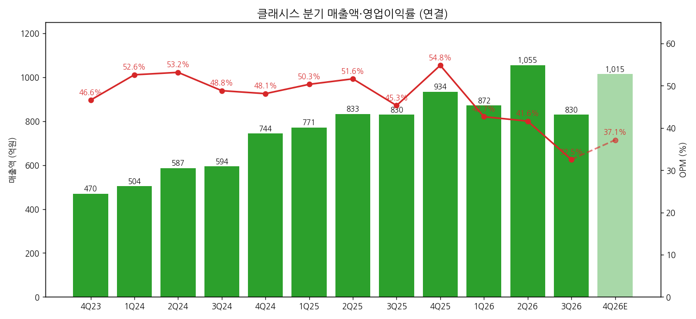
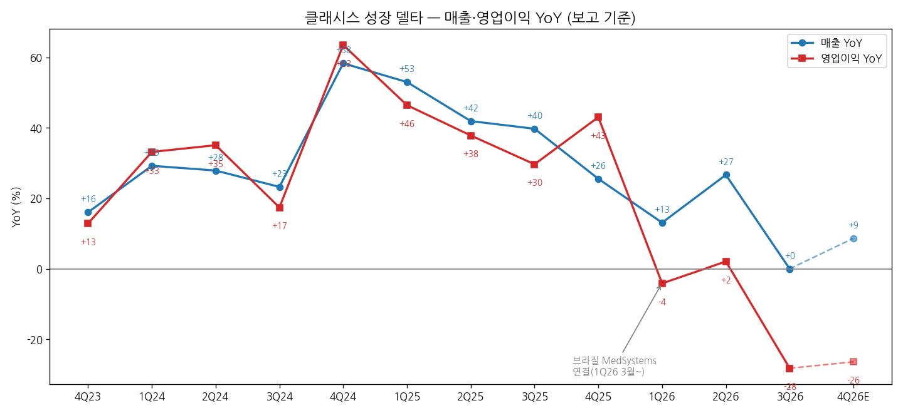
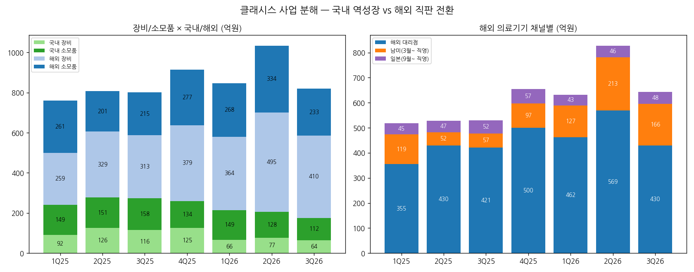

> 모드: 실적 리뷰 (v11)
> 종목: 클래시스 (214150)
> 섹터: 뷰티
> 서브섹터: 미용의료
> 분기: 2026-Q3
> 발표일: 2026-11-12 (연결 잠정실적 공정공시 + IR BOOK) / 확정: 2026-11-16 분기보고서 (rcept 20261116000298 — 잠정치와 동일)
> 작성 시각: 2026-11-22 21:30 KST
> 분석 소스: 회사 IR BOOK「2026년 3분기 경영실적」(2026-11-12) + OpenDART 3Q26 분기보고서·연결 재무제표(2026-11-16) + 셀사이드 8건 첨부 — 씨티(11/13), DB증권(11/13), NH투자증권(11/13), 대신증권(11/13), 삼성증권(11/13), 키움증권(11/13), 유진투자증권(11/16), IBK투자증권(11/17). 과거 분기 숫자는 OpenDART 분기 시계열(클래시스 기업개요 2026-11-15)로 교차검증. 컨퍼런스콜 트랜스크립트 미첨부(셀사이드 컨콜 정리로 대체). 웹서치 보완 없음
> 리뷰 깊이: 풀 | 리서치 첨부 8건
> 비영업 요인: 인수(브라질 MedSystems/JL Health 77.5%, 2026-03-05 연결 — 매출 +109억원 YoY, 판관비·고원가 재고로 이익 감소 요인)·영업외 외환손실(약 -151억원, 순이익만 영향)·고기저(4Q25 브라질 대손충당금 환입) — 판정은 보고 기준 그대로

# 클래시스 3Q26 실적 리뷰 — 국내는 무너지고 직판은 아직 돈을 못 번다, 영업이익 YoY +2% → -28%

> 성장 델타: 꺾임(악화) | 내러티브: 훼손 → 델타 꺾임(악화) + 내러티브 훼손 → 매매 제외 구간 (중국 볼뉴머 허가·국내 신제품으로 2027년 YoY 플러스 복귀가 확인되기 전까지)
>
> ⚠ 비영업 요인 플래그: 판정을 만든 주된 원인은 인수가 아니라 본업이다. 브라질 MedSystems 연결(1Q26~)은 매출을 YoY +109억원(남미 57억원 → 166억원) 더했지만, 이익에는 마이너스였다. 남미를 뺀 매출은 773억원 → 664억원, **YoY -14.1%**다 ([계산], IR 채널별 매출). 회사가 밝힌 영업이익 YoY 감소 요인(-106억원) 중 국내 매출 감소가 50억원이고, 나머지는 남미 운영·마케팅비 +30억원, 일본 직영 선투자 6억원, 미국 홈뷰티 마케팅 15억원이다 (IR 5쪽). 인수 효과를 빼도 판정은 같거나 더 나쁘다. 영업외에서 외환차손·외화환산손실 약 151억원이 생겨 순이익은 -81%였지만, 이는 영업이익 아래 항목이라 델타 판정에는 들어가지 않는다

→ **숫자**: 매출 830억원(+0.0% YoY, -21.3% QoQ), 영업이익 270억원(-28.2% YoY, -38.5% QoQ), OPM 32.5%. 영업이익 YoY는 2Q26 +2.2%에서 -28.2%로 30.4%p 내려갔다. 코로나 시기 4Q20(-30.8%) 이후 가장 큰 마이너스다. FnGuide 컨센(매출 1,074억원·영업이익 454억원) 대비 매출 -22.7%, 영업이익 -40.5%의 어닝쇼크다
→ **쟁점 ①**: 국내 의료기기 매출이 176억원(-35.9% YoY)으로 3개 분기 연속 역성장했다. 국내 장비는 -45%, 소모품은 -29%다. 회사는 "주력 제품 세대교체기"라고 설명하지만, 셀사이드 다수(씨티·NH·IBK)는 경쟁 국산 EBD 장비 증가를 함께 원인으로 본다. New 슈링크는 2Q27, 매출 본격화는 2H27(DB)이라 국내 공백은 2~3개 분기 더 간다
→ **쟁점 ②**: 직판 전환은 아직 비용만 들고 이익은 없다. 남미 매출은 QoQ -22%(213억원 → 166억원)로 꺾였고, 인수 전 고원가 재고 때문에 유통마진만 남는다. 브라질 법인은 3월 인수 후 누적 순손실 175억원(매출 375억원, 내부거래 제거 전, 분기보고서)이다. 연결 판관비 342억원 중 자회사·연결 몫이 약 95억원(1년 전 약 9억원)이다
→ **쟁점 ③**: 8곳 모두 TP를 내렸다(평균 5.74만원 → 3.34만원, -41.8%). DB는 Hold로 내렸다. 2026E·2027E 영업이익 추정은 약 -22% 내려갔고(직전치 공개 4곳 평균), 목표 배수도 함께 낮아졌다. 연간 매출 가이던스(4,300~4,600억원)는 4Q에 1,543억원이 필요해 사실상 미달이 확정적이다(셀사이드 4Q 매출 평균 1,015억원)
→ **다음 분기 관건**: 4Q26 영업이익 컨센 377억원은 YoY -26%다. 3Q(-28.2%)와 거의 같아 "꺾임 지속"이다. 4Q25 기저(512억원, 대손충당금 환입 포함)가 높아 4Q에 YoY 플러스는 사실상 불가능하다. 델타가 바뀔 수 있는 시점은 1Q27(기저 372억원)이다. 12월 중국 볼뉴머 NMPA 허가와 4Q 남미 GPM 회복이 그 전제다

---

## 1. 숫자

① 연결 기준 분기 표 (단위: 억원, %)

| 항목 | 4Q23 | 1Q24 | 2Q24 | 3Q24 | 4Q24 | 1Q25 | 2Q25 | 3Q25 | 4Q25 | 1Q26 | 2Q26 | **3Q26** | 4Q26E |
|---|---|---|---|---|---|---|---|---|---|---|---|---|---|
| 매출액 | 470 | 504 | 587 | 594 | 744 | 771 | 833 | 830 | 934 | 872 | 1,055 | **830** | 1,015 |
| 영업이익 | 219 | 265 | 312 | 290 | 358 | 388 | 430 | 376 | 512 | 372 | 439 | **270** | 377 |
| OPM | 46.6 | 52.6 | 53.1 | 48.7 | 48.1 | 50.3 | 51.6 | 45.3 | 54.8 | 42.7 | 41.6 | **32.5** | 37.1 |
| 매출 YoY | +16.2 | +29.3 | +28.0 | +23.1 | +58.3 | +53.1 | +41.8 | +39.7 | +25.6 | +13.0 | +26.7 | **+0.0** | +8.7 |
| 영업이익 YoY | +12.8 | +33.3 | +34.7 | +17.4 | +63.3 | +46.3 | +37.9 | +29.9 | +43.0 | -4.1 | +2.2 | **-28.2** | -26.4 |
| **매출 YoY 델타 (%p)** | -28.8 | +13.1 | -1.3 | -4.9 | +35.2 | -5.2 | -11.3 | -2.1 | -14.1 | -12.6 | +13.7 | **-26.7** | +8.7 |
| **영업이익 YoY 델타 (%p)** | -28.3 | +20.5 | +1.4 | -17.3 | +45.9 | -17.0 | -8.4 | -8.0 | +13.1 | -47.1 | +6.3 | **-30.4** | +1.8 |
| (참고) 남미 제외 매출 | | | | | | 652 | 781 | 773 | 837 | 745 | 842 | 664 | |
| (참고) 남미 제외 매출 YoY | | | | | | | | | | +14.3 | +7.8 | **-14.1** | |

→ (출처: 4Q23~2Q26 = OpenDART 연결 분기 시계열(dart_quarterly_summary, 4Q = 연간 − 3Q 누적), 3Q26 = 2026-11-16 분기보고서 연결(매출 830.2억원, 영업이익 270.0억원 — 11/12 잠정치와 동일). 4Q26E = 씨티·DB·NH·대신·삼성·키움·유진·IBK 8곳 단순평균(씨티는 2026E − 3Q 누적으로 [계산]). 1Q27E는 분기 추정을 낸 곳이 없어 생략. 남미 제외 매출 = 연결 매출 − IR "남미" 채널 매출 [계산])
→ **YoY 계산 기준**: K-IFRS 연결 **보고 기준** 영업이익(현행 K-IFRS 1001호, IFRS 18 미적용)끼리 비교했다. 3Q26 분기보고서 확정치 / 3Q25 분기보고서 확정치, 재작성 없음. 3Q25 기준에는 MedSystems가 연결되지 않았다. 당시 브라질 매출은 대리점 출고액 57억원으로 들어 있다. 반면 3Q26에는 현지 직판 매출 166억원이 연결돼 있어 매출 YoY는 인수 효과로 부풀려져 있다. 이 효과를 뺀 대용치(남미 제외 매출)는 YoY -14.1%다
→ 3Q26 서프라이즈: 매출 컨센 대비 -22.7%, 영업이익 -40.5% (컨센 매출 1,074억원·영업이익 454억원, FnGuide — IBK·NH 인용. 커버 증권사 14곳(삼성). 유진 인용 컨센은 1,083억원/438억원, DB "시장 기대치"는 1,024억원/423억원, 씨티 "OP 41% below consensus")
→ 영업이익 YoY의 정점은 4Q24(+63.3%)였다. 이후 +46% → +38% → +30%로 줄었다. 4Q25의 +43%는 브라질 대리점 대손충당금 환입이 낀 일시 반등이다(기업개요, 금액 미확인). 이후 1Q26 -4.1%로 마이너스가 됐고, 2Q26 +2.2%로 잠깐 플러스였다가 3Q26 -28.2%로 꺾였다
→ 컨센 경로: 4Q26 -26%(OPM 37.1%)로 마이너스가 이어진다. 그다음 2027년 연간 영업이익 +29.7%(1,891억원, 8곳 평균)로 반등을 그린다. 2027년 반등은 2026년의 낮은 기저 덕이 크다. 분기 YoY가 플러스로 돌아설 첫 후보는 1Q27(기저 372억원, OPM 42.7%)이다 [판단]
→ **[판단] 델타 = 꺾임**: 영업이익 YoY가 2Q26 +2.2%에서 -28.2%로 마이너스 전환했다. 1Q26(-4.1%)에 이어 4개 분기 중 3번째 둔화·마이너스다. 매출 YoY도 +26.7%에서 0.0%로 같은 방향이다. 인수 효과를 빼면 매출은 -14%라 보고치보다 더 나쁘다

→ (출처: OpenDART 연결, 3Q26 분기보고서. 4Q26E = 증권사 8곳 평균, 연한 막대·점선 = 추정)

→ (출처: 동일. 점선 = 4Q26E 컨센. 1Q26부터 브라질 MedSystems 연결로 매출 YoY에 인수 효과 포함)

② 사업부별 매출 — 장비/소모품 × 국내/해외, 해외 채널별 (단위: 억원, %)

회사는 단일 보고부문(미용의료기기)이라 **사업부별 영업이익을 공시하지 않는다** (분기보고서 "부문 정보"). 셀사이드도 사업부별 영업이익을 추정하지 않는다. 대신 IR이 별도·연결 차이와 비용 증가 내역을 공개했다

(1) 장비/소모품 × 국내/해외 — IR 3Q26 기준 (남미·일본 직영 매출은 해외 장비·소모품에 포함)

| 구분 | 1Q25 | 2Q25 | 3Q25 | 4Q25 | 1Q26 | 2Q26 | **3Q26** | 3Q26 YoY | 3Q26 QoQ | 3Q26 비중 |
|---|---|---|---|---|---|---|---|---|---|---|
| **장비 합계** | 351 | 455 | 429 | 505 | 430 | 572 | **474** | +10.5 | -17.1 | 57.1 |
| ├ 해외 장비 | 259 | 329 | 313 | 379 | 364 | 495 | **410** | +30.9 | -17.1 | 49.4 |
| └ 국내 장비 | 92 | 126 | 116 | 125 | 66 | 77 | **64** | -45.0 | -16.5 | 7.7 |
| **소모품 합계** | 410 | 352 | 373 | 411 | 417 | 462 | **345** | -7.6 | -25.4 | 41.6 |
| ├ 해외 소모품 | 261 | 201 | 215 | 277 | 268 | 334 | **233** | +8.1 | -30.2 | 28.1 |
| └ 국내 소모품 | 149 | 151 | 158 | 134 | 149 | 128 | **112** | -29.1 | -12.7 | 13.5 |
| 홈케어 | 8 | 24 | 25 | 16 | 21 | 19 | **11** | -55.7 | -41.2 | 1.3 |
| 임대 | 2 | 2 | 2 | 2 | 4 | 3 | **1** | -75.8 | -81.6 | 0.1 |
| **국내 의료기기** | 241 | 277 | 274 | 259 | 215 | 205 | **176** | -35.9 | -14.1 | 21.2 |
| **해외 의료기기** | 520 | 530 | 529 | 657 | 632 | 829 | **643** | +21.6 | -22.4 | 77.5 |

→ (출처: 3Q26·2Q26·3Q25 = 회사 IR BOOK 4쪽. 1Q25~1Q26 = 키움 실적 추이표(IR 분류와 일치 — 해외 장비·소모품에 남미 연결분 포함), 대신·유진 재분류 장비·소모품 합계로 교차확인)
→ **기업개요의 3Q26 장비 474 vs 423 불일치 판정**: IR 연결 기준 장비는 **474억원**(해외 410 + 국내 64), 소모품은 **345억원**(해외 233 + 국내 112)으로 확정이다. DB·IBK·대신·삼성·키움·유진 6곳 모두 474/345를 쓴다. "423억원(-1.4%)·333억원(-10.6%)"은 IR과 첨부 리포트 8건 어디에도 없다. 별도 기준이나 남미 일부를 뺀 집계를 인용한 것으로 보이지만 확인할 수 없다 [미확인]. 기업개요 v1.1에서 474/345로 고정하는 게 맞다
→ **2Q26 재분류 주의**: 기업개요의 2Q26 장비 492·소모품 392·기타 171은 2Q26 발표 당시 분류다. 그때는 브라질 매출을 "기타"에 넣었다. 3Q26 IR은 남미를 해외 장비·소모품에 넣어 다시 분류했다. 그 기준으로 2Q26은 장비 572·소모품 462·홈케어 19·임대 3이다 (IR 2Q26 열, 대신·유진 재분류치와 일치). 1Q26도 같은 이유로 장비 430·소모품 417이다

(2) 해외 의료기기 채널별 — 브라질·일본 직판 분해

| 채널 | 1Q25 | 2Q25 | 3Q25 | 4Q25 | 1Q26 | 2Q26 | **3Q26** | 3Q26 YoY | 3Q26 QoQ | 3Q26 YTD YoY |
|---|---|---|---|---|---|---|---|---|---|---|
| 해외 대리점 | 355 | 430 | 421 | 500 | 462 | 569 | **430** | +2.1 | -24.6 | +21.2 |
| 남미 (2026.03 직영화) | 119 | 52 | 57 | 97 | 127 | 213 | **166** | +193.3 | -22.3 | +121.8 |
| 일본 (2026.09 직영화) | 45 | 47 | 52 | 57 | 43 | 46 | **48** | -7.8 | +4.4 | -4.8 |
| 합계 | 520 | 530 | 529 | 657 | 632 | 829 | **643** | +21.6 | -22.4 | +33.4 |

→ (출처: IR BOOK 4쪽(3Q26·2Q26·3Q25·YTD), 키움·NH 분기표(1Q25~1Q26). 주: 직영화 전 매출은 본사 → 대리점 출고 기준. 남미 1Q26은 3월 1개월만 직판)
→ **해외 대리점(+2.1%)**: 유럽은 울트라포머·볼뉴머 침투로 +16%, 미국은 에버레스 소모품과 쿼드세이 장비로 +19%였다. 태국·호주 등은 2Q 판매가 강했던 뒤 주문이 줄었다 (IR). 남미·일본을 뺀 해외는 3Q25 473억원 → 3Q26 478억원(+1.1%)으로 사실상 정체다 [계산]
→ **브라질 직판(남미 166억원)**: YoY +193%는 회계 효과다. 1년 전은 대리점 출고가, 지금은 현지 최종 판매가다. 현지 클래시스 제품 판매량은 YoY 2Q +10%, 3Q +12%다 (IR). 브라질 대리점은 A/S·소모품 공급 문제로 2025년부터 매출이 급감하던 상황이었다. QoQ -22%는 2Q 프로모션 뒤 영업 공백 때문이다 (키움·삼성)
→ **브라질 법인 손익**: Classys Brasil(JL Health 등 포함)의 인수 후(3~9월) 누적 매출은 375억원, 순손실은 -175억원이다. 비지배지분 몫 -38억원은 지분 22.5% 기준이다 (분기보고서 연결 주석, 내부거래 제거 전). 순손실에는 차입 이자·외환손실이 섞여 있다. 영업손익만 따로는 공시되지 않는다. 메드시스템즈 콜롬비아·아르헨티나 법인은 같은 기간 매출 61억원, 순이익 16억원으로 흑자다
→ **일본 직판(48억원)**: 계약 종료를 앞둔 기존 유통사가 영업을 줄여 7~8월이 약했다. 9월 매출은 상반기 월평균보다 +26%였다 (IR). Classys Japan 누적 매출은 15억원, 순손실은 -8억원이다 (분기보고서, 내부거래 제거 전 — 본사 → 일본 출고분은 본사 매출에 잡힘)

(3) 이익 분해 — 사업부 대신 "별도 vs 연결"과 YoY 브리지

| 항목 | 3Q25 | 3Q26 | 차이 | 출처 |
|---|---|---|---|---|
| 연결 GPM | 76.8% | 73.7% | -3.0%p | IR 5쪽 |
| 별도 GPM | 약 76.1% | 75.3% | -0.8%p | IR 5쪽 (환율 하락·장비 비중 56%로 상승) |
| 연결 판관비 | 261 | 342 | +81 | IR 6쪽 |
| 별도 판관비 | 252 | 248 | -4 | IR 6쪽 (마케팅 -25, 인건비 +12) |
| 자회사·연결조정 판관비 (연결 − 별도) | 약 9 | 약 95 | +86 | [계산] |

→ 회사 YoY 영업이익 브리지(IR 5쪽): 국내 제품 세대교체 매출 감소 영향 -50억원, 남미 법인 운영·마케팅비 +30억원(브랜드 리바이탈리제이션 마케팅 20억원 포함), 일본 직영 선투자 +6억원, 홈뷰티 미국 진출 마케팅 +15억원. 합계 약 -101억원이고, 실제 감소는 -106억원이다
→ 즉 3Q26 영업이익 감소는 **국내 약 절반, 해외 확장 비용 약 절반**이다. 연결 GPM -3.0%p 중 별도 몫은 -0.8%p다. 나머지 약 -2%p는 남미 고원가 재고(유통마진만 인식) 때문이다 [계산]
→ 판관비 항목: 지급수수료 48억원(+122% YoY), 급여 62억원(+52%), 기타 77억원(+45%). 광고선전비는 53억원(-11%)이다. 별도 마케팅 25억원을 줄였지만 4Q에 신제품 캠페인을 몰아 집행할 예정이다 (IR 6쪽) → 4Q 판관비 부담이 늘어날 수 있다

→ (출처: 회사 IR BOOK, 키움·NH 분기 실적 추이표)

(4) 영업외 — 기업개요의 "영업외손실 193억원" 원인 확인 (3Q26 분기보고서 주석 28·29)

| 항목 (3Q26, 3개월) | 금액 (억원) |
|---|---|
| 외환차손 | -48.5 |
| 외화환산손실 | -85.6 |
| 외화환산이익 (2Q 인식분 환입, 음수) | -20.2 |
| 외환차익 | +3.6 |
| **외환 순손익** | **-150.7** |
| 이자비용 | -30.8 |
| 이자수익 | +13.4 |
| 매출채권처분손실 | -7.1 |
| 파생상품 평가·거래손실 | -2.8 |
| 당기손익-공정가치 금융자산 평가이익 (음수, 환입) | -4.2 |
| **금융순손익 소계** | **-182.1** |
| 기타수익 − 기타비용 (잡손실 10.7 등) | -11.2 |
| **영업외손익 합계** | **-193.3** |

→ 영업외 -193억원의 약 78%(-151억원)는 외환이다. 회사는 "평균환율 전분기 대비 USD -2%, BRL -6.7%"라고 설명했다 (IR 5쪽). 통화별 내역은 공시하지 않았다. 브라질 풋옵션 평가손익은 별도 항목으로 잡히지 않았다. 파생상품 손실은 2.8억원뿐이라, 기업개요의 "풋옵션" 가설은 현재 근거가 약하다
→ 이자비용 31억원(3Q25 6억원)은 브라질 인수로 승계한 차입금(960억원) 때문이다. 이 비용은 앞으로도 매 분기 반복된다
→ 결과: 세전이익 77억원(-82%), 지배순이익 63억원(-81%). 영업이익 판정에는 영향이 없지만, 셀사이드 EPS·TP 하향 폭을 키웠다

③ 연간 (단위: 억원, %)

| 항목 | 2022 | 2023 | 2024 | 2025 | 2026E | 2027E |
|---|---|---|---|---|---|---|
| 매출액 | 1,418 | 1,801 | 2,429 | 3,368 | 3,772 | 4,565 |
| 영업이익 | 689 | 896 | 1,224 | 1,706 | 1,458 | 1,891 |
| OPM | 48.6 | 49.8 | 50.4 | 50.7 | 38.7 | 41.4 |
| 매출 YoY | +41.0 | +27.0 | +34.9 | +38.6 | +12.0 | +21.0 |
| 영업이익 YoY | +33.3 | +30.0 | +36.6 | +39.4 | -14.5 | +29.7 |

→ (출처: 2022~2025 OpenDART 연결. 2026E·2027E = 씨티·DB·NH·대신·삼성·키움·유진·IBK 8곳 발표 후 추정 단순평균. 2024년 4Q부터 이루다 합병 반영)
→ 회사 가이던스: 2026년 매출 4,300~4,600억원(2026-08-12 정정 — 기존 4,700~5,100억원). 3Q 누적 2,757억원이라 4Q에 1,543억원(YoY +65%)이 필요하다. 8곳 모두 미달을 전망한다(4Q 매출 추정 915~1,105억원). 회사는 IR에서 2026 가이던스를 다시 언급하지 않았고 "2027년 성장 가속화"를 내세웠다 (IR 7쪽)
→ 발표 전후 컨센 변화: 발표 전 2026E 영업이익은 약 1,715억원이다(1H 실적 811억원 + FnGuide 3Q 컨센 454억원 + 4Q 컨센 450억원(대신 인용), [계산]). 발표 후 8곳 평균은 1,458억원(-15%)이다. 직전 추정치를 공개한 4곳(IBK·NH·대신·유진) 기준으로는 2026E 1,924억원 → 1,488억원(-22.7%), 2027E 2,585억원 → 2,030억원(-21.5%)이다
→ 2027E 영업이익 분산은 1,603억원(키움)~2,279억원(유진)으로 42% 벌어져 있다. 증권사마다 중국·국내 신제품·남미 정상화를 얼마나 반영하느냐에 따라 갈린다

---

## 2. 시장 쟁점

① 지난 분기 체크
→ 첫 리뷰 — 직전 체크 없음 (2Q26 리뷰·팔로업 미작성)

② 이번 분기 쟁점 5개

| # | 쟁점 | 언급 증권사 수 |
|---|---|---|
| (1) | 국내 -36% — 세대교체 공백인가, 경쟁에 따른 점유율 하락인가 | 8/8 |
| (2) | 직판 전환(남미·일본) — 왜 매출이 늘었는데 이익은 줄었나, 언제 정상화되나 | 8/8 |
| (3) | 정상 OPM은 몇 %인가 — 50% 시대는 끝났나 | 8/8 |
| (4) | 2027 회복 카탈리스트 — 중국 볼뉴머·New 슈링크·비클라라 | 8/8 |
| (5) | TP -42% — 실적 하향인가 멀티플 하향인가, 최대주주 오버행 | 8/8 (오버행은 키움 단독 심층) |

③ 쟁점별 분해

(1) 국내 -36% — 세대교체 공백인가, 점유율 하락인가

(1-1) 회사 설명 (IR 4쪽)
→ "슈링크/볼뉴머 출시 4년 경과 후 장비/소모품 판매 약세". 신제품(쿼드세이·포트라)은 확대가 늦어져 4Q에 본격 판매할 예정이다. 최고가 장비인 리팟 판매는 전년 대비 줄었고, 보급형(Mass version)을 준비 중이다
→ 대응: 신제품 마케팅 캠페인과 복합 시술 유도(4Q), 신규 시술 프로토콜(1Q27), 출력을 강화한 New 슈링크와 볼뉴머 신규 팁(2Q27) (IR 7쪽)

(1-2) 증권사별 해석 편차

| 증권사 | 핵심 가정·추정 | 논리 |
|---|---|---|
| 씨티 | 국내 매출 190억원(-38%) | 경쟁 심화와 기존 제품 업그레이드 부재. 2Q27 HIFU 리뉴얼만으로는 장비 매출 감소를 메우기 부족하다 |
| NH | 4Q 국내 장비 73억원·소모품 128억원 | EBD 경쟁 심화. 한국 HIFU·RF 경쟁 신제품 8종(1H24~2H26)을 표로 제시. 과거 슈링크 신제품으로 판매 급감을 극복했던 전례가 있어 1H27 반등을 전망 |
| IBK | 2026E 내수 843억원(-25%), 2027E +9% | 소비여력 위축과 국내 EBD 경쟁 심화. 내수 회복은 보수적으로 봐야 한다 |
| 삼성 | 2027E 국내 소모품 -8% | 출시 4~5년차 자연 감소, 3Q 시술 일시 둔화, 쿼드세이·포트라 마케팅 지연. "브랜드 수명 말기" |
| DB | 4Q 국내 장비 71억원, 2027E 내수 장비 347억원 | New 슈링크 매출 본격화는 2H27. 신제품 공백으로 내수 부진 지속 |
| 대신 | 2027F 내수 1,041억원(+22%) | 1Q27 HIFU 신규 프로토콜, 2Q27 신형 슈링크로 점진 회복 |
| 키움 | 2027E 국내 의료기기 733억원(-4%), 소모품 440억원(-12%) | 8곳 중 유일하게 2027년 국내 역성장을 가정. 국내 누적 설치대수 증가 둔화 |
| 유진 | 4Q 국내 성장 전환 기대 | 신제품 마케팅·복합 시술·New 슈링크로 성장 전환 |

(1-3) 공통 결론 vs 갈리는 지점
→ 공통: 국내 장비·소모품 부진이 2Q27 New 슈링크 전까지 이어진다는 데 8곳 모두 동의한다. 4Q 국내 장비 추정은 60~89억원으로, 3Q(64억원)와 비슷한 수준에 모여 있다
→ 갈림: 원인 비중이 갈린다. 회사·대신·NH는 "세대교체 공백"(신제품이 나오면 회복), 씨티·IBK·키움은 "경쟁 심화"(구조적 점유율 하락)를 더 무겁게 본다. 2027E 국내 성장률은 -4%(키움)에서 +22%(대신)까지 벌어져 있다

(1-4) **[판단]**
→ 국내 소모품 -29%가 핵심 증거다. 장비 판매 감소는 교체 주기로 설명할 수 있다. 그러나 소모품은 설치기반 × 시술 횟수로 나오는 반복 매출이라, 세대교체만으로는 이렇게 줄지 않는다. 국내 소모품은 4Q25부터 4개 분기 중 3개 분기 YoY 마이너스다(4Q25 -5.5%, 1Q26 0%, 2Q26 -15%, 3Q26 -29%). 기존 설치기반의 시술 수 자체가 줄거나 경쟁 장비로 넘어가고 있다는 뜻이다. 이 점에서 "경쟁 심화"(씨티·IBK) 해석이 숫자와 더 맞는다 [판단]
→ 다만 국내 장비 매출 비중은 이제 7.7%다. 국내 전체가 매출의 21%까지 내려와 전사 델타에 미치는 하방 영향은 점점 작아진다
→ 결론이 바뀌는 조건: 4Q 신제품 캠페인 이후 국내 소모품이 QoQ 플러스(112억원 초과)로 돌면 세대교체 해석이 힘을 얻는다. 2Q27 New 슈링크 출시 뒤에도 국내 소모품 YoY가 마이너스면 구조적 점유율 하락으로 확정한다

(2) 직판 전환 — 매출은 늘었는데 왜 이익은 줄었나

(2-1) 회사 설명 (IR 4~6쪽)
→ 남미: "높은 제품 만족도로 남미 1위 확보했으나 A/S·소모품 공급 문제로 유통 파트너 이슈 → 2025년부터 매출 급감 → 인수 후 클래시스 제품 매출 반등 중". "인수 전 고원가 재고 조기 소진 과정에서 유통 마진만 인식된 구간 → 신규 공급분 판매 시 고마진 확보 가능"
→ 남미 법인은 C레벨 채용 등 조직 보강, 브랜드 리바이탈리제이션 마케팅(20억원)에 돈을 쓴다. 인건비·광고비는 고정비 성격이다. 4Q26에 브라질 쿼드세이 인허가, 1Q27에 엘르레이(레이저) 인허가를 받는다
→ 일본: 9월 직영 전환을 시작했고, 4Q에 100% 완료한다. 기존 병원 고객의 소모품 매출을 직접 확보해 매출·이익이 개선될 것으로 기대한다

(2-2) 증권사별 해석 편차

| 증권사 | 4Q26 남미 / 일본 E | 논리 |
|---|---|---|
| NH | 170억원 / 69억원, 2027E 남미 1,049억원·일본 315억원 | 직판 국가 영업망 정상화에 예상보다 시간이 걸린다. 남미 고원가 재고 부담이 길어진다. 2027년 재고 소진·일본 직영 온기 반영 |
| 키움 | 180억원 / 50억원, 2027E 남미 860억원·일본 217억원 | 2Q 프로모션 뒤 영업세 감소. 일본은 7~8월 영업 공백 |
| 씨티 | — | 브라질 최종 판매가 QoQ 감소(213억원 → 166억원), 일본 정체. 램프업이 예상보다 느리다. 브라질 확장은 장기 이슈 |
| IBK | — | 브라질은 기존 유통 재고 소진으로 유통마진만 인식. 일본 직영 개시가 예상보다 늦다. 해외 비용 부담은 4Q에도 지속 |
| DB | — | 직판 법인 매출은 단기 반등보다 점진 개선 |
| 삼성 | — | 남미는 2Q 주문 강세 뒤 공백 구간. 4Q 브라질 볼뉴머 등 신제품으로 외형 회복을 카탈리스트로 제시 |
| 대신·유진 | — | 일본 직영 온기 반영과 남미 정상화로 이익 개선(대신). 신규 공급 제품 판매 시 수익성 회복(유진) |

(2-3) 공통 결론 vs 갈리는 지점
→ 공통: 직판 전환이 2026년 이익을 깎는 주원인 중 하나이고, 2027년에 정상화된다는 시각이 다수다. 4Q에도 브라질 마케팅비 추가 확대로 비용 부담이 이어진다 (NH·IBK·삼성)
→ 갈림: 정상화 속도다. NH는 2027E 남미 매출을 1,049억원(2026E의 1.5배)으로, 키움은 860억원으로 본다. 씨티는 정상화 시점을 특정하지 않고 "장기"로 둔다

(2-4) **[판단]**
→ 숫자로 보면 직판의 이익 기여는 아직 마이너스다. 남미 매출 YoY +109억원에 대해, 회사 집계 남미 비용 증가는 +30억원이다. 여기에 고원가 재고 때문에 연결 GPM이 약 2%p 깎였다(약 17억원, [계산]). 이자비용도 분기 약 25억원 늘었다(영업외). 브라질 법인은 인수 후 7개월 동안 순손실 175억원을 냈다. "매출 인식 단가 상승"이 이익으로 바뀌려면 ① 고원가 재고 소진 ② 판관비 고정비 흡수(매출 규모 확대)가 모두 필요하다
→ 관건은 매출 규모다. 남미 매출이 QoQ -22%로 꺾인 것이 이번 분기 가장 나쁜 신호다. 고정비 성격 판관비를 흡수하려면 분기 200억원 이상이 지속돼야 한다 [판단]. "2Q 프로모션 효과 소멸"이라는 해석(키움·삼성)이 맞는지는 4Q에 확인된다
→ 결론이 바뀌는 조건: 4Q 남미 매출이 200억원을 회복하고 연결 GPM이 75% 이상(별도와의 격차 축소)이면 정상화 경로(NH)가 맞다. 남미가 170억원 아래에 머물면 씨티의 "장기화" 쪽이 맞다

(3) 정상 OPM은 몇 %인가 — 50% 시대는 끝났나

(3-1) 회사 설명 (IR 5쪽)
→ "매출 약세, 환율 효과, 남미/일본 직영 전환 비용으로 일시적 영업이익 부담. 27년 이후 직영 체제 안정화에 따른 높은 매출이익률 인식"
→ "본사 및 직영법인 외형 회복 시 고정비 부담이 완화될 예정" (IR 6쪽)

(3-2) 증권사별 해석 편차

| 증권사 | 4Q26E OPM | 2027E OPM | 논리 |
|---|---|---|---|
| 유진 | 44.9% | 48.4% | 8곳 중 가장 낙관. 4Q부터 수익성 회복, 2027년 40%대 후반 복귀 |
| NH | 39.0% | 43.9% | 남미 재고 소진 후 2027년 회복. 2028E 45.5% |
| 대신 | 36.7% | 41.5% | 4Q 마케팅 부담 반영 |
| 씨티 | 약 34% [계산] | 40.4% | 저마진 장비(레이저 등) 믹스 상승, 국내·일본·브라질 마케팅비 증가로 추가 마진 압박 |
| DB | 35.2% | 38.5% | 2028E 49.0%로 회복을 가정하지만 2027년까지는 30%대 |
| IBK | 37.8% | 40.5% | 해외 사업 관련 비용 부담 지속 |
| 삼성 | 36.9% | 39.9% | "전례 없이 성장성과 마진이 동시에 훼손". EBD 자체 GPM 70% 이상은 유효 |
| 키움 | 30.9% | 37.4% | 8곳 중 가장 보수적. 4Q 판관비율 43%, 2027년에도 30%대 후반 |

(3-3) 공통 결론 vs 갈리는 지점
→ 공통: 2027년 OPM이 2019~2025년 밴드(48.6~53.1%)로 돌아간다고 보는 곳은 유진 1곳뿐이다. 나머지 7곳은 37~44%로, **구조적으로 한 단계 낮아진 마진**을 가정한다
→ 갈림: 원인 해석이 다르다. 씨티는 제품 믹스(저마진 레이저·장비 비중 상승)를, 삼성·키움은 판관비 고정비화를 원인으로 본다. 회사·유진·NH는 일시적 비용(재고·초기 투자)으로 본다

(3-4) **[판단]**
→ 이번 분기를 분해하면 OPM 하락 12.8%p(45.3% → 32.5%)는 대략 세 덩어리다. ① 국내 매출 감소에 따른 영업 레버리지 역전(약 50억원 ≈ 6%p) ② 직판·홈뷰티 확장 비용(약 51억원 ≈ 6%p) ③ GPM 하락 일부(고원가 재고) [계산, IR 브리지 기준]
→ ①은 국내가 회복돼야 풀리고, ②는 남미·일본이 고정비를 흡수할 만큼 커져야 풀린다. 직판 구조 자체가 대리점 모델보다 판관비율이 높다(현지 인건비·마케팅·A/S). 그래서 직판 비중이 커질수록 GPM은 오르지만 판관비율도 오른다. "50% OPM 복귀"(유진)보다 "40% 안팎으로 레벨 다운"(다수) 쪽이 구조상 더 맞다 [판단]
→ 결론이 바뀌는 조건: 4Q에 판관비가 줄지 않았는데도 OPM이 40%를 넘기면, 직판 모델로도 고마진이 가능하다는 증거가 된다

(4) 2027 회복 카탈리스트 — 중국 볼뉴머·New 슈링크·비클라라

(4-1) 회사 설명 (IR 7쪽 로드맵)
→ 중국: 4Q26 볼뉴머 NMPA 허가(경쟁장비 대조 임상 완료) → 1Q27 출시(강한 현지 유통망 총판과 협업) → 2Q27 울트라포머 MPT 허가 → 2Q27 비클라라 허가
→ 미국·유럽: 1Q27 비클라라 출시, 2Q27 미국 리팟, 4Q27 미국 울트라포머 FDA 출시, 4Q27 유럽 쿼드세이
→ DB 인용: 볼뉴머 중국 허가는 "추가 보완 요청이 없을 경우 12월 가능성이 높다"고 소통했다

(4-2) 증권사별 해석 편차

| 증권사 | 중국 반영 | 논리 |
|---|---|---|
| 씨티 | 업사이드 리스크로만 | 경쟁자가 서구 럭셔리 브랜드뿐이고 허가 장벽이 높다. 그러나 미국 에버레스 1년차 300대·3Q YTD 매출 기여 6%를 보면 1년차 기여는 크지 않다. HIFU 허가(2Q27)가 더 큰 업사이드 |
| 대신 | 1Q27부터 매출 반영 | 현지 마케팅은 대리점이 맡아 본사 비용 부담 제한적 |
| 삼성 | 12월 허가·대리점 발표·첫 선적을 카탈리스트로 | 2Q27 New 슈링크 출시가 기존 2027년 말에서 앞당겨졌다 |
| IBK | "중국 마이크로니들 RF 장비 인증" 언급 | 현지 유통사 계약 마무리 단계. 다만 IBK의 "마이크로니들 RF"는 회사 로드맵(볼뉴머 = 모노폴라 RF)과 다르다 — 표기 오류로 보임 [미확인] |
| NH | 중국 볼뉴머 4Q26~1Q27 | 미국·중국 등 Big3 진출 모멘텀 유효 |
| DB·키움·유진 | 허가 시점만 언급 | 외형 성장 가시성이 낮아져 추정에 크게 반영하지 않음(DB) |

(4-3) 공통 결론 vs 갈리는 지점
→ 공통: 중국 볼뉴머 허가(12월)가 가장 가까운 카탈리스트라는 데 이견이 없다
→ 갈림: 2027년 실적 기여의 크기다. 대신·NH는 2027년 매출 +26~30%의 일부로 넣었다. 씨티·DB는 업사이드로만 둔다

(4-4) **[판단]**
→ 중국은 델타를 바꿀 수 있는 유일한 대형 변수다. 다만 IR이 밝힌 대로 총판(대리점) 모델이다. 1년차 매출은 장비 초도 물량이고, 소모품 반복 매출은 2년차부터 쌓인다. 미국 사례(1년차 300대)를 쓰면, 대당 수천만원으로 잡아도 1년차 매출은 수십억~100억원대다. 2027E 매출(4,565억원)의 몇 %에 불과하다 [판단]
→ 따라서 2027년 델타 회복의 1차 동력은 중국보다 ① 낮은 기저 ② 국내 New 슈링크 ③ 남미 고원가 재고 소진이다. 중국은 내러티브 회복(멀티플)에 먼저 작용할 가능성이 크다
→ 결론이 바뀌는 조건: 12월 허가가 미뤄지면(보완 요청) 2027년 회복 시나리오 전체의 신뢰도가 떨어진다

(5) TP -42% — 실적 하향인가 멀티플 하향인가, 최대주주 오버행

(5-1) 회사 설명
→ 해당 없음 (밸류에이션·지배구조 쟁점). 회사는 IR에서 주주환원·최대주주 관련 언급이 없었다

(5-2) 증권사별 해석 편차

| 증권사 | 적용 멀티플 | 하향 이유 |
|---|---|---|
| 씨티 | 2027E PER 15배 (국내 피어 수준) | FY26~28 NP 추정 -20~31%. 펀더멘털 약화(브라질 QoQ 감소, 국내 업그레이드 부재) |
| DB | 12MF PER 13.5배 (의료기기 피어 평균) | 실적 추정과 목표 멀티플 모두 하향. 괴리율로 Hold 하향 |
| IBK | PER 13배 | 2026E·2027E 영업이익 -29%·-37% |
| NH | 12MF PER 21배 (Big3 진출 개화기 평균 26배에 20% 할인) | 12MF EPS -24%. 2027E PER 9배는 역사적 저점 |
| 대신 | 12MF PER 20.2배 (기존 27.1배 → 2021~22년 성장기 평균) | 적용 배수 하향이 주원인. EPS는 기준 연도 변경으로 -5% |
| 삼성 | 12MF EV/EBITDA 11배 (국내 의료미용 피어) | "성장성·마진 동시 훼손으로 별도 프리미엄 불가". 2026E·27E 영업이익 -17%·-24% |
| 키움 | 12MF PER 20배 | 2개 분기 연속 미스와 가이던스 달성 불가. 최대주주 인수금융 LTV 이슈 |
| 유진 | 12MF PER 14.3배 (국내 유사기업 평균) | 2026E·27E 영업이익 -24%·-15% |

(5-3) 공통 결론 vs 갈리는 지점
→ 공통: 8곳 모두 TP를 25~52% 내렸다. 7곳은 매수를 유지했고, DB만 Hold로 내렸다. 적용 멀티플은 "과거 성장주 프리미엄"에서 "국내 의료미용 피어 평균(11~15배)"으로 옮겨가는 중이다 (씨티·DB·IBK·삼성·유진)
→ 갈림: NH·대신·키움은 여전히 PER 20~21배를 적용한다. 2027년 성장 회복을 전제로 한 배수다

(5-4) **[판단]**
→ 이번 TP 하향은 **실적 하향과 멀티플 하향이 반반**이다. 영업이익 추정 하향은 약 -22%이고, TP는 -42%다. 그 차이(약 -25%)가 멀티플 몫이다 [계산]. 에이피알(멀티플 주도)과 달리 실적 자체가 크게 내려간 하향이다
→ 오버행(키움): 베인캐피탈(BCPE)은 2025-09 2차 리캡으로 인수금융을 9,300억원(담보상한 9,500억원)으로 늘렸다. 현 주가에서는 담보비율(LTV)이 80%를 넘었을 가능성이 높다(유지비율 70%, 키움 추정). 계약상 가산금리 등의 조정이 생길 수 있다. 주가가 오르지 않으면 최대주주 지분(46.1%)이 상단을 누르는 수급 요인이다. 다만 이는 키움 단독 추정이다 [미확인]
→ 주가는 11/12 24,100원(52주 최저), 11/16 23,500원으로 52주 고점(75,600원, 2026-01-29) 대비 -69%다. 컨센 기준 2027E PER 약 10배다(씨티 10x, NH 9x)

④ 낙관 vs 보수 — 논리 대비
→ **가장 낙관(대신 TP 4.3만원, NH 3.6만원, 유진 4Q OP 496억원)**: 대신은 과거 성장기 평균 PER 20.2배를 유지하고 2027F 매출 +26%·영업이익 +35%를 본다. NH는 2027F 매출 +29.6%(4,995억원)·OPM 43.9%로, 남미 1,049억원과 일본 직영 온기 반영을 가정한다. 유진은 4Q26 OPM 44.9%, 2027E 48.4%로 마진이 빠르게 회복된다고 본다
→ **가장 보수(DB TP 2.6만원 Hold, 키움 4Q OP 283억원, 삼성 TP 3만원)**: DB는 New 슈링크 매출 본격화를 2H27로 늦춰 잡고, 배수도 피어 평균 13.5배로 낮췄다. 키움은 4Q OPM 30.9%, 2027E 매출 +16.6%·OPM 37.4%로 국내 역성장 지속을 가정한다. 삼성은 프리미엄을 없애고 피어 EV/EBITDA 11배를 적용했다
→ 셀사이드 vs 시장: 7곳이 매수지만 주가는 실적 발표 전후로 52주 신저가를 갱신했다. 평균 TP(3.34만원) 대비 상승여력은 +42%다. 셀사이드는 "2027년 회복"을, 시장은 "성장성·마진 동시 훼손 + 최대주주 오버행"을 가격에 넣고 있다

⑤ 추정치·TP 변화 (단위: 원, 억원)

| 증권사 (발간일) | 직전 TP | 현재 TP | 4Q26 영업이익 E | 2026 / 2027 영업이익 E | 핵심 변화 한 줄 |
|---|---|---|---|---|---|
| 씨티 (11/13) | 54,000 | 33,000 (-38.9%) | 약 359 [계산] | 1,440 / 1,950 | FY26~28 NP -20~31%, 2027E PER 15배 |
| DB (11/13) | 54,000 | 26,000 (-51.9%) | 367 | 1,448 / 1,756 | **Hold 하향**, 피어 PER 13.5배 |
| IBK (11/17) | 62,000 | 30,000 (-51.6%) | 357 | 1,438 / 1,714 | 2026E·27E OP -29%·-37% |
| NH (11/13) | 48,000 | 36,000 (-25.0%) | 427 | 1,509 / 2,193 | 12MF EPS -24%, 2027년 +30% 성장 기대 |
| 대신 (11/13) | 60,000 | 43,000 (-28.3%) | 347 | 1,428 / 1,935 | PER 27.1배 → 20.2배, OP -24%·-26% |
| 삼성 (11/13) | 60,000 | 30,000 (-50.0%) | 376 | 1,457 / 1,694 | 프리미엄 제거, EV/EBITDA 11배 |
| 키움 (11/13) | 54,000 | 35,000 (-35.2%) | 283 | 1,365 / 1,603 | 가이던스 달성 불가, 최대주주 LTV 이슈 |
| 유진 (11/16) | 67,000 | 34,000 (-49.3%) | 496 | 1,577 / 2,279 | 4Q부터 수익성 회복 가정, 피어 PER 14.3배 |

→ 평균 TP: 5.74만원 → 3.34만원 (-41.8%). 하향 8건, 유지·상향 0건. 투자의견은 매수 7·Hold 1(DB 하향)
→ 연간 컨센: 2026E 영업이익 발표 전 약 1,715억원([계산], FnGuide 분기 컨센 합산) → 발표 후 1,458억원(-15%). 2027E는 직전치 공개 4곳 기준 -21.5%
→ TP 하향 원인: **실적 하향(약 -22%)과 멀티플 하향(약 -25%)이 함께**다. 실적 하향이 큰 곳은 IBK(-37%)·대신(-26%)·삼성(-24%), 멀티플 하향이 큰 곳은 대신(27.1배 → 20.2배)·DB(피어 평균 13.5배)다
→ 씨티 직전 TP 54,000원은 리포트 표기, NH 직전 48,000원은 "25% 하향"에서 역산했다. 씨티 4Q E는 2026E 1,440억원(EBIT adj)에서 3Q 누적 1,081억원을 뺀 값이다 ([계산])

---

## 3. 내러티브 점검

① 성장 스토리 정의
→ "슈링크(HIFU)·볼뉴머(RF)로 국내 1위 설치기반을 만들고, 그 위에서 고마진 소모품을 반복 판매하면서, 해외 인허가를 순차로 넓혀 매출 +30~40%·OPM 50%를 동시에 내는 미용의료기기 플랫폼". 시장은 이 종목을 "소모품 반복 매출이 받치는 50% 마진 고성장주"로 사 왔다 (기업개요: 2019~2025 OPM 48.6~53.1%)

② 이번 분기가 스토리에 준 영향
→ **훼손된 부분 (국내 설치기반·소모품)**: 국내 소모품 -29%는 "설치기반 위 반복 매출"이라는 핵심 전제가 국내에서 흔들린다는 뜻이다. NH가 정리한 경쟁 신제품 표(국내 HIFU·RF 8종)와 씨티·IBK의 "경쟁 심화" 진단이 같은 방향이다
→ **훼손된 부분 (구조적 50% 마진)**: OPM 32.5%로 상장 이래 최저다. 8곳 중 7곳은 2027년에도 OPM 37~44%로 본다. 직판 모델은 판관비율이 구조적으로 높아 "50% 마진" 전제는 사실상 폐기됐다
→ **유지된 부분 (해외 대리점·인허가)**: 유럽 +16%, 미국 +19%로 Big3 시장 진출은 계획대로 가고 있다 (NH "추정치와 인라인"). 중국 볼뉴머 허가(12월)와 2027 신제품 로드맵이 그대로다
→ **판정 = 훼손**: 기준표의 "스토리의 핵심 전제(수요·점유율·구조적 마진)가 깨짐"에 해당한다. 국내 점유율과 구조적 마진, 두 전제가 동시에 흔들렸다. 삼성의 "전례 없이 성장성과 마진이 동시에 훼손"과 같은 진단이다. 다만 해외 확장 스토리는 살아 있어 회복 경로가 닫힌 것은 아니다 [판단]

③ 국면
→ 델타 꺾임(영업이익 YoY +2.2% → -28.2%, 4Q 컨센도 -26%) + 내러티브 훼손 → **매매 제외 구간**
→ 4Q26은 기저(4Q25 OPM 54.8%, 대손충당금 환입 포함)가 높아 YoY 플러스가 사실상 불가능하다. 델타 판정이 바뀔 수 있는 가장 빠른 시점은 1Q27 실적(2027년 5월)이다. 그 전에는 12월 중국 허가가 내러티브 쪽 신호를 먼저 줄 수 있다 [판단]

④ 트리거와 리스크
→ **트리거 (스토리 재강화)**: (1) 12월 중국 볼뉴머 NMPA 허가 + 총판 계약·첫 선적 (2) 4Q 남미 매출 200억원 회복 + 연결 GPM 75% 이상(고원가 재고 소진 확인) (3) 2Q27 New 슈링크 출시 후 국내 소모품 YoY 플러스 전환
→ **리스크 (훼손 심화)**: (1) 4Q 신제품 마케팅 집중으로 판관비가 더 늘어 OPM이 30%를 밑돌 위험(키움 30.9%) (2) 최대주주 인수금융 LTV 초과에 따른 지분 처분·오버행 (3) BRL 약세 지속 시 외환손실 반복, 브라질 차입 이자비용(분기 약 30억원)이 순이익을 계속 깎을 위험

---

## 4. 향후 봐야 할 것

(1) **4Q26 영업이익 — 컨센 377억원(YoY -26%) 대비 위치** — 델타 판정을 바꾸는 1순위 변수
→ 무엇을: 4Q 영업이익이 394억원(YoY -23%, 델타 +5%p 이상) 이상이면 "꺾임 속 개선", 377억원 수준이면 "꺾임 지속(유지)", 330억원(YoY -36%) 미만이면 "추가 악화"다. 4Q 매출 1,015억원(+9%)과 판관비 340억원대 유지 여부를 함께 본다
→ 어떤 데이터로: 4Q26 잠정실적 공시·IR BOOK, 관세청 강남구 HS 9018.90 월간 수출(키움·대신·NH 트래킹)
→ 언제: 2027년 2월 중순 (4Q26 실적 발표, 캘린더 ~2/12)

(2) **남미 직판 정상화 — 매출 200억원 회복, 연결 GPM 75% 이상**
→ 무엇을: 남미 매출이 166억원에서 200억원 이상으로 회복하는지, 연결 GPM(73.7%)이 별도(75.3%)에 근접하는지(고원가 재고 소진 신호), 자회사 판관비(연결 − 별도 약 95억원)가 더 커지는지, 브라질 쿼드세이 인허가(4Q26)
→ 어떤 데이터로: 4Q IR 채널별 매출·별도/연결 GPM, 2026 사업보고서 종속기업 요약 손익(Classys Brasil), 관세청 브라질향 수출
→ 언제: 2027년 2월(실적), 3월(사업보고서)

(3) **중국 볼뉴머 NMPA 허가와 총판 계약**
→ 무엇을: 12월 허가 여부(보완 요청 시 지연), 총판 계약 발표, 1Q27 첫 선적 물량
→ 어떤 데이터로: 회사 공시·보도자료, 뉴스 키워드 "클래시스 NMPA", "볼뉴머 중국 허가"
→ 언제: 2026년 12월 (DB 인용 회사 소통)

(4) **국내 장비·소모품 바닥 확인**
→ 무엇을: 4Q 신제품(포트라·쿼드세이) 캠페인 뒤 국내 소모품이 QoQ 플러스(112억원 초과)로 도는지, 국내 장비 64억원 바닥 여부, 2Q27 New 슈링크·볼뉴머 신규 팁 출시 일정
→ 어떤 데이터로: 4Q IR 국내 장비·소모품, 식약처 허가, 경쟁 장비 출시 뉴스(NH 표 — 덴서티 느와르·듀오타이트 등)
→ 언제: 2027년 2월(실적), 2Q27(신제품)

(5) **최대주주 오버행과 2027 가이던스·배당**
→ 무엇을: 베인(BCPE) 인수금융 LTV(유지비율 70%) 관련 공시·지분 변동, 2027 매출 가이던스(2026년은 두 번 하향), DPS 1,000원 유지 여부(씨티는 600원 가정)
→ 어떤 데이터로: 최대주주 주식담보·대량보유 공시, 4Q 실적 IR, 현금배당결정 공시
→ 언제: 수시(공시) / 2027년 2~3월
