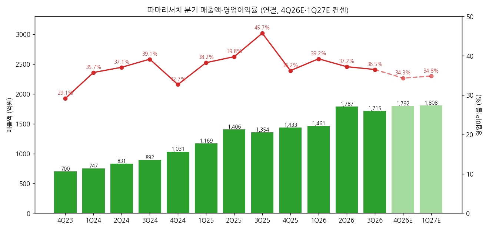
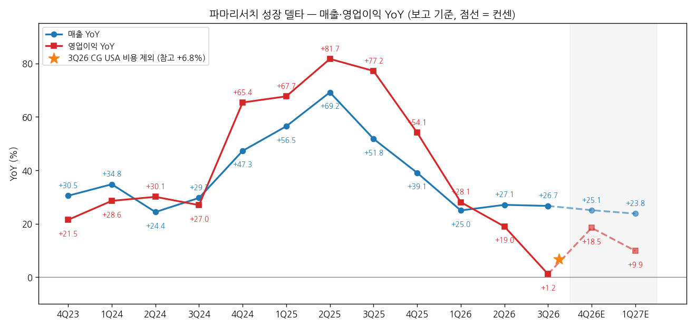
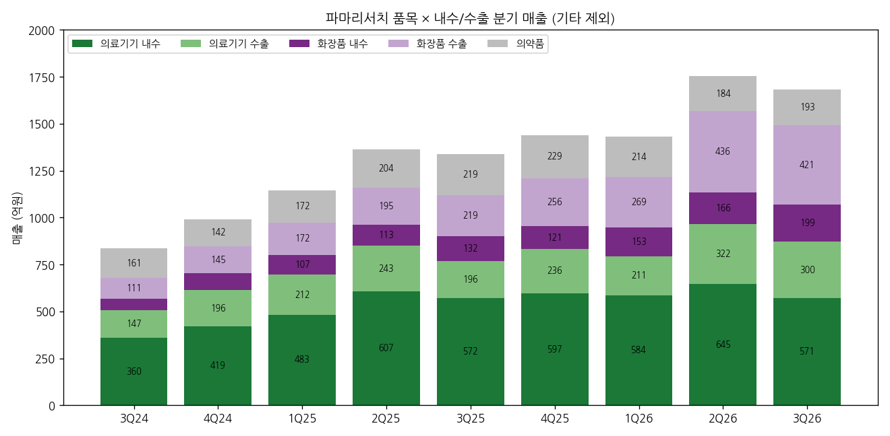

> 모드: 실적 리뷰 (v11)
> 종목: 파마리서치 (214450)
> 섹터: 뷰티
> 서브섹터: 미용의료
> 분기: 2026-Q3
> 발표일: 2026-11-06 (연결 잠정실적 + IR「26년 3분기 실적 Review」, 분기보고서 2026-11-13 확정치와 동일)
> 작성 시각: 2026-11-22 20:45 KST
> 분석 소스: 회사 IR「26년 3분기 실적 Review」(2026-11-06) + 셀사이드 발표 후 5건 — DB증권(11/09), 다올투자증권(11/09), 대신증권(11/09), 미래에셋증권(11/09, 경영진 Q&A 포함), 키움증권(11/09) + (참고) 씨티「Likely 3Q26E Miss」(10/27, 발표 전 프리뷰 — 집계 제외). 과거 분기 숫자는 파마리서치 기업개요(2026-11-15, OpenDART 연결 분기·품목 시계열)로 교차검증. 컨콜 트랜스크립트 미첨부, 웹서치 보완 없음
> 리뷰 깊이: 풀 | 리서치 첨부 6건 (발표 후 5건 + 발표 전 1건)
> 비영업 요인: 인수(Cosmetic Group USA 편입 — 3Q 비용 약 35억원, 그중 자문·법률 수수료 약 20억원 일회성)·고기저(3Q25 OPM 45.7%, 분기 최고) — 판정은 보고 기준 그대로

# 파마리서치 3Q26 실적 리뷰 — 수출은 달렸는데 이익이 멈췄다, 영업이익 YoY +19.0% → +1.2%

> 성장 델타: 꺾임 | 내러티브: 약화 → 델타 꺾임 + 내러티브 약화 → 매매 제외 구간 (내수 의료기기 YoY 플러스 복귀와 OPM 35~37% 밴드 확인 전까지)
>
> ⚠ 비영업 요인 플래그: 3Q26 보고 영업이익 626억원에는 Cosmetic Group USA(CG USA) 편입 비용 약 35억원(DB·대신·미래)이 들어 있다. 그중 약 20억원은 인수 자문·법률 수수료(일회성, 다올·미래), 나머지 약 15억원은 분기마다 이어지는 영업손실이다(회사, 미래 Q&A). CG USA 비용 전액을 빼면 661억원, YoY +6.8%이고 일회성 20억원만 빼면 646억원, YoY +4.4%다 ([계산], 참고). 비교 기저인 3Q25는 OPM 45.7%로 분기 최고였다(고기저). 어느 조정치로 봐도 2Q26(+19.0%)보다 12%p 이상 낮아 판정은 같다

→ **숫자**: 매출 1,715억원(+26.7% YoY, -4.0% QoQ), 영업이익 626억원(+1.2% YoY, -5.8% QoQ), OPM 36.5%. 매출 YoY는 3개 분기째 +25~27%로 안정적이지만, 영업이익 YoY는 2Q25 +81.7%에서 5개 분기 연속 내려와 거의 0%가 됐다(델타 -17.8%p). FnGuide 컨센(매출 1,770억원·영업이익 664억원) 대비 각각 -3.1%, -5.7%로 소폭 미스다
→ **쟁점 ①**: 내수 의료기기(리쥬란)가 571억원으로 YoY 0%(-0.1%)다. YoY는 +21% → +6% → 0%로 3개 분기 연속 둔화했다. 회사는 외국인 관광객 비중이 2Q 40%대에서 3Q 34~35%로 내려갔다고 설명했다. 9월부터 회복했다고 했지만, 4Q 가이드도 "YoY 한 자릿수 초반"이다
→ **쟁점 ②**: 회사가 전사 OPM 범위를 37~40%에서 35~37%로 낮췄다(미래 Q&A). 화장품 비중이 26%에서 36%로 오르는 믹스 변화, CG USA 손실(분기 약 15억원), 해외 법인 비용이 이유다. 3Q25 같은 OPM 45%대나 2025년 연간 40%는 다시 기대하기 어렵다
→ **쟁점 ③**: 수출은 강했다. 화장품 수출 421억원(+92%)은 2Q 우크라이나 일회성 물량(약 70억원)이 빠졌는데도 2Q 수준을 지켰고, 의료기기 수출 300억원(+53%)도 좋았다. 수출 비중은 47.6%로 사상 최고다. YoY 매출 증가분 361억원 중 86%(311억원)가 수출에서 나왔다
→ **쟁점 ④**: 5곳 중 3곳이 TP를 내렸다(평균 48.0만원 → 43.0만원, -10.4%). 실적 하향 폭(미래 2027E -16%)과 멀티플 하향(대신 목표 PER -10% 할인)이 섞였다. 키움만 "손지훈 대표의 휴젤 데자뷔"를 근거로 TP를 올렸다(+11.6%)
→ **다음 분기 관건**: 4Q25 기저가 낮아(OPM 36.2%) 컨센 4Q26 영업이익 615억원(+18.5%)이 나오면 YoY는 숫자상 다시 커진다. 그러나 회사는 "4Q 영업이익이 3Q보다 내려온다"고 했다. 552억원(+6.4%)을 넘으면 기준상 "가속"이지만 기저효과다. 진짜 시험대는 1Q27(다올 630억원, +9.9%)과 내수 의료기기의 YoY 플러스 복귀다

---

## 1. 숫자

① 연결 기준 분기 표 (단위: 억원, %)

| 항목 | 4Q23 | 1Q24 | 2Q24 | 3Q24 | 4Q24 | 1Q25 | 2Q25 | 3Q25 | 4Q25 | 1Q26 | 2Q26 | **3Q26** | 4Q26E | 1Q27E |
|---|---|---|---|---|---|---|---|---|---|---|---|---|---|---|
| 매출액 | 700 | 747 | 831 | 892 | 1,031 | 1,169 | 1,406 | 1,354 | 1,433 | 1,461 | 1,787 | **1,715** | 1,792 | 1,808 |
| 영업이익 (보고) | 204 | 267 | 308 | 349 | 337 | 447 | 559 | 619 | 519 | 573 | 665 | **626** | 615 | 630 |
| OPM | 29.1 | 35.7 | 37.0 | 39.1 | 32.7 | 38.3 | 39.7 | 45.7 | 36.2 | 39.2 | 37.2 | **36.5** | 34.3 | 34.8 |
| 매출 YoY | +30.5 | +34.8 | +24.4 | +29.7 | +47.3 | +56.5 | +69.2 | +51.8 | +39.1 | +25.0 | +27.1 | **+26.7** | +25.1 | +23.8 |
| 영업이익 YoY | +21.5 | +28.6 | +30.1 | +27.0 | +65.4 | +67.7 | +81.7 | +77.2 | +54.1 | +28.1 | +19.0 | **+1.2** | +18.5 | +9.9 |
| **매출 YoY 델타 (%p)** | -18.4 | +4.3 | -10.4 | +5.3 | +17.6 | +9.2 | +12.7 | -17.4 | -12.7 | -14.1 | +2.1 | **-0.4** | -1.6 | -1.3 |
| **영업이익 YoY 델타 (%p)** | -45.2 | +7.1 | +1.5 | -3.1 | +38.4 | +2.3 | +14.0 | -4.5 | -23.1 | -26.0 | -9.1 | **-17.8** | +17.3 | -8.6 |
| (참고) 영업이익, CG USA 비용 35억원 제외 | | | | | | | | | | | | 661 (YoY +6.8) | | |
| (참고) 영업이익, 인수 수수료 20억원만 제외 | | | | | | | | | | | | 646 (YoY +4.4) | | |

→ (출처: 4Q23~2Q26 = OpenDART 연결(파마리서치 기업개요 분기 시계열), 3Q26 = 회사 IR(11/06 잠정, 매출 171,542백만원·영업이익 62,627백만원) = 분기보고서(11/13) 확정치. 4Q26E = DB·다올·대신·미래·키움 5곳 단순평균(매출 1,768~1,825억원, 영업이익 577~649억원). 1Q27E = 다올투자증권 단독 추정(분기 변경표). 4Q23 델타는 3Q23 YoY(매출 +48.9%·영업이익 +66.7%, 기업개요 분기 숫자로 [계산]) 기준)
→ **YoY 계산 기준**: 보고 K-IFRS 연결 영업이익끼리 비교한다. 3Q26 626.3억원 vs 3Q25 618.7억원(회사 IR 61,871백만원 = DART 원공시, 재작성 없음) = **+1.2%**. 2Q26은 664.7억원 vs 2Q25 559억원 = +19.0%. 델타는 -17.8%p다. 회계 기준 변경으로 다시 쓴 과거 분기는 없다. 단, 4Q25부터 리쥬란 정품인증 마케팅분담금을 매출에서 빼는 순액 인식(IFRS 15)을 적용해 4Q25 매출이 약 50억원 줄었다(영업이익 영향 없음). 이 때문에 4Q26 매출 YoY는 약 +3.5%p 부풀려진다
→ 3Q26 서프라이즈: 매출 컨센 대비 -3.1%, 영업이익 -5.7% (FnGuide 컨센 매출 1,770억원·영업이익 664억원, DB·다올·미래·키움 인용. 집계 증권사 수는 리포트에 없어 미확인). 발표 2주 전 씨티가 인용한 컨센은 영업이익 710억원이었다. 컨센이 발표 전에 이미 7% 내려와 있었고, 낮아진 컨센도 밑돌았다
→ 영업이익 YoY의 정점은 2Q25(+81.7%)였다. 이후 +77% → +54% → +28% → +19% → +1%로 5개 분기 연속 내려왔다. 매출 YoY는 2Q25 +69%에서 +25~27%로 내려와 3개 분기째 그 수준을 유지하고 있다. **매출은 유지되는데 이익률이 빠지는 구조**다 (OPM 3Q25 45.7% → 3Q26 36.5%)
→ 컨센 경로는 4Q26 +18.5%로 한 분기 다시 올라간 뒤 1Q27 +9.9%(다올), 2027년 연간 +18.3%(5곳 평균)다. 4Q26의 반등은 4Q25 기저(OPM 36.2%, 판관비율 40.1%)가 낮아서 생기는 효과다. **컨센 경로상 YoY 정점(2Q25)은 이미 지났다** [판단]
→ **[판단] 델타 = 꺾임**: 영업이익 YoY는 +1.2%로 아직 플러스다. 그러나 5개 분기 연속 둔화했고, 컨센 경로상 정점도 이미 지나 기준상 "꺾임"이다. CG USA 비용을 다 빼도(+6.8%) 2Q26(+19.0%)보다 12.2%p 낮다

→ (출처: OpenDART 연결, 회사 IR(3Q26), 4Q26E = 증권사 5곳 평균, 1Q27E = 다올투자증권. 연한 막대·점선 = 추정)

→ (출처: 동일. 별표 = 3Q26 CG USA 비용 35억원 가산 영업이익 YoY, [계산] 참고치. 음영 = 컨센)

② 품목(의료기기·화장품·의약품) × 내수/수출 (단위: 억원, %)

(1) 품목 × 내수/수출 분기 매출 — 회사는 품목별 영업이익을 공시하지 않는다

| 품목 | 구분 | 1Q25 | 2Q25 | 3Q25 | 4Q25 | 1Q26 | 2Q26 | **3Q26** | 3Q26 YoY | 3Q26 QoQ | 3Q26 비중 |
|---|---|---|---|---|---|---|---|---|---|---|---|
| 의료기기 | 내수 | 483 | 607 | 572 | 597 | 584 | 645 | **571** | -0.1 | -11.4 | 33.3 |
| 의료기기 | 수출 | 212 | 243 | 196 | 236 | 211 | 322 | **300** | +53.0 | -6.9 | 17.5 |
| 의료기기 | 계 | 695 | 850 | 768 | 833 | 795 | 967 | **871** | +13.5 | -9.9 | 50.8 |
| 화장품 | 내수 | 107 | 113 | 132 | 121 | 153 | 166 | **199** | +50.0 | +19.8 | 11.6 |
| 화장품 | 수출 | 172 | 195 | 219 | 256 | 269 | 436 | **421** | +92.0 | -3.4 | 24.6 |
| 화장품 | 계 | 279 | 308 | 351 | 377 | 422 | 602 | **620** | +76.2 | +3.0 | 36.1 |
| 의약품 | 내수 | 106 | 134 | 133 | 137 | 112 | 107 | **104** | -21.8 | -2.4 | 6.1 |
| 의약품 | 수출 | 66 | 70 | 86 | 92 | 102 | 77 | **89** | +3.3 | +15.8 | 5.2 |
| 의약품 | 계 | 172 | 205 | 220 | 229 | 214 | 184 | **194** | -12.0 | +5.2 | 11.3 |
| 기타 | 계 | 24 | 44 | 15 | -6 | 30 | 35 | **31** | | | 1.8 |
| **합계** | 내수 | 717 | 887 | 849 | 841 | 873 | 947 | **899** | +5.9 | -5.0 | 52.4 |
| **합계** | 수출 | 453 | 519 | 505 | 593 | 588 | 840 | **816** | +61.5 | -2.9 | 47.6 |

→ (출처: 회사 IR 3~5쪽(3Q25~3Q26, 백만원 → 억원), 1Q25~2Q25는 기업개요 품목 시계열·DB 도표 2. 4Q25는 IFRS 15 순액 인식 후 수치)
→ 품목 YoY 추이: 내수 의료기기 +59%(3Q25) → +43% → +21% → +6% → **0%**, 수출 의료기기 +34% → +20% → 0% → +33% → **+53%**, 화장품 내수 +126% → +38% → +43% → +47% → **+50%**, 화장품 수출 +98% → +77% → +56% → +124% → **+92%**, 의약품 내수 +33% → +58% → +6% → -20% → **-22%** (회사 IR YoY)
→ **YoY 매출 증가분 361억원의 분해**: 화장품 수출 +202억원, 의료기기 수출 +104억원, 화장품 내수 +67억원, 기타 +16억원, 의약품 수출 +3억원, 의료기기 내수 -1억원, 의약품 내수 -29억원 ([계산]). 수출이 증가분의 86%다
→ **QoQ 매출 감소분 72억원의 분해**: 의료기기 내수 -74억원과 의료기기 수출 -22억원, 화장품 수출 -15억원(2Q 우크라이나 일회성 약 70억원 소멸, 미래)이 화장품 내수 +33억원과 의약품 +10억원을 넘어섰다 ([계산])
→ 델타를 끌어내린 품목은 **내수 의료기기**와 **믹스 변화**다. 이익률이 가장 높은 내수 리쥬란이 멈췄고, 이익률이 낮은 화장품(내수 OPM 20%대 후반~30% 초반, 회사 — 미래 Q&A) 비중이 1년 만에 26%에서 36%로 올라갔다. 매출 YoY +27%가 영업이익 YoY +1%로 줄어든 이유 대부분이 여기 있다 [판단]

(2) 지역별 (수출, 회사 공개 비중)

| 구분 | 3Q25 | 4Q25 | 1Q26 | 2Q26 | **3Q26** | 3Q26 YoY (미래 인용) |
|---|---|---|---|---|---|---|
| 의료기기 수출 — 아시아 | 65% | 62% | 54% | 55% | **53%** | +25% |
| 의료기기 수출 — 유럽/오세아니아 | 30% | 32% | 35% | 39% | **40%** | +104% |
| 의료기기 수출 — 중동 | 4% | 3% | 10% | 4% | **6%** | +129% |
| 화장품 수출 — 아시아 | 53% | 51% | 46% | 45% | **59%** | +114% |
| 화장품 수출 — 미주 | 41% | 33% | 48% | 38% | **38%** | +78% |
| 화장품 수출 — 유럽 | | | | | **3%** | -4% |

→ (출처: 회사 IR 7쪽 지역 비중, YoY는 미래에셋 3Q26 Review. 2Q26 화장품 기타 16%는 우크라이나 일회성 물량으로 추정 [추정]. IR 차트의 일부 칸은 텍스트로 추출되지 않아 공란)
→ 유럽 의료기기는 2026년 1Q에 22개국 인허가를 받은 뒤 비중이 30%에서 40%로 커졌다(리쥬란 인허가 총 53개국). 화장품은 동남아 6개국이 QoQ +50%, 중국이 YoY +30%였다(다올)

→ (출처: 회사 IR, 기업개요 품목 시계열. 기타 제외)

(3) 비용 구조 (회사 미공시 항목은 증권사 추정)

| 항목 | 3Q25 | 2Q26 | **3Q26** | YoY (%p) | QoQ (%p) |
|---|---|---|---|---|---|
| 매출총이익률 | 80.6 | 77.0 | **75.8** | -4.8 | -1.2 |
| 판관비율 | 34.9 | 39.8 | **39.3** | +4.4 | -0.5 |
| OPM | 45.7 | 37.2 | **36.5** | -9.2 | -0.7 |

→ (출처: 회사 IR(매출총이익·영업이익), 판관비는 키움 실적표(3Q26 673억원))
→ YoY OPM 하락 9.2%p 중 4.8%p는 원가율(화장품 믹스·환율), 4.4%p는 판관비다. 판관비 가운데 CG USA 35억원이 약 2.0%p다 ([계산]). QoQ로는 TV 광고 종료로 판관비가 줄었지만, CG USA 비용과 화장품 채널 수수료가 늘어 상쇄됐다(DB)
→ 영업외에서는 환손실 등으로 185억원 손실이 나 순이익이 302억원(-40.6% YoY)이었다(대신). 영업이익 판정에는 영향이 없지만, EPS 기반 TP를 쓰는 증권사들은 이 때문에 2026E 순이익을 크게 내렸다(대신 -10.2%, 미래 -20.0%)

③ 연간 (단위: 억원, %)

| 항목 | 2022 | 2023 | 2024 | 2025 | 2026E | 2027E |
|---|---|---|---|---|---|---|
| 매출액 | 1,948 | 2,610 | 3,501 | 5,363 | 6,755 | 8,296 |
| 영업이익 | 659 | 923 | 1,261 | 2,144 | 2,479 | 2,933 |
| OPM | 33.8 | 35.3 | 36.0 | 40.0 | 36.7 | 35.4 |
| 매출 YoY | +26.4 | +34.0 | +34.1 | +53.2 | +26.0 | +22.8 |
| 영업이익 YoY | +25.5 | +40.1 | +36.6 | +70.0 | +15.6 | +18.3 |

→ (출처: 2022~2025 OpenDART 연결. 2026E·2027E = DB·다올·대신·미래·키움 발표 후 추정 단순평균. 다올 2026E 영업이익 2,504억원은 3Q 누적 1,864억원 + 4Q E 640억원 [계산])
→ 회사 코멘트(공식 연간 가이던스 아님): 3년 매출 CAGR +25% 목표(씨티 10/27 경영진 미팅), 2027년 사업계획 환율은 1,300원 초중반, 전사 OPM 범위 35~37%(미래 Q&A)
→ 발표 전후 연간 컨센 변화: 수정 전후가 공개된 3곳(대신·미래·다올) 평균 2026E 영업이익은 2,597억원에서 2,495억원으로 -3.9%다. 증권사별로는 대신 +0.3%, 미래 -10.7%, 다올 -0.6%([계산])다. 2027E는 대신 -0.3%, 미래 -16.3%, 다올 1~3Q27 합산 -5.3%로 증권사 간 편차가 크다. 미래가 발표 당일 표지에 인용한 FnGuide 2026F 컨센은 2,590억원이다(갱신 전 수치일 수 있음)
→ 2027E 영업이익 범위는 2,824억원(대신)~3,037억원(키움)으로 7%밖에 차이 나지 않는다. 셀사이드는 "2027년 +14~23% 이익 성장, OPM 35%대"라는 그림에 거의 수렴했다

---

## 2. 시장 쟁점

① 지난 분기 체크
→ 첫 리뷰 — 직전 체크 없음 (2Q26 리뷰·팔로업 미작성). 참고로 기존 캘린더 시그널("리쥬란 수출, 화장품 수출 92%↑ 지속 여부, OPM 36% 방어, 4Q 분기 최대 목표")로 보면 화장품 수출 +92%는 확인됐다. OPM 36%는 36.5%로 겨우 방어했다

② 이번 분기 쟁점 5개

| # | 쟁점 | 언급 증권사 수 |
|---|---|---|
| (1) | 내수 의료기기 0% — 의료관광 일시 둔화인가, 리쥬란 내수 성숙인가 | 5/5 |
| (2) | OPM 36.5% — CG USA·믹스를 빼면 정상 마진은 몇 %이고, 새 밴드 35~37%는 바닥인가 | 5/5 |
| (3) | 화장품 수출 +92% — 우크라이나 일회성을 빼고도 지속되는가 (미국 세포라·코스트코, 실리콘투) | 5/5 |
| (4) | 의료기기 수출 +53% — 유럽·중동이 내수 공백을 메울 크기인가 (브라질 2H27) | 5/5 |
| (5) | TP 하향은 실적 때문인가 멀티플 때문인가 — "휴젤 데자뷔" 논쟁 | 5/5 |

(분모는 발표 후 리포트 5곳. 씨티(10/27)는 발표 전 자료라 쟁점 집계에서 빼고 참고로만 인용)

③ 쟁점별 분해

(1) 내수 의료기기 0% — 의료관광 일시 둔화인가, 리쥬란 내수 성숙인가

(1-1) 회사 설명 (IR 4쪽, 경영진 Q&A — 미래·대신 정리)
→ IR은 3Q26 내수 의료기기를 57,126백만원, YoY "Flat"(-39백만원)으로 표기했다
→ "리쥬란 정품 인증 프로그램과 병원 확인 기준으로 3Q 외국인 관광객 비중은 약 34~35%다. 40%를 넘었던 2Q 대비 크게 감소했다. 4Q에는 다시 조금씩 유입되고 있다" (미래 Q&A)
→ "2025년부터 시작된 방한 외국인의 급격한 유입이 다시 나타나기는 한동안 어렵다. 내국인 수요를 점진적으로 높이는 것이 과제다. 타겟 병원 커버리지를 5,000처에서 6,000처로 확대 중이며 3Q 약 5,500~5,600처" (미래 Q&A)
→ 9월부터 내수 의료기기 수요가 회복됐다. 4Q 의료기기 내수는 YoY 한 자릿수 초반 성장을 예상한다 (대신)
→ RF 디바이스 "리넥스(RE:INEX)" 허가는 11월, 2027년 초 판매를 시작한다. 기기 단독 매출은 내년 수십억 원대로 크지 않을 것이다. 목표는 리쥬란을 많이 쓰는 병원에 기기를 깔아 리쥬란 사용(2cc → 4cc 메가도즈)을 늘리는 것이다 (미래 Q&A)
→ 중국 관광객의 ECM 선호 변화는 영업부에서 아직 뚜렷하게 체감되지 않는다. 타사도 3Q가 좋지 않아 계절적 비수기 영향이 더 컸다 (미래 Q&A)

(1-2) 증권사별 해석 편차

| 증권사 | 4Q26 내수 의료기기 E (YoY) | 논리 |
|---|---|---|
| DB | 623억원 (+4.4%) | 7~8월 외국인 피부과 지출 감소로 정체. 2027E 내수 의료기기 2,576억원(+6%) |
| 다올 | 미공개 | 외국인 비중 2Q 40%대 → 3Q 30% 중반. "의료 관광 성장세는 둔화되며 내수 회복 더디지만 성장의 축은 화장품과 해외로 이전". 2027E 의료기기 전체 4,205억원(+18%), 리넥스 1Q27 + 브라질 2H27 |
| 대신 | 615억원 (+3.0%) | 3Q를 저점으로 회복하지만 속도는 보수적으로 반영. 2027E 내수 의료기기 2,684억원(+11%) — 리넥스 도입으로 리쥬란 시술 증가 |
| 미래 | 미공개 | 9월부터 수요 회복, 4Q QoQ 상승. 리넥스·패키지 마케팅으로 내년 성장 회복 |
| 키움 | 616억원 (+3.2%) | 여름 비수기 + 7~8월 부진. 2026E 내수 의료기기 2,416억원(+7.0%), 2027E 2,630억원(+9%) |

(1-3) 공통 결론 vs 갈리는 지점
→ 공통: 5곳 모두 3Q가 저점이고 4Q에 QoQ로 회복한다고 본다. 4Q 추정은 615~623억원(YoY +3~4%)으로 회사 가이드("한 자릿수 초반")와 맞춰져 있다
→ 갈림: 2027년이다. 리넥스 효과를 크게 보는 곳은 대신(+11%)과 다올(의료기기 전체 +18%)이다. DB(+6%)와 키움(+9%)은 리넥스 효과를 작게 본다

(1-4) **[판단]** — 외국인과 내국인을 나눠 보면
→ 회사가 밝힌 외국인 비중(2Q 약 40%, 3Q 약 34.5%)을 그대로 적용하면, 외국인 수요는 2Q 약 258억원에서 3Q 약 197억원(-24% QoQ)으로, 내국인 수요는 약 387억원에서 약 374억원(-3% QoQ)으로 줄었다 ([추정], 비중은 정품인증 기준이라 매출 비중과 다를 수 있음)
→ 즉 이번 분기 감소의 대부분은 외국인이다. 그러나 **내국인도 늘지 않았다.** 회사가 "급격한 외국인 유입이 한동안 어렵다", "내국인 수요를 점진적으로 높이는 것이 과제"라고 직접 말한 것은, 내수 리쥬란이 성숙 단계에 들어섰다는 신호로 읽는 게 숫자와 맞다 [판단]
→ 외국인 피부과 소비는 7월 MoM -18%에서 9월 +12%로 반등했다(다올, 한국관광데이터랩). "9월 회복" 설명과 맞지만, 4Q 가이드가 YoY +2~4%(약 610~620억원)라 성장률이 다시 두 자릿수로 가는 그림은 아니다
→ 결론이 바뀌는 조건: 4Q 내수 의료기기가 597억원(4Q25)을 밑돌면 YoY 마이너스 전환으로 "성숙"이 확정된다. 반대로 1Q27에 리넥스 출시와 함께 내수 의료기기가 YoY +10%를 넘으면 "디바이스 결합으로 내수 재성장"이라는 새 스토리가 생긴다

(2) OPM 36.5% — 정상 마진은 몇 %인가

(2-1) 회사 설명 (미래 Q&A)
→ "전사 OPM 범위는 기존 37~40%에서 현재 35~37%로 보고 있다. 4Q 글로벌 심포지엄(PGS)이나 추가 광고가 있으면 분기에 따라 1~2%p 더 낮아질 수 있다"
→ "4Q 영업이익은 3Q보다 내려올 것이다. PGS 비용 약 30억원이 광고선전비로 반영된다. 30% 후반은 어렵겠지만 30%대는 유지할 것"
→ 화장품 OPM: 내수는 20% 후반~30% 초반, 해외(특히 미주)는 현재 회사 OPM 수준이다
→ CG USA: 인수 당시 연매출 약 1,000만 달러, 손실 300만 달러 이내로 안내했다. 연간 약 40억원, 분기 약 10억원의 영업이익 감소 효과가 계속된다. 3Q 영향 약 35억원 중 약 20억원은 전문가 수수료·법률 비용이었다. 앞으로는 분기 15억원 내외다. 내년 초 미국 수요 대응 생산을 시작하면 다소 나아질 것이다

(2-2) 증권사별 해석 편차

| 증권사 | 3Q 조정 OPM / 4Q26 OPM E | 2027E OPM | 논리 |
|---|---|---|---|
| DB | CG USA 제외 38.5% / 32.6% | 35.2% | PGS 판관비와 분기당 약 15억원의 CG USA 손실로 4Q 영업이익은 QoQ 감소(577억원, 5곳 중 최저) |
| 다올 | 자문료 20억원 제외 영업이익 646억원(추정치 상회) / 35.7% | 35.0% | 화장품 비중이 34%(2026E)에서 39%(2027E)로 오르면서 OPM -2.1%p |
| 대신 | — / 34.0% | 35.3% | PGS 30억원대 등 연말 비용을 보수적으로 반영. 화장품 비중 확대로 OPM 보수적 |
| 미래 | 조정 EBITDA 676억원(39.4%) / 36.0% | 35.5% | 다각화와 M&A 효과로 마진은 내려갈 것. 4Q 영업이익 649억원으로 5곳 중 최고 |
| 키움 | — / 33.2% | 35.7% | 2027E 매출총이익률 75.0%, 판관비율 39.3% |
| (참고) 씨티 10/27 | 3Q E 36% / — | 37.9% | 발표 전. 화장품 믹스·환율·CG USA를 이유로 마진 전망을 낮추면서도 2027E OPM은 5곳보다 높게 본다 |

(2-3) 공통 결론 vs 갈리는 지점
→ 공통: 5곳 모두 2027E OPM을 35.0~35.7%로 잡았다. 회사의 새 밴드(35~37%) 하단이다. 2025년 40%, 3Q25 45.7%는 다시 오지 않는다는 데 이견이 없다
→ 갈림: 4Q OPM이다. 32.6%(DB)부터 36.0%(미래)까지 3.4%p 벌어져 있다. 회사는 "3Q보다 낮음"을 말했으므로 미래의 649억원(3Q 626억원보다 높음)은 회사 코멘트와 어긋난다

(2-4) **[판단]**
→ 3Q 일회성(인수 수수료 20억원)만 빼면 영업이익 646억원, OPM 37.7%다. 반복 비용인 CG USA 손실 15억원은 이미 포함된 숫자다. 이 수준은 2Q26 37.2%와 비슷하다. **경상 OPM은 37% 안팎에서 안정됐고, 새 밴드(35~37%)의 상단이다** ([계산])
→ 문제는 방향이다. 마진을 낮추는 세 요인(화장품 믹스, CG USA, 해외 법인)이 모두 2027년에 더 커진다. 화장품 비중은 36%에서 39%로(다올) 오르고, 미국 법인·브라질·유럽 법인(씨티: 5개 현지 법인 목표)이 추가된다. 매출이 +23% 커져도 영업이익은 +18% 정도로 덜 커진다는 셀사이드 그림이 맞다 [판단]
→ 결론이 바뀌는 조건: 4Q OPM이 PGS 비용(약 30억원, 1.7%p)을 넣고도 35% 이상이면 "경상 37%"가 확인된다. 33% 아래로 떨어지면 밴드 하단(35%)도 위험하다

(3) 화장품 수출 +92% — 지속되는가

(3-1) 회사 설명 (IR 6쪽, 미래 Q&A)
→ 8/20 미국 세포라 × 올리브영 K-Beauty Edit로 580개 매장·온라인 동시 런칭, 8월 올리브영 페스타 in LA에서 듀얼이펙트 앰플 1위, 9월 중국 Chicmax(CCM) MOU (IR)
→ 올해 화장품 사업부를 글로벌 사업부에서 분리하고, 미국·아시아 화장품 헤드를 새로 뽑았다. 전략도 "의료기기 먼저, 화장품 나중"에서 "진출 가능한 지역은 화장품이라도 먼저"로 바꿨다 (미래 Q&A)
→ 미국 코스트코는 3Q에 초도 물량을 출하했고 10월부터 일부 매장에 입점했다. 실리콘투 향 3Q 매출은 10억원대(20억원 미만)이고, 코스트코도 비슷한 규모다. 아마존은 2Q에 올랐다가 3Q에 소폭 줄었다. "미국에서는 아직 마이너 플레이어" (미래 Q&A)
→ 유럽은 일부 레시피가 EU 승인을 받지 못해 수정 레시피로 진출을 준비 중이다. 영국 온라인몰이 첫 진출국이 될 전망이다. 4Q부터 CG USA 생산 물량을 일부 쓰고, 장기적으로는 미국은 현지 생산, 한국 공장은 아시아·유럽향 생산을 맡는다 (미래 Q&A)
→ 4Q 화장품 수출은 YoY 60%대, 내수는 50%대를 예상한다 (대신)

(3-2) 증권사별 해석 편차

| 증권사 | 4Q26 화장품 수출 E (YoY) | 2027E 화장품 매출 (YoY) | 논리 |
|---|---|---|---|
| DB | 439억원 (+71%) | 3,138억원 (+38%) | 북미 중심 화장품 수출 성장 지속 |
| 다올 | 미공개 | 3,302억원 (+45%) | 2027 성장은 화장품이 주도. 세포라 매장 확대, 코스트코 초도 물량, 4Q 대만·홍콩·UAE 드럭스토어 입점 추가. CG USA 기초 라인은 2027년 초 가동 |
| 대신 | 410억원 (+60%) | 2,877억원 (+28%) | 우크라이나 일회성이 빠졌는데도 +92%. 미국·아시아 성장, 유럽 진출. 5곳 중 2027 성장률 최저권 |
| 미래 | 미공개 | 2,811억원 (+24%) | 침투한 대부분 지역에서 고성장. 다만 2027E 화장품 성장률은 5곳 중 가장 낮게 잡았다 |
| 키움 | 452억원 (+77%) | 3,134억원 (+37%) | 출하량(Q)은 늘었지만 환율 영향. 내수는 올리브영 + 쿠팡·실리콘투 신규 채널(회계상 내수 매출) |

(3-3) 공통 결론 vs 갈리는 지점
→ 공통: 화장품은 2027년 성장의 1번 엔진이다(다올·대신·미래 모두 명시). 4Q 수출은 410~452억원으로 회사 가이드(YoY 60%대 = 410~435억원)와 비슷하다
→ 갈림: 2027년 화장품 매출이 2,811억원(미래)에서 3,302억원(다올)까지 약 490억원 벌어져 있다. 미국 오프라인(세포라·코스트코)의 리오더 강도를 어떻게 보느냐의 차이다

(3-4) **[판단]**
→ 2Q 화장품 수출 436억원에서 우크라이나 일회성 약 70억원을 빼면 약 366억원이다. 3Q 421억원은 이 대비 QoQ 약 +15%다 ([계산]). 일회성을 빼고 보면 화장품 수출은 오히려 가속하고 있다
→ 지역 구성도 바뀌었다. 3Q 화장품 수출의 59%가 아시아(+114% YoY)였다. 미국 신규 채널(세포라·코스트코·실리콘투)은 회사 말로 아직 각 10억원대다. 지금 숫자를 끄는 것은 아시아이고, 미국 오프라인은 2027년 옵션이다 [판단]
→ 아마존 리쥬란 판매량은 7~9월 월 1.2~1.3만 개에서 10월 2.7만 개로 늘었다(다올, 빅딜데이 효과). 틱톡샵 일평균 GMV는 9월 1.99만 달러에서 10월 1.22만 달러로 줄었다(다올). 온라인 채널별로 신호가 엇갈린다
→ 결론이 바뀌는 조건: 4Q 화장품 수출이 410억원(가이드 하단)을 밑돌면 3Q가 "채널 초도 물량" 효과였다는 해석이 힘을 얻는다

(4) 의료기기 수출 +53% — 내수 공백을 메울 크기인가

(4-1) 회사 설명 (IR 7~8쪽, 미래·대신·씨티)
→ 리쥬란 해외 인허가 총 53개국. 2026년 1Q 유럽 22개국, 2Q 슬로바키아·헝가리·캄보디아·레바논, 3Q 아르헨티나. 9월 사우디 런칭(리야드 250명·제다 150명), 하반기 EU 로드쇼(헝가리·리투아니아) (IR)
→ 2Q에 처음 300억원을 넘은 수출은 3Q에 판매량 기준으로는 최대였지만, 환율 영향으로 금액은 QoQ -7%였다 (미래)
→ 브라질은 허가 2027년 상반기, 판매 하반기, 판매사 확정 (미래 Q&A). 일부 국가 수출은 4Q에도 3Q 수준(50억원대)으로 연 170억원 계획을 마무리한다 (미래 Q&A — 국가명 표기는 원문 확인 필요)
→ 4Q 의료기기 수출은 YoY 40%대를 예상한다 (대신)

(4-2) 증권사별 해석 편차

| 증권사 | 4Q26 의료기기 수출 E (YoY) | 2027E 의료기기 수출 (YoY) | 논리 |
|---|---|---|---|
| DB | 329억원 (+39%) | 1,462억원 (+26%) | 유럽 중심 의료기기 수출 성장세 지속 |
| 대신 | 340억원 (+44%) | 1,427억원 (+22%) | 브라질 하반기 판매 개시로 증가 |
| 키움 | 335억원 (+42%) | 1,680억원 (+44%) | 3Q25 해외 유통망 정비 후 2Q26부터 2개 분기 연속 "수출 체급" 상승. 수출 비중 상승은 판가 인상 효과 → 리레이팅 근거 |
| 다올·미래 | 미공개 | — | 미래: 중동 신규 확장이 제한된 상황에서 거둔 성과(유럽 +104%, 중동 +129%) |

(4-3) 공통 결론 vs 갈리는 지점
→ 공통: 4Q 의료기기 수출은 329~340억원(YoY +39~44%)으로 거의 같다. 유럽이 주도한다는 데도 모두 동의한다
→ 갈림: 2027년 성장률이 +22%(대신)에서 +44%(키움)까지 2배 차이 난다. 키움은 수출 성장이 2027년에도 4Q 수준으로 이어진다고 보고, DB·대신은 기저가 높아지면서 둔화한다고 본다

(4-4) **[판단]**
→ 3Q +53%의 일부는 기저효과다. 3Q25 의료기기 수출(196억원)은 해외 유통망 정비로 7개 분기 만에 QoQ 역성장한 분기였다(키움). 2Q26 대비로는 -7%다
→ 크기도 따져야 한다. 의료기기 수출 연간 증가분은 2027E 약 +300~500억원이다. 내수 의료기기 성장이 +3%로 멈추면 연 약 75억원밖에 늘지 않는다. 수출이 내수 공백을 금액으로는 메우지만, 해외 판매는 대리점 경유라 [추정] 이익률이 내수 직판보다 낮을 가능성이 크다. 매출 공백은 메워도 이익 공백까지 메우기는 어렵다 [판단]
→ 결론이 바뀌는 조건: 1Q27 의료기기 수출이 1Q26(211억원) 대비 +40% 이상(약 300억원+)이면 기저효과가 아닌 체급 상승(키움 논리)이 확인된다

(5) TP 하향은 실적 때문인가 멀티플 때문인가 — "휴젤 데자뷔" 논쟁

(5-1) 회사 설명
→ 해당 없음 (밸류에이션 쟁점). 경영진은 3년 매출 CAGR +25%를 목표로 글로벌 확장(5개 현지 법인)과 파이프라인 확장(리넥스, 톡신 2공장 GMP 2027 중반, 리쥬란 HB Plus 리뉴얼)을 제시했다 (씨티 10/27 경영진 미팅). 콜라겐 인젝터블은 2028년경으로 예상보다 약 2년 늦어졌다 (미래 Q&A)

(5-2) 증권사별 해석 편차

| 증권사 | 적용 멀티플 | TP 변화 이유 |
|---|---|---|
| 미래 | 12MF PER 12배(5년 평균 18배 대비 저평가) 언급, 구체 목표 배수 미기재 | 600,000 → 450,000원(-25%). 2026E 영업이익 -10.7%, 2027E -16.3%로 **실적 하향** 주도 |
| DB | 12MF P/E 14.7배를 "역사적 저평가 구간"으로 봄 | 460,000 → 350,000원(-24%). 하향 이유·추정 변경 폭 미기재 (표지는 "유지", 본문은 "46만원 유지"로 적혀 있지만 TP 이력표는 11/09 35만원. 하향으로 처리) |
| 대신 | 12MF EPS 21,230원 × PER 19.6배(2년 평균 21.8배에서 10% 할인) | 460,000 → 420,000원(-8.7%). EPS는 "기존과 유사". 내수 회복 속도·해외 화장품 리오더 불확실성을 할인으로 반영 → **멀티플 하향** |
| 다올 | 2027E 완전 희석 EPS 19,983원 × PER 22.7배(글로벌 화장품·의료기기 가중평균에서 할인) | 450,000원 유지. "이익률 회복 국면에서 리레이팅 기대" |
| 키움 | 선행 4개 분기 EPS 24,542원 × PER 20배 | 430,000 → 480,000원(+11.6%). 손지훈 대표가 휴젤에서 3Q18 해외 거래선 정리 → 실적 조정 → 중국·유럽 진출로 주가를 끌어올린 패턴이 반복 중. 수출 비중 47.6%(사상 최고)는 판가 인상·리레이팅 근거 |

(5-3) 공통 결론 vs 갈리는 지점
→ 공통: 5곳 모두 매수 유지. 현재 주가(11/06 234,500원)는 12MF PER 11~12배로, 5곳 모두 역사적 저점권이라고 본다
→ 갈림: 키움은 "체질 개선 후 수출 리레이팅", 미래·DB는 "마진 하향에 맞춘 눈높이 조정", 대신은 "회복 확인 전 할인"이다. 같은 숫자를 보고 TP 방향이 위아래로 갈렸다

(5-4) **[판단]**
→ 평균 TP 하향(-10.4%)은 **실적 하향(미래)과 멀티플 하향(대신)이 섞인 결과**다. 수정 전후가 공개된 곳 중 미래를 빼면(대신·다올) 2026E 영업이익 추정 변화는 ±1% 안이다(DB·키움은 수정 폭 미기재). 적용 PER은 19.6~22.7배로 과거 2년 평균(21.8배, 대신) 근처다. TP 하향의 무게는 PER 배수보다 EPS(순이익) 하향 — 영업외 환손실 포함 — 쪽에 더 실렸다 [판단]
→ 키움의 휴젤 비유는 수출 체급 상승을 설명하지만, 이번 분기 델타의 원인(내수 성숙 + 믹스로 인한 마진 하향)과는 다른 축이다. 휴젤 패턴이 맞으려면 이익 성장률이 다시 매출 성장률을 따라잡아야 하는데, 5곳 모두 2027E OPM을 2026E보다 낮게 잡았다 [판단]
→ 주가 반응은 셀사이드보다 긍정적이었다. 발표 당일 KOSDAQ -5.0%에도 +4.2%(초과수익 +9.2%p, 키움)였고, 11/13 종가는 252,000원(기업개요)이다. 시장은 "낮아진 기대치에 비해 나쁘지 않았다"로 받아들였다

④ 낙관 vs 보수 — 논리 대비
→ **가장 낙관(키움 TP 48만원, 다올 45만원)**: 키움은 2027E 매출 8,496억원(+25%)·영업이익 3,037억원(+23%)으로 5곳 중 최고다. 의료기기 수출 2027E +44%가 핵심 가정이다. 다올은 화장품 2027E +45%(3,302억원)로 화장품 성장을 가장 높게 본다
→ **가장 보수(DB TP 35만원, 대신 42만원)**: DB는 4Q 영업이익 577억원(OPM 32.6%)으로 연말 비용을 가장 무겁게 잡았다. 대신은 2027E 매출 8,009억원(+19%)·영업이익 2,824억원(+14%)으로 성장률이 가장 낮다. 내수 회복 속도와 해외 화장품 리오더를 아직 확인하지 않았다는 이유다
→ 셀사이드 vs 시장: 5곳 평균 TP 43.0만원은 11/13 종가(25.2만원) 대비 +71%다. 주가는 2025.07 고점(종가 68만원) 대비 -63%다. 셀사이드는 "수출이 내수를 메운다"를, 시장은 "이익 성장률이 한 자릿수로 내려왔다"를 가격에 넣고 있다

⑤ 추정치·TP 변화 (단위: 원, 억원)

| 증권사 (발간일) | 직전 TP | 현재 TP | 4Q26 영업이익 E | 2026 / 2027 영업이익 E | 핵심 변화 한 줄 |
|---|---|---|---|---|---|
| 키움 (11/09) | 430,000 | 480,000 (+11.6%) | 605 | 2,469 / 3,037 | 휴젤 데자뷔, 수출 체급 상승 → PER 20배 |
| 다올 (11/09) | 450,000 | 450,000 (유지) | 640 | 2,504 [계산] / 2,974 | 화장품 주도 2027 매출 +26%, OPM 35% |
| 미래 (11/09) | 600,000 | 450,000 (-25.0%) | 649 | 2,513 / 2,957 | 2026E OP -10.7%, 2027E -16.3% |
| 대신 (11/09) | 460,000 | 420,000 (-8.7%) | 604 | 2,468 / 2,824 | EPS 유사, 목표 PER 2년 평균 10% 할인 |
| DB (11/09) | 460,000 | 350,000 (-23.9%) | 577 | 2,441 / 2,872 | 4Q PGS·CG USA로 QoQ 감소 (TP 표기 불일치) |
| (참고) 씨티 (10/27, 발표 전) | 500,000 | 450,000 (-10.0%) | 약 646 [계산] | 2,510 / 3,110 | 3Q 미스 예상, FY26~28 순이익 -7~9% |

→ 평균 TP(발표 후 5곳): 48.0만원 → 43.0만원 (-10.4%). 하향 3건, 유지 1건, 상향 1건
→ 4Q26 영업이익 E 평균 615억원(577~649억원), 2026E 평균 2,479억원, 2027E 평균 2,933억원
→ 연간 컨센: 수정 전후가 공개된 3곳 기준 2026E 영업이익 -3.9%, 2027E는 증권사별로 -0.3%~-16.3%
→ TP 하향 원인: **미래는 실적 하향, 대신은 멀티플 하향, DB는 이유 미기재**. 하향 폭이 큰 두 곳(미래 -25%, DB -24%) 중 실적 하향이 확인되는 곳은 미래 1곳이다
→ 씨티 4Q E는 2026E 2,510억원에서 3Q 누적 실적 1,864억원을 뺀 값이다 ([계산]). 씨티의 3Q 추정치(620억원)는 실제(626억원)와 거의 같았다

---

## 3. 내러티브 점검

① 성장 스토리 정의
→ "PN 스킨부스터 원조 리쥬란이 내수(의료관광 포함)에서 다진 플랫폼을 유럽·중동·남미 수출과 리쥬란 화장품의 글로벌 확장으로 넓히며, 매출 +25% 이상과 OPM 35~40%를 동시에 내는 고마진 성장주". 2025년에는 외국인 의료관광이 내수를 끌어올리며 이익이 +70% 성장했고, 2026년 시장은 "성장 축이 내수에서 수출·화장품으로 넘어가는 동안 이익 성장이 유지되느냐"를 보고 있다

② 이번 분기가 스토리에 준 영향
→ **강화된 부분 (수출 Q)**: 수출 비중 47.6%(사상 최고), 화장품 수출 +92%(일회성 제외 QoQ +15%), 의료기기 수출 +53%(유럽 +104%·중동 +129%), 인허가 53개국. 성장 축의 교대 자체는 숫자로 확인됐다
→ **약화된 부분 (내수와 마진)**: 내수 의료기기 YoY 0%로 3개 분기 연속 둔화했다. 회사가 직접 "급격한 외국인 유입은 한동안 어렵다"고 했다. 전사 OPM 범위도 37~40%에서 35~37%로 스스로 낮췄다. 성장 축이 이익률 높은 내수 리쥬란에서 이익률 낮은 화장품·수출로 옮겨가면서, **매출 성장은 유지되고 이익 성장은 매출 성장보다 낮아지는 구조**가 됐다
→ **성장률 정상화**: 영업이익 YoY는 +82%(2Q25)에서 +1%로 내려왔다. 컨센 경로는 2027년 +18%다. "+70% 이익 성장주"에서 "+15~20% 이익 성장주"로 넘어가는 구간이다. 시장은 이를 PER 11~12배로 먼저 가격에 반영했다
→ **판정 = 약화**: 스토리의 핵심 전제(PN 수요, 해외 확장)는 유지됐다. 그러나 마진 밴드 하향과 내수 성숙으로 추정치(미래 -16%)와 멀티플(대신 -10%)이 함께 내려갔다. 훼손이 아니라 약화다

③ 국면
→ 델타 꺾임(영업이익 YoY 5개 분기 연속 둔화, 정점 통과) + 내러티브 약화 → **매매 제외 구간**. BT 프레임에서 지금은 "성장 델타가 꺾인" 구간이다. 셀사이드의 "역사적 저평가"는 밸류에이션 논리로, 델타 판정과는 다른 축이다
→ 4Q26에는 기저가 낮아(4Q25 OPM 36.2%) 영업이익 YoY가 +18.5%(컨센)로 숫자상 다시 커질 수 있다. 판정 기준으로는 "가속"이 나올 수 있지만 원인은 기저다. 그게 진짜 재가속인지는 1Q27(기저 OPM 39.2%)에서 YoY 두 자릿수가 유지되는지로 판단해야 한다 [판단]

④ 트리거와 리스크
→ **트리거 (스토리 재강화)**: (1) 리넥스 1Q27 출시 후 내수 의료기기 YoY +10% 복귀 (2) 미국 세포라·코스트코 리오더로 화장품 수출 분기 500억원 돌파 (3) 브라질 허가(1H27)와 유럽 직판 법인 설립으로 의료기기 수출 +40% 유지
→ **리스크 (스토리 훼손)**: (1) 내수 의료기기 YoY 마이너스 전환 — ECM·PLLA 등 차세대 스킨부스터 경쟁이 숫자로 나타나는 경우 (2) OPM이 새 밴드 하단 35%를 밑도는 경우(CG USA·해외 법인 비용 확대) (3) 원화 강세 지속 — 수출 비중 48%라 환산 매출과 영업외 환손실(3Q 185억원)이 함께 커진다. 2027.10부터 CVC RCPS(2,000억원) 상환 청구가 가능해지는 것도 자본 측면의 변수다(기업개요)

---

## 4. 향후 봐야 할 것

(1) **4Q26 영업이익 552억원 이상 / OPM 34% 이상** — 델타 판정을 바꾸는 1순위 변수
→ 무엇을: 4Q 영업이익 552억원(YoY +6.4%, 3Q +1.2% 대비 +5%p 초과) 이상이면 기준상 "가속"(단, 4Q25 저기저 효과로 표시), 519~551억원이면 "유지", 519억원(4Q25) 미만이면 YoY 마이너스로 "꺾임 확정". 컨센 615억원(+18.5%), 회사 코멘트는 "3Q(626억원)보다 낮음". 매출은 컨센 1,792억원(+25%), 회사 가이드 QoQ 높은 한 자릿수(약 1,835~1,870억원 [계산])
→ 어떤 데이터로: 4Q26 잠정실적 공시·IR, 증권사 4Q 프리뷰(1월), PGS 광고선전비 규모
→ 언제: 2027년 2월 초 (캘린더 예상 ~2027-02-03)

(2) **내수 의료기기 YoY 플러스 복귀와 리넥스 효과** — 내러티브 판정 변수
→ 무엇을: 4Q 내수 의료기기 597억원(4Q25) 이상, 가이드(한 자릿수 초반, 약 610~620억원) 달성 여부. 외국인 비중(3Q 34~35%)이 다시 올라가는지, 리넥스 11월 허가 → 2027년 초 출시, 타겟 병원 6,000처 커버리지
→ 어떤 데이터로: 한국관광데이터랩 월간 외국인 피부과 소비(다올 트래킹), 식약처 의료기기 허가, 뉴스 키워드 "리넥스", "리쥬란 4cc"
→ 언제: 월간 외국인 소비 데이터(매월), 리넥스 허가 11~12월, 2월 실적

(3) **화장품 수출 분기 410억원 이상 유지와 미국 오프라인 리오더**
→ 무엇을: 4Q 화장품 수출 410~435억원(회사 가이드 YoY 60%대), 세포라·코스트코·실리콘투 리오더, 4Q 대만·홍콩·UAE 드럭스토어 입점(다올), 아마존 리쥬란 판매량(10월 2.7만 개 유지 여부)
→ 어떤 데이터로: 관세청 강릉시 HS 3304.99 월간 수출(다올·대신·키움 트래킹), 아마존·틱톡샵 판매 데이터, 영국 온라인몰 진출 뉴스
→ 언제: 매월 15일 전후 수출입 통계(11월분 12월, 12월분 1월), 2월 실적

(4) **OPM 새 밴드(35~37%) 하단 방어와 CG USA 손실 축소**
→ 무엇을: 4Q OPM 33% 이상(PGS 1~2%p 감안), CG USA 분기 손실 15억원 이하로 줄어드는지, 2027년 초 CG USA 미국 수요 대응 생산 시작
→ 어떤 데이터로: 4Q IR·사업보고서(판관비 세부, 종속회사 손익), 경영진 코멘트
→ 언제: 2월 실적, 3월 사업보고서

(5) **의료기기 수출 4Q 330억원 이상과 2027 사업계획**
→ 무엇을: 4Q 의료기기 수출 329~340억원(가이드 YoY 40%대) 달성, 브라질 허가(1H27), 유럽 추가 법인, 2027 매출 성장 목표(3년 CAGR +25%)와 OPM 범위 재확인, 배당(2025 DPS 3,700원) 이상 주주환원
→ 어떤 데이터로: 4Q 실적 IR·컨콜, 인허가 공시, 강릉시 의료기기(필러) 수출 데이터
→ 언제: 2027년 2월 (4Q 실적), 브라질 허가 1H27
