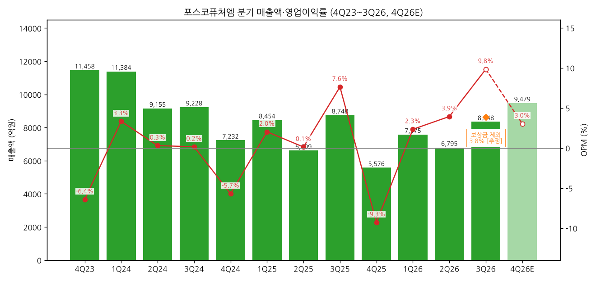
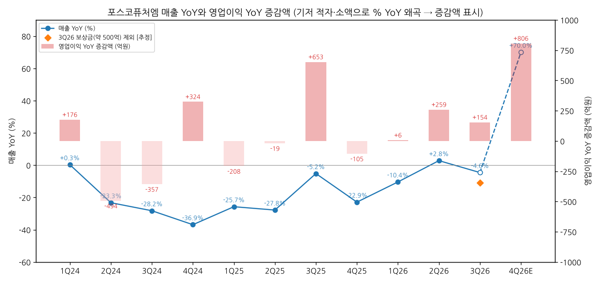
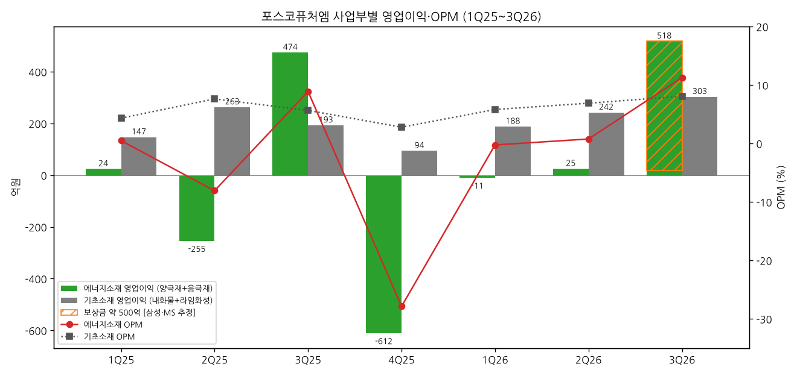

> 모드: 실적 리뷰 (v11)
> 종목: 포스코퓨처엠 (003670)
> 섹터: 배터리
> 서브섹터: 양극재
> 분기: 2026-Q3
> 발표일: 2026-11-02 (실적발표·컨퍼런스콜, IR 자료 irgo 게시 11/3 / DART 3Q26 분기보고서 11/13 — 숫자 IR과 일치)
> 작성 시각: 2026-11-16 17:30 KST
> 분석 소스: 회사 「2026년 3분기 실적발표」 IR PT(2026-11-02) + 국내 5개사(삼성 11/2, 하나 11/3, 다올 11/3, 메리츠 11/13 「2027 Outlook」, DB 11/16) + 해외 4개사(Citi 11/3, HSBC 11/2, J.P. Morgan 11/2, Morgan Stanley 11/2) — 첨부 11건 중 포스코퓨처엠 10건 사용 (J.P. Morgan 11/5 에코프로비엠 단독 리포트 1건은 타 종목이라 제외) / 과거 분기는 본 세션 기업개요(회사 IR 사업부별 연결 실적·OpenDART, 2026-11-14) + 3Q25 회사 IR(2025-10-27) / 직전 리뷰 2026-Q1 / 중국 피어는 본 세션 Ronbay(688005.SS)·Easpring(300073.SZ) 3Q26 리뷰
> 리뷰 깊이: 풀 | 리서치 첨부 9건

# 포스코퓨처엠 3Q26 실적 리뷰

## 0. 한 줄 판정

> 성장 델타: 둔화 (보고 기준 영업이익 YoY +154억으로 플러스지만 증감액은 2Q보다 축소, 보상금 제외 시 YoY 마이너스) | 내러티브: 형성 (LFP — 셀 3사 수주로 2027 물량 스토리 등장, 마진은 미확인) → 관찰 구간 (물량 스토리는 생겼지만 이익 델타는 4Q 보상금 소멸·리튬 하락으로 공백, LFP 램프 마진 확인 전)

→ 숫자: 매출 8,348억 (YoY −4.6%, QoQ +22.9%), 영업이익 821억 (YoY +23.1%, QoQ +207.5%, OPM 9.8%). FnGuide 컨센 179억(삼성 인용) 대비 **+359%**. 단 매출 YoY는 2Q26 +2.8% → 3Q26 −4.6%로 다시 마이너스, 영업이익 YoY 증감액은 2Q26 +259억 → 3Q26 +154억으로 축소
→ 쟁점 ①: 서프라이즈의 정체는 **고객 물량 미이행 보상금**(회사 금액 비공개, 삼성·MS 약 500억 추정). 빼면 영업이익 약 321억(OPM 3.8%), 에너지소재는 약 18억(OPM 0.4%)으로 **본업은 BEP** — 전년 대비 증익은 사실상 기초소재(+110억)가 만들었다 [추정]
→ 쟁점 ②: LFP가 새 스토리 — SK온(약 1.1조, 2027\~29)·삼성SDI(약 6.05조, 2027\~32) 계약 + LGES와 양·음극재 72만톤 MoU(2027\~33). 포항 라인을 1H27까지 **LFP 10.5만톤**으로 전환, 2027 양극재 출하 **약 10만톤(LFP 약 5만톤)** 가이드 (JPM·MS·Citi 인용). 셀사이드는 물량은 인정하되 LFP 판가가 삼원계의 1/3(하나)이라 2027E 영업이익 평균은 발표 전보다 −5.6%
→ 다음 분기 관건: 보상금 없는 4Q26 영업이익(셀사이드 평균 288억, 171\~370억)과 **12월 LFP 초도 출하(1.5kt)**, 그리고 리튬 하락에 따른 4Q 판가 하락·재고평가손이 에너지소재를 다시 적자로 돌리는지

---

## 1. 숫자

① 연결 분기 표 (억원, K-IFRS 연결)

| 항목 | 4Q23 | 1Q24 | 2Q24 | 3Q24 | 4Q24 | 1Q25 | 2Q25 | 3Q25 | 4Q25 | 1Q26 | 2Q26 | **3Q26** | 4Q26E |
|---|---|---|---|---|---|---|---|---|---|---|---|---|---|
| 매출액 | 11,458 | 11,384 | 9,155 | 9,228 | 7,232 | 8,454 | 6,609 | 8,748 | 5,576 | 7,575 | 6,795 | **8,348** | 9,479 |
| 영업이익 | −737 | 379 | 27 | 14 | −413 | 171 | 8 | 667 | −518 | 177 | 267 | **821** | 288 |
| OPM | −6.4% | 3.3% | 0.3% | 0.2% | −5.7% | 2.0% | 0.1% | 7.6% | −9.3% | 2.3% | 3.9% | **9.8%** | 3.0% |
| 매출 YoY | +46.7% | +0.3% | −23.3% | −28.2% | −36.9% | −25.7% | −27.8% | −5.2% | −22.9% | −10.4% | +2.8% | **−4.6%** | +70.0% |
| 영업이익 YoY | 적전 | +86.7% | −94.8% | −96.2% | 적지 | −54.9% | −70.4% | +4,664% | 적지 | +3.5% | +3,238% | **+23.1%** | 흑전 |
| 영업이익 YoY 증감액 | −770 | +176 | −494 | −357 | +324 | −208 | −19 | +653 | −105 | +6 | +259 | **+154** | +806 |
| **매출 YoY 델타 (%p)** | +24.7 | −46.5 | −23.5 | −5.0 | −8.7 | +11.1 | −2.1 | +22.6 | −17.7 | +12.5 | +13.2 | **−7.4** | +74.6 |
| **영업이익 YoY 델타 (%p)** | — | — | −181.5 | −1.4 | — | — | −15.5 | — | — | — | — | **—** | — |

→ (출처: 회사 3Q26 IR(2026-11-02) p.10 「사업부별 연결 실적」 2024\~3Q26, 2022\~2023 분기는 본 세션 기업개요(회사 IR·OpenDART). 3Q26은 DART 분기보고서(2026-11-13)와 일치. 4Q26E = 발표 후 6개사(삼성 11/2·하나 11/3·다올 11/3·DB 11/16·HSBC 11/2·J.P. Morgan 11/2) 평균 [계산])
→ 컨센 대비: 영업이익 **+359%** (FnGuide 179억, 삼성 인용 — 다올 시장 컨센 194억, DB 200억, Bloomberg 185\~190억), 매출 **+8.1%** (컨센 약 7,720억, 삼성·다올 인용). FnGuide 커버 17개사(삼성 표기)
→ 영업이익 YoY %는 기저가 0에 가까운 분기(2Q25 8억, 3Q24 14억)와 적자 분기가 섞여 의미가 없다 → **판정은 영업이익 YoY 증감액(억원)으로** 한다 (SDI 리뷰와 같은 방식)

**해석**
→ 매출 YoY는 4Q24 −36.9%를 바닥으로 1Q26 −10.4%, 2Q26 +2.8%까지 올라왔다가 3Q26 −4.6%로 다시 꺾였다. 기저(3Q25 8,748억)가 높았고 양극재 매출이 YoY −14.9%였기 때문. 4Q26E는 전년 기저가 2023년 이후 최저(5,576억)라 +70%로 튄다 — **이건 성장이 아니라 기저효과** [판단]
→ 영업이익 YoY 증감액은 2Q26 +259억 → 3Q26 +154억으로 플러스지만 축소(= 둔화). 보상금 약 500억을 빼면 3Q26 약 321억으로 **YoY −346억(−52%)** [추정]. 단, 3Q25(667억)에도 양·음극재 재고평가 충당금 환입이 있었다(회사 3Q25 IR, 금액 비공개) — 기저도 부풀어 있어 조정 기준 감익폭은 이보다 작다
→ 컨센 경로상 매출 YoY 정점은 기저효과로 4Q26(+70%), 영업이익 증감액도 4Q26(+806억, 적자 기저). 2027년부터는 기저가 정상화되며 LFP 물량이 실제로 이익을 내는지가 델타를 정한다

→ (출처: 회사 IR, OpenDART, 셀사이드 6개사 평균 — 4Q26E는 연한 막대·점선. 주황 마름모 = 보상금 약 500억(삼성·MS 추정) 제외 3Q26 OPM [추정])

→ (출처: 동일. 막대 = 영업이익 YoY 증감액(억원), 주황 마름모 = 보상금 제외 3Q26 증감액 −346억 [추정])

② 사업부별 매출·영업이익 (억원, 회사 IR 연결 기준)

| 사업부 | 3Q25 | 4Q25 | 1Q26 | 2Q26 | **3Q26** | 4Q26E (HSBC) | 3Q26 YoY | 3Q26 QoQ | 3Q26 매출 비중 |
|---|---|---|---|---|---|---|---|---|---|
| 에너지소재 매출 | 5,334 | 2,196 | 4,336 | 3,279 | **4,596** | 5,550 | −13.8% | +40.2% | 55.1% |
| ㄴ 양극재 | 5,080 | 1,979 | 4,187 | 2,996 | **4,323** | 5,120 | −14.9% | +44.3% | 51.8% |
| ㄴ 음극재 | 254 | 217 | 149 | 283 | **273** | 420 | +7.5% | −3.5% | 3.3% |
| 에너지소재 영업이익 | 474 | −612 | −11 | 25 | **518** | 110 | +44억 | +493억 | |
| 에너지소재 OPM | 8.9% | −27.9% | −0.3% | 0.8% | **11.3%** | 2.0% | | | |
| 기초소재 매출 | 3,414 | 3,380 | 3,239 | 3,516 | **3,752** | 3,550 | +9.9% | +6.7% | 44.9% |
| ㄴ 내화물/플랜트 | 1,295 | 1,218 | 1,132 | 1,144 | **1,015** | — | −21.6% | −11.3% | |
| ㄴ 라임/화성 | 2,119 | 2,162 | 2,107 | 2,372 | **2,737** | — | +29.2% | +15.4% | |
| 기초소재 영업이익 | 193 | 94 | 188 | 242 | **303** | — | +110억 (+57.0%) | +61억 | |
| 기초소재 OPM | 5.7% | 2.8% | 5.8% | 6.9% | **8.1%** | — | | | |

→ (출처: 회사 3Q26 IR p.4·5·10 사업부별 실적. 양극재·음극재 영업이익은 회사 미분리(에너지소재 합산만 공시). 4Q26E는 HSBC 2026-11-02 Exhibit 9 — HSBC 양극재 매출은 연결조정 전 기준(3Q26 4,930억)이라 회사 숫자와 기준 차이 있음. 기초소재 세부 손익: Citi 추정 3Q26 내화물 3억·라임화성 300억 [추정])
→ 에너지소재 매출 YoY 추이(1Q25\~3Q26): −35.3% → −46.8% → −8.5% → −42.5% → −14.2% → +3.9% → **−13.8%**. 양극재만 보면 −36.3% → −49.7% → −9.0% → −43.7% → −10.2% → +9.7% → **−14.9%**
→ 양극재 출하·판가(회사 미공시 — DART 「정보유출 우려」로 미기재): 3Q26 출하 **약 1.0\~1.1만톤**(QoQ +10\~15%, 삼성·다올 추정), ASP 약 23$/kg 보합(다올 추정). 회사 설명은 "기존 고객사향 판매량 회복 및 판가 상승"(IR p.4) — 현대차 N87·포드향 N65 재개와 얼티엄셀즈향 N86 일부 반영(다올·삼성)
→ 회사 4Q 가이던스: 양극재 출하 **+50% 이상 QoQ**(올해 최고, 소형·신규 시장 + LFP 초도), 음극재 **+20% QoQ**, 대신 리튬 하락으로 **양극재 판가 QoQ 하락** (MS·Citi 인용). 2026 연간 양극재 약 5만톤(YoY +15%)

**해석**
→ 3Q26 전사 영업이익 YoY +154억 = **에너지소재 +44억 + 기초소재 +110억**. 에너지소재에 보상금 약 500억이 들어 있으므로, 보상금을 빼면 에너지소재는 약 18억(OPM 0.4%)으로 **YoY −456억** [추정] — 실질 증익은 전부 기초소재(유가 연동 화성품 판가 상승 + 라임 생산량 증가에 따른 고정비 감소, 회사 IR p.5)에서 나왔다
→ 음극재는 해외(일본) 고객 물량이 늘었지만 중국발 판가 인하로 매출 QoQ −3.5%, **재고평가손실**로 적자 확대(회사 IR p.4). 1Q26 리뷰에서 기대한 "음극재 적자 절반 축소"는 오지 않았다
→ 델타를 끌 후보는 4Q 양극재 물량(+50% QoQ)뿐인데, 판가가 내려가는 물량 증가라 이익 레버리지는 제한적 — HSBC 4Q 에너지소재 영업이익 110억(−78% QoQ) [추정]

→ (출처: 회사 3Q26 IR p.10. 빗금 = 보상금 약 500억 — 회사 비공개, 삼성 2026-11-02·MS 2026-11-02 추정)

③ 중국 양극재 피어 대비 3Q26 (본 세션 리뷰 기준)

| 항목 | 포스코퓨처엠 에너지소재 | Ronbay (688005.SS) | Easpring (300073.SZ) |
|---|---|---|---|
| 3Q26 매출 | 4,596억 (양극재 4,323억) | 58.83억위안 ≈ 1조 2,364억 | 69.8억위안 ≈ 1조 4,669억 |
| 매출 YoY | −13.8% (양극재 −14.9%) | **+114.9%** | **+135.3%** |
| 영업이익률 | 11.3% / 보상금 제외 약 0.4% [추정] | 0.3% (한국식 근사, 재고손 반영 시 적자 추정) | 3.9% (한국식 근사, QoQ −2.8%p) |
| 출하량 | 양극재 약 1.0\~1.1만톤 [삼성·다올 추정] | 삼원 3.8만톤+ (+81% YoY) | 다원계 2.2만톤 + LFP 4.5\~4.8만톤 [동오 추정] |
| 메탈가 영향 | 음극재 재고평가손, 양극재 재고손(DB·HSBC) vs 과거 평가손 제품 환입(하나) | 리튬 반락 → 재고평가손 약 0.8억위안 | 9월 탄산리튬 고점 대비 −28% → GPM 7.5% 사상 최저 |
| 4Q 관건 | 출하 +50% QoQ, 판가 하락 | 흑자 복귀·한국 공장 임대 확정 | GPM 10% 회복 |

→ (출처: 포스코퓨처엠 회사 IR·셀사이드 / Ronbay·Easpring은 본 세션 3Q26 리뷰(2026-11-14, 거래소 공시 기반). 원화 환산 = 3Q26 평균 CNY/KRW 210.16 [계산])
→ 중국 피어는 물량이 2배로 늘고도 리튬 반락 래깅에 마진이 0\~4%로 눌렸다. 포스코퓨처엠은 물량이 YoY 감소한 상태에서 **보상금이 같은 래깅 충격을 가렸을 뿐** — 셋 다 3Q의 본업 마진은 0\~4% 구간으로 같다 [판단]

④ 연간 (억원)

| 항목 | 2023 | 2024 | 2025 | 2026E | 2027E |
|---|---|---|---|---|---|
| 매출액 | 47,599 | 36,999 | 29,387 | 32,266 | 38,605 |
| 영업이익 | 359 | 7 | 328 | 1,558 | 1,646 |
| OPM | 0.8% | 0.0% | 1.1% | 4.8% | 4.3% |
| 매출 YoY | +44.2% | −22.3% | −20.6% | +9.8% | +19.6% |
| 영업이익 YoY | −78.4% | −98.1% | +4,586% | +375% | +5.6% |

→ (출처: 2023\~2025 회사 3Q26 IR p.10. 2026E·2027E = 발표 후 셀사이드 평균 [계산] — 영업이익 8개사(삼성 1,562/2,449·하나 1,436/1,362·다올 1,630/1,990·DB 1,600/1,840·메리츠 1,596/1,696·Citi 1,560/1,190·HSBC 1,580/1,410·JPM 1,500/1,230), 매출 9개사(MS 포함). 2027E 영업이익 범위 **1,190억(Citi)\~2,449억(삼성)**, 매출 범위 2.97조(하나)\~4.65조(삼성))
→ 발표 전 컨센(하나 표기 FnGuide) 2026E 863억 / 2027E 1,744억 → 발표 후 평균 1,558억 / 1,646억 — **2026E +80.5%(보상금 반영), 2027E −5.6% 하향**. 2027E 하향은 리튬 하락에 따른 판가(메리츠·HSBC 환율·판가)와 LFP 저판가 반영

---

## 2. 시장 쟁점

### 2-0. 지난 리뷰(1Q26)에서 "봐야 할 것"으로 남긴 항목

| 1Q26 리뷰 4번 항목 | 3Q26 결과 | 판정 |
|---|---|---|
| GM 얼티엄셀즈 가동 재개 (N86 회복) | 3Q 얼티엄셀즈향 N86 판매 일부 반영(삼성), 4Q GM 물량 재개(다올). 단 회사는 2027 NCM 물량 "보합\~소폭 감소" 가이드(MS) | 일부 확인 (재개 O, 성장 X) |
| 2Q26 OPM 3% 유지 (본업 검증) | 2Q26 OPM 3.9%, 3Q26 9.8% — 3Q는 보상금 제외 시 약 3.8% [추정] | 확인 (보고 기준) / 본업은 3%대 정체 |
| LFP 시제품 → 1차 수주 | SK온(9월, 약 1.1조)·삼성SDI(10월, 약 6.05조) 계약 + LGES 72만톤 MoU. 포항 20kt 전환 완료, 12월 초도 출하 | 확인 (기대 초과) |
| 음극재 회복 (일본향 출하, 적자 절반 축소) | 일본 물량 증가에도 매출 QoQ −3.5%, 재고평가손으로 적자 확대(회사 IR) | 반대로 나옴 |
| 순차입금비율 75%+ 추적 (80% 경계) | 1Q26 74% → 2Q26 73% → **3Q26 78%** (순차입금 3.46조, 현금 5,731억) | 경계 근접 |

### 2-1. 이번 분기 쟁점

① **서프라이즈의 질 — 보상금을 빼면 본업 이익은 얼마인가** (9건 중 9건)
② **LFP 전환 — 2027 물량 10만톤은 이익이 되나** (9건 중 9건)
③ **리튬 하락과 재고평가 — 4Q 판가 하락이 이익을 다시 지우나** (9건 중 7건)
④ **밸류에이션 프리미엄과 오버행 — PER 100\~200배를 정당화할 수 있나** (9건 중 6건)

### 2-2. 쟁점별 분해

#### ① 보상금 — 본업 이익의 실체

(1) 회사 설명
→ "양극재: 판매량 증대 및 **고객사 미이행 보상금** 반영 / 음극재: 재고평가손실 인식으로 전분기비 악화" (IR p.4). 보상금 금액·고객·반복 여부는 공개하지 않음 (Citi "amount not disclosed")
→ 영업외손익 −217억(QoQ −207억), 당기순이익 464억, EBITDA 1,360억 (IR p.2)

(2) 증권사별 해석 편차

| 증권사 | 보상금 추정 | 보상금 제외 본업 판단 | 4Q26E 영업이익 |
|---|---|---|---|
| 삼성 (11/2) | **약 500억** (판매 미이행 보상금) | 출하 +10%+ QoQ 약 1만톤, N65·N86 반영 — 물량 개선은 실재 | 294억 |
| Morgan Stanley (11/2) | **약 500억** (MSe) | "본업 양·음극재 수익성은 저가동률로 부진" | — |
| HSBC (11/2) | 언급(금액 없음) | 에너지소재 **BEP 안팎** — 음극재 손실 + 양극재 원재료 재고손 | 330억 (에너지소재 110억) |
| DB (11/16) | 언급(바인딩 계약 미이행) | 보상금 제외 양극재 수익성 **2Q와 비슷** — N87 믹스 개선을 재고평가손이 상쇄 | 330억 |
| 하나 (11/3) | 언급(보상금이 **매출**로 반영) | 보상금 + **2년 전 평가손 제품을 중국 저가시장에 출하하며 환입** — 1회성 "대거" | **171억** |
| 다올 (11/3) | "일회성 외에도 긍정적 변화" | 양극재 출하 1.1만톤(+15%+ QoQ), 현대차 N87·포드 N65 재개 | **370억** |
| J.P. Morgan (11/2) | 주문 취소 관련 일회성 | JPMe 250억 대비 차이 대부분이 보상금 | 230억 |
| Citi (11/3) | 비공개 | 2026E·2027E EPS 상향에 보상금+LFP 물량 반영 | — |
| 메리츠 (11/13) | 보상금 수취 등 일회성 소멸 | 기존 삼원계 출하·수익성 부진 지속 | — |

(3) 공통 결론 vs 갈리는 지점
→ 공통: 3Q 영업이익의 60% 안팎은 보상금, 4Q에는 없다. 4Q26E는 171\~370억(평균 288억)으로 3Q 대비 −55\~−79%
→ 갈림: 보상금을 뺀 에너지소재가 **BEP냐(HSBC·DB) 아니면 하나처럼 환입까지 빼면 적자냐**. 같은 3Q 양극재에 대해 DB·HSBC는 "재고평가 **손실**", 하나는 "과거 평가손 제품 **환입**"으로 부호가 반대 — 회사가 분해를 안 줘서 증권사 모델이 엇갈린다

(4) [판단]
→ 보상금 500억 기준 에너지소재 본업은 약 18억(OPM 0.4%)으로 2Q26(25억, 0.8%)과 거의 같다 — DB의 "2Q와 비슷" 해석이 숫자와 가장 잘 맞는다 [추정]. 즉 **3Q는 물량(+44% QoQ 양극재 매출)이 늘었는데도 본업 마진이 개선되지 않은 분기** — 리튬 하락 래깅이 물량 효과를 먹었다
→ 결론을 바꿀 데이터: 4Q 실적에서 에너지소재 영업이익이 100억 이상(HSBC 110억)이면 "물량 +50%가 BEP를 넘긴다"로 볼 수 있다. 적자면 3Q 본업은 BEP가 아니라 적자였던 것

#### ② LFP 전환 — 2027 물량 10만톤의 이익 기여

(1) 회사 설명
→ "국내외 생산거점 확보 및 양극재 라인 전환(삼원계 → LFP) 진행", 포항 양극재 1공장 60천톤 중 **LFP 전환 진행 중 105천톤 예정**, "LFP 신규 수주 시 양극재 라인 추가 전환으로 대응", 씨앤피신소재(LFP) off-take 물량 별도 확보(2027.4Q\~) (IR p.7)
→ 중기 전략: Non-PFE LFP 양극재 시장 선도, 無전구체 공법 상용화로 원가우위, 高밀도 LFP 개발 (IR p.8)
→ 컨콜(셀사이드 인용): LFP 12월 첫 출하(4Q26 1.5kt), 포항 2-2 4개 라인 1H27까지 전환 → 105ktpa, 2027 LFP 약 50kt로 **NCM 물량 추월**, 2028 추가 전환 검토. 2027 양극재 출하 약 100kt(올해 <50kt) (MS·JPM·Citi). NCM은 2027 "보합\~소폭 감소" (MS·Citi)

(2) 증권사별 해석 편차

| 증권사 | 2027 출하 가정 | LFP 마진·기여 가정 | 논리 |
|---|---|---|---|
| 하나 | LFP 60kt + 삼원 42kt (2028 LFP 120kt) | LFP 판가 9.8$/kg(삼원 29.5$의 1/3), OPM 6.1% | 매출·이익 기여 강도가 과거 대비 약함 → 2027E 매출 −3.5% YoY. "시총 20조 내 트레이딩" |
| DB | 7.2만톤 (삼원 5.3 + LFP **2.0**) | Non-PFE 프리미엄 LFP 비중↑ → 믹스 개선 | 105kt 체제는 1H27 완성, 먼저 전환된 20kt부터 가동 — 2027 LFP 보수 반영. 2028 OP 3,350억 |
| 다올 | 7.4만톤 (2026 4.9만톤 대비 +51%) | 2027E 영업이익 1,990억 (+60%, 일회성 제외) | 양·음극재 모두 성장 사이클 진입, 2029 ROE 20% |
| HSBC | LFP = 양극재 물량의 48%(2027)/61%(2028) | LFP 매출 비중 23%/34%, 2028 에너지소재 OP의 62% | 방향은 좋지만 실행이 관건. 2027/28 OP는 컨센 대비 −16%/−35% |
| J.P. Morgan | 약 100kt (LFP 약 50kt) | 마진은 "muted" | 한국(엘앤에프)·중국 경쟁 + 급격한 램프업 리스크, 無전구체 공정은 검증 중 |
| Citi | >100kt (LFP 50%+) | 정상화 양극재 EBIT 7\~8% | 셀 업체가 미국 ESS 노출에 더 낫다. LGES 1위 LFP 공급사 Lopal의 non-PFE 지분 조정(인니 2기 100%→24%) = 경쟁 |
| 삼성 | 계약 물량이 포항 미전환 Capa(LFP 전환 시 약 8.5만톤)로도 부족 | 추가 전환 불가피 | 2027E EPS +2.1%, 국내 유일 인조흑연과 함께 탈중국 수혜 |
| 메리츠 | LFP 총 20만톤+ 규모 | 수익성 개선 시점이 관건 | non-PFE 효과로 국내 섹터 멀티플 프리미엄, 단 삼원계 부진 지속 |

(3) 공통 결론 vs 갈리는 지점
→ 공통: 셀 3사와 계약을 모두 확보해 2027 물량은 가시성이 생겼다. 기존 라인 전환이라 엘앤에프 신설 대비 Capex·리드타임이 유리(Citi)
→ 갈림: ① 2027 LFP 실제 출하 **20kt(DB) vs 50kt(회사·MS) vs 60kt(하나)** — 3배 차이 ② LFP 마진 — 하나 6.1%, Citi 정상화 7\~8% vs JPM "muted". 이 두 가정이 2027E 영업이익 1,190억\~2,449억 편차의 대부분

(4) [판단]
→ HSBC 계약 정리 기준 SDI 6.05조(2027\~32, 약 50\~64만톤)·SK온 1.1조(2027\~29)를 연평균으로 나누면 LFP 매출은 연 1.4조 안팎이 상한선 [추정: 6.05조/6년 + 1.1조/3년]. 삼원계 판가의 1/3짜리 물량이라 **매출은 늘어도 이익 기여는 2028년부터** 의미 있다는 하나·HSBC 경로가 숫자와 맞다 [판단]
→ 결론을 바꿀 데이터: 12월 1.5kt 초도 출하가 예정대로 나가고, 1Q27 LFP 출하가 분기 5kt 이상(연 20kt 페이스)이면 DB 가정이 바닥, 10kt 이상이면 회사 가이드(50kt)가 현실화

#### ③ 리튬 하락과 재고평가 — 4Q 판가

(1) 회사 설명
→ 4Q 양극재 판가는 리튬 가격 하락으로 **QoQ 하락**, 물량은 +50% 이상 증가 (Citi·MS 인용). IR p.9 원재료 동향에 탄산리튬·니켈·코발트 가격 추이 게시
→ 음극재 3Q 재고평가손실 인식 (IR p.4)

(2) 증권사별 해석 편차

| 증권사 | 판단 | 반영 |
|---|---|---|
| 메리츠 | 2026 하반기 광물 가격 하락 → **중단기 판가 하락**, 보상금 소멸 | 추정치 조정, Hold·적정가 15만 유지 |
| Citi | 자사 원자재팀의 단기 리튬 신중 전망 → 재고손 가능성, 고정자산 60%+가 건설중(향후 감가상각 부담) | Sell, 2028E EPS 하향(캐나다 JV 고정비) |
| HSBC | 양극재 원재료 재고 관련 손실, FX 가정 반영으로 판가 하락 | 2027/28 매출 −5%/−2% |
| DB | 양극재·음극재(환율 하락) 모두 재고평가손 | 4Q 출하 +40% QoQ(중국향 저가재고·파워툴) |
| J.P. Morgan | 음극재 판가 하락에 따른 재고 재평가손 "재발" | 마진 개선 지연 |
| 하나 | 오히려 과거 평가손 제품 출하로 **환입** | 4Q 1회성 소멸로 감익 불가피 (171억) |

(3) 공통 결론 vs 갈리는 지점
→ 공통: 4Q 판가는 내려간다. 물량 증가가 판가 하락을 상쇄해 매출은 늘지만 이익은 3Q 본업 수준(BEP)을 크게 넘기 어렵다
→ 갈림: 4Q 출하 증가분 중 **중국향 저가재고 판매(DB)** 비중 — 재고 처분 물량이면 마진은 더 낮다

(4) [판단]
→ 중국 피어(Easpring GPM 7.5% 사상 최저, Ronbay 재고손 약 0.8억위안)가 같은 분기에 같은 래깅을 맞았다. 리튬 반락이 4Q에도 이어지면 포스코퓨처엠도 보상금 없이 래깅 충격을 맨몸으로 받는 첫 분기가 된다 [판단]
→ 결론을 바꿀 데이터: 4Q 중 탄산리튬 가격이 9월 저점 대비 반등하면 1Q27 래깅이 플러스로 돈다. 추가 하락이면 4Q 에너지소재 적자 가능성

#### ④ 밸류에이션 프리미엄과 오버행

(1) 회사 설명
→ 회사 직접 언급 없음. 3Q26 말 자본 4.44조(기타포괄손익 −2,665억 QoQ), 순차입금 3.46조, 순차입금비율 78% (IR p.3)

(2) 증권사별 해석 편차

| 증권사 | 판단 | 근거 |
|---|---|---|
| 하나 | 프리미엄은 정당, 그러나 **주가가 상당 부분 반영** | 양·음극재·전구체 수직계열 + 모회사 리튬 → 5년간 경쟁사 2배 멀티플. LFP 판가 1/3 → 시총 20조 내 트레이딩 |
| 삼성 | 프리미엄 유지 | Peer P/B 3.0 → 2.7배 하락으로 TP 하향, 국내 유일 음극재 프리미엄(최근 6개월 평균 43%) |
| DB | 오버행 완화 | POSCO홀딩스 지분 처분 계획이 **최대 2027년 말까지 연기**된 것으로 소통 → 내년 상반기까지 오버행 완화 |
| HSBC | "blue-sky 시나리오를 반영" | 2027/28E PER 194배/160배 |
| J.P. Morgan | 다운사이클 멀티플 | 2028E EV/EBITDA 25배 |
| 메리츠 | 국내 섹터 non-PFE 프리미엄은 인정 | 2027E EV/EBITDA 41배에도 적정가 15만 |

(3) 공통 결론 vs 갈리는 지점
→ 공통: 이익 기준 밸류에이션(PER 100배+)은 설명력이 없고, P/B·EV/EBITDA 프리미엄을 얼마나 줄지의 문제
→ 갈림: 국내 Buy 진영(다올·DB·삼성·하나)은 수직계열·탈중국 프리미엄을 인정, 해외 4사(Citi·HSBC·JPM·MS)는 전부 Sell/Underweight — **국내 vs 해외의 정면 대립**

(4) [판단]
→ 9개사 평균 TP 171,000원이 11/13 종가 173,500원보다 낮다 — 셀사이드 합의상 현재가는 이미 "공정가 이상" 구간 [판단]. 주가를 더 끌려면 추정치(2027E)가 올라가야 하는데 이번엔 반대(−5.6%)였다

### 2-3. 낙관 vs 보수 — 논리 대비

→ **가장 낙관: 다올(BUY, 29만)·DB(Buy, 23만)** — 2029 ROE 20% × P/B 4.8배(다올), 2028 영업이익 3,350억(DB). 가정의 핵심은 "LFP·음극재 동시 성장 사이클 + Non-PFE 프리미엄 LFP가 믹스를 개선"
→ **가장 보수: J.P. Morgan(UW, 10만)·Morgan Stanley(UW, 11만)·HSBC(Reduce, 12만)** — "물량은 늘지만 마진은 muted"(JPM), 2028E 영업이익 1,580억(JPM)·1,960억(HSBC). 가정의 핵심은 **LFP 저판가 + 한·중 경쟁 + 삼원계 정체로 OPM 3%대 고착**
→ 둘을 가르는 변수: 2028E 영업이익 **3,350억(DB) vs 1,580억(JPM)** — 2배 차이. 결국 LFP OPM이 6\~7%(하나·Citi 정상화)냐 3%대(JPM·HSBC)냐
→ 셀사이드 vs 시장: 10/30 종가 162,100원 → 발표일 11/2 168,900원(+4.2%) → 11/13 173,500원(+7.0%). 해외 4사 전원 매도 의견에도 주가는 보상금 서프라이즈와 LFP 수주에 올랐다. 다만 12개월 KOSPI 대비 −45.3%p(삼성 표기) — 수급은 "LFP 물량 기대"를 사지만 이익은 아직 따라오지 않은 구간 [판단]

### 2-4. 추정치·TP 변화

| 증권사 | 의견 | 직전 TP | 현재 TP | 4Q26E 영업이익 | 2026E / 2027E 영업이익 | 핵심 변화 한 줄 |
|---|---|---|---|---|---|---|
| 다올 (11/3) | BUY | 290,000 | 290,000 | 370억 | 1,630억 / 1,990억 | 2029 ROE 20% × P/B 4.8배 유지 |
| DB (11/16) | Buy | 230,000 | 230,000 | 330억 | 1,600억 / 1,840억 | 2027 출하 7.2만톤, 오버행 완화 |
| 삼성 (11/2) | BUY | 230,000 | **210,000** | 294억 | 1,562억 / 2,449억 | 2026E OP +94.8%, Peer P/B 하락으로 TP −8.7% |
| 하나 (11/3) | BUY | 171,000 | **196,000** | 171억 | 1,436억 / 1,362억 | LFP 출하 반영 상향, 2027E는 감익 |
| 메리츠 (11/13) | Hold | 150,000 | 150,000 | — | 1,596억 / 1,696억 | 리튬 하락 반영 추정 조정 |
| Citi (11/3) | Sell | 130,000 | 130,000 | — | 1,560억 / 1,190억 | 2026\~27E EPS 상향, 2028E 하향(캐나다 JV) |
| HSBC (11/2) | Reduce | 110,000 | **120,000** | 330억 | 1,580억 / 1,410억 | 2026E OP +112%, 2027/28E +5%/+10% |
| Morgan Stanley (11/2) | UW | [미확보] | 110,000 | — | — (EBITDA 3,420억 / 4,920억) | 3Q 일회성, LFP 로드맵 긍정이나 UW 유지 |
| J.P. Morgan (11/2) | UW | 100,000 | 100,000 | 230억 | 1,500억 / 1,230억 | 2026E OP +55%, 2027\~28E 변화 <1% |

→ 평균 TP(9개사) **171,000원** (11/13 종가 173,500원 대비 −1.4%). 직전 TP 확인 8개사 평균 176,375원 → 178,250원(**+1.1%**). 상향 2건(하나·HSBC), 하향 1건(삼성), 유지 5건, 확인 불가 1건(MS). FnGuide 17개사 평균 TP 227,647원(삼성 표기, 발표 전)
→ TP 변화 원인: 상향 2건은 **LFP 물량 반영(실적)**, 하향 1건(삼성)은 **Peer P/B 하락(멀티플)** — 실적 하향에 의한 TP 하향은 없었다
→ 발표 전 대비 연간 컨센: 2026E 영업이익 **+80.5%**(863억 → 1,558억, 보상금 반영), **2027E −5.6%**(1,744억 → 1,646억) — 올해는 일회성으로 올렸고 내년은 리튬·LFP 저판가로 깎았다

---

## 3. 내러티브 점검

① 스토리 정의
→ **"삼원계 침체를 Non-PFE LFP(한국 셀 3사·미국 ESS)와 탈중국 음극재로 메우는 유일한 수직계열 소재사"** — 시장이 포스코퓨처엠을 사는 이유는 POSCO 그룹 원료(리튬·흑연)부터 양·음극재까지의 탈중국 공급망과, 그에 대한 멀티플 프리미엄

② 이번 분기가 스토리에 준 영향
→ 생긴 것: LFP 스토리의 **물량 근거**. 셀 3사 모두와 계약/MoU, 포항 105kt 전환 일정(1H27), 12월 초도 출하, 2027 출하 가이드 약 100kt(올해의 2배). 하나·HSBC가 TP를 올리고 전 증권사가 2027 물량을 모델에 넣기 시작
→ 약해진 것: 본업 이익. 보상금을 빼면 에너지소재는 BEP, 음극재는 재고평가손으로 적자 확대, 삼원계는 2027 보합\~감소 가이드. 2027E 영업이익 컨센은 −5.6% 하향
→ 판정: 새 성장 스토리(LFP)가 등장하고 셀사이드가 물량·TP에 반영하기 시작했으나 이익 추정은 아직 따라오지 않음 → **내러티브 "형성"**
→ 국면: 성장 델타는 보고 기준 둔화(조정 기준 감익), 내러티브는 형성 단계 → **"관찰 구간"** — 4Q 숫자는 기저효과로 좋아 보이겠지만(+70% 매출, 흑전), 판정을 바꿀 진짜 숫자는 1Q27 LFP 출하와 마진 [판단]

③ 다시 강해질 트리거
→ LFP 초도 출하(12월 1.5kt) 정상 진행 + 1Q27 분기 LFP 출하 10kt 이상
→ LGES MoU의 본계약 전환(물량·금액 확정) 또는 추가 LFP 라인 전환(광양) 발표
→ 4Q26 에너지소재 영업이익 100억 이상 — 보상금 없이 물량으로 BEP 돌파

④ 스토리를 깨뜨릴 리스크
→ 리튬 추가 하락 → 4Q 재고평가손으로 에너지소재 적자 복귀
→ LFP 램프업 지연·수율 문제(JPM: 급격한 램프업 리스크, 無전구체 공정 검증 중) 또는 중국계의 non-PFE 우회(Lopal 지분 조정, Citi)
→ 순차입금비율 80% 돌파 + POSCO홀딩스 지분 처분 재부각

---

## 4. 향후 봐야 할 것

① **4Q26 보상금 없는 영업이익과 에너지소재 손익** — 1순위 (델타 판정을 바꾸는 변수)
→ 무엇을: 연결 영업이익 288억(셀사이드 평균, 171\~370억) 방어, 에너지소재 100억 이상(HSBC 110억)이면 "물량으로 BEP 돌파", 적자면 3Q 본업도 적자였던 것으로 재판정
→ 어떤 데이터로: 4Q26 실적발표 IR PT·컨콜, 셀사이드 리뷰
→ 언제: 2027-01 말 (4Q25 실적 발표는 2026-01-29)

② **LFP 초도 출하와 램프 속도**
→ 무엇을: 12월 1.5kt 초도 출하, 1H27 105kt 전환 완료, 1Q27 LFP 출하 5kt(연 20kt, DB 가정) vs 10kt+(연 50kt, 회사 가이드), LGES 72만톤 MoU 본계약 전환
→ 어떤 데이터로: 회사 공시·보도("포스코퓨처엠 LFP 출하", "LGES LFP 양극재 계약"), 4Q 컨콜 LFP 코멘트, 삼성SDI 미국 LFP 라인 가동 뉴스
→ 언제: 2026-12 (초도) \~ 2027-01 말 (4Q 컨콜)

③ **리튬 가격과 4Q 재고평가손**
→ 무엇을: 탄산리튬 가격이 9월 저점 대비 반등하는지, 4Q 양극재 판가 하락폭, 양·음극재 재고평가손 재발 여부
→ 어떤 데이터로: Fastmarkets·SMM 탄산리튬 주간 가격, 중국 피어(Ronbay·Easpring) 4Q 실적예고, 회사 IR 원재료 동향 페이지
→ 언제: 매주 \~ 2027-01 (중국 피어 연간 실적예고 1월 중순)

④ **삼원계(NCM) 물량 — 4Q +50% QoQ의 질**
→ 무엇을: 4Q 양극재 출하 약 1.5만톤(+40\~50% QoQ) 달성 여부, 그중 중국향 저가재고·파워툴 비중(DB), GM 얼티엄셀즈 N86 재개 지속, 2027 NCM 보합 가이드 유지 여부
→ 어떤 데이터로: 4Q 컨콜, 관세청 양극재 수출입 통계(월간), GM·얼티엄셀즈 가동 뉴스
→ 언제: 매월 (수출 통계) \~ 2027-01 말

⑤ **재무와 오버행**
→ 무엇을: 순차입금비율 78% → 80% 돌파 여부, 2027 Capex 가이던스(LFP 추가 전환·캐나다 JV·베트남 음극재), POSCO홀딩스 지분 처분 시점(2027년 말까지 연기로 소통, DB)
→ 어떤 데이터로: 4Q IR 재무현황, 회사채 발행 공시, POSCO홀딩스 IR
→ 언제: 2027-01 말
