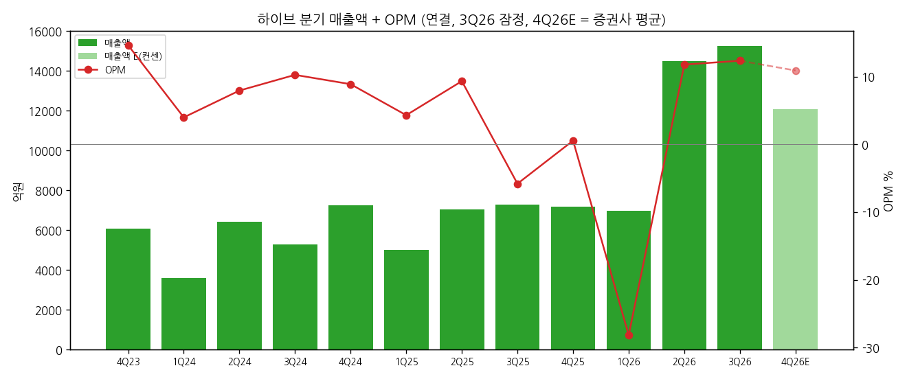
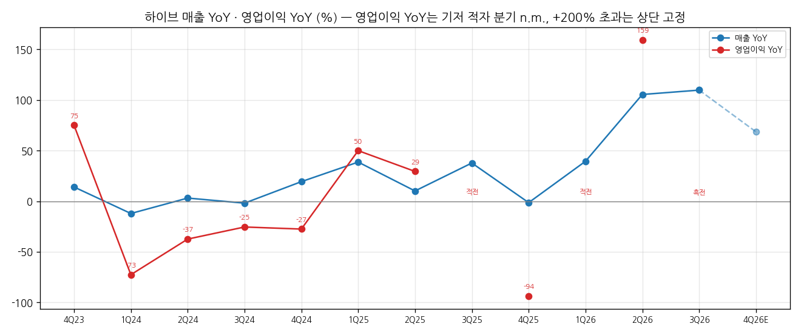
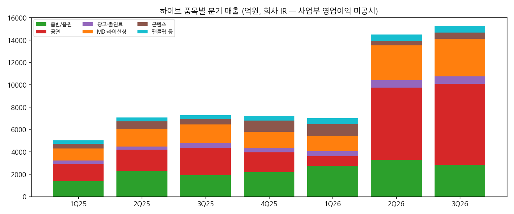

> 모드: 실적 리뷰 (v11)
> 종목: 하이브 (352820)
> 섹터: 엔터
> 서브섹터: 기획사
> 분기: 2026-Q3
> 발표일: 2026-11-03 (IR 잠정실적, 분기보고서 제출 전)
> 작성 시각: 2026-11-22 23:50 KST
> 분석 소스: 하이브 2026년 3분기 실적발표 IR(2026-11-03) + OpenDART 분기 재무(company-data MCP `dart_quarterly_summary`, 1Q21\~2Q26) + 셀사이드 13건 — Citi(11/3)·Goldman Sachs(11/3)·HSBC(11/3)·Bernstein(11/4)·유안타(11/4)·하나(11/4, 11/11)·삼성(11/4, 11/19 KeyHolder)·한화(11/4)·다올(11/4)·키움(11/17) / 같은 폴더 `company-overview/하이브_기업개요.md` 시계열 재사용. 웹서치 보완 없음
> 리뷰 깊이: 풀 | 리서치 첨부 13건 (IR 1 + 증권사 12)
> 비영업 요인: 저기저(3Q25 영업손실 −422억 — 북미 구조조정·신인 IP 투자, 3Q26 YoY는 흑자전환 n.m.) · 일회성(1Q26 임직원 보상 주식증여 비용 2,550억 → 1Q26 영업손실 −1,966억) · 영업외(3Q26 외화자산 원화평가손실 약 1,400억 — 하나 추정, 순이익만 영향)

# 하이브 3Q26 실적 리뷰

## 0. 한 줄 판정

> 성장 델타: 가속 | 내러티브: 약화 → 정점 경계 구간 (분기 최대 실적·컨센 +14%로 이익 증가폭은 커졌지만, BTS 투어가 끝나는 2027년 하반기 공백을 이유로 증권사 10곳 중 5곳이 TP 하향 — 실적이 아니라 멀티플이 깎이는 국면)

> ⚠ 비영업 요인 플래그: 3Q26 영업이익 YoY는 기저(3Q25 −422억) 적자로 n.m. — 판정은 영업이익 증가액(YoY +1,050억 → **+2,307억**)과 2년 전 동기 대비(2Q24 대비 +236% → 3Q24 대비 **+248%**)로 대체. 1Q26 적자는 주식증여 비용 2,550억(일회성, 조정 영업이익 585억). 3Q26 순이익 113억(지배 −68억)은 외화평가손실(영업외) 때문으로 영업이익 판정과 무관

→ 숫자: 매출액 1조 5,257억 (+109.8% YoY, +5.2% QoQ), 영업이익 1,885억 (흑자전환, +10.3% QoQ, OPM 12.4%). 매출 YoY 105.5%(2Q26) → **109.8%**, 영업이익은 2Q26 1,709억(+159%) → 3Q26 1,885억으로 2개 분기 연속 분기 최대
→ 컨센 대비: 매출 +3.9%, 영업이익 +14.6% (FnGuide 컨센 매출 1조 4,690억·영업이익 1,650억, 유안타 인용) — 이익 서프라이즈의 원천은 매출이 아니라 **판관비 −5.5% QoQ**
→ 쟁점 ①: **2027년 하반기 BTS 공백** — 회사가 "투어 이후 그룹·솔로 활동 준비"를 언급했지만 구체 일정 없음. 증권사 2027E 영업이익은 4,310억(다올)\~5,620억(GS)으로 갈린다
→ 쟁점 ②: **MD 수익화가 마진을 지킨다** — 공연 비중 48%로 GPM은 −1.5%p QoQ(30.3%) 하락했지만, BTS 북미 투어 MD만 1,070억(현지 생산·공급망)
→ 다음 분기 관건: 4Q26 영업이익 컨센 평균 약 1,320억(증권사 10곳 1,070\~1,560억) — 기타판관비 정상화 후에도 OPM 11%를 지키는지, BTS 2027년 하반기 활동 공지가 나오는지

## 1. 숫자

① 연결 분기 표 (억원, K-IFRS 영업이익. 3Q26은 IR 잠정, 4Q26E는 증권사 10곳 영업이익 평균·매출은 4곳 평균)

| 항목 (억원) | 4Q23 | 1Q24 | 2Q24 | 3Q24 | 4Q24 | 1Q25 | 2Q25 | 3Q25 | 4Q25 | 1Q26 | 2Q26 | **3Q26 [잠정]** | 4Q26E (컨센) |
|---|---|---|---|---|---|---|---|---|---|---|---|---|---|
| 매출액 | 6,086 | 3,609 | 6,405 | 5,278 | 7,264 | 5,006 | 7,056 | 7,272 | 7,164 | 6,983 | 14,500 | 15,257 | 12,079 |
| 영업이익 | 891 | 144 | 509 | 542 | 646 | 216 | 659 | -422 | 40 | -1,966 | 1,709 | 1,885 | 1,318 |
| OPM | 14.6% | 4.0% | 7.9% | 10.3% | 8.9% | 4.3% | 9.3% | -5.8% | 0.6% | -28.2% | 11.8% | 12.4% | 10.9% |
| 매출 YoY | +14.1% | -12.1% | +3.1% | -1.9% | +19.4% | +38.7% | +10.2% | +37.8% | -1.4% | +39.5% | +105.5% | +109.8% | +68.6% |
| 영업이익 YoY | +75.0% | -72.6% | -37.4% | -25.4% | -27.5% | +50.0% | +29.5% | 적전 | -93.8% | 적전 | +159.3% | 흑전 | +3195.0% |
| **매출 YoY 델타** | n.m. | -26.2%p | +15.2%p | -5.0%p | +21.2%p | +19.4%p | -28.5%p | +27.6%p | -39.2%p | +40.9%p | +66.0%p | +4.3%p | -41.2%p |
| **영업이익 YoY 델타** | n.m. | -147.6%p | +35.2%p | +11.9%p | -2.1%p | +77.5%p | -20.5%p | n.m. | n.m. | n.m. | n.m. | n.m. | n.m. |
| 참고: 조정 영업이익 |  |  |  |  |  |  |  |  |  | 585 (주식증여 2,550 제외) | 1,709 | 1,885 |  |
| 참고: 영업이익 증가액 YoY | 382 | -381 | -304 | -185 | -245 | 72 | 150 | -964 | -606 | -2,182 | 1,050 | 2,307 | 1,278 |

→ 영업이익 YoY: 2Q25 이후 기저가 흔들려(3Q25 −422억, 4Q25 40억, 1Q26 −1,966억) 비율 비교가 어렵다. 증가액 기준으로 2Q26 +1,050억 → 3Q26 **+2,307억**, 2년 전 동기 대비 +236% → +248% [계산] → 가속으로 판정
→ [판단] 매출 YoY 정점은 3Q26(+109.8%) 또는 4Q26(컨센 +69%, 기저 7,164억)이다. 컨센이 그리는 2027년은 매출 4.3조(−12%)·영업이익 4,940억(FnGuide, 하나 11/11 인용) — 보고 영업이익은 1Q26 일회성 기저 덕에 +60%대로 보이지만, 조정 기준(2026년 약 5,500억)으로는 **약 10% 감익**(하나). 분기 YoY는 2Q27부터 BTS 스타디움 투어 역기저로 꺾이는 경로
→ OPM: 12.4%(+0.6%p QoQ)로 2023년 4Q(14.6%) 이후 최고 수준. 4Q26E 10.9%로 소폭 하락 전망(유안타: 3분기 기타판관비 감소는 일회성)

→ (출처: OpenDART 분기 재무 1Q21\~2Q26, 하이브 3Q26 IR 잠정실적, 4Q26E 증권사 10곳 평균 [계산])

→ (출처: 같은 자료로 계산. 영업이익 YoY는 기저 적자 분기를 n.m.으로 표시)

② 품목별 매출 (억원, 회사 IR — 사업부별 영업이익은 미공시)

| 품목 | 3Q25 | 2Q26 | **3Q26** | QoQ | YoY | 비중 |
|---|---|---|---|---|---|---|
| 음반/음원 | 1,898 | 3,268 | 2,828 | −13.4% | +49.0% | 18.5% |
| 공연 | 2,450 | 6,477 | 7,268 | +12.2% | +196.7% | 47.6% |
| 광고·출연료 | 426 | 654 | 656 | +0.4% | +54.2% | 4.3% |
| MD·라이선싱 | 1,683 | 3,106 | 3,346 | +7.7% | +98.7% | 21.9% |
| 콘텐츠 | 468 | 416 | 567 | +36.3% | +21.2% | 3.7% |
| 팬클럽 등 | 346 | 579 | 591 | +2.2% | +70.8% | 3.9% |
| **합계** | 7,272 | 14,500 | 15,257 | +5.2% | +109.8% | 100% |
→ (출처: 하이브 3Q26 IR) 델타를 끄는 것은 **공연**(YoY 증가분 4,818억 = 전사 증가분 7,985억의 60%)과 **MD**(1,663억, 21%) [계산]. BTS 스타디움(유럽·북미 회당 약 7만 명) + 엔하이픈·르세라핌·앤팀·보이넥스트도어·투어스·아일릿·캣츠아이·코르티스 투어 동시 반영 (유안타)
→ 음반은 발매 감소로 −13% QoQ지만 추정치 상회(유안타 +12.5%): 엔하이픈 210만 장, 코르티스 미니 2집 누적 400만 장 돌파. 분기 판매 약 930만 장 (하나)
→ 원가 구조: 매출총이익률 30.3%(2Q26 31.8%, 3Q25 27.7%), 판관비 2,745억(2Q26 2,905억, −5.5%) — 인건비 1,577억(+1.2%) 유지, 운반비 160억(−27%)·기타판관비 128억(−43%) 감소 (IR 요약재무)

→ (출처: 하이브 IR 분기 품목별 매출, 1Q25\~3Q26)

③ 연간 (억원)

| 항목 | 2023A | 2024A | 2025A | 2026E | 2027E |
|---|---|---|---|---|---|
| 매출액 | 21,781 | 22,556 | 26,499 | 49,230 | 42,897 |
| 영업이익 | 2,956 | 1,840 | 493 | 3,029 | 4,939 |
| OPM | 13.6% | 8.2% | 1.9% | 6.2% | 11.5% |
| 매출 YoY | +22.6% | +3.6% | +17.5% | +85.8% | −12.9% |
| 영업이익 YoY | +24.8% | −37.8% | −73.2% | +514% | +63.1% |
→ (출처: 2023\~2025 OpenDART, 2026E·2027E FnGuide 컨센 — 하나 11/11 리포트 인용) 2026E에는 1Q26 주식증여 비용 2,550억 포함 → 조정 기준 2026E 약 5,580억, 2027E는 **조정 기준 약 −11%** [계산]
→ 발표 전 → 후 2026E 영업이익 컨센: 2,840억(하나 11/4 표기) → 3,029억(하나 11/11 표기) **+6.7%** 상향. 2027E는 4,756억 → 4,939억 +3.8% (같은 출처)

## 2. 시장 쟁점

① 지난 분기 체크
→ 첫 리뷰 — 직전 체크 없음

② 이번 분기 쟁점 (리포트 12건 기준)

(1) **2027년 하반기 BTS 공백** — 10건 언급. BTS 투어 종료 후 실적 절벽이 오나
(2) **공연 비중 확대 속 마진 방어** — 10건. GPM 하락을 판관비·MD가 상쇄했는데, 지속 가능한가
(3) **저연차 IP 수익화(캣츠아이·코르티스·미국 신인)** — 12건 전부. BTS 역기저를 메울 수 있나
(4) **디레이팅과 주주환원** — 7건. 사상 최대 실적에도 주가가 공모가 근처(2027E P/E 14\~17배)인 이유
(5) **순이익 적자 — 외화평가손실** — 9건. 영업 밖 회계 손실인가

③ 쟁점별 분해

(1) **2027년 하반기 BTS 공백**

(1-1) 회사 설명: CEO "BTS 멤버들과 다양한 솔로·그룹 활동을 논의 중이며, ARIRANG 월드투어 추가 일정과 투어 이후 그룹·솔로 활동을 준비하고 있다" (Bernstein 인용, 3Q26 컨콜). 2027년 1분기 호주·홍콩·마닐라 앙코르 투어 11회·57만 명 (키움)

(1-2) 증권사별 해석 편차

| 증권사 | 2027E 영업이익 | 핵심 가정·논리 |
|---|---|---|
| Goldman Sachs | 5,620억 | BTS 추가 투어·투어 후 활동 2027년 반영, 저연차 IP 확대 |
| 키움 | 5,602억 | 2027년 하반기 단체·솔로 음반, 투어 초기비용 소멸로 고마진 매출 누적 — 컨센 +18% |
| Bernstein | 5,370억 | BTS 투어 이후 활동 가시성이 오버행 제거·리레이팅 계기 (2027E EPS +6%) |
| 하나 | 4,851억 | 2027년 하반기 활동 언급 → 5,000억 내외 가능, 조정 기준 약 10% 감익 |
| HSBC | 4,740억 | BTS 공연 횟수 감소로 조정 영업이익 −10% YoY, 2028년 +36% |
| Citi | 4,530억 | 시장은 BTS를 '논이벤트'로 보지만 스트리밍·MD로 팬덤 지출 지속 |
| 다올 | 4,310억 | BTS 하반기 활동을 보수적으로 반영 — 2027E 매출 3.54조(−27%) |

(1-3) 공통 결론 vs 갈리는 지점: 모두 "2027년 상반기까지 투어, 하반기 활동은 언급만 있고 미확정"에 동의. 갈리는 변수는 **2027년 하반기 BTS 매출을 얼마나 넣느냐** — 영업이익 기준 1,300억 차이(다올 vs GS)
(1-4) [판단] 숫자상 2027년 감익(조정 기준)은 컨센에 이미 들어 있다. 확인되면 결론이 바뀌는 것은 **완전체 앨범·차기 투어 일정 공지**(하나: 내년 초 구체화 예상) — 공지 전까지는 보수 쪽(4,300\~4,800억)이 숫자와 더 맞다

(2) **공연 비중 확대 속 마진 방어**

(2-1) 회사 설명: BTS ARIRANG 북미 투어(4\~9월) 12개 도시·31회, 공연장당 MD 부스 15개, MD 200만 개 판매. 위버스 픽업(선주문 후 현장 수령)·RFID 결제로 구매 경험 고도화, 아티스트별 MD·캐릭터로 확대 계획 (IR)

(2-2) 증권사별 해석 편차

| 증권사 | 핵심 가정·추정 | 논리 |
|---|---|---|
| Bernstein | MD 매출 / (공연+음반) 31.9% → 33.1% | '공연-MD 이익 엔진' 검증 — 같은 팬 수요를 고마진 MD로 깊게 수익화 |
| Goldman Sachs | 북미 BTS MD 1,000억+ | 현지 상품 개발·유통·공급망 역량이 다른 아티스트로 복제 가능 |
| Citi | GPM 30.3% 예상 부합 | 이익 서프라이즈는 판관비 통제 + MD 현지화 마진 |
| 유안타 | 4Q26E OPM 10.9% | 3분기 기타판관비 감소는 일회성 — 4분기 정상화 감안 |
| 한화 | OPM 12.4% | 직접 매출 비중 확대에도 구보·MD 호조가 마진 지탱 |

(2-3) 공통 결론 vs 갈리는 지점: MD 현지화가 구조적이라는 데 공통. 갈리는 지점은 **3분기 판관비 감소의 지속성** — 유안타는 일회성으로 보고 4분기 OPM을 낮췄다
(2-4) [판단] IR 요약재무상 판관비 감소분(−160억 QoQ) 중 운반비·기타판관비가 −155억이라 일회성 쪽 논리가 숫자와 맞다. 4Q26 OPM 컨센(평균 약 11%)이 유지되면 마진 구조 개선은 MD 효과로 확인된다

(3) **저연차 IP 수익화**

(3-1) 회사 설명: 캣츠아이 3rd EP 'WILD' 빌보드200 1위, 유럽·북미 27개 도시 31회 아레나 투어, 2027년 아시아·오세아니아 11회 추가, 롤라팔루자 인디아 2027 헤드라이너. 3Q 스트리밍의 52%가 2026년 발매곡 (IR)

(3-2) 증권사별 해석 편차

| 증권사 | 핵심 가정 | 논리 |
|---|---|---|
| 하나 | 코르티스·캣츠아이 2028년 연 100만 명 내외 투어 | 2028년 세븐틴 13인 완전체 + 저연차 → 영업이익 6,000억 사상 최대 |
| 키움 | 캣츠아이 북미 대기자 30만+ → 2027 돔·2028 스타디움 | 2027년 미국 보이·걸그룹은 비용이 캣츠아이 대비 크게 감소 |
| 유안타 | 코르티스 차기 투어 대형 공연장 확대 | 2027년 공연 레버리지가 가장 큰 IP — 외형보다 마진 개선 폭이 클 것 |
| HSBC | 비K팝 IP 이익 기여 5%(26) → 11%(27) → 17%(28) | TAM이 K팝에서 글로벌 음악 시장 전체로 확장 → 멀티플 확장 |
| 한화 | 코르티스 위버스 가입자 절반이 생애 첫 가입 | 앨범 판매가 롱테일로 누적 — 팬덤 확장 확신 |

(3-3) 공통 결론 vs 갈리는 지점: 저연차 IP 체급은 숫자로 확인됐다는 데 전원 동의. 갈리는 지점은 **이익 기여 시점** — 2027년(키움·유안타) vs 2028년(하나·HSBC)
(3-4) [판단] 2027년 BTS 역기저(공연 매출 −40%대, 다올·유안타 추정)를 저연차가 2027년 안에 메우기는 어렵다는 쪽이 숫자와 맞다. 미국 신인 남자 그룹(2027년 상반기 데뷔) 초기 성과가 2027년 기여 논리의 첫 확인점

(4) **디레이팅과 주주환원**

(4-1) 사실: 11/3 주가 155,900원, 11/10 143,400원(52주 저점 138,000원), 2027E P/E 약 15배(하나 11/11) — 공모가 대비 115% 수준(하나). HSBC는 K팝 IP의 비기획사 흥행·동남아 현지 IP 확산으로 업종 밸류 프리미엄이 사라졌다고 진단
(4-2) 갈리는 지점: 하나는 "역사적 저점 주가에서 높은 주주환원 계획 동반 필요", 한화는 "센티먼트가 실적과 별개로 나빴던 만큼 강한 반등 기대". 11/19 HYBE Japan의 KeyHolder(노기자카46 운영사 지분 50%) 최대 50.1% 공개매수(주당 1,200엔, 약 1,057억, 2027-01-06 종료) 발표 후 주가 166,600원 (삼성)
(4-3) [판단] TP 하향의 원인이 멀티플(아래 표)이라 주가 반등은 이익보다 **BTS 일정 확정 + 주주환원**이라는 이벤트에 달려 있다

(5) **순이익 적자 — 외화평가손실**
(5-1) 회사·증권사 공통: 영업외비용 1,428억, 원화 강세로 외화 현금·예금 평가손실 약 1,400억(하나) — 현금창출력과 무관한 회계 손실(GS·HSBC·한화)
(5-2) [판단] 영업이익 판정에는 영향 없음. 다만 대규모 외화 현금 보유 구조라 원화 방향에 따라 분기 순이익 변동성이 계속 크다

④ 낙관 vs 보수

→ 가장 낙관: **Bernstein**(TP 32만 원, 상향) — DCF 기준 30배 유지, 'K팝 성장 정점' 논쟁에 Spotify Top 200 K팝 비중 3%(2022) → 6\~7%(2025\~26)로 반박. **키움**(28만 원, 2027E 5,602억) — 투어 초기비용 소멸·고마진 누적
→ 가장 보수: **다올**(25.5만 원, 2027E 4,310억·매출 −27%) — BTS 하반기 활동을 숫자에 거의 넣지 않음. **삼성**(23.5만 원, 28만 → 하향) — 업종 밸류에이션 하락을 SOTP에 반영
→ 다르게 가정한 것: BTS 2027년 하반기 매출 반영 여부 + 적용 멀티플(25\~30배)
→ 셀사이드 vs 시장: 리포트는 전원 BUY·평균 상승여력 70%대인데 주가는 발표 후 1주일간 −8%로 52주 저점 경신 — 시장은 2027년 감익을 더 크게 본다

⑤ 추정치·TP 변화

| 증권사 | 직전 TP | 현재 TP | 4Q26E 영업이익 | 2026E / 2027E 영업이익 | 핵심 변화 한 줄 |
|---|---|---|---|---|---|
| Bernstein (11/4) | 300,000 | **320,000 ↑** | 1,390 [계산] | 3,020 / 5,370 | 2027E EPS +6%, DCF 30배 유지 |
| Goldman Sachs (11/3) | 300,000 | 290,000 ↓ | 1,410 [계산] | 3,040 / 5,620 | EPS 하향(외화손실), 2027E 영업이익 −1% |
| HSBC (11/3) | 280,000 | 280,000 | 1,070 | 2,700 / 4,740 | 2026\~27E 영업이익 +10%/+6% |
| 키움 (11/17) | 280,000 | 280,000 | 1,190 | 2,822 / 5,602 | 목표 P/E 25배, 업종 최선호 |
| 하나 (11/4) | 300,000 | 270,000 ↓ | 1,300 | 2,926 / 4,851 | 목표 P/E 29배로 하향(디레이팅) |
| 유안타 (11/4) | 265,000 | 265,000 | 1,561 | 3,190 / 5,076 | 2026E 상향, 순이익 부진은 일회성 |
| 다올 (11/4) | 255,000 | 255,000 | 1,381 | 3,009 / 4,310 | 4Q·2027E 보수적 반영 |
| Citi (11/3) | 290,000 | 250,000 ↓ | 1,400 [계산] | 3,030 / 4,530 | 기준 연도를 2027E로 롤오버, P/E 29배 유지 |
| 한화 (11/4) | 380,000 (4월) | 250,000 ↓ | 1,150 | 2,780 / 4,770 | 목표 P/E 36배 → 30배(밴드 하단) |
| 삼성 (11/4) | 280,000 | 235,000 ↓ | 1,330 | 2,958 / 4,759 | 업종 밸류 하락 반영 SOTP |
→ (출처: 각 리포트. [계산] = 2026E − 9M26 실적 1,628억)
→ 평균 TP 293,000원 → **269,500원 (−8.0%)**, 상향 1·유지 4·하향 5 [계산]. 2027E 영업이익 평균 4,962억 — FnGuide 컨센 4,939억과 비슷
→ TP 하향의 원인은 **멀티플 하향**: 2027E 영업이익은 대부분 유지·상향(HSBC +6%, Bernstein +12.6%, GS −1%, 한화 −6%)인데, 목표 P/E가 36 → 30배(한화), 하나 29배로 하향, Citi는 12개월 선행 피크 EPS → 2027E로 기준 변경

## 3. 내러티브 점검

→ 성장 스토리: **BTS 완전체 복귀로 공연·MD 사상 최대 실적을 내는 동안, 캣츠아이·코르티스·미국 신인이 다음 성장축으로 자리 잡는 '신구 교체'** — 시장이 하이브를 사는 이유는 BTS 이후의 이익 레벨
→ 이번 분기: BTS 효과(공연 +197%, MD +99%)와 저연차 체급(캣츠아이 빌보드 1위·아레나 매진, 코르티스 누적 400만 장)은 숫자로 확인. 그러나 2027년 하반기 BTS 일정이 비어 있어 **이익 정점(2026년) 이후 경로에 대한 확신이 약해졌고**, 셀사이드는 추정치 대신 멀티플을 깎았다 → **델타 가속 + 내러티브 약화 → 정점 경계 구간** (모멘텀 관점: 분기 숫자는 최고지만 2027년 감익 경로가 컨센에 있음)
→ 다시 강하게 만들 트리거: BTS 완전체 앨범·차기 투어 공지 / 미국 신인 남자 그룹 데뷔 흥행 / 의미 있는 주주환원(자사주 소각·배당 확대)
→ 깨뜨릴 리스크: BTS 2027년 하반기 활동이 솔로 위주로 축소 / 4Q26 판관비 정상화로 OPM 10% 하회 / KeyHolder 등 M&A가 주주환원 대신 자본 배분을 가져감

## 4. 향후 봐야 할 것

① **4Q26 영업이익 1,320억(컨센 평균) 달성과 OPM 11%** — 기타판관비 정상화 후 마진 확인 (델타 판정을 바꿀 1순위) / 4Q26 잠정실적 / 2027년 2월
② **BTS 2027년 하반기 활동 공지** — 완전체 앨범·차기 투어 일정 (2027E 영업이익 4,300억 vs 5,600억을 가르는 변수) / 하이브·빅히트 공지, 위버스 / 2027년 1분기 (하나: 내년 초 구체화 예상)
③ **저연차 IP 공연 체급** — 캣츠아이 아시아 11회(2027년 1월\~)·코르티스 대형 공연장 투어 발표, 미국 신인 남자 그룹 데뷔(2027년 상반기) / 티켓 판매·Pollstar·빌보드 / 1Q27\~2Q27
④ **주주환원 계획과 KeyHolder 공개매수 결과** — 공개매수 2027-01-06 종료, 연결 편입 여부 / DART 공시·TDnet / 2027년 1\~2월
⑤ **원/달러 환율** — 외화자산 평가손익(분기 순이익 변동)과 해외 매출 환산 / 원/달러 환율 / 분기별
