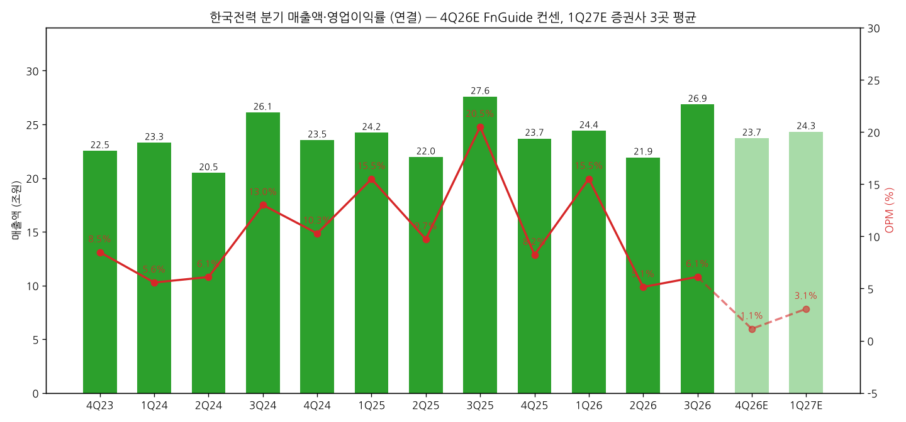
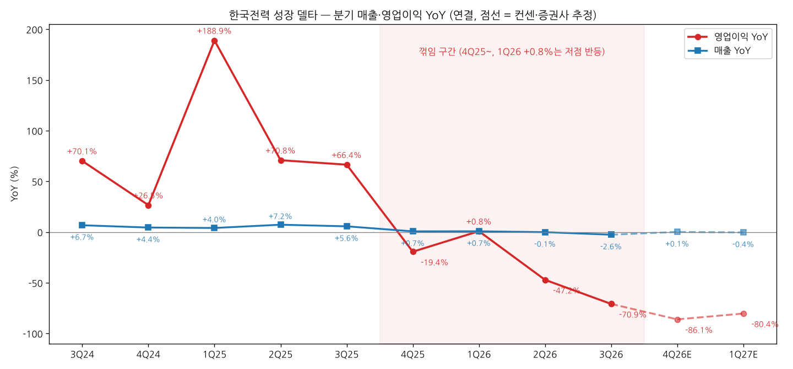
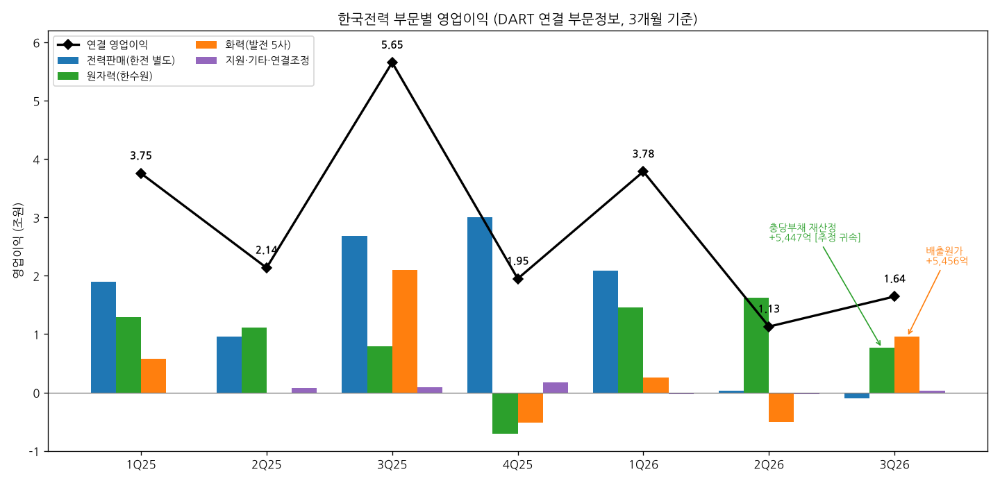
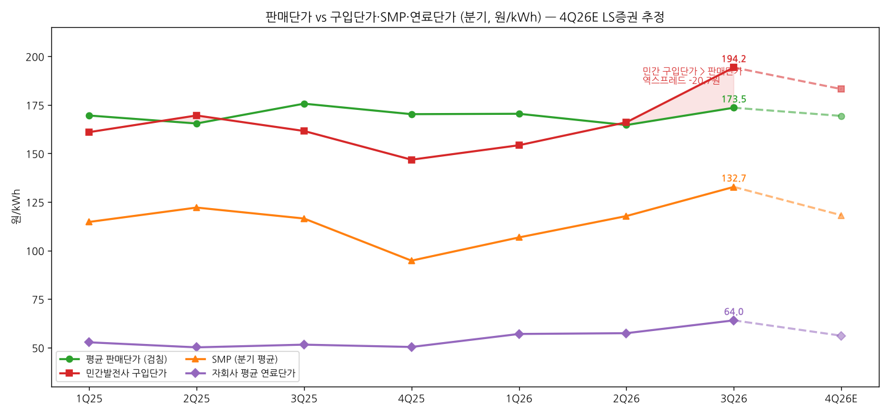

> 모드: 실적 리뷰 (v11)
> 종목: 한국전력 (015760)
> 섹터: 원전
> 서브섹터: 원전 운영
> 분기: 2026-Q3
> 발표일: 2026-11-12 (결산실적 공정공시·IR 자료) / 분기보고서 2026-11-16 제출 (DART 접수 20261116001501 — 연결·별도·부문 확정치, 결산실적 공시와 동일)
> 작성 시각: 2026-11-17 18:30 KST
> 분석 소스: 회사 자료 — DART 분기보고서(2026.09, 11/16 제출: 연결 손익·연결 주석 4 부문정보·원자력발전부문 생산실적/가동률·소송/중재), OpenDART 연결·별도 재무제표(fnlttSinglAcntAll, company-data `dart_financials`·`dart_quarterly_summary`, 2016\~3Q26), 회사 IR 자료 「2026년 3분기」(FnGuide 경유 PDF — **1\~9월 누적 기준**, 첨부 10건 중 1건은 증권사 리포트가 아니라 이 회사 IR), 기업개요 한국전력_기업개요.md v1.0(DART 46분기 부문 시계열·요금·사채·배당). 셀사이드 9건 첨부 — 하나증권(11/13 "아빠 찬스")·대신증권(11/13 "바텀피싱을 노려볼 때")·KB증권(11/13 "에너지가격과 환경비용 상승으로 컨센서스 하회")·DS투자증권(11/13 "피할 수 없는 선택지")·IBK투자증권(11/13 "원전 확대 기대감은 유효")·SK증권(11/13 "피할 수 없는 연료단가 상승")·LS증권(11/16 "지독한 전쟁 영향")·유진투자증권(11/16 "AI 투자를 위한 요금 인상과 시장 개방 명분", 실적설명회 Q&A 포함)·J.P. Morgan(11/03, 실적 발표 전 Neutral 상향 — 사전 기대치 비교용). 주가: Yahoo Finance 일봉(\~11/13). 웹서치 보완 없음
> 리뷰 깊이: 풀 | 리서치 첨부 9건 (+ 회사 IR 1건)
> 판정 기준: 보고 K-IFRS 연결 영업이익 YoY와 직전 분기 대비 변화 (BT 결정 2026-11-16 — 일회성 제외치는 참고 행으로만)
> 비영업 요인: 일회성(월성 1호기 해체비용 재산정 — 원전 복구충당부채 전입 +5,447억원 YoY)·규제 정산(온실가스 배출권 무상할당 축소에 따른 배출원가 +5,456억원 YoY, 1\~9월분 3Q 집중 인식 — DS는 이 중 경상분 약 1,800억원으로 추정). 합계 약 1.09조원 — 판정은 바꾸지 않음 (아래 플래그)

# 한국전력 3Q26 실적 리뷰 — 영업이익 -70.9%, 별도는 적자 전환. 꺾임의 본체는 연료비·SMP 스프레드이고 1.1조원 일회성은 폭을 키웠을 뿐

> 성장 델타: 꺾임 | 내러티브: 약화 → 델타 꺾임(2개 분기 연속 YoY 마이너스 확대, 4Q26 컨센 -86%·증권사 절반 적자 전망) + 내러티브 약화(중동전쟁발 연료비 충격, 요금 신호 부재, 추정치 대폭 하향) → 매매 제외 구간 (유가·SMP 하락과 12월 요금 결정 확인 전까지 관망)
>
> ⚠ 비영업 요인 플래그: 감익 폭을 키운 비영업 요인 = 월성 1호기 복구충당부채 재산정 +5,447억원(회계추정 변경, 일회성) + 온실가스 배출원가 +5,456억원(무상할당 축소분 1\~9월 일괄 정산 — 규제 정산 성격, 4Q 추가 가능). 둘을 모두 빼도 영업이익 약 2.73조원(YoY -51.6%) [계산·참고] — **꺾임 판정을 만든 주된 원인은 영업 요인(전력판매부문 -2.78조원: 판매단가 -1.2%·판매량 -1.9% vs 민간 구입단가 +20.2%·자회사 연료단가 +24.2%)**이다. 판정은 보고 기준 꺾임 그대로

→ **숫자**: 연결 매출 26조 8,518억원(-2.6% YoY), 영업이익 1조 6,441억원(**-70.9%**), OPM 6.1%(-14.4%p). 영업이익 YoY가 1Q26 +0.8% → 2Q26 -47.2% → 3Q26 -70.9%로 2개 분기 연속 마이너스 폭이 커졌다(델타 -23.7%p). 매출 YoY도 -0.1% → -2.6%로 역성장 확대. **별도(한전 본체) 영업이익 -990억원으로 적자 전환**(3Q25 +2조 6,785억원) — 13분기 연속 연결 흑자는 지켰지만 판매단가로 원가가 전이되지 않는 구조가 다시 드러났다. FnGuide 컨센(2조 4,140억원) 대비 -31.9%

→ **쟁점 ①**: 컨센 대비 미달 7,700억원의 원인은 증권사마다 다르게 본다. DS·대신·KB·IBK·하나·유진은 **기타 영업비용 1.1조원(충당부채 5,447억원 + 배출원가 5,456억원)**을, LS는 **원전 발전 Mix가 시장 기대보다 낮았던 것**을 꼽았다. 3Q 원전 발전량은 오히려 +4.9% YoY(DART 계산, 3Q 평균가동률 약 85%)라 LS의 설명보다 비용 쪽 설명이 숫자와 맞는다

→ **쟁점 ②**: 경상 이익력 자체가 꺾였다. 조달단가(발전+구입 합산)가 84.4 → 99.2원/kWh(+17.5%, KB 추정)로 오르는 동안 판매단가는 175.6 → 173.5원으로 내려갔다. **4Q26 영업이익 전망은 FnGuide +2,700억원 vs 증권사 8곳 중 5곳 적자(-2.15조\~-271억원)**로 갈리고, 2027E 영업이익은 2.57조(하나)\~9.46조원(SK)으로 3.7배 차이가 난다. 유가 4\~5개월 래깅 구조상 LNG 도입단가 부담은 4Q26\~1H27까지 남는다

→ **쟁점 ③**: 요금은 반대로 가고 있다. 연료비조정단가는 상한 +5원/kWh에 18분기째 묶였고(4Q26 산정치 +7.3원), 회사는 상한 조정 가능성이 낮다고 밝혔다(DS). 오히려 2026년 4월 산업용 계절·시간대 개편(-0.8\~-0.9%), 2027년 산업용 지역별 요금제(-5.5\~-5.9%, 매출 -2.8조원 — 대신)가 판매단가를 낮춘다. 12월 말 2027년 요금 결정이 첫 번째 분기점이다

→ **다음 분기 관건**: 4Q26은 4Q25(1조 9,492억원) 대비 컨센(2,700억원)으로도 -86%, 1Q27E(증권사 3곳 평균 7,423억원)는 1Q26(3조 7,842억원) 대비 -80%다. **컨센 경로상 YoY 반등은 빨라야 3Q27**(대신 3Q27E +177%, LS +131% vs 1Q26 대비)이다. 판정을 바꿀 변수는 유가·LNG 하락 속도, 12월 요금 결정, 원전 이용률 80%대 유지(고리 3·4호기 계속운전 승인 2026-10-27)다

---

## 1. 숫자

① 연결 기준 분기 표 (단위: 억원, %)

| 항목 | 4Q23 | 1Q24 | 2Q24 | 3Q24 | 4Q24 | 1Q25 | 2Q25 | 3Q25 | 4Q25 | 1Q26 | 2Q26 | **3Q26** | 4Q26E | 1Q27E |
|---|---|---|---|---|---|---|---|---|---|---|---|---|---|---|
| 매출액 | 225,330 | 232,927 | 204,737 | 261,034 | 235,291 | 242,240 | 219,501 | 275,724 | 236,828 | 243,985 | 219,189 | **268,518** | 237,020 | 243,050 |
| 영업이익 | 19,117 | 12,993 | 12,503 | 33,961 | 24,190 | 37,536 | 21,359 | 56,519 | 19,492 | 37,842 | 11,286 | **16,441** | 2,700 | 7,423 |
| OPM | 8.5 | 5.6 | 6.1 | 13.0 | 10.3 | 15.5 | 9.7 | 20.5 | 8.2 | 15.5 | 5.1 | **6.1** | 1.1 | 3.1 |
| 매출 YoY | +15.6 | +7.9 | +4.3 | +6.7 | +4.4 | +4.0 | +7.2 | +5.6 | +0.7 | +0.7 | -0.1 | **-2.6** | +0.1 | -0.4 |
| 영업이익 YoY | 흑전 | 흑전 | 흑전 | +70.1 | +26.5 | +188.9 | +70.8 | +66.4 | -19.4 | +0.8 | -47.2 | **-70.9** | -86.1 | -80.4 |
| **매출 YoY 델타 (%p)** | -8.2 | -7.7 | -3.6 | +2.4 | -2.3 | -0.4 | +3.2 | -1.6 | -4.9 | +0.0 | -0.8 | **-2.5** | +2.7 | -0.5 |
| **영업이익 YoY 델타 (%p)** | 산출 불가 | 산출 불가 | 산출 불가 | 산출 불가 | -43.6 | +162.4 | -118.1 | -4.4 | -85.8 | +20.2 | -48.0 | **-23.7** | -15.2 | +5.7 |

→ (출처: 4Q23\~3Q26 OpenDART 연결 fnlttSinglAcntAll — 1\~3Q는 분기 3개월 금액, 4Q = 연간 − 3Q 누적(company-data `dart_quarterly_summary`, 2026-11-17 조회). 3Q26은 DART 분기보고서(2026.09) 연결 손익 — 매출 26,851,798백만원·영업이익 1,644,132백만원, 11/12 결산실적 공시와 동일. 4Q26E = FnGuide 컨센(2026-11-12 기준, DS 11/13 인용 — 매출 23.702조원·영업이익 0.270조원). 1Q27E = 분기 추정을 낸 발표 후 3곳(대신 7,030억원·DS -3,550억원·LS 1조 8,790억원) 단순평균 [계산]. 4Q23 매출 YoY 델타는 3Q23 매출 YoY +23.8% 대비)
→ 3Q26 서프라이즈: 매출은 FnGuide 컨센(27조 4,963억원) 대비 -2.3%, **영업이익은 컨센(2조 4,143억원) 대비 -31.9%**. QuantiWise 기준(2조 3,760억원)으로는 -30.8%(KB), LS 인용 FnGuide(2조 6,345억원) 기준 -37.6%. 실적 발표 전 JPM(11/03)은 원전 이용률 회복과 SMP 안정을 근거로 **3.47조원 비트**를 예상했다 — 사전 기대 중 가장 높았던 숫자와의 괴리는 -53%. 컨센 집계 증권사 수는 첨부 리포트에 미기재
→ 지배주주순이익 8,367억원(-77.7%), 컨센(1조 7,360억원) 대비 -51.8%(DS). 9M26 누적 연결 영업이익 6조 5,569억원(-43.2%), 별도 2조 238억원(-63.4%) (회사 IR p.28)
→ YoY는 1Q25 +188.9%에서 정점을 찍고 4Q25 -19.4%로 처음 마이너스로 돌아섰다. 1Q26 +0.8%는 1Q25 고기저 위의 보합(연료비가 아직 오르기 전)일 뿐이고, 2Q26부터 중동전쟁(2월 말 발발) 이후 유가가 4\~5개월 시차로 원가에 들어오며 -47% → -71%로 깊어졌다(LS). **컨센 경로상 YoY는 4Q26(-86%)·1Q27(-80%)까지 마이너스이고, 플러스 전환은 빨라야 3Q27**이다
→ **[판단] 델타 = 꺾임 (보고 기준)**: 판정표 "영업이익 YoY 마이너스 전환, 또는 2개 분기 연속 둔화 + 컨센 경로상 정점 통과"를 모두 충족한다. 4Q25부터 4개 분기 중 3개 분기가 마이너스이고, 이번 분기는 마이너스 폭이 커졌다. 일회성 1.09조원을 모두 빼도 -51.6%라 판정은 같다

→ (출처: OpenDART 연결·DART 분기보고서(2026.09). 4Q26E FnGuide 컨센(DS 인용), 1Q27E 증권사 3곳 평균 [계산] — 연한 막대·점선)

→ (출처: OpenDART·DART, 4Q26E FnGuide 컨센, 1Q27E 증권사 3곳 평균 [계산] — 점선. 4Q23\~2Q24는 흑전이라 YoY 미표기)

(1) 참고 행 — 일회성 제외 영업이익 (판정에 미반영)

| 항목 | 3Q25 | 3Q26 | YoY |
|---|---|---|---|
| 보고 영업이익 | 56,519 | 16,441 | -70.9% |
| (+) 원전 복구충당부채 증가분 (월성 1호기 해체비용 재산정) | — | 5,447 | |
| (+) 온실가스 배출원가 증가분 | — | 5,456 | |
| 참고 ① 두 항목 전액 제외 | 56,519 | 약 27,344 | 약 -51.6% |
| 참고 ② DS 방식 (충당부채 전액 + 배출원가 중 비경상분만 제외) | 56,519 | 약 25,544 | 약 -54.8% |

→ (출처: 금액 = 회사 실적설명회 Q&A(유진 11/16 정리 — "전년동기 대비 5,447억원·5,456억원 증가")·대신·IBK·DS 공통 인용. KB는 각각 약 4,900억원·약 5,300억원으로 추정. 참고 ②는 DS 표2 기준 — 배출원가는 4차 할당 확정에 따른 1\~9월분 일괄 인식으로 보고 분기 경상분 약 0.18조원만 남김. 두 항목은 "전년 대비 증가분"이라 3Q25 쪽 기저 조정은 하지 않았다 [계산])

② 사업부별 매출·영업이익 (단위: 억원, %)

| 부문 | 항목 | 3Q25 | 4Q25 | 1Q26 | 2Q26 | **3Q26** | 3Q26 YoY |
|---|---|---|---|---|---|---|---|
| 전력판매 (한전 별도) | 매출 | 270,069 | 230,678 | 237,092 | 212,870 | **259,317** | -4.0 |
| 전력판매 | 영업이익 | 26,785 | 30,040 | 20,867 | 361 | **-990** | 적전 |
| 전력판매 | OPM | 9.9 | 13.0 | 8.8 | 0.2 | **-0.4** | -10.3%p |
| 원자력 (한수원) | 매출 | 36,409 | 34,995 | 39,164 | 42,352 | **36,529** | +0.3 |
| 원자력 | 영업이익 | 7,907 | -7,084 | 14,625 | 16,267 | **7,620** | -3.6 |
| 원자력 | OPM | 21.7 | -20.2 | 37.3 | 38.4 | **20.9** | -0.8%p |
| 화력 (발전 5사) | 매출 | 92,632 | 63,956 | 71,570 | 63,218 | **102,512** | +10.7 |
| 화력 | 영업이익 | 20,956 | -5,201 | 2,602 | -5,058 | **9,530** | -54.5 |
| 화력 | OPM | 22.6 | -8.1 | 3.6 | -8.0 | **9.3** | -13.3%p |
| 전력지원 (KPS·한전기술 등) | 영업이익 | 988 | — | — | — | **607** | -38.6 |
| 기타 (해외사업 등) | 영업이익 | 771 | — | — | — | **509** | -34.0 |
| 연결조정 | 영업이익 | -888 | 1,030 | -1,266 | -1,121 | **-835** | — |
| **연결 합계** | 영업이익 | 56,519 | 19,492 | 37,842 | 11,286 | **16,441** | -70.9 |

→ (출처: 3Q25·3Q26 = DART 분기보고서 연결 주석 4 부문정보 "3개월" 금액(백만원 → 억원 환산). 4Q25\~2Q26 = 기업개요 v1.0 분기 시계열(DART 부문정보, 4Q = 연간 − 3Q 누적). 부문 매출은 부문간 매출 포함(외부매출 아님). 4Q25\~2Q26 전력지원·기타는 기업개요에서 합산(4Q25 707, 1Q26 1,013, 2Q26 837억원)으로만 관리해 분리 미기재. 합계는 연결과 일치 [계산])
→ **YoY 감익 -4조 78억원의 분해: 전력판매 -2조 7,775억원(69%), 화력 -1조 1,426억원(29%), 원자력 -287억원, 지원·기타 -643억원, 연결조정 +53억원** [계산]. 꺾임을 끈 것은 한전 본체의 스프레드 축소이고, 화력 감익의 절반가량은 배출원가(+5,456억원)다 [추정: 배출권 정산은 발전 5사 비용]
→ **원자력은 "보이는 숫자"와 "실제 운영"이 반대다.** 부문 영업이익은 -3.6%지만 3Q 원전 발전량은 46,507GWh로 +4.9% YoY다(DART 9M 128,595GWh − 1H 82,088GWh, 전년 142,464 − 98,134 = 44,330GWh [계산]). 월성 1호기는 한수원 소유라 복구충당부채 5,447억원은 원자력 부문에 들어갔을 가능성이 높다 [추정] — 빼면 원자력 영업이익은 약 1조 3,067억원(+65% YoY, OPM 35.8%)으로 1·2Q의 37\~38% OPM과 같은 수준이다 [계산·참고]
→ 한수원 이익이 커지는 것은 연결로는 상쇄된다. 원전 정산단가(한전 구입단가)는 1\~9월 79.6 → 86.3원/kWh(+8.4%)로 올랐다(회사 IR p.18) — 한수원 매출이 오르는 만큼 한전 본체 원가도 오른다. **연결 기준으로 원전이 주는 이익은 "LNG를 대체하는 물량 효과"뿐이다** (기업개요 3-③ 분류 논리와 같음)
→ 화력 매출 +10.7%·영업이익 -54.5%: 석탄 발전량이 늘고(상한제약 완화, 1H 석탄 발전 +22.2% — KB) 연료단가가 +33%(석탄)·+33%(LNG) 올라(LS 표5) 매출은 커졌지만, 정산조정계수로 이익이 관리되는 데다 배출원가가 붙었다

→ (출처: DART 연결 주석 4 부문정보(3Q25·3Q26 분기보고서), 1Q25\~2Q26 기업개요 v1.0 시계열. 충당부채·배출원가 화살표 = 회사 설명회 Q&A 금액, 부문 귀속은 [추정])

③ 판매·조달 단가와 스프레드 — 이번 분기 숫자의 본체 (단위: GWh, 원/kWh, 조원)

| 항목 | 3Q25 | 1Q26 | 2Q26 | **3Q26** | YoY | 4Q26E (LS) |
|---|---|---|---|---|---|---|
| 전력판매량 (검침 기준, GWh) | 151,506 | 139,742 | 126,929 | **148,673** | -1.9% | 129,788 |
| 산업용 판매량 (GWh) | 73,286 | 68,295 | 67,866 | **71,315** | -2.7% | 68,564 |
| 평균 판매단가 | 175.6 | 170.4 | 164.6 | **173.5** | -1.2% | 169.3 |
| SMP (분기 평균) | 116.46 | 106.71 | 117.72 | **132.74** | +14.0% | 118.15 |
| 민간발전사 구입단가 | 161.54 | 154.19 | 166.01 | **194.24** | +20.2% | 183.13 |
| 자회사 평균 연료단가 | 51.5 | 57.0 | 57.4 | **64.0** | +24.2% | 56.1 |
| 판매단가 − 민간 구입단가 | +14.1 | +16.2 | -1.4 | **-20.7** | -34.8원 | -13.8 |
| 조달단가 (발전+구입 합산, KB) | 84.4 | — | — | **99.2** | +17.5% | — |
| 판매단가 − 조달단가 (KB) | 91.2 | — | — | **74.3** | -16.9원 | — |
| 연료비 (조원) | 5.501 | 5.218 | 4.925 | **6.884** | +25.1% | 5.350 |
| 구입전력비 (조원) | 9.249 | 8.720 | 8.487 | **10.303** | +11.4% | 8.835 |

→ (출처: 판매량·판매단가·SMP·민간 구입단가·연료단가 = LS증권 11/16 표4\~6(회사 데이터·전력통계월보 기반, 4Q26E는 LS 추정). 조달단가 = KB 11/13 표6(전원별 조달량·단가, KB 추정 포함). 연료비·구입전력비 = DART 연결 손익(IBK·SK 표 동일). 차이 행 [계산])
→ **판매 1kWh당 남는 돈이 1년 만에 91.2원 → 74.3원으로 16.9원 줄었다** (KB 기준). 판매량 148.7TWh를 곱하면 약 2.5조원 [계산] — 전력판매부문 YoY 감익 2.78조원의 대부분이 이 스프레드에서 나왔다
→ 민간 구입단가 194.24원은 판매단가 173.5원보다 20.7원 높다. **민간에서 사 오는 전기는 팔수록 손해**인 구간이다(2022년 역마진 국면과 같은 구조, 폭은 작음). DS는 민간 구입단가가 SMP 회귀선보다 17원 높았고(RPS 의무비율 14 → 15% 상향 영향), 회사도 "구입전력비가 SMP 대비 높은 원인은 RPS 비용 증가"라고 답했다(유진 Q&A)
→ 판매량 -1.9%는 산업용(-2.7%) 탓이다. 중동전쟁 이후 원자재 수급·석유화학 업황 부진으로 제조업 가동률이 내려갔다(IBK·SK). DS는 같은 기간 전국 발전량도 -1.9%라 "직접구매 이탈이 아닌 전반적 수요 약화"로 봤다
→ 판매단가 -1.2%는 2026년 4월 산업용 계절·시간대별 요금 개편 효과(-0.8\~-0.9%, 대신)와 용도 믹스 영향이다. 요금 인상은 2024-10 산업용이 마지막이다(기업개요)

→ (출처: LS증권 11/16 표4\~6 — 1Q25\~3Q26 회사 실적 기반, 4Q26E LS 추정(점선))

④ 별도(한전 본체)와 원전 운영 지표 (단위: 억원, %, GWh)

| 항목 | 3Q25 | 4Q25 | 1Q26 | 2Q26 | **3Q26** |
|---|---|---|---|---|---|
| 별도 매출 | 270,069 | 230,678 | 237,092 | 212,870 | **259,317** |
| 별도 영업이익 | 26,785 | 30,040 | 20,867 | 361 | **-990** |
| 별도 순이익 | 18,180 | 23,474 | 32,387 | -3,612 | **-4,340** |
| 한수원 원전 발전량 (GWh) | 44,330 | — | — | — | **46,507 (+4.9%)** |
| 원전 평균가동률 (9M 누적) | 87.9 (9M25) | 83.3 (2025 연간) | — | 74.2 (1H26) | **77.8 (9M26)** |
| 원전 평균가동률 (3Q 단독, 근사) | 약 79.6 | — | — | — | **약 84.9** |

→ (출처: 별도 = OpenDART OFS `dart_quarterly_summary`(4Q = 연간 − 3Q 누적). 원전 = DART 분기·반기보고서 II-3 원자력발전부문 생산실적·평균가동률(실제가동시간 ÷ 가동가능시간). 3Q 단독 가동률 = (9M × 273일 − 1H × 181일) ÷ 92일 [계산·근사 — 공시값 아님])
→ **별도는 2Q26(영업이익 361억원, 순손실 -3,612억원)에 이어 3Q26 영업적자 -990억원**이다. 성수기 3Q에 별도 적자는 2024년(3Q24 -7,737억원) 이후 처음이다. 9M 별도 순이익 2.44조원은 1Q 3.24조원(관계사 배당 등 영업외 포함)에 기대고 있다 — 4Q 별도 적자가 이어지면 별도 기준 배당 재원이 줄어든다 (2번 (4))
→ 원전 가동률은 9M 누적으로는 87.9% → 77.8%로 크게 낮지만(계획예방정비 장기화 — LS), **3Q 단독으로는 약 79.6% → 84.9%로 회복**했다 [계산·근사]. JPM이 7\~8월 데이터로 본 "약 83%"(2Q 약 75%)와 같은 방향이다. IBK·유진이 "원전 이용률 하락"을 감익 원인으로 쓴 것은 9M·전년 연간 기준 표현이다
→ 연결 차입금 132.8조원(+1.8% YoY), 차입금비율 256.9%(-16.3%p), 부채비율 405.6%(-24.5%p) (IBK, 회사 IR p.23). 원화 99.0%·고정금리 95.2%(스왑 후, 한전+발전 6사), 만기는 2027년 약 32.2조원이 최대 [회사 IR p.23 차트 판독 — 2Q26 IR의 2027년 31.1조원과 정합]

⑤ 연간 (단위: 억원, %)

| 항목 | 2022 | 2023 | 2024 | 2025 | 2026E | 2027E |
|---|---|---|---|---|---|---|
| 매출액 | 712,579 | 882,195 | 933,989 | 974,293 | 973,524 | 983,175 |
| 영업이익 | -326,550 | -45,417 | 83,647 | 134,906 | 75,730 | 97,519 |
| OPM | -45.8 | -5.1 | 9.0 | 13.8 | 7.8 | 9.9 |
| 매출 YoY | +17.6 | +23.8 | +5.9 | +4.3 | -0.1 | +1.0 |
| 영업이익 YoY | 적지 | 적지 | 흑전 | +61.3 | -43.9 | +28.8 |
| 증권사 8곳 평균 영업이익 (발표 후) | | | | | **60,202 (-55.4%)** | **60,601 (+0.7%)** |

→ (출처: 2022\~2025 OpenDART 연결 분기 합산 [계산, 사업보고서와 일치]. 2026E·2027E = FnGuide 컨센(2026-11-12, DS 인용). 발표 후 평균 = 하나·대신·KB·DS·IBK·SK·LS·유진 8곳 단순평균 [계산])
→ 발표 전후 연간 컨센: 2026E 영업이익 7.997조원(Bloomberg, JPM 11/03) → 7.631조원(QuantiWise, KB 11/13) → 7.573조원(FnGuide 11/12). **그러나 발표 후 증권사 8곳 평균은 6.02조원으로 FnGuide 컨센보다 -20%, 2027E는 6.06조원으로 컨센 9.75조원보다 -38%** — 컨센이 아직 다 내려오지 않았다. 2027E 범위 2.57조(하나)\~9.46조원(SK)
→ 추정 변경을 밝힌 곳의 영업이익 수정폭: 2026E -10.0%(KB)·-22.7%(LS)·-34.3%(DS)·-38.7%(유진), 2027E +11.0%(KB)·-28.9%(DS)·-36.4%(LS)·-80.8%(유진)

---

## 2. 시장 쟁점

① 지난 분기 체크
→ 첫 리뷰 — 직전 체크 없음 (2026-Q2 한국전력 리뷰·팔로업 미작성)

② 이번 분기 쟁점 5개

| # | 쟁점 | 언급 증권사 수 |
|---|---|---|
| (1) | 컨센 -32% 미스의 분해 — 1.1조원 일회성(충당부채·배출원가)인가, 원전 Mix인가 | 8/8 |
| (2) | 연료비·SMP 스프레드 — 4Q26 적자 전환 여부와 회복 시점(유가 래깅·원전·SMP 구조 변화) | 8/8 |
| (3) | 요금·제도 — 연료비조정단가 상한, 12월 요금 결정, 산업용 지역별 요금제·LMP, RPS·ETS 구조 비용 | 7/8 |
| (4) | 재무·배당 — 별도 적자, 차입금·사채 한도 2027말 특례, 2026 DPS 급감 | 6/8 |
| (5) | 원전·AI 전력수요 — 국내 원전 이용률·신규 가동, 해외 원전(UAE·체코·미국), 12차 전력수급기본계획 | 6/8 |

→ (8 = 발표 후 국내 증권사 8곳. JPM은 발표 전(11/03) 리포트라 쟁점 수에서 제외하고 사전 기대치 비교에만 사용. (3) 미언급 IBK, (4) 미언급 LS·하나(배당 추정만), (5) 미언급 하나·DS)

③ 쟁점별 분해

(1) 컨센 -32% 미스의 분해 — 1.1조원 일회성인가, 원전 Mix인가

(1-1) 회사 설명 (11/12 실적 발표·설명회 — 유진 Q&A 정리, IR 자료)
→ 기타 영업비용 증가 요인: "월성 1호기 해체 비용 재산정으로 원전 복구 충당부채 전년동기 대비 5,447억원 증가", "무상할당량 감소 및 초과 배출량 증가로 온실가스 배출 원가 전년동기 대비 5,456억원 증가" (유진 Q&A Q1)
→ 9M 기준 감익 요인(회사 IR p.22): 전기판매수익 -1조 1,606억원(판매단가 -0.4%, 판매량 -1.1%), 자회사 연료비 +2조 2,007억원, 민간 구입전력비 +9,034억원, 기타 영업비용 +1조 3,030억원("발전 및 송배전 설비 신규 자산 증가에 따른 감가상각비 증가 등")
→ 회사 IR의 감익 요인표는 **3Q 단독이 아니라 1\~9월 누적**이다. 3Q 단독 유무형자산상각비는 3조 4,880억원으로 전년 3조 4,650억원 대비 +0.7%에 그친다(LS 표3) — 3Q 기타비용 급증의 원인은 감가상각이 아니라 충당부채·배출원가다 [계산]

(1-2) 증권사별 해석 편차

| 증권사 | 미스 원인 | 핵심 가정·숫자 | 논리 |
|---|---|---|---|
| DS (11/13) | **기타영업비용 -0.70조** + 판매수익 -0.52조 + 구입전력비 -0.30조 (자체 추정 2.95조 대비 브리지) | 배출원가 중 경상분 0.18조만 인정 | 연료비(6.88조)는 추정 부합. 충당부채는 일회성, 배출원가는 4차 할당 확정에 따른 1\~9월분 일괄 인식. 판매량 -1.9%(추정 -0.5%)도 컸다 |
| 대신 (11/13) | 1.1조원 예상외 비용 | 충당부채 5,447억·배출원가 5,456억 | 판매단가 -1.2%·판매량 -1.9%·LNG 상승은 예상됐던 부분, 그 이상 부진은 1.1조 때문 |
| KB (11/13) | 기타 영업비용 +25.4% YoY | 충당 약 4,900억·배출권 약 5,300억 | 배출권은 상반기 석탄발전 +22.2%와 무상할당 축소 반영. **정산 물량이 남아 4Q에도 발생 가능** |
| IBK (11/13) | 연료비·구입전력비 + 원전 이용률 하락 + 1.1조 | 연료비 +25.1%, 구입전력비 +11.4% | 중동전쟁발 국제 에너지가격 상승이 본체, 1.1조가 폭을 키움 |
| 하나 (11/13) | 충당부채 + ETS 규제 강화 | 원전 이용률 80.9%(+5.1%p) 추정 | SMP가 LNG 연료비단가보다 낮게 형성돼 비용 상승이 일부 억제됐다 |
| SK (11/13) | 연료비·구입전력비 | 두 항목 증가액이 영업이익 감소분의 **약 61%** | 일회성보다 연료단가 상승의 구조를 강조 |
| LS (11/16) | **원전 발전 Mix의 시장 기대 하회** | 자체 추정(1.91조) 대비 -14%로 "부합", 컨센 대비 -38% | 원전 Mix가 3Q26 YoY (+) 전환은 했으나 시장 예상에 크게 못 미쳐 컨센 미달. SMP는 예상보다 양호 |
| 유진 (11/16) | 연료비 + 1.1조 | 자체 추정에는 부합 | 원전 이용률 하락에 따른 대체 발전 확대로 연료비 +25% |

(1-3) 공통 결론 vs 갈리는 지점
→ 공통: 8곳 모두 **"중동전쟁발 연료단가 상승은 예상된 감익, 컨센과의 차이는 기타비용 1.1조원"**이라는 큰 틀에 동의한다. 자체 추정 대비로는 LS(-14%)·유진(부합)처럼 이미 낮게 본 곳과, DS(-44%)·KB(-52%)·JPM(사전 3.47조, -53%)처럼 높게 본 곳으로 갈렸다
→ 갈림: (a) **배출원가의 반복성** — DS는 1\~9월분 일괄 인식이라 경상분 0.18조만 남는다고 보고, KB는 정산 물량이 남아 4Q에도 나오며 유상할당 비율 상승으로 2027년에도 늘어난다고 본다. (b) **원전의 역할** — LS는 원전 Mix 부족을 미스 원인으로, 하나·JPM은 원전 이용률 회복을 긍정 요인으로 봤다

(1-4) **[판단]**
→ 숫자는 DS·대신 쪽이다. DART 기준 3Q 원전 발전량은 +4.9% YoY, 3Q 가동률은 약 85%로 전년(약 80%)보다 높다 [계산]. 원전 Mix가 "기대보다 덜 좋았다"는 LS 설명은 성립할 수 있어도 YoY 감익의 원인은 아니다. 반대로 원자력 부문 영업이익이 -3.6%인 것은 충당부채가 한수원에 잡혔기 때문으로 보인다 [추정]
→ 다만 일회성을 다 빼도 -52\~-55%다. **"일회성 때문에 나빠 보인다"가 아니라 "원래 나쁜데 일회성이 더했다"**가 정확하다
→ 배출원가는 완전한 일회성이 아니다. 무상할당 축소와 유상할당 비율 상승은 제도 변화라 매년 비용 레벨을 올린다(KB). 3Q의 "몰아서 인식"은 일회성, "레벨 상승"은 경상이다 — 4Q26 기타비용에 배출원가가 다시 나오면 KB 쪽이 맞다
→ 결론이 바뀌는 조건: 4Q26 실적에서 기타 영업비용이 4Q25(LS 표3 기준 6.35조원)와 비슷하고 배출원가 추가 인식이 없으면 DS의 "0.18조 경상" 가정이 맞다

(2) 연료비·SMP 스프레드 — 4Q26 적자 전환 여부와 회복 시점

(2-1) 회사 설명·경과
→ 회사: 3Q 연료비 +25.1%, 구입전력비 +11.4% YoY. 구입전력비가 SMP 대비 높은 원인은 RPS 의무비율 상승에 따른 비용 증가(유진 Q&A Q5). 9M 발전원별 구입단가: 원전 79.6 → 86.3원, 석탄 145.2 → 140.3원, LNG 163.4 → 170.2원, 신재생(RPS 포함) 195.1 → 207.8원(IR p.18)
→ 유가 → 원가 경로: 두바이유가 LNG 도입단가에 약 4\~5개월 시차로 반영된다. 2월 말·3월 초 전쟁 발발 → 성수기 3Q26에 집중(LS). 대신은 LNG 적용 유가를 3Q26 97달러 → 4Q26 88달러 → 1Q27 91달러로 본다
→ SMP: 여름 140\~160원 → 9월 중순\~10월 90\~110원으로 정상화(JPM 11/03, 날씨 효과). 그러나 DS는 **11월 SMP가 다시 140원을 넘었다**고 썼다

(2-2) 증권사별 해석 편차

| 증권사 | 4Q26 영업이익 E | 1Q27 / 2027E 영업이익 | 핵심 가정 | 논리 |
|---|---|---|---|---|
| DS (11/13) | **-2조 1,540억** | -3,550억 / 2.95조 | 4Q SMP 123원, 민간 구입단가 프리미엄 +15원, 판매량 -1.5% | 4Q는 판매단가 비수기 + 11월 SMP 140원+. 2027F 지배순이익 적자. 비용이 판가로 전이되지 않는 구조 |
| 유진 (11/16) | -1조 3,250억 | — / 2.94조 | 4Q 연료비 6.6조·구입전력비 10.4조 | 4Q26 저점 후 점진 개선 — ① SMP 하락(강제가동 발전소 30개소+, 태양광·수도권 융통) ② 원전 회복 ③ LNG 단가 안정(3\~4개월 시차) |
| IBK (11/13) | -1조 2,130억 | — / 4.93조 | 4Q 연료비 +27.0%, 구입전력비 +14.3% | RPS·탄소 비용 증가 지속 가능성, 단기 수익성 우려 지속 |
| 하나 (11/13) | -5,922억 | — / **2.57조 (최저)** | 4Q LNG 124.2만원/톤, 석탄 22.9만원/톤 | 2027 산업용 지역요금제로 매출 상단 하락. 다만 송전제약 강제가동으로 SMP·정산단가 하락 → 규제 당국이 한전 편 |
| LS (11/16) | -2,710억 | 1조 8,790억 / 9.19조 | 4Q SMP 118원, 민간 구입단가 183원 | 유가 90\~100달러 지속. **2H27이 실적 바닥 가능성**, 원전 Mix는 계획예방정비 해소로 늦어도 2H27 가파른 상승 |
| SK (11/13) | +2,620억 | — / **9.46조 (최고)** | 4Q 구입전력비 7.48조(-0.4%) | 실적·주가 반등의 핵심 변수는 두바이유 방향성. 미국-이란 전쟁 지속 전망으로 TP는 하향 |
| 대신 (11/13) | **+5,430억 (최고)** | 7,030억 / 7.91조 | Brent 4Q 91달러·2027 85달러, LNG 적용유가 4Q 88달러, 원전 가동률 4Q 78.1%·2027 83.2% | 2Q27까지 실적 부진 불가피, **3Q27 이후 본격 개선** |
| KB (11/13) | 약 +4,560억 [계산: 2026E 7.013조 − 9M] | — / 8.54조 | 2026 조달단가 +9.3%, 판매단가 -0.4% | 연말 요금 결정이 관건 |

→ (출처: 각 증권사 분기·연간 추정. KB 4Q는 연간 − 9M 실적 [계산])

(2-3) 공통 결론 vs 갈리는 지점
→ 공통: 8곳 모두 **4Q26이 3Q26보다 나쁘다**(4Q 비수기 + 연료비 래깅)고 보고, 회복은 2027년 중반 이후라는 데 동의한다. 3Q27에 YoY 플러스 전환을 그리는 곳이 대신(3Q27E 4.55조)·LS(3.79조)·DS(3.36조)다
→ 갈림: (a) **4Q26 부호** — 적자 5곳(DS·유진·IBK·하나·LS) vs 흑자 3곳(대신·KB·SK). 차이는 4Q 민간 구입단가 프리미엄과 기타비용(배출원가 추가 여부)이다. (b) **2027년 레벨** — 2.6\~4.9조원(하나·유진·DS·IBK) vs 7.9\~9.5조원(대신·KB·LS·SK). 하나·대신이 짚은 산업용 지역별 요금제(매출 -2.8조원)를 넣었는지, 유가를 85달러대로 내렸는지가 갈랐다

(2-4) **[판단]**
→ 4Q26 FnGuide 컨센(+2,700억원)은 증권사 8곳 평균(약 -5,370억원 [계산])보다 높다 — **컨센이 아직 덜 내려왔다**. DS가 짚은 11월 SMP 140원+는 JPM이 10월에 본 "SMP 정상화"를 되돌리는 데이터라 4Q는 적자 쪽 확률이 높다 [판단]
→ 회복의 열쇠는 원전과 SMP 구조다. 유진·하나가 말한 "강제가동·태양광·수도권 융통으로 LNG의 가격결정 비중 하락"은 요금 인상 없이 구입비를 낮추는 경로라, 정부가 요금 대신 이 경로를 택하고 있다는 하나의 해석과 맞물린다. 이 경로가 실제로 SMP를 120원 아래로 끌어내리는지가 2027년 레벨을 가른다
→ 결론이 바뀌는 조건: 12\~1월 월평균 SMP가 120원 아래 + 두바이유 80달러 아래면 대신·LS 경로(2027E 8\~9조원), SMP 140원대 지속이면 DS·유진 경로(3조원 이하)

(3) 요금·제도 — 연료비조정단가 상한, 12월 요금 결정, 지역별 요금제·LMP, RPS·ETS

(3-1) 회사 설명·경과
→ 연료비조정요금은 ±5.0원/kWh 범위 안에서 조정(IR p.17). **회사는 연료비조정단가 상한 조정 가능성이 낮다고 밝혔다**(DS). 연료비조정단가는 +5원 상한에 18분기 연속 고정, 4Q26 산정치는 +7.3원이었으나 상한 적용(기업개요 — 파이낸셜뉴스 11/08). 주택용 14분기·산업용 8분기 연속 동결
→ 산업용 지역별 차등요금제·LMP: "지역별 도매가격제와 산업용 지역별 요금제 동시 도입 추진, LMP 규칙 개정안 공지 완료, 연내 도입 목표이나 구체적 적용 시기는 미확정"(유진 Q&A Q2)
→ 정부 지원: "정부 예산안에 약 1조원 규모의 전기요금 특례 지원, 한전 출자 및 전력망 투자비 보조 포함 — 국회 심의 후 확정"(유진 Q&A Q3)

(3-2) 증권사별 해석 편차

| 증권사 | 요금·제도 가정 | 논리 |
|---|---|---|
| DS (11/13) | 요금 상향 신호 **전무**, 중립 유지 조건 = 원인자 부담 제도화·독립적 비용회수 결정·사채 한도 해소 | 구조적으로 증가하는 비용(RPS·배출권)에 비해 요금 인상 신호가 없다 |
| 대신 (11/13) | 2026-04 산업용 개편 -0.8\~-0.9%, **2027 산업용 지역요금제 -5.5\~-5.9%(매출 -2.8조원)**. 지역별 도매요금제의 별도 구입단가 하락 1.1조원 vs 연결 0.3조원 | 발전자회사 도매단가도 같이 내려가 연결 효과는 작다 |
| 하나 (11/13) | 지역요금제는 **매출 상단을 낮추는 정책**, 도매가격제 동반 시 일부 상쇄 | 요금 인상 대신 비용 절감으로 인상 요인 억제 — 발전사보다 한전이 상대적 우위 ("아빠 찬스") |
| KB (11/13) | 12월 말 2027년 요금이 환경비용 증가를 반영하는지 | 배출권 유상할당·RPS 비율이 매년 상승 → 2027년에도 환경비용 증가 |
| 유진 (11/16) | AI 인프라 투자 + 재무 악화 → **요금 정상화 논의 시작**, LMP를 시작으로 전력시장 구조개편 | 민간 자본 규제사업 참여(LMP·원전/LNG PPA·민간 전력망)로 해외 피어 대비 50%+ 디스카운트 해소 |
| SK (11/13) | 투자 확대에 따른 재원조달·이자부담·요금 인상 모니터링 | 수요 확대가 주주가치로 이어지려면 비용 회수 방안 병행 필요 |
| LS (11/16) | 중동전쟁 직전 손익구조는 요금 누적 인상분 50% 내외로 개선됐었음 | 종전 시 에너지가격 안정으로 손익구조 빠르게 복원 |

(3-3) 공통 결론 vs 갈리는 지점
→ 공통: **단기(4Q26\~1H27) 요금 인상은 아무도 가정하지 않았다.** 7곳 모두 12월 말 2027년 요금·연료비조정단가 결정을 다음 확인 포인트로 둔다
→ 갈림: **제도 개편의 방향** — 대신·하나·DS는 지역요금제·도매가격제가 한전 매출과 연결 이익을 깎는 쪽(하방)으로, 유진은 LMP·시장 개방이 장기적으로 요금 정상화와 밸류 재평가의 명분(상방)으로 본다. 같은 제도를 놓고 방향이 반대다

(3-4) **[판단]**
→ 1년 안의 숫자로는 대신·하나가 맞다. 지역요금제의 매출 -2.8조원은 구체적 숫자이고, 유진의 시장 개방 효과는 시점이 없다. 연료비조정단가 상한(±5원)이 유지되는 한, 연료비 충격은 전부 한전 이익으로 흡수된다 — 이 리뷰의 꺾임 판정을 만드는 구조 그 자체다
→ 결론이 바뀌는 조건: 12월 말 발표에서 ① 연료비조정단가 상한 확대(±5원 → ±10원 등) 또는 ② 기준연료비·전력량요금 인상이 나오면 "약화" 내러티브가 "유지" 이상으로 돌아설 수 있다. 동결 + 2027년 지역요금제 시행 확정이면 "훼손" 쪽이다

(4) 재무·배당 — 별도 적자, 차입금, 사채 한도 2027말 특례, DPS

(4-1) 회사 설명·경과
→ 3Q26말 연결 차입금 132.8조원, 별도 86.2조원, 연결 차입금비율 256.9%(IR p.23). 투자비 집행: 한전그룹 2026년 23조원(3Q까지 15조원 집행), 2027년 27조원 예상, 12차 전력수급기본계획 확정 후 송변전·배전 투자계획 업데이트(유진 Q&A Q3)
→ 사채 발행 한도: 2022년 한전법 개정으로 (자본금+적립금)의 2배 → 5배, **2027년 말까지 한시**. 1H26 사채 잔액 71.5조원 vs 한도 121.3조원, 2028년 2배 복귀 시 한도 약 57조원 → 국회예산정책처 2027말 사채 잔액 전망 76.05조원 기준 약 19조원 초과. 사장 국감 발언(10/12): "배수가 2배로 떨어지면 사채 발행 불가", "최소한의 전기요금 인상이 필요" (기업개요 — 파이낸셜뉴스 11/08)
→ 별도 누적 영업적자 47.8조원(2021\~2023) → 34.1조원(3Q26)(기업개요 — 뉴스핌 11/12). 3Q 별도 적자로 축소 속도가 멈췄다

(4-2) 증권사별 해석 편차 (2026E DPS)

| 증권사 | 2026E DPS | 2027E DPS | 논리 |
|---|---|---|---|
| 대신 | 480원 | 590원 | 별도 기준 배당성향 15% |
| KB | 623원 | 420원 | Bear case: 원전·전력망 투자 증가에 따른 배당 축소 |
| 유진 | 110원 | 0원 | 2027E 순손실 |
| 하나 | 70원 | 0원 | 2027E 순이익 1,163억원 |
| IBK | 배당수익률 1.3% (약 400원 [계산]) | — | — |
| SK | 1,542원 (2025 유지) | 1,542원 | 배당 고정 가정 |
| DS | 사채 한도 해소 확인 전 중립 | — | 사채 한도가 중립 유지 조건 중 하나 |

→ (출처: 각 증권사 추정 재무제표. 2025 DPS 1,542원(배당총액 9,899억원, 연결 배당성향 11.6% — DART))

(4-3) 공통 결론 vs 갈리는 지점
→ 공통: 2025년 1,542원(시가배당률 3.2%)이 유지된다고 본 곳은 SK뿐이다. 나머지는 **2026E DPS 70\~623원으로 60\~95% 감소**를 넣었다
→ 갈림: 배당의 기준 — 대신은 별도 순이익 × 15%, 하나·유진은 연결 순이익 급감에 연동. 공기업 배당은 기재부 협의로 결정되고 회사 독자 정책은 공시되지 않는다(기업개요)

(4-4) **[판단]**
→ 3Q 별도 순손실 -4,340억원에 4Q 별도 적자가 더해지면 2026 별도 순이익은 9M 2.44조원보다 작아진다. 배당은 "3% 배당주"에서 "1% 미만"으로 바뀌는 쪽이 기본값이다 [판단]
→ 사채 한도 특례(2027말)는 2026년 이익이 줄수록 더 급해진다 — 적립금이 덜 쌓이면 2배 복귀 시 한도가 더 작아진다. 이 이슈는 요금 인상 압력의 명분이자(사장 국감 발언), 연장 법안이 나오지 않으면 자금조달 리스크다. 2027년 만기 약 32.2조원(IR p.23 차트 판독)과 겹친다

(5) 원전·AI 전력수요 — 국내 이용률, 해외 원전, 12차 전기본

(5-1) 회사 설명·경과
→ 국내 원전: 고리 3·4호기 계속운전 승인(2026-10-27), 한빛 1호기(2025-12-22)·2호기(2026-09-11) 설계수명 만료로 계속운전 추진 중(DART 분기보고서 II-3). 새울 3·4호기 건설(2026\~27년 준공), 신한울 3·4호기(2032\~33년)(IR p.24). 11차 전기본 신규 대형 2기(영덕)·SMR 1기(기장)
→ 해외: 한전은 UAE 바라카 1\~4호기 주계약자(상업운전 완료), 해외 12개국 31개 프로젝트(IR p.19). **한수원이 UAE 원전 건설사업 운영지원용역 계약 이견으로 한전을 상대로 대한상사중재원·런던 국제중재법원에 중재 신청 — "최종 결과를 예측할 수 없음"**(DART 분기보고서 소송·중재). 체코 두코바니 5·6호기는 한수원 본계약(2025-06, 약 26조원), 한전기술 종합설계 계약 완료(2025-12)
→ 체코 시공: 2026-10-29 한수원과 대우건설·두산에너빌리티 시공 컨소시엄 계약 협상 결렬(공사비 차이), 시공사 교체 또는 재계약 진행 — 2027년 7월까지 선정되면 2029년 착공 유지 가능(LS)
→ Westinghouse: 2025-01 APR1400 지재권 분쟁 종결 합의. 보도된 조건(협정문 비공개, 미검증) — 50년, 기당 물품·용역 6.5억달러 + 기술료 1.75억달러, 북미·EU·영국·우크라이나·일본 등 Team Korea 단독 수주 불가(기업개요, LS)
→ AI 전력수요: 11차 전기본 2038년 데이터센터 6.2GW·첨단산업 15.4GW 추가 수요(IR p.11). 3대 메가프로젝트(용인 반도체 15GW, 호남 반도체 9.45GW+α, AI 데이터센터 18.4GW — LS)

(5-2) 증권사별 해석 편차

| 증권사 | 원전·AI 가정 | 밸류 반영 | 논리 |
|---|---|---|---|
| 대신 (11/13) | 2035년 해외 원전 EPC 순이익 0.78조원 | **해외 원전 EPC 가치 7.64조원(PER 9.8배) — TP 40,000원의 약 30%** | 국내 전력사업(0.34배 P/B)만으로는 TP의 70% |
| IBK (11/13) | 2027년부터 고리 3·4, 한빛 1·2 순차 재가동 + 새울 3·4 신규 → 원전 비중 확대 | Target PBR 0.5배 (2025\~26E 평균) | 단기 수익성 부담에도 "원전 확대 기대감은 유효" |
| LS (11/16) | 원전 Mix 2H27부터 가파른 상승, 12차 전기본에 대형 원전 추가 가능성. 체코 테믈린 1·2호기(약 25\~26조원) Team Korea 유력, UAE 5·6호기·사우디는 종전 후 | PBR 0.44배, "Long Term Buy" | 중동전쟁으로 모든 투자포인트가 매몰된 상황, 중장기 방향성은 유효 |
| 유진 (11/16) | 3대 메가프로젝트·전력망 병목 → 요금 정상화 명분, 민간 자본 참여 | 27F BPS × 0.5배 | AI 데이터센터·첨단산업용 인프라 확충이 요금 인상의 주 근거 |
| SK (11/13) | 12차 전기본: 8월 잠정 2040년 최대전력 158.4\~165.0GW(4월 대비 +27GW) → **10월 AI DC 수요 과대추계 문제 제기, 하향 가능성** | Target PBR 0.4배 | 수요 확대가 주주가치로 이어지려면 투자재원·비용회수 병행 필요 |
| KB (11/13) | Bull case: 한미 원전 협력 강화·미국 내 원전 투자 확정 | Bull 69,000원 | Bear: 원전·전력망 투자 증가에 따른 배당 축소 |

(5-3) 공통 결론 vs 갈리는 지점
→ 공통: 원전은 **2027년 이후 연결 원가를 낮추는 물량 요인**(LNG 대체)이라는 데 이견이 없다. 해외 원전은 체코 테믈린·UAE 5·6·사우디 모두 "종전 후·장기"로 분류됐다
→ 갈림: (a) **해외 원전을 TP에 넣느냐** — 대신만 별도 가치(7.64조원)를 더했고, 나머지는 P/B 한 개 배수로 처리했다. (b) **AI 수요를 이익으로 보느냐 비용으로 보느냐** — 유진·LS는 요금 정상화·원전 증설의 명분(상방), SK·KB·DS는 송배전 CAPEX(2026 23조 → 2027 27조원)와 재원조달 부담(하방)으로 본다

(5-4) **[판단]**
→ 이번 분기 숫자에서 원전은 가장 좋은 소식이다. 3Q 발전량 +4.9%, 가동률 약 85% [계산], 고리 3·4호기 계속운전 승인으로 2027년 물량 회복 경로가 구체화됐다. 다만 연결 이익에서 원전은 "LNG 대체 물량"으로만 작동하고, 한수원 정산단가 상승(9M +8.4%)은 연결로는 상쇄된다
→ 해외 원전은 한전 연결에 직접 기여가 작다. 체코는 한수원 계약이고 Westinghouse 합의 조건(보도 기준)이 기당 수익성을 깎는다. UAE는 오히려 **한수원 ↔ 한전 내부 중재**가 진행 중이라 한전 별도에 충당부채 리스크가 있다(DART). 대신의 해외 원전 7.64조원 가치는 TP의 30%를 차지하는 만큼 확인 가능한 사건(테믈린 입찰, UAE 5·6호기 발주)이 필요하다 [판단]
→ AI 전력수요는 12차 전기본(국회 보고 2026년 12월 말\~2027년 1월 초 예상 — SK)에서 숫자로 확정된다. 데이터센터 수요가 하향되면 원전 추가 기수와 송배전 투자 규모가 함께 줄고, 상향되면 CAPEX와 요금 인상 명분이 함께 커진다

④ 낙관 vs 보수 — 논리 대비
→ **가장 낙관 (대신 40,000원·KB 40,000원 유지, SK의 2027E 9.46조원)**: 대신은 유가 하향 안정 시 "바텀피싱", 3Q27 이후 본격 개선을 가정하고 해외 원전 EPC 가치 7.64조원을 더했다. KB는 DCF(WACC 3.24%, 영구성장률 1.0%)로 12MF P/B 0.56배를 정당화한다 — WACC 0.1%p 변화에 TP가 약 ±940원 움직이는 구조(KB 민감도 표)라 할인율 가정에 크게 의존한다
→ **가장 보수 (SK 30,000원 중립, DS 31,000원 중립, 하나의 2027E 2.57조원)**: DS는 지속가능 ROE 3.6% ÷ COE 9.0% = P/B 0.40배, "원인자 부담 제도화·독립적 비용회수·사채 한도 해소" 전까지 중립. SK는 미국-이란 전쟁 지속을 전제로 PBR 0.5 → 0.4배. 하나는 Buy를 유지하면서도 2027E 영업이익을 가장 낮게(2.57조원, 지배순이익 1,163억원) 잡았다 — **등급과 추정이 따로 노는** 사례다
→ 셀사이드 vs 바이사이드: 발표 전 JPM은 "포지셔닝이 크게 숏, 투자자들은 단기 요금 인상 가능성을 낮게 보고 유가를 유일한 상방 트리거로 본다"고 전했다(11/03, BBG 등급 매수 16·중립 8·매도 2). 발표 다음 날 주가 -9.8%(30,650 → 27,650원, 11/13)로 52주 최저 27,550\~27,850원 부근까지 밀렸다 — 매수 의견 6곳의 "악재 대부분 반영"(대신·IBK) 판단을 시장은 아직 받아들이지 않았다

⑤ 추정치·TP 변화 (단위: 원, 십억원)

| 증권사 | 직전 TP | 현재 TP | 4Q26 영업이익 E | 2026 / 2027 영업이익 E | 핵심 변화 한 줄 |
|---|---|---|---|---|---|
| JPM (11/03, 발표 전) | 26,000 (UW) | 29,000 (Neutral 상향) | 1,486 | 9,869 / 3,870 | 원전 이용률·SMP 안정으로 3Q 비트 예상(3.47조) — 결과는 반대 |
| 하나 (11/13) | 40,000 | 40,000 (유지) | -592 | 5,965 / 2,570 | Buy 유지, 2027E는 8곳 중 최저 |
| 대신 (11/13) | 40,000 | 40,000 (유지) | 543 | 7,100 / 7,910 | 12MF PBR 0.37배로 악재 반영, 해외 원전 EPC 7.64조 포함 |
| KB (11/13) | 40,000 | 40,000 (유지) | 456 [계산] | 7,013 / 8,536 | 2026E -10%, 2027E +11%. DCF 유지 |
| DS (11/13) | 33,000 | 31,000 (-6.1%), 중립 | -2,154 | 4,403 / 2,948 | 2026E -34%, 2027E -29%, 28E BPS -6.3%, P/B 0.40배 유지 |
| IBK (11/13) | 77,000 | 39,000 (-49.4%) | -1,213 | 5,344 / 4,925 | 추정치·Target PBR 동시 하향(0.5배). 직전 TP는 오래된 값 |
| SK (11/13) | 40,000 | 30,000 (-25.0%), 중립 | 262 | 6,819 / 9,459 | Target PBR 0.5 → 0.4배 — 전쟁 지속 반영 |
| LS (11/16) | 42,000 | 38,000 (-9.5%) | -271 | 6,286 / 9,190 | 2026E -22.7%, 2027E -36.4%, 27E BPS -8%·PBR -2% |
| 유진 (11/16) | 64,000 | 40,000 (-37.5%) | -1,325 | 5,232 / 2,943 | 2026E -38.7%, 2027E -80.8%, 27F BPS × 0.5배 |

→ (출처: 각 증권사 리포트. KB 4Q는 2026E − 9M 실적 [계산])
→ 발표 후 8곳 평균 TP 37,250원(직전 47,000원 대비 **-20.7%**), 11/13 종가 27,650원 대비 +34.7% [계산]. 하향 5곳(DS·IBK·SK·LS·유진), 유지 3곳(하나·대신·KB), 상향 0곳. 투자의견: 매수 6곳, 중립 2곳(DS·SK). KB 인용 컨센 TP 44,600원은 아직 사후 하향을 다 반영하지 않았다
→ 발표 후 8곳 평균: 4Q26E 영업이익 약 -5,370억원, 2026E 6.02조원, 2027E 6.06조원 [계산] vs FnGuide 컨센 0.27조·7.57조·9.75조원
→ **TP 하향의 원인 = 실적 하향 중심 + 일부 멀티플 하향**. DS·LS·유진은 BPS(=이익 추정) 하향이 주도(배수는 유지 또는 -2%), SK는 Target PBR 0.5 → 0.4배로 멀티플 하향, IBK는 둘 다. 유지 3곳도 2026E 이익은 내렸다(KB -10%)

---

## 3. 내러티브 점검

① 성장 스토리 정의
→ 2025년\~2026년 1월 한국전력을 산 이유는 **"요금 누적 인상(2022\~2024년 7차례, 49.4%) + 저유가·원전 이용률 상승 → 판매-구입 스프레드 정상화 → 13분기 연속 흑자, 배당 재개(2025 DPS 1,542원), 누적 적자·부채 축소"**였고, 그 위에 체코 수주·미국 원전 협력·AI 전력수요라는 원전 옵션이 멀티플(연말 P/B 2024년 0.32배 → 2025년 0.63배 — 하나)을 올렸다. 주가는 2026-01-21 사상 최고 종가 67,900원(시총 43.6조원)까지 갔다(기업개요)

② 이번 분기 평가
→ **약화된 부분**: 스토리의 바닥인 스프레드가 깨졌다. 민간 구입단가(194.2원)가 판매단가(173.5원)를 넘었고, 별도는 적자 전환, 8곳이 2026E·2027E 이익을 10\~80% 내렸다. 요금은 상한(±5원)에 묶여 있고 2027년 지역별 요금제는 오히려 판매단가를 낮춘다. 배당은 1,542원에서 70\~623원(대부분 추정)으로 줄어든다
→ **유지된 부분**: 원전 운영(3Q 발전량 +4.9%, 계속운전 승인)과 장기 원전·AI 수요 서사. 매수 6곳 모두 "중장기 방향성은 유효"를 근거로 들었다(IBK·LS·유진)
→ **[판단] 내러티브 = 약화**: 기준표의 "스토리는 유지되나 타이밍 지연·마진 의문 등으로 추정치·멀티플 하향"에 해당한다. 원인이 중동전쟁이라는 외부 충격(종전 시 복원 가능 — LS)이라 "핵심 전제가 깨짐(훼손)"까지는 아니다. 그러나 요금 구조(상한·지역요금제)와 환경비용(RPS·ETS)은 구조적이라, 12월 요금 결정이 동결로 나오면 훼손으로 넘어갈 수 있다
→ 1번 델타 "꺾임"과 합치면 **델타 꺾임 + 내러티브 약화 → 매매 제외 구간**이다. 컨센 경로상 YoY 반등이 3Q27이고, 그 전까지 숫자가 스토리를 뒷받침할 분기가 없다 [판단]

③ 스토리를 다시 강하게 만들 트리거
→ 12월 말 2027년 요금 결정에서 연료비조정단가 상한 확대 또는 기준 요금 인상 (사채 한도 특례 연장과 묶여 나올 가능성)
→ 중동 종전 → 두바이유·LNG 하락이 4\~5개월 시차로 2Q27\~3Q27 원가에 반영 (LS·대신 경로)
→ 원전 이용률 85%+ 정착(고리 3·4·한빛 1·2 재가동, 새울 3호기 가동) + SMP 구조적 하락(강제가동·태양광) — 요금 인상 없이 구입비가 내려가는 경로 (유진·하나)

④ 스토리를 깨뜨릴 리스크
→ 12월 요금 동결 + 2027년 산업용 지역별 요금제 시행 확정 (매출 -2.8조원 — 대신) + 배출권·RPS 비용 레벨 상승
→ 사채 한도 특례(2027말) 연장 무산 → 2028년 한도 약 57조원으로 축소, 자금조달 리스크가 요금 정책을 압박
→ 유가 90\~100달러 장기화(SK·LS) — 2027E 영업이익이 하나·유진·DS 경로(2.6\~3.0조원)로 수렴

⑤ 피어 대비 — Constellation(규제 없는 원전 운영)과의 대조
→ 같은 "원전 운영" 서브섹터인데 3Q26 델타는 정반대다. Constellation은 GAAP 영업이익 +129.5%로 가속(Calpine 인수·헤지평가 플래그, 기존 원전 RNF -0.5%), 한국전력은 -70.9%로 꺾임이다 (2026-Q3_CEG_리뷰.md)
→ 차이는 **전력 가격이 누구 편이냐**다. CEG는 도매 전력가격(PJM 용량가격·전력 단가)이 오르면 원전 매출이 오르는 판매자다. 한전은 SMP로 사서 규제 요금으로 파는 구매자라, 연료비·SMP 상승이 그대로 손실이다. 같은 원전이어도 CEG에게는 이익 레버, 한전에게는 손실 완충재일 뿐이다
→ 밸류 격차: 12MF P/B 한국전력 0.4배 vs Constellation 3.4배, P/E 3.9배 vs 21.2배(KB 피어표, Bloomberg). 유진이 말한 "해외 피어 대비 50%+ 디스카운트 해소"는 요금 결정이 시장으로 넘어가야 가능한 이야기다 [판단]

---

## 4. 향후 봐야 할 것 (우선순위 순)

(1) **4Q26 영업이익 — 적자 전환 여부 (컨센 +2,700억원 vs 증권사 평균 약 -5,370억원)** — 델타 판정 1순위 변수
→ 무엇을: 4Q26은 4Q25(1조 9,492억원) 대비 컨센으로도 -86%라 "꺾임" 유지가 기본값이다. 확인할 것은 ① 부호(흑자 3곳 vs 적자 5곳) ② 기타 영업비용에 배출원가 추가 인식이 있는지(KB 가설) ③ 별도 영업적자 지속 여부. 1Q27은 1Q26 3조 7,842억원이 기저라 YoY 플러스는 사실상 불가능 — **YoY 반등 첫 후보는 3Q27(기저 1조 6,441억원)**
→ 어떤 데이터로: 전력통계월보(10\~12월 SMP·민간 구입단가·판매단가·판매량), 전력거래소 월평균 SMP, 4Q26 결산실적 공정공시·IR
→ 언제: 월보 매월 하순, 4Q26 실적 2027년 2월 하순(캘린더상 \~2/25)

(2) **12월 말 2027년 1Q 전기요금·연료비조정단가 결정 + 산업용 지역별 요금제·LMP 시행 시기**
→ 무엇을: 연료비조정단가 상한(±5원) 확대 여부, 기준연료비·전력량요금 인상 여부, 지역별 요금제의 적용 시기·인하 폭(대신 -5.5\~-5.9%), 정부 예산 약 1조원 특례 지원 국회 확정
→ 어떤 데이터로: 산업통상부·한전 요금 발표, 국회 예산 의결, 전기위원회 의결, 뉴스 키워드 "연료비조정단가 1분기", "지역별 차등요금제 시행"
→ 언제: 2026년 12월 말 (예산은 12월 초)

(3) **유가·LNG·SMP — 4\~5개월 래깅 경로**
→ 무엇을: 두바이유 80달러 하회 여부(종전 협상), 월평균 SMP 120원 하회 여부(11월 140원+ — DS), 원/달러 환율(10원 절상 시 순이익 약 +4,000억원 — JPM 민감도)
→ 어떤 데이터로: 두바이유·JKM 가격, 전력거래소 SMP(일·월), 한국가스공사 발전용 요금, 미국-이란 협상 뉴스
→ 언제: 상시, 2027년 1\~2월 SMP가 1Q27 실적을 결정

(4) **원전 이용률 80%대 유지와 재가동 일정**
→ 무엇을: 월별 원전 이용률 80%+ 유지, 고리 3·4호기(10/27 계속운전 승인) 재가동 시점, 한빛 1·2호기 계속운전 승인, 새울 3호기 상업운전 — 2027E 원전 가동률 83%(대신) 경로의 확인
→ 어떤 데이터로: 원안위 의결, 한수원 발전 실적·전력통계월보 전원별 발전량, 사업보고서 II-3 가동률
→ 언제: 매월, 사업보고서 2027년 3월 중순

(5) **사채 한도 특례(2027말)·12차 전력수급기본계획·배당**
→ 무엇을: 한전법 사채 한도 특례 연장 법안 발의·처리, 12차 전기본의 2040년 최대전력(데이터센터 수요 하향 여부)·신규 원전 추가 기수·송배전 투자(2027 27조원), 2026 결산 DPS(대신 480원 vs 하나 70원)
→ 어떤 데이터로: 국회 산자위 법안, 12차 전기본 국회 보고, 2026 결산 배당 공시
→ 언제: 12차 전기본 2026년 12월 말\~2027년 1월 초, 배당 2027년 2월 하순(결산 이사회)

---

> 참고 — 피어 교차: 같은 원전 섹터에서 Constellation(2026-Q3_CEG_리뷰.md)은 "규제 없는 판매자"라 전력가격 상승이 가속으로, 한국전력은 "규제된 구매자"라 같은 충격이 꺾임으로 나왔다. 체코 시공 결렬(10/29)은 대우건설 리뷰(내러티브 훼손)·두산에너빌리티 리뷰(타이밍 문제)에서 다뤘고, 한전 연결에는 한수원 계약을 통한 간접 영향만 있다
