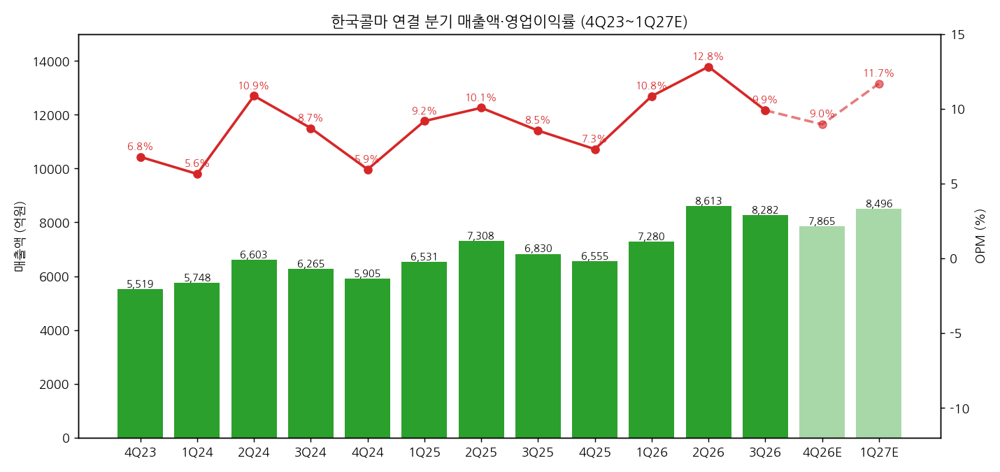
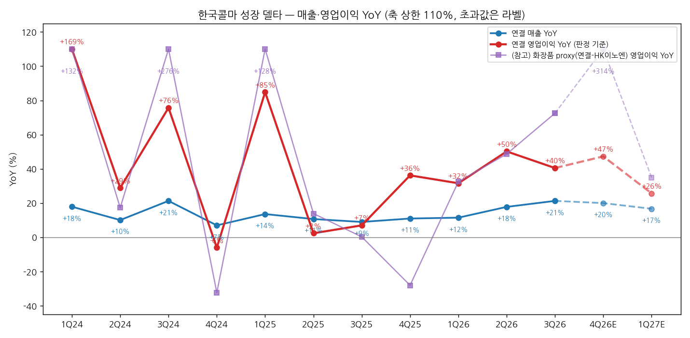
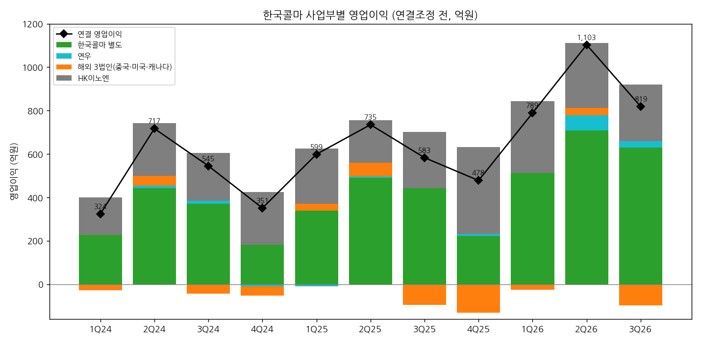

> 모드: 실적 리뷰 (v11)
> 종목: 한국콜마 (161890)
> 섹터: 뷰티
> 서브섹터: ODM
> 분기: 2026-Q3
> 발표일: 2026-11-06 (연결 잠정실적 공정공시 + IR 자료「2026년 3분기 경영실적」 + 실적 설명/Q&A)
> 작성 시각: 2026-11-22 20:42 KST
> 분석 소스: 회사 IR「2026년 3분기 경영실적」(2026-11-06, 잠정·감사 전) + 셀사이드 첨부 8건 전부 한국콜마 리포트(첫 페이지로 종목 확인) — JP모건(11/06), HSBC(11/06, Equity Snap), 씨티(11/06), 한화투자증권(11/06), DB증권(11/09), NH투자증권(11/09), 하나증권(11/09), 교보증권(11/16). 과거 분기 숫자는 한국콜마 기업개요(2026-11-15, OpenDART 연결·별도 분기 시계열 + IR 사업부별 1Q23~3Q26P)로 교차검증. 웹서치 보완 없음
> 리뷰 깊이: 풀 | 리서치 첨부 8건 (8개 증권사)
> 비영업 요인: 일회성(재고자산평가충당금 — 미국 법인 20~25억원, NH는 별도 GPM에도 20억원 기재) · HK이노엔 케이캡 국내 출고량 조절(영업 요인이지만 연결 델타를 깎은 주원인) · 금융비용 증가(167억원, 순이익만 영향) — 판정은 보고 기준 그대로

# 한국콜마 3Q26 실적 리뷰 — 화장품은 가속, 연결은 HK이노엔이 깎았다, 영업이익 YoY +50% → +41%

> 성장 델타: 둔화 | 내러티브: 유지 → 델타 둔화 + 내러티브 유지 → 경계 구간 (연결 델타는 HK이노엔 정체가 깎았고 화장품 본업은 가속 — 4Q26 연결 영업이익 700억원대(YoY +47%) 재확대와 1H27 CAPA 확보 결정을 확인하면 재진입 후보)
>
> ⚠ 비영업 요인 플래그: 3Q26 보고 연결 영업이익 819억원에는 재고자산평가충당금이 들어 있다 — 미국 법인 25억원(씨티·NH·한화) 또는 20억원(DB·하나), NH는 별도 GPM 하락 요인으로도 20억원을 적었다(미국과 별개인지 불명확 [불확실]). 이를 더한 영업이익은 약 840~865억원, YoY +44~48%로 2Q26(+50.2%)보다 여전히 낮아 판정은 같다 ([계산], 참고). DB·하나는 4Q 납품 시 상당 부분 환입을 예상한다 — 4Q26 소폭 플러스 요인. 연결 델타 둔화의 주원인은 일회성이 아니라 HK이노엔 영업이익 YoY +53.8% → +0.4%(케이캡 국내 출고량 조절)다. 화장품(연결−HK이노엔) 영업이익 YoY는 +48.7% → +72.5%로 오히려 가속했다 (참고, 판정 미사용)

→ **숫자**: 연결 매출 8,282억원(+21.3% YoY, -3.8% QoQ), 영업이익 819억원(+40.5% YoY, -25.7% QoQ), OPM 9.9%(+1.4%p YoY). 영업이익 YoY는 2Q26 +50.2%에서 +40.5%로 -9.7%p 줄었지만 플러스라 "둔화"다. 매출 YoY는 +17.8% → +21.3%로 3개 분기 연속 확대됐다. FnGuide 컨센(매출 8,362억원·영업이익 916억원, NH) 대비 매출 -1.0%, 영업이익 -10.6% 미스
→ **쟁점 ①**: 미스의 출처는 화장품이 아니다. 씨티 추정 대비 갭 132억원 중 HK이노엔이 -83억원(63%), 해외 3법인이 -58억원, 별도는 -28억원, 연우는 +20억원이다. 8곳 모두 "HK이노엔 + 해외법인 탓, 국내 본업은 견조"로 같은 결론이다
→ **쟁점 ②**: 별도(국내 화장품) 매출 4,337억원(+34.7%)은 비수기 3Q에 분기 사상 최대, OPM 14.5%는 3Q 기준 최고다. 선케어 매출 +54%(교보·한화)로 "선케어 계절성 소멸"이 숫자로 나왔다. 회사는 4Q 별도 매출 증가율이 연중 최고(+35% 이상)라고 가이던스했다
→ **쟁점 ③**: 새 쟁점은 CAPA다. 국내 가동률 82%(HSBC)·내용물 제조 풀캐파(교보·하나)로 세종 신공장(2027년 7월 완공) 전까지 1H27 성장 상한이 걸렸다. 씨티는 인력 충원·CAPA 제약으로 "2027년 별도 마진 추가 확대 가시성이 낮다"는 회사 코멘트를 전했다. TP는 8곳 중 4곳 하향(평균 17.3만원 → 16.3만원, -5.6%), 2026E·2027E 영업이익 컨센은 -2.7%·-2.9%다. 주가는 발표일 -10.2%(11/5 121,300원 → 11/6 108,900원), 11/13 102,900원으로 52주 고점(161,700원) 대비 -36%
→ **다음 분기 관건**: 4Q26 연결 영업이익 컨센 704억원(7곳 평균)은 YoY +47%로 3Q(+40.5%)보다 커서 "가속"으로 돌아가는 경로다. 4Q25 기저(478억원)에 미국·캐나다 적자 -114억원이 있어 기저는 낮은 편이다. 별도 4Q 매출 3,620억원(가이던스 +35%) 이상과 HK이노엔 4Q 영업이익 380억원대(4Q25 401억원 고기저) 유지가 조건이다

---

## 1. 숫자

① 연결 기준 분기 표 (단위: 억원, %)

| 항목 | 4Q23 | 1Q24 | 2Q24 | 3Q24 | 4Q24 | 1Q25 | 2Q25 | 3Q25 | 4Q25 | 1Q26 | 2Q26 | **3Q26** | 4Q26E | 1Q27E |
|---|---|---|---|---|---|---|---|---|---|---|---|---|---|---|
| 매출액 | 5,519 | 5,748 | 6,603 | 6,265 | 5,905 | 6,531 | 7,308 | 6,830 | 6,555 | 7,280 | 8,613 | **8,282** | 7,865 | 8,496 |
| 영업이익 | 374 | 324 | 717 | 545 | 351 | 599 | 735 | 583 | 478 | 789 | 1,103 | **819** | 704 | 992 |
| OPM | 6.8 | 5.6 | 10.9 | 8.7 | 5.9 | 9.2 | 10.1 | 8.5 | 7.3 | 10.8 | 12.8 | **9.9** | 9.0 | 11.7 |
| 매출 YoY | +15.2 | +17.9 | +10.1 | +21.3 | +7.0 | +13.6 | +10.7 | +9.0 | +11.0 | +11.5 | +17.8 | **+21.3** | +20.0 | +16.7 |
| 영업이익 YoY | +332.8 | +168.9 | +28.9 | +75.7 | -6.0 | +84.8 | +2.4 | +7.0 | +36.2 | +31.6 | +50.2 | **+40.5** | +47.3 | +25.7 |
| **매출 YoY 델타 (%p)** | +6.1 | +2.7 | -7.8 | +11.2 | -14.3 | +6.6 | -2.9 | -1.7 | +2.0 | +0.5 | +6.3 | **+3.5** | -1.3 | -3.3 |
| **영업이익 YoY 델타 (%p)** | +261.3 | -163.9 | -140.0 | +46.8 | -81.7 | +90.8 | -82.4 | +4.6 | +29.2 | -4.6 | +18.6 | **-9.7** | +6.8 | -21.6 |
| (참고) 화장품 proxy 영업이익 (연결−HK이노엔) | 158 | 151 | 474 | 323 | 107 | 345 | 540 | 324 | 77 | 457 | 803 | **559** | 319 | 617 |
| (참고) 화장품 proxy 영업이익 YoY | — | +132.3 | +17.3 | +275.6 | -32.3 | +128.5 | +13.9 | +0.3 | -28.0 | +32.5 | +48.7 | **+72.5** | +314 | +35.0 |
| (참고) 충당금 가산 영업이익 YoY (20~45억원) | | | | | | | | | | | | +44~48 | | |

→ (출처: 4Q23~2Q26 = OpenDART 연결(한국콜마 기업개요 분기 시계열, 4Q = 연간 − 3Q 누적), 3Q26 = 2026-11-06 잠정실적·IR [잠정]. 4Q26E = JPM·씨티·DB·NH·교보·하나·한화 7곳 단순평균(씨티는 2026E − 3Q 누적 내재치 [계산]). 1Q27E = NH·한화 2곳 평균 — 분기 추정 공개 2곳뿐이라 소수 의견 좌우 가능. 화장품 proxy = 연결 − HK이노엔 사업부(IR), 연결조정·기타법인이 섞인 대용치 [계산]. 4Q23 proxy YoY는 4Q22 HK이노엔 사업부 숫자 미확보로 공란)
→ **YoY 계산 기준**: K-IFRS 연결 보고 영업이익, DART 원공시 대 원공시(재작성 없음). 3Q26은 잠정(감사 전)이고 전년 동기 3Q25는 분기보고서 확정치. 기준 단절 두 가지: ① 2025년 1분기 콜마홀딩스 자회사 콜마UX 인수로 기존 별도 상품 매출 일부가 연결조정으로 이동(NH 주석) — 연결 영향은 작다 ② HK이노엔은 2026년 1분기부터 약가환급수수료를 매출차감으로 회계 변경(기업개요) — HK이노엔 매출 YoY가 1Q26부터 낮게 보인다. 영업이익 영향은 회사 미공시
→ 3Q26 서프라이즈: 매출 컨센 대비 -1.0%, 영업이익 -10.6% (FnGuide 컨센 매출 8,362억원·영업이익 916억원, NH·하나 인용. 블룸버그 컨센 925억원 대비 -11.4%, HSBC·씨티. 한화 집계 FnGuide 920억원 대비 -10.6%). 집계 증권사 수는 리포트에 미기재
→ 영업이익 YoY는 2024년(+169% → -6%)과 2025년(+85% → +2%)처럼 출렁이다가, 2025년 4Q부터 +36% → +32% → +50% → +41%로 30~50% 구간에 4개 분기 머물고 있다. 2Q26이 이번 사이클의 정점이다
→ 컨센 경로: 4Q26 +47%(4Q25 기저 478억원에 해외법인 적자 -130억원 포함) → 1Q27 +26%(2곳) → 2027년 연간 +19%(7곳 평균). **보고 기준 YoY는 4Q26E에 한 번 더 커진 뒤 2027년에 20%대로 내려가는 경로**다. 2Q26 +50%를 넘는 분기는 컨센에 없다 [판단]
→ **[판단] 델타 = 둔화**: 연결 영업이익 YoY가 9.7%p 줄었지만 +40.5%로 플러스이고, 2개 분기 연속 둔화가 아니다(2Q26은 확대). 다만 매출 YoY는 +3.5%p 확대돼 방향이 엇갈린다 — 스킬 기준표의 "방향 엇갈림 → 유지"를 문자 그대로 적용하면 "유지"도 가능하다. 영업이익 YoY 변화폭(-9.7%p)이 ±5%p 범위를 넘어 BT 원칙(영업이익 YoY 중심, 매출 보조)에 따라 "둔화"로 둔다 [불확실 — 경계 사례]
→ **(참고) 화장품 본업**: 화장품 proxy 영업이익 YoY는 +32.5% → +48.7% → +72.5%로 2개 분기 연속 가속이다. 다만 3Q25 기저(324억원, YoY +0.3%)가 낮았던 효과가 있고, 별도만 보면 영업이익 YoY는 +51% → +45% → +42%로 오히려 완만히 둔화 중이다 — 화장품 가속분의 일부는 연우 흑자전환(-2 → +30억원)과 연결조정 축소(-24 → -2억원)에서 나왔다 ([계산])

→ (출처: OpenDART 연결(기업개요 시계열), 3Q26 잠정실적·IR. 4Q26E = 증권사 7곳 평균, 1Q27E = NH·한화 평균. 연한 막대·점선 = 추정)

→ (출처: 동일. 판정 기준선 = 연결 영업이익 YoY(적색). 보라색 화장품 proxy는 참고용. 110% 초과 구간은 축 상한에 찍고 실제 값을 라벨로 표기)

② 사업부별 매출·영업이익 — 화장품(별도·해외법인·연우)과 HK이노엔 분리

(1) 사업부별 3Q26 (회사 IR, 연결조정 전, 단위: 억원, %)

| 사업부 | 3Q25 매출 | 2Q26 매출 | **3Q26 매출** | 매출 YoY | 3Q25 OP | 2Q26 OP | **3Q26 OP** | OP YoY | 3Q26 OPM | 매출 비중 |
|---|---|---|---|---|---|---|---|---|---|---|
| 한국콜마 별도 (국내 화장품 ODM) | 3,220 | 4,304 | **4,337** | +34.7 | 443 | 708 | **629** | +42.0 | 14.5 | 52 |
| 중국 (무석) | 318 | 579 | **304** | -4.5 | -16 | 57 | **-44** | 적자지속 | -14.5 | 4 |
| 미국 | 81 | 178 | **180** | +122.2 | -64 | -14 | **-38** | 적자축소 | -21.1 | 2 |
| 캐나다 | 92 | 92 | **81** | -12.1 | -13 | -9 | **-16** | 적자지속 | -19.8 | 1 |
| 연우 (용기) | 618 | 911 | **835** | +35.1 | -2 | 70 | **30** | 흑자전환 | 3.6 | 10 |
| **화장품 소계 (연결조정 전)** | 4,329 | 6,064 | **5,737** | +32.5 | 348 | 812 | **561** | +61.2 | 9.8 | 69 |
| HK이노엔 (제약·H&B, 지분 43%) | 2,608 | 2,672 | **2,604** | -0.2 | 259 | 300 | **260** | +0.4 | 10.0 | 31 |
| 연결 | 6,830 | 8,613 | **8,282** | +21.3 | 583 | 1,103 | **819** | +40.5 | 9.9 | 100 |

→ (출처: 회사 IR 2·4쪽(3Q25·3Q26), 기업개요 사업부별 15분기 표(2Q26). 화장품 소계 = 별도+중국+미국+캐나다+연우 [계산]. 사업부 합과 연결의 차이는 연결조정·기타법인(엠오디머티어리얼즈·콜마유엑스 등) — 3Q26 영업이익 -2억원, 3Q25 -24억원)
→ 연결 영업이익 YoY 증가분 +236억원 중 별도가 +186억원(79%), 연우 +32억원, 연결조정 +22억원, HK이노엔 +1억원, 해외 3법인 -5억원이다 ([계산]). 이번 분기 성장은 사실상 별도 한 곳이 만들었다
→ 영업이익 기여(3Q26, 조정 전): 별도 77%·HK이노엔 32%·연우 4%·해외 3법인 -12% (IR 2쪽)

(2) 사업부별 YoY 추이 (회사 IR, 단위: %)

| 사업부 | 지표 | 1Q25 | 2Q25 | 3Q25 | 4Q25 | 1Q26 | 2Q26 | **3Q26** |
|---|---|---|---|---|---|---|---|---|
| 별도 | 매출 YoY | +10.7 | +10.5 | +17.7 | +11.2 | +25.0 | +31.2 | **+34.7** |
| 별도 | 영업이익 YoY | +48.7 | +10.9 | +19.1 | +23.2 | +51.0 | +44.5 | **+42.0** |
| 별도 | OPM | 12.4 | 14.9 | 13.8 | 8.3 | 14.9 | 16.4 | **14.5** |
| HK이노엔 | 매출 YoY | +16.4 | +20.0 | +13.6 | +23.8 | +4.6 | +1.6 | **-0.2** |
| HK이노엔 | 영업이익 YoY | +46.8 | -19.8 | +16.7 | +64.3 | +30.7 | +53.8 | **+0.4** |
| HK이노엔 | OPM | 10.3 | 7.4 | 9.9 | 13.7 | 12.8 | 11.2 | **10.0** |
| 연우 | 매출 YoY | -5.2 | -4.5 | -15.1 | -11.1 | -2.0 | +28.9 | **+35.1** |
| 연우 | 영업이익 | -10 | 8 | -2 | 8 | -3 | 70 | **30** |
| 해외 3법인 합 | 매출 (억원) | 720 | 783 | 491 | 476 | 691 | 849 | **565** |
| 해외 3법인 합 | 영업이익 (억원) | 33 | 62 | -93 | -130 | -22 | 34 | **-98** |
| 화장품 proxy (연결−HK) | 영업이익 YoY | +128.5 | +13.9 | +0.3 | -28.0 | +32.5 | +48.7 | **+72.5** |

→ (출처: 회사 IR, 기업개요 사업부별 15분기 표. YoY [계산])
→ **델타를 끄는 쪽은 별도**: 매출 YoY는 7개 분기 동안 +10%대에서 +34.7%로 거의 매 분기 커졌다. 영업이익 YoY는 1Q26 +51%를 정점으로 +45% → +42%로 완만히 내려오는 중이다 — 매출은 가속, 마진 레버리지는 둔화
→ **델타를 깎은 쪽은 HK이노엔**: 매출 YoY가 +23.8%(4Q25)에서 -0.2%로 3개 분기 연속 둔화(1Q26부터 회계 변경 효과 포함), 영업이익 YoY는 +53.8%에서 +0.4%로 떨어졌다. 케이캡 국내 매출 372억원(-15.0% YoY)이 출고량 조절로 줄었고(처방은 654억원, +16.5%), 케이캡 수출 56억원(+113%)·수액 405억원(+4.4%)이 일부를 메웠다 (IR 5쪽). 씨티는 H&B 마케팅비 부담도 원인으로 들었다
→ **해외 3법인은 계절 패턴 반복**: 선케어 성수기(2Q)만 흑자, 3Q·4Q는 적자다. 3Q26 -98억원은 3Q25(-93억원)와 비슷하다. 미국은 매출 +122%로 글로벌 MNC 색조 브랜드가 상위 고객으로 편입됐지만, 충당금 20~25억원으로 적자가 QoQ 24억원 커졌다. 중국은 메이크업 고객 주문이 기대에 못 미쳐 고정비 부담으로 -44억원 (IR 5쪽)
→ **연우는 턴어라운드 확인**: 2개 분기 연속 매출 +29~35%, 영업이익 70억 → 30억원. 대형 2사(아모레·LG생건) 비중이 11%로 줄고 스케일업 선케어 브랜드 용기로 고객이 바뀌었다. 4Q는 두 자릿수 매출 증가 예상(회사), 하나는 매출 650억원 BEP로 본다

(3) 별도 카테고리·고객 KPI (회사 IR, 증권사)

| 항목 | 3Q25 | 4Q25 | 2Q26 | **3Q26** | 출처 |
|---|---|---|---|---|---|
| 선케어 비중 | 28 | 17 | 35 | **32** | IR·HSBC (3Q25는 HSBC "+4%p YoY"로 역산) |
| 스킨케어 비중 | — | 62 | 49 | **48** | IR, 기업개요 |
| 메이크업 비중 | — | 16 | 12 | **15** | IR, 기업개요 |
| 선케어 매출 YoY | | | | **+54** | 교보·한화 |
| 스킨케어 / 메이크업 매출 YoY | | | | **+32 / +19** | 한화 |
| Top10 고객 비중 | 54~55 | | | **57~58** | IR 57%, DB·하나 58%(+3%p YoY) |
| 국내 가동률 | | | | **82** | HSBC(Q&A) |

→ 선케어 비중이 비수기 3Q에 32%로, 4Q25(17%) 대비 두 배다. 수출 고객사의 선케어는 계절성이 약하다(하나·교보·한화). 별도 GPM은 -0.6%p YoY(조업일수 감소·색조 비중 상승·충당금)였지만 판관비 레버리지로 OPM +0.7%p (NH, IR 7쪽: 별도 매출원가 +35.7% vs 판관비 +8.7%)

→ (출처: 회사 IR, 기업개요 사업부별 15분기 표. 막대 = 사업부 영업이익(연결조정 전), 검은 선 = 연결 영업이익)

③ 연간 (단위: 억원, %)

| 항목 | 2022 | 2023 | 2024 | 2025 | 2026E | 2027E |
|---|---|---|---|---|---|---|
| 매출액 | 18,657 | 21,557 | 24,521 | 27,224 | 32,040 | 36,158 |
| 영업이익 | 733 | 1,361 | 1,939 | 2,396 | 3,416 | 4,074 |
| OPM | 3.9 | 6.3 | 7.9 | 8.8 | 10.7 | 11.3 |
| 매출 YoY | +17.6 | +15.5 | +13.7 | +11.0 | +17.7 | +12.9 |
| 영업이익 YoY | -13.0 | +85.7 | +42.5 | +23.6 | +42.6 | +19.3 |
| (참고) 별도 매출 / 영업이익 | — | 8,565 / 797 | 10,597 / 1,223 | 11,928 / 1,495 | 15,925 / 2,227 | 19,122 / 2,725 |
| (참고) HK이노엔 영업이익 | — | 650 | 882 | 1,109 | 1,278 | 1,405 |

→ (출처: 2022~2025 OpenDART 연결(기업개요), 사업부는 IR 분기 합산(기업개요). 2026E·2027E = JPM·씨티·DB·NH·교보·하나·한화 7곳 발표 후 추정 단순평균 [계산]. 별도 2026E·2027E는 씨티·DB·NH·교보·하나·한화 6곳 평균(JPM 'Parent' 분기 수치가 IR과 맞지 않아 제외), HK이노엔은 2026E 7곳·2027E 6곳(JPM 미기재) 평균)
→ 1~3Q26 누적: 매출 2조 4,175억원(+17.0%), 영업이익 2,711억원(+41.4%), OPM 11.2% (기업개요)
→ 발표 전후 컨센 변화: 2026E 영업이익 FnGuide 3,511억원(하나 표지 인용) → 7곳 평균 3,416억원(-2.7%), 2027E 4,196억원 → 4,074억원(-2.9%). 증권사별 2027E 영업이익은 3,920억원(씨티·DB)~4,249억원(하나)으로 8% 범위
→ 2027E 별도 영업이익 YoY는 6곳 평균 +22%(DB +19% ~ 교보 +30%), 별도 OPM은 13.5%(씨티)~15.1%(교보)로 2026E(13.8~14.1%)와 거의 같다 — **2027년 성장은 매출이 끌고 마진은 횡보**라는 데 컨센이 모여 있다 [판단]

---

## 2. 시장 쟁점

① 지난 분기 체크
→ 첫 리뷰 — 직전 체크 없음 (2026-Q2 한국콜마 리뷰·팔로업 미작성)

② 이번 분기 쟁점 5개

| # | 쟁점 | 언급 증권사 수 |
|---|---|---|
| (1) | 컨센 -11% 미스는 어디서 — HK이노엔·해외법인인가, 화장품 본업인가 | 8/8 |
| (2) | 별도 OPM 14.5% — 왜 사상 최대 매출에도 마진이 QoQ -1.9%p였나, 2027년 마진은 더 오르나 | 7/8 |
| (3) | 수요는 구조적인가 — 선케어 계절성 소멸과 4Q "연중 최고 성장" 가이던스 | 8/8 |
| (4) | CAPA 병목 — 세종 신공장(2H27) 전까지 1H27 성장 상한 | 7/8 |
| (5) | TP 하향 — 실적인가, HK이노엔 지분가치·멀티플인가 | 8/8 |

③ 쟁점별 분해

(1) 컨센 -11% 미스는 어디서 — HK이노엔·해외법인인가, 화장품 본업인가

(1-1) 회사 설명 (IR 2·5쪽)
→ 별도: "2분기를 넘어서는 사상 최대 분기 매출, OPM 14.5%로 3Q 기준으로는 최고 수익성"
→ HK이노엔: "K-CAB 국내 출고량 조절" — 처방 654억원(+16.5%)인데 국내 매출 372억원(-15.0%). 수출 56억원(+113.3%)
→ 중국: "주요 메이크업 고객사들의 주문이 기대 하회하면서 고정비 부담 증가". 미국: "최대 고객사 비중 점진적 감소 진행 중, 글로벌 MNC 색조 브랜드가 의미 있는 비중으로 상위 고객사 편입"

(1-2) 증권사별 해석 편차

| 증권사 | 자체 추정 대비 | 논리 |
|---|---|---|
| 씨티 | 영업이익 -14%(951억원 대비). HK이노엔 -24%, 별도 -4%, 중국 -34억원, 미국 -18억원, 연우 +200% | 미스 4가지: HK이노엔 케이캡 출고 조절·H&B 마케팅비, 중국 고정비, 미국 재고충당금 25억원, 캐나다 매출 -12%. 별도는 +35%·OPM 확대 |
| JPM | 영업이익 -15%(JPMe), 컨센 -11%. HK이노엔 -23%, 별도 OPM 14.5% vs JPMe 15.0% | "자회사 탓, 국내는 견조". 해외법인 적자가 전 공장에서 확대 |
| NH | 영업이익 -11%(918억원 대비), HK이노엔 제외 시 -5%(-49억원) | 별도 분기 최대 매출, 미국 충당금 25억원. 본업 미스는 작다 |
| DB | 영업이익 -6.9%(880억원 대비) | "HK이노엔 제외하면 기대 부합", 중국·미국도 소폭 하회(미국 원부자재 충당금 20억원) |
| 한화 | 영업이익 -12.3%(930억원 대비) | 하회의 대부분이 HK이노엔과 중국. 미국 충당금 25억원 |
| HSBC | 컨센 -11.4% | "3Q는 무난했지만 기대가 더 높았다" — 2Q 사상 최대 이익 뒤라 기대치가 올라가 있었다 |
| 하나 | 컨센(916억원) 미달 | 비수기 3Q에 역대 최대 매출 자체가 ODM 호황 증거. 북미·중국 QoQ 손실 증가는 아쉽다, 미국 충당금 약 20억원은 4Q 환입 |
| 교보 | (미스 언급 없음) | 한국 +35% 호실적에 초점 |

(1-3) 공통 결론 vs 갈리는 지점
→ 공통: 8곳 모두 "미스 = HK이노엔 + 해외법인, 국내 본업 견조"다. 별도 영업이익은 추정 대비 -3~-4%(JPM·씨티)로 거의 부합했다
→ 갈림: 미국 충당금 규모(20억원 DB·하나 vs 25억원 씨티·NH·한화)와 환입 여부. DB·하나는 4Q 환입을 명시했고, 씨티·NH는 환입을 말하지 않았다

(1-4) **[판단]**
→ 씨티 추정 대비 갭 132억원을 분해하면 HK이노엔 -83억원, 해외 3법인 -58억원(중국 -34·미국 -18·캐나다 -6), 별도 -28억원, 연우 +20억원, 기타 +17억원이다 ([계산]). 화장품 본업(별도+연우)만 보면 추정 대비 -8억원으로 사실상 부합
→ 다만 BT 판정은 연결 보고 기준이라 HK이노엔 정체는 그대로 델타를 깎는다. HK이노엔은 연결 영업이익의 32%이고 지분율은 43%라, 지배주주 이익 기준으로는 영향이 더 작다(NH SOTP도 HK이노엔을 지분가치로만 반영)
→ 결론이 바뀌는 조건: HK이노엔 4Q 영업이익이 컨센(약 385억원)대로 나오면 3Q 출고 조절은 일시적이다. 4Q에도 케이캡 국내 매출이 YoY 마이너스면 HK이노엔이 연결 델타의 구조적 감속 요인이 된다

(2) 별도 OPM 14.5% — 왜 사상 최대 매출에도 마진이 QoQ -1.9%p였나, 2027년 마진은 더 오르나

(2-1) 회사 설명 (IR 5쪽, 컨콜 — 씨티·HSBC 정리)
→ OPM 14.5%는 3Q 기준 최고. 4Q에도 별도 OPM YoY 개선 자신 (씨티 컨콜 정리)
→ "1H27 수요 증가에 대비한 CAPA 추가 확보에 집중" (IR 5쪽). 인력 충원·1H27 CAPA 제약 가능성 때문에 2027년 별도 마진의 추가 확대는 2026년만큼 가시성이 높지 않다 (씨티 컨콜 정리)

(2-2) 증권사별 해석 편차

| 증권사 | 4Q26E 별도 OPM | 2027E 별도 OPM (영업이익 YoY) | 논리 |
|---|---|---|---|
| 하나 | 10.2 | 14.3 (+28%) | QoQ 하락은 하계휴가·추석 조업일수 감소와 인건비. 4Q는 인건비·인센티브로 3Q보다 낮지만 비수기 대비 증가폭 매우 큼 |
| NH | 10.3 | 14.0 (+16%) | GPM -0.6%p(조업일수·색조↑·충당금 20억원), 판관비 효율화로 OPM +0.7%p. 본업 영업이익 추정 -3% |
| DB | 10.3 | 14.6 (+19%) | 규모의 경제 강화. 단 증설 단계 인건비 등 고정비 증가로 개선 폭이 예상보다 제한될 수 있다 |
| 씨티 | 약 9.0 [계산] | 13.5 (+20%) | 회사가 2027년 마진 가시성을 낮게 말함 → 2027E 별도 영업이익 -6% 하향 |
| 한화 | 9.3 | 14.0 (+20%) | 2027년 스케일업 수출·MNC 신제품 출하로 고성장 지속 |
| 교보 | 9.5 | 15.1 (+30%) | 높은 선케어 비중으로 한국 법인 OPM 약 15% vs 경쟁사 약 10%. 선케어 확대는 수익성에 유리 |
| JPM | 14.0 [JPM 표 'Parent', IR과 불일치] | — | 선케어·스킨케어로 "추가 영업 레버리지" 기대 |

(2-3) 공통 결론 vs 갈리는 지점
→ 공통: 3Q QoQ 마진 하락은 조업일수·인건비·충당금 등 일시 요인이라는 데 대부분 동의한다. 4Q 별도 OPM은 9~10%대(4Q25 8.3%)로 YoY 개선 쪽이다
→ 갈림: 2027년. 교보(15.1%)·DB(14.6%)는 마진이 더 오른다고, 씨티(13.5%)는 회사 코멘트를 근거로 2026년 수준 이하로 본다

(2-4) **[판단]**
→ 3Q 별도 매출원가 +35.7%가 매출(+34.7%)보다 빨랐다(GPM 하락). OPM이 오른 건 판관비 +8.7%의 레버리지 덕이다 (IR 7쪽). 즉 매출총이익단의 규모의 경제는 이미 한계에 가깝고, 남은 레버리지는 판관비다
→ 회사가 직접 "2027년 마진 가시성 낮음"을 말한 점이 중요하다. 2027년은 증설 비용·인력 충원 국면이라 별도 OPM 횡보(14% 안팎)가 기본 가정으로 맞다. 그렇다면 2027년 별도 영업이익 성장률 ≈ 매출 성장률(컨센 +15~26%)이다
→ 결론이 바뀌는 조건: 4Q26 별도 OPM이 10% 이상이면서 매출 +35%를 넘기면 "비수기에도 레버리지 유지" — 교보·DB 쪽. 4Q OPM이 9% 미만이면 고정비 증가가 시작된 신호다

(3) 수요는 구조적인가 — 선케어 계절성 소멸과 4Q "연중 최고 성장" 가이던스

(3-1) 회사 설명 (IR 5쪽, Q&A — HSBC·씨티 정리)
→ "스케일업 선케어와 스킨케어 브랜드들의 동반 호조, 글로벌 MNC 럭셔리 매출 순항하는 가운데 신제품 출하 개시". "매출액 증가율 면에서 4Q가 연중 가장 강할 것"
→ 3Q 성장은 구조적 — 한국 인디브랜드 주문 모멘텀 + 글로벌 MNC 파트너십 강화. 고객 순위는 크게 바뀌지 않았고 기존 상위 고객 주문이 늘고 있다. 강한 수요는 2027년에도 이어질 것 (HSBC Q&A 정리)
→ 4Q 별도 매출 +35% 이상(YoY 연중 최고, 계절성으로 QoQ 증가는 어려움), 북미 YoY 증가·QoQ 보합, 연우 약 +20% (HSBC·JPM·씨티)

(3-2) 증권사별 해석 편차

| 증권사 | 4Q26E 별도 매출 (YoY) | 논리 |
|---|---|---|
| 하나 | 4,210억원 (+56.9%) | 수출용 선케어는 계절성 소멸. 2027년 화장품 수출 +20% 이상. 글로벌 L사 크림 리오더·SKU 확대 |
| NH | 3,831억원 (+42.8%) | 한국 화장품 수출 신기록. Top10 비중 57%(+3%p). CAPA만 확보하면 분기 매출 추가 업사이드 |
| 한화 | 3,828억원 (+42.8%) | 수출 고객사 선케어 계절성 약함, 스킨케어·MNC 수주 견조. "본질은 견조한 수요" |
| 씨티 | 약 3,769억원 (+40.5%) [계산] | 1Q/2Q/3Q +25%/+31%/+35% 뒤 4Q 추가 가속 가이던스 |
| 교보 | 3,756억원 (+40.0%) | 선케어 +54% — 글로벌 유통망 확대로 계절성 희석. MNC 물량 우상향, 2027년 신규 프로젝트 |
| DB | 3,730억원 (+39.0%) | Top10 58%, 규모의 경제. 수출 고객 수주는 강하지만 연말 휴가 소진으로 출고 갭 → 4Q 매출은 3Q보다 낮음 |
| JPM | 3,690억원 (+37.5%) | 성장 중인 미국·유럽에서 점유율을 늘리는 브랜드에 매출 노출이 높다 — K-뷰티 시장 재편의 수혜 |

(3-3) 공통 결론 vs 갈리는 지점
→ 공통: 8곳 모두 수요는 구조적이라고 본다. 4Q 별도 매출 YoY 추정은 +37.5~56.9%로 7곳 전부 회사 가이던스(+35%)를 넘는다
→ 갈림: 4Q 별도 매출 수준. 하나(4,210억원, 3Q와 비슷)만 QoQ 보합을 가정했고, 나머지 6곳은 3,690~3,831억원(QoQ -12~-15%)이다. 하나 추정과 나머지 평균의 차이 약 440억원은 연결 4Q 영업이익 추정 범위(609~840억원)의 한 축이다

(3-4) **[판단]**
→ 별도 매출 YoY가 +11% → +25% → +31% → +35%로 4개 분기 연속 커졌고 4Q 가이던스도 더 높다. 비수기 3Q 매출이 성수기 2Q를 넘었다(4,337억원 vs 4,304억원). 계절성 약화는 숫자로 확인됐다
→ 그러나 4Q 별도 매출 YoY가 +40%대로 높게 나오는 데는 4Q25 기저(2,683억원, YoY +11%)가 낮은 효과가 섞여 있다. QoQ로는 6곳이 -12~-15%를 가정한다. "구조적 수요"를 판별하는 지표는 YoY보다 **4Q 매출의 QoQ 낙폭**이다 — 4Q25 QoQ 낙폭은 -16.7%(3,220 → 2,683억원)였다
→ 결론이 바뀌는 조건: 4Q26 별도 매출이 3,800억원(QoQ -12%) 이상이면 계절성 약화가 확인된다. 3,620억원(가이던스 하단, QoQ -17%) 근처면 계절성은 그대로이고 YoY는 기저 효과다

(4) CAPA 병목 — 세종 신공장(2H27) 전까지 1H27 성장 상한

(4-1) 회사 설명 (IR 5쪽, Q&A — HSBC·NH·하나 정리)
→ "1H27 수요 증가에 대비한 CAPA 추가 확보에 집중" (IR 5쪽). 국내 가동률 82%, 2H27 증설 계획은 순항 (HSBC Q&A)
→ 국내 생산 CAPA 2024년 4.3억개 → 2025년 5.3억개 → 2026년 현재 7.8억개, 2027년 하반기 세종 신공장 증설 시 배증 가능. 1H27까지는 아웃소싱·인수·계열사 공장 활용 등 다방면 검토 (NH)
→ 칭량·제조(내용물) 캐파가 부족 — M&A, 세종 2공장·콜마비앤에이치·콜마스크·H&G·콜마오랄스 공간에 신규 설비 투자 검토. 튜브 등 용기 수급 부담은 많이 완화 (하나)

(4-2) 증권사별 해석 편차

| 증권사 | 핵심 가정 | 논리 |
|---|---|---|
| 하나 | 적정 PER 18 → 16배 하향 | 캐파 제약으로 ODM 수요를 다 흡수할 수 없다 — 경쟁사 대비 성장률을 낮추는 요인. 단 2027년 별도 매출 2조 441억원(+26%, 6곳 중 최고) |
| 교보 | 2027E 별도 매출 +20% | 풀캐파, 충진·포장보다 내용물 제조가 병목. 2027년 7월 세종 공장 완공 시 해소, 1H27 대응이 관건 |
| NH | 확보 결정 시 분기 매출 업사이드 | "CAPA만 확보하면 몰려드는 주문도 무섭지 않다". 확보는 업사이드 옵션 |
| DB | 수익성 개선 폭 제한 가능 | 아웃소싱·추가 공장 인수·세종 부지 검토. 증설 단계 인건비 등 고정비 증가 |
| 씨티 | 2027E 별도 영업이익 -6% | 인력 충원·1H27 CAPA 제약 → 2027년 마진 가시성 낮음 |
| 한화 | 2027E 영업이익 유지 | 용기 쇼티지·생산 병목 우려는 공급처 다변화·기존 시설·임차·인수로 대응 가능 — "본질은 수요" |
| HSBC | — | 가동률 82%, 2H27 증설 순항을 확인 사항으로만 전달 |

(4-3) 공통 결론 vs 갈리는 지점
→ 공통: 1H27이 CAPA 공백 구간이고 세종 신공장(2027년 7월 완공, 교보)이 해법이라는 데 동의한다
→ 갈림: CAPA를 "성장 상한 + 비용 증가"(하나·씨티·DB)로 볼지, "확보 결정 시 업사이드 옵션"(NH·한화)으로 볼지. 하나는 멀티플을, 씨티는 이익을 깎았다

(4-4) **[판단]**
→ 가동률 82%(HSBC)와 "풀캐파"(교보)가 동시에 나온다. 공정별 병목(내용물 제조 vs 충진·포장)의 차이로 보인다 — 평균 가동률보다 제조 공정이 먼저 찬다 [판단]. 기업개요의 2025년 별도 CAPA 6.32억개·가동률 76.8%(사업보고서)와 NH의 2025년 5.3억개는 기준이 달라 직접 비교가 안 된다 [불확실]
→ 델타 관점에서 CAPA는 1Q27·2Q27 별도 매출 YoY 상한이다. NH·한화의 1Q27E 별도 매출 YoY는 +24~25%, 2Q27E +13~22%로 이미 3Q26(+35%)보다 낮다 — 컨센은 1H27 감속을 이미 반영하고 있다
→ 결론이 바뀌는 조건: 4Q 실적 발표 전후로 외부 공장 인수·임차 또는 계열사 공장 전환이 공시되면 1H27 매출 추정이 올라간다(NH 업사이드 시나리오). 결정이 2027년 상반기로 밀리면 하나·씨티 쪽이다

(5) TP 하향 — 실적인가, HK이노엔 지분가치·멀티플인가

(5-1) 회사 설명
→ 해당 없음 (밸류에이션 쟁점). 회사는 4Q 해외법인 가이던스를 보수적으로 냈다 — 중국 적자 지속·매출 소폭 증가, 미국·캐나다 3Q 수준 (IR 5쪽, 씨티)

(5-2) 증권사별 해석 편차

| 증권사 | 밸류에이션 | 논리 |
|---|---|---|
| JPM | SOTP: 화장품 12MF PER 16배(코스맥스 목표 배수 소폭 프리미엄) 2.7조원 + HK이노엔 지분 5,310억원(6,340억원에서 하향, 25% 할인) | 해외 자회사 보수적 가정 + HK이노엔 추정 변경 → 2027E 영업이익 -9% |
| 씨티 | SOTP: 화장품 2027E 순이익 1,803억원 × 19배(코스맥스 역사적 평균 -0.5SD) + HK이노엔 지분 3,263억원(시가) | 해외 마진·영업외 보수화로 2026~28E 순이익 -4~9% |
| NH | SOTP: 화장품(연우 포함) 12MF 지배순이익 1,960억원 × 17배 + HK이노엔 지분 3,350억원(30% 할인) | 자회사 지분가치 하락 + 본업 영업이익 -3% |
| 하나 | 12MF PER 18 → 16배 | 추정치 하향 + 캐파 제약에 따른 멀티플 하향 |
| DB | SOTP: 본사 2027E 순이익 2,240억원 × 17배 + HK이노엔 지분 2,140억원(50% 할인) | TP 유지. 2027E PER 11배까지 하락 → 저점 매수 |
| 한화 | 2027E EPS 9,881원 × 15.8배(글로벌 피어 평균 40% 할인) | TP 유지, 추정 거의 불변 |
| 교보 | (밸류 상세 미기재) | TP 유지, 2027E 영업이익 4,235억원(8곳 중 상위) |
| HSBC | (Equity Snap, 10/28 TP 유지) | TP·추정 변경 없음 |

(5-3) 공통 결론 vs 갈리는 지점
→ 공통: 8곳 모두 매수(Buy·OW) 유지. 블룸버그 ANR Buy 28·Hold 0·Sell 0 (JPM 인용). 현재 주가는 2027E PER 약 10.6~11배(NH·하나·DB)
→ 갈림: 화장품 본업 멀티플 16배(JPM·하나)~19배(씨티), HK이노엔 지분 할인율 25%(JPM)~50%(DB). HK이노엔 지분가치는 증권사마다 2,140~5,310억원으로 2.5배 차이 — 주당 약 9천~2.2만원

(5-4) **[판단]**
→ TP 하향 4건 중 JPM은 이익(2027E -9%)+HK이노엔 지분가치, 씨티는 이익(순이익 -4~9%), NH는 HK이노엔 지분가치+본업 -3%, 하나는 멀티플(18→16배)+추정 소폭 하향이다. **실적 하향은 대부분 HK이노엔·해외법인 쪽**이고 본업은 -3~-6% 수준, 멀티플 하향은 하나 1곳이다
→ 주가는 발표일 -10.2%, 11/13까지 -15%로 TP 평균 하향(-5.6%)보다 훨씬 크게 빠졌다. 52주 고점(8/28 161,700원) 이후 이미 -25%였다 — 시장은 "2Q 사상 최대 이후 기대 과열 해소"(HSBC)와 CAPA 상한을 같이 반영했다 [판단]

④ 낙관 vs 보수 — 논리 대비
→ **가장 낙관 (DB TP 18만원 유지, 하나 2027E 영업이익 4,249억원)**: DB는 "본업 모먼트 이상 무" — HK이노엔만 빼면 부합이라 TP를 지켰다. 하나는 TP를 내렸지만 2027E 별도 매출 2조 441억원(+26%)·4Q26 별도 매출 4,210억원(+57%)으로 수요 추정은 가장 높다. 둘 다 "수요 > 공급" 전제
→ **가장 보수 (씨티 2027E 영업이익 3,920억원, JPM TP 15만원)**: 씨티는 회사의 "2027년 마진 가시성 낮음" 코멘트를 그대로 반영해 별도 2027E 영업이익을 -6% 내렸고 OPM 13.5%로 가장 낮다. JPM은 화장품 멀티플 16배·HK이노엔 지분가치 하향으로 TP를 -17% 내렸다. 둘 다 수요는 인정하되 "마진·자회사" 쪽을 문제 삼는다
→ 셀사이드 vs 시장: 8곳 매수, 평균 TP 16.3만원 대비 현재가 102,900원(11/13)은 상승여력 +59%다. 반면 주가는 1개월 -21.6%(DB·교보) — 셀사이드는 "본업 이상 무", 시장은 "델타 정점 통과 + CAPA 상한"으로 반응이 엇갈린다

⑤ 추정치·TP 변화 (단위: 원, 억원)

| 증권사 (발간일) | 직전 TP | 현재 TP | 4Q26 영업이익 E | 2026 / 2027 영업이익 E | 핵심 변화 한 줄 |
|---|---|---|---|---|---|
| JPM (11/06) | 180,000 | 150,000 (-16.7%) | 840 | 3,550 / 4,080 | 2027E 영업이익 -9%, EPS -3.2%, HK이노엔 지분가치 6,340 → 5,310억원 |
| 씨티 (11/06) | 174,000 | 156,000 (-10.3%) | 약 609 [계산] | 3,320 / 3,920 | 영업이익 -5% / -7%, 순이익 -9% / -8%, 해외 마진·영업외 보수화 |
| HSBC (11/06) | 170,000 | 170,000 (유지) | — | — / — | Equity Snap, 추정·TP 변경 없음 |
| 한화 (11/06) | 160,000 | 160,000 (유지) | 674 | 3,390 / 4,110 | 영업이익 -1.0% / 0.0% |
| DB (11/09) | 180,000 | 180,000 (유지) | 650 | 3,360 / 3,920 | 본업 부합, 4Q 별도 OPM 10.3% |
| NH (11/09) | 170,000 | 160,000 (-5.9%) | 704 | 3,415 / 4,007 | 영업이익 -2.8% / -3.0%, HK이노엔 지분가치 하락 |
| 하나 (11/09) | 180,000 | 160,000 (-11.1%) | 763 | 3,474 / 4,249 | 영업이익 -2.2% / -0.6%, 12MF PER 18 → 16배 |
| 교보 (11/16) | 170,000 | 170,000 (유지) | 690 | 3,402 / 4,235 | 4Q 별도 +40%, 2027E 별도 OPM 15.1% |

→ 평균 TP: 17.3만원 → 16.3만원 (-5.6%). 하향 4건(JPM·씨티·NH·하나), 유지 4건, 상향 0건
→ 연간 컨센: 2026E 영업이익 3,511억원 → 3,416억원 (-2.7%), 2027E 4,196억원 → 4,074억원 (-2.9%). 발표 전은 FnGuide(하나 표지 Consensus Data), 발표 후는 7곳 평균(HSBC 제외)
→ TP 하향 원인: **실적 하향(주로 HK이노엔·해외법인)과 HK이노엔 지분가치 하락이 중심이고, 멀티플 하향은 하나 1곳**. 본업(별도) 추정 하향은 -3~-6%로 작다
→ 씨티 4Q E는 2026E 영업이익 3,320억원에서 3Q 누적 2,711억원을 뺀 값이다 ([계산]). 4Q26E 범위 609~840억원, 평균 704억원(7곳)

---

## 3. 내러티브 점검

① 성장 스토리 정의
→ "K-뷰티 인디·스케일업 브랜드의 미국·유럽 수출 확대와 글로벌 MNC 수주를 국내 1위 선케어·스킨케어 ODM이 흡수 — 선케어 계절성이 사라지며 별도 매출이 분기 2,000억원대에서 4,000억원대로 레벨업하고, 영업 레버리지로 별도 OPM 14~16%를 내는 K-뷰티 공급망 수혜주". HK이노엔은 지분가치로 할인되는 보조 축이고, 시장은 화장품 본업을 보고 산다

② 이번 분기가 스토리에 준 영향
→ **강화된 부분**: 비수기 3Q에 별도 사상 최대 매출(+35%), 선케어 +54%·비중 32%로 계절성 약화가 숫자로 확인됐다. 4Q 가이던스가 "연중 최고 성장"이고, 회사는 2027년까지 수요가 이어진다고 말했다. 연우 흑자 기조, 미국 MNC 색조 고객 편입도 플러스
→ **약화된 부분**: ① CAPA 상한 — 1H27 매출 성장이 공급에 묶인다(하나 멀티플 하향 근거) ② 2027년 별도 마진 가시성 낮음(회사 코멘트, 씨티) — "레버리지로 마진이 계속 오른다"는 스토리의 두 번째 다리가 약해졌다 ③ HK이노엔 정체와 해외법인 적자 반복으로 연결 이익 질이 출렁인다
→ **판정 = 유지**: 수요 스토리는 강화됐고, 마진·CAPA 쪽은 약화됐다. 추정치 하향(2026E·2027E -3%)은 주로 비핵심(HK이노엔·해외)이고 본업 추정 변화는 작다. 멀티플 하향은 1곳이다. "약화(추정치·멀티플 동반 하향)"라고 하기엔 본업 숫자가 덜 움직였다. 다만 주가 -15%는 시장이 약화 쪽으로 해석했다는 뜻이다 [판단]

③ 국면
→ 연결 델타 둔화(영업이익 YoY +50% → +41%) + 내러티브 유지 → **경계 구간**. 화장품 본업만 보면 매출 가속·이익 고성장(+42~73%)이라 델타 자체는 강하다. 그러나 BT 판정 기준(연결 보고)에서 2Q26이 YoY 정점이고, 컨센 경로상 2027년에는 +20%대로 내려간다 [판단]
→ 4Q26 컨센(YoY +47%)대로 나오면 연결 델타는 "가속"으로 돌아간다. 그 뒤 1Q27(+26%, 2곳)은 다시 둔화다. 즉 모멘텀 관점의 창은 4Q26 실적(2월 말) 한 분기이고, 이후는 CAPA 확보 여부가 2027년 델타를 결정한다 [판단]

④ 트리거와 리스크
→ **트리거 (스토리 재강화)**: (1) 1H27 CAPA 확보 결정(외부 공장 인수·임차, 계열사 공장 전환) — 1H27 매출 추정 상향 (2) 4Q26 별도 매출 3,800억원 이상(QoQ 낙폭 -12% 이내)으로 계절성 소멸 재확인 (3) 2027년 글로벌 MNC 신규 프로젝트·SKU 확대(하나 L사 크림 리오더)
→ **리스크 (스토리 훼손)**: (1) 증설기 고정비·인건비로 별도 OPM이 14%를 밑도는 분기 등장 (2) 상위 고객 집중(Top10 57~58%) — 인디브랜드 주문 급변(미국 법인 1위 고객 이탈 사례) (3) 한국 화장품 수출 증가율 둔화(관세청 월간) — 수요 축 자체의 감속

---

## 4. 향후 봐야 할 것

(1) **4Q26 연결 영업이익 700억원대 — YoY +47%로 델타 재확대되는가** — 델타 판정 1순위
→ 무엇을: 연결 영업이익 704억원(7곳 평균, YoY +47%) 이상이면 3Q(+40.5%)보다 커져 "가속". 640억원(+34%) 미만이면 2개 분기 연속 둔화로 "꺾임" 조건 검토. 화장품 proxy(연결−HK) 300억원대(4Q25 77억원), 미국 충당금 환입 여부
→ 어떤 데이터로: 4Q26 잠정실적 공시·IR, 증권사 4Q 프리뷰(2월)
→ 언제: 2027년 2월 하순 예상 (실적 캘린더 ~2027-02-25, 정확한 일정 미확인)

(2) **별도 4Q 매출 3,620억원(+35%) 이상·OPM 10% — 계절성 소멸과 비수기 레버리지**
→ 무엇을: 회사 가이던스(+35% 이상) 하단 3,620억원, 컨센 약 3,830억원(+43%). QoQ 낙폭 -12% 이내면 계절성 소멸 확인(4Q25 -16.7%). 별도 OPM 10% 이상(4Q25 8.3%), 4Q 선케어 비중(4Q25 17%)
→ 어떤 데이터로: 관세청 월간 화장품 수출(10~12월, 미국·유럽·일본), 4Q 실적 IR 카테고리 믹스, 피어 코스맥스·코스메카코리아 4Q 국내 법인 실적
→ 언제: 매월 1일·15일(수출입 잠정치) / 2월 하순(실적)

(3) **1H27 CAPA 확보 결정 — 외부 공장 인수·임차, 계열사 공장 전환**
→ 무엇을: 아웃소싱·M&A·세종 2공장·콜마비앤에이치 등 공간 활용 결정 공시, 세종 신공장 2027년 7월 완공 일정 유지, 국내 가동률(3Q 82%), 2027년 별도 마진 가이던스(씨티: 가시성 낮음)
→ 어떤 데이터로: DART 주요사항·유형자산 취득 공시, 4Q 컨콜 Q&A, 언론 뉴스 키워드 "한국콜마 공장 인수·증설·세종"
→ 언제: 수시 / 2월 하순 컨콜

(4) **HK이노엔 — 케이캡 국내 출고 정상화, 4Q 영업이익 380억원대**
→ 무엇을: 케이캡 국내 매출 YoY 플러스 회복(3Q -15%), HK이노엔 4Q 영업이익 컨센 약 385억원(4Q25 401억원 고기저 — YoY -4% 수준). 연결 델타의 31~32%를 차지하므로 여기서 다시 미스가 나면 연결 4Q YoY +47% 경로가 깨진다
→ 어떤 데이터로: UBIST 월간 원외처방(케이캡), HK이노엔 4Q 잠정실적(별도 상장사), 케이캡 미국 허가 뉴스
→ 언제: 매월 중순(처방 데이터) / 2월(HK이노엔 실적)

(5) **해외법인 적자 축소 — 미국 충당금 환입, 중국 신규 고객**
→ 무엇을: 해외 3법인 합산 4Q 영업손실이 4Q25(-130억원)보다 줄어드는지(5곳 추정 -50~-62억원), 미국 매출 3Q 수준(180억원) 유지와 충당금 환입, 중국 4Q 매출 YoY 플러스(신규 고객 생산)
→ 어떤 데이터로: 4Q 실적 IR 법인별 표
→ 언제: 2월 하순

---

> 캘린더 시그널 (BT 지시로 earnings_calendar.md 미수정, 문구만): `4Q 연결 OP 700억(+47%), 별도 매출 +35%↑·OPM 10%, 1H27 CAPA 확보, HK이노엔 케이캡 출고 정상화, 미국 적자 축소`
