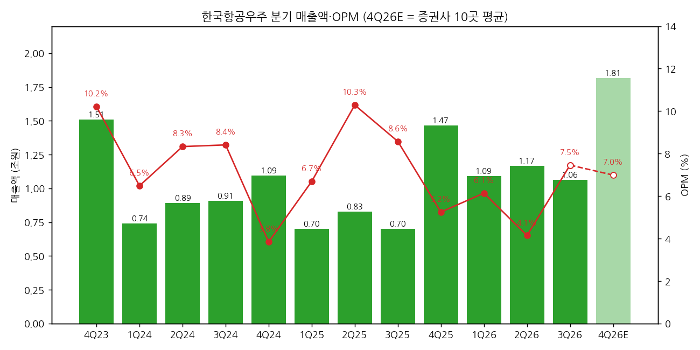
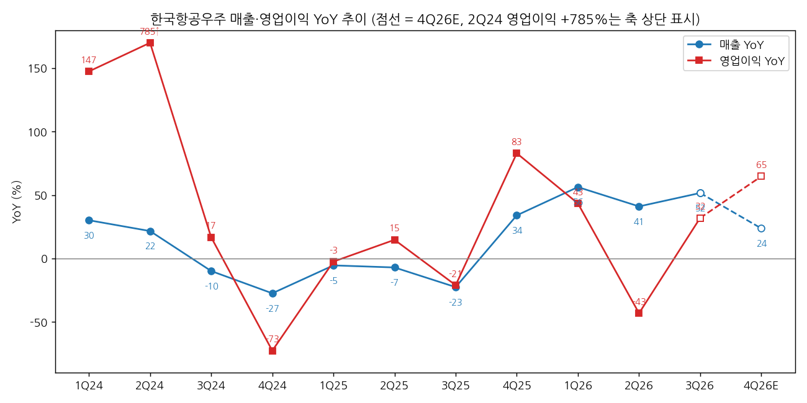
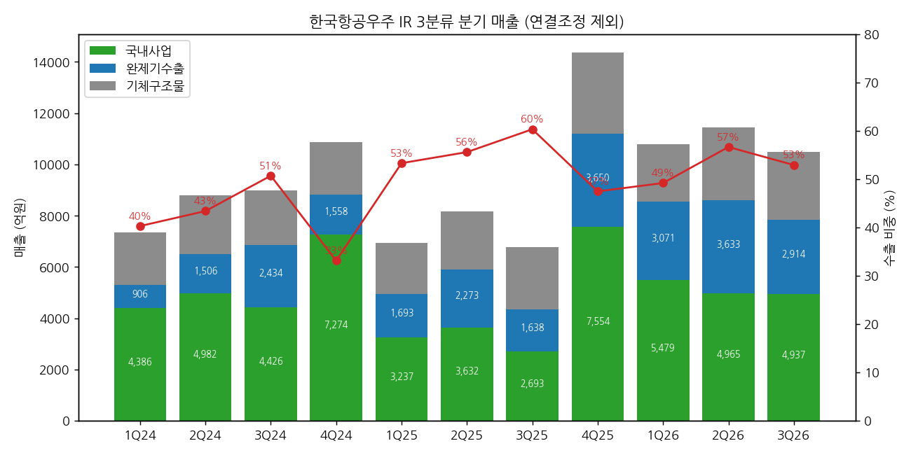

> 모드: 실적 리뷰 (v11)
> 종목: 한국항공우주 (047810)
> 섹터: 방산
> 서브섹터: 방산
> 분기: 2026-Q3
> 발표일: 2026-11-03
> 작성 시각: 2026-11-14 16:30 KST
> 분석 소스: 회사 3Q26 잠정실적 IR(2026-11-03, 6p) + 셀사이드 10곳 — KB(11/03)·다올(11/03)·JP모간(11/03, 리서치)·BofA(11/03)·맥쿼리(11/03, 플래시노트)·대신(11/04)·SK(11/04)·유진(11/04)·LS(11/05)·BNK(11/09) + JP모간 APAC 스페셜리스트 세일즈 노트(11/04, KAI 단락만 사용 — 투자자 반응 참고용) + 한국항공우주 기업개요 v1.1(DART·IR 분기 시계열). 날짜 없는 첨부 4건은 본문에서 발간사·발간일·대상 종목(KAI 3Q26) 확인 후 사용. 웹서치 보완 없음. 3Q26 분기보고서(부문별 영업이익)는 미확보

# 한국항공우주 3Q26 실적 리뷰

## 0. 한 줄 판정

> 성장 델타: 가속 | 내러티브: 유지 → 관찰 구간 (4Q 대형 수주 확인 시 적극 구간 전환 후보)

→ 숫자: 매출 1조 643억(+51.6% YoY), 영업이익 794억(+31.9%). 영업이익 YoY가 2Q26 -43.2% → 3Q26 +31.9%로 플러스 전환(+75%p). 컨센 대비 매출 -10.5%, 영업이익 +4.5%(FnGuide, KB 인용)
→ 다만 이익의 질이 쟁점: 환율 하락에 따른 수출 예정원가 재조정 이익 약 400억이 일회성 비용 약 300억(이라크 대손 120억·하자보수 110억·기체 손실충당 70억)을 상쇄했다. 둘 다 빼면 영업이익 약 694억(OPM 6.5%, +15% YoY) — 그래도 2Q(-43%)보다는 가속이다 `[판단]`
→ 매출 미스의 원인은 LAH(미르온) 엔진 결함으로 3Q 납품 0대. 11월 재개되지만 약 20대가 2027년으로 넘어가 2026 매출 가이던스(5.73조)는 약 5.2조로 하회 전망(9곳 공통)
→ 긍정 재료: KF-21 첫 양산 납품 2대(2,129억)와 비공개 완제기 수출 신규 수주 1조 4,527억(신규 고객). 3Q 신규수주 1조 5,806억(+502%)
→ 다음 분기 관건: **4Q 수주 백엔드** — 연 수주 목표 10.4조 중 누계 2.2조(21%). LAH 3차 양산(108대, 약 3조)과 인니 KF-21(16대, 약 4조)이 연내 체결돼야 2027 영업이익 +73%(10곳 평균) 경로가 숫자로 연결된다

## 1. 숫자

① 연결 분기 표 (억원)

| 항목 | 4Q23 | 1Q24 | 2Q24 | 3Q24 | 4Q24 | 1Q25 | 2Q25 | 3Q25 | 4Q25 | 1Q26 | 2Q26 | **3Q26** | 4Q26E |
|---|---|---|---|---|---|---|---|---|---|---|---|---|---|
| 매출액 | 15,100 | 7,399 | 8,918 | 9,072 | 10,948 | 6,993 | 8,283 | 7,021 | 14,667 | 10,927 | 11,679 | **10,643** | 18,141 |
| 영업이익 | 1,543 | 480 | 743 | 763 | 421 | 468 | 852 | 602 | 770 | 671 | 484 | **794** | 1,268 |
| OPM | 10.2% | 6.5% | 8.3% | 8.4% | 3.8% | 6.7% | 10.3% | 8.6% | 5.2% | 6.1% | 4.1% | **7.5%** | 7.0% |
| 매출 YoY | 73.8% | 30.1% | 21.6% | -9.9% | -27.5% | -5.5% | -7.1% | -22.6% | 34.0% | 56.3% | 41.0% | **51.6%** | 23.7% |
| 영업이익 YoY | 311.5% | 147.4% | 784.5% | 16.7% | -72.7% | -2.5% | 14.7% | -21.1% | 82.9% | 43.4% | -43.2% | **31.9%** | 64.7% |
| **매출 YoY 델타 (%p)** | — | -43.7 | -8.5 | -31.5 | -17.6 | +22.0 | -1.6 | -15.5 | +56.6 | +22.3 | -15.3 | **+10.6** | -27.9 |
| **영업이익 YoY 델타 (%p)** | — | -164.0 | +637.1 | -767.9 | -89.4 | +70.2 | +17.2 | -35.8 | +104.0 | -39.5 | -86.6 | **+75.1** | +32.8 |

→ (출처: 4Q22~2Q26 DART 분기보고서·회사 IR(기업개요 v1.1 표), 3Q26 회사 3Q26 잠정실적 IR p.3·6 (2026-11-03, K-IFRS 연결, 감사 전). 3Q26 잠정 공시 당일 정정공시가 있었으나 정정 내용은 미확인 — IR·증권사 10곳의 매출 10,643억·영업이익 794억·당기순이익 190억이 모두 일치해 최종치로 사용. 4Q26E = 증권사 10곳(KB·다올·대신·SK·유진·LS·BNK·JP모간·BofA·맥쿼리) 평균. 4Q22~3Q23 YoY 기준치는 기업개요 v1.1)
→ 컨센 대비: 매출 -10.5%, 영업이익 +4.5% (FnGuide 컨센 매출 1조 1,894억 / 영업이익 760억 — KB·BNK 인용). 다올 집계 컨센(영업이익 823억) 기준으로는 -3.5%. 지배순이익 201~204억은 컨센(494억) 대비 약 -59% — 외환손실 399억·순금융비용 241억으로 세전이익이 218억에 그쳤다(KB)
→ 이 회사의 YoY는 인도 이벤트에 따라 크게 출렁인다(2Q24 +785% → 4Q24 -73%). 그래서 델타는 "방향"만 본다. 2025년 3Q까지 바닥(-21%)을 다진 뒤 4Q25부터 KF-21·FA-50 진행률로 플러스 구간에 들어왔고, 2Q26의 -43%는 LAH 납품 차질과 고정익 적자(-88억, DART 부문)가 겹친 구간이었다 `[판단]`
→ 컨센 경로: 4Q26E +65%(10곳 평균, 범위 BofA +3% ~ SK +106%), 2027E 영업이익 +73%(5,579억). 분기로는 기저가 낮은 2Q27(2Q26 484억)이 YoY 정점 후보 — SK 2Q27E +174%, 다올 +212% `[전망]`. **YoY 정점은 아직 앞에 있다**

→ (출처: 회사 IR·DART, 4Q26E 증권사 10곳 평균)

→ (출처: 회사 IR·DART, 4Q26E 증권사 10곳 평균. 2Q24 영업이익 YoY +785%는 축 상단에 눌러 표시)

(1) 이익의 질 분해 (3Q26, 억원)

| 항목 | 금액 | 반영 위치 | 출처 |
|---|---|---|---|
| 보고 영업이익 | 794 | | 회사 IR |
| (+) 이라크 사업 대손충당금 | 120 | 판관비 | SK·다올·BNK 컨콜 정리 |
| (+) 국내·기체 하자보수충당금 | 110 | 판관비 | 〃 |
| (+) 기체구조물 손실충당금(G280) | 70 | 매출원가 | 〃 |
| (−) 환율 하락 → 수출 예정원가 재조정 이익 | 약 -400 | 매출원가 | 〃 (JP모간·맥쿼리는 약 400억 동일) |
| **일회성 양방향 제거 영업이익** | **약 694 (OPM 6.5%)** | | 계산 `[추정]` |

→ 일회성 비용만 빼면 1,094억(OPM 10.3%, 다올·BNK), 환율 이익만 빼면 394억(OPM 3.7%, 대신). 어느 쪽을 "정상"으로 보느냐가 쟁점 (1)이다
→ 영업외: 외환손실 399억(환율 이익과 거의 같은 크기가 아래로 빠짐)·이자비용 등 순금융 -241억 → 세전 218억, 당기순이익 190억(-51.2% YoY, IR p.6)

② 사업부별 매출·이익

(2-1) IR 3분류 매출 (연결, 억원)

| 부문 | 3Q25 | 4Q25 | 1Q26 | 2Q26 | **3Q26** | QoQ | YoY | 3Q26 누계 / 2026 가이던스 |
|---|---|---|---|---|---|---|---|---|
| 국내사업 | 2,693 | 7,554 | 5,479 | 4,965 | **4,937** | -0.6% | +83.3% | 15,381 / 32,895 (46.8%) |
| 완제기수출 | 1,638 | 3,650 | 3,071 | 3,633 | **2,914** | -19.8% | +77.9% | 9,627 / 13,964 (68.9%) |
| 기체구조물 | 2,450 | 3,166 | 2,228 | 2,847 | **2,628** | -7.7% | +7.3% | 7,692 / 10,447 (73.6%) |
| 연결조정 | 240 | 297 | 150 | 234 | **164** | | | 548 |
| **합계** | 7,021 | 14,667 | 10,927 | 11,679 | **10,643** | -8.9% | +51.6% | 33,248 / 57,306 (58.0%) |
| 수출 비중(완제기+기체) | 58% | 46% | 48% | 55% | **52%** | | | |

→ (출처: 회사 3Q26 IR p.3·5, 3Q25~2Q26 기업개요 v1.1 (4-1) 표 = 각 분기 IR)
→ 부문 YoY 추이: 국내 -39%(3Q25) → +4% → +69% → +37% → **+83%**, 완제기 -33% → +134% → +81% → +60% → **+78%**, 기체 +16% → +55% → +12% → +26% → **+7%**

→ (출처: 회사 IR 각 분기, 기업개요 v1.1)

→ **델타를 끄는 건 국내사업**이다. KF-21 첫 양산 납품 2대(2,129억, SK·BNK)가 국내 매출의 43%를 차지했다. 백두 2차·상륙공격헬기 등 개발사업 진행률도 더해졌다(BNK). LAH는 0대
→ 완제기수출은 3Q 인도는 없고 진행률 매출만: 말레이시아 FA-50 1,525억(누적 진행률 42%, 10월 말 첫 인도), 폴란드 FA-50PL 899억(누적 약 25%, 미국 시험비행 지연), 필리핀 141억(진행률 10% 안팎) (BNK 컨콜 정리, SK 동일 수치). QoQ -20%는 폴란드 지연 탓
→ 기체구조물은 보잉 향 납품 증가로 +7%(IR p.5). 증가율이 2Q 26% → 3Q 7%로 둔화됐고, 기체 수주는 연 목표 1.45조 대비 0.6~0.7조에 그칠 전망(BNK 컨콜 정리 — 보잉·에어버스 신규 기종 개발 지연)

(2-2) 부문 이익 — 회사 미공개, 증권사 추정 비교 (3Q26)

| 출처 | 국내 | 완제기수출 | 기체구조물 | 비고 |
|---|---|---|---|---|
| 회사(컨콜, BNK 정리) | GP 10% 초반 | GP 20% 초반 | GP 10% 중반 | 이번 분기 GP 마진 언급 |
| 유진 | GP low-teens | GP high-single | GP high-teens | 일회성 제거 기준 추정 |
| 대신 (GP, 억원) | 620 (12.6%) | 270 (9.3%) | 470 (17.9%) | 1Q26 710/170/490, 2Q26 540/220/680 |
| JP모간 (OP, 억원) | 250 (5.0%) | 270 (9.2%) | 350 (13.4%) | 2Q26 -130/110/500 |
| LS (OP, 억원) | 방위(국내+완제기) 210 (2.6%) | — | 민수 480 (18.2%) | 2Q26 방위 50 / 민수 520 |

→ (출처: 각 증권사 리포트. 모두 `[추정]` — 3Q26 분기보고서의 부문(고정익·회전익·기체·기타) 영업이익은 아직 미확보. 참고로 DART 부문 OP는 2Q26 고정익 -88억·회전익 37억·기체 522억·기타 37억)
→ 완제기 GP 마진이 "20% 초반(회사)"인지 "한 자릿수 후반(유진·대신)"인지가 갈린다. 회사 수치는 환율 예정원가 이익 400억이 들어간 이번 분기 값으로 보인다 `[판단]`. 수출 2,914억에 400억이면 그것만으로 GP 마진 약 14%p다
→ 공통점: **이익의 바닥은 기체**(OPM 13~18%)가 받치고, 방산(국내+수출)은 아직 한 자릿수 초반 OPM이다. 2027 성장 논리는 방산 OPM이 KF-21·LAH 양산으로 회복된다는 데 걸려 있다

(2-3) 수주 (연결, 억원)

| | 3Q25 | 4Q25 | 1Q26 | 2Q26 | **3Q26** |
|---|---|---|---|---|---|
| 신규수주 (분기) | 2,624 | 27,107 | 3,093 | 3,194 | **15,806** |
| ㄴ국내 / 완제기 / 기체 | 1,352 / 120 / 1,152 | 20,017 / 1,014 / 6,076 | 1,776 / 1,291 / 26 | 549 / 218 / 2,427 | **1,231 / 14,575 / 0** |
| 수주잔고 | 262,673 | 273,437 | 265,532 | 257,502 | **262,855** |
| ㄴ국내 / 완제기 / 기체 | 105,000 / 58,439 / 99,234 | 117,705 / 55,232 / 100,500 | (부문 미공개) | 109,170 / 50,256 / 98,076 | **105,381 / 61,930 / 95,544** |

→ (출처: 회사 3Q26 IR p.3·4, 이전 분기는 기업개요 v1.1 (4-1) 표)
→ 3Q 누계 신규수주 2조 2,100억, 2026 목표 10조 4,383억 대비 21.2%. 남은 금액 약 8.2조(유진)
→ 완제기 수주 1조 4,575억 = 비공개 수출 계약 1조 4,527억(거래소 유보공시) + 수리부속 등. 완제기 잔고 5.0조 → 6.2조로 2분기 만에 반등. 잔고/연 매출 약 5.1년치(2026E 매출 5.14조 기준) `[판단]`

③ 연간 (억원)

| 항목 | 2023 | 2024 | 2025 | 2026E | 2027E |
|---|---|---|---|---|---|
| 매출액 | 38,193 | 36,337 | 36,964 | 51,391 | 65,790 |
| 영업이익 | 2,475 | 2,407 | 2,692 | 3,217 | 5,579 |
| OPM | 6.5% | 6.6% | 7.3% | 6.3% | 8.5% |
| 매출 YoY | 37.0% | -4.9% | 1.7% | 39.0% | 28.0% |
| 영업이익 YoY | 74.8% | -2.7% | 11.8% | 19.5% | 73.4% |

→ (출처: 2023~2025 DART 연결 / 2026E·2027E = 발표 후 증권사 10곳 평균. 2026E 영업이익 범위 BofA 2,740억 ~ SK 3,536억, 2027E 범위 대신 4,540억 ~ JP모간 6,760억)
→ 발표 전 Quantiwise 컨센(SK 인용) 2026E 영업이익 3,321억 / 2027E 5,646억 → 발표 후 10곳 평균 3,217억(-3.1%) / 5,579억(-1.2%). **2027년 숫자는 거의 그대로**다. 하향의 무게는 LAH 이연이 걸린 2026년에 실렸고, 그마저 3%에 그쳤다
→ 2026 매출 가이던스 5.73조는 6년 연속 미달이 확정적(10곳 2026E 매출 4.92~5.29조). 반대로 2027년 매출 6.6조(+28%)는 LAH 이연분 약 20대가 그대로 얹힌 숫자다

## 2. 시장 쟁점

① 2-0 지난 분기 체크

→ 첫 리뷰 — 직전 체크 없음 (2Q26 리뷰 미작성)

② 이번 분기 쟁점 5개

| # | 쟁점 | 언급 증권사 |
|---|---|---|
| (1) | 영업이익 서프라이즈의 질 — 환율 예정원가 +400억 vs 일회성 -300억 | 10/10 |
| (2) | LAH 엔진 결함과 2026 가이던스 미달 — 2027 납품 50~60대로 이연 | 9/10 |
| (3) | 4Q 수주 백엔드 — 연 10.4조 목표, LAH 3차·인니 KF-21이 연내 되나 | 10/10 |
| (4) | 비공개 1.45조 완제기 수출 — 신규 고객, 언제 매출이 되나 | 9/10 |
| (5) | 이익이 현금이 안 되는 구조 — 차입금 3조, 외환손실·이자, 이라크 채권 | 6/10 |

③ 쟁점별 분해

(1) **영업이익 서프라이즈의 질 — 환율 예정원가 +400억 vs 일회성 -300억**

(1-1) 회사 설명
→ 컨콜(11/03, BNK 정리): 분기 중 환율이 급락해 진행기준 수출사업의 예정원가 적용 환율을 재조정했고, 약 400억의 완제기 수출 이익률 개선 효과가 생겼다. 앞으로는 유의적 손익 왜곡을 막기 위해 예정원가 환율을 **분기 단위로 재조정**한다. 일회성 비용은 이라크 대손 120억·하자보수 110억(판관비 230억)·기체구조물 손실충당 70억(매출원가)
→ 같은 환율 하락으로 영업외에서 외환손실 399억이 났다

(1-2) 증권사별 해석

| 증권사 | 핵심 가정·추정 | 논리 |
|---|---|---|
| 다올 | 일회성 제거 OPM 10.3%, 방산 업종에서 유일한 증익으로 평가 | 비용 쪽 일회성이 진짜 일회성, 마진은 정상화 중 |
| BNK | 조정 OPM 10.3%, 국내 수익성 정상화 | 다올과 같은 계산 |
| 대신 | 환율 이익 제거 시 394억, 당사 추정(570억) 하회 | 본업은 오히려 기대 이하 |
| 맥쿼리 | 400억은 누적 진행률 캐치업, 구조적 개선 아님 | 수익성 개선은 일부 비경상 |
| JP모간 | OPM 7.5% vs 예상 6.9%, 우려보다 양호하다고 평가 | 환율이 순풍이 됐고 일회성(300억+자회사 손실 70억)은 비반복 가이드 |
| BofA | 영업이익 790억 vs 자사 430억, 컨센 부합 | 원화 강세로 원재료 투입원가 하락이 부문 이익 지지 |

(1-3) 공통 vs 갈림
→ 공통: 보고 영업이익 794억은 "양쪽 일회성이 서로 상쇄한 결과"라는 계산은 같다. 순이익 기준으로는 외환손실 399억이 환율 이익을 되돌려 놓아 실질 이득이 거의 없다
→ 갈림: **어느 쪽이 반복되는가.** 다올·BNK는 비용(충당금)을 일회성으로 빼고 10.3%를 본다. 대신·맥쿼리는 환율 이익을 빼고 3.7%를 본다. 회사가 예정원가 환율을 분기마다 재조정하겠다고 했으니, 앞으로는 환율 방향에 따라 이익이 위아래로 흔들린다

(1-4) [판단]
→ 양쪽을 다 빼면 약 694억(OPM 6.5%, +15% YoY)이 이번 분기의 "깨끗한" 이익이다. 2Q 484억(4.1%) 대비로는 개선이 맞지만 10% 마진은 아직 아니다
→ 이라크 대손은 4개 분기째 반복되는 성격이라(다올도 충당금 설정이 거의 매 분기 반복된다고 지적) 완전한 일회성으로 보기 어렵다. 반대로 다올은 사업 종료 시 환입 가능성도 언급한다. 4Q에 원화가 다시 약해지면 예정원가 재조정이 반대로 작용할 수 있다 — **4Q 영업이익을 볼 때 환율 효과를 분리해서 봐야 한다**

(2) **LAH 엔진 결함과 2026 가이던스 미달**

(2-1) 회사 설명
→ LAH(미르온)는 상반기 엔진 결함으로 3Q 납품 0대. 10월 중순 엔진 입고 재개, 11월부터 정상 납품 체제(BNK·JP모간 정리). 연 60대 목표 중 약 20대가 2027년으로 이연, 매출 차질 4,000~5,000억(BNK)
→ IR p.5: "KF-21 최초 납품 개시를 기점으로 국내 사업의 양산·납품 중심 매출구조 전환 본격화 및 미르온 4분기 납품 정상화 예정"
→ 2026 매출 가이던스 5.73조는 하향 불가피. 완제기 납품은 2027년 50~60대, 2028년 80~90대(SK·BNK 컨콜 정리)

(2-2) 증권사별 해석

| 증권사 | 4Q26E 매출 | 4Q LAH 가정 | 2027E 매출 | 논리 |
|---|---|---|---|---|
| BNK | 1조 9,590억 | 23대 납품 재개 | 6.51조 | KF-21 6대+, 폴란드 1,500~2,000억 |
| LS | 1조 9,670억 | — | 6.83조 | LAH 총 170대, 내년부터 연 50대 이상 |
| SK | 1조 8,789억 | 2~3대 추가 | 7.02조 | 국내 4Q 1.25조, 20대 이연 |
| 대신 | 1조 8,760억 | 재개 | 6.80조 | 경상개발비 4Q 500억 집중 → OPM 6.3% |
| 다올 | 1조 7,168억 | 11월 재개 | 6.78조 | 양산 40 → 60 → 80대(2026~28) |
| JP모간 | 1조 8,360억 | 국내 4Q 1.1조 → 1.0조로 소폭 하향 | 6.86조 | 2027E 국내 3.9 → 4.3조로 상향 |
| BofA | 약 1조 6,630억 | LAH 정상화는 4Q까지 역풍 | 5.95조 | 보수적, 4Q 영업이익 790억(+3%) |

(2-3) 공통 vs 갈림
→ 공통: 2026 매출은 약 5.2조(가이던스 대비 -9%), 이연분은 2027년에 더해진다. "물량 소멸이 아니라 시점 이동"이라는 데 이견이 없다
→ 갈림: **4Q LAH 납품 대수.** BNK는 23대, SK는 2~3대를 가정한다. 이 차이가 4Q 국내 매출 1.0조(JP모간) ~ 1.34조(BNK) 범위를 만든다

(2-4) [판단]
→ 가이던스 미달은 6년 연속(2021~2026)이라 시장에 새 정보는 아니다. 중요한 건 **11월 재개가 실제로 이어지는지**다. 4Q LAH가 한 자릿수에 그치면 2027년에 몰리는 물량이 더 커지고, 생산 병목(엔진 공급) 우려가 다시 나온다. 4Q 잠정실적의 국내사업 매출 1조 원 이상이 확인 기준이다 `[판단]`

(3) **4Q 수주 백엔드 — 연 10.4조 목표**

(3-1) 회사 설명
→ 3Q 누계 2.21조(21%)로 저조하지만 연 10조 수준 가능(SK·BNK·JP모간 정리). 근거: ① LAH 3차 양산 108대 일괄 계약 약 3.0~3.2조 ② 인니 KF-21 16대+후속 군수지원 약 4조 — 협상은 사실상 마무리, 인니 재무부 예산 승인 대기 ③ 기타 수출·국내 사업. 기체 수주는 0.6~0.7조로 목표(1.45조) 미달
→ 인니 KF-21 체결 시점 가이드가 2Q26에서 4Q26으로 밀렸다(JP모간)

(3-2) 증권사별 해석

| 증권사 | 4Q 수주 가정 | 논리 |
|---|---|---|
| BNK | 4Q 7.4조(국내 3.0 / 완제기 4.0 / 기체 0.4), 연 9.6조 | 회사 가이드를 거의 그대로 반영 |
| KB | KF-21 인니·LAH 3차 성사 가능성 높음 | 2026 완제기 수출 수주 3~5조가 Base 시나리오 |
| 다올 | 인니 KF-21 1차 성공 확률 51%, 파이프라인 46조·기대이익 2.1조 | 단기 모멘텀으로 인정하되 확률 가중 |
| 유진 | 남은 8.2조 중 LAH 3조·기체 0.4조 빼면 4.8조를 완제기로 채워야 | 회사가 자신감을 보임 |
| 맥쿼리 | 연내 확정은 불확실 — 과거 지연 이력 | 연말 수주 전환 실행 리스크 높음 |
| JP모간 | 인니는 예산·행정 절차에 달림 | 단기 촉매 부재 판단 유지(Neutral) |

→ 그 밖의 파이프라인: 이집트 FA-50 약 2.8조, 말레이시아 FA-50 추가 약 1.4조, 페루 FA-50 약 2조, 이라크 KUH 약 1.5조(JP모간 정리). 다올은 UAE·사우디 KF-21(각 10조 규모, 확률 30%)까지 포함

(3-3) 공통 vs 갈림
→ 공통: LAH 3차는 국내 사업이라 연내 체결 가능성이 높다는 데 대체로 동의한다. 수주 목표 달성 여부는 사실상 **인니 KF-21 하나**에 달렸다
→ 갈림: 인니 연내 체결 확률. 국내 증권사는 대부분 연내를 기본 가정으로 두고, 맥쿼리·JP모간은 반복된 지연 이력을 들어 2027년으로 밀릴 수 있다고 본다

(3-4) [판단]
→ LAH 3차(3조)만 들어오면 연 수주는 약 5.5조(목표의 53%)에 그친다. 인니 KF-21까지 들어와야 9~10조가 된다. KF-21의 **첫 수출**이라는 상징성 때문에 인니 체결 여부가 4Q 주가의 가장 큰 변수다. 인니가 2027년으로 넘어가면 "또 지연" 내러티브가 붙는다 `[판단]`

(4) **비공개 1.45조 완제기 수출 — 신규 고객**

(4-1) 회사 설명
→ 3Q 완제기 수출 계약 1조 4,527억. 고객의 강력한 비공개 요청과 비밀유지 의무로 거래소 유보공시, 기종·국가는 공개 가능 시점에 발표(BNK 정리). 수주잔고 인식은 최종 계약 체결 기준(MOU·LOA는 미반영)
→ 이르면 2027년, 늦어도 2028년부터 진행률 기준으로 매출 반영(LS 정리)

(4-2) 증권사별 해석

| 증권사 | 평가 |
|---|---|
| KB | 올해 첫 대규모·고수익·신규 고객 계약 — "매우 긍정적" |
| 다올 | 2027년 일부, 2028~29년 매출 기여 반영(2027E 1,450억, 2028E 4,850억). 잔고 너머 성장 기반 |
| LS | FA-50 누적 150대·74억 달러 수출, 중거리 공대공 미사일 장착으로 경쟁력 상승 |
| BNK | 그동안 FA-50 파이프라인으로 거론되던 국가로 추정 |
| BofA | 수주 다변화(중동·북아프리카 등)가 컨센 EPS 상향을 부를 것 |
| 맥쿼리·JP모간 | 수주 사실만 인용, 추정치·멀티플 변화 근거로는 쓰지 않음 |

(4-3) [판단]
→ 금액·시점으로는 2027년 이익을 바꾸지 않는다(다올 기준 2027E 매출 기여 1,450억, 2027E 매출의 2%). 의미는 **"수주가 끊긴 회사"라는 인식을 깼다**는 데 있다. 완제기 잔고가 2분기 만에 반등했고, 2024~1H26의 수주 공백 구간이 끝났다는 신호다 `[판단]`
→ 국가·기종이 공개되면 수익성(현지화 비중)과 후속 물량을 다시 평가해야 한다

(5) **이익이 현금이 안 되는 구조 — 차입금·외환·이라크 채권**

(5-1) 회사 설명
→ KF-21 양산과 수출 사업으로 운전자본이 늘어 3Q말 차입금 3조 522억, 순차입금 2조 9,528억(IR p.6). 연말에도 약 3조 유지, 자금 수지는 2026~2027년 타이트, 2027~2028년 이후 정상화 기대(BNK 정리)
→ 이라크 수리온 2대: 납품·매출 인식은 끝났으나 대금 회수 지연으로 충당금 설정 중(BNK 정리)

(5-2) 증권사별 해석

| 증권사 | 평가 |
|---|---|
| BNK | 이자비용 부담 지속, 이라크 충당금 리스크 체크 필요 |
| KB | 세전이익 218억 — 외환손실 399억·금융손익 -241억 |
| 다올 | 이라크 충당금은 2028년까지 사업 종료 시 환입 서프라이즈 가능성 |
| 맥쿼리 | 운전자본 압박 지속을 Underperform 근거로 |
| JP모간·BofA | 2027년 영업현금흐름 플러스 전환 전망(JP모간 1.08조, BofA 0.83조) |

(5-3) [판단]
→ 영업이익 794억 중 순이익으로 남은 건 190억(24%)이다. 이 구조가 2027년까지 이어지면 PER 기준 밸류에이션이 계속 부담이 된다. 2027년 영업CF 플러스 전환(양산 인도 → 대금 회수)이 확인돼야 순이익 레버리지가 살아난다 `[판단]`

④ 낙관 vs 보수

→ 낙관(다올 19만·LS 19만·대신 17.3만): 다올은 TP를 9.5% 내리면서도 업종 선호주로 올렸다. 2026~28 양산 40 → 60 → 80대로 업종에서 가장 가파른 증익을 근거로, 2028E EPS × 적정 PER 30배 + 파이프라인 가치(46조 × 확률)를 더한다. 대신은 2028E 순이익에 PER 31배, 4Q KF-21 첫 수출이 성사되면 밸류 부담이 풀린다고 본다
→ 보수(맥쿼리 9.2만·JP모간 11만): 맥쿼리는 Underperform·P/B 기준 TP 9.2만 원(7/30 이후 유지). 이익 개선 일부가 비경상이고, 운전자본 압박과 KF-21 대규모 수출 경로가 검증 전이라는 이유다. JP모간은 2027E 영업이익을 오히려 1% 올렸지만 투자심리 악화를 이유로 목표 PER을 20배 → 18배로 낮췄다
→ 차이의 본질은 **어느 해 이익에 몇 배를 주느냐**다. 낙관 쪽은 2028E 이익(양산 80대)에 국내 방산 프리미엄 멀티플을, 보수 쪽은 2027E 이익이나 자산가치에 피어 평균 이하 멀티플을 쓴다. 2027E 영업이익 자체는 4,540억(대신) ~ 6,760억(JP모간)으로 갈리지만 평균은 발표 전과 같다
→ 셀사이드 vs 주가: 발표일 11/03 종가 97,300원(52주 최저권, 1개월 -27%, 6개월 -42%) → 11/04 108,800원(+11.8%) → 11/06 102,600원. JP모간 세일즈 노트의 투자자 반응: 실적 하향 사이클이 끝났다는 데 대체로 동의하고 하방은 제한적으로 보지만, **적극적으로 비중을 늘리려는 투자자는 아직 적다**. 공매도 잔고는 주간 -4.5%. 바이사이드는 "바닥은 확인, 매수는 수주 확인 후" 쪽이다 `[판단]`
→ 지분 구도 변수: 한화에어로스페이스(외)가 15.9%를 보유 — KB는 TP에 M&A 프리미엄 20%를 유지했고, JP모간은 한화그룹의 공격적 지분 매입을 상방 리스크로 적었다

⑤ 추정치·TP 변화

| 증권사 | 직전 TP | 현재 TP | 4Q26 영업이익 E | 2026E / 2027E 영업이익 | 핵심 변화 한 줄 |
|---|---|---|---|---|---|
| KB (11/03) | 180,000 | 145,000 | 1,431억 | 3,380 / 5,680억 | 2026E -17.4%, 2027E -8.7%, P/E 33.9배(피어+20% M&A 프리미엄) |
| 다올 (11/03) | 210,000 | 190,000 | 1,333억 | 3,283 / 6,054억 | 2026E +6%, 2027E +2%, 2028E -12%. 선호주로 상향 |
| JP모간 (11/03) | 120,000 | 110,000 | 1,490억 | 3,440 / 6,760억 | 2027E +1%·2028E +5% 상향, 목표 PER 20→18배. Neutral |
| BofA (11/03) | 160,000 | 160,000 | 791억 | 2,740 / 4,950억 | 2026E +14.6%(3Q 반영), 2027E 유지. EV/EBITDA 27.3배 |
| 맥쿼리 (11/03) | 92,000 | 92,000 | 966억 | 2,915 / 5,725억 | Underperform 유지, P/B 기준 |
| 대신 (11/04) | 약 186,000 (7.0%↓) | 173,000 | 1,180억 | 3,120 / 4,540억 | 실적 추정·멀티플 하향, 2028E 순이익 × 31배 |
| SK (11/04) | 190,000 | 150,000 | 1,587억 | 3,536 / 6,101억 | 2026E -12.8%, 2027E -2.6%, 2028E EPS × 25배 |
| 유진 (11/04) | 146,000 | 146,000 | 1,220억 | 3,170 / 5,020억 | 2026E 상향(282→317), 2027E 하향(535→502) |
| LS (11/05) | 190,000 | 190,000 | 1,400억 | 3,350 / 5,250억 | 유지 |
| BNK (11/09) | 170,000 | 150,000 | 1,280억 | 3,230 / 5,710억 | 2027E × PER 38.8배(직전년 최고 PER -25%) |

→ (출처: 각 증권사 리포트. 4Q26E는 KB·BofA·맥쿼리는 2026E 연간 − 1~3Q 실적으로 역산 `[추정]`. 대신 직전 TP는 "7.0% 하향" 문구로 역산 `[추정]`. 맥쿼리 직전 TP는 리포트 내 추천 이력(2026-07-30) 기준)
→ 평균 TP: 10곳 기준 16.4만 원 → 15.1만 원(-8.4%). 국내 7곳 평균 현재 TP 16.3만 원. 하향 6건(KB·다올·JP모간·대신·SK·BNK), 유지 4건. 발표 전 컨센 TP 178,357원(KB 인용). 11/03 종가 대비 평균 TP 상승여력 +55%
→ 4Q26E 영업이익 범위가 791억(BofA) ~ 1,587억(SK)으로 2배 차이 — LAH 납품 대수와 경상개발비·충당금 가정 차이다
→ **TP 하향의 원인은 대부분 멀티플이다.** 2027E 영업이익 컨센은 발표 전 대비 -1.2%(10곳 평균)로 거의 그대로인데 TP는 -8.4% 내려갔다. JP모간(PER 20→18배)·대신(멀티플 하향)·KB(피어 밸류 변화)가 명시적으로 멀티플을 낮췄다. 2026E 하향(-3.1%)은 LAH 이연 탓이지만 그 물량은 2027E로 넘어갔다 `[판단]`

## 3. 내러티브 점검

① 성장 스토리 정의
→ "KF-21 양산과 FA-50 수출(폴란드·말레이시아·필리핀)로 2026~2028년 완제기 납품이 40 → 60 → 80대로 늘며 이익이 두 배 이상 커지는 회사. 그 위에 KF-21 첫 수출(인니)이 붙으면 '한국판 전투기 수출국' 프리미엄이 붙는다"

② 이번 분기가 스토리에 준 영향
→ 강화된 것: KF-21 양산 매출이 실제로 시작됐고(3Q 2대, 4Q 6대+), 1.45조 신규 수출 계약으로 완제기 잔고가 반등했다. 2027E 영업이익 컨센(5,579억, +73%)은 흔들리지 않았다
→ 약화된 것: LAH 엔진 결함으로 2026 가이던스는 6년 연속 미달이 확정적이고, 인니 KF-21 체결 가이드가 2Q → 4Q로 밀렸다. 이익의 질(환율 예정원가)과 현금 전환(차입금 3조)에 대한 의문이 남았다. 멀티플은 하향(평균 TP -8%)
→ 훼손은 아니다: 핵심 전제(양산 물량 증가)는 오히려 이연을 통해 2027년에 더 몰렸다. 실적 하향 사이클이 끝났다는 게 바이사이드 다수 반응(JP모간 세일즈)

③ 국면 판단
→ 델타 가속(영업이익 YoY -43% → +32%, 일회성 제거 기준으로도 +15%, 4Q26E +65%·2027E +73%로 YoY 정점은 앞에 있음) + 내러티브 유지(추정치 2027E 그대로, 멀티플만 하향) → **관찰 구간**
→ 숫자의 방향은 BT 프레임에 맞는 쪽(가속)이지만, 그 가속이 "시점 이동된 물량"과 "환율 이익"에 기대고 있어 아직 내러티브를 다시 강화할 이벤트가 없다. **4Q에 LAH 3차 + 인니 KF-21이 체결되면** 수주(내러티브 강화)와 실적(델타 가속)이 동시에 맞물려 적극 구간 조건이 갖춰진다 `[판단]`

④ 트리거와 리스크
→ 트리거: ① 인니 KF-21 16대(약 4조) 연내 계약 — KF-21 첫 수출 ② LAH 3차 양산 108대(약 3조) 계약 ③ 비공개 1.45조 수주의 국가·기종 공개(중동·아프리카 신규 시장이면 파이프라인 재평가)
→ 리스크: ① 인니 예산 승인 2027년으로 지연 → 연 수주 5조대 ② 4Q LAH 납품이 한 자릿수에 그쳐 2027 물량 쏠림·엔진 병목 ③ 원화 약세 전환 시 예정원가 재조정이 반대로 작용 + 이라크 충당금 추가

## 4. 향후 봐야 할 것

① **인니 KF-21 수출 계약** (델타·내러티브 판정을 바꿀 1순위)
→ 무엇을: 16대+후속 군수지원 약 4조 계약의 연내 체결 여부 — 인니 재무부 예산 승인이 마지막 관문
→ 어떤 데이터로: 회사 단일판매·공급계약 공시, 인니 국방부·재무부 발표, 뉴스 키워드 "KF-21 인도네시아", "IF-X"
→ 언제: 2026.12 (회사 목표 4Q26, 직전 가이드 2Q26)

② **LAH 3차 양산 계약과 4Q 납품 재개 속도**
→ 무엇을: 108대 일괄 계약(약 3.0~3.2조) 체결, 4Q LAH 납품 대수(BNK 23대 vs SK 2~3대)
→ 어떤 데이터로: 방사청 계약 발표·회사 공시, 4Q26 잠정실적의 국내사업 매출(1조 원 이상 여부)
→ 언제: 2026.12 계약 / 2027.2 초 4Q26 잠정실적

③ **4Q26 영업이익 1,270억과 환율 효과 분리**
→ 무엇을: 4Q 영업이익 컨센 1,268억(+65% YoY, 10곳 평균) 달성 여부. 예정원가 환율 재조정 손익과 이라크 충당금 추가 여부를 빼고 본 OPM이 7%대인지
→ 어떤 데이터로: 4Q26 잠정실적·IR, 원/달러 환율(4Q 평균 vs 3Q말), 3Q26 분기보고서 부문 영업이익(고정익 흑자 전환 여부)
→ 언제: 3Q26 분기보고서 2026.11 중순 / 4Q26 잠정 2027.2 초

④ **폴란드 FA-50PL 진행률과 2027.7 초도 인도**
→ 무엇을: 4Q 폴란드 매출 1,500~2,000억(3Q 899억) 회복, 미국 시험비행 지연 해소, 2027년 7월 초도 납품 수정계약 일정 준수
→ 어떤 데이터로: 4Q26 IR의 완제기수출 매출, 폴란드 군비청 발표
→ 언제: 2027.2 초 (4Q 실적) / 2027.7 (초도 인도)

⑤ **2027 가이던스와 비공개 수주 공개**
→ 무엇을: 4Q 컨콜의 2027 매출·수주 가이던스(컨센 매출 6.6조·영업이익 5,580억 대비), 1.45조 수주의 국가·기종 공개, 이집트·말레이시아 추가·페루 FA-50 진척
→ 어떤 데이터로: 4Q26 IR·컨콜, 유보공시 해제 공시
→ 언제: 2027.2 초
