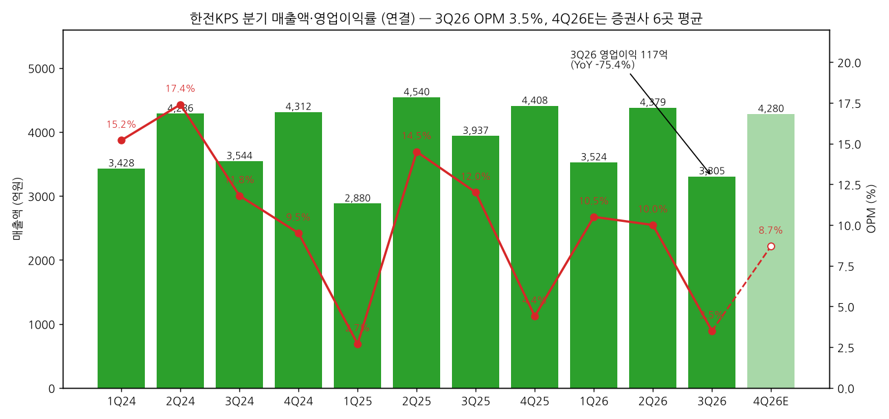
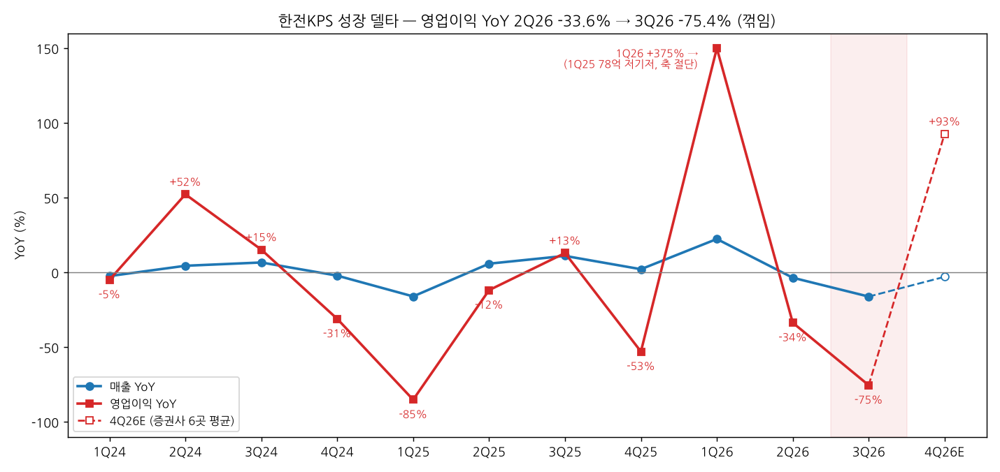
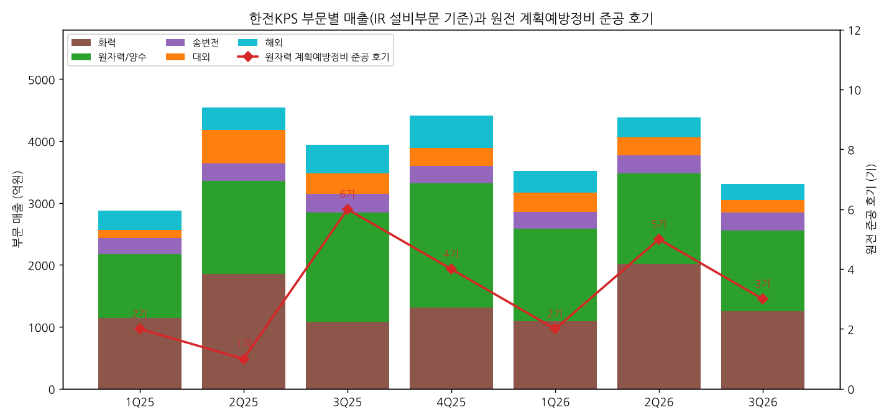
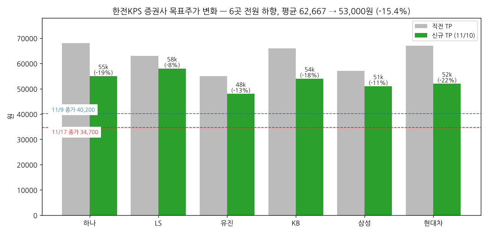

> 모드: 실적 리뷰 (v11)
> 종목: 한전KPS (051600)
> 섹터: 원전
> 서브섹터: 원전 정비
> 분기: 2026-Q3
> 발표일: 2026-11-09 (잠정실적·IR Newsletter·실적 설명회) / 분기보고서 2026-11-16 제출 (DART 접수 20261116000889)
> 작성 시각: 2026-11-17 18:00 KST
> 분석 소스: 회사 자료 — 3Q26 IR Newsletter(2026-11, 국문 10p — 첨부 7건 중 1건, 증권사 리포트 아님), DART 분기보고서(2026.09, 11/16 제출 — 매출실적·수주현황·충당부채 주석·해외사업), OpenDART 연결재무제표(fnlttSinglAcntAll, 2016\~3Q26), 기업개요 v1.1(DART 42분기 부문 시계열). 셀사이드 6건 첨부 (모두 11/10): 하나증권(유재선)·LS증권(성종화)·유진투자증권(황성현, 실적 설명회 Q&A 10문항 정리 포함)·KB증권(정혜정)·삼성증권(김영호)·현대차증권(신동현). 웹서치 보완: 한국경제 11/11(주가·7개사 TP 집계·한국투자증권 1Q27E 인용), Yahoo Finance 일별 종가(10/19\~11/17). 피어 교차 참조: 2026-Q3 두산에너빌리티·현대건설·대우건설 리뷰, 한전기술·한국전력 3Q26 첨부 자료(LS증권 11/10, 한국전력 IR 11/12)
> 리뷰 깊이: 풀 | 리서치 첨부 6건 (+ 회사 IR 1건)
> 비영업 요인: 없음 (영업이익 기준). 영업외손익 -47억원(외환·기타)은 순이익에만 반영

# 한전KPS 3Q26 실적 리뷰 — 일감은 그대로인데 원전이 안 돌아와서 매출이 안 잡혔다. 영업이익 117억원, 2개 분기 연속 대형 미스

> 성장 델타: 꺾임 | 내러티브: 약화 → 델타 꺾임 + 내러티브 약화 → 매매 제외 구간 (4Q26 저기저 반등은 숫자상 '가속'으로 찍힐 수 있으나 원전 계속운전 인허가 속도가 확인되기 전까지는 관찰만)

> ⚠ 비영업 요인 플래그: 없음 — 영업이익 YoY 감소 -357억원(474억 → 117억)은 원자력/양수 매출 -465억원(원전 계획예방정비 장기화), 해외·대외 변동공사 기저 소멸 -338억원, 매출 감소에 따른 노무비 고정비 부담이라는 **영업 요인**이다. 성과급·경영평가 충당금은 3·9월 지급률 50% 고정이라 3Q 영향 없음(LS), 일회성 원가·소송·정산 이익도 없다(분기보고서 충당부채 주석: 9M 신규 손실부담계약충당 8억원·법적소송충당 5억원 — 미미). 참고: 영업외손익 -47억원(3Q25 +41억원)으로 순이익만 -86.7%. **다음 분기 주의**: 4Q25 영업이익 193억원(수명연장 자재비·외주비·퇴직급여로 OPM 4.4%)이 이례적 저기저라 4Q26 YoY는 193억원만 넘으면 플러스 전환된다

→ **숫자**: 연결 매출 3,305억원(-16.1% YoY), 영업이익 117억원(-75.4% YoY), OPM 3.5%(-8.5%p). 영업이익 YoY가 2Q26 -33.6%에서 -75.4%로 41.8%p 더 내려갔고 매출 YoY도 -3.5% → -16.1%로 같이 꺾였다. 판정 기준상 "꺾임"(마이너스 성장 + 2개 분기 연속 악화)이다. 컨센(FnGuide 467억원) 대비 -75.0%로 2Q26(436억원, 컨센 620억원 대비 -30%)에 이어 2개 분기 연속 대형 미스다
→ **쟁점 ①**: 원인은 한 줄로 "원전 정비 기간이 길어져 같은 계약의 매출이 더 긴 기간에 나눠 잡힌 것"이다. 원자력/양수 매출 1,305억원(-26.3%), 원전 계획예방정비 준공 3기(3Q25 6기). 수명이 끝난 원전들이 계속운전 허가를 기다리며 정비 현장에 묶여 있다 — 6곳 모두 같은 진단, 수주 금액은 그대로라는 점도 같다(하나)
→ **쟁점 ②**: 매출 -16%가 영업이익 -75%로 커진 것은 고마진 원자력이 줄고 저마진 화력(+16.3%)이 늘어난 믹스 악화와, 매출의 42%까지 오른 노무비 고정비 때문이다(LS). 매출 감소분 632억원 중 357억원(56%)이 그대로 영업이익에서 빠졌다 [계산]
→ **쟁점 ③**: 회복 시점에서 증권사가 갈렸다. 4Q26E 영업이익이 KB 530억원·하나 517억원(4Q 회복) vs LS 195억원·유진 270억원(1H27까지 부진)으로 2.7배 차이다. 회사는 가이던스를 주지 않았다("발전소별 계획·정부 정책에 따라 변동성이 커 제시 어려움", 유진 정리)
→ **쟁점 ④**: 6곳 전원 TP 하향(평균 62,667원 → 53,000원, -15.4%), 2026E 영업이익은 평균 1,297억원으로 발표 전 FnGuide 컨센(1,734억원) 대비 -25%. **TP 하향의 주원인은 실적 하향**이고, KB(COE 상승)·삼성(역사적 P/E 하락)만 멀티플 하향이 컸다. 주가는 11/10 -7.0%(37,400원, 장중 52주 신저가), 11/17 34,700원으로 발표일 대비 -13.7%
→ **다음 분기 관건**: 4Q26 영업이익이 4Q25 저기저(193억원)를 넘으면 YoY는 플러스(평균 추정 372억원이면 +93%)로 돌아 숫자상 델타는 반등한다. 판정보다 중요한 것은 그 반등이 **고리 3·4호기 재가동·한빛 1·2호기 계속운전 승인으로 원자력 매출이 돌아온 결과인지**, 4Q 준공 정산에 따른 일시 반등인지다

---

## 1. 숫자

① 연결 기준 분기 표 (단위: 억원, %)

| 항목 | 1Q24 | 2Q24 | 3Q24 | 4Q24 | 1Q25 | 2Q25 | 3Q25 | 4Q25 | 1Q26 | 2Q26 | **3Q26** | 4Q26E |
|---|---|---|---|---|---|---|---|---|---|---|---|---|
| 매출액 | 3,428 | 4,286 | 3,544 | 4,312 | 2,880 | 4,540 | 3,937 | 4,408 | 3,524 | 4,379 | **3,305** | 4,280 |
| 영업이익 | 522 | 744 | 420 | 409 | 78 | 656 | 474 | 193 | 370 | 436 | **117** | 372 |
| OPM | 15.2 | 17.4 | 11.8 | 9.5 | 2.7 | 14.5 | 12.0 | 4.4 | 10.5 | 10.0 | **3.5** | 8.7 |
| 매출 YoY | -2.4 | +4.5 | +6.7 | -2.1 | -16.0 | +5.9 | +11.1 | +2.2 | +22.4 | -3.5 | **-16.1** | -2.9 |
| 영업이익 YoY | -4.9 | +52.3 | +15.3 | -31.0 | -85.1 | -11.8 | +13.0 | -52.9 | +374.6 | -33.6 | **-75.4** | +92.7 |
| **매출 YoY 델타 (%p)** | -12.9 | +6.9 | +2.2 | -8.8 | -13.9 | +21.9 | +5.2 | -8.9 | +20.2 | -25.9 | **-12.6** | +13.1 |
| **영업이익 YoY 델타 (%p)** | -27.4 | +57.2 | -37.0 | -46.3 | -54.1 | +73.3 | +24.8 | -65.9 | +427.5 | -408.2 | **-41.8** | +168.1 |

→ (출처: 1Q24\~3Q26 OpenDART 연결 fnlttSinglAcntAll — 1\~3Q는 각 보고서 3개월 금액, 4Q = 연간 − 3Q 누적. 3Q26은 DART 분기보고서(2026.09, 11/16 제출) = 잠정 공시와 동일(매출 3,305억원·영업이익 117억원). 1Q24 델타의 기준인 4Q23 YoY는 매출 +10.5%·영업이익 +22.5%(기업개요 v1.1). 4Q26E는 [계산] 첨부 6개 증권사 추정 평균 — 영업이익 하나 517·LS 195·유진 270·KB 530·삼성 389·현대차 330억원, 매출 4,278·4,011·3,810·4,510·4,808·4,260억원. 발표 후 FnGuide 분기 컨센은 미확보)
→ 3Q26 서프라이즈: 매출 컨센 대비 -16.0%, 영업이익 -75.0% (FnGuide 컨센 매출 3,932억원·영업이익 467억원 — LS 11/10 표2. Quantiwise 컨센 영업이익 470억원 대비 -75.2% — KB. 커버 12곳, 삼성). 지배순이익 57억원(-86.5%)
→ 9M26 누적: 매출 1조 1,208억원(-1.3%), 영업이익 923억원(-23.7%), 순이익 734억원(-30.0%) (IR Newsletter p.6)
→ 이 종목의 분기 YoY는 원래 지그재그다. 계획예방정비가 2Q·4Q에 몰리고, 호기 수와 노무비(경영평가 성과급)가 분기마다 출렁인다(기업개요 v1.1: "이익 굴곡은 업황이 아니라 노무비·정비 호기수 주기"). 그래서 한 분기 YoY보다 **연속성**을 봐야 하는데, 2Q26(-33.6%) → 3Q26(-75.4%)은 두 분기 연속 악화이고 두 분기 모두 같은 원인(원전 OH 장기화)이다. 노이즈가 아니라 추세다
→ 컨센 경로상 4Q26E YoY +93%는 4Q25(193억원, OPM 4.4%) 저기저 효과다. 2026년 연간 영업이익은 평균 1,297억원(-7.4%)으로 2025년(1,401억원, -33.1%)에 이어 2년 연속 감소, 2027E 1,674억원(+29.1%)에서 반등하는 경로다 — 반등이 맞아도 2027E는 2024년(2,095억원)의 80% 수준이다 [계산]
→ **[판단] 델타 = 꺾임**: 영업이익 YoY 마이너스가 깊어졌고 매출 YoY도 같은 방향이라 "엇갈림(유지)"도 아니다. 보고 기준 영업이익으로 판정했고, 판정을 움직인 비영업 요인은 없다(위 플래그)

→ (출처: OpenDART 연결, 4Q26E는 첨부 6개 증권사 평균 [계산] — 연한 막대·점선)

→ (출처: OpenDART 연결, 4Q26E는 첨부 6개 증권사 평균 [계산] — 점선. 1Q26 +374.6%는 1Q25 78억원 저기저로 축 절단)

② 사업부별 매출 (단위: 억원, %) — 부문별 영업이익은 미공시

| 부문 | 1Q25 | 2Q25 | 3Q25 | 4Q25 | 1Q26 | 2Q26 | **3Q26** | 3Q26 비중 | 3Q26 YoY | 3Q26 QoQ |
|---|---|---|---|---|---|---|---|---|---|---|
| 화력 | 1,145 | 1,855 | 1,079 | 1,312 | 1,088 | 2,011 | **1,255** | 38.0 | **+16.3** | -37.6 |
| 원자력/양수 | 1,031 | 1,501 | 1,770 | 2,003 | 1,499 | 1,466 | **1,305** | 39.5 | **-26.3** | -11.0 |
| 송변전 | 263 | 283 | 295 | 283 | 275 | 289 | **290** | 8.8 | -1.7 | +0.3 |
| 대외 | 127 | 538 | 338 | 289 | 302 | 297 | **193** | 5.8 | **-42.9** | -35.0 |
| 해외 | 313 | 363 | 455 | 521 | 360 | 316 | **262** | 7.9 | **-42.4** | -17.1 |
| 합계 | 2,880 | 4,540 | 3,937 | 4,408 | 3,524 | 4,379 | **3,305** | 100 | -16.1 | -24.5 |

| 부문 YoY 추이 | 1Q25 | 2Q25 | 3Q25 | 4Q25 | 1Q26 | 2Q26 | **3Q26** |
|---|---|---|---|---|---|---|---|
| 화력 | +10.0 | +22.1 | +6.7 | -13.5 | -5.0 | +8.4 | **+16.3** |
| 원자력/양수 | -29.7 | -11.1 | +11.7 | +14.0 | +45.4 | -2.4 | **-26.3** |
| 송변전 | +9.8 | -3.5 | +5.0 | -7.5 | +4.3 | +2.7 | **-1.7** |
| 대외 | -13.2 | +70.2 | +5.7 | -3.6 | +137.0 | -44.7 | **-42.9** |
| 해외 | -41.3 | -22.7 | +30.5 | +20.7 | +14.8 | -12.9 | **-42.4** |

→ (출처: 3Q25·3Q26은 회사 IR Newsletter p.4(설비부문 기준). 1Q25\~2Q26 분기값·YoY는 하나증권 도표 1·LS증권 표3(회사 IR 설비부문 기준 재구성, 1억원 단위 반올림 차이 있음))
→ ⚠ **부문 기준 주의**: 회사 IR은 "설비부문" 기준이고 DART 분기보고서는 "수주사업장" 기준이다(IR 주석). 국내 4개 부문은 두 기준이 같다(9M26 DART: 화력 4,354억·원자력/양수 4,270억·송변전 855억·대외 792억원 = IR 분기 합과 일치 [계산]). 해외만 다르다 — DART 기준 9M26 해외(본사) 652억원 + 종속사(남아공 293억·KPS파트너스 118억·필리핀 16억원) − 내부거래 140억원. 기업개요 v1.1 42분기 표의 "해외"(종속사 포함 총액) 방식으로 환산하면 3Q26 해외 약 384억원, 기타·조정 약 -121억원이다 [계산: 9M − 1H] — 3Q에 내부거래 조정이 커져(3Q25 -16억원) IR 기준 해외(262억원)와 차이가 벌어졌다
→ ⚠ 부문별 영업이익은 미공시다(DART 주석: 단일 보고부문). 증권사들은 "원자력 정비가 상대적으로 수익성이 양호, 화력은 낮다"는 정성 설명만 한다(LS·현대차) — 부문 마진 추정치를 낸 곳은 없다
→ **델타를 끌어내린 것은 원자력/양수다**. 전사 매출 감소 632억원 중 원자력 -465억원(74%), 해외 -193억원, 대외 -145억원이고 화력 +176억원이 일부 막았다 [계산]. 원자력/양수 YoY는 1Q26 +45.4%(정점) → 2Q26 -2.4% → 3Q26 -26.3%로 두 분기 연속 꺾였다
→ 해외·대외는 "일감이 사라진" 것이 아니라 "작년 대형 공사가 끝난" 기저 효과다 — 해외는 UAE 바라카 공사 마무리, 대외는 포스코 광양 성능개선 완료 후 후속 물량 미확보(유진·KB). 다만 대외는 후속이 없어 LS가 2026\~2028E 대외 매출을 연 -9\~-25%로 잡았다

→ (출처: 회사 IR(설비부문 기준), 하나·LS 분기 표, 원전 준공 호기는 IR Newsletter p.8)

(1) 계획예방정비 호기 — 매출 선행지표가 고장났다 (단위: 호기, 준공 기준, 민자 포함)

| 구분 | 1Q | 2Q | 3Q | 4Q | 연간 |
|---|---|---|---|---|---|
| 화력 2025 | 4 | 54 | 17 | 12 | 87 |
| 화력 2026 | 4 | 31 | **18** | 28 (잔여) | 81 (계획) |
| 원자력 2025 | 2 | 1 | 6 | 4 | 13 |
| 원자력 2026 | 2 | 5 | **3** | 9 (잔여) | 19 (계획) |

→ (출처: IR Newsletter p.8. 4Q 잔여 = 연간 계획 − 9M [계산], 하나증권 도표 4·5와 같음. 유진 설명회 Q&A는 "원자력 4Q 7호기 계획, 3Q까지 누적 약 12호기 **수행**"으로 준공 기준(10기)과 다른 수행 기준 숫자를 제시)
→ 연간 계획이 계속 줄었다: 화력 101기(2월) → 97기(2Q 발표 시) → 81기, 원자력 20기 → 19기 (기업개요 v1.1, LS 그림 3·5, 삼성은 화력 96기 → 81기로 표기)
→ **[판단] 준공 호기는 이번 분기에 매출 선행지표로 작동하지 않았다**(하나: "준공 및 수행호기 실적이 매출의 선행지표로 작동하지 않는 점을 감안해야"). 화력은 준공 17 → 18기에 매출 +16%로 맞았지만, 원자력은 2Q26 준공 5기(YoY +4기)에도 매출이 -2.4%였다. 원전은 호기당 정비 기간이 100일을 넘기며(KB: 월성 2·한빛 1·2호기) 같은 계약 금액이 여러 분기에 나뉘어 잡히고 있어 "준공 호기 수"보다 "**분기 중 실제 수행 호기 수와 정비 일수**"가 매출을 정한다 (회사: "준공 호기 수보다 실제 수행 호기 수가 더 중요한 변수", 유진 Q9)

(2) 비용 구조 — 매출 -16%가 영업이익 -75%가 된 경로 (단위: 억원)

| 항목 | 3Q25 | 2Q26 | 3Q26 | YoY | 매출 대비 3Q25 → 3Q26 |
|---|---|---|---|---|---|
| 재료비 | 216 | 302 | 159 | -26.4% | 5.5% → 4.8% |
| 노무비 | 1,421 | 1,466 | 1,388 | -2.3% | 36.1% → **42.0%** |
| 경비 | 1,825 | 2,176 | 1,641 | -10.1% | 46.4% → 49.7% |
| 영업비용 계 | 3,462 | 3,944 | 3,188 | -7.9% | 87.9% → **96.5%** |
| 판관비(연결, 영업비용 내) | 208 | — | 226 | +8.7% | — |

→ (출처: IR Newsletter p.5·p.6, 2Q26은 하나 도표 1. 매출 대비 비율 [계산], LS 표1과 같음)
→ 매출은 632억원 줄었는데 비용은 274억원만 줄었다. 줄어든 비용은 재료비(수명연장 공사 자재비)와 경비(계획예방정비 외주가공비) — 즉 **변동비만 따라 줄고 노무비는 그대로**였다. 노무비가 매출의 42%(LS: 2025년 연간 39.1%)까지 올라온 것이 OPM 3.5%의 직접 원인이다
→ 노무비 YoY -2.3%는 경영평가와 무관하다. 성과급은 3·9월 지급률 50% 고정, 6·12월 지급분만 직전연도 경영평가 등급 영향을 받는다(LS 표5). 2025년도 평가는 B등급(2026년 6월 완료) — 세부 점수가 과거 B보다 낮아 4Q 노무비에 "소폭 감소 요인"(LS 4Q26 노무비 YoY -2.4% 추정)

(3) 수주 잔액 — 분기보고서 "주요 사업"(기본도급 100억원 이상) (단위: 억원)

| 부문 | 3Q25 | 2Q26 | **3Q26** | 비고 (3Q26) |
|---|---|---|---|---|
| 원자력/양수 | 12,935 | 7,929 | **6,895** | 한수원 2025년도 원전(다수호기) 기전설비 정비공사 등 24건, \~2027.06 |
| 해외 | 15,305 | 14,779 | **14,661** | 요르단 IPP3 O&M 등 8건, \~2039.02 (루마니아 체르나보다 포함 여부 미기재 [추정]) |
| 대외 | 2,129 | 2,904 | **3,081** | 광양바이오매스 경상정비·운전 등 14건 |
| 화력 | 620 | 640 | **566** | 당진 계측제어 경상정비 등 14건 |
| 송변전 | 518 | 98 | **327** | 2026년 가공송전 순시점검 등 4건 (연간 계약) |

→ (출처: DART 분기보고서(2025.09)·반기보고서(2026.06)·분기보고서(2026.09) "II-4. 다. 수주현황" 계약잔액, 백만원 → 억원 환산. 종속사 별도 — 남아공 773억·KPS파트너스 211억·필리핀 18억원(3Q26))
→ 원자력 잔액 감소는 수요 신호가 아니다 — 한수원 정비 계약이 2년 단위(2025.07\~2027.06)라 기간이 지날수록 소진되는 구조다. 반대로 말하면 **2027년 하반기 차기 다수호기 계약 갱신 때 단가·물량**이 다음 성장의 단서다 [판단]
→ 해외 잔액 1.47조원은 2025년 해외 매출(1,730억원, DART)의 8배다. 다만 요르단 IPP3(\~2039) 같은 장기 O&M이 대부분이라 분기 매출 탄력은 작다

③ 연간 (단위: 억원, %)

| 항목 | 2022 | 2023 | 2024 | 2025 | 2026E | 2027E |
|---|---|---|---|---|---|---|
| 매출액 | 14,290 | 15,338 | 15,571 | 15,765 | 15,489 | 16,595 |
| 영업이익 | 1,305 | 1,993 | 2,095 | 1,401 | 1,297 | 1,674 |
| OPM | 9.1 | 13.0 | 13.5 | 8.9 | 8.4 | 10.1 |
| 매출 YoY | +3.5 | +7.3 | +1.5 | +1.2 | -1.7 | +7.1 |
| 영업이익 YoY | +5.2 | +52.7 | +5.1 | -33.1 | -7.4 | +29.1 |

→ (출처: 2022\~2025 OpenDART 연결(분기 합). 2026E·2027E는 첨부 6개 증권사 평균 [계산] — 2026E 영업이익 하나 1,439·LS 1,118·유진 1,190·KB 1,460·삼성 1,312·현대차 1,260억원 / 2027E 1,812·1,720·1,500·1,820·1,682·1,510억원)
→ 발표 전 → 발표 후 연간 컨센: FnGuide 2026E 영업이익 1,734억원·2027E 1,961억원(하나·KB 인용, 발표 직전 집계) → 첨부 6곳 평균 1,297억원(-25.2%)·1,674억원(-14.6%). 추정 전·후를 밝힌 5곳(LS·유진·KB·삼성·현대차)의 하향 폭은 2026E -16.8\~-31.4%, 2027E -11.7\~-18.7% (한경 11/11 집계와 같음)
→ 6곳 모두 2026년을 "바닥", 2027년을 "반등"으로 그렸다. 갈리는 것은 반등의 높이다 — 2027E 영업이익 1,500억원(유진) vs 1,820억원(KB)

---

## 2. 시장 쟁점

① 지난 분기 체크
→ 첫 리뷰 — 직전 체크 없음 (2026-Q2 리뷰·팔로업 미작성). 참고로 2Q26은 영업이익 436억원으로 컨센 620억원 대비 -30% 미스였고(기업개요 v1.1, 이데일리 8/11 인용) 원인은 대외 -44.7%·원전 OH 장기화였다 — 3Q26은 같은 원인이 원자력으로 번진 2차 미스다

② 이번 분기 쟁점 5개

| # | 쟁점 | 언급 증권사 수 |
|---|---|---|
| (1) | 원전 OH 장기화 — 왜 수주는 그대로인데 매출이 26% 줄었나, 언제 풀리나 | 6/6 |
| (2) | 매출 -16%가 왜 영업이익 -75%가 됐나 — 믹스와 노무비 고정비, "정상 마진"은 몇 %인가 | 5/6 |
| (3) | 4Q26 회복이냐 1H27까지 부진이냐 — 4Q26E 195\~530억원, 2.7배 차이 | 6/6 |
| (4) | 해외·대외 공백과 신규 해외 원전 — 루마니아·체코·UAE·미국은 언제 매출이 되나 | 6/6 (신규 해외는 유진·KB·삼성) |
| (5) | TP 하향은 실적 문제인가 멀티플 문제인가 — 배당주로서 하방은 어디인가 | 6/6 |

③ 쟁점별 분해

(1) **원전 OH 장기화 — 수주는 그대로, 매출만 늦게 잡힌다**

(1-1) 회사 설명 (실적 설명회 — 유진 Q&A 정리, IR Newsletter)

→ "원자력: 전년 대비 장기 OH 공사 증가로 매출 인식 기간 장기화" / "원전 수명 만료 후 계속 운전을 위한 규제기관 운영허가 및 설비개선 과정에서 OH 장기화" (유진 Q1·Q6)

→ 시사점: 회사도 원인을 **수요가 아니라 인허가 절차**로 본다 → 고리 2호기 2026년 4월 운영허가 완료, 고리 3호기 최근 운영허가 획득, "계속 운전 관련 승인 주기도 점차 짧아지는 추세" → 다만 "한빛 1·2호기 등은 규제기관의 정밀검사가 필요해 **일정 예측 어려움**"

→ "고리 2호기는 재가동 준비에 약 2년 소요 … 관련 경험이 축적되면서 재가동 준비 기간은 점차 단축 … 추가 설비개선공사 수행으로 관련 매출 증가 가능" (유진 Q10)

→ 시사점: 지연은 매출의 **소멸이 아니라 이연**이고, 지연 과정에서 설비개선 공사가 추가로 붙을 수 있다 → 다만 그 이연이 "몇 분기"인지는 회사도 모른다

(1-2) 증권사별 해석 편차

| 증권사 | 핵심 가정·추정 | 논리 |
|---|---|---|
| 하나 | 수주 금액 변화 없이 공사 기간만 길어져 단위 매출 둔화. 2027년 상시검사제도 전 원전 확대 시 분기 변동성 축소 | 앞으로 가동을 멈추는 원전보다 재개하는 호기가 많아져 지연 효과는 점진 완화. 고리 3·4호기 1H27 재가동 목표 |
| LS | 장기화 원인은 **구조적** — 사고관리계획서·운영변경허가 심사 강화, 계획예방정비와 수명연장 심사 중첩, 미세 누설 정밀점검. 영향은 **1H27까지 지속** | 한빛 1·2(사고관리계획서·수명연장 심사 지연), 한빛 5·6(냉각재 누설 정밀조사·보호계전기 승인 추가), 고리 3·4(사고관리계획서 보완) — 호기별로 원인이 다르다 |
| 유진 | 장기 OH 완료 호기 순차 증가(고리 2 완료, 고리 3 허가) → "실적 바닥 확인 중" | "완료를 못해서 생기는 문제". 국내 원전의 잦은 감발·가동 지연이 정비 물량 정산에도 부정적 |
| KB | 원안위가 7개 호기(한빛 1·2, 월성 2\~4, 한울 1·2) 계속운전 심사 중, 월성 2·한빛 1·2는 정비일수 100일 초과 | 10월 고리 3·4호기 계속운전 승인 → 4Q 성능개선 공사로 회복. 회복의 관건은 장기 OH 원전의 재가동 승인 시기 |
| 삼성 | 3Q 원전 수행 3기(3Q25 6기), 계약 장기화로 매출 인식 지연 = "일시적" | 원전 계획예방정비 사이클 도래로 신규 수주 지속 |
| 현대차 | 2026년 한빛 2·월성 2, 2027년 한울 1·월성 3 설계수명 만료 예정 → **한동안 OH 장기화 지속** | 노후 원전 계속운전 추진이 이어지는 한 단기 실적 변동성 확대 |

(1-3) 공통 결론 vs 갈리는 지점
→ 공통: 원인은 계속운전 인허가 대기로 인한 정비 기간 연장이고, 일감(수주) 자체는 줄지 않았다. 6곳 모두 2027년에는 완화된다고 본다
→ 갈림: **"일시적 지연"(삼성·유진·KB·하나) vs "구조적 지연"(LS·현대차)**. 갈리는 변수는 설계수명이 끝나는 원전이 앞으로도 계속 줄을 서느냐다. 현대차 목록대로라면 2026\~2027년에 새로 만료되는 호기(한빛 2·월성 2·한울 1·월성 3)가 계속 대기열에 들어온다

(1-4) **[판단]** 숫자는 LS·현대차 쪽에 가깝다. 원자력 매출은 1Q26 +45% → 2Q26 -2% → 3Q26 -26%로 "한 번 밀리고 끝"이 아니라 분기마다 깊어졌고, 연간 원전 계획(19기)도 4Q에 9기(유진 기준 7기)를 몰아야 맞는다. 다만 "구조적"이라는 말을 "물량 감소"로 읽으면 안 된다 — 계속운전 승인이 나면 설비개선 공사가 추가로 붙고(회사 Q10), 승인된 원전은 다시 2년 정비 주기에 들어온다. **결론을 바꿀 확인 변수**: ① 한빛 1·2호기 원안위 계속운전 의결 시점 ② 고리 3·4호기 1H27 재가동 ③ 4Q26 원자력 매출이 3Q25 수준(1,770억원)을 회복하는지

(2) **매출 -16%가 영업이익 -75%가 된 이유 — 정상 마진은 얼마인가**

(2-1) 회사 설명 (IR Newsletter p.5)

→ "재료비 — 수명연장공사 자재비 감소 등", "경비 — 계획예방정비공사 외주가공비 감소 등"

→ 시사점: 회사가 설명한 비용 감소는 모두 매출과 함께 움직이는 변동비 → 노무비(1,388억원, -2.3%)는 설명 없이 거의 그대로 → **매출이 줄면 이익이 몇 배로 줄어드는 구조**를 회사 자료가 그대로 보여준다

(2-2) 증권사별 해석 편차

| 증권사 | 핵심 가정·추정 | 논리 |
|---|---|---|
| LS | 노무비/매출 42.0%(3Q25 36.1%), 영업비용률 96.5% | 수익성 높은 원전 매출 급감 + 수익성 낮은 화력 매출 증가 → 믹스 악화가 매출 부진보다 이익을 더 끌어내림 |
| 하나 | 2026E OPM 9.3%, 2027E 10.7% | 매출 감소로 고정비 부담 증가 — 매출이 돌아오면 마진도 돌아온다 |
| 삼성 | 2026E OPM 8.2%, 2027E 9.5% | 전반적 매출 감소로 고정비 비율 상승 |
| 현대차 | OPM 1Q26 10.5% → 2Q26 10.0% → 3Q26 3.5% | 원자력 정비 매출 감소로 전체 매출 감소와 믹스 악화가 동시에 발생 |
| KB | 2027E OPM 10.8% | 계획예방정비·수명연장공사 축소로 영업비용 -7.9%에도 OPM 하락 불가피 |

(2-3) 공통 결론 vs 갈리는 지점
→ 공통: 3.5%는 "정상 마진"이 아니라 매출 공백에 고정비가 걸린 결과다. 매출이 회복되면 마진도 회복된다
→ 갈림: 회복될 "정상 마진"의 높이 — 2027E OPM 9.4%(유진)\~10.8%(KB). 2023\~2024년 13\~13.5%로 돌아간다고 본 곳은 없다

(2-4) **[판단]** 정상 마진은 "10% 안팎"이 증권사 합의이고, 숫자도 그렇다 — 원전 매출이 정상이던 1Q26·2Q26 OPM이 10.5%·10.0%였다. 2023\~2024년 13%대는 노무비가 낮던 시기(노무비/매출 2024년 38.2%, LS)라 재현 근거가 약하다. 즉 **회복 시나리오에서도 OPM 상한은 10\~11%**이고, 이익 성장률은 매출(원전 호기·해외) 성장률에 묶인다. 이 구조가 모멘텀 관점에서 이 종목의 한계다

(3) **4Q26 회복이냐, 1H27까지 부진이냐**

(3-1) 회사 설명 (유진 Q3·Q9·Q2)

→ "4Q26은 잔여 계획예방정비 준공 호기 증가로 실적 개선 전망 … 2027년 실적은 아직 구체적인 전망 제시 어려움" / "준공에 따른 추가 정산으로 매출 증가 가능 … 4Q26은 3Q26 대비 수행 호기 수 증가 전망, 2027년 1Q에도 수행 호기 수 증가 추세"

→ 시사점: 회사는 **QoQ 개선만** 말했다 → "공사기간 연장 등에 따라 준공 호기 수는 변동 가능"(Q2)이라는 단서를 달았고 유진은 "4Q 물량도 이월 가능성 여전"으로 해석 → 가이던스 없음

(3-2) 증권사별 해석 편차

| 증권사 | 4Q26E 영업이익 | 1Q27E | 논리 |
|---|---|---|---|
| KB | **530억원** (OPM 11.8%, YoY +178%) | — | 고리 3·4호기 계속운전 승인 → 성능개선 공사, 원전 정비 일수 상반기 대비 증가. 원자력 매출 1,860억원 |
| 하나 | **517억원** (OPM 12.1%) | — | 4Q 준공 호기 증가 + 준공 시 정산수익. 원자력 1,688억·해외 530억원 |
| 삼성 | 389억원 (OPM 8.1%) | — | 원자력 2,318억원(+15.7%)으로 가장 낙관적이나 화력 계획 96 → 81기 축소로 4Q 화력은 "미지수" |
| 현대차 | 330억원 (OPM 7.9%) | — | 4Q 수행호기 증가로 매출 일부 회복, 해외 -43.6% |
| 유진 | 270억원 (OPM 7.0%) | — | 소폭 턴어라운드는 가능하나 원전 7기·화력 28기 반영 정도에 변동성, 4Q 물량 이월 가능성 |
| LS | **195억원** (OPM 4.9%, YoY +1.5%) | **248억원** (YoY -32.9%) | 장기화 영향 1H27까지. 1Q27 원자력 1,244억원(-17%) |

→ (출처: 각 사 11/10 분기 추정 표. 유진은 본문 "영업이익 210억원"과 분기 표 "27십억원(270억원)"이 다르다 — 본 리뷰는 연간 합계와 맞는 표 값 사용. 한국투자증권은 1Q27E 572억원(YoY +54.6%)으로 LS와 방향이 반대(한경 11/11 인용, 리포트 미첨부))

(3-3) 공통 결론 vs 갈리는 지점
→ 공통: 4Q26은 3Q26보다 낫다(QoQ). 4Q25가 193억원 저기저라 4Q26 YoY도 대부분 플러스다
→ 갈림: **4Q 원자력 매출이 돌아오느냐**. 낙관(KB·하나)은 고리 3·4 성능개선·준공 정산이 4Q에 잡힌다고 봤고, 보수(LS·유진)는 같은 호기가 또 이월될 수 있다고 봤다. 원자력 4Q26E가 LS 1,583억원 vs KB 1,860억원·삼성 2,318억원으로 갈린다 — KB와 LS의 원자력 차이 277억원이 두 곳 4Q 영업이익 차이(335억원)의 대부분이다 [계산]

(3-4) **[판단]** 회사가 "준공 호기 수보다 수행 호기 수가 중요"하다고 스스로 말한 이상, 4Q 준공 9기(또는 7기)라는 숫자만으로 낙관 쪽에 무게를 둘 근거는 약하다. 3Q에도 증권사 추정이 원자력 매출을 크게 과대 추정했다(LS 3Q26 원자력 추정 1,744억원 vs 실제 1,305억원, -25%) — 2Q(컨센 대비 영업이익 -30%)에 이은 두 번째 오차다. 판정 관점에서는 어느 쪽이 맞든 4Q26 YoY는 193억원 기저 덕에 플러스로 찍힌다 — **그래서 4Q 숫자는 "가속 여부"보다 "원자력 매출 1,770억원(3Q25) 회복 여부"로 읽어야 한다**

(4) **해외·대외 공백과 신규 해외 원전**

(4-1) 회사 설명

→ "해외: 전년도 UAE 공사 종료에 따른 기저효과", "대외: 전년도 대규모 공사 마무리로 매출 감소" (유진 Q1). UAE는 "모든 역무를 완료하고, 시운전 정비공사 잔여 역무 수행 중 … '24년부터 단위공사별 입찰을 통해 계획예방정비공사를 수행 중" (분기보고서 II-5)

→ 시사점: 바라카는 장기정비(LTMSA) 대형 역무가 끝나고 **건별 입찰 구조**로 바뀌었다 → 해외 매출 바닥이 낮아졌다

→ 루마니아 체르나보다: "2027년부터 매출 인식 전망, 정확한 인식 시점은 상반기 초 또는 중반으로 아직 미확정" (유진 Q4) / "'27년 9월 현장 착공 예정" (분기보고서 II-5)

→ 시사점: 매출 개시(1H27)와 현장 착공(9월)이 다르다 → 착공 전 설계·자재 조달 단계 매출이 먼저 잡힐 수 있으나 규모는 미공개 → 4Q26 해외 매출은 "진행 중 사업이 있어 전망 제시 어려움"(Q5)

(4-2) 증권사별 해석 편차

| 증권사 | 해외 매출 추정 | 논리 |
|---|---|---|
| KB | 2026E 1,490억 → **2027E 2,200억원 (+47.7%)** | 해외 원전 수주 성공이 Bull case(74,000원). 4Q26 해외 550억원 |
| 하나 | 4Q26E 530억원 | 2027년 상시검사제도로 변동성 완화 — 해외는 정성 언급 없음 |
| 유진 | 기타(대외+해외) 2026E 2,370억 → 2027E 미공개 | 루마니아 체르나보다 1호기 착공(2027년 9월말)으로 해외 매출 증가 기대, **체코 원전 유지보수 계약 협의 지속 중**, 미국 시장 팀코리아·단독 투트랙 검토 |
| LS | 2026E 1,290억 → 2027E 1,308억원 (+1.4%), 대외 2027E 807억원 (-17%) | 해외 반등 거의 미반영. 원전 모멘텀 공백기 — 체코 시공 결렬·새울 3호기 시운전 사고 등 역모멘텀 뉴스 |
| 현대차 | 2026E 1,230억 → 2027E 1,250억원 (+1.5%) | 국내외 신규 원전 프로젝트 기대감은 유효 — 숫자엔 미반영 |
| 삼성 | 2027E 1,218억원 (해외·대외 분류가 회사 IR과 다름 — 3Q25 해외 554억원으로 표기) | P/E 밴드에 '25.06 체코 두코바니 본계약을 표시 — 체코가 멀티플 이벤트라는 시각 |

(4-3) 공통 결론 vs 갈리는 지점
→ 공통: 2026년 해외·대외 감소는 기저 효과이고, 루마니아가 2027년부터 해외를 다시 키운다
→ 갈림: **2027E 해외 매출 +48%(KB) vs +1\~2%(LS·현대차)** — 루마니아 매출 개시 시점(1H27 vs 9월 착공 이후)과 체코 정비 본계약 반영 여부. 체코는 10/29 한수원·대우건설·두산 컨소시엄 시공 협상 결렬 이후 일정 리스크만 언급될 뿐(LS "역모멘텀 뉴스"), 정비 계약은 "협의 지속"(유진) 상태로 아무도 숫자에 넣지 않았다

(4-4) **[판단]** 체코 시공 결렬은 KPS 정비 역할의 직접 대상은 아니지만(기업개요 v1.1, 한수원 10/29 설명자료), 시공사 재선정이 2027년 7월 계약 목표(현대건설·대우건설 3Q26 리뷰)로 밀린 이상 **시운전정비 착수 시점도 같이 밀린다**고 보는 게 숫자와 맞다. 해외에서 2027년 숫자를 움직일 수 있는 것은 루마니아뿐이다. 루마니아 계약 4,850억원(2025-08\~2030-06)이 착공(2027-09) 이후 집중된다면 2027년 기여는 1분기 남짓이라 KB의 +48%는 공격적이다 [판단]

(5) **TP 하향 — 실적 하향인가 멀티플 하향인가**

(5-1) 증권사별 해석 편차 (아래 ⑤ 표와 함께)

| 증권사 | TP 변화 | 밸류에이션 방법 | TP 하향 분해 |
|---|---|---|---|
| 하나 | 68,000 → 55,000원 (-19.1%) | 2027E EPS × 목표 PER 17배 | 이익 추정 하향 (2027E PER 12.3배로 저평가 언급) |
| LS | 63,000 → 58,000원 (-7.9%) | 2027E EPS 3,348원 × PER 17.3배 | **실적**: EPS -11.0%, PER은 오히려 +3.5% (16.7 → 17.3배) |
| 유진 | 55,000 → 48,000원 (-12.7%) | 2027F BPS × 1.5배 | 이익 하향 → BPS 하향 (PBR 기준이라 하향 폭 작음) |
| KB | 66,000 → 54,000원 (-18.2%) | 3단계 DDM (COE 9.9%, 배당성향 60%) | **멀티플(할인율) 주**: 무위험이자율 3.1 → 3.4%로 COE 9.6 → 9.9%, 2027E 이익 -13.3% |
| 삼성 | 57,000 → 51,000원 (-10.5%) | 2027E EPS × 역사적 평균 P/E | **멀티플**: P/E 17.3 → 15.5배(-10.5%) — 최근 주가 급락으로 역사적 평균 하락. 2027E EPS -11.6% |
| 현대차 | 67,000 → 52,000원 (-22.4%) | 12m Fwd EPS 2,699원 × P/E 19.23배 (2013년 바라카 계약 시 밴드 상단) | **실적**: P/E 유지, EPS 하향만으로 -22.4% |

(5-2) 공통 결론 vs 갈리는 지점
→ 공통: 6곳 모두 Buy 유지 — 장기 원전 확대 방향성 유효, 배당(8년 연속 배당성향 50% 이상, 삼성)이 하방
→ 갈림: 목표 멀티플의 근거. 현대차(19.2배, 바라카 수주 시점 밴드 상단)·하나(17배)·LS(17.3배, 2021\~2025 평균 +15% 할증)는 "원전 모멘텀 프리미엄"을 유지했고, 삼성은 프리미엄을 깎았다(15.5배). LS는 Buy를 유지하되 "Long Term 관점 … 원전 모멘텀 공백기, 시장위험 시기"라고 단기 비중 축소 뉘앙스를 붙였다

(5-3) **[판단]** TP 하향의 주원인은 **실적 하향**이다(LS·현대차·하나·유진 4곳은 멀티플 유지 또는 상향). 문제는 남은 멀티플이 여전히 "원전 프리미엄"(17\~19배)을 깔고 있다는 점이다. 11/17 주가 34,700원은 2027E EPS 평균 3,155원 기준 P/E 11.0배, 2026E BPS 약 30,700원 기준 P/B 1.13배다 [계산]. 시장은 이미 프리미엄을 뺐고, 증권사 TP와의 괴리(평균 53,000원 대비 +53%)는 "셀사이드 Buy 관성"에 가깝다. 바이사이드 심리는 주가가 말해준다 — 발표 후 6거래일 연속 하락

④ 낙관 vs 보수 — 논리 대비
→ **낙관 (KB·하나)**: 일감이 그대로이니 인허가가 풀리는 순간 이연 매출이 한꺼번에 돌아온다. 고리 3·4호기 승인(10월)이 첫 신호이고 4Q부터 회복(4Q26E 517\~530억원), 2027E 영업이익 1,812\~1,820억원(+25%). KB는 해외 +48%와 DDM(배당 60%)으로 하방을 막는다
→ **보수 (LS·유진)**: 지연 원인이 호기마다 다르고(누설·보호계전기·사고관리계획서) 새로 수명이 끝나는 원전이 계속 들어오니 1H27까지 부진. 4Q26E 195\~270억원, 2027E 1,500\~1,720억원. LS는 "원전 모멘텀 공백기 → 긴 호흡", 유진은 "완료를 못해서 생기는 문제"
→ 무엇을 다르게 가정했나: **4Q·1Q27 원자력 매출 인식 속도** 하나다. 해외(KB)는 두 번째 변수
→ 셀사이드 vs 바이사이드: 6곳 전원 Buy·평균 상승여력 32%(11/9 기준)인데 주가는 발표 후 -13.7%(40,200 → 34,700원), 52주 고점(67,500원) 대비 -49%. 바이사이드는 "2개 분기 연속 대형 미스 + 회복 시점 불확실"에 더 무게를 둔다

⑤ 추정치·TP 변화

| 증권사 | 직전 TP | 현재 TP | 4Q26E 영업이익 | 2026E / 2027E 영업이익 | 핵심 변화 한 줄 |
|---|---|---|---|---|---|
| 하나 | 68,000 [계산] | 55,000 | 517 | 1,439 / 1,812 | 4Q 준공 정산으로 회복, 2027년 상시검사로 변동성 완화 |
| LS | 63,000 | 58,000 | 195 | 1,118 / 1,720 (종전 대비 -31.4% / -11.7%) | OH 장기화 1H27까지, 1Q27E도 YoY -33% |
| 유진 | 55,000 | 48,000 | 270 | 1,190 / 1,500 (-28.7% / -14.9%) | 바닥 확인 중이나 4Q 이월 가능성, 체코 협의 지속 |
| KB | 66,000 | 54,000 | 530 | 1,460 / 1,820 (-16.8% / -13.3%) | COE 상승 + 고리 3·4 승인으로 4Q 회복 |
| 삼성 | 57,000 | 51,000 | 389 | 1,312 / 1,682 (-21.6% / -13.3%) | 역사적 P/E 하락 반영, 연말 배당주 관심 |
| 현대차 | 67,000 | 52,000 | 330 | 1,260 / 1,510 (-25.7% / -18.7%) | 설계수명 만료 원전 연속 → 변동성 지속 |

→ (출처: 각 사 11/10 리포트. 단위 원·억원. 하나 직전 TP는 "55,000원으로 19.1% 하향"에서 역산 [계산]. 괄호는 각 사 종전 추정 대비 변화율. 하나는 종전 추정치 미공개)
→ 평균 TP 62,667원 → 53,000원(-15.4%), 상향 0건·하향 6건. 한경 11/11 집계로는 7곳(한국투자증권 포함) 모두 하향, 범위 48,000\~58,000원, FnGuide 컨센 TP 63,000원(발표 전) → 56,182원
→ 연간 컨센: 2026E 영업이익 1,734억원(발표 전 FnGuide) → 6곳 평균 1,297억원(-25.2%), 2027E 1,961억원 → 1,674억원(-14.6%)
→ **TP 하향의 원인 = 실적 하향 (주) + 멀티플·할인율 하향 (부, KB·삼성)**. TP 평균 -15.4% vs 2027E 영업이익 평균 -14.6% — 거의 같은 폭이라 대부분 이익 하향으로 설명된다

→ (출처: 각 사 11/10 리포트, 주가는 Yahoo Finance 종가(11/9·11/17))

⑥ 주가 반응
→ 11/6 41,300원 → 11/9(발표일) 40,200원(-2.7%) → **11/10 37,400원(-7.0%, 장중 36,350원 52주 신저가 — 2024년 8월 이후 최저, 한경)** → 11/11 36,900 → 11/12 35,950 → 11/13 35,500 → 11/16 35,500 → 11/17 34,700원. 발표일 종가 대비 -13.7%, 52주 고점(67,500원) 대비 -48.6% (Yahoo Finance 일별 종가 [계산])
→ 배당 하방: 2026E DPS 6곳 평균 약 1,430원(하나 1,800·LS 1,242·유진 1,100·KB 약 1,598·삼성 1,479·현대차 1,360원) → 11/17 기준 배당수익률 약 4.1% [계산]. 2025년 DPS 1,651원(배당성향 59.8%, KB) 대비 감소가 기본 경로다 — 배당이 "하방"이긴 하나 올해는 배당도 줄어든다

⑦ 피어 교차 확인 (원전 밸류체인 3Q26)
→ **두산에너빌리티(기자재)**: 영업이익 +90.6% YoY로 델타 가속, 그러나 체코 시공 결렬·원자력 수주 지연으로 내러티브 약화 (2026-Q3_두산에너빌리티_리뷰). 신규 원전 "건설" 쪽은 숫자가 나오고 있다
→ **한전기술(설계)**: 3Q26 매출 1,446억원(+26% YoY), 영업이익 108억원 — 컨센 152억원 대비 미스, 외화환산손실로 순이익 적자 (LS증권 11/10). 매출은 신규 원전 설계·O&M으로 성장 중이고, TP 하향 폭(하나 -36%, 삼성 -37.5%)은 KPS(-15%)보다 훨씬 컸다 — 한전기술은 멀티플(기대) 조정, KPS는 이익 조정이라는 차이다
→ **현대건설·대우건설(시공)**: 체코 두코바니 재입찰 — 한수원 신규 시공사 경쟁입찰, 2027년 7월 계약 목표 (각 3Q26 리뷰). KPS 시운전정비 착수 시점의 선행 변수
→ **한국전력(운영, KPS 지분 51%)**: 같은 변수(노후 원전 계속운전 승인 속도)가 KPS에는 정비 매출 이연, 한전에는 원전 발전량·전력구입비로 작용한다 [판단]. 한전 3Q26 IR은 1\~9월 원전 전력구입단가 86.3원/kWh(전년 79.6원)를 제시했다 (한국전력 IR 2026년 3분기)
→ **[판단] 밸류체인 내 위치**: 3Q26 원전 섹터에서 "신규 건설(기자재·설계)"은 매출이 늘고, "운영 원전 정비(KPS)"는 인허가 병목으로 매출이 줄었다. 같은 원전 섹터 안에서도 KPS의 델타는 국내 운영 원전의 계속운전 행정 속도에 묶여 있어, 섹터 내러티브(해외 신규 원전)와 따로 움직인다

---

## 3. 내러티브 점검

① 성장 스토리 정의
→ 국내 상업운전 원전 26기 전부의 정비를 맡는 회사(14기 단독·12기 공동수급, 분기보고서)가, 노후 원전 계속운전(수명연장 공사)·신규 원전 편입(신한울·새울)으로 정비 물량이 구조적으로 늘고, 해외 원전 O&M(바라카·체르나보다·체코·미국)이 옵션으로 붙는다. 여기에 배당성향 50\~60%의 고배당이 하방을 받친다. 시장은 "원전 르네상스의 저위험 수혜 + 배당"을 산다

② 이번 분기 평가
→ **훼손되지 않은 부분**: 일감. 원자력 수주 금액은 변하지 않았고(하나), 계속운전이 승인될수록 설비개선 공사가 추가로 붙는다(회사). 정비 독점 구조와 배당 정책도 그대로다
→ **약해진 부분**: 시간표와 마진. 스토리의 핵심 동력이던 "계속운전"이 오히려 매출 지연의 원인이 됐다 — 수명연장이 많아질수록 단기 매출은 더 밀리는 역설이다. 그 결과 2개 분기 연속 대형 미스, 2026E 영업이익 -25%, 6곳 TP 하향. 해외는 바라카가 건별 입찰로 바뀌고 체코가 시공 결렬로 밀리면서 2027년 숫자를 받칠 해외 프로젝트가 루마니아 하나로 줄었다
→ **[판단] 내러티브 = 약화**: 핵심 전제(원전 정비 수요 증가)는 깨지지 않았지만 타이밍 지연으로 추정치가 크게 내려갔다 — 기준표의 "약화"다. "훼손"으로 가려면 계속운전 승인 자체가 막히거나(정책 변화) 정비 시장 개방(KB Bear case)이 나와야 한다
→ 1번 델타 "꺾임"과 합치면 **매매 제외 구간**이다. 모멘텀 프레임에서 이 종목이 다시 대상이 되려면 "원자력 매출이 분기 기준으로 2개 분기 연속 YoY 플러스 + OPM 10% 회복"이 필요하다 [판단]. 4Q26 단독 반등은 저기저(193억원) 효과가 커서 신호로 쓰기 어렵다

③ 스토리를 다시 강하게 만들 트리거
→ 원안위의 한빛 1·2호기·월성 2호기 계속운전 의결 (정비일수 100일 초과 호기들 — 승인 즉시 이연 매출 회수) + 고리 3·4호기 1H27 재가동
→ 2027년 원전 상시검사제도 전 원전 확대 확정 (분기 변동성 축소 — 하나·유진)
→ 체코 두코바니 정비(시운전정비·가동전검사) 본계약, 또는 미국 원전 정비 첫 계약(팀코리아·단독 투트랙, 유진)

④ 스토리를 깨뜨릴 리스크
→ 계속운전 심사 장기화가 2H27 이후까지 이어지는 경우 (LS 시나리오의 연장) — 2026\~2027년 설계수명 만료 호기(한빛 2·월성 2·한울 1·월성 3)가 계속 대기열에 합류
→ 국내 발전정비 시장 개방(경쟁 2단계) 재개 — KB Bear case 34,000원 (현재가 34,700원과 비슷)
→ 재생에너지 확대에 따른 원전 감발 증가가 정비 물량 정산에 부정적(유진) — 회사는 "OH는 법정 주기라 직접 영향 제한적"(Q7)이라고 반박

---

## 4. 향후 봐야 할 것 (우선순위 순)

(1) **4Q26 원자력/양수 매출 1,770억원(3Q25 수준) 회복 + 영업이익 193억원(4Q25 기저) 초과** — 델타 판정을 바꿀 1순위 변수
→ 무엇을: 영업이익이 193억원만 넘으면 YoY 플러스 전환으로 숫자상 델타는 반등한다(평균 추정 372억원이면 +93%). 그래서 판정보다 **원자력 매출**로 반등의 질을 본다 — 1,770억원 이상이면 이연 매출 회수 시작, LS 추정(1,583억원) 수준이면 "기저 효과 반등"
→ 어떤 데이터로: 4Q26 잠정실적·IR Newsletter(부문 매출, 계획예방정비 준공 호기 — 원자력 9기·화력 28기 달성 여부), 실적 설명회 Q&A(수행 호기 수), 4Q 노무비(12월 성과급, 경영평가 B등급 세부점수 하락 → 소폭 감소 요인)
→ 언제: 2027년 2월 (4Q25 실적 발표 시점 기준 추정 — 노션 실적 캘린더로 확정)

(2) **원전 계속운전 인허가 — 한빛 1·2호기·월성 2호기 의결, 고리 3·4호기 재가동**
→ 무엇을: 원안위 심사 중 7개 호기(한빛 1·2, 월성 2\~4, 한울 1·2) 중 의결 호기 수, 고리 3·4호기 1H27 재가동 일정 준수 여부. 정비일수 100일 초과 호기(월성 2·한빛 1·2)가 먼저 풀려야 이연 매출이 돌아온다
→ 어떤 데이터로: 원자력안전위원회 회의 의결 공고, 한수원 보도자료, 뉴스 키워드 "한빛 1호기 계속운전 승인", "월성 2호기 계속운전", "고리 3호기 재가동", "원안위 운영변경허가"
→ 언제: 4Q26\~1H27 수시 (LS: 운영변경허가 심사·의결 상정이 1H27 본격화)

(3) **2027년 계획예방정비 계획 호기와 상시검사제도**
→ 무엇을: 2027년 원자력·화력 연간 계획 호기(2026년 19기·81기 대비), 계획 하향 반복 여부(2026년 화력 101 → 81기, 원자력 20 → 19기). 상시검사제도 전 원전 확대 확정 여부(분기 변동성 완화)
→ 어떤 데이터로: 4Q26 IR Newsletter "계획예방정비 실적" 페이지(연간 계획), 원안위·산업부 상시검사제도 발표
→ 언제: 2027년 2월 (4Q IR), 제도는 2027년 중

(4) **해외 — 루마니아 매출 개시 시점, 체코 정비 본계약, UAE 건별 수주**
→ 무엇을: 루마니아 체르나보다 1호기(4,850억원) 매출 인식이 1H27(회사 Q&A)에 시작되는지 9월 착공 이후인지, 체코 두코바니 시운전정비·가동전검사 본계약 체결, 4Q26 해외 매출(하나 530억·KB 550억원 vs 현대차 290억원)
→ 어떤 데이터로: 단일판매·공급계약 공시, DART 분기보고서 수주현황 "해외" 계약잔액(3Q26 1.47조원) 증감, 한수원 체코 시공사 재입찰 공고(2027년 7월 계약 목표), 뉴스 키워드 "한전KPS 체코 정비 계약", "체르나보다 압력관 교체 착수"
→ 언제: 체코는 4Q26\~2027 (시공 재입찰 연동), 루마니아는 1Q27·2Q27 실적

(5) **2026년 결산 배당 — DPS 1,400원대 유지 여부**
→ 무엇을: 2026년 DPS(6곳 평균 약 1,430원, 범위 1,100\~1,800원)와 배당성향 50\~60% 유지. 주가 하방(배당수익률 4%대)의 근거
→ 어떤 데이터로: 결산배당 이사회 결의 공시(현금·현물배당 결정)
→ 언제: 2027년 2\~3월
