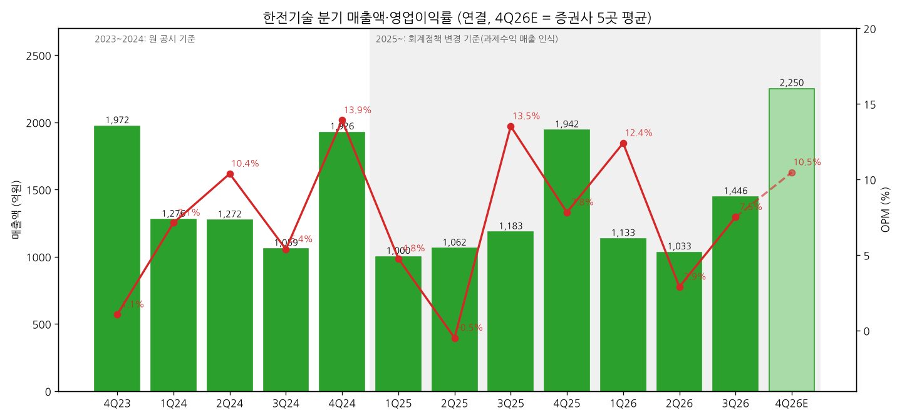
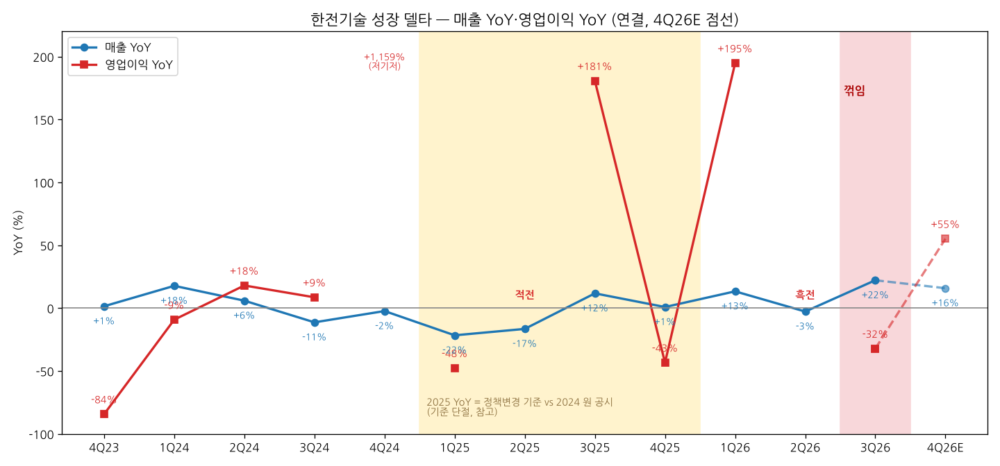
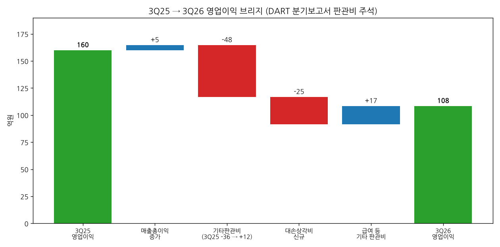
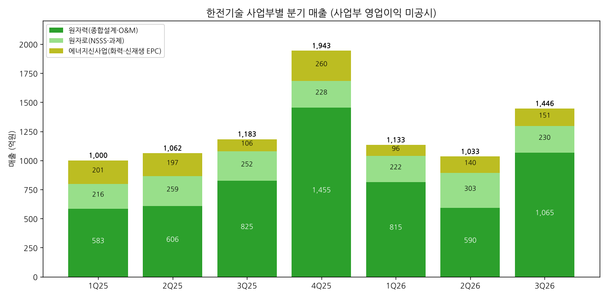

> 모드: 실적 리뷰 (v11)
> 종목: 한전기술 (052690)
> 섹터: 원전
> 서브섹터: 원전 설계
> 분기: 2026-Q3
> 발표일: 2026-11-09 (회사 IR 「2026년도 3분기 결산 요약」 게시 — kepco-enc.com 실적자료 게시판 bid=0022, list_no 45236) / 분기보고서 2026-11-16 제출 (DART 접수 20261116000524)
> 작성 시각: 2026-11-17 18:30 KST
> 분석 소스: 회사 자료 — 3Q26 IR 결산 요약(11/9, 국문 7p, kepco-enc.com 원본과 BT 첨부 FnGuide 사본 동일), DART 분기보고서(2026.09 — 연결 손익·판관비 주석·공사/용역 매출원가·사업부문/해외 매출·프로젝트 종류별 완성도 현황(계약잔액)·현금흐름 조정), OpenDART 연결재무제표(fnlttSinglAcntAll, 2020\~3Q26 — company-data `dart_financials`·`dart_quarterly_summary`), 기업개요 v1.1(2025 분기 회계정책 변경 소급 비교치·사업부 시계열·계약잔액 시계열). 셀사이드 첨부 5건(모두 11/10 발간) — 하나증권 「외화환산손실로 순이익 적자전환」(유재선)·LS증권 「원전 기대감 반영된 높은 멀티플. 시장위험 시기엔 부담」(성종화)·삼성증권 「3Q review — 외형 성장은 본격화」(김영호)·미래에셋증권 「3Q26 Review: 파이프라인 재점검」(김태형, 이미지 PDF — OCR 후 원본 대조)·유진투자증권 「펀더멘털 이상 없음, 센티만 악화」(황성현). 첨부 6건 중 1건(「2026년도 3분기 결산 요약」)은 증권사 리포트가 아니라 회사 IR 자료. 피어 교차 참조: 같은 폴더 2026-Q3 두산에너빌리티·현대건설·대우건설·Cameco 리뷰. 주가: Yahoo Finance 일간 종가(052690.KS, 11/17 조회). 웹 검색 보완: 10월 주가 하락 원인 2회 검색 — 특정 뉴스 미확인
> 리뷰 깊이: 풀 | 리서치 첨부 5건 (+ 회사 IR 1건)
> 비영업 요인: 일회성 판관비(3Q26 대손상각비 25억원 신규 — LS는 사택 전세보증 관련 약 18억원으로 설명 / 3Q25 기저에 기타판관비 -36억원 환입성 항목, 내용 미공시)·회계정책 변경(2025-12 위탁연구과제 보조금 영업수익 인식·R&D비 원가 재분류 — 2025 분기 비교치 소급, 3Q25 영업이익 원 공시 123억원 → 소급 160억원)·영업외 외화환산손실(유로 사업, 3Q 기타손익 -91억원 — 순이익 적자 원인, 영업이익과 무관)·2025 구사옥 매각이익 792억원(1Q25 영업외 — 순이익 비교만 왜곡)

# 한전기술 3Q26 실적 리뷰 — 체코 설계 매출로 분기 최대 매출을 찍었는데, 이익은 판관비에 막혀 꺾였고 시장은 그 뒤의 파이프라인을 깎았다

> 성장 델타: 꺾임 | 내러티브: 약화 → 델타 꺾임 + 내러티브 약화 → 매매 제외 구간 (4Q는 저기저로 숫자 반등 가능성이 크지만, 용역 마진과 신규 수주가 확인되기 전까지 관망)

> ⚠ 비영업 요인 플래그: 꺾임의 주된 원인 = 판관비 일회성의 양방향 효과 — 3Q25 기저 영업이익 160억원에는 기타판관비 -36억원(환입 성격, 회사 미설명)이 들어 있고, 3Q26에는 대손상각비 25억원이 새로 들어갔다. 이 둘을 걷어내면 3Q26 134억원 vs 3Q25 124억원으로 YoY +8%다 [참고·계산 — DART 판관비 주석]. 판정은 보고 기준 꺾임(-32.2%) 그대로다. 비교 기준도 확인했다 — 3Q25는 2025-12 회계정책 변경 소급치(160억원)이고, 원 공시(123억원) 기준이면 YoY -11.5%(LS 표기)로 방향은 같다. 순이익 -10억원 적자는 유로 외화환산손실(기타손익 -91억원) 때문이라 영업이익 판정과 무관하다

→ **숫자**: 연결 매출 1,446억원(+22.2% YoY, +40.0% QoQ — 분기 사상 최대), 영업이익 108억원(-32.2% YoY, OPM 7.5%). 영업이익 YoY가 2Q26 흑자전환(2Q25 -5억원 → 30억원)에서 -32.2%로 **마이너스 전환**해 판정 기준상 "꺾임"이다. 매출 YoY는 -2.7% → +22.2%로 크게 올랐는데, 매출총이익은 +1.5%(318억원 → 323억원)에 그쳤고 판관비가 +35.7%(158억원 → 214억원) 늘었다
→ **쟁점 ①**: 5곳 모두 "매출 호조·이익 미달"로 읽었다(FnGuide 컨센 대비 매출 +6.3%, 영업이익 -28.6%). 원인 설명이 갈린다 — 하나·유진·LS는 "해상풍력 EPC 매출 비중 상승에 따른 마진 믹스"를, 삼성은 "급격한 원화 강세"를 들었다. DART로 나눠 보면 공사(EPC) 매출 비중은 오히려 8.6% → 6.9%로 줄었고, 마진 하락은 **설계 용역 GPM 하락**(29.2% → 23.6%)에서 나왔다. 판관비 증가 56억원이 영업이익 감소 52억원보다 크고, 그 판관비 증가의 대부분이 위 플래그의 일회성 두 항목이다
→ **쟁점 ②**: 체코 두코바니 설계 매출이 본격화했다(9M26 해외 원자력 637억원 + 해외 원자로 197억원 = 전사 매출의 22.7%). 미래에셋에 따르면 두코바니 관련 매출은 2Q 130억원에서 3Q 약 290억원으로 늘었다. 10/29 시공 협상 결렬에 대해 LS는 "사전설계 매출 영향 없음, 2027-07까지 시공사가 선정되면 본설계 일정도 영향 없음"으로 정리했다. 다른 4곳도 설계 계약에 대한 직접 영향은 언급하지 않았다
→ **쟁점 ③**: 5곳 모두 TP를 내렸다(평균 184,000원 → 126,000원, -31.5%). 2026E 영업이익 추정 하향은 10\~15%(유진·LS·삼성)라 **TP 하향의 주원인은 멀티플과 장기 파이프라인**이다. 미래에셋은 UAE 2기·사우디 2기·튀르키예 2기를 추정에서 빼고 미국 APR1400 2기만 넣었고, 하나는 2030년 NOPLAT 적용 배수를 100배에서 46배로 내렸다
→ **주가**: 10월 한 달 -29.6%(9/30 122,600원 → 10/30 86,300원). 결렬 당일 하락(-7.8%)보다 그 전 3주(10/7 127,800원 → 10/28 96,200원, -24.7%)가 더 컸다. 실적 발표 다음 날(11/10)은 +3.0%였지만 11/17 66,200원으로 52주 고점(종가 194,800원) 대비 -66%다
→ **다음 분기 관건**: 증권사 5곳 평균 4Q26 영업이익은 236억원이다. 회사 비교 기준(2025-12 정책 변경 소급) 4Q25 152억원 대비 YoY **+55%** 수준이라 숫자상 "가속" 반등이 기본값이다. 반면 증권사 표의 4Q25(264억원)는 원 공시 9M과 정책 변경 후 연간을 섞은 값이라 그 기준으로는 +0\~9%로 보인다. 판정보다 중요한 것은 4Q 최대 매출 분기에 **용역 GPM이 25% 이상으로 돌아오는지**, 그리고 12월 원전 공론화위 권고안(12차 전기본)에서 신규 원전이 숫자로 나오는지다

---

## 1. 숫자

① 연결 기준 분기 표 (단위: 억원, %)

| 항목 | 4Q23 | 1Q24 | 2Q24 | 3Q24 | 4Q24 | 1Q25 | 2Q25 | 3Q25 | 4Q25 | 1Q26 | 2Q26 | **3Q26** | 4Q26E |
|---|---|---|---|---|---|---|---|---|---|---|---|---|---|
| 매출액 | 1,972 | 1,276 | 1,272 | 1,059 | 1,926 | 1,000 | 1,062 | 1,183 | 1,943 | 1,133 | 1,033 | **1,446** | 2,250 |
| 영업이익 | 21 | 91 | 132 | 57 | 268 | 48 | -5 | 160 | 152 | 141 | 30 | **108** | 236 |
| OPM | 1.1 | 7.2 | 10.4 | 5.4 | 13.9 | 4.8 | -0.5 | 13.5 | 7.8 | 12.4 | 2.9 | **7.5** | 10.5 |
| 매출 YoY | +1.5 | +17.7 | +6.0 | -11.3 | -2.3 | -21.6† | -16.5† | +11.7† | +0.9† | +13.3 | -2.7 | **+22.2** | +15.8 |
| 영업이익 YoY | -84.3 | -9.2 | +18.0 | +8.6 | +1,159 | -47.6† | 적전† | +180.7† | -43.3† | +194.8 | 흑전 | **-32.2** | +55.1 |
| **매출 YoY 델타 (%p)** | — | +16.2 | -11.7 | -17.3 | +9.0 | -19.3† | +5.1† | +28.2† | -10.8† | +12.4 | -16.0 | **+24.9** | -6.4 |
| **영업이익 YoY 델타 (%p)** | — | +75.1 | +27.2 | -9.4 | n/m | n/m | n/m | n/m | -224.0† | +238.1 | n/m (흑전) | **n/m (흑전 → -32.2%)** | +87.3 |

→ (출처: 4Q23\~4Q24 OpenDART 연결(원 공시 기준, 4Q = 연간 − 3Q 누적). 1Q25\~3Q25는 2026 분기·반기보고서 전기 비교치(2025-12 회계정책 변경 소급), 4Q25 = 2025 사업보고서 연간(정책 변경 반영, 매출 5,188억원·영업이익 355억원) − 소급 9M25(3,245억원·203억원) [계산]. 1Q26\~3Q26 DART 분기·반기보고서(3Q26 = IR 결산 요약과 동일: 매출 144,551백만원, 영업이익 10,846백만원). 4Q26E = 증권사 5곳 4Q26 추정 평균 [계산] — 유진 270·하나 196·LS 265·삼성 288·미래에셋 159억원)
→ † 기준 단절: 2025 분기는 정책 변경 기준, 2024 분기는 원 공시 기준이라 2025 YoY는 참고치다. 정책 변경 효과는 2024 연간 기준 매출 +161억원·영업이익 +161억원(원 공시 5,534억원·548억원 → 소급 5,695억원·709억원, 기업개요)으로 분기 영업이익 규모에 비해 크다. **2026 분기 YoY(1Q\~3Q26)는 같은 기준끼리의 비교**라 판정에 그대로 쓴다
→ 3Q26 서프라이즈: 매출은 FnGuide 컨센(1,360억원) 대비 +6.3%, 영업이익은 컨센(152억원) 대비 -28.6% (LS 표 2, FnGuide). 미래에셋(+5.9% / -28.5%)·삼성(+6.6% / -27.7%) 인용치도 같은 방향. 커버 증권사 9곳(삼성 컨센서스 표) — 소수 의견에 좌우될 수 있는 규모다
→ 9M26 누적: 매출 3,612억원(+11.3%), 영업이익 279억원(+37.7%), OPM 7.7%. 순이익은 158억원으로 9M25(775억원, 구사옥 매각이익 792억원 포함) 대비 -80% (DART)
→ 영업이익 YoY는 1Q26 +195%(저기저) → 2Q26 흑전 → 3Q26 -32%로 움직였다. 분기 이익 규모가 30\~160억원이라 판관비 수십억원이 YoY를 좌우하는 구조다. 컨센 경로(5곳 평균)는 4Q26 +55% → 2026년 연간 +45% → 2027년 +76%로, **YoY 정점은 아직 오지 않은 것으로 그려져 있다**. 다만 4Q26 +55%는 4Q25 OPM 7.8% 저기저 효과다
→ **[판단] 델타 = 꺾임**: 판정 기준상 영업이익 YoY의 마이너스 전환이다. 원 공시 기준(-11.5%)으로 바꿔도, 일회성을 걷어낸 참고치(+8%)로 봐도 "가속"은 아니다. 참고치 기준이면 "유지\~둔화"에 해당하지만, 판정은 보고 기준으로 한다(BT 결정 2026-11-16)

→ (출처: OpenDART·DART 분기보고서. 2023\~2024 원 공시, 2025\~ 회계정책 변경 기준. 4Q26E = 증권사 5곳 평균 — 연한 막대·점선)

→ (출처: 같은 표. 2025 구간(노란 배경)은 기준 단절 참고치, 영업이익 YoY ±300% 초과·흑적전은 텍스트로 표기. 4Q26E 점선)

② 이익 분해 — 매출 +22%에 영업이익 -32%가 된 경로 (단위: 억원, %)

| 항목 | 3Q25 (소급) | 1Q26 | 2Q26 | **3Q26** | YoY |
|---|---|---|---|---|---|
| 매출액 | 1,183 | 1,133 | 1,033 | **1,446** | +22.2% |
| 용역 매출 | 1,082 | 1,034 | 933 | **1,346** | +24.4% |
| 공사(EPC) 매출 | 102 | 100 | 100 | **100** | -2.1% |
| 공사 매출 비중 | 8.6 | 8.8 | 9.7 | **6.9** | -1.7%p |
| 매출총이익 | 318 | 286 | 218 | **323** | +1.5% |
| GPM | 26.9 | 25.2 | 21.1 | **22.3** | -4.6%p |
| 용역 GPM | 29.2 | 28.4 | 21.7 | **23.6** | -5.6%p |
| 공사 GPM | 2.1 | -7.5 | 15.8 | **5.2** | +3.1%p |
| 판관비 | 158 | 145 | 188 | **214** | +35.7% |
| 　대손상각비 | 0 | 0 | 0 | **25** | 신규 |
| 　기타판관비 | -36 | — | — | **12** | +48 |
| 　경상개발비 | 65 | — | — | **72** | +10% |
| 영업이익 | 160 | 141 | 30 | **108** | -32.2% |

→ (출처: DART 분기보고서(2026.09) 연결손익계산서 공사·용역 매출·매출원가, 판관비 주석 28(3개월). 1Q26·2Q26 = 각 분기·반기보고서. "—"는 이번에 분해하지 않은 분기. 2Q26 공사 GPM 15.8%는 인도네시아 EPC 정산 등 소규모 금액 변동이라 의미가 작다)

→ (출처: DART 분기보고서 판관비 주석 [계산]. 160 + 매출총이익 +5 − 기타판관비 스윙 48 − 대손상각비 25 + 급여 등 감소 17 = 108억원)
→ 판관비 증가 56억원 중 73억원이 일회성 두 항목(기저 환입 소멸 48억원 + 대손 25억원)이다. 급여(-17억원)·감가상각 등은 오히려 줄었다
→ **진짜 질문은 매출총이익이다**: 매출이 263억원 늘었는데 매출총이익은 5억원 늘었다. 용역 GPM이 1Q26 28.4% → 2Q26 21.7% → 3Q26 23.6%로 2개 분기째 20%대 초반이다. LS 원가 분해(원 공시 기준 비교)로는 원가 인건비 +24%(445억원 → 552억원), 기타 원가 +74%(218억원 → 381억원)다 [추정: 체코 사전설계 초기 인력·외주 투입이 매출 인식보다 앞서는 구간]. 해상풍력 EPC 믹스 설명은 DART 공사·용역 구분과 맞지 않는다 (2번 쟁점 (1))

③ 사업부별 매출 (단위: 억원, %) — 사업부 영업이익은 회사 미공시

| 사업부 | 항목 | 1Q25 | 2Q25 | 3Q25 | 4Q25 | 1Q26 | 2Q26 | **3Q26** |
|---|---|---|---|---|---|---|---|---|
| 원자력 (종합설계 A/E·O&M) | 매출 | 583 | 606 | 825 | 1,455 | 815 | 590 | **1,065** |
| 원자력 | 매출 YoY | — | — | — | — | +39.8 | -2.6 | **+29.1** |
| 원자력 | 비중 | 58.3 | 57.1 | 69.7 | 74.9 | 71.9 | 57.1 | **73.7** |
| 원자로 (NSSS·SMR 과제) | 매출 | 216 | 259 | 252 | 228 | 222 | 303 | **230** |
| 원자로 | 매출 YoY | — | — | — | — | +2.8 | +17.0 | **-8.7** |
| 에너지신사업 (화력·신재생 EPC) | 매출 | 201 | 197 | 106 | 260 | 96 | 140 | **151** |
| 에너지신사업 | 매출 YoY | — | — | — | — | -52.2 | -28.9 | **+42.5** |

→ (출처: 각 분기 IR "본부별 매출 실적" — 1Q25·2Q25·4Q25는 2026 IR 비교치(정책 변경 기준), 3Q25는 3Q26 IR 비교치. 2025 YoY는 기준 단절로 생략. 증권사 중 하나·LS는 3Q25 원 공시(원자력 806억원·에너지 103억원·원자로 237억원)로 YoY를 계산해 원자력 +32.1%·에너지 +46.9%·원자로 -3.1%로 표기 — 삼성은 소급 기준(+29.1%·+42.5%·-8.7%)으로 이 표와 같다)

→ (출처: 회사 IR 본부별 매출)
→ **델타를 끄는 곳 = 원자력**: QoQ +475억원으로 전사 증가분(+413억원)보다 크다. LS에 따르면 두코바니 5·6호기 사전설계와 가동원전 O&M이 각각 QoQ +160억원·+150억원 늘었다. 9M26 누계로 원자력 설계 1,868억원(+27.3%), 원자력 O&M 602억원(+10.0%)이다 (IR p.5)
→ **꺾이는 곳 = 원자로**: 회사는 "혁신형 SMR 과제를 포함한 정부과제 중후반기(2단계) 도래에 따른 과제 매출 감소"로 설명했고, 삼성은 "신한울 3·4호기 원자로 매출 인식 일시 저하"를 들었다. 9M 원자로 설계 676억원은 YoY +5.6%로 아직 플러스다
→ **에너지신사업**은 3년 만의 YoY 플러스(+42.5%)지만 9M 누계로는 387억원(-25.4%)이다. 인도네시아 EPC가 끝나는 자리를 완도금일·압해 해상풍력 EPC가 채우는 중이다. 해외 에너지 매출은 9M -13억원(인도네시아 PLN 정산)이다 (DART 해외사업 현황)

④ 수주 선행지표 — 계약잔액과 체코 매출 인식 속도 (단위: 억원)

| 기준일 | 계약잔액 합계 | 국내 | 해외 | 해외 원자력 | 비고 |
|---|---|---|---|---|---|
| 2024말 | 20,209 | — | — | — | |
| 2025말 | 34,323 | — | — | 20,090 | 체코 두코바니 A/E 12,395억원·NSSS 3,718억원 반영 |
| 1H26 | 30,991 | — | — | 15,221 | |
| **3Q26** | **30,283** | **15,344** | **14,939** | **14,891** | 9M26 수익인식 3,612억원 |

→ (출처: DART 사업·반기·분기보고서 "프로젝트 종류별 완성도 현황" — 당기 매출이 발생한 사업만 집계한 값이라 회사 전체 수주잔고와 다르다. 해외 계약잔액은 외화 잔여매출에 내부 지침 환율을 적용(분기보고서 주3). 2024말\~1H26은 기업개요 v1.1)
→ 9M26 해외 매출 821억원(전사 22.7%) = 원자력 637억원("체코 두코바니5&6호기 종합설계용역 등") + 원자로 197억원("체코 두코바니5&6호기 원자로계통설계 용역 등") − 에너지 13억원 (DART 해외사업 현황). 2025년 해외 원자력 매출 495억원(기업개요)을 9개월 만에 넘었다
→ 체코 계약 1.61조원(2025-12 \~ 2038-04)을 12.3년에 단순 안분하면 연 약 1,300억원, 분기 약 330억원이다 [계산]. 미래에셋이 확인한 3Q 두코바니 관련 매출 약 290억원은 이 속도에 근접했다
→ 해외 원자력 계약잔액은 2025말 20,090억원 → 1H26 15,221억원으로 4,869억원 줄었다. 같은 기간 해외 매출 인식(약 550억원 [추정])보다 훨씬 크다. 회사는 설명하지 않았다 — 유로 환율(내부 지침 환율 변경) 또는 집계 범위 차이로 보이나 **[미확인]**. 3Q 순이익을 적자로 만든 유로 외화환산손실과 같은 방향이다
→ 참고 — 운전자본: 미청구공사가 2025말 2,724억원 → 3Q26 3,554억원(유동 2,244억원 + 장기 1,310억원 신규)으로 830억원 늘었고, 현금성자산 + 유동금융자산은 1,711억원 → 562억원으로 줄었다(배당 512억원 지급 포함). 체코 사전설계 매출이 청구보다 앞서 인식되는 구간이다 [판단]. 유진은 2027E 순차입금 1,380억원(차입금 1,700억원)을 추정했다

⑤ 연간 (단위: 억원, %)

| 항목 | 2021 | 2022 | 2023 | 2024 | 2025 | 2026E | 2027E |
|---|---|---|---|---|---|---|---|
| 매출액 | 4,331 | 5,053 | 5,544 | 5,695 | 5,188 | 5,861 | 7,981 |
| 영업이익 | 101 | 139 | 378 | 709 | 355 | 515 | 903 |
| OPM | 2.3 | 2.8 | 6.8 | 12.5 | 6.8 | 8.8 | 11.3 |
| 매출 YoY | +0.3 | +16.7 | +9.7† | +2.7 | -8.9 | +13.0 | +36.2 |
| 영업이익 YoY | -65.9 | +37.6 | +171.9† | +87.6 | -50.0 | +45.1 | +75.5 |

→ (출처: 2021\~2025 OpenDART 연결(기업개요 v1.1) — 2023·2024는 2025 회계정책 변경 소급치, 2021·2022는 원 공시라 † 2023 YoY 기준 단절. 2026E·2027E = 증권사 5곳 평균 [계산] — 2026E 영업이익 유진 550·하나 475·LS 544·삼성 567·미래에셋 437억원, 2027E 유진 1,050·하나 521·LS 952·삼성 994·미래에셋 1,000억원)
→ 컨센 비교: FnGuide 컨센(하나 11/10 Consensus Data)은 2026E 매출 5,765억원·영업이익 605억원, 2027E 7,342억원·908억원이다. 발표 후 5곳 평균 2026E 영업이익(515억원)은 FnGuide 대비 -15%로, FnGuide가 아직 발표 전 추정을 담고 있는 것으로 보인다
→ 발표 전 → 후: 전후를 모두 밝힌 3곳이 2026E 영업이익을 10\~15% 내렸다(유진 620 → 550억원 -12.1%, LS 640 → 544억원 -15.0%, 삼성 630 → 567억원 -10.2%). 2027E는 유진 -16.4%, LS -10.8%, 삼성 -2.4%다. 하나·미래에셋은 직전 추정을 공개하지 않았다
→ 2027E가 갈린다: 하나 521억원(매출 6,166억원, +5%) vs 나머지 4곳 952\~1,050억원(매출 7,419\~10,580억원). 체코 본설계·국내 신규 원전 설계가 2027년 매출로 들어오는지에 대한 가정 차이다 (2번 ④)

---

## 2. 시장 쟁점

① 지난 분기 체크

→ 첫 리뷰 — 직전 체크 없음 (2026-Q2 한전기술 리뷰·팔로업 미작성)

② 이번 분기 쟁점 5개

| # | 쟁점 | 언급 증권사 |
|---|---|---|
| (1) | 매출 +22%인데 영업이익 -32% — 마진 믹스인가, 일회성인가, 설계 마진 하락인가 | 5/5 |
| (2) | 체코 두코바니 — 시공 결렬은 설계 매출에 영향이 없나, 매출 인식 속도는 충분한가 | 5/5 |
| (3) | 해외 파이프라인 재점검 — 미국 APR1400 vs AP1000, Westinghouse 합의, 중동·튀르키예 | 4/5 |
| (4) | 국내 신규 원전·i-SMR — 12차 전기본과 정부과제 2단계 | 4/5 |
| (5) | TP -31.5%는 실적 하향인가 멀티플 하향인가 (+ 순이익 적자의 의미) | 5/5 |

③ 쟁점별 분해

(1) **매출 +22%인데 영업이익 -32% — 무엇이 마진을 막았나**

(1-1) 회사 설명 (3Q26 IR p.5 — 컨퍼런스콜 자료 미확보, 회사 설명은 IR 결산 요약 기준)

→ "체코 두코바니 사업 본격화와 가동원전 사업 등 대형원전 중심 용역 매출 증가" / "완도금일 및 압해 해상풍력 EPC 사업이 매출 확대되었으나, 인도네시아 EPC 사업 준공 도래에 따라 전체 공사 매출 감소"

→ 시사점: 회사는 **매출 증가 원인만 설명**하고 영업이익 감소 원인은 밝히지 않았다 → "전체 공사 매출 감소"라는 회사 문구 자체가 **EPC 믹스 악화 설명과 충돌** → 마진 원인은 판관비 일회성과 용역 원가에서 찾아야 한다

(1-2) 증권사별 해석 편차

| 증권사 | 핵심 가정·추정 | 논리 |
|---|---|---|
| LS | 대손상각비 약 18억원(사택 전세보증) 일회성 제외해도 OPM 8.7%(YoY -2.0%p) | "일부는 일회성, 일부는 구조적" — 수익성 낮은 에너지신사업 매출 증가가 원전 설계 증가보다 훨씬 빠른 매출 믹스 악화 |
| 하나 | "영업이익단에 특별한 비용 이슈는 없었다" | 해상풍력 EPC 비중 상승에 의한 마진 믹스 변화로 추정 |
| 유진 | 추정 부합, "영업 펀더멘털은 견조" | 해상풍력 EPC 비중 상승 마진 믹스 + 판관비 증가 복합 |
| 삼성 | 매출 컨센 부합, 영업이익 기대 하회 | "급격한 원화 강세 영향 등으로" 영업이익 -32%, 순이익 적자 — 일시적 수익성 저하 |
| 미래에셋 | OPM 2.9% → 7.5% QoQ 회복 | 매출원가율 상승과 판관비 증가 |

(1-3) 공통 결론 vs 갈리는 지점

→ 공통: 탑라인은 체코·신한울 3·4·가동원전 O&M으로 질이 좋고, 이익 미달은 일시적 요인이 섞였다
→ 갈림: 원인이 **구조적 믹스** 문제냐 **일회성**이냐. 하나는 일회성이 없다고 봤고 LS는 18억원만 일회성으로 잡았다. 삼성의 환율 설명은 영업외(외화환산손실)와 영업이익을 섞은 것으로 보인다 — 원화 강세가 유로 계약 매출 환산에 영향을 줄 수는 있지만 3Q 매출은 컨센을 6% 넘었다

(1-4) **[판단]**

→ DART 숫자는 "EPC 믹스" 설명을 지지하지 않는다. 공사 매출은 100억원으로 1년 전(102억원)과 같고, 공사 GPM은 2.1% → 5.2%로 올랐다. 하락은 **설계 용역 마진**(GPM 29.2% → 23.6%)에서 났다. 해상풍력 EPC 매출 일부가 용역으로 분류됐을 가능성은 남지만, 에너지신사업 전체 매출(151억원)이 늘어난 폭(+45억원)으로는 용역 마진 -5.6%p를 설명하기 어렵다 [계산]
→ 영업이익 YoY는 판관비 일회성 두 항목(기저 -36억원, 이번 +25억원)으로 대부분 설명된다. 걷어내면 YoY +8%다. 그래서 이번 "꺾임"은 **이익 체력이 무너진 것이 아니라 일회성과 설계 마진 하락이 겹친 것**이다
→ 결론이 바뀌는 조건: 4Q(최대 매출 분기)에 용역 GPM이 25% 이상으로 돌아오면 2·3Q는 체코 초기 투입 구간이었다는 해석이 맞다. 20%대 초반에 머물면 체코·신한울 설계의 계약 마진 자체가 과거(UAE·신고리 시기)보다 낮다는 뜻이고, 2027E 영업이익 900억원대(4곳)는 높다

(2) **체코 두코바니 — 시공 결렬은 설계에 영향이 없나, 매출 인식 속도는 충분한가**

(2-1) 회사 설명

→ "체코 두코바니 사업 본격화와 가동원전 사업 등 대형원전 중심 용역 매출 증가" (IR p.5). 결렬에 대한 회사 별도 공시는 없었다. 한수원은 10/29 설명자료에서 재선정은 시공 분야 한정이고 다른 사업 분야는 정상 진행이라고 밝혔다 (기업개요 v1.1 — 연합뉴스·한국경제 10/29 보도)

→ 시사점: 한전기술의 A/E(한수원 발주 12,395억원)·NSSS(두산에너빌리티 발주 3,718억원) 계약은 **시공 협상 결렬의 직접 대상이 아니다** → 위험은 계약이 아니라 **본설계 일정**이다

(2-2) 증권사별 해석 편차

| 증권사 | 핵심 가정·추정 | 논리 |
|---|---|---|
| LS | 사전설계 매출 영향 없음, 2027-07 시공사 선정 시 본설계 일정도 영향 없음 | 체코 계약 1.62조원은 2026\~2038년 13년 안분, 2026년부터 착공 전 사전 착수 설계 매출 |
| 유진 | 체코·신한울 3·4 실적 가시성 유효, 업종 센티먼트 악화로 멀티플만 하향 | 한수원과 국내 건설사 간 EPC 계약 불발로 국내 원전 발주 불확실성도 확대 |
| 미래에셋 | 두코바니 관련 매출 2Q 130억원 → 3Q 약 290억원 | 체코 매출 인식 확대는 성장 방향성을 유지하는 요인 |
| 삼성 | 원자력 매출 +29.1% — "체코 두코바니 등 주요 프로젝트 매출 인식 본격 확대" | 결렬 영향 별도 언급 없음 |
| 하나 | "기존 대형 원전 프로젝트 잔고 기반 실적 인식 진행" | 결렬 영향 별도 언급 없음 |

(2-3) 공통 결론 vs 갈리는 지점

→ 공통: 설계 계약과 매출 인식은 영향이 없다. 5곳 모두 체코 매출 본격화를 이번 분기의 긍정 요인으로 꼽았다
→ 갈림: 결렬의 **간접 효과**다. 유진만 국내 원전 발주 불확실성과 업종 멀티플로 연결했다. Macquarie는 "한수원이 필수 엔지니어링·인허가는 계속하지만 일부 활동이 이미 지연됐다"고 적었다 (Macquarie Flashnote 10/29 — 두산에너빌리티 리뷰 첨부 자료, 이번 첨부 5건 외)

(2-4) **[판단]**

→ 숫자로는 체코가 이미 분기 300억원 안팎을 만들고 있어, 연 1,300억원 안분 속도에 근접했다. 이번 분기 매출 서프라이즈의 원천이다
→ 위험은 두 가지다. 첫째, 시공사 선정(2027-01 사전설명회 → 4월 공고 → 7월 선정, 대우건설 리뷰 인용)이 밀리면 사전설계 이후 본설계 착수가 늦어지고 2027E 매출 가정(4곳 7,400억원 이상)이 흔들린다. 둘째, 해외 계약잔액이 1H에만 4,869억원 줄었는데 원인이 공시되지 않았다. 환율 효과라면 매출 원화 환산액도 같은 비율로 줄 수 있다
→ 결론이 바뀌는 조건: 4Q 해외 원자력·원자로 매출이 300억원 이상 유지되고 연말 해외 계약잔액이 1.4조원대를 지키면 "결렬은 설계와 무관"이 확인된다

(3) **해외 파이프라인 재점검 — 미국 APR1400 vs AP1000, Westinghouse 합의**

(3-1) 회사 설명

→ 회사는 IR에서 해외 수주 전망을 제시하지 않았다. 사업 구조상 한전기술은 APR1400의 종합설계(A/E)와 원자로계통설계(NSSS)를 모두 맡는 반면, AP1000은 Westinghouse 설계라 한전기술 역할이 정해져 있지 않다 (기업개요 — 키움증권 추정: APR1400 채택 시 기당 설계 6,000\~8,000억원)

→ 시사점: 미국 대형원전이 **어느 노형으로 가느냐가 곧 한전기술 몫의 크기** → 한미 프레임워크(AP1000 6기 + APR1400 2기)에서 직접 수혜는 APR1400 2기다

(3-2) 증권사별 해석 편차

| 증권사 | 핵심 가정·추정 | 논리 |
|---|---|---|
| 미래에셋 | UAE BNPP 5·6호기·사우디 두와이힌 2기·튀르키예 시노프 2기 제외, 미국 APR1400 2기 신규 반영 → TP -27.5% | UAE 일정 지연, 사우디는 미-사우디 123협정으로 Westinghouse 수주 가능성↑, 튀르키예는 러시아 가능성↑. 미국 APR1400 2기로는 상쇄 역부족. TP 상향엔 미국 계약 구조와 동사 수행 범위 구체화 필요 |
| 유진 | 핵잠 원자로 설계·대미 APR1400·연료주기 패키지는 구조적 모멘텀이나 정치 리스크 | 민주당의 의회 장악으로 한미 원자력 협력 입법·예산 집행 속도 둔화 가능. 미국 대형원전 구체화는 2028년 이후 |
| 삼성 | 미국 DOE·DOC가 20여 기 AP1000 추진 → 한국형 원전 미국 진출 기대 유효 | 미국 원전 정책은 초당적 지지 |
| LS | 미국 대형원전 Team Korea 참여 portion 상당, 다만 매우 장기적 그림 | 한수원-Westinghouse 합의상 북미·EU·영국·우크라이나·일본은 Team Korea 단독 수주 불가. 체코 테믈린은 체코 요구로 Westinghouse에 대가 제공 후 Team Korea 수주 가능성 높음(2028년까지 입찰 예상) |

(3-3) 공통 결론 vs 갈리는 지점

→ 공통: 미국은 장기 옵션이고, 단기 수주 가시성은 낮다
→ 갈림: 미국 정치 리스크를 유진은 할인 요인으로, 삼성은 "초당적 지지"로 반대로 읽었다. 중동·튀르키예를 추정에서 뺀 곳은 미래에셋 하나다

(3-4) **[판단]**

→ 피어 리뷰와 맞춰 보면 미국 경로는 Westinghouse 일정에 묶여 있다. Cameco 3Q26 MD&A 기준 한미 프레임워크는 AP1000 6기 + APR1400 2기이고, APR1400에서도 Westinghouse 몫이 1기당 약 20억달러다. 2025-01 IP 합의(보도 기준 1기당 물품·용역 약 6.5억달러 + 기술료 약 1.75억달러)보다 Westinghouse 몫이 크다 (2026-Q3_CCJ_리뷰.md)
→ 한전기술 입장에서 AP1000 6기는 설계 매출이 거의 없는 구조이고, APR1400 2기도 Westinghouse 몫을 뺀 범위다. 미래에셋의 "파이프라인 절대 규모 축소"가 숫자로는 가장 보수적이면서도 사실에 가깝다 [판단]
→ 결론이 바뀌는 조건: 한미 프레임워크 확정 계약에서 APR1400 2기의 설계 주체와 범위가 공개되거나, 테믈린 입찰이 2027년에 열리면 파이프라인이 다시 커진다

(4) **국내 신규 원전·i-SMR — 12차 전기본과 정부과제 2단계**

(4-1) 회사 설명

→ "혁신형 SMR 과제를 포함한 진행중인 정부과제 중후반기(2단계) 도래에 따른 과제 매출 감소" (IR p.5)

→ 시사점: 원자로 부문의 과제 매출은 **i-SMR 2단계 진입으로 줄어드는 구간** → 2025-12 정책 변경으로 과제수익이 매출에 들어가면서 과제 사이클이 분기 매출·이익을 흔드는 변수가 됐다

(4-2) 증권사별 해석 편차

| 증권사 | 핵심 가정·추정 | 논리 |
|---|---|---|
| 하나 | 12차 전기본 공론화위 12월 권고안 목표, 한빛 내부 2기 + 새울 인근 2기 최대 4기 추가 가능 | AI DC 수요 전망 하향 가능성이 언급돼 추이 확인 필요 |
| 삼성 | 11차 전기본 확정 대형 2기 + SMR 1기 신규 수주 임박 | 수주 모멘텀 지속 |
| LS | 영덕 대형 2기(2038\~2040 가동)·기장 SMR 1기(2035\~2038), i-SMR 개발 2024-05\~2027-12 기술료 4,000억원 중 동사 설계 약 1,000억원 | SMR은 장기 성장 동력 |
| 유진 | 4Q26에 SMR 과제 완료분 매출 추가 인식 기대 | 한수원-국내 건설사 EPC 협상 불발로 국내 발주 불확실성도 확대 |
| 미래에셋 | 2027F 수주 3.77조원(원자력 2.63조원·원자로 0.53조원·에너지 0.61조원) | 2026F 수주 0.06조원 — 국내 신규 원전 설계 수주가 2027년에 몰리는 가정 |

(4-3) 공통 결론 vs 갈리는 지점

→ 공통: 국내 신규 원전 설계 발주는 시간문제다. 2026년 수주는 거의 없다(미래에셋 0.06조원)
→ 갈림: 하나는 12차 전기본의 원전 기수가 AI 데이터센터 수요 전망 하향으로 줄 수 있다고 봤고, 삼성은 "임박"으로 봤다

(4-4) **[판단]**

→ 2026년 신규 수주가 사실상 없으니 2027년 매출은 체코 + 신한울 3·4 + O&M 잔고로 만들어야 한다. 하나(2027E 매출 +5%)가 가장 잔고에 충실한 가정이고, 나머지 4곳의 +24\~79%는 2027년 신규 수주의 빠른 매출화를 깔고 있다
→ 결론이 바뀌는 조건: 12월 공론화위 권고안에서 신규 대형 원전 기수가 4기 이상으로 나오고, 영덕 1·2호기 종합설계 계약이 1H27에 체결되면 4곳 쪽 가정에 힘이 실린다

(5) **TP -31.5%는 실적 하향인가 멀티플 하향인가**

(5-1) 회사 설명

→ "환율 변동에 따른 해외사업 외화환산평가손실로 인해 3분기 당기순이익 일시적 적자 기록" (IR p.5)

→ 시사점: 회사는 순이익 적자를 **일시적·환율 요인**으로 규정 → 삼성은 이 순이익 하향(2026E EPS -40%)을 TP에 그대로 반영했고, 다른 곳은 배수를 내렸다

(5-2) 증권사별 해석 편차

| 증권사 | TP 변화 | 하향 원천 | 논리 |
|---|---|---|---|
| 하나 | 220,000 → 140,000원 (-36.4%) | 멀티플 100% | 2030년 최대 Capa 기준 NOPLAT 유지, 배수 100배 → 46배 |
| 유진 | 200,000 → 140,000원 (-30.0%) | 멀티플 중심 | 26E OP -12%·27E -16%이나 "업종 센티먼트 악화 반영 멀티플 하향" |
| LS | 140,000 → 105,000원 (-25.0%) | 실적 반·멀티플 반 | 27E EPS -12.6% × PER 59.7 → 51.2배(-14.2%) |
| 삼성 | 160,000 → 100,000원 (-37.5%) | 순이익(환율) | 26E EPS -40.3% × 역사적 고점 평균 P/E 97배 유지 |
| 미래에셋 | 200,000 → 145,000원 (-27.5%) | 장기 파이프라인 | 해외 6기 제외·미국 2기 추가 → 2030F EPS 할인 × 37배 |

(5-3) 공통 결론 vs 갈리는 지점

→ 공통: 5곳 모두 매수 유지, TP 하향. 단기 영업이익 추정 하향은 10\~15%로 TP 하향폭(-25\~-38%)보다 작다
→ 갈림: 삼성은 일시적이라는 환산손실을 EPS에 반영해 TP를 깎았고, 유진은 같은 손실을 "실질 이익 체력과 무관"으로 봤다

(5-4) **[판단]**

→ TP 하향의 주원인은 **멀티플과 장기 파이프라인**이다. 다섯 곳의 적용 배수는 여전히 2027E P/E 30\~70배 수준이라, 이 종목은 이익이 아니라 수주 옵션의 할인율로 값이 매겨진다
→ 삼성의 순이익 기반 하향은 영업이익과 무관한 환산손실을 반영한 것이라, 4Q 유로 환율이 되돌아오면 가장 먼저 되돌아올 수 있다

④ 낙관 vs 보수 — 논리 대비

→ **낙관 (유진·미래에셋)**: 유진은 2027E 매출 1조 580억원(+79%)·영업이익 1,050억원으로 체코 본설계와 후속 수주의 빠른 매출화를 가정했다. 미래에셋은 2027F 수주 3.77조원 → 2028F 영업이익 1,740억원·2030F 2,301억원의 장기 경로를 그렸다(다만 그 장기 경로에서 해외 6기를 뺐다)
→ **보수 (하나·LS)**: 하나는 2027E 영업이익 521억원(+10%)으로 잔고만 인정했다. LS는 이익 경로(2027E 952억원)는 높게 두되 "원전 모멘텀 공백기 + 시장위험 시기의 높은 멀티플"을 이유로 TP를 가장 낮은 축(105,000원)에 뒀다
→ 차이의 본질: **2027년에 신규 원전 설계 매출이 들어오느냐**와 **원전 옵션에 몇 배를 주느냐**다. 2026E 영업이익은 437\~567억원으로 좁은데, 2027E는 521\~1,050억원으로 두 배 차이다
→ 셀사이드 vs 시장: 5곳 전원 매수(평균 TP 126,000원)인데 주가는 11/17 66,200원으로 평균 TP 대비 +90% 상승여력이다 [계산]. 셀사이드는 "펀더멘털 이상 없음, 센티 악화"(유진)로, 시장은 수주 옵션 자체의 할인으로 보고 있다

⑤ 추정치·TP 변화 (단위: 원, 억원)

| 증권사 (발간일) | 직전 TP | 현재 TP | 4Q26 영업이익 E | 2026E / 2027E 영업이익 | 핵심 변화 한 줄 |
|---|---|---|---|---|---|
| 하나 (11/10) | 220,000 | 140,000 (-36.4%) | 196 | 475 / 521 | NOPLAT 배수 100 → 46배 |
| 유진 (11/10) | 200,000 | 140,000 (-30.0%) | 270 | 550 / 1,050 | 26E -12.1%·27E -16.4%, 센티 반영 멀티플 하향 |
| LS (11/10) | 140,000 | 105,000 (-25.0%) | 265 | 544 / 952 | 27E EPS -12.6%, PER -14.2% |
| 삼성 (11/10) | 160,000 | 100,000 (-37.5%) | 288 | 567 / 994 | 26E EPS -40.3%(환산손실), P/E 97배 |
| 미래에셋 (11/10) | 200,000 | 145,000 (-27.5%) | 159 | 437 / 1,000 | 해외 6기 제외·미국 APR1400 2기 추가 |

→ (출처: 각 리포트. 미래에셋은 표지 요약(2026F 500억원·2027F 1,160억원)과 본문 표 1(437억원·1,000억원)이 달라 분기 합이 맞는 표 1을 썼다. 미래에셋 표 1은 열 머리가 1Q25\~4Q25로 인쇄됐으나 값은 1Q26\~4Q26F·1Q27F\~4Q27F다 — 1Q26 113.2·2Q26 103.3·3Q26 144.6십억원 일치로 확인)
→ 평균 TP 184,000원 → 126,000원(-31.5%), 하향 5건·유지 0건. 발표 전 커버 9곳 평균 TP 175,444원(삼성 컨센서스 표)
→ 평균 4Q26 영업이익 E 236억원(범위 159\~288억원), 2026E 515억원, 2027E 903억원
→ **TP 하향의 원인 = 멀티플(+장기 파이프라인) > 실적**: 단기 영업이익 추정 하향(2026E -10\~-15%)보다 TP 하향(-25\~-38%)이 두 배 이상 크다. 실적 요인이 큰 곳은 순이익 환산손실을 반영한 삼성뿐이다

⑥ 주가 — 10월 -30%의 분해

| 구간 | 종가 | 변화 | 이벤트 |
|---|---|---|---|
| 9/30 → 10/7 | 122,600 → 127,800원 | +4.2% | |
| 10/7 → 10/28 | 127,800 → 96,200원 | -24.7% | 특정 뉴스 미확인 — 시장 위험 회피·원전 섹터 디레이팅 |
| 10/28 → 10/29 | 96,200 → 88,700원 | -7.8% | 한수원, 체코 두코바니 시공 협상 종료 (두산 -7.7%, 대우건설 -18.6%) |
| 10/29 → 10/30 | 88,700 → 86,300원 | -2.7% | 10월 합계 -29.6% |
| 11/9 → 11/10 | 72,800 → 75,000원 | +3.0% | 3Q26 실적(11/9) 다음 날 |
| 11/10 → 11/17 | 75,000 → 66,200원 | -11.7% | 52주 고점(종가 194,800원) 대비 -66% |

→ (출처: Yahoo Finance 일간 종가(052690.KS). 두산·대우건설 결렬일 등락은 같은 폴더 리뷰)
→ 10월 하락의 대부분(-24.7%)은 결렬 **이전**에 나왔다. 첨부 리포트와 웹 검색으로는 10/8\~10/15(5거래일 -21.7%)의 개별 트리거를 특정하지 못했다 **[미확인]**. 증권사가 든 배경은 시장 위험 회피와 높은 멀티플(LS — 미래에셋 표지 기준 11/9까지 1개월 주가 -40.8%, KOSPI 대비 -21.9%p로 같은 기간 KOSPI 약 -19% [계산]), 해외 파이프라인 축소(미래에셋), 미국 정치 리스크(유진), 12차 전기본 수요 전망 하향 가능성(하나)이다
→ 결렬 당일 한전기술(-7.8%)은 시공 당사자인 대우건설(-18.6%)보다 덜 빠지고 두산에너빌리티(-7.7%)와 비슷했다. 시장도 설계 계약은 직접 대상이 아니라고 본 것이다
→ 피어 read-across: 같은 분기 두산에너빌리티(가속·약화)·현대건설(가속·약화)·대우건설(가속·훼손) 모두 "TP 하향의 주원인 = 원전 멀티플"이었다. 한전기술은 그중 **유일하게 영업이익 델타까지 꺾인 원전 종목**이다. 체코 매출은 먼저 들어오는데 이익이 따라오지 않은 분기다

---

## 3. 내러티브 점검

① 성장 스토리 정의

→ 국내 유일의 원전 종합설계(A/E) + 원자로계통설계(NSSS) 동시 보유사로서, 체코 두코바니로 해외 설계 매출이 처음 본격화하고, 국내 신규 원전·i-SMR·미국 APR1400·체코 테믈린 등 후속 수주가 이어지면 설계 매출이 2027\~2030년 두 배 이상이 된다는 "수주 → 설계 매출 → 고마진" 스토리다. 시장은 이 옵션에 2027E P/E 30\~70배를 줘 왔다

② 이번 분기 평가

→ **강화된 부분**: 체코 매출이 숫자로 들어왔다. 분기 사상 최대 매출(1,446억원), 해외 매출 비중 22.7%, 두코바니 관련 매출 분기 약 290억원(미래에셋)으로 계약 안분 속도에 근접했다
→ **약화된 부분**: ① 매출이 늘어도 설계 용역 GPM이 2개 분기째 20%대 초반이라 "고마진 설계" 전제가 아직 숫자로 확인되지 않았다 ② 해외 후속 파이프라인을 1곳(미래에셋)이 실제로 줄였고, 미국 경로는 Westinghouse·AP1000 중심이다 ③ 체코 시공 결렬로 본설계 일정에 간접 위험이 생겼다 ④ 5곳 전원이 TP를 평균 31.5% 내렸다
→ 1번 델타 "꺾임"(보고 기준, 일회성 제외 시 +8%)과 합치면 **매매 제외 구간**이다. 숫자 면에서는 일회성 판관비가 판정을 만들었으니 4Q 반등 가능성이 크다. 그러나 반등이 나와도 저기저(4Q25 OPM 7.8%)·4Q 계절성 효과라 "강한 내러티브 형성 구간"의 근거는 아니다. 근거가 될 것은 신규 수주다 [판단]

③ 스토리를 다시 강하게 만들 트리거

→ 12차 전기본 공론화위 권고안(12월 목표)에서 신규 대형 원전 4기 이상 + 영덕 1·2호기 종합설계 계약
→ 한미 원전 프레임워크 확정 계약에서 APR1400 2기의 한전기술 설계 범위 확인
→ 4Q 용역 GPM 25% 이상 회복 + 체코 분기 매출 300억원 이상 유지

④ 스토리를 깨뜨릴 리스크

→ 체코 시공사 재선정 지연(2027-07 이후)으로 본설계 착수 지연 → 2027E 매출 가정(4곳 7,400억원 이상) 붕괴
→ 미국 대형원전이 AP1000 위주로 확정되고 APR1400 2기마저 지연 → 해외 옵션은 체코·테믈린만 남음
→ 용역 GPM 20%대 초반 고착 → 설계 계약 마진 자체가 낮아졌다는 신호

---

## 4. 향후 봐야 할 것 (우선순위 순)

(1) **4Q26 영업이익 236억원(5곳 평균) + 용역 GPM 25% 이상** — 델타 판정을 정하는 1순위 변수
→ 무엇을: 회사 비교 기준 4Q25(152억원) 대비면 236억원은 YoY +55%로 "가속"이고, 152억원을 밑돌면 2개 분기 연속 마이너스로 "꺾임"이 굳는다. 증권사 표의 4Q25(264억원)는 기준이 섞인 값이라 회사 4Q IR의 비교치를 먼저 확인한다. 같은 분기 용역 GPM(3Q 23.6%)이 25% 이상이면 2·3Q 마진 하락이 체코 초기 투입 구간이었다는 확인, 20%대 초반이면 구조적
→ 어떤 데이터로: 4Q26 IR 결산 요약(kepco-enc.com 실적자료), 2026 사업보고서 공사·용역 매출원가, 판관비 대손상각비·기타판관비
→ 언제: 2027년 2월 초(4Q26 IR, 캘린더 \~2027-02-08) / 사업보고서 3월

(2) **체코 두코바니 설계 매출 속도와 해외 계약잔액**
→ 무엇을: 분기 해외 원자력 + 원자로 매출 300억원 이상 유지(연 1,300억원 안분 속도), 해외 원자력 계약잔액 1.49조원(3Q26)의 감소 원인(환율 vs 범위), 시공사 재입찰 일정(2027-01 사전설명회 → 4월 공고 → 7월 선정)
→ 어떤 데이터로: DART 사업보고서 "해외사업 관련 주요 현황"·"프로젝트 종류별 완성도 현황", 한수원 입찰 공고, 대우건설·현대건설·두산에너빌리티 공시
→ 언제: 사업보고서 2027년 3월, 입찰 1H27

(3) **12차 전기본 신규 원전 기수와 국내 설계 발주**
→ 무엇을: 원전 공론화위 권고안의 신규 대형 원전 기수(하나: 최대 4기 — 한빛 내부 2기 + 새울 인근 2기), 11차 영덕 1·2호기·기장 SMR 종합설계 계약 시점·금액
→ 어떤 데이터로: 공론화위 권고안·12차 전기본 초안, 한전기술 단일판매·공급계약 공시, 뉴스 키워드 "영덕 원전 종합설계", "12차 전력수급기본계획 원전"
→ 언제: 권고안 12월 목표, 설계 계약 2027년

(4) **미국 APR1400 2기의 설계 주체·범위와 Westinghouse 몫**
→ 무엇을: 한미 원전 프레임워크(AP1000 6기 + APR1400 2기) 확정 계약, APR1400 2기에서 한전기술 A/E·NSSS 범위, 선급금 100억달러 이전 여부. 체코 테믈린 입찰 개시(LS: 늦어도 2028년)
→ 어떤 데이터로: 한미 정부 발표, Westinghouse 공개 S-1(한국 관련 공급 범위), Cameco 4Q26 MD&A, 뉴스 키워드 "APR1400 미국 설계", "테믈린 입찰"
→ 언제: 프레임워크 확정 2026년 말\~1H27, 테믈린 2027\~2028

(5) **판관비·운전자본 정상화**
→ 무엇을: 분기 판관비 190\~210억원대 유지와 대손상각비 재발 여부, 미청구공사 3,554억원(장기 1,310억원 포함)의 청구·회수, 유로 환율에 따른 외화환산손익 반전
→ 어떤 데이터로: 분기보고서 판관비 주석·재무상태표, 현금흐름표 외화환산손익
→ 언제: 2026 사업보고서(3월), 1Q27 분기보고서(5월)
