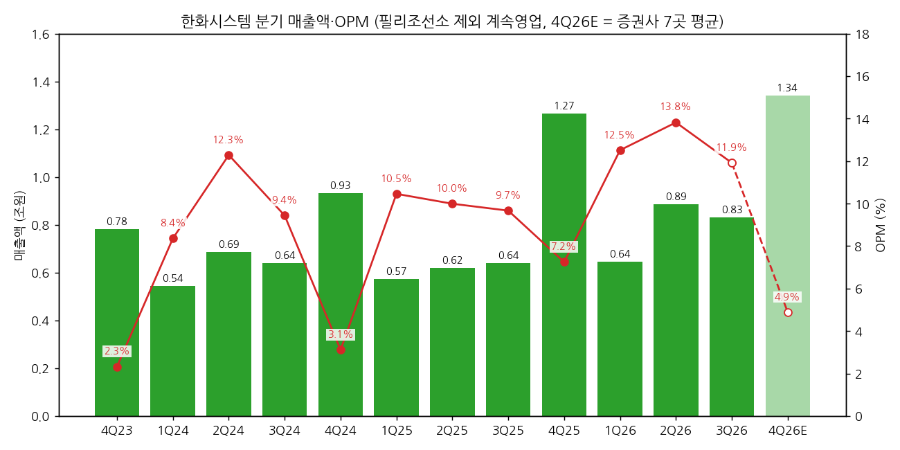
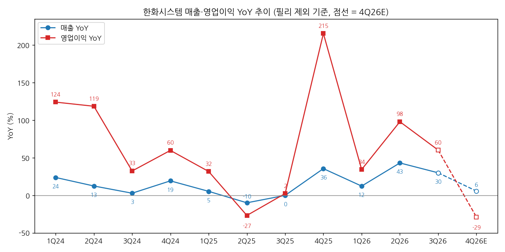
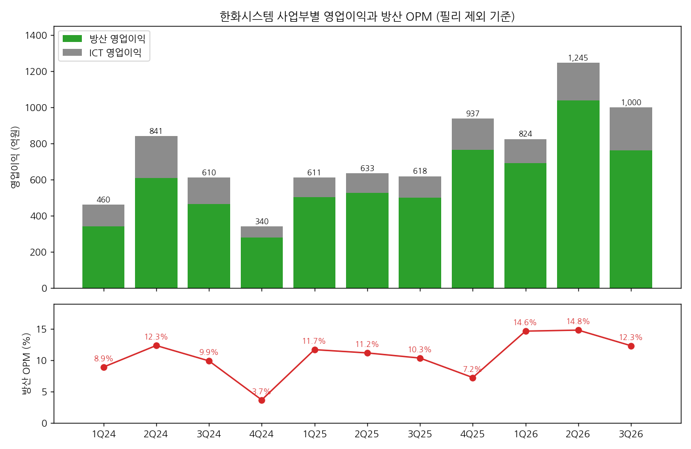

> 모드: 실적 리뷰 (v11)
> 종목: 한화시스템 (272210)
> 섹터: 방산
> 서브섹터: 방산
> 분기: 2026-Q3
> 발표일: 2026-10-27
> 작성 시각: 2026-11-14 16:20 KST
> 분석 소스: 회사 3Q26 실적(잠정) 발표 IR(2026-10-27) + 셀사이드 7곳 — SK(10/28)·대신(10/28)·DS(10/28)·신한(10/28, 컨콜 Q&A 포함)·다올(10/28)·한화(10/28)·유진(11/02) + 한화시스템 기업개요 v1.1(IR 별첨 분기표 32분기, 필리 제외 재작성치). 웹서치 보완 없음

# 한화시스템 3Q26 실적 리뷰

## 0. 한 줄 판정

> 성장 델타: 둔화 | 내러티브: 유지 → 경계 구간 (UAE 통합대공망 본계약 확인 전까지 관망)

→ 숫자: 필리조선소를 뺀 계속영업 기준 매출 8,316억(+30.1% YoY), 영업이익 991억(+60.4%), OPM 11.9%. 영업이익 YoY가 2Q26 +98.1% → 3Q26 +60.4%로 **-37.7%p 둔화**, 여전히 플러스다. 4Q26E는 자체 투자개발비가 몰리며 증권사 7곳 평균 655억(-29% YoY)으로 일시 역성장이 예상된다
→ "컨센 +60% 서프라이즈"의 상당 부분은 **기준 차이**다. FnGuide 컨센(619억)은 필리 적자를 포함한 숫자였다. 필리 제외 기준 증권사 추정(대신 860억·신한 771억) 대비로는 +15~29% 상회. 그래도 본업은 기대보다 좋았다
→ 쟁점의 중심은 **중동 레이다 수출의 2027년 본격화 폭**과 **UAE 통합대공망 본계약**이다. 2027E 영업이익이 한화 3,950억 ~ 대신 6,340억으로 1.6배 차이가 난다. 갈리는 변수는 2027년 수출 비중(다올 30.5% vs 대신 49.6%)
→ 방산 수주잔고는 4Q25 9.30조 정점 이후 3분기 연속 감소해 3Q26 8.40조(-9.7% YTD). 대형 수출 신규 수주가 붙어야 2027년 이후 그림이 숫자로 연결된다
→ 다음 분기 관건: 11월 UAE 대통령 방한 전후 EDGE 본계약 여부, 그리고 4Q 개발비 규모(9M 380억 → 연간 750~1,000억 계획)가 컨센 655억을 얼마나 깎는지

## 1. 숫자

① 연결 분기 표 (억원, 필리조선소 제외 계속영업 기준)

| 항목 | 4Q23 | 1Q24 | 2Q24 | 3Q24 | 4Q24 | 1Q25 | 2Q25 | 3Q25 | 4Q25 | 1Q26 | 2Q26 | **3Q26** | 4Q26E |
|---|---|---|---|---|---|---|---|---|---|---|---|---|---|
| 매출액 | 7,820 | 5,442 | 6,870 | 6,390 | 9,335 | 5,737 | 6,195 | 6,392 | 12,663 | 6,449 | 8,872 | **8,316** | 13,403 |
| 영업이익 | 182 | 455 | 844 | 603 | 291 | 600 | 619 | 618 | 918 | 807 | 1,226 | **991** | 655 |
| OPM | 2.3% | 8.4% | 12.3% | 9.4% | 3.1% | 10.5% | 10.0% | 9.7% | 7.2% | 12.5% | 13.8% | **11.9%** | 4.9% |
| 매출 YoY | -0.8% | 23.9% | 12.5% | 2.9% | 19.4% | 5.4% | -9.8% | 0.0% | 35.7% | 12.4% | 43.2% | **30.1%** | 5.8% |
| 영업이익 YoY | 흑전 | 124.1% | 118.7% | 32.5% | 59.9% | 31.9% | -26.7% | 2.5% | 215.5% | 34.5% | 98.1% | **60.4%** | -28.6% |
| **매출 YoY 델타 (%p)** | -35.9 | +24.7 | -11.3 | -9.6 | +16.4 | -14.0 | -15.2 | +9.9 | +35.6 | -23.2 | +30.8 | **-13.1** | -24.3 |
| **영업이익 YoY 델타 (%p)** | — | — | -5.5 | -86.1 | +27.4 | -28.0 | -58.5 | +29.1 | +213.0 | -181.0 | +63.6 | **-37.7** | -89.0 |

→ **기준**: 1Q24~3Q26 = 회사 3Q26 IR p.9 별첨 분기표(2026-10-27, 필리조선소 중단영업 재작성치, 3Q26은 감사 전 잠정). 4Q22~4Q23 = 4Q24·4Q25 IR 별첨(필리 편입 2024.12.31 이전이라 필리 영향 없음, 중단사업 재분류 반영). **모든 YoY는 같은 필리 제외 기준끼리 비교**했다. 회사가 발표한 YoY(+30%/+60%)도 이 기준(3Q25 매출 6,392억·영업이익 618억)이다
→ 필리 포함 보고치(기존 공시 기준) 3Q25는 매출 8,077억·영업이익 206억이었다. 이 숫자와 비교하면 매출 +3%·영업이익 +381%로 왜곡된다(다올·DS 표의 "YoY +3%/+340%"가 이 기준). 본 리뷰는 쓰지 않는다
→ 4Q26E = SK·대신·DS·신한·다올·한화·유진 7곳 평균(매출 1조 3,403억, 영업이익 655억). 영업이익 범위 240억(한화) ~ 1,050억(대신)으로 매우 넓다
→ 컨센 대비: 영업이익 +60.1%, 매출 -22.3% (FnGuide 컨센 영업이익 619억·매출 1조 697억 — 신한·SK 인용, **필리 포함 기준이라 직접 비교 불가**). 필리 제외 기준 증권사 추정 대비로는 대신(매출 8,300억·영업이익 860억) 대비 매출 부합·영업이익 +15.2%, 신한(방산+ICT 영업이익 771억) 대비 +28.5%
→ YoY 흐름: 2025년 중반 -27%(2Q25)까지 내려갔다가 4Q25 +215%(4Q24 개발비 기저), 2Q26 +98%로 다시 올라왔다. 3Q26 +60%는 그 고점에서 한 단계 내려온 자리다 `[판단]`
→ 컨센 경로: 4Q26E -29% (개발비 집중) → 1Q27E +24%(SK) ~ +34%(DS) → 2027E 연간 +35%(7곳 평균). **4Q26의 역성장은 회사가 연초부터 예고한 비용 이벤트이고, 다음 YoY 정점은 중동 수출 매출이 본격화되는 2027년으로 미뤄진 상태** `[전망]`

→ (출처: 회사 3Q26 IR p.9·4Q25 IR p.11, 4Q26E 증권사 7곳 평균. 필리조선소 제외 계속영업 기준)

→ (출처: 같은 기준. 4Q23 영업이익 YoY는 4Q22 적자(-12억) 기저라 표시 제외)

② 사업부별 매출·영업이익 (억원, 필리 제외 기준)

| 부문 | 항목 | 3Q25 | 4Q25 | 1Q26 | 2Q26 | **3Q26** | QoQ | YoY |
|---|---|---|---|---|---|---|---|---|
| 방산 | 매출 | 4,814 | 10,569 | 4,712 | 7,006 | **6,174** | -11.9% | +28.3% |
| | 영업이익 | 498 | 765 | 690 | 1,037 | **760** | -26.7% | +52.6% |
| | OPM | 10.3% | 7.2% | 14.6% | 14.8% | **12.3%** | -2.5%p | +2.0%p |
| | 매출 비중 | 75.3% | 83.5% | 73.1% | 79.0% | **74.2%** | | |
| ICT | 매출 | 1,556 | 2,084 | 1,723 | 1,873 | **2,126** | +13.5% | +36.6% |
| | 영업이익 | 120 | 172 | 134 | 208 | **240** | +15.4% | +100.0% |
| | OPM | 7.7% | 8.3% | 7.8% | 11.1% | **11.3%** | +0.2%p | +3.6%p |
| 기타 | 매출 | 22 | 10 | 14 | -7 | **16** | | |
| | 영업이익 | 0 | -19 | -17 | -19 | **-9** | | |

→ (출처: 회사 3Q26 IR p.6·7·9. 기타 = 필리 제외 잔여 자회사)
→ 사업부 YoY 추이: 방산 영업이익 YoY 1Q26 +37.2% → 2Q26 +97.5% → 3Q26 +52.6%, ICT 영업이익 YoY +24.1% → +92.6% → +100.0% (IR 분기표로 계산). **3Q의 델타 둔화는 방산에서 나왔고, ICT는 오히려 가속**했다
→ 이익 기여: 3Q26 방산 760억 / ICT 240억. ICT 비중이 24%로 커졌다(3Q25 19%). 9M26 기준 방산 매출 +29.5%·영업이익 +63.0%, ICT 매출 +28.8%·영업이익 +73.2% YoY
→ 방산 QoQ 감익 원인: 조업일수 감소와 환율(다올), 폴란드 K2 사격통제시스템 매출 감소(SK). 매출은 중동 M-SAM 다기능레이다(MFR)와 국내 KF-21 항전장비·TICN 4차·K2 양산이 받쳤다(회사 IR p.6)
→ ICT 개선 원인: 한화생명 차세대 시스템, 한화필리조선소 ERP·생산운영 시스템 구축 등 마진이 좋은 계열사향 시스템 구축 사업 확대(회사 IR p.7, 신한 Q&A)

→ (출처: 회사 3Q26 IR p.9. 막대 = 방산+ICT 합계, 기타 제외)

(2-1) 방산 매출 구성 — 수출 비중은 오히려 낮아졌다 (억원)

| | 1Q26 | 2Q26 | 3Q26 | 4Q26E (다올) |
|---|---|---|---|---|
| 방산 매출 | 4,712 | 7,006 | 6,174 | 8,805 |
| 수출 매출 (다올 추정) | 1,364 | 1,611 | 1,358 | 2,549 |
| 수출 비중 | 28.9% | 23.0% | **22.0%** | 28.9% |
| 방산 OPM | 14.6% | 14.8% | 12.3% | 8.6% |

→ (출처: 방산 매출·OPM 회사 IR / 수출 매출·비중 다올투자증권 10/28 Fig.3 — 회사는 비중만 컨콜에서 언급, 금액 미공개)
→ 3Q26 방산 매출 구성: 수출 22% / 국내 개발 29% / 양산 33% / 유지보수 16% (회사 컨콜, 기업개요 v1.1 인용). 수출 중에서는 이라크가 가장 크고 UAE·사우디 순(신한 Q&A)
→ 수출 비중이 22%로 낮았는데도 방산 OPM 12.3%를 냈다. DS는 수출 OPM을 30%로 추정하고, 대신은 이라크 천궁-II 양산 매출 인식에 따른 믹스 개선으로 수출 마진이 자사 추정보다 높았다고 본다 `[추정]`

(2-2) 수주잔고 — 방산 잔고는 3분기 연속 감소 (억원)

| 분기말 | 1Q25 | 2Q25 | 3Q25 | 4Q25 | 1Q26 | 2Q26 | **3Q26** |
|---|---|---|---|---|---|---|---|
| 합계 | 86,403 | 87,964 | 85,419 | 96,513 | 96,628 | 89,755 | **88,653** |
| 방산 | 84,275 | 84,589 | 81,851 | 93,027 | 92,457 | 85,379 | **83,956** |
| ICT | 2,128 | 3,375 | 3,568 | 3,486 | 4,171 | 4,376 | **4,697** |
| 방산 QoQ | — | +0.4% | -3.2% | +13.7% | -0.6% | -7.7% | **-1.7%** |

→ (출처: 회사 3Q26 IR p.10, 필리 제외. 분기 신규수주 금액은 미공시)
→ 방산 잔고 8.40조는 최근 4분기 방산 매출(2.85조) 대비 약 2.9배다. 4Q25말 3.7배 수준에서 내려왔다 `[판단]`. UAE 통합대공망(Term Sheet 단계)은 아직 잔고에 없다

③ 연간 (억원, 필리 제외 기준)

| 항목 | 2023 | 2024 | 2025 | 2026E | 2027E |
|---|---|---|---|---|---|
| 매출액 | 24,525 | 28,037 | 30,987 | 37,040 | 42,127 |
| 영업이익 | 1,226 | 2,193 | 2,755 | 3,679 | 4,951 |
| OPM | 5.0% | 7.8% | 8.9% | 9.9% | 11.8% |
| 매출 YoY | 12.1% | 14.3% | 10.5% | 19.5% | 13.7% |
| 영업이익 YoY | 213.6% | 78.9% | 25.6% | 33.5% | 34.6% |

→ (출처: 2023 = 4Q25 IR p.11 분기 합산 / 2024·2025 = 3Q26 IR p.9 분기 합산 / 2026E = 9M26 실적(매출 23,637억·영업이익 3,024억) + 7곳 4Q26E 평균 / 2027E = 7곳 평균. 증권사 연간 추정치 일부(대신·DS·다올·한화 2026E)는 1H26 필리 실적을 포함해 직접 평균하지 않고 9M 실적 + 4Q 추정으로 재구성)
→ 2027E 범위: 한화 3,950억(+21%) ~ 대신 6,340억(+56%). 대신은 2028E에 매출 -31%·영업이익 -42%로 꺾이는 그림(중동 양산 일단락)이고, 다올·SK·DS는 2028E도 증익이다
→ 2027E 영업이익: 7곳 발표 전 평균 4,467억 → 발표 후 4,951억(+10.8%). 단 발표 전 추정 다수가 필리 적자를 포함하고 있어 **상향의 대부분은 필리 제외 효과**다. 필리 영향을 이미 빼고 있던 한화(4,790억 → 3,950억, -17.6%)와 유진(5,680억 → 5,440억, -4.2%)은 오히려 내렸다
→ FnGuide 발표 전 컨센(Quantiwise, SK 인용): 2026E 영업이익 4,580억 / 2027E 5,760억 — 필리 포함 + 오래된 추정치가 섞인 숫자라 비교 기준으로는 부적합 `[판단]`

## 2. 시장 쟁점

① 2-0 지난 분기 체크

→ 첫 리뷰 — 직전 체크 없음 (2Q26 리뷰 미작성)

② 이번 분기 쟁점 5개

| # | 쟁점 | 언급 증권사 |
|---|---|---|
| (1) | 서프라이즈의 실체 — 필리 제외 효과 vs 본업 개선 | 7/7 |
| (2) | 4Q 자체 투자개발비 — 4Q 영업이익을 얼마나 깎나 | 7/7 |
| (3) | 중동 MFR 수출 본격화 — 2027년 수출 비중과 방산 마진 | 7/7 |
| (4) | UAE 통합대공망 — 부체계 공급사에서 체계종합으로 | 7/7 |
| (5) | 조선 자산 회수 3.4조 → 위성 20조 투자 — 자본 배분과 밸류에이션 | 5/7 |

③ 쟁점별 분해

(1) **서프라이즈의 실체 — 필리 제외 효과 vs 본업 개선**

(1-1) 회사 설명
→ IR p.5: 매출은 방산 수출·국내 양산과 ICT 계열사향 매출 증가, 영업이익은 매출 증가 효과. 필리조선소 실적은 중단영업으로 제외(2026.9 지분 매각 결정)
→ 컨콜(신한 Q&A): 세전이익에 지분투자회사 평가이익, 헤지 포함 외환손실 약 300억, 이자비용 반영. 순이익 38억은 필리 중단영업손실(세후) 영향이며 손실 규모는 거래 종결 시 확정

(1-2) 증권사별 해석

| 증권사 | 비교 기준 | 논리 |
|---|---|---|
| SK | 시장예상 619억 대비 +60% | 필리 제외 효과에 더해, 환율 비용 약 300억을 감안하면 경상적으로도 컨센 상회 |
| 대신 | 필리 제외 자사 추정 860억 대비 상회, 매출은 부합 | 수출 비중 22%(추정 36.6%)로 낮았는데도 수출 마진이 더 높았음 |
| 신한 | 같은 기준 자사 추정 771억 대비 +29% | 중동 M-SAM 레이다 수출이 이익을 견인 |
| DS | 컨센 618억 상회, 필리 제외 시 매출도 상회 | 원인 4가지: MFR 수출 가속, ICT 캡티브, 필리 제외, 개발비의 4Q 이연 |
| 다올 | 자사 추정 485억(필리 포함) 대비 +104% | 서프라이즈지만 QoQ로는 방산 감익 |

(1-3) 공통 vs 갈림
→ 공통: 헤드라인 +60%는 과장이다. 필리 제외 기준으로 맞추면 +15~29% 상회 수준이고, 그 상회분은 **방산 수출 마진 + ICT**에서 나왔다
→ 갈림: 개발비 이연 효과의 크기. DS는 하반기 개발비가 4Q로 몰린 것을 상회 원인 중 하나로 꼽았다 — 즉 3Q 이익의 일부는 4Q에서 되돌려진다는 해석이다

(1-4) [판단]
→ 본업 개선은 사실이다. ICT 영업이익이 1년 만에 두 배(120억 → 240억)가 된 것은 기준 효과가 아니다. 다만 3Q 방산 OPM 12.3%는 2Q 14.8%보다 낮았고, 개발비 이연까지 감안하면 "방산 이익 서프라이즈"라고 보기는 어렵다. **서프라이즈의 질은 ICT > 방산** `[판단]`

(2) **4Q 자체 투자개발비 — 4Q 영업이익을 얼마나 깎나**

(2-1) 회사 설명
→ 2026년 가이던스 유지: 방산 매출 20%대 성장·영업이익은 자체 투자개발비 증가로 전년 유사, ICT 매출·영업이익 20%대 성장(신한 Q&A)
→ 자체 투자개발비는 2025년(200억대 중반)의 3~4배, 3Q 누적 약 380억 → 4Q 집중. 2027년에도 일정 부분 발생, 계획은 2027년 2월경 소통(신한 Q&A)

(2-2) 증권사별 4Q26E

| 증권사 | 4Q26E 영업이익 | 4Q 방산 OPM | 개발비 가정 |
|---|---|---|---|
| 대신 | 1,050억 | 7.4% | 자체개발비 집중 + 수출 비중 하락 |
| 다올 | 972억 | 8.6% | 개발비 집행 규모가 감익 폭을 결정 |
| SK | 883억 | — | 4Q 자체투자개발비 300~400억 |
| 신한 | 580억 | 4.5% | 개발비 집중 구간 |
| 유진 | 480억 | — | 수익성 둔화 불가피 |
| DS | 381억 | 2.0% | 4Q 자체투자개발비 600억 수준 |
| 한화 | 240억 | — | 개발비 집행 규모에 따라 변동성 |

(2-3) 공통 vs 갈림
→ 공통: 4Q 방산 OPM은 한 자릿수로 내려간다. 4Q가 원래 비용 분기(4Q 방산 OPM 2020~2025년 2.9~7.2%)인 데다 개발비가 겹친다
→ 갈림: 개발비 규모. 회사 가이드(연간 750~1,000억, 9M 380억)를 그대로 받으면 4Q 잔여분은 370~620억이다. SK(300~400억)는 하단, DS(600억)는 상단을 쓴다

(2-4) [판단]
→ 회사가 연간 영업이익을 "전년 유사"라고 했는데 9M26 방산 영업이익이 이미 2,487억으로 2025년 연간(2,291억)을 넘었다. 회사 가이드는 보수적이었다. 4Q 영업이익은 400~900억 사이로 보는 게 합리적이다 `[판단]`. 4Q 숫자가 655억(평균)을 밑돌아도 이미 예고된 비용이라 델타 판정에는 큰 의미가 없고, **2027년 개발비 계획(2월)**이 더 중요하다

(3) **중동 MFR 수출 본격화 — 2027년 수출 비중과 방산 마진**

(3-1) 회사 설명
→ UAE·사우디·이라크 3개국 M-SAM MFR 매출 본격화는 2027년부터. 이라크도 계약 구조상 특이점 없음(신한·다올 Q&A)
→ 국내는 KF-21 항전장비·TICN 4차·K2 4차 양산(IR p.6)

(3-2) 증권사별 2027E

| 증권사 | 2027E 수출 비중 | 2027E 방산 OPM | 2027E 영업이익 | 논리 |
|---|---|---|---|---|
| 대신 | 49.6% | 18.0% | 6,340억 | 4Q26부터 3개국 양산 매출 동시 인식, 27년 수출 비중 2배 |
| 유진 | — | — | 5,440억 | 3개국 모두 매출화 단계 진입 |
| DS | — | 11.4% | 4,950억 | 3개국 MFR 동시 생산 체제, 수출 OPM 30% 추정 |
| SK | — | — | 4,857억 | 필리 제외로 26~28년 추정치 상향 |
| 다올 | 30.5% | 12.7% | 4,662억 | UAE·사우디·이라크 MFR, 폴란드 K2 조준경 등 사업별 매출을 쌓아 추정 — 수출 비중 30%대 초반 유지 |
| 신한 | — | 11.2% | 4,457억 | 중동 레이다 매출 본격화, 개발비는 2027년에도 지속 |
| 한화 | — | — | 3,950억 | 2027E -17.6% 하향, OPM 8.6% 가정 (리포트에 하향 사유 구체 기재 없음) |

(3-3) 공통 vs 갈림
→ 공통: 2027년은 중동 3개국 MFR 양산이 겹치는 해이고, 매출 성장은 확실하다(7곳 평균 매출 +14%)
→ 갈림: **수출 비중이 얼마나 오르느냐**. 대신은 50%로 두 배를, 다올은 30%대 초반을 가정한다. 수출 OPM 30% 가정에서 수출 비중 20%p 차이는 방산 OPM 약 4~5%p 차이로 이어진다 `[추정]`. 대신은 그 대가로 2028E 감익(-42%)을 그리고, 다른 곳은 2028년까지 완만한 증익을 그린다

(3-4) [판단]
→ 3Q26 수출 비중이 오히려 22%로 내려왔다는 점에서 대신의 50%는 공격적이다. 3개국 양산이 동시에 매출로 잡히는 4Q26~1Q27 수출 비중이 30%를 넘는지가 첫 확인점이다. 30% 미만이면 2027E 컨센(4,951억)은 하단(4,500억 안팎)으로 수렴할 가능성이 크다 `[판단]`

(4) **UAE 통합대공망 — 부체계 공급사에서 체계종합으로**

(4-1) 회사 설명
→ 2026.9.15 UAE EDGE 그룹과 '통합대공망' 구축 주요조건합의서(Term Sheet) 체결(IR p.4). 단·중·장거리 다계층 방공망에 천무 등 지상 무기체계까지 연동하는 체계 사업자 역할. 장비 전체 공급과 연동을 포함한 계약으로 협상 중. 통합 체계 수출은 C2·AI 역량이 핵심이고 이번 건이 시작점(신한 Q&A)

(4-2) 증권사별 해석

| 증권사 | 가정 | 논리 |
|---|---|---|
| SK | 4Q26 내 계약 기대 | 11월 UAE 대통령 방한 → 천궁-II·L-SAM·천광 등 방공 패키지 + C2·AI 통합체계. 방산주 중 가장 빠른 중동 수주 모멘텀 |
| 유진 | 11월 방한 전후 본계약 주목 | 주체계 사업자 확보 = 체계종합업체로 전환 |
| DS | 연내 수주 구체화, EDGE와 JV 협의 | 단·중·장거리 요격체계와 천무를 아우르는 체계종합 기회 |
| 신한 | 본계약 시 2028년부터 매출 2,000억 반영 | 그래도 투자의견 중립 — 대형 수출 수주 확인이 먼저 |
| 다올 | 단기 주가는 이 수주에 달림 | 중장기 위성 투자 재원도 해외 체계종합 사업으로 마련 |
| 한화 | 프레임워크·공급계약 협상 진행 중 | 개별 무기체계 공급 → 통합방공망 구축으로 영역 확대 |

(4-3) 공통 vs 갈림
→ 공통: 이 계약이 이번 사이클의 주가 촉매라는 데 이견이 없다
→ 갈림: **실적 반영 시점**. 신한만 2028년 매출을 넣었고, 나머지는 대부분 추정치에 반영하지 않았다. 반영하지 않았다는 건 계약 시 추정치 상향 여지, 계약이 밀리면 주가 촉매 소멸이라는 뜻이다

(4-4) [판단]
→ Term Sheet는 금액·범위가 확정된 계약이 아니다. 11월 방한 일정이 지나도 본계약이 안 나오면 시장은 "연내 수주" 기대를 2027년으로 넘길 것이다. 이 종목에서 **내러티브를 '유지'에서 '강화'로 바꿀 유일한 단기 이벤트**다 `[판단]`

(5) **조선 자산 회수 3.4조 → 위성 20조 투자**

(5-1) 회사 설명
→ 한화오션 1차 PRS(약 1,300만주)는 상당 부분 매도·정산 완료. 3Q말 차입금 2조 1,660억으로 2Q말 대비 1조 948억 감소(IR p.8, 신한 Q&A)
→ 필리조선소 60%를 한화디펜스USA 측에 3,251억에 매각(10/31 양도 예정, 다올 Fig.6). 매각 자금은 위성 중심 우주와 국방 AI가 우선, 구체 계획은 2027년 2월경. 오스탈 USA는 실사 후 가격 협의 단계(신한 Q&A)

(5-2) 증권사별 해석

| 증권사 | TP 방법 | 논리 |
|---|---|---|
| 다올 | 2028E EPS × 30배 → 73,000원(-38%) | 한화오션 지분가치(주당 1.3만원)·필리 가치(2.7만원) 제거. 2040년까지 23조(위성 20조·AI DC 3조) 자본조달 우려 |
| 대신 | SOTP: 2027 방산 EV/EBITDA 19배 + ICT 9배 + 우주 PSR 4.3배(3.3조) → 96,000원(-2%) | PRS 차입금 반영해 소폭 하향, 우주는 별도 가치로 인정 |
| 한화 | 2028E EPS × 41.4배(해외 3사 23배 + 우주 프리미엄 80%) → 100,000원 | PRS 우려 해소, 우주 투자 계획은 2027 사업계획 이후 가시화 |
| SK | 2028E EPS × 35배 → 100,000원 | 필리 제외로 26~28년 추정치 상향 → 매수 기회 |
| DS | 2027F EPS × 39배(글로벌 피어 27F P/E) → 94,000원 | 개발비보다 수출 성장에 주목 |

(5-3) 공통 vs 갈림
→ 공통: 조선 리스크(필리 적자·한화오션 지분 변동성)는 걷혔다
→ 갈림: **위성 투자를 프리미엄으로 볼지 할인으로 볼지**. 한화·대신은 우주 가치를 더하고, 다올은 수익화 확인 전까지 자본조달 리스크로 본다

(5-4) [판단]
→ 회수한 3.4조보다 투자 계획(23조)이 훨씬 크다. 방산 본업 이익(2027E 약 5천억)으로는 감당이 어려운 규모라 증자·차입 우려가 주가 상단을 누를 수 있다. 2월 투자 계획 발표가 밸류에이션의 분기점이다 `[판단]`

④ 낙관 vs 보수

→ 낙관(대신 96,000원·SK 100,000원): 대신은 2027년 수출 비중 49.6%, 방산 OPM 18%를 넣어 2027E 영업이익 6,340억(+56%)에 우주 가치 3.3조를 더했다. SK는 4Q 개발비를 300~400억으로 가장 낮게 잡고 2028E EPS에 35배를 적용했다
→ 보수(신한 중립·다올 73,000원): 신한은 2027E 4,457억(+24%)으로 성장은 인정하지만 "수주 확인이 먼저"라며 TP 없이 중립을 유지했다. 다올은 조선 지분 가치를 모두 걷어내고 위성 투자 자본조달 리스크를 이유로 TP를 38% 내렸다
→ 차이의 본질은 **2027년 수출 비중**과 **우주 투자를 가치로 볼지 리스크로 볼지**다
→ 셀사이드 vs 주가: 7곳 중 6곳이 매수인데 주가는 발표일 10/27 63,100원 → 11/02 60,500원(-4%, 유진 기준가). 52주 최고 162,700원(SK·대신·다올·한화 기재) 대비 약 -61%, 6개월 -50%(대신·다올). 숫자는 좋았지만 바이사이드는 "UAE 본계약과 위성 투자 계획을 보고 산다"는 쪽이다 `[판단]`

⑤ 추정치·TP 변화

| 증권사 | 직전 TP | 현재 TP | 4Q26 영업이익 E | 2026E / 2027E 영업이익 | 핵심 변화 한 줄 |
|---|---|---|---|---|---|
| SK (10/28) | 100,000 | 100,000 | 883억 | 3,908 / 4,857억 | 필리 제외 반영, 2027E +35%(기준 변경 효과 포함) |
| 대신 (10/28) | 약 98,000 (2%↓) | 96,000 | 1,050억 | 3,410 / 6,340억 | 2027E +16.5%, PRS 차입금 반영해 TP 소폭 하향 |
| DS (10/28) | 94,000 | 94,000 | 381억 | 2,752 / 4,950억 | 2027E +3.6%, 4Q 개발비 600억 반영 |
| 신한 (10/28) | — (중립) | — (중립) | 580억 | 3,609 / 4,457억 | 필리 제외로 2026E +71%·2027E +30%, 중립 유지 |
| 다올 (10/28) | 118,000 | 73,000 | 972억 | 3,342 / 4,662억 | 한화오션·필리 가치 제거로 TP -38% |
| 한화 (10/28) | 100,000 | 100,000 | 240억 | 3,264 / 3,950억 | 2027E -17.6%, 우주 프리미엄 80% 유지 |
| 유진 (11/02) | 100,000 | 100,000 | 480억 | 3,500 / 5,440억 | 2026E 2,630 → 3,500억, 2027E 5,680 → 5,440억 |

→ (출처: 각 증권사 리포트. 2026E는 각 사 발표 수치 그대로 — 대신·DS·다올은 1H26 필리 실적 포함 기준, 한화는 필리 제외 분기표 합산치(필리 포함 연간 2,610억). 대신 직전 TP는 "-2.0% 하향" 문구로 역산 `[추정]`)
→ 평균 TP: TP를 제시한 6곳 기준 101,667원 → 93,833원(-7.7%). 하향 2건(다올·대신), 유지 4건, 중립(TP 없음) 1건
→ **TP 하향은 실적이 아니라 멀티플·자산가치 쪽에서 나왔다.** 2027E 영업이익은 7곳 평균 +10.8%(대부분 필리 제외 효과)인데 TP는 내려갔다. 하향의 거의 전부가 다올의 조선 지분·필리 가치 제거(-38%)와 대신의 차입금 반영이다 `[판단]`

## 3. 내러티브 점검

① 성장 스토리 정의
→ "천궁-II·L-SAM 다기능레이다를 만드는 방산전자 회사. 중동 방공 수출이 2027년 본격화되며 방산 마진이 두 자릿수로 올라서고, UAE 통합대공망으로 레이다 공급사에서 방공 체계종합업체로 레벨업한다"

② 이번 분기가 스토리에 준 영향
→ 강화된 것: 필리조선소가 빠지며 본업 수익성(계속영업 OPM 11.9%)이 처음으로 깨끗하게 드러났다. 수출 비중 22%로도 방산 OPM 12%대를 냈고, ICT까지 이익이 두 배가 됐다
→ 약화된 것: 방산 영업이익 YoY가 +98% → +53%로 둔화했고, 방산 수주잔고가 3분기 연속 줄었다. UAE는 아직 Term Sheet이고, 위성 20조 투자 계획이 새로운 자본조달 불확실성을 더했다
→ 훼손은 아니다: 중동 3개국 MFR 양산은 계약된 물량이고 2027년 매출 성장은 7곳 모두 동의한다

③ 국면 판단
→ 델타 둔화(영업이익 YoY +98% → +60%, 4Q26E -29% 예고) + 내러티브 유지(본업 확인 vs UAE 미확정·투자 부담) → **경계 구간**
→ 4Q26의 일시 역성장은 개발비 이벤트라 "꺾임"으로 보지 않는다. 다만 1Q27 YoY가 +20%대로 다시 올라오지 않으면 꺾임으로 판정을 바꾼다 `[판단]`
→ 주가는 52주 고점 대비 -61%로 이미 많이 빠졌다. BT 프레임에서 가격 하락은 매매 근거가 아니고, **UAE 본계약이 내러티브를 '강화'로 올리는 순간**이 국면 전환점이다 `[판단]`

④ 트리거와 리스크
→ 트리거: ① UAE 통합대공망 본계약(11월 UAE 대통령 방한 전후) ② 1Q27 수출 비중 30% 돌파와 방산 OPM 15% 회복 ③ 다부처 초소형 SAR 위성 사업 수주(1.4조, 다올)
→ 리스크: ① UAE 본계약 지연 → 수주 공백 장기화(방산 잔고 감소 지속) ② 2027년 개발비가 2026년 수준으로 이어져 이익 레버리지 희석 ③ 위성 투자 재원 조달 과정의 증자·차입 우려

## 4. 향후 봐야 할 것

① **UAE 통합대공망 본계약** (내러티브 판정을 바꿀 1순위)
→ 무엇을: EDGE 그룹과의 프레임워크·공급계약 체결 여부, 계약 금액과 한화시스템 몫(체계종합·MFR·C2), EDGE JV 설립
→ 어떤 데이터로: 회사 단일판매·공급계약 공시, UAE 대통령 방한 결과 보도, 뉴스 키워드 "EDGE 통합대공망", "천궁-II UAE 추가"
→ 언제: 2026.11 UAE 대통령 방한 전후 → 연내

② **1Q27 수출 비중과 방산 OPM** (델타 판정을 바꿀 1순위)
→ 무엇을: 중동 3개국 MFR 동시 양산 매출로 수출 비중 30% 이상, 방산 OPM 15% 안팎 회복 여부. 1Q27 영업이익 YoY +20% 이상(컨센 경로) 유지
→ 어떤 데이터로: 4Q26·1Q27 IR·컨콜 수출 비중 발언, 관세청 레이다 수출 통계
→ 언제: 2027.2 초(4Q26 실적) / 2027.4 하순(1Q27 실적)

③ **4Q26 개발비 규모와 2027 개발비 계획**
→ 무엇을: 4Q 자체 투자개발비 370~620억 범위 안인지, 4Q 영업이익이 컨센 655억(범위 240~1,050억) 대비 어디에 오는지, 2027 개발비 계획
→ 어떤 데이터로: 4Q26 잠정실적, 2월 컨콜
→ 언제: 2027.2 초

④ **방산 수주잔고 반등**
→ 무엇을: 방산 잔고 8.40조의 4분기 연속 감소 여부, 사우디·이라크 추가 MFR·SAR 위성(1.4조) 등 신규 수주
→ 어떤 데이터로: 4Q26 IR 수주잔고, 회사 수주 공시
→ 언제: 2027.2 초

⑤ **위성·국방 AI 투자 계획과 재원**
→ 무엇을: 위성 20조·AI DC 3조 투자의 연도별 집행 규모, 재원(현금 3.4조 회수분·차입·증자), 필리 매각 종결과 중단영업손실 확정치, 오스탈 USA 지분 거래
→ 어떤 데이터로: 2027.2 사업계획 발표, 필리 매각 종결 공시, 3Q26 분기보고서(중단영업 손익 상세)
→ 언제: 2026.11 중순(분기보고서) / 2027.2
