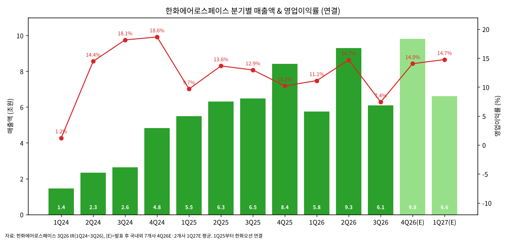
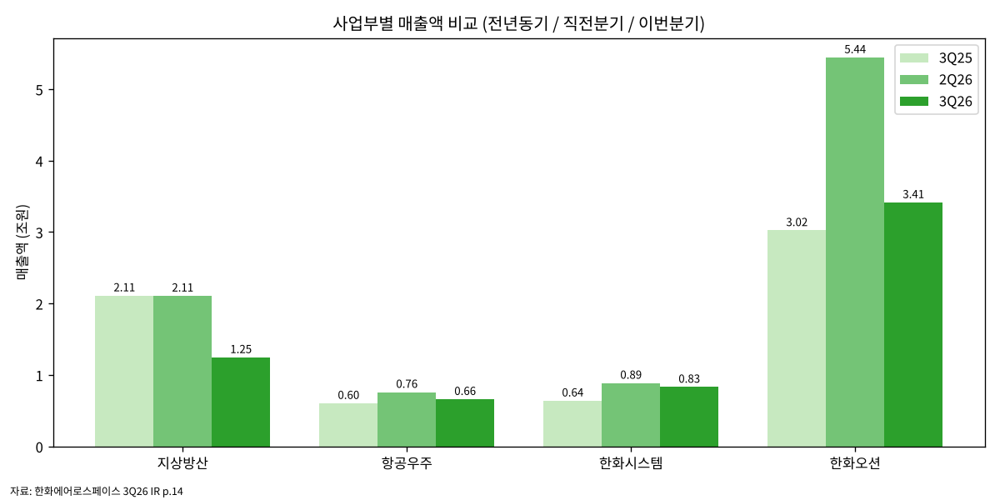
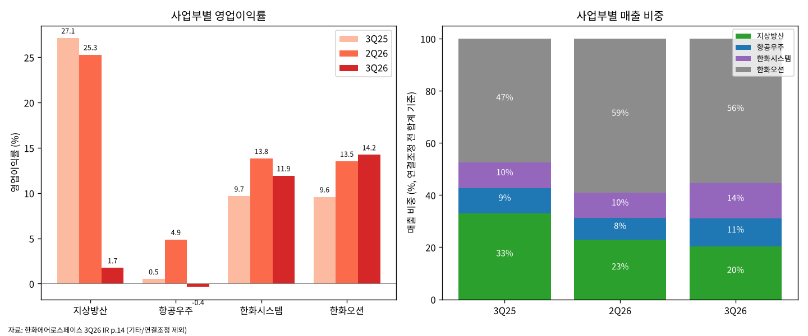
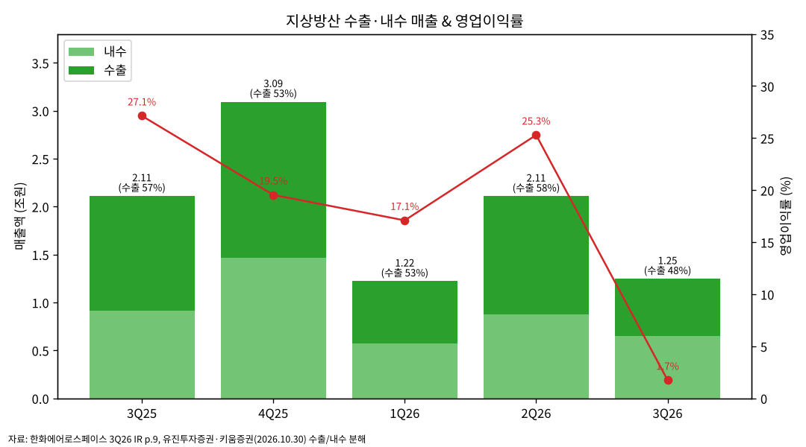
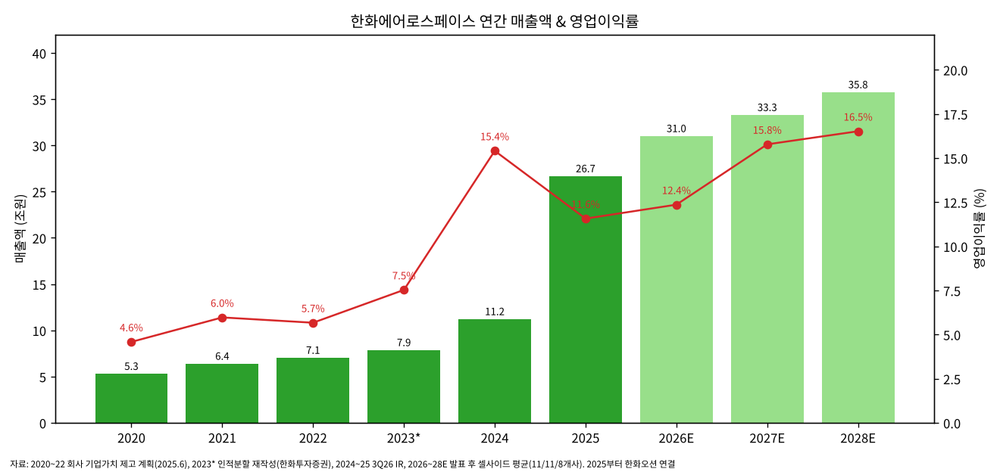

# 한화에어로스페이스 3Q26 실적 리뷰

> 모드: 실적 리뷰
> 종목: 한화에어로스페이스 (012450)
> 섹터: 방산
> 분기: 2026-Q3
> 발표일: 2026-10-29
> 작성 시각: 2026-10-30 21:30 KST
> 분석 소스: 회사 3Q26 IR Presentation(국문) + 국내 10개사 리뷰(DB·유진·SK·한화·키움·유안타·신한·대신·삼성·미래에셋, 10/30) + 해외 3개사(Goldman Sachs·Morgan Stanley·J.P. Morgan, 10/29~30) + JPM Specialist Sales First Glance + 글로벌 피어 공시(LMT·RTX)
> 프리뷰 자료 없음 — 본 분기 단독 분석으로 진행 (항목 4-1·7-1 생략)

---

## Executive Summary

→ **어닝 쇼크 — 영업이익 4,520억원, 컨센 1조 1,614억원 대비 -61.1%**: 매출 6조 943억원(YoY -6.0%, QoQ -34.4%), OPM 7.4%. 세전 -1,896억원·순이익 -367억원으로 적자전환 (회사 IR, FnGuide 컨센은 유진·신한 인용)

→ **쇼크의 진앙은 지상방산 단 한 곳 — 매출 -41% YoY, 영업이익 217억원(OPM 1.7%)**: 한화오션(4,857억원, OPM 14.2%)·한화시스템(991억원, OPM 11.9%)은 오히려 YoY +68%·+60%. 오션·시스템을 뺀 "본체" 영업이익은 약 -1,330억원 적자 (GS 계산)

→ **원인은 4중 악재의 동시 발생**: ① 고마진 폴란드 K9·천무 인도가 4Q로 몰림(수출 매출 5,936억원, -50% YoY) ② 국내는 저마진 유무인 초도 물량 집중 + 대전 사업장 사고로 손익분기~적자 ③ 매출 급감에 따른 고정비 부담 ④ 일회성 약 460억원(대전 복구 300억원 + 충당금 160억원) + 원화 강세

→ **회사 메시지는 "시차", 가이던스는 오히려 상향**: 2026 폴란드 천무 인도 40대+ → **60대+** 상향, K9 30문+ 유지(4Q 집중), 27~29년 지상방산 매출 연 +15% 가이던스 유지. 대전 사업장 정상화 목표 2027년 상반기

→ **셀사이드 13개사 전원 매수 유지, 그러나 TP는 8개사 하향**: 13개사 평균 TP **1,305,385원**(직전 TP 확인된 11개사 평균 1,507,273원 → 1,304,545원, -13.4%). 2026E 영업이익 평균 **3.84조원**(발표 전 컨센 4.62조원 대비 -17%), 2027E **5.26조원**(발표 전 5.70조원 대비 -8%)

→ **글로벌 피어와의 대비가 핵심 시사점**: LMT·RTX는 3Q 수주잔고 사상 최대·가이던스 상향인 반면, 한화 지상방산 잔고는 35.0조원으로 2025년 말 37.2조원 대비 감소. **수요가 아니라 실행(인도 타이밍)과 신규 수주 공백이 문제인 분기**

→ **4Q26이 시험대**: 발표 후 셀사이드 4Q26E 영업이익 평균 1.38조원(범위 1.04~1.78조원). 독자 베이스는 1.2조원 [전망] — 폴란드 인도량·수출 마진 정상화·한화시스템 4Q 개발비 집중이 변수

---

## ① 실적 추이 (업데이트)

### (1) 분기 실적 — 1Q24~3Q26 확정 + 4Q26E·1Q27E 셀사이드

| 항목 (억원) | 1Q24 | 2Q24 | 3Q24 | 4Q24 | 1Q25 | 2Q25 | 3Q25 | 4Q25 | 1Q26 | 2Q26 | **3Q26** | 4Q26E | 1Q27E |
|---|---|---|---|---|---|---|---|---|---|---|---|---|---|
| 매출액 | 14,491 | 23,347 | 26,312 | 48,250 | 54,842 | 63,110 | 64,865 | 84,212 | 57,510 | 92,929 | **60,943** | 98,010 | 66,090 |
| YoY | - | - | - | - | +278% | +170% | +147% | +75% | +5% | +47% | **-6%** | +16% | +15% |
| QoQ | - | +61% | +13% | +83% | +14% | +15% | +3% | +30% | -32% | +62% | **-34%** | +61% | -33% |
| 영업이익 | 177 | 3,372 | 4,772 | 8,997 | 5,299 | 8,614 | 8,396 | 8,583 | 6,389 | 13,655 | **4,520** | 13,760 | 9,740 |
| OPM | 1.2% | 14.4% | 18.1% | 18.6% | 9.7% | 13.6% | 12.9% | 10.2% | 11.1% | 14.7% | **7.4%** | 14.0% | 14.7% |
| 당기순이익 | 26 | 1,599 | 3,304 | 20,469 | 1,829 | 2,862 | 6,990 | 10,339 | 5,263 | 10,805 | **-367** | - | - |
| 지상방산 매출 | 6,553 | 13,296 | 16,560 | 33,654 | 11,575 | 17,732 | 21,098 | 30,926 | 12,211 | 21,075 | **12,455** | - | - |
| 지상방산 YoY | - | - | - | - | +77% | +33% | +27% | -8% | +5% | +19% | **-41%** | - | - |
| 항공우주 매출 | 4,297 | 5,427 | 4,779 | 5,945 | 5,309 | 6,489 | 6,040 | 7,368 | 6,612 | 7,600 | **6,599** | - | - |
| 한화시스템 매출 | 5,442 | 6,870 | 6,390 | 9,335 | 5,737 | 6,195 | 6,392 | 12,663 | 6,449 | 8,872 | **8,316** | - | - |
| 한화오션 매출 | - | - | - | - | 31,432 | 32,941 | 30,234 | 33,230 | 32,099 | 54,432 | **34,139** | - | - |

→ (출처: 한화에어로스페이스 3Q26 IR p.14, 단위 억원. 4Q26E = 발표 후 DB·유진·SK·한화·키움·유안타·JPM 7개사 평균, 1Q27E = SK·한화 2개사 평균, 2026-10-30)
→ 인적분할(2024.9.1) 반영 재작성 기준. 1Q25부터 한화오션 연결 편입으로 YoY 비교 왜곡 — 2025년 YoY 세 자릿수는 연결 범위 효과
→ 환율: 분기 평균 원/달러는 확인 불가. 회사는 "원화 강세가 3Q 영업이익을 약 10% 낮췄다"고 설명 (신한·SK 컨콜 정리). DB·미래에셋은 환영향을 약 -70억원으로 별도 추정 — 기준 차이 존재

→ (출처: 회사 IR 1Q24~3Q26, 4Q26E·1Q27E 발표 후 셀사이드 평균)

(1-1) 3Q26은 연결 편입 후 최저 OPM
→ 7.4%는 한화오션 연결(1Q25) 이후 최저. 직전 저점 1Q25 9.7%·4Q25 10.2%
→ 분기 OPM이 14.7% → 7.4% → (E)14.0%로 출렁이는 패턴이 2025년부터 반복됨. 삼성증권은 "수출 비중이 커질수록 인도 기준 매출 인식 때문에 분기 변동성은 오히려 확대된다"고 진단

(1-2) 발표 후 다음 분기 컨센 변화
→ 4Q26E 영업이익: 발표 전 Quantiwise 컨센 1조 4,520억원 → 발표 후 7개사 평균 1조 3,760억원 (-5%). 범위 1조 430억원(유진) ~ 1조 7,815억원(유안타)
→ 1Q27E 영업이익: 발표 전 1조 1,560억원 → SK 9,260억원·한화 1조 220억원 (-12~-20%)
→ 4Q 하향 폭이 작은 이유: 3Q 미인식 물량이 4Q로 넘어온다는 회사 설명을 셀사이드 대부분이 수용. 반면 1Q27E는 "이연 물량 소진 후 공백" 우려로 더 크게 하향

### (2) 사업부별 실적 — IR 원본

| 사업부 (억원) | 3Q25 | 2Q26 | **3Q26** | YoY | QoQ | 매출 비중 | 영업이익 | OPM | OPM QoQ |
|---|---|---|---|---|---|---|---|---|---|
| 지상방산 | 21,098 | 21,075 | **12,455** | -41% | -41% | 20% | 217 | 1.7% | -23.6%p |
| 항공우주 | 6,040 | 7,600 | **6,599** | +9% | -13% | 11% | -24 | -0.4% | -5.3%p |
| 한화시스템 | 6,392 | 8,872 | **8,316** | +30% | -6% | 14% | 991 | 11.9% | -1.9%p |
| 한화오션 | 30,234 | 54,432 | **34,139** | +13% | -37% | 56% | 4,857 | 14.2% | +0.7%p |
| 기타·연결조정 | 1,100 | 950 | **-565** | - | - | - | -1,521 | - | - |
| **합계** | 64,865 | 92,929 | **60,943** | -6% | -34% | 100% | **4,520** | **7.4%** | -7.3%p |

→ (출처: 회사 3Q26 IR p.6~7·14. 매출 비중은 기타 제외 4개 사업부 합계 기준)
→ 기타 -1,521억원 내역: 필리조선소 매출 1,318억원·영업손실 936억원 + 쎄트렉아이·HOESS·PPA 상각·연결조정 (신한 컨콜 Q&A, 키움)

→ (출처: 회사 3Q26 IR p.14)

→ (출처: 회사 3Q26 IR p.14)

(2-1) 지상방산 — 수출·내수 동반 급감
→ 수출 매출 5,936억원(YoY -50%, QoQ -52%), 내수 6,519억원(YoY -29%, QoQ -26%). 수출 비중 48% (2Q26 58%, 3Q25 57%)
→ 3Q 수출은 이집트 K9·호주(레드백·K9 현지 생산)가 중심, 폴란드는 소량 (회사 컨콜, 신한·키움)
→ 수주잔고 35.0조원 (2025년 말 37.2조원, 2024년 말 32.4조원), 수출 비중 74%. 스페인 K9 계약(8월)은 잔고 미반영 (회사 IR p.10)

→ (출처: 회사 IR p.9 차트 수치, 1Q26·2Q26 분해는 유진투자증권 실적 테이블과 일치 확인)

(2-2) 항공우주 — 매출은 성장, 이익은 GTF RSP가 잠식
→ 매출 6,599억원(+9% YoY): 군수 물량 증가
→ RSP(국제공동개발) 손실 227억원 — GTF 엔진 인도 증가에 비례해 손실 확대 구조. RSP 제외 영업이익 203억원 (회사 IR p.11)
→ 회사 2026 전망: GTF 인도 대수 증가로 연간 RSP 손실 확대 예상 — 매출 성장이 이익으로 안 이어지는 구조가 지속

(2-3) 한화시스템 — 방산 수출이 견인
→ 매출 8,316억원(+30%), 영업이익 991억원(+60%), 연합인포맥스 컨센 658억원 대비 +50.8% 상회 (10/27 별도 발표)
→ 중동 천궁-II 다기능레이다 수출 + KF-21 레이다 양산. 필리조선소는 중단영업 분류(지분 매각, 10월 말 종결 예정)
→ 단, 회사는 자체 투자개발비가 4Q에 집중될 것이라고 언급 — 4Q 시스템 이익 하향 요인

(2-4) 한화오션 — 고선가 인식 지속
→ 매출 3조 4,139억원(+13%), 영업이익 4,857억원(OPM 14.2%). 고선가 상선 매출 인식 + FPSO 변경계약(C/O) 효과 (회사 IR p.13)
→ 영업외에서 오션의 외화환산손실이 세전이익 적자전환(-1,896억원)의 주원인 (회사 컨콜, 신한)

### (3) 연간 실적 — 2020~2025 확정 + 2026~2028E 셀사이드

| 항목 | 2020 | 2021 | 2022 | 2023* | 2024 | 2025 | 2026E | 2027E | 2028E |
|---|---|---|---|---|---|---|---|---|---|
| 매출액 (조원) | 5.32 | 6.42 | 7.06 | 7.89 | 11.24 | 26.70 | 31.04 | 33.32 | 35.78 |
| YoY | - | +21% | +10% | - | +42% | +138% | +16% | +7% | +7% |
| 영업이익 (억원) | 2,439 | 3,830 | 4,003 | 5,940 | 17,319 | 30,893 | 38,360 | 52,570 | 59,110 |
| OPM | 4.6% | 6.0% | 5.7% | 7.5% | 15.4% | 11.6% | 12.4% | 15.8% | 16.5% |
| 지상방산 매출 (조원) | - | - | - | 4.13 | 7.01 | 8.13 | 8.2~9.5 | 10.2~13.2 | - |
| 발표 전 컨센 OP (억원) | - | - | - | - | - | - | 46,210 | 57,020 | - |

→ (출처: 2020~2022 회사 「기업가치 제고 계획」(2025.6) 연결 기준, 2023* 인적분할 재작성(한화투자증권 재무제표), 2024~2025 회사 3Q26 IR, 2026E·2027E 발표 후 11개사 평균, 2028E 매출 9개사·OP 8개사 평균. 발표 전 컨센은 Quantiwise(SK증권 인용))
→ 기준 단절 2회 주의: 2023년 인적분할(한화비전·정밀기계 분리) 재작성, 2025년 한화오션 연결 편입

→ (출처: 위 표와 동일)

(3-1) 발표 후 연간 컨센 변화 — 2026E가 가장 크게 깎임
→ 2026E 영업이익: 발표 전 4.62조원 → 발표 후 3.84조원(-17%). 11개사 범위 3.39조(신한) ~ 4.20조원(유안타)
→ 2027E 영업이익: 5.70조원 → 5.26조원(-8%). 범위 4.77조(신한) ~ 6.13조원(대신)
→ 하향 11개사 중 상향은 **대신 1곳**(27E 6.13조원, 폴란드 인도 증가로 수출 비중 58% → 77%, 지상방산 OPM 19.8% → 28.0% 가정)

(3-2) 사이클 관점 코멘트
→ 2024년 OPM 15.4%는 지상방산 수출(폴란드 1차)이 본격화한 해. 2025년 OPM 하락(11.6%)은 오션 연결 희석 효과
→ 셀사이드 2027E OPM 15.8%는 "폴란드 2차 + 루마니아 + 호주 레드백 양산 동시 진입"을 전제로 함. 3Q26 쇼크는 이 전제의 **타이밍** 리스크를 노출 (GS: 약 6개월 지연 시사)

---

## ② 실적 vs 컨센서스 (가이던스 부재 → 3축 비교)

### (1) 잠정실적 vs 컨센서스 vs 직전분기·전년동기

| 항목 | FnGuide 컨센 | 3Q26 실적 | 서프라이즈 | 2Q26 | QoQ | 3Q25 | YoY |
|---|---|---|---|---|---|---|---|
| 매출액 (억원) | 74,871 | **60,943** | **-18.6%** | 92,929 | -34.4% | 64,865 | -6.0% |
| 영업이익 (억원) | 11,614 | **4,520** | **-61.1%** | 13,655 | -66.9% | 8,396 | -46.2% |
| OPM | 15.5% | **7.4%** | -8.1%p | 14.7% | -7.3%p | 12.9% | -5.5%p |
| 세전이익 (억원) | 10,550 | **-1,896** | 적전 | 12,467 | 적전 | 7,952 | 적전 |
| 지배순이익 (억원) | 5,440 | **-1,371** | 적전 | 6,360 | 적전 | - | 적전 |

→ (출처: 회사 IR p.7, 컨센은 신한·유안타 인용 FnGuide/Quantiwise. 지배순이익은 신한·삼성 기재)
→ 컨센 커버리지: 삼성증권 기준 20개사 (소수 의견 좌우 리스크 낮음)
→ 컨센 기준 차이: 유진·SK 1조 1,614~1,615억원, 키움 1조 1,521억원, 한화 1조 1,670억원, Bloomberg 1조 720억원(GS 인용), 대신 1.1조원
→ 3Q25 영업이익 기준 차이: IR 재작성 8,396억원(-46%) vs 일부 증권사 8,900억원(-49%) — 본 리뷰는 IR 기준 사용

(1-1) 사업부별 미스 — 지상방산이 미스의 거의 전부
→ JPM 기준: 지상방산 영업이익 220억원 vs JPMe 4,750억원(-95%), 컨센 대비 -96%
→ 한화시스템은 오히려 JPMe 대비 +23%, 오션은 GSe 대비 -16%
→ GS 분해: 오션·시스템을 뺀 본체(지상방산+항공우주+기타) 매출 1.85조원·영업이익 **-1,330억원**(OPM -7%). GSe 본체 영업이익은 5,650억원이었음

### (2) 확정 상세 — 손익 하단·재무구조

| 항목 | 3Q26 | 비고 |
|---|---|---|
| 세전이익 | -1,896억원 | 오션 외화환산손실 (회사 컨콜) |
| 당기순이익 | -367억원 | 지배 -1,371억원 |
| 순차입금 | 9조 8,527억원 | 2025년 말 4조 4,931억원 대비 +5.36조원(+119%) |
| 순차입금비율 | 51% | 2025년 말 27% |
| 총차입금비율 | 86% | 2025년 말 74% |
| 현금성자산 | 6조 6,999억원 | 2025년 말 7조 9,018억원 (-15%) |

→ (출처: 회사 IR p.8·16)
→ 순차입금 급증 배경: 2028년까지 11조원 이상 투자·R&D 계획(해외 6.27조원, 신규시장 R&D 1.56조원, 지상방산 인프라 2.29조원, 항공우주 0.95조원 — IR p.27) + 운전자본 증가. 회사는 투자 규모를 연간 실적 발표 때 업데이트하겠다고 언급

### (3) 지상방산 영업이익 해부 — 일회성 vs 구조

| 구분 | 금액·추정 | 출처 |
|---|---|---|
| 보고 영업이익 | 217억원 (OPM 1.7%) | 회사 IR |
| 일회성 비용 | 약 460억원 (대전 복구·정상화 300억원 + 국내외 충당금 160억원) | 회사 컨콜 (전 증권사 공통) |
| 환율 영향 | "영업이익의 약 10%" (회사) / 약 70억원 (DB·미래에셋 추정) | 신한·SK / DB·미래 |
| 일회성 제외 영업이익 | 약 680~800억원 (OPM 5.5~6.4%) | JPM 680억원, 유진 717억원, GS 약 800억원 |
| 정상 레벨 대비 | 2025년 연간 지상방산 OPM 24.6% | 유안타 |

→ **일회성을 다 빼도 OPM 6% 안팎** — 쇼크의 본질은 일회성이 아니라 물량 공백·믹스

(3-1) 수출·내수 마진 추정 — 증권사별 편차가 큼

| 증권사 | 수출 OPM 추정 | 내수 OPM 추정 | 논리 |
|---|---|---|---|
| 유진 | 17.6% | -12.7% (일회성 포함) | 일회성 전액 국내 귀속 가정 |
| 키움 | 10% 중반 | - | 이집트·호주 K9 저마진 |
| 유안타 | 약 11% | 손익분기 수준 | 낮은 수출 비중 + 부진한 믹스 |
| JPM | 10%대 (vs JPMe 36%) | 적자 | 호주 R&D 매출(마진 희석) 비중 확대 |
| JPM Sales | 약 15% | -10% 가정 | 2Q26 수출 마진 30% 대비 |

→ (출처: 각 사 리포트 2026-10-29~30)
→ 공통 결론: **폴란드가 빠진 수출의 마진은 10%대** — 폴란드 직수출(30%대)과 비폴란드(현지 생산·초기 단계 사업) 간 마진 격차가 회사 설명보다 크다는 점이 이번 분기에 처음으로 수치로 드러남

(3-2) 왜 1Q26(OPM 17%)보다도 나빴나 — GS의 3가지 설명
→ ① 4Q·내년 초(루마니아 K9) 인도분의 생산원가가 3Q에 먼저 반영됨
→ ② 통상 직전 분기 생산분이 이번 분기 매출로 잡히며 완충 역할을 하는데, 2Q에 그 완충을 이미 소진
→ ③ 수출 믹스 중 현지 생산 초기 사업(이집트 K9·호주 레드백) 비중이 직수출 대비 높음
→ 1Q26 수출 매출 6,514억원 vs 3Q26 5,936억원 — 수출 매출 차이는 10%에 불과한데 OPM은 17% vs 2%. **매출보다 원가 인식 타이밍이 더 큰 변수**였음을 시사

### (4) 글로벌 피어 비교

| 피어 | 발표일 | 매출 YoY | 마진 | 수주잔고 | 시사점 |
|---|---|---|---|---|---|
| Lockheed Martin | 10/22 | +11% ($20.7B) | MFC(미사일) OPM 14.0% | **$292B 사상 최대** (+27% QoQ, PAC-3 MSE $52.5B 포함) | 가이던스 2분기 연속 상향 — 미사일·탄약 증산 |
| RTX | 10/20 | +11% ($25.0B) | Raytheon OPM 14.1% (OP +32%) | **$340B 사상 최대** (방산 $164B) | Tomahawk·AMRAAM 다년 계약, 가이던스 상향 |
| Rheinmetall | 8/6 (H1) | Q2 +69% (€3.29B) | Q2 OI €562M, 컨센 +20% | €80B+ 첫 돌파 | 9M 실적은 11월 예정 |
| **한화에어로 지상방산** | 10/29 | **-41%** | **1.7%** | **35.0조원 (연초 대비 감소)** | 인도 타이밍 + 신규 수주 공백 |

→ (출처: LMT 8-K Ex.99.1 2026-10-22, RTX 8-K Ex.99 2026-10-20, Rheinmetall 실적 캘린더 기록 2026-08-06, 한화 IR)
→ 실적 캘린더 정정 필요: LMT 3Q 발표는 10/22(캘린더 10/20), RTX는 10/20(캘린더 10/27)

(4-1) 시사점 — 수요 문제가 아닌 실행·수주 문제
→ 미국 피어는 동일 분기에 수주잔고 기록 경신 + 탄약·방공 증산으로 매출 두 자릿수 성장. 글로벌 방산 수요 사이클은 **가속 구간**
→ 반면 한화는 2026년 신규 수주가 크로아티아 천무 0.6조원·핀란드 K9 0.9조원·노르웨이 천무 1.3조원 등 중소형 위주. 잔고 감소는 "매출 소진 > 신규 수주"의 결과
→ MS 지적: 한국 방산 4사 중 2026년 의미 있는 수주를 확보한 곳은 한화가 유일 — 그럼에도 대형(중동·폴란드 3차) 수주 공백이 투자심리 회복의 선결 조건
→ 구조적 차이: 미국 피어는 자국 국방예산 다년 계약 중심(매출 인식 평탄), 한화는 수출 인도 기준 인식이라 분기 변동성이 구조적으로 큼

### (5) Beat/Miss 이력 (영업이익 기준)

| 분기 | 발표일 | 컨센 | 실적 | 차이 | 결과 | 비고 |
|---|---|---|---|---|---|---|
| 3Q26 | 2026-10-29 | 11,614억원 | 4,520억원 | **-61.1%** | **Miss** | 발표일 종가 760,000원(52주 최저 종가권), 1M -24.9% |
| 2Q26 | 2026-07-31 | 확인 불가 | 13,655억원 | EPS +15.4%, 매출 +29.4% | Beat | 분기 OP 첫 1조 돌파 (Investing.com 서프라이즈) |
| 1Q26 | 2026-04-30 | 확인 불가 | 6,389억원 | EPS -40.2%, 매출 -8.5% | Miss | 폴란드 인도 부재 분기 |
| 4Q25 | 2026-02 | 1조원+ 예상 | 8,583억원 | 대폭 하회 | Miss | 회사 "4Q 쏠림 약화" 설명 (한국경제) |
| 3Q25 | 2025-11-03 | 8,742억원 | 8,564억원(당시) | -2.0% | 부합 | 오션 연결·항공 흑전 |
| 3Q24 | 2024-10-31 | 3,160억원 | 4,772억원 | +51% | Beat | 폴란드 K9 24문·천무 19대 인도 |

→ (출처: 3Q26 컨센 FnGuide(유진·신한), 2Q26·1Q26 Investing.com EPS/매출 서프라이즈, 4Q25 한국경제 2026-02-09, 3Q25 스마트투데이 컨센·디지털데일리 실적, 3Q24 증권사 리뷰(alphasquare 아카이브)). 나머지 분기 컨센·3거래일 주가 반응은 확인 불가
→ 패턴: **최근 4개 분기 중 3개 Miss**. 공통 원인은 매번 "폴란드 인도 타이밍" — 2025년 하반기부터 분기 실적 예측력이 구조적으로 떨어진 상태. 셀사이드가 분기 추정에 폴란드 인도를 균등 배분하는 관행이 미스를 반복 생산

---

## ③ 경영진 코멘터리 (컨퍼런스콜 Q&A 기반)

> 한글 IR 자료에는 Q&A 원문이 없어, 신한투자증권의 컨콜 Q&A 정리와 각 사 리포트의 회사 발언 인용을 바탕으로 재구성. 회사 발언 요지 / 시사점 2단 구성

### (1) 수요·인도 — 3Q 쇼크의 회사 해명

(1-1) **일회성과 믹스 — "고수익 수출이 4Q로 몰렸다"**

→ 대전 사업장 사고 복구·정상화 비용 약 300억원 + 국내외 사업 충당금 약 160억원 반영. 고수익 수출 물량이 4분기로 집중되면서 국내 매출 비중이 **52%**로 높아졌고, 3분기 수출도 마진이 낮은 믹스였음. 환율이 영업이익을 약 10% 낮춤

→ 시사점: 회사도 **수출 믹스 자체가 저마진**이었다고 인정 → 일회성 460억원보다 믹스 효과가 더 큼 → 4Q 반등 폭은 "폴란드 비중"이 결정

(1-2) **국내 수익성 — "손익분기~적자"**

→ 3분기 국내 매출 수익성은 손익분기점에서 적자 수준. 4분기는 고수익 수출 납품 집중 + 일회성 소멸로 3분기 대비 이익 개선. **하반기 지상방산 매출은 상반기보다 많을 전망**

→ 시사점: 상반기 지상방산 매출 3.33조원 → 하반기 > 3.33조원이면 **4Q 지상방산 매출 2.08조원 이상**이 회사 기준 하한선 → 셀사이드 4Q 지상방산 추정(3.3~4.9조원)은 이를 크게 상회 → 회사 하한과 셀사이드 기대 간 갭이 큼

(1-3) **폴란드 인도 가이던스 상향**

→ 납품 속도가 예상보다 빨라 천무 연간 인도를 **40대 이상 → 60대 이상**으로 상향. K9은 **30문 이상**(4Q 집중). 3분기 수출은 호주·이집트 위주였고 폴란드는 소량. **내년 K9·천무 인도 모두 증가**, 루마니아 K9은 내년 납품

→ 시사점: 천무 상향은 긍정적이나 유안타 지적대로 천무 EC1은 미사일 비중이 높아 생산 지연·12월 출하분의 매출 이월 리스크 → 루마니아 K9 매출은 2027년으로 확정(JPM은 4Q 반영분 삭제) → 4Q 컨센 중 루마니아를 넣은 추정은 하향 대상

### (2) 대전 사업장·중장기 가이던스

(2-1) **대전 사업장 영향**

→ 대전은 주로 국내 납품 물량 담당. 수출 위주인 보은·여수 사업장이 국내 물량을 캐치업. **2027년 상반기 정상 가동 목표**. 지체상금·납기 지연은 베이스 케이스에 없음. 천무·천궁-II 추진체 등 수출 납기에는 지장 없음

→ 시사점: 수출 납기 영향은 제한적 → 다만 타 사업장 램프업 인건비 등 국내 수익성 악화는 2027년 상반기까지 지속 (유안타) → 국내 OPM은 정상화 전까지 한 자릿수 초반 (유진)

(2-2) **중장기 성장 가이던스 유지**

→ 지상방산 매출 연평균 **+15% (2027~2029년)** 가이던스 유지

→ 시사점: JPM Sales에 따르면 Bloomberg 컨센의 2027 방산 성장 기대는 +22% → 회사 가이던스가 컨센보다 보수적 → 3Q 기저가 낮아진 만큼 15%는 하한(JPM 판단) vs GS는 연초 15~20% CAGR 대비 실행 지연 6개월 시사

### (3) 수주·해외 거점

(3-1) **미국 자주포**

→ 미 육군 차륜형 자주포 시제 사업자로 단독 선정 — K9MH 6문, 옵션 12문 중 3문 추가 계약. 2~3년 시험 후 양산 계약 일정. 궤도형 자주포 사업도 K9 기반으로 참여

→ 시사점: 미국 시장 진입은 확인됐지만 **매출화는 2029년 이후** → 단기 실적 기여 없음 → 밸류에이션(TAM 확장) 요인

(3-2) **중동**

→ UAE: EDGE 그룹과 통합방공망 구축 termsheet 체결(9월, 한화시스템). JPM은 11월 대통령 방한 가능성이 계약 확정의 계기가 될 수 있다고 봄. 사우디: 역내 군사 행동 격화로 지연 (JPM 컨콜 정리)

→ 시사점: SK·DB·키움은 "사우디 MNG는 시점의 문제"로 보나, JPM Sales의 투자자 피드백은 "사우디 관련 명확한 코멘트 부재로 매수 의욕 낮음" → **중동 대형 수주가 주가 반등의 1순위 트리거**

(3-3) **3Q 수주 성과 (IR p.10)**

| 계약 | 시점 | 규모 | 잔고 반영 |
|---|---|---|---|
| 미국 K9MH 시제품 | 2026.8 | 비공개 | - |
| 스페인 K9 | 2026.8 | 비공개 (유안타: 128문) | **미반영** |
| 크로아티아 천무 | 2026.9 | 0.6조원 | 반영 |
| 美 아칸소 탄약 생산 거점 구축 | 2026.9 | - | - |

→ 유안타: "실적 쇼크와 별개로 미국 K9MH·스페인 K9·크로아티아 천무는 수주 서프라이즈" — 미국·서유럽 신규 시장 진입이라는 질적 성과

### (4) 재무·투자

(4-1) **자금 조달**

→ 투자 규모는 연간 실적 발표 때 업데이트. 보유 현금·영업현금흐름·글로벌 신용등급(A-) 기반 국내외 차입으로 조달. 발사체·위성·AI 데이터센터 투자는 2040년까지 분할 집행

→ 시사점: 순차입금 9.85조원(연초 대비 +5.36조원)으로 레버리지가 빠르게 상승 → 유상증자 언급은 없음 → 4Q 연간 발표 시 투자 규모 재조정 여부가 재무 리스크 체크포인트

### (5) 생산 거점 타임라인

| 거점 | 위치 | 현재 상태 | 용도 |
|---|---|---|---|
| 대전 사업장 | 한국 | 사고 후 가동 중단 — 2027H1 정상화 목표 | 국내 납품 위주 |
| 보은·여수 사업장 | 한국 | 국내 물량 보완 생산 중 | 수출 위주 (추진체·장약 등) |
| 아칸소 탄약 거점 | 미국 | 2026.9 구축 결정 | 미국향 탄약 |
| 폴란드 천무 유도탄 JV | 폴란드 | 진행 중 | 현지화 (K9 EC3 전제) |
| 창원 국방 AI DC | 한국 | 2028년 개시 | AI 학습·추론·실증 |

→ (출처: 회사 IR p.3·26, 신한·유안타·SK 컨콜 정리)

---

## ④ 프리뷰 분석 대비 & 다음 분기 컨센서스

### (1) 프리뷰 독자 분석 vs 실제
→ 프리뷰 자료 없음 — 생략 (방산 섹터 첫 분석)

### (2) 다음 분기(4Q26) 컨센서스 — 가이던스 부재

(2-1) 경영진 톤: **긍정** — "4Q 이익 개선, 하반기 지상방산 매출 > 상반기, 내년 폴란드 인도 증가"

(2-2) 발표 후 4Q26E 증권사별

| 증권사 | 매출 (십억원) | 영업이익 (십억원) | OPM | 지상방산 매출 | 비고 |
|---|---|---|---|---|---|
| 유안타 | 11,154 | 1,782 | 16.0% | 4,884 | 지상방산 OPM 32.2% |
| 한화 | 10,291 | 1,692 | 16.4% | 4,308 | "컨센 상회 전망" |
| 키움 | 9,872 | 1,458 | 14.8% | 4,003 | |
| DB | 9,571 | 1,309 | 13.7% | 3,671 | 수출 OPM 38% 가정 |
| SK | 9,295 | 1,296 | 13.9% | 3,668 | |
| JPM | 9,377 | 1,055 | 11.3% | 3,742 | 지상방산 OPM 21.8% |
| 유진 | 9,047 | 1,043 | 11.5% | 3,298 | 수출 OPM 30% 내외 |
| **평균** | **9,801** | **1,376** | **14.0%** | 3,939 | |
| 발표 전 컨센 | 9,717 | 1,452 | 14.9% | - | Quantiwise |

→ (출처: 각 사 리포트 2026-10-29~30, 발표 전 컨센은 SK증권 인용)
→ 4Q 추정의 핵심 분기점은 **지상방산 매출 3.3조 vs 4.9조원** — 폴란드 천무 미사일 물량의 매출 인식 시점에 대한 가정 차이

---

## ⑤ 업황 사이클 점검 & 독자 전망

### (1) 사이클 위치

| 사업부 | 사이클 위치 | 근거 |
|---|---|---|
| 지상방산 (수요) | **가속** | 글로벌 피어 수주잔고 기록 경신, 유럽 천무 수요 확대, 미국·서유럽 신규 진입 |
| 지상방산 (한화 실행) | **일시 감속 → 4Q 재가속 [전망]** | 3Q 인도 공백, 잔고 35조원(약 3.6~4년치), 신규 대형 수주 공백 |
| 항공우주 | 가속(매출) / 정체(이익) | 군수 증가, GTF RSP 손실 구조적 확대 |
| 한화시스템 | 가속 | 중동 레이다 수출, 방산 OPM 상승 |
| 한화오션 | 정점권 | 고선가 인식·FPSO C/O로 OPM 14%대 — 선가 피크 구간 |

(1-1) 가격·볼륨·마진 종합
→ 볼륨: 폴란드 직수출 → 현지 생산형(이집트·호주·루마니아·폴란드 EC3) 전환기. **현지 생산형은 마진이 낮고 초기 비용이 큼** — 3Q26이 이 전환의 첫 번째 수치 증거
→ 마진: 지상방산 연간 OPM 2024 22.4% → 2025 24.6% → 2026E 약 19%(JPM)로 하락 전환 [전망]
→ 시장 관점: 컨센 2027E 지상방산 OPM은 25~28% 회복 가정 — 이번 분기가 이 가정의 신뢰도를 낮춤

### (2) 독자 전망 [전망]

(2-1) 4Q26 시나리오 (영업이익)

| 시나리오 | 지상방산 매출 | 지상방산 OPM | 지상방산 OP | 연결 OP | 전제 |
|---|---|---|---|---|---|
| Bear | 3.0조원 | 15% | 4,500억원 | 약 0.9조원 | 천무 미사일 물량 일부 1Q27 이월, 비폴란드 저마진 지속 |
| **Base** | **3.6조원** | **22%** | **7,900억원** | **약 1.2조원** | 폴란드 K9 30문 + 천무 약 20대 4Q 인식 (GS 기준 +1.2조원) |
| Bull | 4.3조원+ | 28~32% | 1.2~1.4조원 | 약 1.7조원 | 천무 60대 초과 달성 + 부속류 정상화 |

→ 연결 OP 가정: 오션 4,000~4,800억원, 시스템 600~800억원(4Q 개발비 집중 반영), 항공우주 손익분기, 기타 -1,000억원 내외(필리 매각 종결 회계는 미정)
→ 독자 Base 1.2조원은 셀사이드 평균 1.38조원 대비 약 -12% — 차이는 ① 한화시스템 4Q 개발비 집중 ② 천무 미사일 비중에 따른 인식 이월 ③ 회사 스스로 제시한 하반기 매출 하한(4Q 지상방산 2.08조원+)이 셀사이드 기대보다 훨씬 낮다는 점
→ 2026E 연결 OP 독자 추정: 1~3Q 누적 2.46조원 + 4Q 1.2조원 = **약 3.66조원** (셀사이드 평균 3.84조원 대비 -5%)

(2-2) 2027년 판단
→ 회사 지상방산 매출 가이던스 +15%: 2026E 지상방산 8.3~8.6조원 기준 2027E 9.5~9.9조원 → 셀사이드 5개사 평균(약 11.2조원, 유진 13.2조원 포함)은 가이던스보다 공격적
→ 독자 판단: 2027 지상방산 매출 +15~20%, OPM 22~24% — 폴란드 EC2·루마니아·레드백 동시 양산은 확인되나, 현지 생산 비중 확대가 2024~2025년 수준의 25%+ 마진 복귀를 제약
→ 핵심 변수: **비폴란드 수출 마진** — 10%대(3Q26 실측)에 머물면 2027E 컨센 OP(5.26조원)는 추가 하향 여지

(2-3) 과거 사이클과의 구조적 차이
→ 2022~2025년: 폴란드 1차(직수출·고마진) 단일 프로젝트가 이익을 주도 → 마진 레벨 업
→ 2026년~: 프로젝트 다변화(이집트·호주·루마니아·노르웨이·핀란드·에스토니아·스페인) + 현지화 → 매출 기반은 넓어지지만 **평균 마진은 희석**, 분기 변동성은 확대
→ 시장이 과거 사이클의 "폴란드 마진"을 전체 수출에 외삽해 온 것이 이번 쇼크의 근본 원인으로 판단

(2-4) 환율 민감도
→ 회사 설명 기준 3Q 원화 강세 영향 약 -10%(영업이익 대비) — 수출 비중 74%의 잔고 구조상 원/달러 3~5% 변동 시 지상방산 영업이익 ±5~8% 변동 추정 [전망, 단순 비례 가정]
→ 오션의 외화환산손익은 영업외로 반영 — 세전이익 변동성의 주 원인

### (3) 리스크 모니터링
→ 수주 공백 장기화: 사우디(역내 군사 행동으로 지연), 폴란드 K9 EC3(현지화 전제 협상) — 4Q 내 미체결 시 잔고 감소 지속
→ 실행 리스크: 대전 정상화 지연, 천무 미사일 생산 병목
→ 재무 리스크: 순차입금 9.85조원·순차입금비율 51% — 11조원+ 투자 계획 대비 FCF 마이너스 전환(GS 2026E FCF -2,188억원)
→ 정책 리스크: 미국 중간선거·국방예산 불확실성(한화·MS 언급), 유럽 자체 조달(EU self-procurement) 확대
→ 항공우주: GTF 인도 증가 = RSP 손실 증가 구조

### (4) 밸류에이션 위치
→ 12MF P/E 14.3배, 2027E P/E 13.9배 (유진) — 미래에셋은 12MF P/E가 2024년 12월 수준으로 회귀했다고 평가
→ 2027E P/E 12.5배 vs Rheinmetall 22.5배 (한화투자증권)
→ 52주 고점 대비 -50.6% (키움, 고점 1,537,000원 기준). 사상 최고가 대비 -51% (유진, 4/7 153.7만원 기준)
→ 밸류 밴드 차트: J.P. Morgan 리포트 p.5의 12MF P/E 밴드(2019년~, 14~22배)와 EV/EBITDA 밴드(2018년~)가 첨부 자료 중 시계열이 가장 김. 공개 대시보드 배포 대상이라 증권사 차트 이미지는 임베드하지 않고 수치만 인용

---

## ⑥ 셀사이드 컨센 변화

### (1) 5단계 뷰 분포

| 등급 | 증권사 수 | 평균 TP (원) | 평균 2026E OP (십억원) | 평균 2027E OP (십억원) | 직전 분포 대비 |
|---|---|---|---|---|---|
| Strong Buy | 2 (유진 Top-pick, GS Conviction List) | 1,610,000 | 3,737 | 5,268 | 변동 없음 |
| Buy | 11 | 1,250,000 | 3,859 (9개사) | 5,254 (9개사) | 변동 없음 |
| 중립 | 0 | - | - | - | - |
| Sell / Strong Sell | 0 | - | - | - | - |
| **전체** | **13** | **1,305,385** | **3,836** | **5,257** | 등급 변경 0건, TP 하향 8건·유지 4건·직전 확인 불가 1건(MS) |

→ (출처: 첨부 13개사 리포트. 대신은 BT 첨부본 기준 현재가 739,000원 표기, 나머지는 760,000원 기준. JPM Bloomberg ANR 28 Buy | 0 Hold | 0 Sell)
→ 발표 전 컨센 평균 TP: 1,611,500원 (삼성증권 인용, 20개사) → 발표 후 13개사 평균 1,305,385원 (**-19%**). 현재가 대비 평균 상승여력 +72%

### (2) 단계별 공통 논리 + 특이 디테일

(2-1) Strong Buy (유진·GS)
→ 공통 논리: 쇼크는 국내 적자와 수출 물량 공백이 겹친 일시적 결과 — 수출 경쟁력 훼손으로 볼 수 없음. 주가 조정은 분할 매수 기회
→ 유진 디테일: 수출 OPM은 일회성 소멸과 고마진 수출 집중으로 4Q부터 30% 내외 회복. 폴란드 이후 높아진 수출 마진 레벨은 후속 사업에서도 유지 — **TP 유지(166만원), 섹터 Top-pick 유지**
→ GS 디테일: 미스는 약 6개월의 실행 지연을 의미. 2026~28 순이익을 30%/22%/14% 하향했으나, 내년 수주잔고 2배 가능성이라는 장기 논지는 유효. UAE·사우디 프레임워크 수주가 연말까지 가시화될 수 있다고 판단

(2-2) Buy (DB·SK·한화·키움·유안타·신한·대신·삼성·미래·MS·JPM)
→ 공통 논리: ① 4Q 폴란드 인도 집중으로 실적 회복 ② 35조원 잔고로 2029년까지 성장 가시성 ③ 밸류에이션이 악재 상당 부분 반영 ④ 다만 피어 멀티플 하락·자회사 주가 하락·실적 하향을 반영해 TP 하향
→ 대신 디테일: 유일하게 2027E 추정치를 **상향**(OP 6.13조원). 스페인 양산·미국 시제 선정으로 현지화 전략이 유효함을 증명했다고 판단, 12MF EV/EBITDA 25배 유지
→ 신한 디테일: 가장 보수적(TP 101만원, -26.8%). 국내 방산 5사 평균 P/E 대비 할증을 70% → 50%로 축소 — "숫자는 낮추고 시계는 길게"
→ 삼성 디테일: 방산업 특성상 인도 일정 정보 접근이 어려워 **분기 이익 추정 가시성이 낮아졌다**는 구조적 지적 — TP 136만원 → 100만원(-26.5%)
→ 유안타 디테일: 2026E 지상방산 매출을 -6.1% 하향하며 일부를 27~28년으로 이연. 천무 EC1의 미사일 비중과 12월 출하분 이월 가능성 반영
→ JPM 디테일: 수출 마진 가정을 35%로 낮추고 2027E OP -10%. 4Q가 환율 영향과 지속 가능한 수출 마진을 확인하는 분기가 될 것
→ MS 디테일: 3Q를 실적 바닥으로 보나 "청산 이벤트(clearing event)는 아직 아니다" — 신규 수주 확인 필요, AlphaSignals상 "논지 약화"로 분류

(2-3) 중립 이하: 없음
→ 단, JPM Sales의 투자자 피드백은 **부정적** — 컨콜 후 추가 매수 의욕이 낮고, 추가 이익 리셋을 예상. 셀사이드 전원 매수와 바이사이드 심리 간 괴리 존재

### (3) 증권사별 변화

| 증권사 | 직전 의견 | 현재 의견 | 직전 TP | 현재 TP | 핵심 변화 (한 줄) |
|---|---|---|---|---|---|
| 유진 | BUY | BUY (Top-pick) | 1,660,000 | 1,660,000 | 26E OP 4.25 → 3.50조, 27E 6.05 → 5.42조 |
| 대신 | 매수 | 매수 | 1,640,000 | 1,640,000 | 4Q26·27E 상향 — 유일한 추정치 상향 |
| GS | BUY (CL) | BUY (CL) | 1,810,000 | 1,560,000 | 순이익 26~28E -30/-22/-14%, 6개월 지연 반영 |
| 유안타 | BUY | BUY | 1,480,000 | 1,480,000 | 26E 지상방산 매출 -6.1% 이연 |
| 키움 | BUY | BUY | 확인 불가 | 1,370,000 | 27E 별도 순이익 -13% + 자회사 가치 하락 |
| SK | 매수 | 매수 | 1,600,000 | 1,300,000 | 피어 멀티플 하향, 26E OP 4.61 → 3.75조 |
| 한화 | Buy | Buy | 1,300,000 | 1,300,000 | 26E OP -10%, 27E -5% |
| MS | OW | OW | 확인 불가 | 1,250,000 | "논지 약화·컨센 소폭 하향" 판단 |
| DB | BUY | BUY | 1,500,000 | 1,150,000 | 지상방산 Target P/E 30 → 25배 |
| 미래에셋 | 매수 | 매수 | 약 1,550,000* | 1,150,000 | 글로벌 피어 Target PER 30.8 → 25배, 27E OP -5% |
| JPM | OW | OW | 1,300,000 | 1,100,000 | 수출 OPM 35%로 하향, 27E OP -10% |
| 신한 | 매수 | 매수 | 1,380,000 | 1,010,000 | 할증 70 → 50%, 27E EPS -16.3% |
| 삼성 | BUY | BUY | 1,360,000 | 1,000,000 | 26E EPS -29.9%, 27E -7.5% |

→ (출처: 각 사 리포트 2026-10-29~30. *미래에셋 직전 TP는 리포트상 "26% 하향"에서 역산)

(3-1) 톤 변화 시그널
→ 톤 약화(TP 하향 8건): 주된 논리는 "실적 하향"보다 **멀티플 하향**(DB·SK·미래·신한) — 방산 섹터 전반의 디레이팅과 분기 변동성 확대에 대한 할인
→ 톤 유지(4건): 유진·대신·유안타·한화 — 4Q 회복과 수주 서프라이즈(미국·스페인·크로아티아)에 무게
→ 시각 전환(Bull → Bear): 없음. 단 MS가 thesis impact를 "Weakens"로 표기한 것은 해외 IB 중 가장 명시적인 톤 약화

---

## ⑦ 수정된 관전 포인트 & 향후 전망

### (1) 잠정실적 직후 수정 포인트
→ "폴란드 = 수출 = 고마진" 등식 폐기 → **수출을 폴란드 직수출 / 비폴란드(현지 생산형)로 분리 추적**
→ 분기 추정은 폴란드 인도 일정 중심으로 재구성 — 관세청 월별 수출 데이터(폴란드·루마니아향)가 가장 빠른 선행지표
→ 일회성(460억원) 제외 OPM 6% — "일회성 효과"로 설명되는 범위는 미스의 약 7% 수준에 불과하다는 점을 기준선으로 둠

### (2) 확정실적·컨콜 후 추가 포인트
→ 천무 연간 60대+ 상향 vs 4Q 매출 인식 가능 대수 (JPM 수출 데이터상 연초 이후 폴란드향 천무 누적 출하 55대 — 출하와 매출 인식의 시차)
→ 지상방산 잔고 35.0조원의 QoQ 추이 — 스페인 K9 반영 시점
→ 순차입금·투자 계획 업데이트 (연간 실적 발표 시)
→ 한화시스템 4Q 자체 개발비 집중 규모

### (3) 다음 분기까지 핵심 모니터링 변수 (우선순위)
→ 1순위 **4Q26 폴란드 인도량과 지상방산 OPM**: K9 30문+·천무 60대+ 연간 달성, 지상방산 OPM 20%+ 회복 여부
→ 2순위 **중동 대형 수주**: UAE(EDGE 통합방공망·11월 방한), 사우디 MNG — 연내 체결 여부가 주가 방향 결정
→ 3순위 **비폴란드 수출 마진**: 이집트·호주 OPM이 10%대에서 개선되는지 (2027E 컨센 신뢰도 직결)
→ 4순위 **대전 사업장 재가동·내수 마진**: 2027H1 정상화 일정, 국내 OPM 한 자릿수 회복
→ 5순위 **유럽·미국 확장**: 루마니아 K9 2027년 매출 개시, 폴란드 K9 EC3 계약, 미 궤도형 자주포

---

## 향후 관찰 포인트

→ **관세청 월별 수출 데이터** (폴란드·루마니아향 자주포·부속) — 11월·12월 발표분이 4Q 실적의 사실상 프리뷰
→ **4Q26 실적 발표 (2027년 2월 예상)**: 지상방산 매출 3.6조원·OPM 22% 이상이면 독자 Base 충족, 미달 시 2027E 컨센 추가 하향 불가피
→ **11월 UAE 정상 방한 이벤트**: 방공 패키지 계약 여부
→ **글로벌 피어 4Q 가이던스 (LMT·RTX 1월, Rheinmetall 9M 11월)**: 수요 가속 지속 여부 — 한화와의 "수요 vs 실행" 괴리 확인
→ **방산 섹터 내 교차 확인**: 한화시스템(발표 완료, 컨센 +51% 상회)·현대로템·LIG D&A·KAI 3Q 결과와 비교해 이번 쇼크가 한화 고유 이슈인지 섹터 이슈인지 판별
→ 다음 단계: **[실적 인뎁스 분석 모드] 한화에어로스페이스** — 핵심 논점 후보: ① 비폴란드 수출 마진의 구조적 레벨 ② 15% 가이던스의 보수성 vs 실행 지연 ③ 수주 공백과 잔고 감소의 의미

---

> 본 리포트의 [전망] 표기 수치는 애널리스트 독자 추정이며 투자 권유가 아님. 셀사이드 수치는 각 사 리포트 발간일(2026-10-29~30) 기준.
