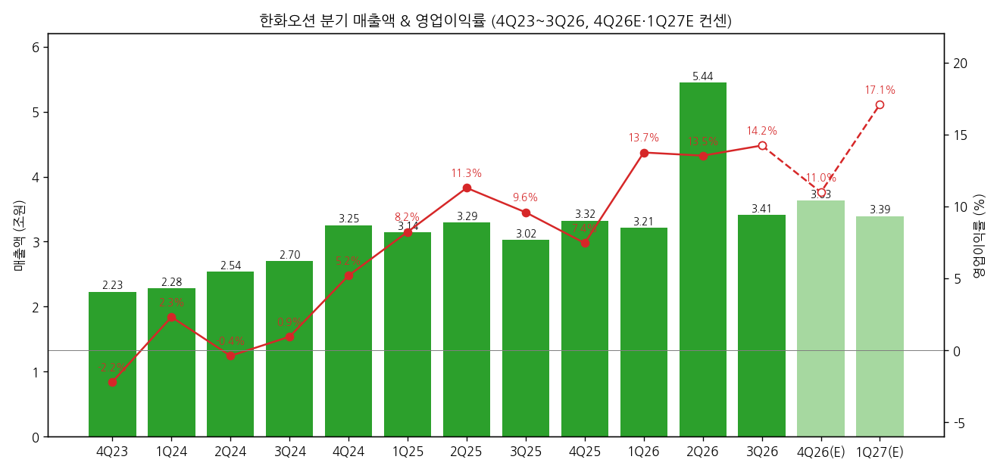
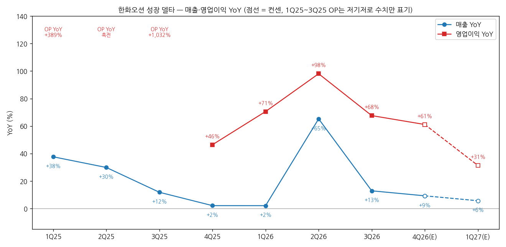
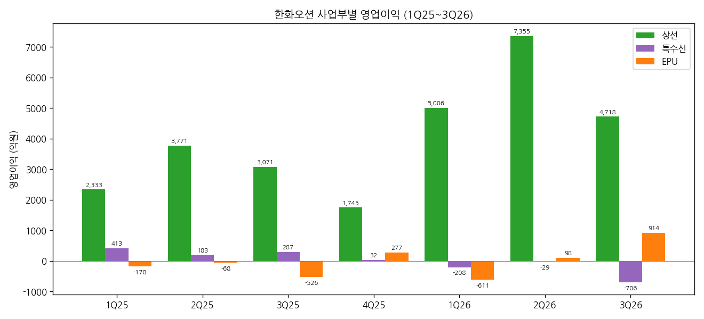

> 모드: 실적 리뷰 (v11)
> 종목: 한화오션 (042660)
> 섹터: 조선
> 서브섹터: 조선
> 분기: 2026-Q3
> 발표일: 2026-10-27 (잠정실적 + 컨퍼런스콜) / 2026-11-11 (3분기 분기보고서, 확정)
> 작성 시각: 2026-11-14 15:30 KST
> 분석 소스: 회사 3Q26 실적발표 IR(10/27) + OpenDART 분기 재무(1Q16~3Q26, 3Q26 분기보고서 확정치) + 셀사이드 국내 13개(하나·SK·NH·DS·iM·LS·다올·미래에셋·신한·현대차·삼성 10/28, 대신 11/3, 유안타 11/12 — 미래에셋은 이미지형 PDF 렌더 판독) + 해외 2개(J.P. Morgan 10/27, Nomura 10/28) + J.P. Morgan 데스크 첫인상(10/27, 세일즈 코멘트). 회사 설명은 IR 자료와 증권사 리포트의 컨퍼런스콜 Q&A 정리(신한·JPM·다올·삼성)로 인용. 웹서치 보완 없음. 직전 분기 리뷰 없음 (첫 리뷰)

# 한화오션 3Q26 실적 리뷰 — 상선은 버텼고, 특수선 프리미엄은 빠졌다

> 성장 델타: 둔화 | 내러티브: 약화 → 델타 둔화 + 내러티브 약화 → 경계 구간 (태국 호위함 본계약·Venus FPSO·미 해군 해외건조 허용 중 하나가 확인되기 전까지 관망)

→ **숫자**: 매출 3조 4,139억원(+12.9% YoY), 영업이익 4,857억원(+67.6% YoY, OPM 14.2%). 영업이익 YoY가 2Q26 +98.0%에서 30%p 내려왔고, FnGuide 컨센(5,415억원) 대비 -10.3% 미스다. 다만 바이사이드 기대(4,500~4,800억원, JPM 데스크)의 상단이었다. 핵심인 상선 영업이익 YoY는 +115% → +95% → +54%로 2개 분기 연속 둔화했다
→ **쟁점 ①**: 상선 OPM 17.4%(2Q 22.7%)는 조업일수 9일 감소와 원화 강세(분기 평균 약 -80원) 때문이고, 비슷한 조건이던 1Q(17.9%)와 같은 수준이다. 시장은 "17~18%가 현재 빈티지의 경상 마진"이라는 데는 동의하지만, 2027년 상선 OPM은 14%(JPM)부터 20.4%(다올)까지 갈린다
→ **쟁점 ②**: 특수선 영업손실 706억원은 공사손실충당부채를 보수적으로 쌓은 결과다. 그러나 국내 저마진 프로젝트와 고정비 부담에, 캐나다 잠수함 탈락과 미 의회의 해외건조 반대(노무라는 2027 NDAA를 근거로 듦)까지 겹쳤다. 15곳 중 다수가 "특수선 할증을 내려놓을 때"라고 결론냈다
→ **쟁점 ③**: 15곳 중 12곳이 TP를 하향했다(직전 TP가 확인된 14곳 평균 12.5만원 → 8.7만원, -30%). 2026·2027년 영업이익 추정은 각각 -7%, -9% 내려 TP 하향의 주원인은 멀티플이다. JPM은 Neutral로, 노무라는 Reduce를 유지하며 TP를 5만원 이하로 잡았다
→ **다음 분기 관건**: 4Q26 영업이익 컨센은 3,988억원(15곳 평균, YoY +61%)이지만 범위가 1,560억~5,550억원으로 넓다. 임단협 타결금·성과급 규모가 이 범위를 정한다. 주가 방향은 숫자보다 특수선·해양 수주(태국 호위함 본계약 연내, Venus FPSO, 12월 미 국방예산) 쪽이 정한다

---

## 1. 숫자

① 연결 기준 분기 표 (단위: 억원, %)

| 항목 | 1Q24 | 2Q24 | 3Q24 | 4Q24 | 1Q25 | 2Q25 | 3Q25 | 4Q25 | 1Q26 | 2Q26 | **3Q26** | 4Q26E | 1Q27E |
|---|---|---|---|---|---|---|---|---|---|---|---|---|---|
| 매출액 | 22,836 | 25,361 | 27,031 | 32,532 | 31,431 | 32,941 | 30,234 | 33,230 | 32,099 | 54,432 | **34,139** | 36,314 | 33,930 |
| 영업이익 | 529 | -97 | 256 | 1,690 | 2,586 | 3,717 | 2,898 | 2,475 | 4,411 | 7,361 | **4,857** | 3,988 | 5,795 |
| OPM | 2.3 | -0.4 | 0.9 | 5.2 | 8.2 | 11.3 | 9.6 | 7.4 | 13.7 | 13.5 | **14.2** | 11.0 | 17.1 |
| 매출 YoY | +58.6 | +39.3 | +41.0 | +45.8 | +37.6 | +29.9 | +11.8 | +2.1 | +2.1 | +65.2 | **+12.9** | +9.3 | +5.7 |
| 영업이익 YoY | 흑전 | 적지 | -65.5 | 흑전 | +388.8 | 흑전 | +1,032.0 | +46.4 | +70.6 | +98.0 | **+67.6** | +61.1 | +31.4 |
| **매출 YoY 델타 (%p)** | — | -19.3 | +1.7 | +4.8 | -8.2 | -7.7 | -18.1 | -9.7 | 0.0 | +63.1 | **-52.3** | -3.6 | -3.6 |
| **영업이익 YoY 델타 (%p)** | — | n.m. | n.m. | n.m. | n.m. | n.m. | n.m. | n.m. | +24.2 | +27.4 | **-30.4** | -6.5 | -29.7 |

→ (출처: 1Q24~3Q26은 OpenDART 연결 재무(분기 3개월 금액, 4Q = 연간 - 3Q 누적). 3Q26은 11/11 분기보고서 확정치로 10/27 잠정치와 같다. 4Q26E는 국내 13곳과 JPM·노무라의 분기 추정 단순평균(15곳, 삼성·유안타는 연간 추정에서 9개월 실적을 빼 역산). 1Q27E는 SK·다올 2곳 평균이라 소수 의견이다)
→ 3Q26 서프라이즈: 매출은 컨센 대비 -1.7%, 영업이익은 -10.3%다(컨센 매출 3조 4,725억원·영업이익 5,415억원, FnGuide, iM·LS·신한 인용). 순이익은 1,451억원으로 컨센(4,176억원) 대비 -65%다. 영업외손실 3,740억원(외환 관련, 내역 비공개) 때문이다. 바이사이드 기대는 4,500~4,800억원이었고 실제치는 그 상단이었다 (JPM 데스크, "relieved but hard to find a buy angle")
→ 2024~2025년 영업이익 YoY는 적자 탈출 구간이라 의미가 없다(n.m.). 이익 기저가 정상화된 4Q25부터 보면 +46% → +71% → +98% → +68%로, 2Q26이 정점이었다. 2Q26 매출 +65%는 브라질 FPSO(P-79) 인도 기준 매출 약 2조원이 한 번에 잡힌 효과다. 이 해양 매출의 이익 기여는 98억원에 그쳐 영업이익 YoY 왜곡은 작다
→ 컨센 경로상 4Q26 영업이익 YoY는 +61%다. 4Q25 기저(2,475억원, 성과급 반영)가 낮아서 나오는 숫자다. 1Q27E는 +31%, 2Q27E는 SK 기준 -24%(2Q26 7,361억원 기저)다. 연간으로는 2026E +76%에서 2027E +6.7%로 급감한다. 즉 컨센이 그리는 YoY 정점은 이미 지났다
→ **[판단] 델타 = 둔화**: 전사 영업이익 YoY는 축소됐지만 플러스이고, 직전 분기에는 재가속했으므로 전사 기준 "2개 분기 연속 둔화"는 아직 아니다. 다만 이익의 거의 전부를 내는 상선 기준으로는 이미 2개 분기 연속 둔화다(1-2 참고). 컨센 경로상 정점도 지났다. 4Q26 영업이익이 컨센 하단(2,475억원 = YoY 0%)을 밑돌거나 1Q27 YoY가 +30%를 크게 밑돌면 "꺾임"으로 바꾼다

→ (출처: OpenDART, 한화오션 IR. 4Q26E는 15곳 평균, 1Q27E는 2곳 평균이며 연한 막대·점선으로 표시)

→ (출처: 동일. 1Q25~3Q25 영업이익 YoY는 저기저(적자·BEP) 효과라 선에서 빼고 수치만 표기)

② 사업부별 매출·영업이익 (단위: 억원, %. IR 제품군별 손익, 1Q26·2Q26은 3Q26 IR 재분류 기준)

| 사업부 | 항목 | 1Q25 | 2Q25 | 3Q25 | 4Q25 | 1Q26 | 2Q26 | **3Q26** |
|---|---|---|---|---|---|---|---|---|
| 상선 | 매출 | 25,686 | 28,068 | 24,639 | 26,858 | 27,942 | 32,382 | **27,150** |
| 상선 | 영업이익 | 2,333 | 3,771 | 3,071 | 1,745 | 5,006 | 7,355 | **4,718** |
| 상선 | OPM | 9.1 | 13.4 | 12.5 | 6.5 | 17.9 | 22.7 | **17.4** |
| 상선 | 매출 YoY | +32.1 | +32.9 | +13.5 | +9.4 | +8.8 | +15.4 | **+10.2** |
| 상선 | 영업이익 YoY | — | — | — | +52.4 | +114.6 | +95.0 | **+53.6** |
| 특수선 | 매출 | 3,034 | 2,368 | 3,750 | 3,688 | 3,183 | 3,272 | **3,630** |
| 특수선 | 영업이익 | 413 | 183 | 287 | 32 | -208 | -29 | **-706** |
| 특수선 | OPM | 13.6 | 7.7 | 7.7 | 0.9 | -6.5 | -0.9 | **-19.4** |
| 특수선 | 매출 YoY | +113.4 | -28.0 | +91.2 | -4.3 | +4.9 | +38.2 | **-3.2** |
| EPU (해양+플랜트) | 매출 | 3,839 | 4,598 | 2,713 | 4,143 | 2,209 | 20,579 | **5,275** |
| EPU (해양+플랜트) | 영업이익 | -178 | -68 | -526 | 277 | -611 | 98 | **914** |
| EPU (해양+플랜트) | OPM | -4.6 | -1.5 | -19.4 | 6.7 | -27.7 | 0.5 | **17.3** |
| 기타·연결조정 | 영업이익 | 18 | -169 | 65 | 422 | 224 | -63 | **-69** |

→ (출처: 한화오션 3Q26 IR p.6·16(3Q25~3Q26), 4Q25 IR(1Q25~2Q25), 2026년부터 EPU = 해양 + 플랜트/E&I 기준. 3Q26 매출 비중은 상선 79.5%·특수선 10.6%·EPU 15.5%(연결조정 -5.6% 전)
→ 사업부 손익은 내부 관리기준의 제품군별 손익이고, K-IFRS 영업부문 공시가 아니다 (IR 각주)

→ (출처: 한화오션 IR, 위 표와 동일)

(1) 델타를 끄는 곳 = 상선, 꺾이는 곳 = 상선
→ 3Q26 9개월 누적 상선 영업이익은 1조 7,079억원으로 전사(1조 6,629억원)보다 많다. 특수선(-942억원)과 EPU(+402억원)를 합치면 마이너스다. 즉 전사 델타 = 상선 델타다
→ 상선 영업이익 YoY: 1Q26 +115% → 2Q26 +95% → 3Q26 +54%. 매출 YoY는 +9% → +15% → +10%로 비슷한데 이익 증가율만 빠르게 줄고 있다. 고선가 빈티지 효과(2024년 이후 수주분 매출 비중 확대)가 마진을 끌어올리던 구간에서, 마진 레벨이 유지되는 구간으로 넘어가는 모습이다 [판단]
→ 상선 내 선종 믹스: LNG선 매출 비중 2Q26 70% → 3Q26 60%(DS·현대차). 2024~2025년 수주분 비중은 약 80%(DS)

(2) 특수선 — 매출은 유지, 이익은 3개 분기 연속 적자
→ 매출 3,630억원(-3% YoY)은 장보고-III 배치2, 울산급 배치3 공정이 정상 진행된 결과다. 영업손실 706억원은 고정비 부담에 일부 호선 예정원가 상승(공사손실충당부채)이 더해진 것이다 (IR p.9, 신한 Q&A)
→ 1Q26부터 적자(-208 → -29 → -706억원). 2025년 OPM 7~14%대에서 내려왔다

(3) EPU — 일회성으로 흑자전환
→ 영업이익 914억원은 기인도 P-79 FPSO의 Change Order 정산(약 500~600억원, DS·NH 추정)과 시추·O&M 자회사(드릴십 용선) 수익 덕분이다. 회사도 2026년 전망에서 "진행공사 인도, 신규 수주 순연에 따른 고정비 부담으로 손익 저조"를 예상한다 (IR p.10)
→ NH는 신안우이 해상풍력·WTIV·플랜트 모듈 건조로 분기 4,000억원 내외 매출이 유지될 것으로 본다. 4Q26E EPU 영업이익은 증권사별로 -2억~56억원 수준이다

③ 연간 (단위: 억원, %)

| 항목 | 2023 | 2024 | 2025 | 2026E | 2027E | 2028E |
|---|---|---|---|---|---|---|
| 매출액 | 74,083 | 107,760 | 127,835 | 156,947 | 148,226 | 155,584 |
| 영업이익 | -1,965 | 2,379 | 11,676 | 20,602 | 21,987 | 23,934 |
| OPM | -2.7 | 2.2 | 9.1 | 13.1 | 14.8 | 15.4 |
| 매출 YoY | +52.4 | +45.5 | +18.6 | +22.8 | -5.6 | +5.0 |
| 영업이익 YoY | 적지 | 흑전 | +390.8 | +76.4 | +6.7 | +8.9 |

→ (출처: 2023~2025 OpenDART 연결. 2026E·2027E는 15곳 평균, 2028E는 13곳 평균(하나·DS 미제시))
→ 발표 전 → 발표 후 연간 컨센(영업이익): 2026E 2조 2,126억원 → 2조 602억원(-6.9%), 2027E 2조 4,114억원 → 2조 1,987억원(-8.8%). 발표 전은 FnGuide(하나 인용), 발표 후는 15곳 평균이다. 2027E 범위는 1조 7,160억원(NH)~2조 5,196억원(하나)으로 넓다
→ 2027E 매출 -5.6%는 2026년 P-79 FPSO 일괄 인식(약 2조원)의 기저와 EPU 수주 공백 때문이다. 상선만 보면 2027E 매출은 2026E 수준과 비슷하다(LS 12.84조원 vs 11.66조원으로 증가, 신한 11.45조원 vs 11.61조원으로 소폭 감소 — 증권사별로 방향이 갈림)

---

## 2. 시장 쟁점

① 지난 분기 체크

→ 첫 리뷰 — 직전 체크 없음 (2Q26 리뷰·팔로업 미작성)

② 이번 분기 쟁점

| # | 쟁점 | 한 줄 정의 | 언급 |
|---|---|---|---|
| 1 | 상선 마진의 위치 | 17.4%는 일시적 저점인가, 빈티지 효과가 끝난 경상 수준인가 | 15곳 전부 |
| 2 | 특수선 적자와 할증 소멸 | -706억원은 일회성인가, 그리고 해외 함정·MASGA 프리미엄을 얼마나 지울 것인가 | 15곳 전부 |
| 3 | 4Q26 바닥과 비영업 변수 | 임단협 타결금·성과급·환헤지가 4Q 이익과 순이익을 얼마나 깎는가 | 14곳 |
| 4 | 상선 이외 수주 공백 | 2026 수주가 상선 위주(61.8억달러/77.2억달러)인데, 해양·특수선 수주는 언제 오는가 | 13곳 |

③ 쟁점별 분해

(1) 쟁점 1 — 상선 OPM 17.4%: 저점인가, 경상 수준인가

(1-1) 회사 설명
→ 3분기 감익은 조업일수 9일 감소(하계휴가·추석)와 환율 영향이다. 3분기와 내년 매출 모두 2024~2025년 수주분이 대부분이고, 2024년 이후 수주분은 전 선종이 과거보다 높은 선가다 (신한 Q&A)
→ 2분기 고점(22.7%) 회복 여부에 대해 "현재 전망으로 4분기 기준 수익성이 내년에도 유지될 것"이라고 답했다 (신한 Q&A). 2026년 상선 손익은 "'24년 이후 수주한 고수익 프로젝트의 매출 비중 증가 및 원가 절감 성과로 견조한 수익성"을 예상하되 일시타결금·성과급은 제외한 표현이다 (IR p.8)
→ 6월부터 환헤지를 확대해 신규 수주분도 체계적으로 헤지 중이다. 환율 10% 변동 시 영업이익 영향은 10%가 조금 안 된다 (신한·다올 Q&A). JPM은 회사의 기존 가이던스를 "mid- to high-teen%"로 전한다

(1-2) 증권사별 해석

| 증권사 | 2027E 상선 OPM | 핵심 논리 |
|---|---|---|
| 다올 | 20.4% | 2024년 이후 "초대박 고가" 물량이 50% → 거의 100%로 확대. LNG 비중 70%대 → 50%대 하락과 상쇄되지만 완만한 회복 |
| DS | 18.0% [계산] | 고선가 빈티지 비중이 100%까지 채워지고 초고선가 컨테이너선 확대, LNG 비중은 약 47%로 축소 |
| 미래에셋 | 18.2% | 17.4%는 "현재 빈티지의 경상 수익성". 빈티지 정점 통과(3Q 78% → 27F 98.9%)와 믹스 악화(LNG 53.6% → 35%)로 2028년까지 18%대에서 개선 둔화 |
| 신한 | 17.5% | 환율 하락과 일회성 비용으로 상선 마진의 추가 상승 여력은 제한적 |
| 노무라 | 15.6% | 4Q26F 상선 OPM 5.0%(성과급·환율). 2027F 상선 이익 -16.7% 하향 |
| 현대차 | 14.5% | 환율 하락을 반영해 상선 마진 조정, 2028년 EPS -26% 하향 |
| JPM | 14% (조선 OPM, 기존 15%) | 2023~24년 수주분에서 2025~26년 수주분으로 넘어가는 2027년부터 믹스 개선 둔화 + 환율 재조정. Street 2027/28E 영업이익에 19%/23% 하방 위험 |
| NH | 전사 14% 이상 | 2027년 고선가 비중 확대, 원화 강세가 지속돼도 연 14% 이상. 후판·외주비 상승 압력 제한적 |
| 유안타 | — | LNGC 기여도 4Q26 55% → 4Q27 38%로 하락하나 대부분 저선가(2022~23년 수주) LNGC가 빠지는 것. 컨테이너선이 대체해 믹스 양호. 환헤지는 3분기말 순노출의 50%, 환율 1,400원 후반 |

→ (출처: 각사 3Q26 리뷰. DS는 2027F 상선 영업이익 2.14조원 / 매출 11.84조원으로 계산)

(1-3) 공통 결론 vs 갈리는 지점
→ 공통: 3Q 17.4%는 1Q(17.9%)와 비슷하고, 2Q 22.7%가 예외적이었다. 환헤지 확대로 환율 영향은 점차 줄어든다 (iM·하나·NH·신한·JPM 등 다수)
→ 갈림: ① 빈티지 효과가 2027년에도 마진을 끌어올리는가(다올·DS), 아니면 정점을 지나 정체되는가(미래·JPM·신한) ② 원/달러 1,320~1,350원대 전제를 얼마나 깊게 반영하는가(현대차 2027년 1,320원, 대신 1,350원) ③ 컨테이너선 비중 상승이 마진 중립인가(유안타) 불확실한가(미래)

(1-4) [판단]
→ 숫자는 "17~18%가 경상 수준"이라는 쪽과 더 맞는다. 조업일수와 환율이 모두 불리했는데도 1Q 수준을 지켰다는 점은 하방이 단단하다는 근거다. 반대로 같은 빈티지 비중(약 80%)에서 2Q 22.7%가 다시 나오지 않은 것은 상방이 제한된다는 근거다
→ 결론을 바꿀 데이터: 4Q26 실적에서 일회성(타결금·성과급)을 뺀 상선 OPM이 17%대면 "경상 17~18%"가 확정된다. 15% 미만이면 JPM 쪽(14%)으로 기운다. 회사가 헤지 비율과 헤지 환율을 공개하는지도 확인해야 한다(삼성이 요구한 정보)

(2) 쟁점 2 — 특수선 적자와 할증 소멸

(2-1) 회사 설명
→ 일부 진행 호선의 공사 손실을 예상해 공사손실충당부채를 보수적으로 인식했다. 마진이 낮은 국내 프로젝트와 고정비 부담으로 단기 개선 폭은 제한적이지만, 연간 매출은 전년 대비 늘어난다 (신한 Q&A, IR p.9)
→ 수출 파이프라인은 그리스·태국·중동·남미다. 일정은 공개하지 않았다 (JPM 체크리스트). 미 해군·MASGA는 "Austal US 인수 관련 협상 진행 중" 외에 업데이트가 없다 (JPM)
→ 필리조선소 진행 프로젝트는 9척이고, 한화오션 영업이익에는 간접 수혜만 있다. 거제에서 초도선을 짓고 후속선을 미국에서 짓는 브릿지 전략이다 (신한 Q&A). 11/3 필리조선소(Hanwha Defense USA)가 미 해군 중형상륙함(LSM) 1척을 2.69억달러에 수주했고, 추가 3척 옵션이 붙었다 (대신)

(2-2) 증권사별 해석

| 증권사 | 특수선 가정 | 할증 처리 |
|---|---|---|
| 노무라 | 2026F -98억원, 2028F +361억원 | 미 해군 기회 밸류 제외. 2027 NDAA가 해외 전투함 건조에 예산 배정 금지 → 미 해군 수주는 시간이 걸린다 |
| JPM | 2026E -75억원 | "derailed가 아니라 delayed". 미 예산·해외건조 허용 확인 전까지 함정 옵션에 가치 부여 안 함 |
| iM | 2027E OPM 5.2% | 해군 준비태세 보장법 등이 119대 회기(2027.1.2 종료) 내 통과 못하면 자동 폐기. 시장 기대보다 1년 이상 지연 → Target P/B 하향 |
| 다올 | 2027E 매출 -42%, OPM 1.7% | 해외 특수선 수주 공백으로 실적 크게 하향. 적정 PER 20배(MASGA) → 15배(2000년대 슈퍼사이클) |
| 신한 | 2027F OPM 1.3% | 2007년 조선 4사 PER에 기존 10% 할증 → 5% 할인. "특수선 할증 근거 약화" |
| 미래에셋 | 2027F OPM 2.7% | KDDX(4Q28~)·태국 초도함 건조 진입 전까지 BEP. 사우디·그리스 잠수함이 상방 요인 |
| NH | High-single 회복까지 시간 | 2027년 태국 군함·국내 지원함·에스토니아 예상, 그리스·사우디는 더 걸림 |
| SK | — | 미 해군 호위함·군수지원함 해외건조 초도 2척 허용 시 수주 가능성 높음. 마스가 가시화 전까지 보수적 접근 |
| LS | 2027E 790억원 | 태국 호위함 우선협상(출범 후 첫 해외 군함 신조), 중간선거·새 의회(2027.1) 이후 정책 가시성 확대로 모멘텀 재건 기대 |
| 유안타 | — | 미국 방산 가치 11.67조원(국내건조·해외건조 세후이익 × PER 20배)을 SOTP에 반영. 필리조선소·오스탈 선제 인수로 협력 참여 가시성이 경쟁사보다 높다 |

→ (출처: 각사 3Q26 리뷰)

(2-3) 공통 결론 vs 갈리는 지점
→ 공통: 3Q 손실은 충당금 성격이 크지만, 국내 저마진 물량과 고정비 때문에 2027년까지 특수선 이익 기여는 미미하다. 태국 호위함(약 6.8억달러, 노무라)은 연내 본계약이 유력하다
→ 갈림: 미 해군 해외건조가 "언제" 열리는가. 노무라·iM은 입법 경로가 막혀 있다고 보고, SK·LS·유안타는 초도 2척 허용·중간선거 이후 예산 편성에서 열린다고 본다. 이 차이가 TP 4.8만원(노무라)과 10.4만원(유안타)의 차이 대부분을 설명한다

(2-4) [판단]
→ 숫자로 확인되는 것은 "특수선이 이익을 깎고 있다"는 사실뿐이고, 해외 함정 수주는 아직 전부 내러티브 단계다. 따라서 특수선 할증을 지운 다수 의견이 현재 정보와 더 맞는다
→ 결론을 바꿀 데이터: 태국 호위함 본계약 공시(연내), 12월 미 국방예산(FY27)과 NDAA 최종본의 해외건조 조항, LSM 옵션 3척 행사 여부. 미 해군 함정이 한국에서 건조되도록 허용되면 할증 복원 논리가 다시 살아난다

(3) 쟁점 3 — 4Q26 바닥과 비영업 변수

(3-1) 회사 설명
→ 4Q에 일시 타결금과 연간 성과급이 반영되면 수익성이 다소 낮아질 수 있다. 성과급은 지급 규모 확정 전 추정이 어려워 분기가 아닌 기말에 반영한다 (신한 Q&A). 임단협은 4Q 안에 타결될 것으로 본다 (JPM)
→ 3Q 영업외손실 3,740억원에 외환손익이 포함되지만 구체적 금액은 공개하지 않았다 (신한). 세전이익은 1,117억원(OPM 대비 -11%p)이다

(3-2) 증권사별 해석

| 증권사 | 4Q26E 영업이익 | OPM | 가정 |
|---|---|---|---|
| 대신 | 5,550 | 14.9 | 상선 OPM 16.4%, 특수선 흑자전환 |
| 하나 | 5,533 | 14.6 | 임단협·성과급 반영 시 일시 둔화 가능성만 언급 |
| DS | 5,360 | 14.1 | 상선 546억원 |
| 유안타 | 4,931 [역산] | — | 연간 2조 1,560억원 - 9개월 |
| SK | 4,720 | 12.8 | 선종믹스 악화(LNG 감소), 일회성 반영 시 OPM 성장 제한 |
| iM | 4,486 | 12.6 | 타결금·성과급 충당금 반영 |
| 미래에셋 | 4,210 | 11.4 | 성과급 일시 반영(-5%p QoQ) |
| LS | 4,140 | 11.8 | 상선 404억원 |
| 다올 | 3,940 | 11.2 | 2025년과 같이 QoQ 감익 |
| 신한 | 3,820 | 11.0 | 상선 OPM 14.0% |
| 삼성 | 3,641 [역산] | — | 회사는 경쟁사와 달리 성과급·타결금을 미리 반영하지 않았다 |
| 현대차 | 3,523 | 8.6 | 상선 OPM 9.0% |
| NH | 2,380 | 6.9 | 성과급 반영으로 수익성 재차 하락 |
| JPM | 2,020 | 5.7 | 타결 일회성으로 2,300억원 → 2,020억원 하향 |
| 노무라 | 1,560 | 4.2 | 상선 OPM 5.0% |
| **평균** | **3,988** | **11.0** | 15곳 |

→ (출처: 각사 3Q26 리뷰. 유안타·삼성은 연간 추정에서 9개월 실적 1조 6,629억원을 빼 역산)

(3-3) 공통 결론 vs 갈리는 지점
→ 공통: 4Q는 QoQ 감익이다. 환율 영향은 헤지 확대로 3Q보다 작다
→ 갈림: 일회성의 크기. 하단(노무라·JPM·NH)은 2025년 4Q처럼 성과급을 대규모로 반영한다고 보고, 상단(대신·하나·DS)은 상선 경상 마진 유지에 무게를 둔다. 4Q25 상선 OPM은 6.5%였다

(3-4) [판단]
→ 4Q25 상선 OPM(6.5%)이 성과급 반영 분기의 선례라면, 하단 시나리오(2,000억원대)가 비현실적이지 않다. 다만 4Q25 기저 자체가 낮아 YoY는 플러스일 가능성이 크다. 델타 판정에 중요한 것은 헤드라인 숫자보다 "일회성 제외 상선 OPM"이다
→ 순이익은 별개다. 3Q 외환 관련 영업외손실처럼, 환율 변동이 세전이익을 크게 흔드는 구조는 4Q에도 유지된다

(4) 쟁점 4 — 상선 이외 수주 공백

(4-1) 회사 설명
→ 2026년 9월까지 수주 44척/기, 77.2억달러(상선 38척 61.8억달러, EPU 9.2억달러, 특수선 6.2억달러). 인도기준 수주잔고 362.2억달러로 3년치다 (IR p.15)
→ 2029년 납기 LNG선은 인기가 낮지만 2030년 이후 납기는 미국 LNG 프로젝트로 수요가 많다. 올해 상선 수주는 연 매출 약 80억달러의 약 80%이고, 선가를 낮추면서까지 무리하게 수주하지 않는다 (신한 Q&A). FPSO 1건이 하반기 중 나올 수 있다 (JPM 체크리스트)

(4-2) 증권사별 해석

| 증권사 | 해양·FPSO | 상선 수주 시각 |
|---|---|---|
| NH | Venus FPSO 수주 가능성 상향(SBM Offshore가 역량을 다른 프로젝트로 돌림). 수주 시 Mopane 해양설비 경쟁에서도 유리 | 2029~2030 슬롯 논의 중이라 급격한 선가 하락 가능성 제한 |
| 노무라 | Venus FID 지연 신호. 2026F 해양 수주 36억달러는 Venus 의존 | 2026F 상선 수주 97억달러, LNG선 62억달러(+90%) 가정 |
| iM | 전통 해양플랜트는 수주 가시권 밖. 지금 수주해도 2027년까지 EPU 실적 상승 어려움 | 상선 수주 61.8억달러(전년의 65%), 저가 선종인 탱커 비중 확대 |
| 다올 | Venus FPSO도 태국 이후 파이프라인도 더딤 | — |
| 하나·대신 | Venus 수주 시 2027~2030년 매출 기여 | 3년치 잔고로 수익성 중심 선별 수주 지속 |
| JPM | 하반기 FPSO 1건 가능성(IR 추가 확인 필요) | LNGC·VLCC·VLGC 수주 기회 지속, 중동 상황에 따른 교체 수요 |

→ (출처: 각사 3Q26 리뷰)

(4-3) 공통 결론 vs 갈리는 지점
→ 공통: 잔고(3년치)는 충분하다. 성장의 다음 단계는 상선이 아니라 고정비 부담이 큰 해양·특수선의 수주에서 나와야 한다 (DS·iM·현대차 등)
→ 갈림: Venus FPSO의 확률과 시점(NH 낙관 vs 노무라·다올 신중)

(4-4) [판단]
→ 상선 수주는 선별 기조로 안정적이지만, 해양 공백이 2027년 매출 -5.6%(컨센)의 직접 원인이다. Venus FPSO는 2027년 실적보다 2028년 이후 EPU 고정비 흡수와 "상선 외 성장 축" 내러티브에 더 중요하다

④ 낙관 vs 보수 — 논리 대비

| 구분 | 증권사 | TP | 무엇을 다르게 가정했나 |
|---|---|---|---|
| 낙관 | 유안타 | 104,000원 | 상선 P/O 0.7배(18.9조원) + 미국 방산 PER 20배(11.67조원)의 SOTP. 시가총액이 상선 적정가치를 밑돈다. FY27 대형 조선 Top pick |
| 낙관 | 다올 | 110,000원 | 2027년 상선 OPM 20.4%(빈티지 100%), 조선 슈퍼사이클 PER 15배 |
| 보수 | JPM | 50,000원 (Neutral, 하향) | 조선 OPM 14%, 2028E EPS × 8배(중국 조선사 동급). 함정 옵션 가치 0. Street 2027/28E 영업이익 19~23% 하방 |
| 보수 | 노무라 | 48,000원 (Reduce) | 12MF BVPS(영구채 전환 시 15.9% 희석 반영) × P/B 1.93배. 미 해군 기회 제외, 중국 캐파 확대로 2027F 신조선가 약세 |

→ 핵심 차이는 ① 미국 함정 가치(0 vs 11.7조원) ② 2027년 상선 OPM(14% vs 20%) 두 가지다. 등급은 같은 매수라도 국내 13곳의 TP 범위가 7.4만~11만원으로 넓다
→ 셀사이드 vs 바이사이드: 국내 13곳은 전원 매수 유지다. 그러나 바이사이드는 "안도했지만 살 이유를 찾기 어렵다"는 반응이다. 3Q 미스를 예상한 숏이 들어와 있었고, 11월 말 미 예산 확인 전까지 주가는 횡보할 것으로 본다 (JPM 데스크). 주가는 10/27 53,000원 → 11/11 48,350원(유안타)으로 리뷰 이후에도 9% 더 내렸다

⑤ 추정치·TP 변화

| 증권사 | 의견 | 직전 TP | 현재 TP | 4Q26E OP | 2026E / 2027E OP | 핵심 변화 |
|---|---|---|---|---|---|---|
| 하나 | 매수 | 175,000 | 100,000 | 5,533 | 22,161 / 25,196 | 2028 BPS × P/B 2.5배 |
| SK | 매수 | 110,000 | 90,000 | 4,720 | 21,350 / 22,540 | 2028 EPS × 13배, 중국 캐파·상선 피크아웃 반영 |
| NH | Buy | 126,000 | 91,000 | 2,380 | 19,010 / 17,160 | 2027·28 OP -18·-19%, Target PBR -10% |
| DS | 매수 | — | 100,000 | 5,360 | 21,990 / 22,340 | 2025 PER 평균에 20% 할인(군함 수출 프리미엄 삭제) |
| iM | Buy | 134,000 | 98,000 | 4,486 | 21,115 / 23,363 | 2027F BPS × P/B 3.5배, 미 특수선 기대 하향 |
| LS | Buy | 90,000 | 90,000 | 4,140 | 20,760 / 24,740 | 유지, 12MF 조정 PER 8.7배는 2024년 이후 최저 |
| 다올 | BUY | 170,000 | 110,000 | 3,940 | 20,570 / 24,320 | 적정 PER 20배 → 15배 |
| 대신 | 매수 | 139,000 | 102,000 | 5,550 | 22,180 / 24,060 | 2028 EPS × 14.1배(피어 +10%), LSM 수주 반영 |
| 미래에셋 | 매수 | 128,000 | 90,000 | 4,210 | 20,630 / 21,950 | 2028 EPS 7,506 → 6,600원, 멀티플 17배 → 14배 |
| 삼성 | BUY | 80,000 | 80,000 | 3,641 | 20,270 / 23,080 | 유지, 할증 대부분 희석 |
| 신한 | 매수 | 130,000 | 90,000 | 3,820 | 20,451 / 20,781 | 10% 할증 → 5% 할인 |
| 현대차 | BUY | 100,000 | 74,000 | 3,523 | 20,148 / 17,791 | 2028 EPS 6,562 → 4,882원(환율), PER 15.2배 유지 |
| 유안타 (11/12) | BUY | 179,000 | 104,000 | 4,931 | 21,560 / 23,720 | SOTP, FY27 Top pick |
| JPM | Neutral (↓) | 130,000 | 50,000 | 2,020 | 18,640 / 19,680 | P/Orderbook → PER 8배 |
| 노무라 | Reduce | 56,000 | 48,000 | 1,560 | 18,190 / 19,080 | 희석 반영 BVPS × P/B 1.93배 |

→ (출처: 각사 3Q26 리뷰. 단위 원·억원. NH·iM·대신 직전 TP는 하향률에서 역산 [계산]. DS 직전 TP는 리포트에 미기재)
→ 평균 TP 87,800원(15곳). 직전 TP가 확인된 14곳 평균은 124,786원 → 86,929원(-30.3%)이다. 하향 12곳, 유지 2곳(LS·삼성), 상향 0곳이다. 투자의견 변경은 JPM 1곳(Overweight → Neutral)이다
→ 4Q26E 영업이익 평균 3,988억원(발표 전 Quantiwise 컨센 4,990억원 대비 -20%, SK 인용), 2026E 2조 602억원(-6.9%), 2027E 2조 1,987억원(-8.8%)
→ **TP 하향의 원인은 멀티플이다**: 이익 추정 하향은 7~9%인데 TP는 30% 내렸다. 멀티플 하향 사유는 거의 같다. 특수선·MASGA 할증을 걷어내고(신한·DS·다올·iM·NH), 중국 캐파 증설에 따른 상선 피크아웃 우려를 반영했다(SK·노무라·JPM). 해외 2곳은 평가 방식 자체를 수주잔고 기준에서 PER 8배(중국 조선사 수준)로 바꿨다

---

## 3. 내러티브 점검

① 이 종목의 성장 스토리
→ "2024~2025년 고선가 상선 물량의 이익 레버리지 + 특수선·MASGA(미 해군 함정 건조·MRO)로 상선 사이클보다 긴 성장"이 2025년 주가 상승(52주 고점 149,900원)의 논리였다. 시장은 이 중 후자에 경쟁사 대비 할증을 줬다

② 이번 분기가 스토리에 한 일
→ **상선 축 — 유지**: 17.4%는 불리한 조건에서도 경상 마진을 확인시켰다. 다만 마진이 더 오르는 구간은 지나가고 있다(상선 영업이익 YoY 2개 분기 연속 둔화, 2027E 전사 영업이익 +6.7%)
→ **특수선·MASGA 축 — 약화(일부 훼손)**: 국내 특수선은 3개 분기 연속 적자이고, 7월 캐나다 잠수함 탈락에 이어 미 의회의 해외건조 반대가 확인됐다. 셀사이드가 할증을 할인으로 바꾸거나(신한) 함정 가치를 0으로 둔(JPM·노무라) 것은 이 축의 전제가 "지연"으로 바뀌었다는 뜻이다. 11/3 LSM 1척 수주(필리조선소)는 방향은 맞지만 규모(2.69억달러)가 작다
→ 합치면 델타 둔화 + 내러티브 약화다. 0번 판정의 근거다. 상선만 남은 한화오션은 "피어와 같은 조선사"로 재평가되는 중이다(JPM 8배 = 중국 조선사, 신한 PER 할증 → 할인)

③ 스토리를 다시 강하게 만들 트리거
→ 미 해군 함정의 한국 건조 허용(FY27 국방예산·NDAA 최종본, SK가 말한 초도 2척), 또는 LSM 옵션 3척 행사
→ 태국 호위함 본계약(연내)에 이어 에스토니아 OPV·그리스 잠수함 등 해외 함정 연속 수주
→ Venus FPSO 수주 — EPU 고정비 해소와 상선 외 성장 축 확인

④ 스토리를 깨뜨릴 리스크
→ 4Q 일회성 제외 상선 OPM이 15% 미만 — 경상 마진 하방이 무너지면 상선 축도 흔들린다
→ 중국 캐파 증설에 따른 2027년 신조선가 하락(노무라·NH가 공통으로 언급)
→ 산업은행 영구전환사채 전환(약 15.9~18.9% 희석, 노무라·기업개요)

---

## 4. 향후 봐야 할 것

(1) **4Q26 영업이익과 "일회성 제외 상선 OPM"** — 델타 판정 1순위
→ 무엇을: 4Q26 영업이익이 컨센 평균 3,988억원(15곳, 범위 1,560~5,550억원)을 넘는지, 그리고 임단협 타결금·성과급을 뺀 상선 OPM이 17%대인지. 영업이익이 2,475억원(4Q25, YoY 0%)을 밑돌면 "꺾임"으로 바꾼다
→ 어떤 데이터로: 임단협 타결 뉴스(타결금 규모), 4Q26 잠정실적·IR 사업부별 손익, 컨콜 Q&A의 일회성 금액
→ 언제: 임단협 11~12월, 4Q 잠정실적 2027년 1월 말~2월 초

(2) **특수선 수주와 미 해군 해외건조 허용 여부** — 내러티브 판정 1순위
→ 무엇을: 태국 호위함 본계약(약 6.8억달러), 에스토니아 OPV 결과, LSM 옵션 3척 행사, FY27 미 국방예산·NDAA 최종본의 해외건조 조항
→ 어떤 데이터로: 단일판매·공급계약 공시, 뉴스 키워드 "한화오션 태국 호위함 계약", "Hanwha Philly LSM option", "NDAA foreign shipbuilding", "MASGA 예산"
→ 언제: 태국 연내, 미 예산·NDAA 11월 말~12월

(3) **Venus FPSO 수주·FID**
→ 무엇을: TotalEnergies 나미비아 Venus FPSO 수주(회사는 하반기 FPSO 1건 가능성 언급), FID 시점. 2026년 해양 수주가 9.2억달러에서 늘어나는지
→ 어떤 데이터로: 수주 공시, 뉴스 키워드 "Venus FPSO Hanwha", "TotalEnergies Venus FID", 3Q·4Q IR 수주 표
→ 언제: 4Q26~1H27

(4) **환헤지 공개와 원/달러**
→ 무엇을: 헤지 비율(유안타 기준 순노출의 50%)과 헤지 환율(1,400원 후반), 원/달러 분기 평균 1,350원 이하 지속 시 2027년 상선 OPM 추정 추가 하향 여부. 영업외 외환손실 규모
→ 어떤 데이터로: 4Q 컨콜 헤지 정책 코멘트, 원/달러 분기 평균, 증권사 2027E 수정
→ 언제: 상시, 4Q 컨콜

(5) **상선 수주 단가와 신조선가**
→ 무엇을: 2026년 상선 수주 61.8억달러(9월 말)의 연말 누적, LNG선 2030년 이후 슬롯 수주 재개, 클락슨 신조선가지수 방향(중국 캐파 증설 영향)
→ 어떤 데이터로: 수주 공시, 클락슨 신조선가·발주 통계, 피어(HD현대중공업·삼성중공업) 4Q 수주
→ 언제: 월간, 4Q 실적 때 연간 집계
