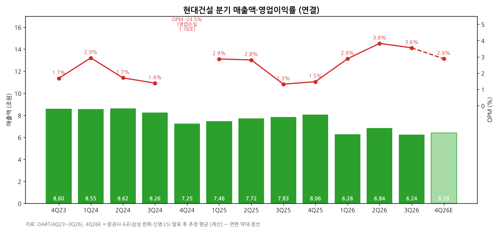
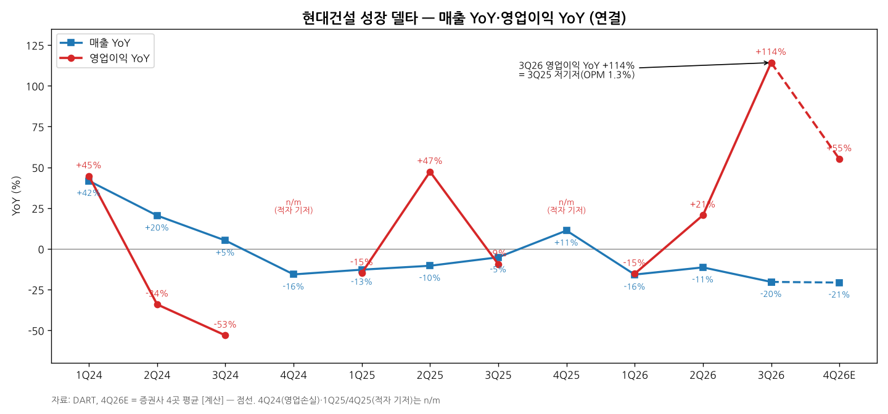
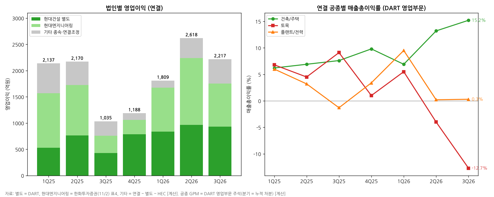
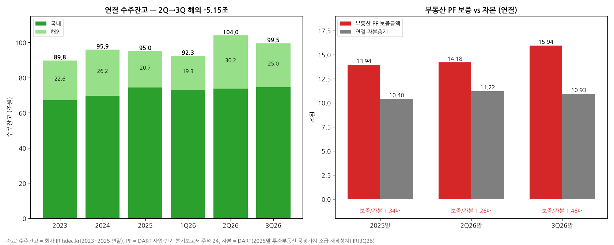

> 모드: 실적 리뷰 (v11)
> 종목: 현대건설 (000720)
> 섹터: 원전
> 서브섹터: 원전 시공
> 분기: 2026-Q3
> 발표일: 2026-10-30 (잠정실적·IR 설명회 — 전날 10/29 한수원이 대우건설·두산 컨소시엄과의 체코 두코바니 시공 협상 종료 발표) / 분기보고서 2026-11-16 제출 (DART 접수 20261116001025)
> 작성 시각: 2026-11-16 21:50 KST
> 분석 소스: 회사 자료 — 3Q26 경영실적 IR(10/30, 국문 19p), DART 분기보고서(2026.09, 11/16 제출 — 연결 손익·영업부문 주석·수주상황 계약잔액·부동산 PF 우발부채·회계정책 변경 주석), DART 반기보고서(2026.06), 기업개요 v1.0(DART 42분기 공종 시계열). 셀사이드 첨부 6건(5개사) — 해외: J.P. Morgan First Take(10/30) / 국내: 삼성증권 3Q26 Review(11/2)·한화투자증권 3Q26 Review(11/2)·신영증권 Review(11/2)·한화투자증권 "수주로 증명하는 수밖에"(11/10, 업종 자료 내 기업분석)·LS증권 "약해진 원전 모멘텀"(11/16, 업종 자료 내 기업분석). 웹 보완: 네이버 리서치 11/2 요지 7건(하나·미래에셋·iM·대신·신한·키움·IBK — 본문 미확보, TP·요지만), 토요경제 11/2(신한 TP), Yahoo Finance 일간 종가(10/28\~11/16)
> 리뷰 깊이: 풀 | 리서치 첨부 6건 (+ 회사 IR 1건)
> 비영업 요인: 저기저(3Q25 영업이익 1,035억원·OPM 1.3%) + 일회성 손익 혼재(싱가포르 남북도로 추가원가 약 800억원·솔로몬제도 수력 약 430억원 비용 vs HEC 준공정산이익 약 500억원). 회계정책 변경(투자부동산 공정가치모형·토지 재평가모형, 2026)은 영업외·자본 항목이라 영업이익 영향 없음

# 현대건설 3Q26 실적 리뷰 — 주택 마진은 15%대까지 올라왔는데, 매출은 -20%이고 원전 본계약 시간표가 또 밀렸다

> 성장 델타: 가속 | 내러티브: 약화 → 델타 가속(저기저) + 내러티브 약화 → 숫자와 주가가 엇갈린 관찰 구간 (원전 본계약 확인 전까지 매매 제외에 가까운 관망)

> ⚠ 비영업 요인 플래그: 가속의 주된 원인 = 이례적 저기저 — 3Q25 영업이익 1,035억원(OPM 1.3%, 플랜트·HEC 비용)이 기저라 YoY가 +20.6% → +114.2%로 뛰었다. 2Q26 대비로는 -15.3%(2,618억원 → 2,217억원) 감익이다. 이번 분기 안에서도 일회성 비용(싱가포르 약 800억원 + 솔로몬제도 약 430억원 = 약 1,230억원)과 일회성 이익(HEC 준공정산 약 500억원)이 섞여 있다 — 둘을 걷어낸 참고치는 약 2,950억원(OPM 4.7%)이다 [참고·계산]. 투자부동산 공정가치모형 전환(2026, 비교표시 소급 재작성)은 평가손익이 기타손익(영업외)으로 가서 영업이익과 YoY 판정에 영향이 없다(9M 평가손실 -153억원, 영업외)

→ **숫자**: 연결 매출 6조 2,406억원(-20.3% YoY), 영업이익 2,217억원(+114.2% YoY, OPM 3.6%). 영업이익 YoY가 2Q26 +20.6%에서 +114.2%로 93.6%p 커져 판정 기준(보고 영업이익 YoY 확대)상 "가속"이다. 그러나 매출 YoY는 -11.4% → -20.3%로 오히려 나빠졌고, 영업이익은 QoQ -15.3%다. 이익을 만든 것은 **연결 건축/주택 매출총이익률 15.2%**(3Q25 7.6%)이고, 토목(-12.7%)·플랜트(0.3%)는 적자권이다
→ **쟁점 ①**: 같은 2,217억원을 FnGuide 컨센(2,119억원) 대비 +4.6% "부합·소폭 상회"로 읽는 데는 이견이 없다. 갈리는 곳은 "**반복되는 해외·플랜트 비용을 일회성으로 볼 것인가**"다 — 신영은 "분기마다 반복되는 추가 원가가 이익 예측가능성을 낮춘다", 삼성은 "연말 실적 변동성 불가피"로 HOLD·TP -12.6%, JPM은 "가이던스 8,000억원 유지 = 예산 버퍼가 현실적이었다"로 읽었다
→ **쟁점 ②**: 원전은 6곳 모두 "파이프라인은 넓어졌는데 본계약이 없다"로 같다. 10/29 체코 두코바니 시공 협상 결렬 뒤 현대건설은 "수익성이 맞을 때만 재입찰 참여"를 밝혔다(JPM·한화). 주가는 10/29\~10/30 이틀간 -12.5%(95,500원 → 83,600원, KOSPI -4.7%)였다
→ **쟁점 ③**: TP는 첨부 5개사 중 4곳이 내렸다(평균 156,600원 → 134,000원, -14.4%). 같은 기간 2026E 영업이익 추정은 거의 그대로(한화 +1.3%, 삼성 2026E EPS -8.2%)라 **하향의 주원인은 원전 옵션 멀티플**이다. "11/2 15곳 중 12곳 하향"은 기업개요에 기재돼 있으나 이번 확인 범위(11/2 발간 11곳)에서는 하향 4·유지 2·직전 TP 미확인 5로 **검증하지 못했다**
→ **다음 분기 관건**: 회사 가이던스(연간 8,000억원)가 내재하는 4Q26 영업이익은 1,355억원(YoY +14%), 증권사 4곳 평균은 1,842억원(YoY +55%)이다. 어느 쪽이든 3Q +114%보다 낮아 **4Q 델타 기본값은 둔화**다. 판정보다 중요한 것은 연말\~연초로 예고된 **불가리아 코즐로두이 초기 시공 계약·Holtec 펠리세이즈 SMR 부분계약이 실제 숫자로 나오는지**다

---

## 1. 숫자

① 연결 기준 분기 표 (단위: 억원, %)

| 항목 | 4Q23 | 1Q24 | 2Q24 | 3Q24 | 4Q24 | 1Q25 | 2Q25 | 3Q25 | 4Q25 | 1Q26 | 2Q26 | **3Q26** | 4Q26E |
|---|---|---|---|---|---|---|---|---|---|---|---|---|---|
| 매출액 | 85,984 | 85,453 | 86,212 | 82,569 | 72,469 | 74,556 | 77,207 | 78,265 | 80,601 | 62,813 | 68,423 | **62,406** | 63,920 |
| 영업이익 | 1,445 | 2,509 | 1,473 | 1,143 | -17,759 | 2,137 | 2,170 | 1,035 | 1,188 | 1,809 | 2,618 | **2,217** | 1,842 |
| OPM | 1.7 | 2.9 | 1.7 | 1.4 | -24.5 | 2.9 | 2.8 | 1.3 | 1.5 | 2.9 | 3.8 | **3.6** | 2.9 |
| 매출 YoY | +41.3 | +41.7 | +20.4 | +5.1 | -15.7 | -12.8 | -10.4 | -5.2 | +11.2 | -15.8 | -11.4 | **-20.3** | -20.7 |
| 영업이익 YoY | +94.5 | +44.6 | -34.1 | -53.1 | 적전 | -14.8 | +47.3 | -9.4 | 흑전 | -15.3 | +20.6 | **+114.2** | +55.1 |
| **매출 YoY 델타 (%p)** | -3.4 | +0.3 | -21.3 | -15.3 | -20.8 | +3.0 | +2.3 | +5.2 | +16.4 | -27.0 | +4.4 | **-8.9** | -0.4 |
| **영업이익 YoY 델타 (%p)** | +35.8 | -49.9 | -78.7 | -19.0 | n/m | n/m | +62.1 | -56.8 | n/m | n/m | +36.0 | **+93.6** | -59.2 |

→ (출처: 4Q23\~2Q26 DART 분기·반기·사업보고서(OpenDART 연결, 4Q = 연간 − 3Q 누적, 기업개요 v1.0 표), 3Q26 DART 분기보고서(2026.09) — 잠정 IR과 동일(매출 6조 2,406억원, 영업이익 2,217억원). 4Q26E = 발표 후 증권사 4곳(삼성 11/2·한화 11/10·신영 11/2·LS 11/16) 4Q26 추정 평균 [계산] — 매출 6조 3,920억원, 영업이익 1,842억원. 4Q24 영업손실·적자 기저 분기는 YoY·델타 n/m)
→ 3Q26 서프라이즈: 매출은 컨센 대비 -6.9%, 영업이익은 +4.6% (컨센 매출 6조 7,030억원·영업이익 2,120억원, FnGuide — 한화·신영 인용 / 삼성은 2,119억원). Bloomberg 컨센(2,150억원) 대비 +3% (JPM). 지배주주순이익은 378억원으로 컨센(1,020억원) 대비 -62.8% — 영업외손익 약 -586억원(환 관련 평가손실 + 법인세 증가, 미래에셋 요지) [계산: 세전 1,631억원 − 영업이익 2,217억원]
→ 9M26 누적: 매출 19조 3,642억원(-15.8%), 영업이익 6,645억원(+24.4%), OPM 3.4%. 연간 가이던스(매출 27.4조원·영업이익 8,000억원) 대비 진척률 70.7%·83.1% (IR p.5)
→ 영업이익 YoY는 4Q24 빅배스(영업손실 1.78조원) 이후 기저가 계속 흔들려, 2025년 이후 정상 비교가 되는 분기는 2Q25·3Q25·2Q26·3Q26뿐이다. **컨센 경로상 YoY 정점은 이번 분기(3Q26 +114%)다**. 4Q26E +55%(증권사 평균) 또는 +14%(가이던스 내재)로 내려가고, 2027년 연간은 증권사 평균 +22%다
→ **[판단] 델타 = 가속 (보고 기준, 저기저 주도)**: 판정 기준(영업이익 YoY 확대)상 가속이다. 다만 ① 매출 YoY는 3개 분기째 두 자릿수 역성장이고 이번 분기 더 나빠졌다 ② 영업이익 레벨은 2Q26보다 낮다 ③ 3Q25가 OPM 1.3%의 이례적 저기저였다. 2년 전(3Q24 1,143억원) 대비로는 +94%다. 기저와 무관하게 개선된 증거는 **주택 마진 레벨**(1-② 참조)이고, 이것이 4Q에도 유지되는지가 다음 판정의 핵심이다. 4Q 기본값은 "둔화"

→ (출처: DART, 4Q26E는 증권사 4곳 평균 [계산] — 연한 막대·점선)

→ (출처: DART, 4Q26E는 증권사 4곳 평균 [계산] — 점선. 적자 기저 분기 n/m)

② 사업부별 매출·이익

(1) 연결 공종별 — 매출·매출총이익 (단위: 억원, %)

| 공종 | 항목 | 1Q25 | 2Q25 | 3Q25 | 4Q25 | 1Q26 | 2Q26 | **3Q26** |
|---|---|---|---|---|---|---|---|---|
| 건축/주택 | 매출 | 42,566 | 43,629 | 42,798 | 41,270 | 29,738 | 35,477 | **31,059** |
| 건축/주택 | 매출총이익 | 2,636 | 3,010 | 3,253 | 4,060 | 2,065 | 4,691 | **4,735** |
| 건축/주택 | GPM | 6.2 | 6.9 | 7.6 | 9.8 | 6.9 | 13.2 | **15.2** |
| 건축/주택 | 매출 YoY | -25.4 | -25.9 | -18.2 | -20.2 | -30.1 | -18.7 | **-27.4** |
| 건축/주택 | 매출총이익 YoY | — | — | — | — | -21.7 | +55.8 | **+45.6** |
| 토목 | 매출 | 6,111 | 6,057 | 7,312 | 7,978 | 6,562 | 7,871 | **6,553** |
| 토목 | 매출총이익 | 416 | 275 | 665 | 83 | 359 | -315 | **-831** |
| 토목 | GPM | 6.8 | 4.5 | 9.1 | 1.0 | 5.5 | -4.0 | **-12.7** |
| 플랜트/전력 | 매출 | 22,880 | 24,260 | 25,173 | 26,968 | 23,180 | 20,964 | **21,883** |
| 플랜트/전력 | 매출총이익 | 1,365 | 765 | -315 | 906 | 2,194 | 32 | **68** |
| 플랜트/전력 | GPM | 6.0 | 3.2 | -1.3 | 3.4 | 9.5 | 0.2 | **0.3** |
| 플랜트/전력 | 매출 YoY | +18.8 | +27.6 | +28.6 | +158.0 | +1.3 | -13.6 | **-13.1** |

→ (출처: DART 영업부문 주석 — 공종별 수익·매출총이익(연결조정 전). 분기 = 누적 차분 [계산]: 3Q26 = 분기보고서(2026.09) 9M − 반기보고서(2026.06) 1H, 3Q25 = 9M25 − 1H25. 1Q25\~2Q26 매출은 기업개요 v1.0 DART 42분기 표. **공종별 영업이익은 회사가 공시하지 않는다**(판관비 미배분) — 매출총이익 기준. 3Q26 기타(임대 등) 매출 4,597억원·매출총이익 990억원, 부문간 제거 -1,686억원·-45억원)
→ 3Q26 매출 비중: 건축/주택 49.8%, 플랜트/전력 35.1%, 토목 10.5% [계산]. 연결 매출총이익 4,917억원(+26.1% YoY) 중 **건축/주택이 4,735억원으로 사실상 전부**다. 토목·플랜트 합산 매출총이익은 -763억원이다
→ **델타를 끈 것은 건축/주택 마진이다**. 매출은 -27.4%로 줄었는데 매출총이익은 +45.6% 늘었다 — 매출 레벨이 아니라 원가율이 이익을 만들었다. 2023년 이후 착공한 현장(고분양가·원가 반영)의 주택 매출 비중이 76%까지 올라왔다(신영·JPM "post-2023 sites")
→ 꺾인 곳은 토목이다. 싱가포르 남북도로(N113·N115) 추가원가 약 800억원으로 GPM이 2Q26 -4.0%에서 -12.7%로 더 내려갔다(삼성·한화·하나 요지). 이 현장의 계약잔액은 930억원(DART 9월말, 완공 예정 2028-12)이라 남은 공사가 작은데 손실이 커진 구조다 [계산]
→ 플랜트/전력은 매출총이익률 0%대가 2개 분기째다. 국내 S-OIL 샤힌(연말 준공) 공정촉진 비용과 HEC 솔로몬제도 수력 약 430억원이 들어갔다. 샤힌 PKG-1·2 계약잔액은 합계 565억원(DART 9월말)으로 사실상 끝물이다 [계산]

(2) 법인별 — 현대건설 별도 vs 현대엔지니어링 (단위: 억원, %)

| 법인 | 항목 | 1Q25 | 2Q25 | 3Q25 | 4Q25 | 1Q26 | 2Q26 | **3Q26** |
|---|---|---|---|---|---|---|---|---|
| 현대건설 별도 | 매출 | 38,909 | 41,543 | 43,423 | 41,249 | 36,130 | 39,185 | **36,090** |
| 현대건설 별도 | 영업이익 | 528 | 766 | 429 | 789 | 836 | 967 | **932** |
| 현대건설 별도 | OPM | 1.4 | 1.8 | 1.0 | 1.9 | 2.3 | 2.5 | **2.6** |
| 현대엔지니어링 | 매출 | 33,668 | 34,119 | 33,141 | 38,037 | 25,365 | 26,677 | **23,762** |
| 현대엔지니어링 | 영업이익 [추정] | 1,040 | 960 | 330 | 270 | 840 | 1,270 | **820** |
| 현대엔지니어링 | OPM | 3.1 | 2.8 | 1.0 | 0.7 | 3.3 | 4.8 | **3.5** |
| 기타 종속·연결조정 | 영업이익 | 569 | 444 | 276 | 129 | 133 | 381 | **465** |

→ (출처: 별도 = DART(3Q26 분기보고서·IR p.18, 영업이익 +117.5% YoY). 현대엔지니어링 매출 = 삼성증권 11/2 실적표, 영업이익 = 한화투자증권 11/2 표4(십억원 단위 → 억원 환산, 회사 비상장 자회사로 분기 영업이익 미공시 — 기업개요는 3Q26 825억원으로 기재). 기타 = 연결 − 별도 − HEC [계산])
→ 3Q26 연결 영업이익 증가 +1,182억원(YoY) 중 별도 +503억원, HEC +490억원, 기타 +189억원 [계산]. 두 법인이 반반씩 끌었다
→ 별도 공종(삼성증권 11/2 표): 주택건축 매출 2조 417억원(-20.1%), GPM **12.3%**(3Q25 5.1%) / 토목 4,389억원(-10.6%), GPM -6.0% / 플랜트·전력 1조 630억원(-16.2%), GPM -2.4%. 9M 별도 원가율은 건축/주택 89.8%(-5.2%p), 토목 101.3%(+8.9%p), 플랜트/뉴에너지 100.6%(+1.4%p) (IR p.11)
→ 현대엔지니어링은 매출 -28.3%(그룹사 공장 준공, 주택 착공 감소)에도 GPM 8.5%(3Q25 5.3%)다. 9M 건축/주택 원가율 85.7%(-6.2%p)가 끌었고, 그룹사 공장·주택 준공정산이익 약 500억원이 솔로몬 비용 430억원을 상쇄했다 (기업개요 3Q26 메모·한화 "준공정산이익" 언급) — 이 500억원은 일회성이다

→ (출처: DART 영업부문 주석·별도 손익, 현대엔지니어링 = 한화투자증권 추정, [계산])

(3) 수주·수주잔고 — 선행지표 (단위: 조원)

| 항목 | 2023 | 2024 | 2025 | 1Q26 | 2Q26 | **3Q26** | 2026 계획 |
|---|---|---|---|---|---|---|---|
| 신규수주 (분기·연간) | 32.49 | 30.53 | 33.44 | 3.96 | 18.87 | **6.05** | 33.4 |
| 수주잔고 | 89.75 | 95.93 | 95.04 | 92.32 | 103.98 | **99.53** | — |
| 국내 잔고 | 67.15 | 69.69 | 74.33 | 73.04 | 73.83 | **74.52** | — |
| 해외 잔고 | 22.60 | 26.23 | 20.71 | 19.29 | 30.16 | **25.01** | — |

→ (출처: 2023\~2025 hdec.kr 주요 경영실적, 1Q26\~3Q26 회사 IR — 기업개요 v1.0 표. 3Q 신규수주 = 9M 28.87조원 − 1H 22.83조원 [계산]. DART 분기보고서 기준 연결 계약잔액은 99.66조원)
→ 9M26 누적 수주 28.87조원(+10.6% YoY), 연간 계획 33.4조원의 86.5%. 주요 수주: 미국 전기로 제철소 5.4조원, 복정역세권 복합개발 3.0조원, 카자흐스탄 가스처리 2.4조원(HEC), 포항 AI 데이터센터 0.4조원, 군산 AI 데이터센터 0.3조원(HEC). 시공권 확보(잔고 미포함) 별도 28.38조원 — 압구정 3구역 5.6조원·압구정 5구역 1.0조원 등 (IR p.7\~8)
→ 별도 주택 수주잔고 37.20조원(2Q 36.26조원), HEC 주택 잔고 10.98조원(2Q 11.28조원). 올해 도시정비 수주 13조원은 역사적 최고치다 (LS)

(4) 2Q → 3Q 수주잔고 -4.45조원, 해외 -5.15조원 — 원인 분해

| 구분 | 2Q26 | 3Q26 | 증감 | 내용 |
|---|---|---|---|---|
| 연결 잔고 (IR) | 103.98 | 99.53 | -4.45 | 3Q 신규수주 6.05 − 매출 6.24 = -0.19가 "정상 소화분", 나머지 약 -4.26은 계약금액 재표시 [계산] |
| 해외 잔고 (IR) | 30.16 | 25.01 | -5.15 | 국내는 +0.69 (신규 5.3 − 국내 매출 약 4.6, 정상) |
| 별도 해외 계약잔액 (DART) | 17.85 | 14.64 | -3.22 | 완성공사(기성) +1.33, **기본도급액 -1.89** |
| HEC 해외 계약잔액 (DART) | 12.31 | 10.38 | -1.93 | 완성공사 +0.74, **기본도급액 -1.20** |

→ (출처: 회사 IR 2Q26·3Q26 p.8, DART 반기보고서(2026.06)·분기보고서(2026.09) "수주상황" 해외합계(기본도급액·완성공사액·계약잔액) [계산]. 국내·해외 3Q 신규수주는 하나증권 요지(국내 5.3조원·해외 0.8조원), 해외 매출은 LS증권 표(3Q26 해외 2.92조원))
→ **해외 잔고 감소의 약 60%는 공사 진행이 아니라 계약금액 자체가 줄어든 것**이다. 별도·HEC 해외 기본도급액이 한 분기에 3.1조원 줄었다 [계산]. 회사·증권사 누구도 설명하지 않았다 — 아래는 DART 현장별 대조로 확인한 것이다
→ 달러 계약 대부분이 2\~4%씩 줄었다: 파나마 메트로 3호선 3.23 → 3.15조원(-2.4%), 사우디 아미랄 PKG4 2.89 → 2.81조원(-2.7%), 자푸라 PKG2 1.79 → 1.71조원(-4.1%), 쿠드미-리야드 HVDC 1.10 → 1.02조원(-7.2%). 같은 분기 "환 관련 평가손실"(미래에셋)과 방향이 같아 **원화 환산액 하락이 공통 요인**이다 [추정]
→ 환율로 설명하기 큰 감액: 이라크 해수처리 4.87 → 4.32조원(-0.55조원, -11.4%), 필리핀 남부철도 1.72 → 1.55조원(-9.6%). 미국 전기로 제철소는 반기보고서에 기본도급액 5.38조원으로 별도 표기됐다가 3Q 분기보고서에서는 "기타"로 합산됐고, IR의 주요 잔고 표기는 5.3조원(2Q) → 4.5조원(3Q)이다 — 계약 범위·명의(시공법인) 조정인지 감액인지 **미확인**
→ [판단] 해외 잔고 25조원은 2025말(20.7조원)보다는 많다. 다만 2Q의 "사상 최대 104조원"은 미국 전기로 제철소 한 건이 만든 숫자였고, 그 건의 표기액이 한 분기 만에 0.8조원 줄었다. 4Q IR에서 전기로 잔고와 이라크 해수처리 감액 사유를 확인해야 한다

(5) 원전 관련 숫자 (DART 수주상황, 단위: 억원)

| 현장 | 발주처 | 기본도급액 (2Q → 3Q) | 완성공사 누적 (2Q → 3Q) | 계약잔액 3Q | 완공 예정 |
|---|---|---|---|---|---|
| 신한울 3·4호기 주설비공사 | 한수원 | 16,028 → **16,476** (+447) | 2,636 → **3,226** (+590) | 13,250 | 2033-10 |
| UAE 바라카 원전 | 한전 | 41,480 → 41,478 | 41,454 → 41,467 | 11 | 2026-09 → **2026-12** (연기) |

→ (출처: DART 반기보고서(2026.06)·분기보고서(2026.09) 수주상황 [계산]. 신한울 진행률 약 19.6% [계산])
→ 신한울 3·4호기는 3Q 기성 590억원으로 분기 매출의 약 1%다. 계약액이 447억원 증액됐다. **해외 원전 EPC 본계약 잔고는 여전히 0**이다 — 불가리아·Fermi·네덜란드는 설계·FEED 단계 계약이라 잔고에 의미 있는 금액이 없다 (기업개요 "2026-11 현재 원전 EPC 본계약 수주잔고 반영분 미확인" 유지)

→ (출처: 회사 IR·hdec.kr, DART 주석 24(부동산 PF), 자본 = DART·IR)

③ 연간 (단위: 억원, %)

| 항목 | 2022 | 2023 | 2024 | 2025 | 2026E | 2027E | 2026 가이던스 |
|---|---|---|---|---|---|---|---|
| 매출액 | 212,391 | 296,514 | 326,703 | 310,629 | 257,560 | 266,930 | 274,000 |
| 영업이익 | 5,749 | 7,855 | -12,634 | 6,530 | 8,483 | 10,378 | 8,000 |
| OPM | 2.7 | 2.6 | -3.9 | 2.1 | 3.3 | 3.9 | 2.9 |
| 매출 YoY | +17.6 | +39.6 | +10.2 | -4.9 | -17.1 | +3.6 | -11.8 |
| 영업이익 YoY | -23.7 | +36.6 | 적전 | 흑전 | +29.9 | +22.3 | +22.5 |

→ (출처: 2022\~2025 DART 사업보고서(기업개요 v1.0). 2026E·2027E = 발표 후 증권사 4곳(삼성 11/2·한화 11/10·신영 11/2·LS 11/16) 단순평균 [계산]. 가이던스 = IR p.5(매출 27.4조원·영업이익 8,000억원))
→ 발표 전 → 후 연간 컨센(FnGuide) 변화는 확보하지 못했다. 추정 전·후를 다 밝힌 곳: 한화 2026E 영업이익 8,030억원 → 8,130억원(+1.3%), 2027E 1조 1,580억원 → 1조 2,690억원(+9.6%, 11/2) → 1조 2,150억원(11/10) / 삼성 2026E EPS -8.2%, 2027E EPS -12.8%
→ **2027E 범위가 8,800억원(신영)\~1조 2,150억원(한화)으로 1.4배 벌어져 있다**. 신영은 2027년 영업이익 +0.7%(정체), 한화는 +49%다 — 2027년 매출이 반등하느냐(한화 +4.1%, LS +4.6% vs 삼성 -1.3%)의 가정 차이다 (2번 쟁점 (3))

---

## 2. 시장 쟁점

① 지난 분기 체크
→ 첫 리뷰 — 직전 체크 없음 (2026-Q2 현대건설 리뷰·팔로업 미작성)

② 이번 분기 쟁점 5개

| # | 쟁점 | 언급 증권사 수 |
|---|---|---|
| (1) | 같은 2,217억원의 질 — 주택 마진 15%는 구조적인가, 반복되는 해외·플랜트 비용은 일회성인가 | 6/6 |
| (2) | 원전 본계약 시간표 지연과 체코 시공 협상 결렬 — 현대건설에 기회인가 | 6/6 |
| (3) | 매출 -20%와 잔고 99.5조원 — 2027년 매출·이익 반등은 오나 | 5/6 |
| (4) | 셀사이드가 비워 둔 쟁점 — 순차입 전환과 PF 보증 15.9조원 | 1/6 (신영 추정표만) |
| (5) | TP 하향은 실적 문제인가 멀티플 문제인가 | 5/6 |

→ (6 = 셀사이드 첨부 6건(5개사, 한화 2건 포함). 네이버 요지 7건은 본문 미확보라 수에 넣지 않았다)

③ 쟁점별 분해

(1) 같은 2,217억원의 질 — 주택 마진 15%는 구조적인가, 해외·플랜트 비용은 일회성인가

(1-1) 회사 설명 (10/30 IR·컨퍼런스콜 — 증권사 정리)
→ 연간 영업이익 가이던스 8,000억원 유지 — 샤힌 공정촉진 비용을 흡수하면서도 유지했다 (JPM)
→ 이번 분기를 "고마진 신규 주택 현장·데이터센터·뉴에너지(원전 포함)로의 믹스 전환이 이어진 분기"로 설명했다 (JPM)
→ 싱가포르·솔로몬 비용은 "예상 가능한 비용을 최대한 선반영"했으나 공사가 진행 중이라 추가 비용 가능성을 완전히 배제하기는 어렵다 (삼성)
→ 중동 14개 현장에서 전쟁 관련 원가 상승은 없다 (JPM). 2026년 주택 착공 계획은 1.6만 세대 → 1.35만 세대로 줄였다(9M 별도 4,472세대) (한화)

(1-2) 증권사별 해석 편차

| 증권사 | 기준 컨센·추정 | 3Q 판정 | 논리 |
|---|---|---|---|
| J.P. Morgan | BBG 2,150억원 / JPMe 2,070억원 | 부합 (+3%/+7%) | 비용 흡수에도 가이던스 유지 = 예산 버퍼가 현실적. post-2023 현장 비중 확대는 구조적 |
| 삼성 | FnGuide 2,119억원 / 자체 1,519억원 | 부합 (+4.6%) | 주택 원가율이 타 부문 부진을 상쇄. 싱가포르·솔로몬·샤힌으로 **연말 실적 변동성 불가피** |
| 한화 (11/2) | FnGuide 2,120억원 / 자체 2,180억원 | 소폭 상회 | 양사 건축/주택 믹스 개선 + 준공정산이익 → 원가율 -2.9%p |
| 신영 | FnGuide 2,120억원 / 자체 2,370억원 | 컨센 부합, 자체 추정 -6.5% | "개별 현장에서는 일회성이지만 **분기마다 반복되는 추가 원가**는 이익 예측가능성을 낮춘다". 2027년 이익 성장 방향은 유효 |
| LS (11/16) | — | — | 건축/주택 **잔고 마진 11\~13%** 추산 — 일회성 없이도 매출 램프업에 따라 이익 눈높이 상승 |
| 한화 (11/10) | — | — | 4Q26E 영업이익 1,490억원으로 가장 보수적, 2027년부터 매출·이익 동반 증가 |

(1-3) 공통 결론 vs 갈리는 지점
→ 공통: 주택 마진 개선이 이익을 만들었고, 그것이 2023년 이후 착공 현장 비중 확대(76%)라는 구조 변화라는 데 이견이 없다
→ 갈림: **해외·플랜트 비용이 "끝물"인가 "상수"인가**다. JPM·한화는 저수익 현장 종료로 소멸할 비용으로 보고, 신영·삼성은 매 분기 다른 현장에서 나오는 반복 비용으로 본다. 4Q26E 영업이익이 1,490억원(한화)\~2,090억원(신영)으로 갈린 것도 이 차이다

(1-4) **[판단]** — 숫자로 분해
→ 비용이 나온 현장들의 남은 계약잔액을 보면 "끝물" 쪽이 숫자와 맞는다. 싱가포르 남북도로 잔액 930억원, 샤힌 PKG-1·2 합계 565억원(DART 9월말)이라 남은 매출 대비 손실 반영이 이미 컸다 [계산]. 플랜트 GPM 0%대 2개 분기는 샤힌 연말 준공과 함께 끝날 가능성이 높다
→ 그러나 "반복" 쪽 근거도 있다. 2Q26(토목 -4.0%, 플랜트 0.2%)과 3Q26(-12.7%, 0.3%) 연속으로 비주택 공종이 손실이었고, 2025년에도 3Q25 플랜트 -1.3%·4Q25 토목 1.0%가 있었다. **비주택 공종이 2개 분기 이상 정상 마진(5%+)을 낸 적이 2025년 이후 1Q26 한 번뿐**이다
→ 주택 GPM 15.2%(연결)는 HEC 준공정산이익 약 500억원이 낀 수치다. 이를 빼면 약 13.6%다 [계산] — LS의 잔고 마진 11\~13% 추정과 겹친다. 즉 주택은 "13% 안팎이 새 정상"이고 15%는 고점이다
→ 결론이 바뀌는 조건: 4Q26에 샤힌 준공 후 플랜트 GPM이 3% 이상으로 돌아오고 주택 GPM이 12% 이상이면 "끝물" 해석이 맞다. 반대로 새 해외 현장(이라크 해수처리·필리핀 철도 등)에서 추가 원가가 나오면 신영·삼성 쪽이 맞다

(2) 원전 본계약 시간표 지연과 체코 시공 협상 결렬 — 현대건설에 기회인가

(2-1) 회사 설명 (10/30 컨퍼런스콜 — JPM·한화·신영 정리)
→ 원전 관련 미래수익 기대는 강화되고 있다. 불가리아·펠리세이즈·미국 페르미·대미투자 등 사업 기회가 늘고, 미국 내 계획 중인 다수 프로젝트를 협의 중이다 (한화 11/2)
→ 체코 두코바니 재입찰에 참여 의사가 있으나 **"수익성을 훼손하는 결정은 하지 않겠다"** (한화), "margin-acceptable basis에서만" (JPM)
→ 미국 상무부(DOC) 8기 프로그램(대부분 웨스팅하우스 파트너십), TerraPower(원자로 조립 계약 먼저, 전체 EPC는 2027년 말 목표), 펠리세이즈 SMR, 불가리아 대형원전 모두 **아직 협의 중**이다. 원전 EPC 계약 시점에 대한 구체적 가이던스는 없다 (JPM)
→ 4Q 수주 추진: 데이터센터·해상풍력·LNG 플랜트·SMR (한화)
→ 체코 경과: 한수원은 10/29 대우건설·두산 컨소시엄과의 시공 협상을 종료하고 경쟁입찰로 새 시공사를 뽑아 2027년 7월 계약을 목표로 한다. 쟁점은 총액확정(Lump-sum) — 한수원은 기본설계 물량 기준 총액 확정, 시공사는 상세설계 증가 물량 보상을 요구했다 (2026-Q3_두산에너빌리티_리뷰 2번 (2), Macquarie·미래에셋·대신 인용)

(2-2) 원전 파이프라인 현황 (2026-11 기준)

| 프로젝트 | 단계 | 다음 이정표 | 출처 |
|---|---|---|---|
| 신한울 3·4호기 (APR1400) | 주설비 시공 중 (진행률 약 20%) | 2033-10 완공 | DART |
| 불가리아 코즐로두이 7·8호기 (AP1000) | 설계 계약 → 후속 설계·부분계약 추진 | 초기 시공 계약 연말\~연초 | 신영, 신한(토요경제) |
| 미국 Holtec 펠리세이즈 SMR-300 ×2 | 후속 설계·부분계약 추진 | 부분계약 연말\~연초(약 2억달러), 본계약 2028 | 신영, 신한, 하나(기업개요 인용) |
| 미국 Fermi America (AP1000 ×4) | FEED 2Q26 완료 | 고객 자금·PPA 지연 | 신영, 삼성 |
| 미국 TerraPower Natrium | 후속 8기 EPC 우선권(2026-08) | 원자로 조립 계약 → 전체 EPC 2027년 말 | 신영, JPM, 삼성 |
| 네덜란드 신규 대형원전 ×2 | FEED 계약 추가 | — | 신영 |
| 미국 대형원전 8기 (한미 원전 프레임워크, 최대 1,200억달러) | 한미전략적투자특별법 시행·10월 프레임워크 발표 | 발주처·SPV 구체화 | 신영, JPM |
| 슬로베니아 Krško 2·핀란드 | 기술타당성·사전업무 완료 | 2027\~2028 | 신영 |
| 체코 두코바니 시공 재입찰 | 한수원 경쟁입찰 예정 | 계약 목표 2027-07 | JPM, 한화, 두산 리뷰 |

(2-3) 증권사별 해석 편차

| 증권사 | 원전 반영 방식 | 체코 결렬 해석 | 논리 |
|---|---|---|---|
| J.P. Morgan | P/B 1.8배(2028E) — 원전은 대형·SMR 모두 노출된 위치로 평가 | 재입찰 참여 신호는 Key Positive | 주가 바닥 근접, 컨센 변화 없을 것. EPC 매도는 실적이 아니라 심리·밸류에이션 |
| 삼성 | 원전 기대 반영 보류, PBR 1.0배 | 별도 언급 없음 | 불가리아·펠리세이즈·페르미 수주 시기 지연, 매크로 불확실성 해소 전까지 지연 지속. "이제는 보여줘야 할 때" |
| 한화 (11/2) | P/B 2.0배 유지 (ROE 7.1%) | 원전 기대감 크게 약화 | **독자적·독보적 원전 수주**를 보여주면 업종 내 차별화 — 차선호주 |
| 신영 | SOTP: 원전 = 2027F 원전 잔고 × PSR → **잔고 30조원 → 12조원, PSR 3.5 → 3.0배** | 단기 수주 지연이지만 **시공사가 불리한 계약을 거부한 것은 긍정적** | 원전 기회는 1년 전보다 넓어졌으나 선반영할 가시성이 낮아졌다. 주가는 원전 옵션 우려를 과도 반영 |
| 한화 (11/10) | P/B 2.0 → 1.55배 | "원전 수주 지연 및 체코 시공계약 협상 결렬 등으로 기대감 약화" | 원전 수주는 2027년부터 시작 |
| LS (11/16) | 글로벌 EPC 평균 PBR 30% 할인 1.4배 | "체코 사태 이후 국내 원전주 멀티플 하락" | 파이프라인 이상 없음, 2027년 수주 가시화 시 반등. 금리·글로벌 원전주 디레이팅 |
| 키움 (웹, 11/2 보도 인용) | — | 저가 원전 입찰이 시공 마진을 압박할 우려 | 본문 미확보 (토요경제 11/2) |

(2-4) 공통 결론 vs 갈리는 지점
→ 공통: 6곳 모두 "파이프라인은 넓어졌고 본계약은 아직 없다"로 같다. 연말\~연초 불가리아 초기 시공·펠리세이즈 부분계약을 다음 확인 포인트로 본다
→ 갈림: **체코 결렬의 의미**다. 신영·JPM은 "규율 있는 수주"의 증거이자 현대건설 재입찰 기회로, 한화(11/10)·LS는 원전 멀티플을 낮춘 이벤트로 읽었다. 현대건설이 재입찰에서 받을 몫을 숫자로 넣은 곳은 없다

(2-5) **[판단]** — 체코는 현대건설에 기회인가
→ 이익으로는 작다. 위험에 놓인 시공분은 약 3조원(두산 리뷰 — BofA·Macquarie 추정)이다. 대형원전 EPC OPM 10%(iM 가정, 기업개요)를 적용해도 10년 넘게 나눠 인식되는 연 수백억원 수준이라 연간 영업이익 8,000억원\~1조원 대비 작다 [계산·추정]
→ 조건이 문제다. 한수원이 결렬한 이유가 총액확정 고수였으므로, 같은 조건이면 현대건설이 들어가도 대우건설이 거부한 위험을 그대로 진다. 회사가 "수익성 훼손 결정은 안 한다"고 미리 선을 그은 것은 **조건이 바뀌지 않으면 안 들어갈 수 있다**는 뜻이다. 신영의 "규율 있는 수주" 해석과 회사 발언이 맞는다
→ 그래서 체코의 진짜 의미는 수주액이 아니라 **팀코리아 해외 대형원전 시공의 주도권**이다. 현대건설은 UAE 바라카(APR1400)와 미국 AP1000 협력(웨스팅하우스) 양쪽 경험이 있는 국내 유일 시공사라(기업개요), 체코 재입찰에서 주간사가 되면 이후 한미 프레임워크의 APR1400·AP1000 물량에서 협상력이 커진다 [판단]
→ 두산에너빌리티 리뷰와의 연결(read-across): 두산 리뷰는 "한수원이 현대건설 단독 등으로 가고 두산 EPC 범위가 빠지면 두산 원자력 수주 경로에서 2.9\~3조원이 영구히 빠진다"를 결론 반전 조건으로 적었다. 현대건설 쪽 증거는 "수익성 조건부 참여"라, **2027년 상반기 재입찰 조건(물량 증액 보상 조항 여부)이 두 종목에 같은 방향으로 작용**한다 — 조건이 완화되면 두산 EPC 범위 유지 + 현대건설 시공 참여가 함께 가능하고, 총액확정이 유지되면 둘 다 마진 위험을 진다 [판단]
→ 결론이 바뀌는 조건: 연말\~1Q27에 불가리아 초기 시공 계약·펠리세이즈 부분계약 중 하나라도 금액과 함께 공시되면 "타이밍 지연" 해석이 맞다. 둘 다 2027년으로 넘어가면 삼성의 "매크로 해소 전까지 지연 지속"이 기본값이 되고, 기업개요 분류 트리거("2027년까지 본계약 0건 시 원전 Secondary 삭제")에 가까워진다

(3) 매출 -20%와 잔고 99.5조원 — 2027년 매출·이익 반등은 오나

(3-1) 회사 설명
→ 3Q 누계 수주 28.9조원(계획 대비 86.5%), 4Q 파이프라인(데이터센터·해상풍력·LNG·SMR) 감안 시 연간 가이던스 달성 전망 (한화)
→ 수주잔고 99.53조원 = 약 3.6년치 일감 (IR p.8). 2026년 매출 가이던스 27.4조원(-11.8%)

(3-2) 증권사별 해석 편차

| 증권사 | 2027E 매출 YoY | 2027E 영업이익 | 논리 |
|---|---|---|---|
| 한화 (11/10) | +4.1% | 1조 2,150억원 (+49%) | 역대 최대 수주 가능 → 내년부터 매출·이익 동반 증가 |
| LS | +4.6% | 1조 790억원 (+28%) | 주택 잔고 마진 11\~13%, 도시정비 13조원(압구정 3·5, 목동 10) |
| 신영 | +7.0% | 8,800억원 (+0.7%) | 매출은 늘지만 원가율 92.4%로 마진 정체 — 3Q27 매출 +22.7% 가정 |
| 삼성 | -1.3% | 9,768억원 (+12.8%) | HEC 매출 -6.5% 지속, 비주택 신규 매출 본격화 필요 |
| J.P. Morgan (발표 전 모델) | +3% | 1조 1,370억원 (+30%) | 2027E 수주 38조원 |

(3-3) 공통 결론 vs 갈리는 지점
→ 공통: 2026년이 매출 바닥이라는 데 대체로 동의한다(삼성 제외). 매출 감소의 원인이 주택 착공 감소(별도 건축/주택 -20.1%)와 HEC 그룹사 공장 준공(-28.3%)이라는 데도 같다
→ 갈림: **2027년 마진**이다. 매출 반등 폭은 +4\~7%로 비슷한데 영업이익 증가율은 +1%(신영)\~+49%(한화)로 갈린다. 신영은 원가율이 그대로라고 보고, 한화는 저수익 현장 종료로 원가율이 90.6%까지 내려간다고 본다

(3-4) **[판단]**
→ 잔고 숫자만 보면 반등의 재료는 있다. 국내 잔고 74.5조원은 3개 분기째 늘었고, 시공권 28.4조원(압구정 등)이 착공 대기 중이다. 그러나 착공 계획을 1.6만 → 1.35만 세대로 줄였고 9M 착공이 4,472세대라, **잔고 → 매출 전환 속도는 2026년보다 2027년 상반기가 더 느릴 수 있다** [판단]
→ 해외 잔고는 계약금액 재표시로 한 분기에 3조원 넘게 줄었다(1-② (4)). 2027년 해외 매출의 핵심인 미국 전기로 제철소의 표기액이 5.3조원 → 4.5조원으로 바뀐 이유가 확인되기 전까지는, JPM의 2027E 수주 38조원·한화의 "역대 최대 수주"를 매출 반등 근거로 그대로 쓰기 어렵다
→ 결론이 바뀌는 조건: 4Q26 연간 수주 33.4조원 초과 + 4Q 착공이 연간 계획 1.35만 세대에 맞게 나오면(9M 착공 별도 4,472세대·HEC 3,073세대 — 하나 요지) 한화·LS의 2027년 반등 경로가 맞다

(4) 셀사이드가 비워 둔 쟁점 — 순차입 전환과 PF 보증 15.9조원

(4-1) 회사 공시 (DART 분기보고서 주석 24·자본위험관리, IR p.16)
→ 연결 순차입금(차입금 − 현금성자산) **1조 4,974억원** (2025말 순현금 9,616억원 → 2Q26 순차입 9,376억원 → 3Q26). 차입금 4.52조원(+17.3%), 현금성자산 3.02조원. IR 기준 현금·예금은 5.18조원 → 3.49조원(-32.7%)
→ 부동산 PF(대출) 보증금액 **15.94조원**(단독 15.89조원 + 컨소시엄 0.05조원) — 2025말 13.94조원, 2Q26 14.18조원에서 한 분기 +1.76조원. 대출잔액 14.29조원. 당기 중 우발부채에서 충당부채로 전환된 금액 0
→ 구성(단독): 정비사업 본PF 보증 8.77조원(대출잔액 7.40조원), 기타사업 본PF 5.60조원(5.40조원), **기타사업 브릿지론 1.51조원(대출잔액 1.49조원 — 이 중 1.14조원이 6개월 이내 만기)**
→ 연결 자본총계 10.93조원(2Q26 11.22조원) → **PF 보증/자본 1.46배**(2Q 1.26배) [계산]

(4-2) 셀사이드 다룬 정도
→ 첨부 6건 중 PF를 다룬 곳은 없다. 신영 추정표만 2026년 순차입금 1.15조원(순차입금비율 11.1%)으로 순차입 전환을 반영했다. IBK(11/2, 본문 미확보)가 제목에 "현금 회수 시점에 주목"을 걸었다

(4-3) **[판단]**
→ 정비사업 본PF(8.77조원)는 조합 사업이라 분양이 되면 해소되는 성격이고, 3Q 증가분 대부분이 여기서 나왔다(2Q 7.66조원 → 3Q 8.77조원) — 도시정비 수주 13조원의 그림자다. 위험의 중심은 **기타사업 브릿지론 1.49조원**이다. 6개월 내 만기 1.14조원의 본PF 전환·차환이 4Q\~1Q27의 확인 항목이다
→ 순차입 전환은 운전자본 때문이다. 2022\~2025년 4년 연속 영업CF 적자(누적 -1.73조원, 기업개요)에 이어 9M26도 현금이 줄었다. 주택 마진이 좋아져도 현금으로 회수되지 않으면 원전 EPC 같은 대형 보증 수요가 생길 때 재무 여력이 제약된다 [판단]
→ 결론이 바뀌는 조건: 4Q에 순차입금이 1조원 미만으로 줄고(연말 기성 회수), 브릿지론 잔액이 1조원 아래로 내려가면 쟁점에서 내릴 수 있다. 브릿지론 만기 연장이나 충당부채 전환이 나오면 주택 마진 개선의 질을 다시 봐야 한다

(5) TP 하향은 실적 문제인가 멀티플 문제인가

(5-1) 회사 설명
→ 해당 없음 (밸류에이션 쟁점)

(5-2) 증권사별 해석 편차

| 증권사 | 밸류에이션 방식 | 하향 이유 |
|---|---|---|
| J.P. Morgan | 2028E P/BV 1.8배 (2011\~13 ROE 10% 구간 준용) | 유지 (First Take) |
| 삼성 | 12M 선행 PBR 1.0배 (ROE-PBR 회귀 + 40% 프리미엄) | 연말 실적 변동성 + 원전 수주 가시성 → EPS 2026E -8.2%, 2027E -12.8% |
| 한화 (11/2 → 11/10) | 12M 예상 BPS × 2.0배 → 1.55배 | 원전 수주 지연·체코 협상 결렬로 목표배수 하향 (추정은 2027E -4.3%) |
| 신영 | SOTP: 원전(2027F 잔고 × PSR) + 종합건설(2027F BPS × 1.5배) | 원전 2027F 잔고 30조원 → 12조원, PSR 3.5 → 3.0배 |
| LS | Forward BPS × 1.4배 (글로벌 EPC 평균 PBR 30% 할인) | 금리 상승에 따른 글로벌 원전주 디레이팅 + 체코 사태 후 국내 원전주 멀티플 |

(5-3) 공통 결론 vs 갈리는 지점
→ 공통: 2026E 영업이익 추정은 거의 그대로(8,130\~8,730억원, 가이던스 8,000억원 근처)인데 TP는 12\~24% 내려갔다
→ 갈림: 하향 근거가 "원전 시간표"인 곳(신영·한화)과 "금리·글로벌 원전주 디레이팅"인 곳(LS), "실적 변동성"까지 넣은 곳(삼성)으로 나뉜다

(5-4) **[판단]**
→ **TP 하향의 원인 = 멀티플 하향(주) + 실적 하향(부)**. 신영 SOTP로 보면 원전 가치는 주당 32,329원(잔고 12조원 × 3.0배), 본업은 주당 120,021원(BPS × 1.5배)이다. 현재 주가 81,700원(11/16)은 본업 BPS(2026E 약 7.9\~8.4만원)의 약 1.0배라 **시장은 원전 옵션을 거의 0으로 놓고 있다** [계산]
→ 2026-04 고점(188,700원, P/B 2.3배) 때 iM SOTP에서 원전 가치가 기업가치의 76%였던 것(기업개요)과 대비된다. 원전 프리미엄은 이미 빠졌다 — JPM이 "주가 바닥 근접"이라고 본 근거다
→ 결론이 바뀌는 조건: 원전 본계약 첫 건이 나오면 원전 가치가 0에서 다시 붙는다(신영 SOTP 기준 주당 3만원 안팎). 반대로 본업 ROE가 5%대(삼성 2026E 5.2%)에 머물면 P/B 1.0배도 비싸다는 삼성 논리가 맞다

④ 낙관 vs 보수 — 논리 대비
→ **가장 낙관 (JPM 17만원, 신영 16만원)**: JPM은 2028E BVPS에 P/B 1.8배(과거 ROE 10% 구간)를 쓰고, 원전 대형·SMR 양쪽 노출을 유지한다. 신영은 원전 잔고를 30조원 → 12조원으로 깎고도 종합건설에 P/B 1.5배를 준다. 둘 다 **본업 ROE가 2027\~28년 7\~10%로 회복**한다고 가정했다
→ **가장 보수 (삼성 9만원 HOLD, LS 12만원)**: 삼성은 원전을 밸류에이션에서 빼고 본업 P/B 1.0배만 준다. 필요 조건으로 ① 저수익 현장 종료에 따른 이익 안정성 ② 비주택 신규 매출 본격화 ③ 미국·유럽 원전 EPC 가시적 성과를 들었다. LS는 매수지만 글로벌 EPC 대비 30% 할인을 걸었다
→ 셀사이드 vs 시장: 커버 21곳 평균 TP 165,143원(삼성 인용, 11/2 이전 집계)·추천점수 4.0(매수)인데 주가는 고점 대비 -57%다. 10/28 → 11/16 주가 -14.5%는 KOSPI(-15.2%)와 비슷해, **실적 발표 후 3주간 추가 디레이팅은 시장 전체 하락과 같은 폭**이었다. 이틀간(10/29\~10/30) -12.5%의 초과 하락은 체코 결렬 + 실적 당일에 집중됐다 [계산]

⑤ 추정치·TP 변화 (단위: 원, 십억원)

| 증권사 | 직전 TP | 현재 TP | 4Q26 영업이익 E | 2026 / 2027 영업이익 E | 핵심 변화 한 줄 |
|---|---|---|---|---|---|
| J.P. Morgan (10/30) | 170,000 | 170,000 (유지) | 226 (발표 전 모델) | 875 / 1,137 (발표 전) | First Take, 컨센 변화 없을 것 |
| 삼성 (11/2) HOLD | 103,000 | 90,000 (-12.6%) | 202 | 866 / 977 | EPS 26E -8.2%·27E -12.8%, PBR 1.0배 |
| 한화 (11/2) | 170,000 (10/19 200,000 → 170,000) | 170,000 (유지) | 149 | 813 / 1,269 | 26E OP +1.3%·27E +9.6% |
| 신영 (11/2) | 200,000 (6/18) | 160,000 (-20.0%) | 209 | 873 / 880 | 원전 잔고 30 → 12조원, PSR 3.5 → 3.0배 |
| 한화 (11/10) | 170,000 | 130,000 (-23.5%) | 149 | 813 / 1,215 | 목표 P/B 2.0 → 1.55배 |
| LS (11/16) | 140,000 | 120,000 (-14.3%) | 177 | 841 / 1,079 | 글로벌 EPC PBR 30% 할인 1.4배 |
| 대신 (11/2, 웹) | 약 168,000 [계산] | 152,000 (-9.5%) | — | — | 네이버 요지 |
| 신한 (11/2, 웹) | 140,000 (10/15 170,000 → 140,000) | 130,000 (-7.1%) | — | — | 토요경제 11/2 |
| iM (11/2, 웹) | 175,000 | 175,000 (유지) | — | — | P/B 2.0배, 본업만으로 밸류 매력 |
| 하나 (11/2, 웹) | 미확인 | 115,000 | — | — | 네이버 요지 |
| 미래에셋 (11/2, 웹) | 미확인 | 133,000 | — | — | 네이버 요지 |
| 키움·IBK (11/2, 웹) | 미확인 | 미확인 | — | — | 키움 "최선호주 제시" |

→ (출처: 첨부 리포트 각 표지·추정표. 웹 = 네이버 리서치 요지(기업개요 수집 11/3)·토요경제 11/2. 4Q26 E = 2026E − 9M 실적 또는 리포트 분기표)
→ 첨부 5개사 최신 기준 평균 TP 156,600원 → 134,000원(-14.4%), 하향 4건·유지 1건(JPM, First Take) [계산]. 웹 포함 확인 가능한 11/2 발간분은 하향 4(삼성·신영·대신·신한)·유지 2(한화·iM)·직전 TP 미확인 5다 — **"15곳 중 12곳 하향"은 검증하지 못했다**
→ 발표 후 2026E 영업이익 4곳 평균 8,483억원(가이던스 8,000억원 대비 +6%), 2027E 1조 378억원 [계산]
→ **TP 하향의 원인 = 멀티플 하향 (주) + 실적 하향 (부)** — 2026E 이익 추정 -0\~8% vs TP -9.5\~-23.5%

---

## 3. 내러티브 점검

① 성장 스토리 정의
→ 4Q24 빅배스로 저수익 해외·주택 현장을 털어낸 뒤, 2023년 이후 착공한 고마진 주택 현장이 매출의 대부분이 되면서 본업 이익이 정상화되고, 그 위에 국내 유일의 APR1400·AP1000 양쪽 시공 경험을 가진 원전 EPC 옵션(대형원전·SMR, 미국·유럽)이 얹힌다. 시장은 "본업 회복 + 원전 옵션"을 사고, 2026-04 고점에서는 기업가치의 3/4을 원전 옵션에 줬다

② 이번 분기 평가
→ **강화된 부분**: 본업 마진이다. 연결 주택 GPM 15.2%(일회성 제외 약 13.6%), 별도 12.3%로 2개 분기 연속 두 자릿수다. 9M 영업이익은 가이던스의 83%다
→ **약해진 부분**: 원전 시간표와 매출이다. 불가리아·펠리세이즈·페르미 본계약이 또 연말\~2027년으로 밀렸고, 체코 시공 협상이 결렬됐다. 매출은 -20.3%로 역성장이 커졌고, 해외 잔고는 계약금액 재표시로 5조원 넘게 줄었다. 첨부 5개사 중 4곳이 TP를 내렸고, 신영은 원전 잔고 가정을 30조원 → 12조원으로 깎았다
→ **[판단] 내러티브 = 약화**: 핵심 전제(주택 마진 회복, 원전 시공 역량)는 깨지지 않았다. 그러나 원전 타이밍 지연으로 멀티플이 내려갔고 2027E 추정 범위가 넓어졌다 — 기준표의 "약화"다. 본업만 떼면 "유지\~강화"다
→ 1번 델타 "가속(저기저)"과 합치면 **숫자와 주가가 엇갈린 관찰 구간**이다. 보고 YoY는 가속이지만 QoQ 감익·매출 역성장이고, 4Q 기본값은 둔화다. 모멘텀 프레임에서 "강한 내러티브 형성 구간"은 아니다 — 원전 옵션이 다시 붙는 계기는 본계약 첫 건이다 [판단]

③ 스토리를 다시 강하게 만들 트리거
→ 불가리아 코즐로두이 초기 시공 계약 또는 Holtec 펠리세이즈 SMR 부분계약의 금액 공시 (연말\~1Q27)
→ 한미 원전 프레임워크(미국 대형원전 8기) 첫 발주처·SPV와 현대건설 시공 역할 확정, TerraPower 원자로 조립 계약
→ 4Q26 플랜트·토목 GPM 정상화(3%+)로 "주택 + 비주택 동시 정상 마진" 첫 확인

④ 스토리를 깨뜨릴 리스크
→ 해외 현장 추가 원가의 반복(이라크 해수처리·필리핀 철도·사우디 PKG 등) — 신영·삼성의 "반복 비용" 시나리오
→ 원전 본계약이 2027년 내내 0건 (기업개요 분류 트리거 — 원전 Secondary 삭제, 순수 주택 사이클 복귀)
→ 기타사업 브릿지론 1.49조원의 본PF 전환 지연·충당부채 전환, 순차입 확대

---

## 4. 향후 봐야 할 것 (우선순위 순)

(1) **4Q26 연결 영업이익 1,355억\~1,842억원 + 비주택 공종 GPM 정상화** — 델타 판정을 정하는 1순위 변수
→ 무엇을: 가이던스 내재 1,355억원(YoY +14%)·증권사 평균 1,842억원(YoY +55%) 모두 3Q +114%보다 낮아 판정은 "둔화"가 기본값이다. "가속"을 유지하려면 YoY +114% 초과 = 2,545억원 이상이 필요하다 [계산]. 판정보다 **플랜트 GPM 3%+(샤힌 준공 후)·토목 흑자 전환·주택 GPM 12%+** 세 가지를 본다. 2027년부터 K-IFRS 1118호로 영업손익 정의가 바뀌고 2026년 재무정보가 재작성되므로(분기보고서 주석 2.1), 4Q26 이후 YoY는 같은 기준인지 확인한다
→ 어떤 데이터로: 4Q26 잠정실적·IR(공종별 원가율), DART 사업보고서 영업부문 주석
→ 언제: 2027년 1월 말\~2월 초 (캘린더 \~2027-02-03)

(2) **원전 본계약 첫 건 — 불가리아 초기 시공·펠리세이즈 부분계약 금액**
→ 무엇을: 불가리아 코즐로두이 7·8호기 초기 시공 계약, Holtec 펠리세이즈 SMR 부분계약(약 2억달러), TerraPower 원자로 조립 계약 중 하나라도 금액과 함께 수주 공시되는지. 한미 원전 프레임워크 8기의 발주처·SPV 확정
→ 어떤 데이터로: 현대건설 수주 공시(단일판매·공급계약), 불가리아 정부·KNPP 발표, Holtec·NRC 인허가 뉴스, 키워드 "Kozloduy EPC Hyundai", "Palisades SMR-300 contract"
→ 언제: 2026년 12월\~2027년 1분기

(3) **체코 두코바니 재입찰 조건과 현대건설 참여 여부** (두산에너빌리티 공통 변수)
→ 무엇을: 한수원 시공사 경쟁입찰 공고의 계약 조건(총액확정 유지 vs 물량 증가 보상 조항), 현대건설 참여·주간사 여부, 두산 EPC 범위와의 조합
→ 어떤 데이터로: 한수원 입찰 공고, 현대건설·대우건설·두산에너빌리티 공시·뉴스
→ 언제: 입찰 1H27, 계약 목표 2027년 7월

(4) **해외 잔고 재표시 사유와 4Q 연간 수주 33.4조원**
→ 무엇을: 미국 전기로 제철소 잔고 5.3조원 → 4.5조원 사유(범위·명의 조정 vs 감액), 이라크 해수처리 -0.55조원 사유, 4Q 수주(데이터센터·해상풍력·LNG·SMR)로 연간 33.4조원 달성 여부, 4Q 착공 세대(연간 1.35만 세대)
→ 어떤 데이터로: 4Q26 IR 수주잔고 페이지, DART 사업보고서 수주상황(해외 기본도급액), 수주 공시
→ 언제: 2027년 1월 말 IR, 3월 사업보고서

(5) **순차입금·브릿지론 — 연말 현금 회수**
→ 무엇을: 연결 순차입금 1.50조원이 연말 기성 회수로 1조원 미만으로 줄어드는지, 기타사업 브릿지론 1.49조원(6개월 내 만기 1.14조원)의 본PF 전환, PF 보증 15.94조원의 증감과 충당부채 전환 여부
→ 어떤 데이터로: 4Q IR 재무상태표, DART 사업보고서 주석 24(부동산 PF 우발부채), 신용평가사 코멘트
→ 언제: 2027년 1월 말(IR), 3월(사업보고서)

---

> 참고 — 회계정책 변경(2026, DART 분기보고서 주석 2.3): ① 투자부동산 원가모형 → 공정가치모형(비교표시 소급 재작성 — 2025말 연결 자본 10.11조원 → 10.40조원, 2025년 당기순이익 +113억원, 평가손익은 기타손익) ② 유형자산 토지 재평가모형(전진 적용, 재평가잉여금은 자본). 별도 자본이 2025말 7.37조원 → 9월말 9.24조원(+25.3%, IR p.19)으로 늘어난 원인은 회사가 분해하지 않았다 — 토지 재평가 등 자본 항목 변동으로 보이며 [추정·미확인], 영업이익과는 무관하다. 9월말 투자부동산 7,510억원 중 848억원이 매각예정자산으로 대체됐다
