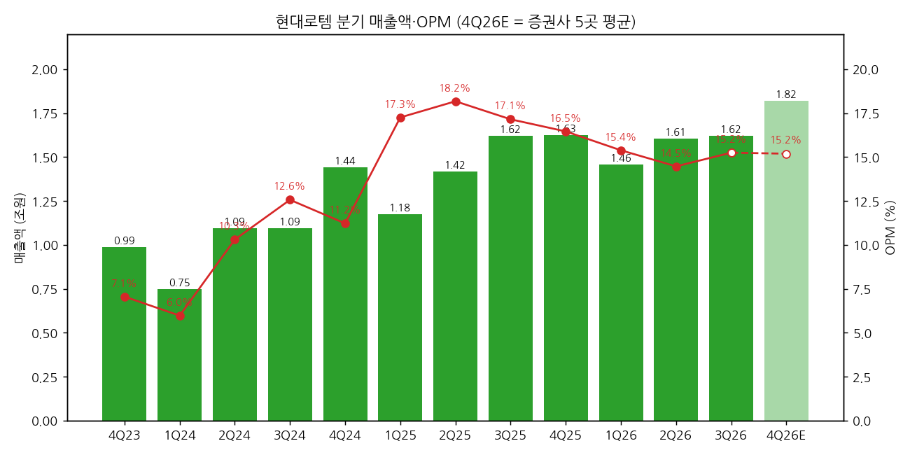
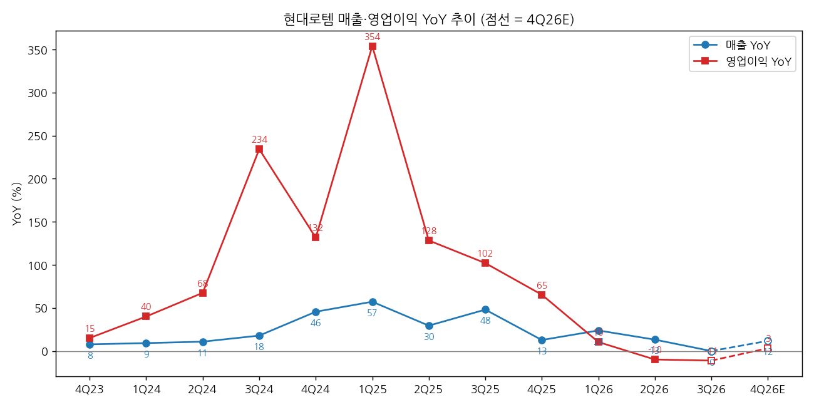
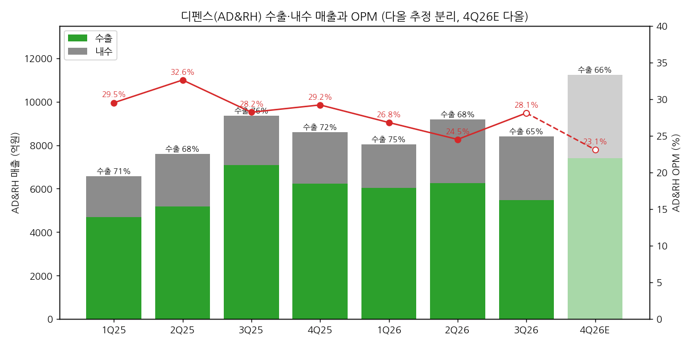

> 모드: 실적 리뷰 (v11)
> 종목: 현대로템 (064350)
> 섹터: 방산
> 서브섹터: 방산
> 분기: 2026-Q3
> 발표일: 2026-10-19
> 작성 시각: 2026-11-14 16:30 KST
> 분석 소스: 회사 3Q26 실적발표 IR(2026-10-19) + 셀사이드 8곳 — KB(10/19)·다올(10/19)·삼성(10/20)·신한(10/20)·SK(10/20)·미래에셋(10/20)·한화(10/26, 커버리지 개시)·유진(11/02) + 현대로템 기업개요 v1.1(DART·IR 분기 시계열). 웹서치 보완 없음

# 현대로템 3Q26 실적 리뷰

## 0. 한 줄 판정

> 성장 델타: 꺾임 | 내러티브: 약화 → 매매 제외 구간 (수출 2호 계약 확인 전까지 관망)

→ 숫자: 매출 1조 6,207억(+0.1% YoY), 영업이익 2,471억(-11.0%)으로 컨센 대비 각각 -10%. 영업이익 YoY가 1Q26 +10.5% → 2Q26 -9.8% → 3Q26 -11.0%로 **2개 분기 연속 마이너스**. 4Q26E도 +3%에 그쳐 YoY 정점(1Q25 +354%)은 이미 지났다
→ 방산 마진은 버텼다: AD&RH OPM 28.1%(2Q 24.5% → +3.6%p). 폴란드 2차(EC2) 생산이 안정되며 수출 마진이 30% 후반대로 추정된다(다올·미래에셋). 이번 분기 "숫자 중 유일한 긍정"
→ 쟁점의 중심은 **2027년 감익**: 회사는 신규 수출 계약이 없어도 2027년 방산 매출은 2026년과 비슷하되 국내 비중 확대·환율로 영업이익은 다소 감소한다고 안내. 증권사 7곳 평균 2027E 영업이익 1.02조로 발표 전 컨센(1.21조) 대비 -16%
→ 수주 공백: 3Q 누계 신규수주 3.8조(-74%), 방산 신규수주 3,445억(전년 9.14조). 방산 수주잔고 9.52조로 3Q25 정점(10.79조) 이후 4분기 연속 감소. 페루·이라크·루마니아·폴란드 EC3 모두 "유효하지만 시점 예단 불가"
→ 다음 분기 관건: 폴란드 EC3 협상 초청장(연내 목표)과 페루 2027 예산 통과(11월 국회) — 둘 중 하나라도 확인돼야 2027 감익 → 2028 증익 그림이 숫자로 연결된다

## 1. 숫자

① 연결 분기 표 (억원)

| 항목 | 4Q23 | 1Q24 | 2Q24 | 3Q24 | 4Q24 | 1Q25 | 2Q25 | 3Q25 | 4Q25 | 1Q26 | 2Q26 | **3Q26** | 4Q26E |
|---|---|---|---|---|---|---|---|---|---|---|---|---|---|
| 매출액 | 9,892 | 7,478 | 10,945 | 10,935 | 14,408 | 11,761 | 14,176 | 16,196 | 16,256 | 14,575 | 16,061 | **16,207** | 18,184 |
| 영업이익 | 698 | 447 | 1,128 | 1,374 | 1,617 | 2,029 | 2,576 | 2,777 | 2,675 | 2,242 | 2,324 | **2,471** | 2,762 |
| OPM | 7.1% | 6.0% | 10.3% | 12.6% | 11.2% | 17.3% | 18.2% | 17.1% | 16.5% | 15.4% | 14.5% | **15.2%** | 15.2% |
| 매출 YoY | 7.8% | 9.3% | 10.9% | 18.0% | 45.7% | 57.3% | 29.5% | 48.1% | 12.8% | 23.9% | 13.3% | **0.1%** | 11.9% |
| 영업이익 YoY | 15.2% | 40.1% | 67.6% | 234.3% | 131.7% | 353.9% | 128.4% | 102.1% | 65.4% | 10.5% | -9.8% | **-11.0%** | 3.3% |
| **매출 YoY 델타 (%p)** | -10.7 | +1.5 | +1.6 | +7.1 | +27.7 | +11.6 | -27.8 | +18.6 | -35.3 | +11.1 | -10.6 | **-13.2** | +11.8 |
| **영업이익 YoY 델타 (%p)** | -13.6 | +24.9 | +27.5 | +166.7 | -102.6 | +222.2 | -225.5 | -26.3 | -36.7 | -54.9 | -20.3 | **-1.2** | +14.3 |

→ (출처: 4Q23~2Q26 DART 분기보고서 재무 + 회사 IR, 3Q26 회사 3Q26 IR p.1·6 (2026-10-19, K-IFRS 연결, 감사 전). 4Q26E = 다올·신한·SK·미래에셋·유진 5곳 평균(매출 1조 8,184억, 영업이익 2,762억). 4Q22~3Q23 YoY 기준치는 기업개요 v1.1 사업부 합산)
→ 컨센 대비: 매출 -10.0%, 영업이익 -10.5% (FnGuide 3M 컨센 매출 1조 8,005억 / 영업이익 2,760억, 커버 19곳 — 삼성증권 인용). 지배순이익 1,766억은 컨센(2,161억) 대비 -18.3% — 영업외손익이 -80억(다올 집계, 전분기 +180억)으로 돌아서며 세전이익이 영업이익보다 더 줄었다
→ YoY 정점은 1Q25(+354%)였다. 2025년 내내 세 자릿수 증가율이 줄었고, 2026년 들어 2Q부터 마이너스로 내려왔다 `[판단]`
→ 컨센 경로: 4Q26E +3%, 2027E 영업이익 YoY +4%(7곳 평균 1.02조 vs 2026E 0.98조). 다만 범위가 유진 -7% ~ 미래에셋 +14%로 넓다. **다음 정점은 2028년(신규 수주 반영)으로 미뤄진 상태** `[전망]`

→ (출처: 회사 IR·DART, 4Q26E 증권사 5곳 평균)

→ (출처: 회사 IR·DART, 4Q26E 증권사 5곳 평균)

② 사업부별 매출·영업이익 (억원)

| 부문 | 항목 | 3Q25 | 4Q25 | 1Q26 | 2Q26 | **3Q26** | QoQ | YoY |
|---|---|---|---|---|---|---|---|---|
| AD&RH (방산·항공·로봇·수소) | 매출 | 9,361 | 8,599 | 8,196 | 9,189 | **8,412** | -8.5% | -10.1% |
| | 영업이익 | 2,638 | 2,507 | 2,199 | 2,248 | **2,360** | +5.0% | -10.5% |
| | OPM | 28.2% | 29.2% | 26.8% | 24.5% | **28.1%** | +3.6%p | -0.1%p |
| | 매출 비중 | 57.8% | 52.9% | 56.2% | 57.2% | **51.9%** | | |
| RS (레일) | 매출 | 5,406 | 6,191 | 5,432 | 5,848 | **6,561** | +12.2% | +21.4% |
| | 영업이익 | 71 | 115 | 29 | 37 | **59** | +59.5% | -16.9% |
| | OPM | 1.3% | 1.9% | 0.5% | 0.6% | **0.9%** | +0.3%p | -0.4%p |
| EP (에코플랜트) | 매출 | 1,429 | 1,466 | 947 | 1,023 | **1,234** | +20.6% | -13.6% |
| | 영업이익 | 69 | 52 | 14 | 39 | **52** | +33.3% | -24.6% |
| | OPM | 4.8% | 3.5% | 1.5% | 3.8% | **4.2%** | +0.4%p | -0.6%p |

→ (출처: 회사 3Q26 IR p.6. 2026.7 조직개편으로 수소·로보틱스가 EP → AD&RH로 이관. IR은 1Q26만 신기준으로 다시 작성했고, 3Q25·4Q25는 구기준 값 그대로 — YoY는 기준이 약간 섞임)
→ 이익의 96%가 AD&RH에서 나온다(3Q26 2,360 / 2,471억). 델타를 끄는 건 **방산 매출 -10%**다. 레일은 매출 +21%로 외형을 받쳤지만 OPM 0.9%라 이익 기여는 미미하다
→ 방산 매출 감소의 원인은 인도 물량이다. 3Q 폴란드 K2 인도는 14대로, 언론이 보도한 46대에 크게 못 미쳤다(KB). 4Q 44대가 예정돼 연 58대 전망 → 4Q 방산 매출은 1조 원 안팎으로 반등 `[전망]`

(2-1) AD&RH 수출·내수 분해 (다올 추정, 억원)

| | 1Q25 | 2Q25 | 3Q25 | 4Q25 | 1Q26 | 2Q26 | 3Q26 | 4Q26E |
|---|---|---|---|---|---|---|---|---|
| 수출 | 4,700 | 5,190 | 7,080 | 6,230 | 6,030 | 6,250 | 5,470 | 7,410 |
| 내수 | 1,880 | 2,420 | 2,280 | 2,370 | 2,010 | 2,940 | 2,940 | 3,840 |
| 수출 비중 | 71% | 68% | 76% | 72% | 75% | 68% | **65%** | 66% |
| OPM | 29.5% | 32.6% | 28.2% | 29.2% | 27.2% | 24.5% | **28.1%** | 23.1% |

→ (출처: 다올투자증권 10/19 Fig.6 — 수출·내수 분리는 회사 미공개, 다올 추정. 수출 비중 65%는 신한도 동일 인용)
→ 수출 비중이 68% → 65%로 내렸는데 OPM은 +3.6%p 올랐다. 수출 마진이 회복됐다는 뜻이다. 미래에셋은 수출 OPM을 2Q 30%대 초반 → 3Q 30% 후반으로 추정 `[추정]`

→ (출처: 다올투자증권 추정 분리, OPM은 회사 IR — 1Q26 OPM은 신기준 26.8%로 표기)

(2-2) 수주 — 방산 공백이 커지는 중 (억원)

| | 3Q25 | 4Q25 | 1Q26 | 2Q26 | **3Q26** |
|---|---|---|---|---|---|
| 수주잔고 전체 | 296,088 | 297,735 | 298,181 | 304,046 | **291,420** |
| AD&RH 잔고 | 107,897 | 105,181 | 101,021 | 98,197 | **95,228** |
| RS 잔고 | 180,028 | 184,533 | 189,365 | 198,670 | **190,310** |
| 신규수주 누계 (전체) | 147,582 | 160,245 | 7,098 | 25,801 | **38,049** |
| 신규수주 누계 (AD&RH) | 91,391 | 94,690 | — | 3,342 | **3,445** |

→ (출처: 회사 IR 각 분기, 기업개요 v1.1 표. 1Q26 사업부별 신규수주 미공개)
→ 3Q 누계 신규수주 3.8조로 전년 동기(14.8조) 대비 -74%(유진). 방산 잔고 9.52조는 2026년 방산 매출 추정치(3.5~3.7조) 기준 약 2.6년치다 `[판단]`

③ 연간 (억원)

| 항목 | 2023 | 2024 | 2025 | 2026E | 2027E |
|---|---|---|---|---|---|
| 매출액 | 35,874 | 43,766 | 58,390 | 64,920 | 72,330 |
| 영업이익 | 2,100 | 4,566 | 10,056 | 9,816 | 10,220 |
| OPM | 5.9% | 10.4% | 17.2% | 15.1% | 14.1% |
| 매출 YoY | 13.4% | 22.0% | 33.4% | 11.2% | 11.4% |
| 영업이익 YoY | 42.4% | 117.4% | 120.3% | -2.4% | +4.1% |

→ (출처: 2023~2025 회사 IR 연간 / 2026E·2027E = 발표 후 증권사 7곳 평균 — KB·다올·신한·SK·미래에셋·한화·유진. 삼성은 영업이익 미공개)
→ 발표 전 FnGuide 3M 컨센 2026E 영업이익 1.03조 / 2027E 1.21조 → 발표 후 7곳 평균 0.98조(-5%) / 1.02조(-16%). **하향의 무게는 2027년에 실렸다**
→ 2027E 매출 범위가 한화 6.37조(-3%) ~ 유진 7.83조(+19%)로 매우 넓다. 레일 모로코 생산 속도와 K2PL 현지 생산 조기화를 얼마나 반영하느냐의 차이다 `[판단]`

## 2. 시장 쟁점

① 2-0 지난 분기 체크

→ 첫 리뷰 — 직전 체크 없음 (2Q26 리뷰 미작성)

② 이번 분기 쟁점 5개

| # | 쟁점 | 언급 증권사 |
|---|---|---|
| (1) | 3Q 미스의 원인 — 인도 지연·환율·예비비 | 8/8 |
| (2) | 방산 마진 28%는 지속 가능한가 — 수출 마진과 믹스 | 8/8 |
| (3) | 2027년 감익의 깊이 — "매출 유지, 이익 다소 감소" | 8/8 |
| (4) | 수출 2호 계약은 언제 — 폴란드 EC3·페루·이라크·루마니아 | 8/8 |
| (5) | 현대위아 특수사업부 인수(3,584억)와 미래사업 입찰 실패 | 7/8 |

③ 쟁점별 분해

(1) **3Q 미스의 원인 — 인도 지연·환율·예비비**

(1-1) 회사 설명
→ 컨콜(10/19): 후속계약 지연, 환율 하락, 폴란드 EC2 물량 조기 인도에 따른 예비비 환입이 기대보다 작았다. 3Q 인도는 14대, 4Q 44대 예정(KB 컨콜 정리)

(1-2) 증권사별 해석

| 증권사 | 핵심 가정·추정 | 논리 |
|---|---|---|
| KB | 3Q 인도 14대(보도 46대), 4Q 44대 → 연 58대 | 인도 타이밍 문제, 연간 물량은 유지 |
| 삼성 | 매출 -10%는 원화 강세 영향이 예상보다 컸기 때문 | 매출 미스지만 이익률은 컨센 부합 |
| 다올 | 디펜스 매출 8,412억(-8% QoQ), 당사 예상(9,370억) 대비 -10% | 수출 비중 하락 + 인도 시점 |
| SK | 시장 예상 2,760억 대비 -10.5% | EC2 GF 116대 = 2H26 58대 + 2027 58대 |

(1-3) 공통 vs 갈림
→ 공통: 미스는 **인도 시점 + 환율** 탓이고, 연간 인도 물량(58대)은 유지된다
→ 갈림: 환율 영향의 크기. 삼성은 2027년 이익 전망을 24% 낮추며 원화 강세를 핵심 변수로 봤고, 다올은 2026E 영업이익을 오히려 +5% 올렸다(3Q 마진이 당사 예상을 웃돌아서)

(1-4) [판단]
→ 3Q 미스는 일시적 요인(인도 시점) 비중이 크다. 4Q 영업이익 2,762억(5곳 평균, +3% YoY)이 나오면 "타이밍 문제"가 확인된다. 반대로 4Q 인도가 다시 밀리면 연 58대 가정 자체가 흔들린다

(2) **방산 마진 28%는 지속 가능한가**

(2-1) 회사 설명
→ 폴란드 수출이 1차(EC1)에서 2차(EC2) 실행계약으로 넘어가는 과정. 통상 프로젝트 초반에는 보수적 원가 가정을 쓴다(삼성 인용). 2027년에는 국내 4차 양산 비중 확대와 환율로 OPM이 내려갈 수 있다(SK·신한 컨콜 정리)

(2-2) 증권사별 해석

| 증권사 | 2026E 방산 OPM | 2027E 방산 OPM | 논리 |
|---|---|---|---|
| 다올 | 25.5% | 25.5% | 수출 마진 30% 후반 추정. EC1처럼 학습효과로 마진 개선 여지 |
| 신한 | 26.0% | 23.4% | 2Q 24.5% → 3Q 28%로 폴란드 2차 생산 안정 확인. 다만 27년 국내 믹스로 부담 |
| 미래에셋 | — | — | 수출 OPM 2Q 30%초반 → 3Q 30%후반 추정 "고무적" |
| 삼성 | — | — | 수출 비중이 낮았음에도 이익률 유지 = 수출 마진 양호 |

(2-3) 공통 vs 갈림
→ 공통: 3Q 28.1%는 "EC2 생산 안정"의 증거다. 매출이 줄었는데도 마진이 올랐다
→ 갈림: 2027년. 다올은 학습효과로 25%대 유지, 신한은 국내 비중 확대로 23%대 하락을 가정

(2-4) [판단]
→ 수출 마진 자체는 회복됐다(숫자로 확인). 문제는 **수출 비중**이다. 다올 추정상 수출 비중이 2025년 72% → 2027년 63% → 2028년 55%로 내려가면, 같은 수출 마진으로도 방산 OPM은 낮아진다. 마진 지속성은 결국 쟁점 (4) 수출 신규 계약에 달려 있다

(3) **2027년 감익의 깊이**

(3-1) 회사 설명
→ "신규 수출 계약이 없어도 2027년 방산 매출은 2026년과 비슷하다. 다만 국내 비중이 커지는 제품 믹스 변화와 환율 영향으로 영업이익은 다소 감소할 수 있다. 2028년은 확정 물량 생산과 신규 수주로 매출을 회복한다"(신한 Q&A 정리)
→ 대응: 폴란드 K2PL(현지 생산분) 착수를 2028년에서 **2027년 하반기로 앞당긴다**. K2PL은 2027~29년 생산·2030년 완료, 계열 차량은 2028~30년 생산

(3-2) 증권사별 2027E

| 증권사 | 2027E 매출 | 2027E 영업이익 | YoY | 핵심 가정 |
|---|---|---|---|---|
| 미래에셋 | 7.59조 | 1.15조 | +14% | 레일 +34%(모로코), 방산 +4% |
| KB | 7.51조 | 1.07조 | +14% | 현대위아 특수사업부 인수 반영해 상향(+3.9%) |
| 다올 | 7.25조 | 1.05조 | +8% | K2PL 2H27 조기화 반영, 방산 OPM 25.5% 유지 |
| SK | 7.02조 | 1.04조 | +4% | 국내 4차 양산·환율로 OPM 하락 |
| 신한 | 7.06조 | 0.98조 | +2% | 방산 OPM 23.4%, 이익 -24% 하향 |
| 한화 | 6.37조 | 0.97조 | -6% | 방산 매출 -10% |
| 유진 | 7.83조 | 0.90조 | -7% | 수출 비중 하락, 내후년 점프업 |

(3-3) 공통 vs 갈림
→ 공통: 2027년은 "버티는 해", 2028년이 다음 성장 구간이다(신한 2028E +46%, 유진 +78%, 한화 +65%)
→ 갈림: 2027년 영업이익이 **늘어나는지(미래·KB) vs 줄어드는지(한화·유진)**. 갈리는 변수는 ① 현대위아 특수사업부 연결(연 매출 3,931억·영업이익 456억, 2027.3 종결 목표) 반영 여부 ② K2PL 조기 착수 반영 여부 ③ 환율

(3-4) [판단]
→ 회사 가이드("영업이익 다소 감소")를 그대로 받으면 2027년 영업이익은 0.9~0.97조가 맞다. KB·미래에셋의 증익은 현대위아 인수와 레일 성장을 더한 결과라 방산 본업 기준으로는 역시 감익이다. **방산 본업 기준 2027 감익은 컨센서스**로 보는 게 맞다 `[판단]`

(4) **수출 2호 계약은 언제**

(4-1) 회사 설명 (컨콜, 신한·KB·다올 정리)
→ 폴란드 EC3: 2026년 안에 협상 초청장 수령이 목표. 선결 과제 두 가지 협의 중 — ① 창정비 기술 이전 범위·현지 업체 ② 공병·교량전차 등 계열 차량의 폴란드형 개발
→ 페루: 2025.12 총괄합의에 따른 이행계약은 유효. 2027 예산안이 2026.11 국회 심의 예정. 2027 상반기 수주하면 그해 매출 인식 가능
→ 이라크: 2025년 긴급 소요로 확정된 K2 도입 계획 유효. 다만 미국-이란 전쟁 등 중동 정세로 시점 예단 어려움. 국방장관은 최근 확정(KB)
→ 루마니아: 2026년 RFP 예정이었으나 총리 불신임·연정 해체로 지연. 10월 말 신임 총리 선임 예상
→ 그 외 동유럽 1~2개국, 싱가포르 영업 중

(4-2) 증권사별 해석

| 증권사 | 파이프라인 가정 | 논리 |
|---|---|---|
| 다올 | 기대이익 4.6조 → 1.6조로 축소, EC3는 가치에서 제거 | EC3는 매출 "유지"용일 뿐 성장 아님. 페루 30%·이라크 30%·루마니아 25% 확률 |
| SK | 페루 2027 초 계약 가능성 높음, 루마니아 1H27 기대 | 이라크는 중동전쟁으로 우려 확대 → 가시화 전 보수적 접근 |
| 삼성 | 시점 전망 자체가 어려워짐 | 단일 제품(K2)·단일 시장(폴란드) 의존 해소 전까지 할인 불가피 |
| 신한 | 폴란드 EC3 시점 확인이 재평가 출발점 | 29조 잔고·EC3 기대는 일부 반영 |
| 유진 | 수주 지연이지 수요 부재 아님 | 유럽 노후 전차 1.1만 대 교체 사이클 초입 |
| 한화 | 이라크는 호르무즈 봉쇄로 예산 부담 | 경쟁사 긴 납기 대비 빠른 납기가 강점 |

(4-3) 공통 vs 갈림
→ 공통: 수요는 있고 시점이 밀렸다. 모든 증권사가 수주 지연을 TP 하향의 주된 이유로 들었다
→ 갈림: **EC3의 가치**. 다올은 "매출 유지일 뿐"이라 가치에서 뺐고, 신한은 "재평가 출발점"으로 본다. 다음 확인 순서는 SK(페루 → 루마니아 → 이라크)가 가장 구체적이다

(4-4) [판단]
→ 2027 감익을 메울 수 있는 건 2027 상반기 안에 매출로 잡히는 계약뿐이다. 회사 설명상 그 조건에 맞는 건 **페루(K2GF 기반, 상반기 수주 시 당해 인식)** 하나다. 페루 11월 예산 심의가 가장 가까운 확인 포인트다 `[판단]`

(5) **현대위아 특수사업부 인수와 미래사업 입찰 실패**

(5-1) 회사 설명
→ 10/19 공시: 현대위아 특수사업부문(K2 120mm 주포·K9 155mm 포신, 함포·CIWS, RCWS, 항공 착륙장치)을 3,584억에 영업양수(영업가치 4,800억 − 미이관 부동산 1,216억). 2025년 매출 3,931억·영업이익 456억(OPM 11.6%). 3Q26말 보유현금으로 지급, 11/27 현대위아 주총, 2027.3.31 거래종결 기한
→ 인수가 근거: DCF(유사 업체 EV/EBITDA 참고). 국내 유일 포신 제조사 — 수직계열화로 원가·현지화 대응력, RCWS 등 중복 R&D 해소

(5-2) 증권사별 해석

| 증권사 | 평가 |
|---|---|
| KB | 2027년 이후 실적 상향 요인으로 반영 |
| 다올·SK·유진 | 포트폴리오 다각화로 약점(K2 단일 제품) 보완, 대드론·CIWS로 확장 |
| 삼성 | 별도로, 올해 다목적 무인차량·KF-21 장거리 공대공 유도탄 개발 사업 수주 실패 → 미래 성장 동력 기대가 꺾임 |

(5-3) [판단]
→ 인수 규모(영업이익 456억)는 2027E 영업이익의 4~5% 수준이다. 감익 폭을 줄이는 정도이지 스토리를 바꾸지는 않는다. 삼성이 지적한 미래사업 입찰 실패가 오히려 "K2 의존" 내러티브를 강화했다 `[판단]`

④ 낙관 vs 보수

→ 낙관(다올 21만·KB 18만): 다올은 디펜스 PER을 30배 → 20배로 내리고 파이프라인을 1.6조로 깎았는데도 21만 원이다. 2027 방산 OPM 25.5% 유지와 2H27 K2PL 조기화를 이미 넣었다. KB는 2026E를 -9% 깎는 대신 현대위아 인수로 2027E를 +4% 올리고 Target P/E 22.5배를 유지했다
→ 보수(한화 11만·유진 13.8만): 한화는 2027E 매출 -3%·영업이익 -6%에 해외 피어 평균 대비 18% 할인한 17배를 적용. 유진은 2027E 영업이익 -7%이지만 2028E 순이익에 글로벌 피어 PER을 적용해 "내후년 점프업"을 가격에 넣었다
→ 차이의 본질은 **2027년 이익의 방향**과 **할증/할인 여부**다. 낙관 쪽은 국내 방산 평균에 가까운 멀티플을, 보수 쪽은 해외 피어 대비 할인을 쓴다
→ 셀사이드 vs 주가: 8곳 모두 매수 유지인데 주가는 발표일 10/19 100,700원 → 10/23 82,700원 → 11/02 76,500원(52주 최저 75,200원)으로 발표 후 -24%. 신규 커버리지(한화)도 TP 11만 원으로 현재가 대비 +33%만 제시. 바이사이드는 "수주 확인 전까지는 안 산다"는 쪽이다 `[판단]`

⑤ 추정치·TP 변화

| 증권사 | 직전 TP | 현재 TP | 4Q26 영업이익 E | 2026E / 2027E 영업이익 | 핵심 변화 한 줄 |
|---|---|---|---|---|---|
| KB (10/19) | 180,000 | 180,000 | — | 9,450 / 10,730억 | 2026E -9.4%, 2027E +3.9%(현대위아 반영), P/E 22.5배 유지 |
| 다올 (10/19) | 380,000 | 210,000 | 2,690억 | 9,730 / 10,500억 | 디펜스 PER 30→20배, 파이프라인 4.6→1.6조 |
| 삼성 (10/20) | 250,000 | 156,000 | — | EPS 7,348 / 8,786원 | 2027E EPS -24%(원화 강세·수주 지연) |
| 신한 (10/20) | 230,000 | 150,000 | 2,570억 | 9,611 / 9,792억 | 2027E 영업이익 -24%, 방산 할증 50→15% |
| SK (10/20) | 310,000 | 180,000 | 2,880억 | 9,916 / 10,355억 | 2027E -31%, 2028E EPS × 20배 |
| 미래에셋 (10/20) | 약 167,000 (4%↓) | 160,000 | 3,030억 | 10,060 / 11,470억 | 2027E -12.7%, 글로벌 피어 27F PER 18.7배 |
| 한화 (10/26) | 신규 | 110,000 | — | 10,270 / 9,670억 | 2027E EPS × 17배(해외 피어 -18%) |
| 유진 (11/02) | 220,000 | 138,000 | 2,640억 | 9,670 / 9,020억 | 2026E·2027E 각각 -3%·-11% |

→ (출처: 각 증권사 리포트. 미래에셋 직전 TP는 "4% 하향" 문구로 역산 `[추정]`)
→ 평균 TP: 직전이 있는 7곳 기준 약 24.8만 원 → 16.8만 원(-32%). 8곳 평균 현재 TP 16.1만 원. 하향 6건, 유지 1건, 신규 1건. 발표 전 컨센 TP 224,368원(삼성·KB 인용)
→ **하향의 원인은 실적과 멀티플이 반반이다.** 2027E 영업이익은 -16% 내려갔는데 TP는 -32% 내려갔다. 나머지 절반은 멀티플 축소(다올 PER 30→20배, 신한 할증 50→15%, 삼성 "글로벌 방산 밸류에이션 하락")에서 나왔다 `[판단]`

## 3. 내러티브 점검

① 성장 스토리 정의
→ "K2 전차 수출로 방산 OPM 30% 가까이를 만드는 회사. 폴란드 다음 수출국이 붙으면서 수출 비중과 이익이 한 단계 더 오른다"

② 이번 분기가 스토리에 준 영향
→ 강화된 것: 수출 마진 자체(3Q 방산 OPM 28.1%, 수출 OPM 30% 후반 추정)는 숫자로 재확인됐다
→ 약화된 것: "폴란드 다음 수출국"이 4개 후보 모두 시점 불명으로 밀렸고, 회사가 2027년 방산 감익을 사실상 인정했다. 미래사업 입찰 실패로 "K2 단일 제품 의존"이라는 약점이 더 부각됐다
→ 훼손은 아니다: 수요(페루·이라크·루마니아·폴란드 EC3)가 사라진 게 아니라 시점이 밀린 것이라는 데 8곳 모두 동의한다

③ 국면 판단
→ 델타 꺾임(영업이익 YoY 2개 분기 연속 마이너스, 4Q26E +3%, 2027E 감익 가능) + 내러티브 약화(수주 시점 지연·추정치 -16%·TP -32%) → **매매 제외 구간**
→ 주가는 이미 P/E 11배 안팎(2026E)까지 내려와 "가격은 싸다"는 데 셀사이드가 모두 동의한다. 다만 BT 프레임에서 싼 것은 매매 근거가 아니다. **델타를 다시 위로 돌릴 이벤트(수주)**가 나와야 국면이 바뀐다 `[판단]`

④ 트리거와 리스크
→ 트리거: ① 폴란드 EC3 협상 초청장 수령(연내 목표) ② 페루 2027 예산 통과 → 1H27 이행계약 ③ 루마니아 신정부 출범 후 RFP 발행
→ 리스크: ① 4Q 인도 44대 미달 → 2026E 추가 하향 ② 원화 강세 지속 → 수출 마진 하락 ③ 이라크·루마니아 추가 지연으로 2028 증익 그림까지 밀림

## 4. 향후 봐야 할 것

① **폴란드 EC3 협상 초청장** (델타 판정을 바꿀 1순위)
→ 무엇을: 2026년 내 협상 초청장 수령 여부, 선결 과제(창정비 기술 이전·계열 차량 폴란드형 개발) 합의
→ 어떤 데이터로: 회사 공시·폴란드 국방부(MON)·군비청 발표, 뉴스 키워드 "K2PL EC3", "협상 초청"
→ 언제: 2026.12 (회사 목표)

② **페루 K2 이행계약과 2027 예산**
→ 무엇을: 11월 페루 국회 2027 예산 심의에 K2 사업 포함 여부 → 1H27 계약 시 당해 매출 인식
→ 어떤 데이터로: 페루 의회 예산 심의 결과, 회사 수주 공시
→ 언제: 2026.11 예산 심의 → 1H27 계약

③ **4Q26 인도 44대와 방산 매출 1조 원 회복**
→ 무엇을: 4Q 폴란드 K2 인도 44대(연 58대), 4Q 영업이익 컨센 2,762억(+3% YoY) 달성 여부, 방산 OPM 23~25% 유지
→ 어떤 데이터로: 4Q26 잠정실적, 관세청 방산 수출 통계(12월), 폴란드 인도 보도
→ 언제: 2027.1 하순 잠정실적

④ **루마니아·이라크 진척**
→ 무엇을: 루마니아 신정부 출범 후 전차 사업 RFP 발행, 이라크 K2 협상 재개
→ 어떤 데이터로: 루마니아 국방부 발표, 중동 정세 뉴스
→ 언제: 루마니아 연내 RFP 여부, 이라크 미정

⑤ **현대위아 특수사업부 인수 절차와 2027 가이던스**
→ 무엇을: 11/27 현대위아 주총 승인, 산업부 인허가, 4Q26 컨콜에서 2027 방산 매출·이익 가이드의 구체 수치
→ 어떤 데이터로: 현대위아 주총 공시, 4Q26 IR
→ 언제: 2026.11.27 / 2027.1 하순
