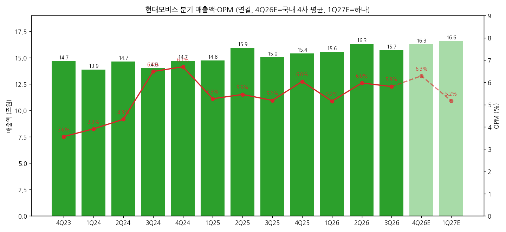
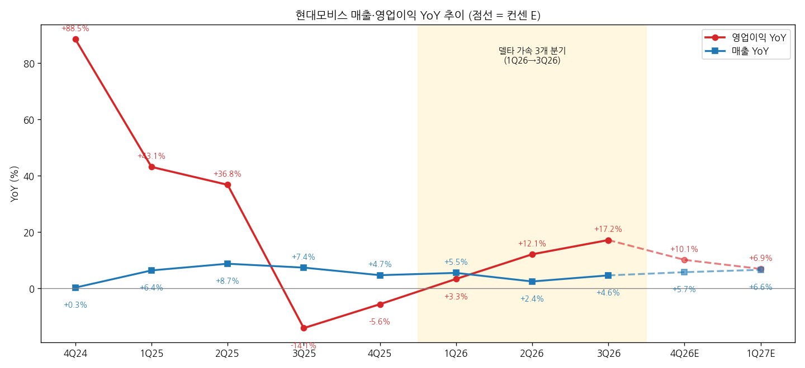
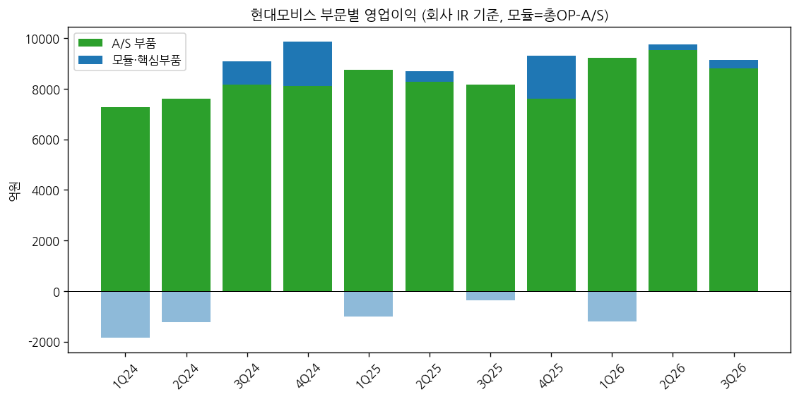
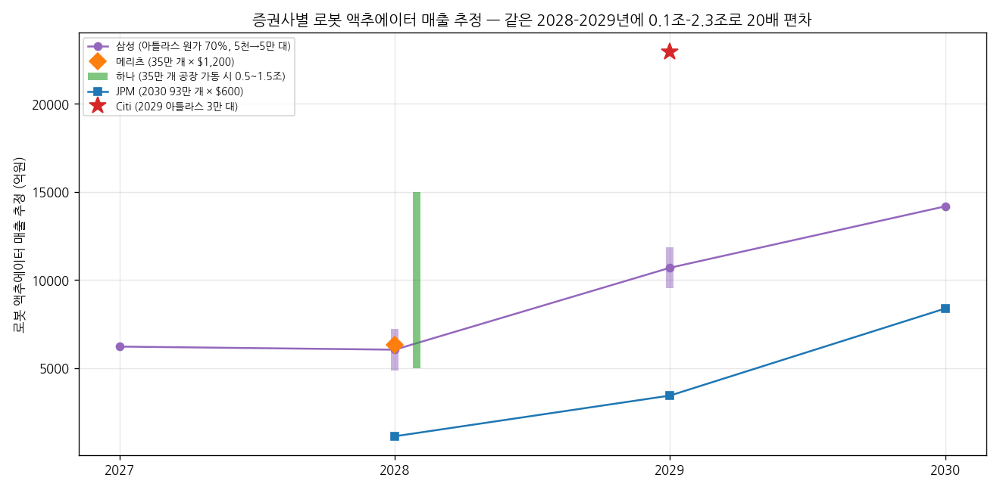
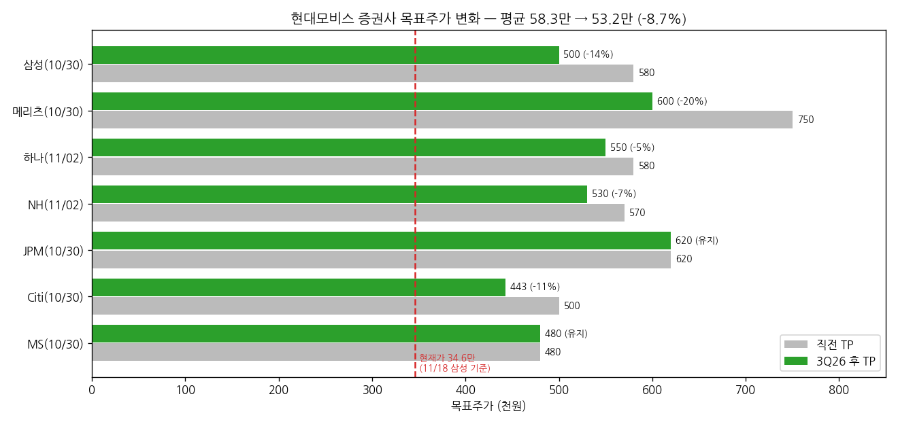

> 모드: 실적 리뷰 (v11)
> 종목: 현대모비스 (012330)
> 섹터: 로봇
> 서브섹터: 로봇 부품
> 분기: 2026-Q3
> 발표일: 2026-10-30
> 작성 시각: 2026-11-23 14:10 KST (v2.1 — BT 2026-11-23 비영업 대칭 기준 재검토 반영, v2 13:40은 .bak_20261123c / v2 — 셀사이드 첨부 반영 풀 리뷰 업그레이드, v1 2026-11-14 22:10 숫자 중심본은 .bak_20261123)
> 분석 소스: 회사 「2026 3분기 경영실적」 IR(2026-10-30, BT 첨부) + OpenDART 분기 재무(1Q16\~3Q26, **3Q26 분기보고서 2026-11-16 접수 확정치**) + DART 분기·반기·사업보고서 영업부문 주석(1Q24\~2Q26) + BT 첨부 셀사이드 10건 — 삼성증권(10/30 3Q26 Review·11/18 2027 전망), 메리츠증권(10/30 Company Brief·11/05 2027 Outlook), 하나증권(11/02 컨콜 Q&A 정리 포함·11/13 Update), NH투자증권(11/02), J.P. Morgan(10/30 First Take), Citi(10/30 Upgrade), Morgan Stanley(10/30) + 기존 키움(11/03) 원문 + 웹 보도 인용(SBS Biz·딜사이트 10/30, 헤럴드경제 05/18, 토요경제 10/22 — v1 소스)
> 리뷰 깊이: 풀 | 리서치 첨부 11건 (셀사이드 10 + 회사 IR 1)
> 비영업 요인: (BT 2026-11-23 대칭 기준 재검토 — 비영업 제외 YoY +7.5\~+24.3%로 가속 유지, 0번 ① 표) 일회성 비용(인도 공장 화재 영업이익 영향 971억 — 영업이익에서 차감, 손실 약 2,300억 대부분 보험 회수 예상) · 일회성 성격 이익(고객사 비용 회수·보조금, 금액 미공개) · 저기저(3Q25 미국 부품 관세 25% 부담 분기, 영업이익 -14.1% YoY) · 직전 분기 일회성(2Q26 A/S 관세 환급) · 영업외(지분법 -39.6%, 기타/금융손익 -1,948억 → 순이익에만 영향). 인수 없음

# 현대모비스 3Q26 실적 리뷰

## 0. 한 줄 판정

> 성장 델타: 가속 | 내러티브: 약화 → 관찰 구간 (본업 델타는 3Q26이 정점 후보, 로봇 액추에이터는 실행이 진전됐지만 멀티플 하향이 그보다 컸다 — 재점화는 액추에이터 공장 투자 공시)

> ⚠ 비영업 요인 플래그 (BT 2026-11-23 기준 재검토: 비영업발 가속 불인정 — 대칭 적용 결과 **가속 유지**): 비영업 요인을 양방향으로 빼도 가속이다. 3Q26 비영업 제외 영업이익 YoY **+7.5\~+24.3%**(중앙 시나리오 +21.5%) vs 2Q26 비영업 제외 **-2.4\~+0.7%** — 보고 기준(+12.1% → +17.2%, +5.1%p)보다 델타가 오히려 크다. 2Q26은 A/S 관세 환급 일회성이 YoY를 부풀렸고, 3Q26은 인도 화재 971억이 YoY를 눌렀기 때문. 가속을 부정하려면 3Q 고객사 비용 회수·보조금(미공개)이 **1,620억 이상**이어야 하는데, 이는 회사·하나가 "원가 절감·외주비 효율화·비용 회수·보조금으로 일회성 부담을 상쇄"라고 묶어 설명한 총액(화재 971 + 품질 550억 수준)을 넘는다 → **가속의 주원인은 본업(모듈 전장·전동화 믹스)**, 인수 없음

→ 숫자(확정): 매출 15.72조(+4.6% YoY), 영업이익 9,141억(+17.2%), OPM 5.8% — 3Q26 분기보고서(2026-11-16) 확정치가 10/30 발표치와 동일. 영업이익 YoY +3.3% → +12.1% → **+17.2%로 3개 분기 연속 확대**(+5.1%p), 매출 YoY도 2.4% → 4.6% → 판정표상 **가속** (변화폭 +5.1%p로 유지 경계선을 간신히 넘은 가속). 컨센 대비 매출 -1.0\~0%, 영업이익 -1.4\~0%로 부합. 지배순이익 5,979억(-35.7%)은 컨센 1.01조를 -41% 하회(지분법·외환)
→ 다음 분기 경로: 4Q26E 영업이익 1.02조(첨부 국내 4사 평균, YoY +10.1%) — **사상 첫 분기 1조원이지만 YoY는 17.2% → 10.1%로 둔화**, 1Q27E(하나) +6.9%. 컨센상 YoY 정점은 3Q26. 가속을 이어가려면 4Q 영업이익이 **1.09조(4Q25 × 1.172)를 넘어야** 한다
→ 쟁점: 10개 리포트 전부가 "4Q 1조원"과 "모듈 흑자 유지"에 동의하고, 갈리는 건 **2027년 모듈 영업이익(920억\~6,610억, 7배 편차)**과 **로봇 액추에이터 가치(TP에 0원 vs 8조원)**. 로봇은 BD 액추에이터 수주 확정·31종 시제품 생산·공장 입지 검토 막바지로 실행이 진전됐으나 "2027년은 90대 분량"(NH), "대량 양산은 2029년 이후"(메리츠)
→ TP: 첨부 7곳 평균 58.3만 → 53.2만(-8.7%), 하향 5·유지 2·상향 0(Citi는 의견만 Neutral → Buy 상향). FnGuide 컨센 TP 66.6만(25곳) → 60.2만(23곳, -9.6%). **영업이익 추정은 유지\~상향(NH +3.5%, Citi +4.1%)인데 TP가 내렸다 = 멀티플(업종·로봇 피어)과 영업외(지분법) 하향** → 내러티브 v1 "유지"에서 **약화로 변경**
→ 다음 분기 관건: 4Q26 영업이익 1.09조 초과 여부(가속 유지선)와 모듈 4Q 1,700억+, 그리고 액추에이터 전용 공장 입지·투자 공시(로봇 내러티브 재점화 트리거)

① 비영업 제외 영업이익 YoY 계산 (억원, BT 2026-11-23 "비영업은 모두 같은 기준" — 일회성 비용 가산과 일회성 이익·기저 차감을 대칭 적용)

| 항목 | 2Q26 | 3Q26 | 금액 근거·방법 |
|---|---|---|---|
| 보고 영업이익 (전년 동기) | 9,752 (8,700) | 9,141 (7,803) | OpenDART |
| 보고 YoY | +12.1% | +17.2% | |
| (+) 인도 공장 화재 비용 가산 | — | +971 | 하나·삼성 971억(메리츠 917억, JPM 약 970억). 3Q 발생, 4Q 추가 없음(회사) |
| (−) A/S 관세 기저·환급 차감 | −995 \~ −1,257 | −414 \~ −634 | 금액 미공개 → 범위 추정. 하한 = A/S OPM 개선분(2Q +2.9%p·3Q +1.2%p × A/S 매출), 상한 = A/S 영업이익 YoY 증가 전액(판가 인상·환율까지 비영업으로 간주하는 보수적 상한). 2Q26은 관세 환급 일회성(하나) + 2Q25 관세 부담 기저, 3Q26은 3Q25 관세 25% 기저 |
| (−) 고객사 비용 회수·보조금 차감 | 미공개 (0 가정) | 0 \~ −1,088 | 미공개 → 범위. 상한 = 모듈 OP의 QoQ 개선 중 화재 비용을 상쇄한 금액 전체(2Q 218 → 3Q 335, 화재 −971을 메운 +1,088억)를 회수·보조금으로 간주 |
| **비영업 제외 영업이익 YoY** | **-2.4% \~ +0.7%** | **+7.5% \~ +24.3%** (화재 가산 + 관세 상한만: +21.5%) | 반도체 원가 940억·전동화 품질 550억(NH)은 반복 원가 성격이라 조정하지 않음 — 품질비용까지 가산하면 3Q는 더 높아짐 |
| 손익분기 | | 회수·보조금 ≥ 1,620억이면 3Q 조정 YoY가 2Q 조정 상단(+0.7%) 이하 | (9,141 + 971 − 634 − R) ÷ 7,803 = 1.007 |

→ 판정: 비영업 제외 기준으로도 2Q → 3Q 델타는 **+6.8\~+26.7%p로 확대** → 가속의 주원인은 본업. 보고 기준 판정(가속)과 같음 — **판정 유지** `[판단]`
→ 섹터 리뷰 집계: 가속으로 셈 (인수·비영업 주도 아님). 단, 회수·보조금 금액이 미공개라 4Q26 컨콜에서 금액이 나오면 재확인

## 1. 숫자

① 연결 분기 표 (억원)

| 항목 | 4Q23 | 1Q24 | 2Q24 | 3Q24 | 4Q24 | 1Q25 | 2Q25 | 3Q25 | 4Q25 | 1Q26 | 2Q26 | **3Q26** | 4Q26E | 1Q27E |
|---|---|---|---|---|---|---|---|---|---|---|---|---|---|---|
| 매출액 | 146,722 | 138,692 | 146,553 | 140,018 | 147,107 | 147,520 | 159,362 | 150,319 | 153,979 | 155,605 | 163,247 | **157,233** | 162,820 | 165,850 |
| 영업이익 | 5,232 | 5,427 | 6,361 | 9,086 | 9,861 | 7,767 | 8,700 | 7,803 | 9,305 | 8,026 | 9,752 | **9,141** | 10,246 | 8,580 |
| OPM | 3.6% | 3.9% | 4.3% | 6.5% | 6.7% | 5.3% | 5.5% | 5.2% | 6.0% | 5.2% | 6.0% | **5.8%** | 6.3% | 5.2% |
| 매출 YoY | -2.1% | -5.4% | -6.6% | -1.6% | +0.3% | +6.4% | +8.7% | +7.4% | +4.7% | +5.5% | +2.4% | **+4.6%** | +5.7% | +6.6% |
| 영업이익 YoY | -20.8% | +29.8% | -4.2% | +31.6% | +88.5% | +43.1% | +36.8% | -14.1% | -5.6% | +3.3% | +12.1% | **+17.2%** | +10.1% | +6.9% |
| **매출 YoY 델타 (%p)** | — | -3.3 | -1.1 | +5.0 | +1.9 | +6.1 | +2.4 | -1.4 | -2.7 | +0.8 | -3.0 | **+2.2** | +1.1 | +0.9 |
| **영업이익 YoY 델타 (%p)** | — | +50.6 | -34.0 | +35.8 | +56.8 | -45.4 | -6.3 | -50.9 | +8.5 | +9.0 | +8.8 | **+5.1** | -7.1 | -3.2 |

→ (출처: 4Q23\~3Q26 OpenDART 연결 분기(4Q = 연간 − 3Q 누적), 3Q26 = 분기보고서 2026-11-16 접수(접수번호 20261116002191) — IR 10/30 발표치와 동일. 4Q26E = 첨부 리포트 중 발표 후 분기 추정을 갱신한 국내 4사(삼성 10/30·메리츠 10/30·하나 11/02·NH 11/02) 평균 — 매출 16.01/16.00/16.06/17.06조, 영업이익 1.013/1.016/1.002/1.067조. 1Q27E = 하나 11/13 단독(소수 의견). 외국계 3사는 분기 추정 미갱신(JPM 9,240억은 발표 전 추정)이라 평균에서 제외)
→ 컨센 대비: 매출 15.72조 vs Bloomberg 15.88조(메리츠·Citi 인용) **-1.0%**, 영업이익 9,141억 vs 9,268억 **-1.4%** / Bloomberg 9,140억(JPM·MS 인용) 대비 **0%** → 부합. 지배순이익 5,979억(-35.7% YoY)은 컨센 1.01조 대비 **-41%** — 지분법이익 2,007억(-39.6%, 현대차 실적 악화)과 원화 강세 외환손실(기타/금융손익 -1,948억, 전년 +1,482억). v1의 "지배순이익 6,890억(유진)"은 오기 → 확정치 5,979억으로 정정
→ 영업이익 YoY는 4Q24(+88.5%)가 직전 사이클 정점, 3Q25(-14.1%) 저점 이후 4개 분기 연속 델타 플러스. 4Q26E +10.1%(4Q25 9,305억은 A/S 관세 부담이 남은 분기)·1Q27E +6.9%로 **컨센 경로상 YoY 정점은 3Q26** — 4Q에 1조원을 넘겨도 YoY는 둔화 `[전망]`. 4Q26E 매출은 NH 17.06조가 이상치(모듈조립 7.98조 가정), 나머지 3사는 16.0조 근방
→ 52주 고점 768,000원(종가, 2026-05-29 — NH)·장중 822,000원(MS) 대비 현재 346,000원(11/18 삼성 기준가)은 -55%

→ (출처: OpenDART·회사 IR, 4Q26E 국내 4사 평균, 1Q27E 하나)

→ (출처: OpenDART·회사 IR, 4Q26E 국내 4사 평균, 1Q27E 하나)

② 사업부별 매출·영업이익 (억원, 회사 IR 기준)

| 부문 | 항목 | 3Q25 | 4Q25 | 1Q26 | 2Q26 | **3Q26** | QoQ | YoY | 4Q26E |
|---|---|---|---|---|---|---|---|---|---|
| 모듈·핵심부품 | 매출 | 116,747 | 120,444 | 120,415 | 128,942 | **122,739** | -4.8% | +5.1% | 128,424 |
| | 영업이익 | -370 | 1,706 | -1,213 | 218 | **335** | +53.7% | 흑전 | 1,684 |
| | OPM | -0.3% | 1.4% | -1.0% | 0.2% | **0.3%** | +0.1%p | +0.6%p | 1.3% |
| | 매출 비중 | 77.7% | 78.2% | 77.4% | 79.0% | **78.1%** | | | |
| └ 모듈조립 | 매출 | 68,485 | 71,812 | 71,492 | 75,212 | **69,439** | -7.7% | +1.4% | |
| └ 부품제조 | 매출 | 35,165 | 36,081 | 36,051 | 39,537 | **37,198** | -5.9% | +5.8% | |
| └ 전동화 | 매출 | 13,097 | 12,551 | 12,872 | 14,193 | **16,102** | +13.5% | +22.9% | |
| A/S 부품 | 매출 | 33,572 | 33,536 | 35,190 | 34,304 | **34,494** | +0.6% | +2.7% | 34,392 |
| | 영업이익 | 8,173 | 7,599 | 9,239 | 9,534 | **8,807** | -7.6% | +7.8% | 8,557 |
| | OPM | 24.3% | 22.7% | 26.3% | 27.8% | **25.5%** | -2.3%p | +1.2%p | 24.9% |

→ (출처: 매출 = DART 분기·반기보고서 외부고객 매출 누적 차감(IR 텍스트와 일치), 3Q26 = IR·하나 컨콜 정리. 하위 3분류는 메리츠 10/30·하나 11/02 표(회사 공시치). 모듈 OP = IR 하이라이트, A/S OP = 연결 OP − 모듈 OP. 4Q26E = 국내 4사 평균. DART 부문 주석은 공통비 배분 전이라 IR과 기준 다름)
→ **YoY 증분 +1,338억 = 모듈 +705억 + A/S +634억** — 델타의 절반 이상을 모듈이 만들었다. 모듈은 고객사 완성차 생산 -2.3%에도 매출 +5.1% — 전동화 +22.9%(유럽 BEV 생산 +12.8%, 스페인 BSA 등 글로벌 OE), 부품제조 +5.8%(고부가 전장·Non-captive). 인도 화재 971억·반도체 940억·전동화 품질비용 550억(NH)을 원가 절감·고객사 비용 회수·보조금으로 상쇄하고 흑자 (회사 IR p.5, 하나 컨콜)
→ A/S는 관세율 25% → 15%·판가 인상·USD +2.8%로 +7.8%. 2Q26(+15.1%, 관세 환급 포함) 대비 둔화, 북미 용품 매출 2개 분기 연속 둔화 — **A/S 델타는 꺾이는 중, 모듈이 바통을 받는 구도** `[판단]`. 2027E A/S 영업이익은 삼성 -2.0%·하나 -3.1%(원/달러 하락 가정) vs 메리츠 +2.5% — **2027 증익은 거의 전부 모듈 몫**
→ 로봇 부품 매출: **분리 공시 없음**. 11월 시제품 납품은 "실비 정산 성격"(회사, 삼성 10/30 인용) — 매출 인식 규모 미미

→ (출처: 회사 IR 기준 재구성, v1 차트 유지)

(2-1) 수주·지역 KPI (회사 3Q26 IR p.7·10·12, 하나 컨콜)
→ Non-captive 핵심부품 수주 3Q 누계 11.5억 달러 = 2026 목표 89.7억 달러의 13% (북미 5.46억, 유럽 4.02억, 중국 1.09억, 일본 0.76억, 인도 0.15억). 회사: "전동화·통합제어기 차세대 프로젝트가 내년으로 순연 — 취소가 아닌 일정 변경"
→ 모듈 포함 연간 수주는 140억 달러 전망(계획 118억 달러 초과) — 10월 **미국 Major OE 샤시모듈 약 7년 공급(미국 생산)**. 회사: 모듈 마진 "로우 싱글 디지트", R&D 부담이 적어 ROIC는 낮지 않음
→ 지역: 유럽 매출 2.62조·영업이익률 7.7%(모듈/부품 +36.0%), 미주 4.57조·5.3%, 기타 -287억 적자(인도 화재), 중국 A/S -77.9%

③ 연간 (억원)

| 항목 | 2023 | 2024 | 2025 | 2026E | 2027E |
|---|---|---|---|---|---|
| 매출액 | 592,544 | 572,370 | 611,181 | 638,837 | 668,326 |
| 영업이익 | 22,953 | 30,735 | 33,575 | 36,841 | 39,160 |
| OPM | 3.9% | 5.4% | 5.5% | 5.8% | 5.9% |
| 매출 YoY | +14.2% | -3.4% | +6.8% | +4.5% | +4.6% |
| 영업이익 YoY | +13.3% | +33.9% | +9.2% | +9.7% | +6.3% |

→ (출처: 2023\~2025 OpenDART, 2026E·2027E = 첨부 7사(삼성·메리츠·하나·NH·JPM·Citi·MS) 평균. 2026E 영업이익 범위 3.60\~3.76조, 2027E 3.59\~4.20조)
→ **v1 키움 단독 2026E 매출 65.3조 검증**: 첨부 7사 2026E 매출 범위 62.95\~64.91조(평균 63.88조), FnGuide 컨센 64.18조(하나 11/13). 1\~3Q 누계 47.61조(분기보고서) 대비 키움 65.3조는 4Q 17.7조(+15% YoY)를 함의 — **이상치로 판단해 표에서 제외**하고 7사 평균으로 교체. `[확인 필요]` 해소
→ 발표 전 → 후 연간 영업이익 컨센(FnGuide, 하나 인용): 2026 3.70조(11/02) → 3.71조(11/13, +0.2%), 2027 4.06조 → 4.02조(-0.8%). 개별 수정: 2026E 메리츠 -1.6%·NH +3.5%·Citi +4.1%, 2027E 메리츠 -4.9%·NH +1.4%·Citi +3.2% — **영업이익 눈높이는 사실상 그대로**. 순이익은 메리츠 2026E -14.7%·Citi -12.7%·NH EPS -8.5%로 하향(지분법·영업외)

## 2. 시장 쟁점

① 2-0 지난 분기 체크

→ 첫 리뷰 — 직전 체크 없음 (2Q26 리뷰 미작성). 다음 분기(4Q26) 리뷰부터 이 리뷰의 4번 목록으로 체크

② 이번 분기 쟁점 5개

| # | 쟁점 | 언급 증권사 수 |
|---|---|---|
| (1) | 4Q26 첫 분기 영업이익 1조원 — 근거는 무엇이고, 반도체 원가가 상향 여지를 막는가 | 7/7 (전부) |
| (2) | 모듈·핵심부품 흑자는 구조적인가 — 일회성을 빼면 정상 마진은, 2027 모듈 이익은 얼마인가 | 7/7 |
| (3) | 로봇 액추에이터(아틀라스) — 수주 확정 이후 물량·단가·마진, TP에 얼마를 넣나 | 7/7 |
| (4) | TP 하향 — 실적이 아니라 멀티플인가, 저평가 논리는 무엇인가 | 7/7 (하향 5) |
| (5) | 램프 매각과 매수청구권(청구가 40.8만원) — 오버행인가 주주환원인가 | 4/7 (Citi·MS·삼성·하나) |

③ 쟁점별 분해

(1) **4Q26 첫 분기 영업이익 1조원 — 근거와 반도체 원가**

(1-1) 회사 설명

→ "4분기 분기 영업이익 1조원 달성 전망(모비스 사상 최초)… 인도 관련 비용은 대부분 집행 완료, 4분기 의미 있는 추가 비용 없음… 매년 비용 정산이 4분기에 집중되는 추세이며 올해도 유지될 전망" (3Q26 컨콜, 하나 11/02 정리)

→ 시사점: 1조원의 근거는 **인도 화재 비용 소멸(3Q 971억) + 연말 고객사 비용 정산 + 모듈 흑자 확대** 세 가지 → 반도체는 "장기계약으로 내년 물량 확보, 가격 협상은 시작 단계, 인상은 불가피 — 부품사가 흡수할 규모가 아님" → 4Q는 확신, **2027 원가는 미지수**

(1-2) 증권사별 해석 편차

| 증권사 | 4Q26E 매출 / 영업이익 (YoY) | 논리 |
|---|---|---|
| 삼성 (10/30) | 16.01조 / 1.013조 (+8.9%) | 화재 비용 축소·제조 흑자 확대·연말 정산. 3Q 누적 제조 손익 -660억 → 연간 개선 폭은 4Q 제조 이익에 좌우. 메모리 원가 분담이 2027 핵심 변수 |
| 메리츠 (10/30) | 16.00조 / 1.016조 (+9.2%) | 단가 인상·비용 정산으로 수익성 방어 지속 |
| 하나 (11/02) | 16.06조 / 1.002조 (+7.7%) | 화재 비용 선반영 소멸 + 연말 정산 + 유럽 전동화 물량. 손실 2,300억 대부분 보험 회수 |
| NH (11/02) | 17.06조 / 1.067조 (+14.7%) | 화재 비용 3Q 전액 반영, 제조 흑자 지속 + A/S 견조 — 모듈 매출 13.6조로 가장 공격적 |
| Citi (10/30) | 16.15조 / 1.01조 (연간 역산) | 회사가 "1조 초과"에 자신(컨센 1.0조와 같은 수준) — Buy 상향 근거 1번 |
| JPM (10/30) | 16.45조 / 0.92조 (발표 전 추정) | 1조 가이던스는 이미 BBG 컨센에 반영. **반도체 원가 회수 불확실 → 상향 여지 제한**, 기아도 2027 원가 압박 언급 |
| MS (10/30) | 15.35조 / 0.93조 (연간 역산, 모델 미갱신 가능) | 모듈 수익성 개선 → 1조 초과 목표, 2027까지 마진 개선 지속 가능(경영진) |

(1-3) 공통 vs 갈림
→ 공통: 4Q 1조원은 **이미 컨센**(FnGuide 1.0조, 삼성 인용) — 달성은 "확인"이지 서프라이즈가 아니다. 1조원이어도 YoY는 +7.7\~14.7%로 3Q(+17.2%)보다 낮다
→ 갈림: 반도체(메모리·기판) 원가 전가. JPM은 "완성차도 마진이 줄어 너그럽지 않다 → 상향 제한", 하나·삼성은 "4Q 정산 관행 유지 → 분담 진행"

(1-4) [판단]
→ 델타 관점에서 4Q는 **1조원이 아니라 1.09조(4Q25 9,305억 × 1.172)가 기준선**이다. 국내 4사 중 이 선을 넘는 추정은 0곳(최고 NH 1.067조) — 컨센 경로대로면 4Q26은 **둔화** 판정. 가속 유지 시나리오는 연말 비용 정산이 예상보다 크거나(삼성: 3Q 누적 제조 -660억이라 4Q 제조 이익 레버리지 큼) 인도 보험 회수가 영업이익으로 잡히는 경우뿐 `[판단]`

(2) **모듈·핵심부품 흑자는 구조적인가**

(2-1) 회사 설명

→ "인도 화재 및 메모리 반도체 비용 부담에도 불구, 유럽 전기차 판매 증가 및 전장 중심의 제품 믹스 개선으로 영업이익 흑자 전환" (회사 3Q26 IR p.5) / "연간 모듈 및 핵심부품 영업이익은 전년 756억원 대비 최소 앞자리가 바뀌는 수준 기대… 전동화는 여전히 적자이나 최악 국면은 넘어가는 중" (컨콜, 하나 11/02)

→ 시사점: 1\~3Q 누계 모듈 OP -660억 → "앞자리가 바뀐다"(최소 1,000억대)면 **4Q 모듈 OP 1,700억+가 필요** → 회사 가이던스 자체가 4Q 모듈 계절 정점(4Q24 1,740억·4Q25 1,706억) 재현을 전제 → 유럽 매출은 "일회성이 아니며 계속 성장"(컨콜)

(2-2) 증권사별 해석 편차 (모듈·핵심부품 영업이익, 억원)

| 증권사 | 4Q26E | 2026E | 2027E (OPM) | 논리 |
|---|---|---|---|---|
| 삼성 (10/30·11/18) | 1,650 | 990 | **6,610 (1.3%)** | 전장시스템(모듈 매출의 20%, 2026E 10.8조 +12%)이 OPM 7\~8%로 xEV 적자 상쇄. 2028 SDV 통합제어기·센서로 연 6\~7조 매출 추가 — "방어주 → 성장주" |
| 메리츠 (10/30·11/05) | 1,634 | 973 | 2,584 (0.5%) | 2026 연간 영업이익의 97%가 A/S. 부품은 비주력 매각·비용 정산으로 개선되나 레거시 OEM 수주는 저마진, 중국 브랜드 성과 부재 |
| 하나 (11/02·11/13) | 1,540 | 880 | 3,990 (0.7%) | 매출 레버리지 + 일회성 제거. 전동화는 OPM -10% 가정(PSR 0.2배), 2027 전동화 매출 +29% |
| NH (11/02) | 1,910 | 1,260 | — | 원가 절감·비용 회수로 일회성 비용(화재 971·반도체 940·품질 550억) 상쇄 |
| Citi (10/30) | — | 1,060 | 3,260 | 2026E 모듈 EBIT -1,360억 → +1,060억으로 상향(기존 대비 흑전) |
| JPM (10/30, 발표 전) | 380 | -1,260 | 920 | 반도체 원가 회수 불확실, HMG EV 판매 부진 시 고정비 부담 |

→ 일회성 가감 참고: 3Q 모듈 OP 335억 + 인도 화재 971억 = **약 1,306억(OPM 1.1%)** `[참고, 단순 가산]` — 단, 고객사 비용 회수·보조금(금액 미공개)이 반대 방향으로 섞여 있어 "정상 마진"은 0.3\~1.1% 사이 어딘가 `[추정]`

(2-3) 공통 vs 갈림
→ 공통: 흑자의 원인은 물량이 아니라 **믹스(전장·전동화)와 비용 정산** — 고객 생산이 -2.3%여도 이익이 났다. 2개 분기 연속 흑자는 전원 인정
→ 갈림: **2027E 모듈 영업이익 920억(JPM)\~6,610억(삼성), 7배 편차**. 삼성은 전장 성장(통합제어기)을, 메리츠·JPM은 현대차·기아 물량 정체와 반도체 원가를 본다. 2027 연결 영업이익 3.59\~4.20조 편차의 대부분이 여기서 나온다

(2-4) [판단]
→ OPM 0.3%는 비용 한 번에 적자로 돌아갈 두께다(1Q26 -1.0%). 그러나 이번 분기는 일회성·원가 비용 2,461억(화재 971·반도체 940·전동화 품질 550억, NH)을 맞고도 흑자였다는 점에서 **"바닥이 올라왔다"는 쪽 증거가 더 많다**. 결론을 가를 숫자는 4Q 모듈 OP 1,700억(4Q25 수준) — 넘으면 회사 가이던스("앞자리 변화") 충족, 2027 컨센 상단(삼성) 쪽으로 이동 `[판단]`
→ Non-captive 핵심부품 수주 13%는 2027\~2028 부품제조 성장률을 낮출 변수 — 회사는 "순연", 메리츠는 "레거시 OEM 성과는 저마진 품목 중심"으로 본다. 샤시모듈 대형 수주는 총량을 메웠지만 마진은 로우 싱글 `[판단]`

(3) **로봇 액추에이터(아틀라스) — 수주 확정 이후 물량·단가·마진**

(3-1) 회사 설명

→ "로보틱스 액추에이터 2종 최초 공개(9월) 및 시제품 생산(11월)… 액추에이터(수주 완료), 핸드그리퍼(공동개발), 퍼셉션모듈(입찰참여중)" (회사 3Q26 IR p.12)

→ "시제품 단계로 의미 있는 숫자가 아님. 단가는 계속 변동 중이며 타깃 원가를 낮추는 중. BD 양산 계획은 BD가 발표할 사항이며 내년 BD 양산 모델이 시작되는 것은 아님… 안정화 후 액추에이터 공장을 건설할 예정이며 **입지와 투자 검토는 막바지**" (컨콜, 하나 11/02)

→ 시사점: 이번 납품은 BD 연구소 제작품이 아니라 **모비스가 양산용으로 재설계한 바디 액추에이터 31종** → 엔지니어링 이정표이지 매출 이벤트가 아님(시제품 매출은 실비 정산, 삼성) → 숫자를 바꿀 다음 이벤트는 **공장 입지·투자 공시**와 BD 양산 계획 발표 → 그리퍼·액추에이터는 고부가, 퍼셉션은 "자체 부가가치 창출 제한적"(회사)

(3-2) 증권사별 해석 편차

| 증권사 | 물량·시점 가정 | 매출 추정 | TP 반영 방식 |
|---|---|---|---|
| 삼성 (10/30·11/18) | 아틀라스 원가의 **70%** 담당(액추에이터 31개·그리퍼·인지·제어기), 2027 5천 대 → 2030 5만 대. BD 2027년 말 1만 대 CAPA | 2028 4,870\~7,200억, 2030 1.42조. 1만 대 시 약 1조(11/18) | Target P/E 할증 — 14.8배 → 13.7배로 축소(로봇 할증 일부 반납) |
| 메리츠 (10/30·11/05) | 2028 연 35만 개 × ASP $1,200, EBITDA 마진 30% | 2028 6,300억 | 액추에이터 EV **4.88조**(2028 피어 최고 EV/EBITDA 28배, WACC 7.8% 할인) — 피어 밸류 하향으로 감액. "유의미한 수주 시 2029년 이후 대량 양산" |
| 하나 (11/02·11/13) | 2028 공장 가동(연산 35만 개) | 연 0.5\~1.5조 | 액추에이터 별도 가치 없음, BD 지분가치 9.18조(30% 할인) |
| NH (11/02) | **2027년 BD향 90대 분량** | 단기 기여 제한 | Target PER 11.5배(글로벌 부품사 +20% 프리미엄) |
| JPM (10/30) | 2030 아틀라스 3만 대 × 31개 = 93만 개, ASP $600 | 2028 1,120억, 2029 3,430억, 2030 8,370억 (영업이익 -120억·-40억) | **P/S 12배 → 8.0조**(TP의 15%) + HMG 로봇사업 지분 4.05조 |
| Citi (10/30) | 2029 아틀라스 3만 대, 대당 액추에이터 7,600만원 | 2029 **2.29조**(영업이익 800억, 마진 3.5%), 장기 11.5조 | 액추에이터 0원, BD 지분 3.9조만 |
| MS (10/30) | 11월 샘플 출하, 초기 매출 2027부터 | — | P/E 9.5배, 별도 반영 없음 |

→ (출처: 각 증권사 리포트 — 삼성 10/30·11/18, 메리츠 10/30, 하나 11/02, JPM 10/30, Citi 10/30. 범위 추정은 막대로 표시)

(3-3) 공통 vs 갈림
→ 공통: **2027년까지 로봇은 실적에 없다**(7/7). BD가 모비스의 핵심 공급망 파트너라는 점(수주 확정·그리퍼 공동개발)은 이견 없음. 액추에이터·그리퍼가 고부가라는 회사 설명도 수용
→ 갈림 ① 물량: 2028\~2029 1만 대(삼성 2028) vs 3만 대(JPM·Citi 2029\~2030), NH는 2027 90대 분량만 확인
→ 갈림 ② 마진: EBITDA 30%(메리츠) vs 영업이익률 3.5%(Citi) vs 적자(JPM 2028\~2029) — **같은 매출이라도 가치가 10배 차이**
→ 갈림 ③ 가치 반영: 액추에이터에 4.9조(메리츠)·8.0조(JPM)를 더하는 곳이 TP 상단(60\~62만), 0원인 곳이 하단(Citi 44.3만·MS 48만)

(3-4) [판단]
→ 가장 큰 변수는 물량보다 **마진**이다. 삼성은 "바디 액추에이터 설계 IP는 BD에 있고, 그리퍼는 공동개발"이라고 적었다 — 설계 IP가 고객에게 있는 부품은 자동차 모듈처럼 위탁 생산 마진에 가까워질 가능성이 크고, Citi(3.5%)·JPM(초기 적자) 쪽 숫자가 현재 정보와 더 맞는다. 모비스 고유의 부가가치는 **그리퍼(공동개발)와 원가 재설계 역량**에서 나온다 `[판단]`
→ 결론을 바꿀 확인 사항: ① 액추에이터 공장 투자 규모(CAPEX → 연산 35만 개 물량 역산) ② BD 양산 계획(2028 RA 3만 대 CAPA — 메리츠 11/05) ③ 그리퍼 수주 형태(공동개발 → 단독 공급). 이 중 ①이 연내\~1Q27 가장 먼저 나올 이벤트 `[전망]`

(4) **TP 하향 — 실적이 아니라 멀티플인가**

(4-1) 회사 설명

→ "주가가 저평가되었다는 판단은 확고. 내부 모델상 A/S 사업 현금가치에도 못 미치는 수준이며 로보틱스 옵셔널리티와 제조 정상화 가치는 미반영" (컨콜 Q&A, 하나 11/02)

→ 시사점: 회사가 직접 저평가를 언급 → 매수청구를 "일부 주주환원의 일환으로 볼 여지"(같은 답변) → 쟁점 (5)와 연결

(4-2) 증권사별 해석 편차

| 증권사 | 방법 | 멀티플 변화 | TP | 하향 원인 |
|---|---|---|---|---|
| 삼성 | 12MF P/E | 14.8 → 13.7배(2010\~2012 현대차·기아 확장기 상단) | 58 → 50만 | 업종 multiple 하락 — 중국 EV 가격 경쟁에 현대차·기아 실적 둔화 우려. EPS 2026E -2.6%·2027E +1.5% |
| 메리츠 | SOTP (부품 EV/EBITDA 8.6배 + 액추에이터) | 부품·액추에이터 모두 피어 하향 | 75 → 60만 | 부품 가치(현대차·기아 판매 부진) + 액추에이터 피어 밸류. 순이익 -15%/-10% |
| 하나 | SOTP (영업가치 + 관계사 지분) | 전체 목표 P/E 13.5 → 11.9배 | 58 → 55만 | 업종 밸류 하락 + 관계사(현대차·BD) 지분가치 하향 |
| NH | 12MF PER | 11.9 → 11.5배 | 57 → 53만 | 글로벌 부품사 피어 multiple 하락. OP는 상향 |
| JPM | SOTP (부품 8배 2028E NP + 로봇 지분 + 액추에이터 P/S 12배) | 유지 | 62만 유지 (10/14 71 → 62만) | — (10월 중순에 이미 하향) |
| Citi | SOTP (2027E core 9배 + BD 지분) | — | 50 → 44.3만 | NP 2026\~2028E -8\~13%(지분법·영업외 보수화). EBIT은 +3\~4% |
| MS | 2027E P/E 9.5배 | 유지 | 48만 유지 | — |

(4-3) 공통 vs 갈림
→ 공통: **영업이익 하향이 아니다**. 현재 주가는 2026E P/E 약 8.7배, 2027E 6.6배(JPM), P/B 0.5\~0.6배 — 7곳 전원 Buy/OW
→ 갈림: 로봇·BD 가치를 얼마나 더하느냐. 본업만 보는 곳(Citi 9배·MS 9.5배·NH 11.5배)은 44\~53만, 액추에이터 가치를 따로 더하는 곳(JPM 8조·메리츠 4.9조)은 60\~62만

(4-4) [판단]
→ 하향 5건의 공통분모는 **현대차·기아 업종 멀티플 + 로봇 피어 밸류 조정**이다. 모비스 자체 영업이익 추정이 유지·상향되는 가운데 멀티플만 내려간 건 내러티브 판정 기준상 **약화**의 전형 — "스토리는 유지되나 멀티플 하향" `[판단]`
→ 셀사이드 TP 최저(Citi 44.3만)도 현재가 대비 +28%. 이 괴리는 셀사이드가 아니라 주가가 로봇 옵션을 이미 지웠다는 뜻 — JPM "자동차 사업의 낮은 이익 가시성이 주가를 박스에 가두고, 로봇 진척은 아직 시장을 흥분시키지 못했다" `[판단]`

(5) **램프 매각과 매수청구권**

(5-1) 회사 설명

→ "매수청구 금액을 보고 판단할 예정… 기계적으로 판단하지 않으며… 재무 건전성 논리를 넘는 금액까지 감수하지는 않으나… 취소 시 모비스 귀책이 아니므로 위약금 조항으로 연결되지 않음" (컨콜 Q&A, 하나 11/02)

→ 시사점: 임시주총 11/24(분할계획서 승인 단독 안건, 특별결의) → 매수청구 기간 11/24\~12/14, **청구가 40.8만원**(하나 11/13, Citi 408,394원) vs 주가 34.6만원 → 청구 유인이 크다 → 한도 2,300억(Citi) 초과 가능성 높음

(5-2) 증권사별 해석 편차

| 증권사 | 시각 | 논리 |
|---|---|---|
| Citi (10/30) | **기회** | 한도 초과에도 회사는 매각 진행할 것. 주가 < 청구가면 매수 후 청구로 차익, 매입 주식은 소각 → EPS 상향. Buy 상향 근거 3번 |
| MS (10/30) | **오버행** | 매수청구 불확실성이 단기 주가 부담 (MS는 OPmobility 측 재무자문사 — 이해상충 고지) |
| 하나 (11/13) | 긍정 | 비주력 매각으로 역량 집중, 내년 해외 범퍼 사업 매각도 예상(보도 인용) |
| 삼성·메리츠 | 긍정 | 포트폴리오 재편, 저수익 비주력 매각으로 부품 수익성 개선(메리츠) |

(5-3) [판단]
→ 이 쟁점은 성장 델타와 무관한 **이벤트**다. 램프(2025 매출 2.5조)는 2027-04-01 물적분할 후 2027 하반기 거래 종결 목표 — 종결 시점부터 연결에서 빠지고(매각예정·중단영업 분류 가능) 셀사이드 2027\~2028E 매출에 반영 여부가 제각각이라 **YoY 기준 단절 주의** `[판단]`
→ 12/14 청구 규모가 한도를 크게 넘고 회사가 진행을 택하면 사실상 대규모 자사주 매입·소각(Citi 논리) — 단기 주가 하방을 받치는 장치 `[판단]`

④ 낙관 vs 보수

→ 낙관(JPM 62만): 부품 사업을 2028E 순이익 5.36조(7사 중 최고) × 8배로 놓고 액추에이터를 P/S 12배(아시아 로봇 부품 순수 업체 평균)로 8조 더했다. "P/S 프레임이라 매출 가시성만 생겨도 주가가 움직인다"
→ 낙관(메리츠 60만): 액추에이터 EBITDA 마진 30%·피어 최고 멀티플 28배 — 로봇을 고마진 부품으로 가정. 다만 같은 리포트 제목은 "휴머노이드 수주 확인 필요"
→ 보수(Citi 44.3만): 2027E core 9배(역사 평균) + BD 지분만. 액추에이터 마진을 3.5%로 봐 별도 가치 0원 — 등급은 오히려 Buy로 상향(가이던스·로봇 개시·램프 매수청구 차익)
→ 보수(MS 48만): 로봇 반영 없이 P/E 9.5배. 모듈 턴어라운드와 로봇 리더십은 인정
→ 셀사이드 vs 주가: 7/7 Buy/OW, 컨센 TP 60.2만 vs 주가 34.6만(괴리 -43%). 발표일 10/30 종가 334,000원(전일 353,000원 대비 -5.4%, MS·Citi 기준가) → 11/04 355,000원 → 11/18 346,000원으로 박스. 바이사이드는 로봇 옵션을 가격에 거의 넣지 않은 상태 `[판단]`

⑤ 추정치·TP 변화

| 증권사 (발간일) | 의견 | 직전 TP | 현재 TP | 4Q26E 영업이익 | 2026E / 2027E 영업이익 | 핵심 변화 한 줄 |
|---|---|---|---|---|---|---|
| 삼성 (10/30·11/18) | BUY | 580,000 | 500,000 (-13.7%) | 1.013조 | 3.71 / 4.20조 | Target P/E 14.8 → 13.7배. 11/18 TP 유지·Top-pick, "방어주 → 성장주" |
| 메리츠 (10/30·11/05) | Buy | 750,000 | 600,000 (-20.0%) | 1.016조 | 3.71 / 3.96조 | 부품·액추에이터 가치 하향, 2027E OP -4.9%. 11/05 유지 |
| 하나 (11/02·11/13) | BUY | 580,000 | 550,000 (-5.2%) | 1.002조 | 3.69 / 3.89조 | P/E 13.5 → 11.9배, 관계사 지분가치 하향. 11/13 유지 |
| NH (11/02) | Buy | 570,000 | 530,000 (-7.0%) | 1.067조 | 3.76 / 4.10조 | PER 11.9 → 11.5배, OP 26E +3.5%·27E +1.4% 상향 |
| JPM (10/30) | OW | 620,000 | 620,000 (유지) | 0.924조 (발표 전) | 3.60 / 3.74조 | First Take, 추정 미갱신 (10/14 71 → 62만) |
| Citi (10/30) | Neutral → Buy | 500,000 | 443,000 (-11.4%) | 약 1.01조 (역산) | 3.70 / 3.93조 | EBIT +3\~4%, NP -8\~13%. 등급 상향 |
| MS (10/30) | OW | 480,000 | 480,000 (유지) | 약 0.93조 (역산) | 3.62 / 3.59조 | Thesis "Unchanged" |
| 참고: 키움 (11/03, 첨부 외) | BUY | 640,000 | 640,000 (유지) | 1.03조 | 3.72 / 4.16조 | v1 원문 — 2026E 매출 65.3조는 이상치로 제외 |

→ (출처: 각 증권사 리포트. 현재가 346,000원 = 삼성 11/18 기준가)
→ 첨부 7곳 평균 TP **58.3만 → 53.2만(-8.7%)**, 하향 5·유지 2·상향 0. FnGuide 컨센 TP 66.6만(25곳, 삼성 10/30) → 60.2만(23곳, 삼성 11/18) **-9.6%**
→ 연간 영업이익 컨센(FnGuide): 2026 3.70 → 3.71조(+0.2%), 2027 4.06 → 4.02조(-0.8%) — 사실상 불변
→ **TP 하향의 원인은 실적이 아니라 멀티플(+영업외)**: 삼성 EPS -2.6%에 TP -13.7%, 하나 목표 P/E -11.9%, NH OP 상향에도 TP -7.0%, Citi EBIT +4%에도 NP -13%로 TP -11.4%. 영업이익 하향이 TP를 끌어내린 사례는 메리츠(2027E -4.9%) 1곳뿐 `[판단]`

## 3. 내러티브 점검

① 성장 스토리 정의
→ "현대차그룹 휴머노이드(아틀라스) 양산의 **핵심 부품 공급사** — 액추에이터·그리퍼를 내재화해 2028년 공장 가동(연산 35만 개)부터 로봇 부품 매출을 만든다. 그 사이 A/S 캐시카우(OPM 25%)와 전장 믹스로 본업 이익이 받친다" (v1 정의 유지, 삼성 11/18은 여기에 "그룹 Physical AI 인프라(통합제어기·센서) 공급사"를 추가)

② 이번 분기가 스토리에 준 영향
→ 강화: ① 본업 — 일회성·원가 비용 2,461억을 맞고도 모듈 2개 분기 연속 흑자, 영업이익 +17.2% ② 로봇 실행 — BD 액추에이터 **수주 확정**, 양산용 재설계 31종 시제품 생산 개시, 공장 입지·투자 검토 "막바지", 그리퍼 공동개발 ③ 커버리지 — Citi Neutral → Buy, 삼성 11/18 "방어주 → 성장주" Top-pick
→ 약화: ① **멀티플** — 7곳 중 5곳 TP 하향(평균 -8.7%), 컨센 TP -9.6%, 원인은 업종·로봇 피어 멀티플(삼성 로봇 할증 P/E 14.8 → 13.7배, 메리츠 액추에이터 피어 밸류 하향) ② 로봇 시점 — "2027년 90대 분량"(NH), "내년 BD 양산 모델 시작 아님"(회사), "대량 양산 2029년 이후"(메리츠) ③ 마진 의문 — 바디 액추에이터 설계 IP는 BD(삼성) ④ Non-captive 핵심부품 수주 13%
→ 종합 **약화 (v1 유지 → 변경)** — 스토리 전제(그룹 핵심 부품사)는 오히려 구체화됐지만, 판정 기준표의 "스토리 유지 + 멀티플 하향"에 해당한다. v1 작성 시엔 발표 후 셀사이드 2곳(TP 유지)만 확인됐고, 첨부 10건으로 보니 발표 직후 하향이 다수였다. 영업이익 추정은 유지·상향이라 **훼손은 아니다**

③ 국면 판단
→ 델타 가속(OP YoY 3개 분기 연속 확대, 다만 +5.1%p로 경계선) + 내러티브 약화 → **관찰 구간 유지**. 국면 이름은 같지만 내용이 바뀌었다 — v1은 "델타는 살아 있고 로봇은 공백", v2는 "**델타는 3Q26이 정점 후보(4Q26E +10.1%)이고 로봇 프리미엄은 멀티플로 깎이는 중**". BT 프레임상 4Q 실적으로 둔화가 확인되면 경계 구간으로 넘어갈 경로이며, 이를 되돌릴 변수는 실적이 아니라 로봇 이벤트(공장 투자 공시)다 `[판단]`

④ 트리거와 리스크
→ 트리거: ① 액추에이터 전용 공장 입지·투자 공시(CAPEX 규모 → 물량 역산) ② 4Q26 영업이익 1.09조 초과(가속 연장) ③ BD 양산 계획·그룹 외 휴머노이드 고객 / 그리퍼 단독 공급 전환
→ 리스크: ① 메모리·기판 원가 전가 실패(JPM 핵심 우려) → 2027 모듈 이익 하향 ② 원화 강세 → A/S 마진·외환손익(삼성 2027 원/달러 1,297원 가정, A/S OP -2%) ③ 현대차·기아 판매 부진·지분법 축소 ④ 로봇 마진이 위탁 생산형(Citi 3.5%)으로 굳어질 가능성

## 4. 향후 봐야 할 것

① **4Q26 영업이익 1.09조 / 1조원, 모듈 OP 1,700억+** (델타 판정을 바꿀 1순위)
→ 무엇을: 영업이익 1.09조(4Q25 9,305억 × 1.172) 초과면 가속 연장, 1.0\~1.09조면 둔화(컨센 경로), 1조 미만이면 컨센 미스. 모듈·핵심부품 OP 1,700억+(4Q25 1,706억, 국내 4사 평균 1,684억) — 회사 "연간 앞자리 변화" 가이던스 충족선. **연말 고객사 비용 정산·인도 보험 회수는 BT 2026-11-23 기준상 비영업 요인** — 4Q에 금액이 공개되면 차감한 YoY로 델타를 판정해야 하므로, 정산·보험 회수 금액 공시 여부가 1순위 확인 사항
→ 어떤 데이터로: 4Q26 실적 IR·컨콜, 잠정 공시
→ 언제: 2027.1 하순

② **로봇 액추에이터 공장 투자 공시와 BD 양산 계획**
→ 무엇을: 전용 공장 입지·투자 금액·CAPA(연산 35만 개 여부), BD 2027 생산 계획(삼성: 2027년 말 1만 대 CAPA), 그리퍼 공급 형태, 퍼셉션 모듈 입찰 결과, 그룹 외 고객
→ 어떤 데이터로: 회사 공시(신규 시설투자), CES 2027, BD·현대차그룹 발표, 뉴스 키워드 "모비스 액추에이터 공장"
→ 언제: 연내\~2027.1 (회사 "검토 막바지")

③ **램프 분할 임시주총과 매수청구 규모**
→ 무엇을: 11/24 특별결의 통과, 매수청구 규모(청구가 40.8만원, 한도 2,300억) vs 주가, 한도 초과 시 진행·소각 결정
→ 어떤 데이터로: 임시주총 결과 공시, 매수청구 결과 공시
→ 언제: 2026.11.24 / 12.14 이후

④ **2027 반도체 원가 분담과 A/S 환율**
→ 무엇을: 메모리·기판 가격 협상 결과(고객사 분담 비율), 2027 사업계획의 모듈 OPM, A/S OPM 25% 유지 여부(원/달러)
→ 어떤 데이터로: 4Q26 컨콜 2027 가이던스, 현대차·기아 4Q 컨콜(부품 단가), 원/달러 평균
→ 언제: 2027.1 하순

⑤ **Non-captive 핵심부품 2026 달성률과 2027 목표**
→ 무엇을: 2026 목표 89.7억 달러 대비 최종 달성률(3Q 13%), 순연 프로젝트의 2027 수주 반영, 2027 목표치
→ 어떤 데이터로: 4Q26 IR 수주 페이지
→ 언제: 2027.1 하순
