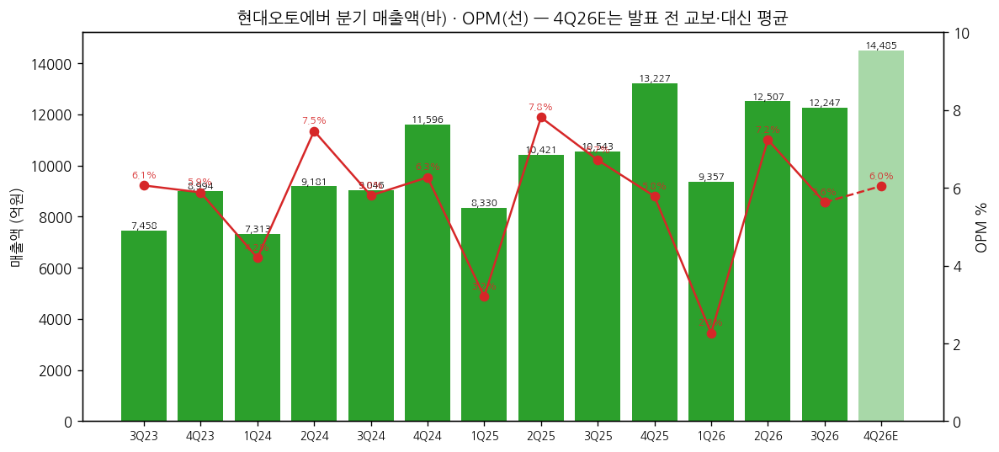
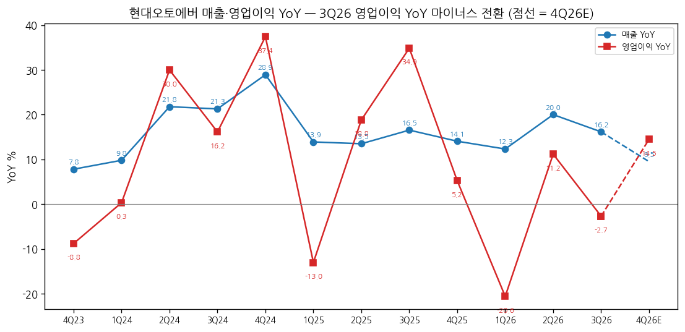
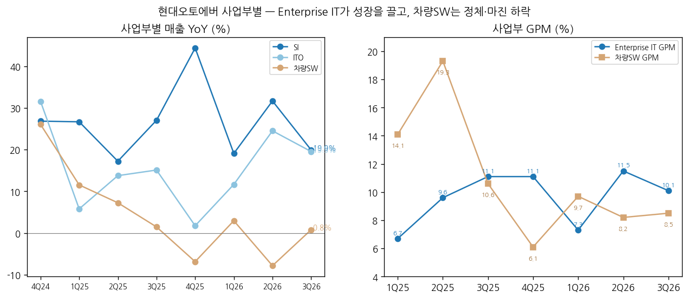

> 모드: 실적 리뷰 (v11)
> 종목: 현대오토에버 (307950)
> 섹터: 로봇
> 서브섹터: 산업·물류 자동화
> 분기: 2026-Q3
> 발표일: 2026-10-30
> 작성 시각: 2026-11-14 21:30 KST
> 분석 소스: 회사 3Q26 실적 IR(2026-10-30, 감사 전) + OpenDART 분기 재무(1Q19~2Q26) + 현대오토에버 기업개요 v1.0 / 셀사이드: 원문 2건 — 교보 2Q26 Review(07/30)·대신 Results Comment(07/31, 발표 전 추정 기준) / 웹 요약 인용 — NH투자 3Q26 리뷰(11/02, 알파증류소 2026-11-02 인용)·흥국 3Q26 리뷰(11/03, 뉴스핌)·연합인포맥스 컨센(10/30)·키움 TP(흥국 인용) / 뉴스: 연합뉴스·인포맥스(10/30), 아시아경제(10/22), 한국경제(11/01, 알파증류소 인용)
> 리뷰 깊이: 숫자 중심 | 리서치 첨부 0건 (BT 첨부 없음 — 공개 웹에서 확인 가능한 범위만 인용, 3Q26 발표 후 증권사 추정치 표는 미확보)

# 현대오토에버 3Q26 실적 리뷰

## 0. 한 줄 판정

> 성장 델타: 둔화 | 내러티브: 약화 → 경계 구간 (4Q 이연분 회수와 그룹 로봇 SI 첫 수주 확인 전까지 관망)

→ 숫자: 매출 1조 2,247억(+16.2% YoY), 영업이익 689억(-2.7%), OPM 5.6%. 매출은 컨센(1조 2,031억) +1.8% 부합, 영업이익은 컨센(759억) -9.2% 미스. 보고 기준 영업이익 YoY는 2Q26 +11.2% → 3Q26 -2.7%로 **마이너스 전환(꺾임 조건)**이지만, ITO 단가 협상 지연으로 약 200억 매출이 4Q로 넘어간 타이밍 요인이라 **조정 기준 둔화**로 판정 (2H26E 영업이익 +6% vs 2H25 +18%)
→ 성장의 질: Enterprise IT 매출 +19.7%가 전부를 끌고, 차량SW는 +0.8%·GPM 8.5%(3Q25 10.6%)로 정체. 1~3Q 누계 매출 +16.4%인데 영업이익 +1.0% — **외형과 이익의 괴리가 3개 분기째**
→ 쟁점의 중심은 로봇이 아니라 **타이밍**: 셀사이드는 "로보틱스 관제 매출의 조기 가시화 기대가 낮아졌다"(흥국)며 TP를 낮추고(NH 72만 → 34만), 주가는 발표일 -13.1%. 로봇 매출은 분리 공시가 없어 숫자로 검증할 수단이 아직 없다
→ 다음 분기 관건: 4Q26 영업이익이 4Q25(765억)를 넘는지 — ITO 단가 인상 4~5% + 소급분이 연내 들어오는지가 판정을 "둔화 → 유지"로 되돌릴 첫 조건

## 1. 숫자

① 연결 분기 표 (억원)

| 항목 | 4Q23 | 1Q24 | 2Q24 | 3Q24 | 4Q24 | 1Q25 | 2Q25 | 3Q25 | 4Q25 | 1Q26 | 2Q26 | **3Q26** | 4Q26E |
|---|---|---|---|---|---|---|---|---|---|---|---|---|---|
| 매출액 | 8,994 | 7,313 | 9,181 | 9,046 | 11,596 | 8,330 | 10,421 | 10,543 | 13,227 | 9,357 | 12,507 | **12,247** | 14,485 |
| 영업이익 | 529 | 307 | 685 | 525 | 727 | 267 | 814 | 708 | 765 | 212 | 905 | **689** | 876 |
| OPM | 5.9% | 4.2% | 7.5% | 5.8% | 6.3% | 3.2% | 7.8% | 6.7% | 5.8% | 2.3% | 7.2% | **5.6%** | 6.0% |
| 매출 YoY | 7.8% | 9.8% | 21.8% | 21.3% | 28.9% | 13.9% | 13.5% | 16.5% | 14.1% | 12.3% | 20.0% | **16.2%** | 9.5% |
| 영업이익 YoY | -8.8% | 0.3% | 30.0% | 16.2% | 37.4% | -13.0% | 18.8% | 34.9% | 5.2% | -20.6% | 11.2% | **-2.7%** | 14.5% |
| **매출 YoY 델타 (%p)** | +5.7 | +2.0 | +12.0 | -0.5 | +7.6 | -15.0 | -0.4 | +3.0 | -2.4 | -1.8 | +7.7 | **-3.8** | -6.7 |
| **영업이익 YoY 델타 (%p)** | -44.5 | +9.1 | +29.7 | -13.8 | +21.2 | -50.4 | +31.8 | +16.1 | -29.7 | -25.8 | +31.8 | **-13.9** | +17.2 |

→ (출처: 4Q23~2Q26 OpenDART 분기 재무·회사 IR, 3Q26 회사 3Q26 IR p.3 (2026-10-30, K-IFRS 연결, 감사 전). 4Q26E = 발표 전 교보(07/30 매출 1조 3,750억·영업이익 840억)·대신(07/31 1조 5,216억·912억) 평균 — **3Q 발표 후 증권사 4Q 추정치는 미확보**. 3Q23 YoY 기준치는 IR 분기별 손익계산서)
→ 컨센 대비: 매출 +1.8%, 영업이익 -9.2% (연합인포맥스 최근 1개월 5개사 컨센 매출 1조 2,031억 / 영업이익 759억). FnGuide 기준 컨센 765억 대비 -9.9%(알파증류소 인용). 순이익 449억(-14.9%)은 영업외손익 -87억(3Q25 -2억)으로 영업이익보다 더 줄었다
→ 영업이익 YoY는 최근 8개 분기 동안 **플러스·마이너스를 번갈아 오가는 톱니 모양**(-13.0 → +18.8 → +34.9 → +5.2 → -20.6 → +11.2 → -2.7)이다. 분기 단위 델타는 ITO 연례 단가 협상의 반영 분기에 좌우돼 노이즈가 크다 → **반기·연간으로 보는 게 맞다** `[판단]`
→ 반기 기준: 영업이익 YoY 1H25 +9.0% → 2H25 +17.7% → 1H26 +3.3% → 2H26E +6.2%(3Q 실적 + 4Q 발표 전 추정). 연간 기준 2024 +23.7% → 2025 +13.8% → 2026E(1~3Q 실적 1,806억 + 4Q26E 876억 = 2,682억) +5.1%. **정점은 2024년이었고, 2년째 둔화 중** `[판단]`
→ 컨센 경로상 다음 YoY 정점: 발표 전 추정 기준 2027E 영업이익 +28%(교보 340억·대신 360억 평균 3,500억). 다만 NH는 3Q 후 2027E EPS를 8,496원으로 제시해 발표 전 교보(9,481원)·대신(9,678원) 대비 약 -11% 낮다 → 2027 반등 폭도 하향 중 `[전망]`

→ (출처: OpenDART·회사 IR, 4Q26E 교보·대신 7월말 추정 평균)

→ (출처: OpenDART·회사 IR, 4Q26E 교보·대신 7월말 추정 평균)

② 사업부별 매출·매출총이익 (억원)

| 부문 | 항목 | 3Q25 | 4Q25 | 1Q26 | 2Q26 | **3Q26** | QoQ | YoY |
|---|---|---|---|---|---|---|---|---|
| SI | 매출 | 4,210 | 5,487 | 3,568 | 5,106 | **5,049** | -1.1% | +19.9% |
| ITO | 매출 | 4,349 | 5,672 | 3,810 | 5,278 | **5,199** | -1.5% | +19.5% |
| **Enterprise IT** | 매출 | 8,559 | 11,159 | 7,378 | 10,384 | **10,248** | -1.3% | +19.7% |
| | GPM | 11.1% | 11.1% | 7.3% | 11.5% | **10.1%** | -1.4%p | -1.0%p |
| | 매출총이익 `[추정]` | 950 | 1,239 | 540 | 1,197 | **1,035** | -13.5% | +8.9% |
| **차량SW** | 매출 | 1,983 | 2,068 | 1,979 | 2,123 | **1,999** | -5.8% | +0.8% |
| | GPM | 10.6% | 6.1% | 9.7% | 8.2% | **8.5%** | +0.3%p | -2.1%p |
| | 매출총이익 `[추정]` | 210 | 126 | 192 | 174 | **170** | -2.3% | -19.0% |
| 전사 | 매출총이익 | 1,161 | 1,368 | 732 | 1,371 | **1,208** | -11.9% | +4.0% |
| | 판관비 | 454 | 604 | 520 | 466 | **519** | +11.4% | +14.3% |
| | 영업이익 | 708 | 765 | 212 | 905 | **689** | -23.9% | -2.7% |

→ (출처: 회사 3Q26 IR p.4·7. 사업부 영업이익은 미공시 — GPM까지만 공개. 사업부 매출총이익 = 매출 × 공시 GPM 역산 `[추정]`, 1Q26·4Q25 GPM은 대신 2026-07-31 표 인용)
→ **델타를 끄는 것**: Enterprise IT 매출 +19.7%(SI +19.9%, ITO +19.5%) — 클라우드·차세대 ERP 전환 구축(회사 설명). 8개 분기 YoY: SI +17~44%, ITO +2~32% 범위로 꾸준
→ **델타를 깎는 것**: ① Enterprise IT GPM이 1년 새 -1.0%p(11.1% → 10.1%) — 매출 +19.7%인데 매출총이익 +8.9%. 회사는 "ITO 단품매출 비중 증가로 수익성 개선 제한"이라고 설명 ② 차량SW 매출총이익 -19% ③ 판관비 +14.3%
→ 차량SW 매출 YoY 8개 분기: +26.1(4Q24) → +11.5 → +7.3 → +1.5 → -6.8 → +3.0 → -7.8 → **+0.8**. 2025 하반기부터 0% 근처에서 횡보 — **이미 꺾인 상태가 4개 분기째 유지** `[판단]`

→ (출처: 회사 IR, 1Q25~4Q25 사업부 GPM은 대신 2026-07-31 표)

(2-1) 로봇·스마트팩토리 매출 공시 여부

→ **분리 공시 없음**. 공장 시스템 구축은 SI, 운영은 ITO에 섞여 있다(DART 2025 사업보고서 II-2 품목 = ITO·SI·차량용SW 3개). 3Q26 IR에도 로봇 관련 수치 없음
→ 정성 신호만 존재: 10/22 모베드 기반 AI 순찰·관제 솔루션 공개("로봇 SI 기업으로 기획·현장 구축·운영 안정화·통합관제·유지보수 일괄 지원", 박봉구 사업개발센터장, 아시아경제 2026-10-22), 10/30 HMG AI 팩토리(가칭) 1,146억 출자·지분 26%(새만금 AI 데이터센터 GPU 서비스, 연합뉴스 2026-10-30)

(2-2) 해외법인 (현지통화 YTD YoY, 회사 3Q26 IR p.5)

→ 미주 +18.7%, 유럽 +14.9%, 인도 +28.0%, 중국 +13.8% — 그룹 글로벌 IT 투자 확대, ERP·CRM 구축, CCS 가입자 증가, 내비SW 현지법인 직접 공급 전환

③ 연간 (억원)

| 항목 | 2023 | 2024 | 2025 | 2026E | 2027E |
|---|---|---|---|---|---|
| 매출액 | 30,650 | 37,136 | 42,521 | 48,415 | 54,630 |
| 영업이익 | 1,814 | 2,244 | 2,553 | 2,740 | 3,500 |
| OPM | 5.9% | 6.0% | 6.0% | 5.7% | 6.4% |
| 매출 YoY | 11.3% | 21.2% | 14.5% | 13.9% | 12.8% |
| 영업이익 YoY | 27.4% | 23.7% | 13.8% | 7.3% | 27.7% |

→ (출처: 2023~2025 회사 IR·OpenDART / 2026E·2027E = **발표 전** 교보(07/30)·대신(07/31) 평균. 3Q 발표 후 연간 컨센은 미확보)
→ 3Q 실적 반영 시 2026E 영업이익은 1~3Q 1,806억 + 4Q 876억 = 2,682억(+5.1%)이 현실적 `[판단]`. 발표 전 2,740억 대비 약 -2%
→ 2027E: NH 3Q 후 EPS 8,496원 = 발표 전 2곳 평균(9,580원) 대비 -11% → 하향의 무게는 2027년 `[추정]`

## 2. 시장 쟁점

① 2-0 지난 분기 체크

→ 첫 리뷰 — 직전 체크 없음 (2Q26 리뷰 미작성)

② 이번 분기 쟁점 4개 (회사 설명 + 공개 셀사이드 요약 기준)

| # | 쟁점 | 언급 출처 |
|---|---|---|
| (1) | 3Q 영업이익 미스의 원인 — ITO 협상 지연 200억은 4Q에 돌아오나 | 흥국·NH·인포맥스 |
| (2) | 외형 +16%인데 이익 정체 — Enterprise IT 마진(단품 믹스)과 판관비 | 회사 IR·교보(발표 전) |
| (3) | 차량SW는 바닥인가 — 내비 탑재율·외부 앱 허용·관세 | NH·한국경제·회사 IR |
| (4) | 로봇·피지컬AI 역할의 매출화 시점 — 관제·스마트팩토리·AI 데이터센터 | 흥국·교보·대신·NH |

③ 쟁점별 분해

(1) **3Q 영업이익 미스의 원인 — ITO 협상 지연 200억**

(1-1) 회사 설명

→ "클라우드, 차세대ERP 전환구축 등 그룹 디지털전환 가속화에 따른 매출 성장 지속, ITO 단품매출 비중 증가로 수익성 개선 제한"

→ 시사점: 회사는 이연 금액을 IR에 적지 않았다 → 200억은 셀사이드 추정(흥국·NH) → 4Q 회수 여부는 4Q IR의 ITO 매출·GPM으로만 확인 가능

(1-2) 출처별 해석

| 출처 | 핵심 가정·추정 | 논리 |
|---|---|---|
| 흥국 (11/03) | ITO 계약 협상 지연으로 약 200억 매출 4Q 이연 | 연내 반영되면 연간 수익성 영향 제한적 |
| NH (11/02, 알파증류소 인용) | 단가 4~5% 인상 + 수십억 원대 소급분 4Q 타결 예상 | 4Q 영업이익이 765억(4Q25)을 넘으면 긍정 신호. 협상이 2027년으로 밀리면 주가 25만 원대 리스크 |
| 대신 (07/31, 발표 전) | 3Q26E 영업이익 703억 | 이미 3Q 감익(-0.7%)을 예상 — 시장 컨센(759억)만 높았던 것 |

(1-3) 공통 vs 갈림
→ 공통: 미스는 **타이밍**(단가 협상 반영 분기)이고, 연간 기준 이익은 크게 훼손되지 않았다
→ 갈림: 소급분이 **2026년 안에 들어오는지**. NH는 2027 이연을 리스크 시나리오로 따로 뒀다

(1-4) [판단]
→ 같은 일이 2024년에도 있었다: 3Q24 ITO 단가 소급분 1/3이 4Q로 지연(iM 2024-10-31) → 4Q24 ITO 매출 +31.6%·영업이익 +37.4%로 회수됐다. 패턴이 반복된다면 4Q26 ITO 매출 YoY는 3Q(+19.5%)보다 높아야 한다. **4Q26 ITO YoY 20% 미만이면 "타이밍" 설명이 깨진다**

(2) **외형 +16%인데 이익 정체 — 마진 믹스**

(2-1) 회사 설명
→ Enterprise IT: ITO 단품매출(하드웨어·SW 재판매) 비중 증가로 수익성 개선 제한 / 전사: "운영효율화를 통한 매출·수익성 동반 제고 및 중장기 성장동력 확보 추진" (3Q26 IR p.4)

(2-2) 숫자로 본 분해 (3Q26 YoY, 억원)

| 항목 | 3Q25 | 3Q26 | 증감 |
|---|---|---|---|
| Enterprise IT 매출총이익 `[추정]` | 950 | 1,035 | +85 |
| 차량SW 매출총이익 `[추정]` | 210 | 170 | -40 |
| 판관비 | 454 | 519 | -65 |
| **영업이익** | 708 | 689 | **-19** |

(2-3) 공통 vs 갈림
→ 공통: Enterprise IT는 GPM 10% 이상을 유지(교보 2Q 리뷰: "고부가 PJT 믹스로 10%+ GPM 확보 확인, 하반기 11% 수준 유지 전망")
→ 갈림: 교보는 하반기 GPM 11%를 예상했지만 3Q는 10.1%. 단가 소급 미반영분을 빼면 11%에 근접했을 가능성 `[추정]`

(2-4) [판단]
→ 이익 감소 -19억은 차량SW(-40억)와 판관비(-65억)가 Enterprise IT 증익(+85억)을 다 먹은 결과다. 판관비 +14%는 3Q24(임금협상 판관비 +10%, 미래에셋 2024-09-30)와 같은 계절 패턴 → 구조적 마진 하락이라기보다 **원가 인상이 먼저, 단가 인상이 나중**인 시차 문제 `[판단]`

(3) **차량SW는 바닥인가**

(3-1) 회사 설명
→ "25년 하반기 이후 비우호적 매크로 환경(미국 관세, 지정학적 리스크 등) 지속에 따른 매출 회복 지연 및 수익성 제한" (3Q26 IR p.4)

(3-2) 출처별 해석

| 출처 | 핵심 가정·추정 | 논리 |
|---|---|---|
| NH (11/02) | 순정 내비 옵션 선택률 하락 | 회복이 아니라 정체 |
| 한국경제 (11/01) | 현대·기아 차량에서 네이버·카카오 내비 앱 사용 가능 | 순정 내비와 경쟁 → 구조적 탑재율 압박 |
| 교보 (07/30, 발표 전) | 하반기 환율 하락·그룹 생산 증가로 둔화 완화, 2027 +10.7% | 플레오스 커넥트-IVI·차세대 내비·신사업 협업 3대 전략 2027부터 반영 |
| 대신 (07/31, 발표 전) | 2027E 차량SW +23.0%, GPM 15.1% | 2027 회복 가정 |

(3-3) 공통 vs 갈림
→ 공통: 2026년은 바닥권(매출 YoY 0% 안팎, GPM 8%대)
→ 갈림: 2027년 회복 여부. 발표 전 셀사이드는 +10~23% 회복을 넣었고, NH는 3Q 후 "정체"로 판단을 바꿨다

(3-4) [판단]
→ 외부 내비 앱 허용은 관세처럼 일시적인 변수가 아니라 **탑재율의 구조적 하향 요인**이다. 2027 회복 가정(+10~23%)은 하향 여지가 크다 `[판단]`. 차량SW 비중이 16%(3Q26)로 줄어 전사 델타에 대한 영향력도 줄고 있다

(4) **로봇·피지컬AI 역할의 매출화 시점**

(4-1) 회사 설명
→ 3Q26 IR에는 로봇 언급 없음. 10/22 로봇 순찰·관제 솔루션 공개 시 "로봇은 경찰관을 대체하는 기술이 아니라, 더 빠르고 정확한 현장 판단과 대응을 돕는 파트너"(박봉구 상무) — 로봇 SI 사업 첫 대외 공개

(4-2) 출처별 해석

| 출처 | 로봇·AI 가정 | 논리 |
|---|---|---|
| 흥국 (11/03) | 정량 추정 없음 | "RMAC 내 역할 확대와 로보틱스 관제 매출의 조기 가시화 기대가 낮아져 주가 큰 폭 조정". AI 팩토리 SPC 출자는 Physical AI 역할 재확인 |
| 교보 (07/30) | 로보틱스 현재가치 4.23조 + GPU/DC 1.06조 | BD(보스턴다이나믹스)/로보틱스 사업 내 SI 영위 가정 → 신사업이 목표 시총 14.0조의 38% |
| 대신 (07/31) | 2028E EPS 13,553원(2026E 대비 +86%) | AI 데이터센터 수혜·로봇 관제 확장·SDV — "내러티브-넘버스 간 밸런스 게임" |
| NH (04/14 개시, 알파증류소 인용) | 아틀라스 초기 3만 대 양산 시 시스템 구축 매출 6.6조 | 아틀라스 공장 투입은 2028년 이후, 로봇·자율주행 수익화 2027~2028 이후 |

(4-3) 공통 vs 갈림
→ 공통: 로봇 매출은 **2027~2028년 이후**. 2026년 실적에는 없다
→ 갈림: 가치를 얼마나 앞당겨 넣느냐. 교보는 로보틱스에 4.2조를 별도 가치로 넣고, 흥국은 "조기 가시화 기대 하락"을 하락 이유로 꼽았다

(4-4) [판단]
→ 현재 시가총액 7.83조는 발표 전 교보의 "기존사업 가치"(8.73조)보다도 작다 — **시장은 로봇 옵션을 사실상 0으로 깎았다** `[판단]`. 내러티브를 다시 켤 수 있는 건 숫자(로봇 관련 수주·매출 공시) 하나뿐이다. 그룹 휴머노이드 양산 SI 계약이나 로봇 관제 플랫폼 수주가 공시되는 시점이 재평가 출발점

④ 낙관 vs 보수

→ 낙관(흥국 45만 원, 유지): ITO 이연은 연내 반영 → 연간 영향 제한, AI 팩토리 SPC 출자로 그룹 Physical AI 역할 재확인
→ 보수(키움 30만 원, 흥국 집계상 최저): 산출 근거 미확보. NH는 TP를 72만 → 34만 원(-52.8%)으로 낮추고 "나눠 사기", 3개월 밴드 26.5~33.5만 원 — 단가 협상 2027 이연 시 25만 원대 리스크
→ 차이의 본질은 **로봇 옵션을 가치에 얼마나 남기느냐**다. 기존 사업만 보면 2027E EPS 8,500~9,700원 × 합병 후 평균 P/E 30배 = 25.5~29만 원 → 현재가 28.55만 원과 거의 같다 `[판단]`
→ 셀사이드 vs 주가: 발표일 10/30 -13.1%(시장 -3.9%, 알파증류소). 같은 분기 삼성SDS·LG CNS는 매출·영업이익 동반 증가(MTN 10/31) → IT서비스 3사 중 유일한 감익이 "그룹 캡티브 프리미엄"을 깎았다 `[판단]`

⑤ 추정치·TP 변화 (확보 범위)

| 출처 | 직전 TP | 현재 TP | 4Q26 영업이익 E | 2026E / 2027E | 핵심 변화 한 줄 |
|---|---|---|---|---|---|
| NH (11/02) | 720,000 | 340,000 | — (4Q25 765억 상회 여부가 기준) | 2027E EPS 8,496원 | 로봇 기대 시점 조정, 차량SW 정체 |
| 흥국 (11/03) | 450,000 | 450,000 | — | — | 이연은 일시적, AI 팩토리 출자 긍정 |
| 키움 | — | 300,000 | — | — | 흥국 집계상 6개월 내 최저 TP |
| 교보 (07/30, 발표 전) | 540,000 | 540,000 | 840억 | 2,750 / 3,400억 | SOTP: 기존 8.73조 + 로보틱스 4.23조 + GPU/DC 1.06조 |
| 대신 (07/31, 발표 전) | 716,000 | 580,000 | 912억 | 2,732 / 3,596억 | 2028E EPS × 42.8배(1H26 평균에서 30% 할인) |

→ (출처: NH = 알파증류소 2026-11-02 요약, 흥국 = 뉴스핌 2026-11-03, 키움 = 흥국 리포트 내 집계, 교보·대신 = 원문 PDF. 대신 직전 TP는 "-19% 하향" 문구로 역산 `[추정]`)
→ 흥국 집계 최근 6개월 전체 증권사 평균 TP 541,250원 — 발표 후 하향이 아직 덜 반영된 수치
→ **TP 하향의 원인은 멀티플이 대부분이다**: NH TP -53%인데 2027E EPS는 발표 전 대비 약 -11%. 나머지는 로봇 옵션 가치 축소(멀티플·신사업 가치 하향)에서 나왔다 `[판단]`

## 3. 내러티브 점검

① 성장 스토리 정의
→ "현대차그룹의 IT 투자를 받아 매년 15% 안팎 크는 캡티브 IT서비스 회사 + 그룹이 휴머노이드·스마트팩토리·AI 데이터센터로 가면 그 SW·관제·인프라를 모두 맡는 피지컬AI 실행 법인"

② 이번 분기가 스토리에 준 영향
→ 유지된 것: 캡티브 IT 성장(Enterprise IT +19.7%, 해외법인 +14~28%)은 숫자로 확인. AI 팩토리 SPC 출자로 그룹 AI 인프라 역할도 공식화
→ 약화된 것: ① 피지컬AI 파트 — 로봇 매출의 조기 가시화 기대가 꺾였고(흥국), 로봇 수치는 공시되지 않았다 ② 이익 레버리지 — 매출 +16%가 이익으로 이어지지 않는 분기가 3개째 ③ 차량SW의 2027 회복 가정이 흔들림
→ 훼손은 아니다: 그룹 로봇 양산 일정 자체(아틀라스 2028 이후 공장 투입)가 바뀐 증거는 없다. 바뀐 건 시장의 기대 시점이다

③ 국면 판단
→ 델타 둔화(분기 영업이익 YoY -2.7%는 이연 조정 시 플러스, 반기·연간 기준 2024 정점 이후 2년째 둔화) + 내러티브 약화(로봇 매출화 시점 후퇴, TP -53%) → **경계 구간**
→ 주가는 ATH(2026-05 주간 종가 93.1만 원) 대비 -69%로, 기존 사업 가치 근처까지 내려왔다. 그러나 BT 프레임에서 "싸다"는 매매 근거가 아니다. **델타를 다시 위로 돌릴 이벤트**(4Q 소급분으로 이익 가속 + 로봇 수주 공시)가 나와야 국면이 바뀐다 `[판단]`

④ 트리거와 리스크
→ 트리거: ① 4Q26 ITO 단가 인상·소급분 반영 → 4Q 영업이익 900억 이상(YoY +18% 이상) ② 그룹 휴머노이드 양산 라인·로봇 관제 플랫폼 SI 수주 공시(첫 로봇 매출 숫자) ③ HMG AI 팩토리 운영 매출 인식 개시
→ 리스크: ① 단가 협상 2027년으로 이연 → 2026 연간 감익 ② 차량SW 역성장 전환(외부 내비 앱 확산) ③ 그룹 로봇 투자 일정 지연

## 4. 향후 봐야 할 것

① **4Q26 ITO 단가 소급분과 영업이익 765억 돌파** (델타 판정을 바꿀 1순위)
→ 무엇을: 4Q26 ITO 매출 YoY 20% 이상, 전사 영업이익 765억(4Q25) 초과 — 발표 전 추정 876억 / 2026 연간 영업이익 2,553억(2025) 대비 증익 여부
→ 어떤 데이터로: 4Q26 실적 IR(ITO 매출·Enterprise IT GPM), 연합인포맥스·FnGuide 컨센
→ 언제: 2027-01 말~02 초 (4Q 실적 발표)

② **그룹 로봇 SI·관제 첫 수주 공시**
→ 무엇을: 현대차그룹 휴머노이드(보스턴다이나믹스 아틀라스) 양산·공장 투입 관련 시스템 구축, 로봇 관제 플랫폼 계약 — 단일판매공급계약 공시 또는 IR 내 로봇 매출 분리
→ 어떤 데이터로: DART 단일판매·공급계약 공시, 현대차그룹 로봇 투자 발표, 뉴스 키워드 "현대오토에버 로봇 관제", "RMAC"
→ 언제: 수시 (그룹 북미 로봇 양산 투자 발표와 연동)

③ **차량SW 매출 YoY와 GPM**
→ 무엇을: 차량SW 매출 YoY 마이너스 전환 여부, GPM 8%대 → 10% 회복 여부 — 2027 회복 가정(+10~23%)의 실현성
→ 어떤 데이터로: 분기 IR 사업부 표, 현대·기아 판매(관세 영향), 외부 내비 앱 허용 차종 확대 뉴스
→ 언제: 2027-01 (4Q26 IR)

④ **HMG AI 팩토리 SPC와 GPU 구매대행 매출**
→ 무엇을: 1,146억 출자(지분 26%) 이후 데이터센터 운영 매출 인식 방식(지분법 vs 용역 매출), GPU 서버 구매대행 매출 규모와 마진
→ 어떤 데이터로: DART 출자 공시·분기보고서 관계기업 주석, 4Q26 IR
→ 언제: 2027-1H

⑤ **판관비·임금 인상 대비 단가 인상**
→ 무엇을: 판관비 YoY(3Q26 +14.3%)가 매출 YoY 아래로 내려오는지, OPM 6% 회복
→ 어떤 데이터로: 분기 IR 손익현황
→ 언제: 분기마다
