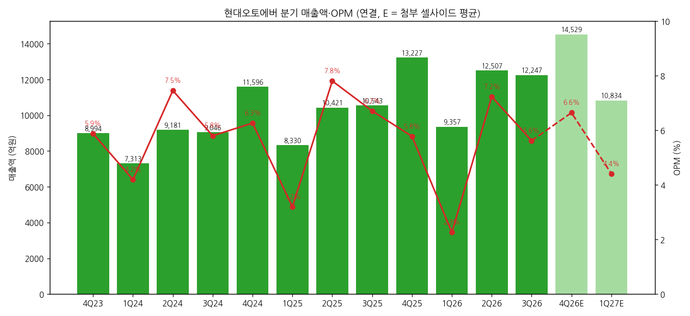
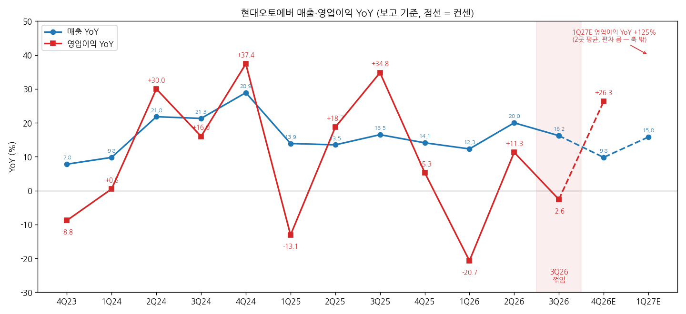
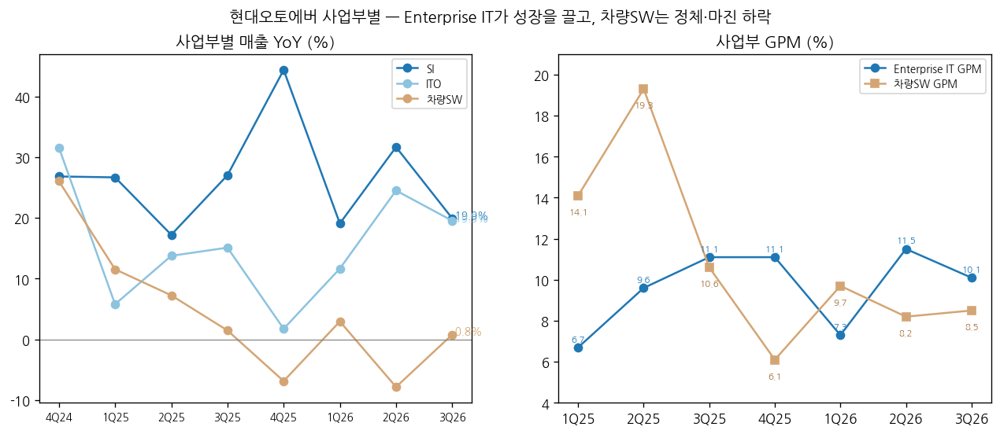
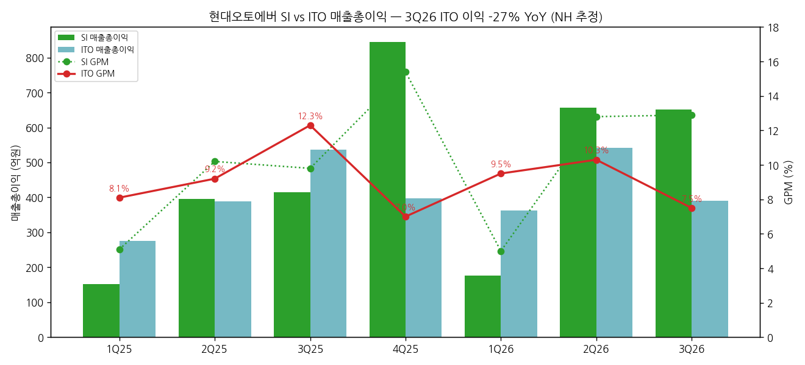

> 모드: 실적 리뷰 (v11)
> 종목: 현대오토에버 (307950)
> 섹터: 로봇
> 서브섹터: 산업·물류 자동화
> 분기: 2026-Q3
> 발표일: 2026-10-30
> 작성 시각: 2026-11-23 13:50 KST (풀 리뷰 업그레이드 — 2026-11-14 숫자 중심판 대체, 백업 .bak_20261123)
> 분석 소스: 회사 3Q26 경영실적 IR(2026-10-30, 감사 전) + OpenDART 분기 재무(1Q19\~3Q26, 3Q26 분기보고서 확정치) / 셀사이드 첨부 8건 — 상상인(11/02, 유민기)·유진(11/02, 이재일)·NH투자(11/02, 하늘)·현대차증권(11/02, 장문수, 컨콜 Q&A 포함)·삼성(11/02 3Q26 Review, 11/18 2027 전망, 임은영)·키움(11/19, 신윤철)·한화투자(11/20, 김성래) / 참고: 11/14판의 7월 교보·대신 원문(발표 전 추정)
> 리뷰 깊이: 풀 | 리서치 첨부 8건 (+회사 IR 1건)
> 비영업 요인: 일회성(ITO 운영 계약·연례 IT 청구단가 협상 지연으로 매출 약 200억 4Q 이연 — 영업 내 타이밍 요인) / 영업외 외환 관련 손실 101억(원화 강세, 순이익만 영향)
> 정정: 11/14판이 웹 요약으로 인용한 "NH TP 72만 → 34만"은 원문 대조 결과 **64만 → 46만(-28.1%)**이 맞음. 흥국·인포맥스 등 원문 미첨부 웹 인용은 이번 판에서 제외

# 현대오토에버 3Q26 실적 리뷰

## 0. 한 줄 판정

> 성장 델타: 꺾임 | 내러티브: 약화 → 매매 제외 구간 (4Q26 영업이익이 컨센 966억·YoY +26%로 반등하는지 확인 전까지)

> ⚠ 비영업 요인 플래그: 꺾임의 주된 원인 = ITO 운영 계약(IT 인프라·해외 커넥티드카 서비스)·연례 청구단가 협상 지연으로 매출 약 200억이 4Q로 이연(회사 컨콜, 현대차증권 Q&A). 회사는 "전액 영업이익은 아니지만 상당 부분 이익 기여"라고 설명 — 판정은 보고 기준 그대로. 순이익(-14.9%)은 영업외 외환손실 101억이 추가로 깎음

→ **판정 변경 (11/14판 둔화 → 꺾임)**: 11/14판은 200억 이연을 되돌린 조정 논리로 '둔화'를 줬다. 2026-11-16 BT 규칙(보고 기준 영업이익 YoY로만 판정, 조정·이연 보정 금지)을 적용하면 영업이익 YoY **+11.3%(2Q26) → -2.6%(3Q26) 마이너스 전환 = 꺾임**. 직전 분기가 플러스였으므로 2026-11-22의 '꺾임(개선/악화)' 표기(마이너스 구간 안에서 폭 변화) 대상이 아니다

→ 숫자: 매출 1조 2,247억(+16.2% YoY, 3분기 최대), 영업이익 689억(-2.6%), OPM 5.6%(-1.1%p). FnGuide 컨센(매출 1조 2,007억 / 영업이익 765억) 대비 매출 +2.0%, 영업이익 **-9.9%** 미스. 1\~3Q 누계 매출 +16.4% vs 영업이익 +1.0%

→ 쟁점 ①: 8개사 모두 "4Q 회복"에 동의 — 4Q26E 영업이익 900\~1,107억(평균 966억, YoY +26%). 이연 200억 + 단가 4\~5% 인상 소급 수십억이 근거. 4Q 확인 시 다음 리뷰에서 플러스 복귀(톱니형 패턴 반복)

→ 쟁점 ②: GPUaaS(HMG AI 팩토리 1,146억 출자·지분 26%)가 새 축으로 등장했지만 **연결 제외 → 지분법**이라 숫자 기여는 작다(삼성 추정 연 세전 242억). 로봇 SI·관제는 2027 설비·2028 양산이 공통 시간표 — 증권사별 규모 추정이 448억(NH 2027F)부터 9,300억(삼성 2027 아틀라스 5천 대 가정)까지 20배 벌어져 있다

→ 다음 분기 관건: 4Q26 ITO 매출 YoY 15% 이상 + 영업이익 900억 이상. 7개사 평균 TP는 49.4만 → 42.6만(-14%), 2026E 영업이익 -4% — **TP 하향의 대부분은 멀티플·신사업 가치 조정**

## 1. 숫자

① 연결 분기 표 (억원, K-IFRS 연결)

| 항목 | 4Q23 | 1Q24 | 2Q24 | 3Q24 | 4Q24 | 1Q25 | 2Q25 | 3Q25 | 4Q25 | 1Q26 | 2Q26 | **3Q26** | 4Q26E | 1Q27E |
|---|---|---|---|---|---|---|---|---|---|---|---|---|---|---|
| 매출액 | 8,994 | 7,313 | 9,181 | 9,046 | 11,596 | 8,330 | 10,421 | 10,543 | 13,227 | 9,357 | 12,507 | **12,247** | 14,529 | 10,834 |
| 영업이익 | 529 | 307 | 685 | 525 | 727 | 267 | 814 | 708 | 765 | 212 | 905 | **689** | 966 | 478 |
| OPM | 5.9% | 4.2% | 7.5% | 5.8% | 6.3% | 3.2% | 7.8% | 6.7% | 5.8% | 2.3% | 7.2% | **5.6%** | 6.6% | 4.4% |
| 매출 YoY | 7.8% | 9.8% | 21.8% | 21.3% | 28.9% | 13.9% | 13.5% | 16.5% | 14.1% | 12.3% | 20.0% | **16.2%** | 9.8% | 15.8% |
| 영업이익 YoY | -8.8% | 0.5% | 30.0% | 16.0% | 37.4% | -13.1% | 18.7% | 34.8% | 5.3% | -20.7% | 11.3% | **-2.6%** | 26.3% | 125% |
| **매출 YoY 델타 (%p)** | +5.7 | +2.0 | +12.0 | -0.5 | +7.6 | -15.0 | -0.4 | +3.0 | -2.4 | -1.8 | +7.7 | **-3.8** | -6.4 | +6.0 |
| **영업이익 YoY 델타 (%p)** | -44.8 | +9.3 | +29.5 | -14.0 | +21.4 | -50.5 | +31.8 | +16.1 | -29.5 | -26.0 | +32.0 | **-13.9** | +28.9 | — |

→ (출처: 4Q23\~3Q26 OpenDART fnlttSinglAcntAll 연결 — 3Q26은 분기보고서 확정치로 IR 잠정치와 동일. 4Q26E = 첨부 7개사 평균: 상상인 14,696/1,073·유진 15,120/920·NH 15,401/918·현대차 14,669/939·삼성 13,770/900·한화 15,048/1,107·키움 13,002/906(키움은 2026F 연간 − 1\~3Q 실적으로 역산 `[추정]`). 1Q27E = 분기 추정을 낸 2곳(상상인 712억·한화 244억) 평균 — **편차가 커서 참고만**)
→ 컨센 대비: 매출 +2.0%, 영업이익 -9.9% (FnGuide 컨센 매출 1조 2,007억 / 영업이익 765억 — 현대차증권·유진·삼성 표 인용, 삼성 기준 커버 15개사). 세전이익은 외환손실로 컨센 대비 -19.1%
→ 영업이익 YoY는 8개 분기째 **플러스·마이너스를 오가는 톱니**(-13.1 → +18.7 → +34.8 → +5.3 → -20.7 → +11.3 → -2.6)다. 1Q는 계절 저점, 3Q·4Q는 ITO 단가 협상 반영 시점에 좌우된다. 판정은 분기 보고 기준으로 하되, 이 종목은 다음 분기에 판정이 뒤집힐 확률이 높다는 점을 같이 봐야 한다 `[판단]`
→ 컨센 경로상 YoY 정점: 4Q26E +26%(이연분 기저) → 1Q27E는 1Q26 저기저(212억) 효과로 숫자가 크게 튀지만 2곳 추정의 차이(712억 vs 244억)가 3배라 신뢰도 낮음. 연간으로는 2026E +8.6% → 2027E +21.2%로 **2027년에 이익 성장률 재가속을 그리는 컨센** `[전망]`

→ (출처: OpenDART, 4Q26E·1Q27E 첨부 셀사이드 평균)

→ (출처: OpenDART, 4Q26E 7개사·1Q27E 2개사 평균 — 점선 구간)

② 사업부별 매출·매출총이익 (억원)

| 부문 | 항목 | 3Q25 | 4Q25 | 1Q26 | 2Q26 | **3Q26** | QoQ | YoY |
|---|---|---|---|---|---|---|---|---|
| SI | 매출 | 4,210 | 5,487 | 3,568 | 5,106 | **5,049** | -1.1% | +19.9% |
| | 매출총이익 `[NH 추정]` | 414 | 845 | 177 | 656 | **651** | -0.8% | +57.2% |
| | GPM | 9.8% | 15.4% | 5.0% | 12.8% | **12.9%** | +0.1%p | +3.1%p |
| ITO | 매출 | 4,349 | 5,672 | 3,810 | 5,278 | **5,199** | -1.5% | +19.5% |
| | 매출총이익 `[NH 추정]` | 536 | 397 | 363 | 542 | **390** | -28.0% | -27.2% |
| | GPM | 12.3% | 7.0% | 9.5% | 10.3% | **7.5%** | -2.8%p | -4.8%p |
| **Enterprise IT** | 매출 | 8,559 | 11,159 | 7,378 | 10,384 | **10,248** | -1.3% | +19.7% |
| | GPM (회사 공시) | 11.1% | — | — | 11.5% | **10.1%** | -1.4%p | -1.0%p |
| **차량SW** | 매출 | 1,983 | 2,068 | 1,979 | 2,123 | **1,999** | -5.8% | +0.8% |
| | 매출총이익 | 211 | 126 | 192 | 174 | **170** | -2.3% | -19.4% |
| | GPM (회사 공시) | 10.6% | 6.1% | 9.7% | 8.2% | **8.5%** | +0.3%p | -2.1%p |
| 전사 | 매출총이익 | 1,161 | 1,368 | 732 | 1,371 | **1,208** | -11.9% | +4.0% |
| | 판관비 | 454 | 604 | 520 | 466 | **519** | +11.4% | +14.3% |
| | 영업이익 | 708 | 765 | 212 | 905 | **689** | -23.9% | -2.6% |

→ (출처: 매출·Enterprise IT·차량SW GPM = 회사 3Q26 IR p.4·7. 3Q26 SI GPM 12.9%·ITO GPM 7.5%·차량SW 8.5% = 회사 컨콜 답변(현대차증권 11/02 Q&A). SI·ITO 분기별 매출총이익 = NH 11/02 표2(3Q26은 컨콜 GPM과 일치) `[추정]`. 사업부 영업이익은 미공시)
→ **델타를 끄는 것**: SI — 매출 +19.9%, 매출총이익 +57%(NH 추정). 그룹 SAP S/4HANA 차세대 ERP·클라우드 전환. 국내 주요 본사 전환은 2026년 내 대부분 완료, 해외 법인은 2028년까지(회사 컨콜)
→ **델타를 깎는 것**: ① **ITO 매출총이익 -27%**(536억 → 390억) — 매출은 +19.5%인데 이익 기여도 높은 운영 매출 200억이 빠지고 단품(HW·SW 재판매) 비중이 늘었다. 3Q 전사 매출총이익 감소(QoQ -163억)의 대부분이 ITO(-152억)에서 났다 ② 차량SW 매출총이익 -19% ③ 판관비 +14.3%
→ 누적으로 보면 덜 나쁘다: 1\~3Q Enterprise IT 매출 2조 8,010억(+21.3%), 누적 GPM 9.9%(+0.5%p YoY, 삼성 11/02) — 분기 인식 시차를 빼면 Enterprise IT 수익성은 개선 추세 `[참고 — 판정에 쓰지 않음]`
→ 차량SW 매출 YoY 8개 분기: +26.1(4Q24) → +11.6 → +7.3 → +1.5 → -6.9 → +2.9 → -7.8 → **+0.8**. 4개 분기째 0% 근처 — 비중은 16.3%로 축소

→ (출처: 회사 IR, 1Q25\~4Q25 사업부 GPM은 대신 2026-07-31 표 — 11/14판 차트 유지)

→ (출처: NH투자 2026-11-02 표2 사업부 매출총이익 추정, 3Q26은 회사 컨콜 GPM 기준)

(2-1) 로봇·GPU 관련 매출 공시 여부

→ **로봇 매출 분리 공시 없음**(사업 품목 = SI·ITO·차량SW 3개). NH는 2027F부터 '로보틱스' 행을 따로 두고 매출 448억·매출총이익 52억을 추정 — 첨부 8건 중 유일한 정량 분리
→ GPU: 7월 현대차·기아향 GPU 약 3,000장 공급 계약(약 3,650억, 한화 11/20)은 신설 HMG AI 팩토리가 전액 승계. 출자 1,146억은 2026\~2031년 6회 분할 납입, SPC는 **연결 대상 아님**(회사 컨콜)

(2-2) 해외법인 (현지통화 YTD YoY, 회사 3Q26 IR p.5)

→ 미주 +18.7%, 유럽 +14.9%, 인도 +28.0%, 중국 +13.8% — 그룹 글로벌 IT 투자·ERP·CRM 구축, CCS 가입자 증가, 내비SW 현지법인 직접 공급 전환

③ 연간 (억원)

| 항목 | 2022 | 2023 | 2024 | 2025 | 2026E | 2027E |
|---|---|---|---|---|---|---|
| 매출액 | 27,545 | 30,651 | 37,136 | 42,521 | 48,640 | 55,361 |
| 영업이익 | 1,424 | 1,814 | 2,244 | 2,553 | 2,773 | 3,360 |
| OPM | 5.2% | 5.9% | 6.0% | 6.0% | 5.7% | 6.1% |
| 매출 YoY | 33.0% | 11.3% | 21.2% | 14.5% | 14.4% | 13.8% |
| 영업이익 YoY | 48.0% | 27.4% | 23.7% | 13.8% | 8.6% | 21.2% |

→ (출처: 2022\~2025 OpenDART 분기 합산 / 2026E·2027E = 첨부 7개사 평균. 2026E 영업이익 범위 2,710\~2,913억, 2027E 3,036\~3,975억)
→ 발표 전 → 후 연간 컨센 변화 (변경 전 수치를 공개한 4곳: 상상인·유진·NH·현대차): 2026E 영업이익 평균 2,885억 → 2,770억(**-4.0%**), 2027E 3,513억 → 3,418억(**-2.7%**). 삼성은 EPS 2026E -8.7%·2027E -7.6%, 한화는 11/09 하향 후 11/20 유지
→ 연간 영업이익 YoY: 2022 정점(+48%) 이후 4년 연속 감속 → 2026E +8.6%가 바닥, 2027E +21%로 재가속이 컨센 시나리오 `[전망]`

## 2. 시장 쟁점

① 2-0 지난 분기 체크

→ 직전 분기(2Q26) 리뷰 없음 — 첫 리뷰. 참고로 11/14 숫자 중심판 4번 항목을 셀사이드 원문으로 중간 점검:

| 11/14판 4번 항목 | 11/23까지 확인된 것 | 판정 |
|---|---|---|
| 4Q26 ITO 소급분과 영업이익 765억 돌파 | 회사 컨콜: 이연 200억 4Q에 모두 인식 계획, 단가 4\~5% 협상 중·소급 수십억. 7개사 4Q26E 영업이익 900억 이상 | 미확인 (4Q 발표 전, 방향은 확인) |
| 그룹 로봇 SI·관제 첫 수주 공시 | 수주 공시 없음. 삼성 11/18 "Spot은 오토에버가 매입 후 시스템 마진 붙여 배포·A/S 담당" 구조 제시 | 미확인 |
| 차량SW 매출 YoY·GPM | 3Q 매출 +0.8%, GPM 8.5%(QoQ +0.3%p — 원화 강세로 구입비 감소) | 미확인 (반등 시점 1H27말\~2H27, 현대차증권) |
| HMG AI 팩토리 SPC 매출 인식 방식 | **확인** — 연결 제외, 지분법 + 운영 위탁(ITO) + GPU 구매대행(ITO) 경로 (회사 컨콜, 삼성 11/18) | 확인 |
| 판관비 vs 단가 인상 | 3Q 판관비 +14.3%, 4Q 결과 대기 | 미확인 |

② 이번 분기 쟁점 5개

| # | 쟁점 | 언급 증권사 |
|---|---|---|
| (1) | 3Q 미스는 타이밍인가 — ITO 이연 200억·단가 소급은 4Q에 얼마나 돌아오나 | 7/7 (전원) |
| (2) | 외형 +16%인데 이익은 왜 안 느나 — ITO 단품 믹스와 Enterprise IT 마진 | 6/7 |
| (3) | GPUaaS·AIDC(HMG AI 팩토리)는 숫자로 얼마인가 — 지분법 26%의 한계 | 7/7 (전원) |
| (4) | 로봇 SI·관제는 언제, 얼마나 매출이 되나 | 4/7 (NH·현대차·삼성·한화) |
| (5) | 차량SW 바닥 탈출 시점 — 내비 옵션 선택률 하락 | 7/7 (전원) |

③ 쟁점별 분해

(1) **3Q 미스는 타이밍인가 — ITO 이연 200억과 단가 소급**

(1-1) 회사 설명

→ "당초 3Q26 인식 예정이던 약 200억 원이 4Q26으로 이연 … 전액 영업이익으로 반영되지는 않지만 상당 부분 이익에 기여 가능 … 4Q26에 모두 인식할 계획으로 ITO 수익성 하락분 만회 가능" / "현재 예년 수준인 4\~5% 인상률을 기준으로 협상 중, 협상 완료 시 4Q26에 수십억 원 수준의 소급 효과 예상" (컨콜 Q&A, 현대차증권 11/02)

→ 시사점: 이연은 **IT 인프라·해외 커넥티드카 서비스 운영 계약**(이익률 높은 운영 매출) → 3Q ITO GPM 7.5%가 원인 → 4Q 인식되면 ITO GPM 정상화 + **소급분은 원가 없는 이익**이라 4Q 영업이익 레버리지가 크다

(1-2) 증권사별 해석 편차

| 증권사 | 4Q26E 영업이익 (YoY) | 4Q26E ITO 매출 (YoY) | 논리 |
|---|---|---|---|
| 한화 (11/20) | **1,107억 (+44.7%)** | 6,286억 (+10.8%) | 이연분 + 소급 + 고부가 믹스로 4Q GPM 11.9% — 최고치 |
| 상상인 (11/02) | 1,073억 (+40.3%) | 5,497억 (-3.1%) | 매출원가율 88.8%로 개선, SI 7,073억(+29%)로 SI가 견인 |
| 현대차증권 (11/02) | 939억 (+22.8%) | 6,281억 (+10.7%) | 이연 반영으로 수익성 회복, OPM 6.4% |
| 유진 (11/02) | 920억 (+20.3%) | 6,520억 (+15.0%) | 단가 협상 4\~5% 인상 목표 |
| NH (11/02) | 918억 (+20.0%) | 6,523억 (+15.0%) | 이연 200억 + 소급 수십억, ITO GPM 9.0% |
| 키움 (11/19) | 906억 (+18.4%) `[역산]` | — | 연간 2,712억만 제시 — 분기 미제시 |
| 삼성 (11/02) | **900억 (+17.6%)** | 5,500억 (-3.0%) | "이연 200억 전체가 영업이익은 아님, 계약 타결·반영 규모 확인 필요" — 최저 |

(1-3) 공통 vs 갈림
→ 공통: 7개사 모두 4Q 영업이익 900억 이상, 즉 4Q25(765억) 대비 **+17.6% 이상** 반등. 미스는 인식 시점 문제라는 데 이견 없음
→ 갈림: 반등 폭(900억 vs 1,107억, 23% 차이). 갈리는 변수는 ① 소급분 규모와 타결 시점 ② 4Q ITO 매출이 이연분을 얹어 늘어나는지(NH·유진 +15%) vs 단품 축소로 줄어드는지(삼성·상상인 -3%)

(1-4) [판단]
→ 2024년에도 3Q 소급 지연 → 4Q24 ITO 매출 +31.6%·영업이익 +37.4%로 회수됐다. 2025년 4Q엔 ITO 매출 +1.8%로 거의 안 늘었는데(소급 반영 시점 차이), 이번 4Q26의 비교 기저가 낮다 → 4Q ITO YoY +15%(NH·유진) 쪽이 패턴과 맞다 `[판단]`
→ 결론이 바뀌는 조건: 단가 협상이 2027년으로 넘어가 4Q 영업이익이 900억 아래면 "타이밍" 설명이 깨지고 2026 연간 증익률이 5%대로 내려간다

(2) **외형 +16%인데 이익은 왜 안 느나 — ITO 단품 믹스**

(2-1) 회사 설명

→ "클라우드, 차세대 ERP 전환 구축 등 그룹 디지털 전환 가속화에 따른 매출 성장 지속, ITO 단품 매출 비중 증가로 수익성 개선 제한" (3Q26 IR p.4)

→ 시사점: SI GPM 12.9%로 높지만 ITO가 7.5%로 떨어져 Enterprise IT 합산 10.1% → 이익 감소의 원인은 **SI가 아니라 ITO** → 단품(재판매) 비중은 GPU 구매대행이 ITO로 잡히면 2027년에 더 커질 수 있다

(2-2) 증권사별 해석 편차

| 증권사 | Enterprise IT 마진 시각 | 논리 |
|---|---|---|
| 삼성 (11/02) | 누적 GPM 9.9%(+0.5%p YoY) — 개선 추세 | 분기 계약 인식 시차를 빼면 수익성은 개선 |
| 한화 (11/20) | EIT GPM 10.5%로 개선 전망(2022 8.4% → 2025 9.9%) | 2027년부터 AI DC 인프라 전환·클라우드 등 **AX 중심 고부가 프로젝트**로 믹스 개선 |
| 현대차증권 (11/02) | "ITO 단품 매출 증가해 수익성 개선 제한" | 2027E OPM 5.5%로 오히려 하락 — 보수적 |
| NH (11/02) | Enterprise IT 외형·수익성 개선 추세 지속 | 2026E GPM 10.0% → 2027F 10.5% |
| 키움 (11/19) | 2026F GPM 9.9%, 2027F 10.4% | 마진 언급보다 그룹 투자 축소 가능성에 무게 |

(2-3) 공통 vs 갈림
→ 공통: SI(ERP·클라우드)는 고성장·고마진 유지. 3Q 이익 둔화는 ITO 쪽 일시 요인 + 단품 믹스
→ 갈림: 2027년 마진 방향. 한화·NH·상상인은 GPM·OPM 개선(상상인 2027E OPM 7.1%), 현대차는 하락(5.5%). 현대차는 GPU 구매대행 등 저마진 매출이 커지는 효과를 더 크게 보는 셈 `[추정]`

(2-4) [판단]
→ 3Q YoY 영업이익 -19억 분해: 매출총이익 +47억(SI +237억, ITO -146억, 차량SW -41억 — NH 추정 기준) − 판관비 증가 65억. **ITO 이연만 정상이었어도 증익**이었다는 건 숫자로 맞다. 다만 판정은 보고 기준이고, 단품 믹스는 일시 요인이 아니라 GPU 구매대행이 붙으면 구조적으로 커질 수 있다는 게 리스크 `[판단]`

(3) **GPUaaS·AIDC(HMG AI 팩토리)는 숫자로 얼마인가**

(3-1) 회사 설명

→ "HMG AI Factory에 총 1,146억 원 출자 예정, 최종적으로 26% 지분 확보 … 현재 계획상 해당 법인은 현대오토에버 연결 대상에 포함되지 않음" / "1차적으로 가산 데이터센터에 GPU 약 3천 장 구축 … GPUaaS 형태로 '27년부터 서비스 시작 … '27\~'30년까지 지속적으로 인프라를 구축" (컨콜 Q&A, 현대차증권 11/02)

→ 시사점: SPC가 GPU를 보유·운영하고 오토에버는 **지분법 + 운영 위탁 + 구매대행**으로 숫자에 잡힘 → 연결 매출 폭발은 없음 → 대신 GPU 감가상각 부담도 SPC가 짐

(3-2) 증권사별 해석 편차

| 증권사 | 실적 기여 추정 | 논리 |
|---|---|---|
| 삼성 (11/18) | **연 세전 242억** = 운영 위탁 ITO 매출 1,657억(영업이익 99억, 6%) + 지분법 142억 | 그룹 사용분 GPU 1.7만 장(5만 장의 34%) 기준. "자산은 가볍고 역할은 크다" — 출자 연 191억은 영업이익의 10% 미만. 나머지 3.3만 장은 미국 빅테크 외부 임대 예상 |
| 키움 (11/19) | 지분법이라 연결 매출 기여 제한 — **Underperform**, TP 26만 | "GPUaaS가 연결 매출 폭발적 성장을 견인할 것이라는 기대는 현실화 확률 낮음". 미국 중간선거 이후 AIDC 성장 기대 축소, 금리 인상, 현대차 주주환원 재검토 언급 → 그룹 IT 투자 축소 가능성 |
| 유진 (11/02) | 정량 없음, 긍정 이벤트 | GPUaaS는 감가상각·초기 투자 부담을 지는 **인프라 사업자 성격** — 자본 부담 거의 없는 기존 IT 서비스와 다름. GPU 매입 비용·가동률이 변수. 단기 주가는 대규모 투자 리스크에 초점 |
| NH (11/02) | 지분법 + AI 플랫폼·인프라 운영 추가 수주 | 연결 제외라 직접 매출보다 지분법·추가 수주가 중요. 신사업 가치 반영 눈높이 하향 → TP -28% |
| 한화 (11/20) | 2027년 = DX → **AX 매출 전환 원년** | AI 인프라 구축·운영으로 Enterprise IT 프로젝트 고부가화, 2027E 매출 +18.4%(7개사 중 최고) |
| 상상인 (11/02) | 2027 GPU 서비스 개시 후 AI 인프라·플랫폼 확장 | 2030 새만금 AIDC와 연계한 사업 확대, 2028E 매출 7.2조(+28%) |
| 현대차증권 (11/02) | '27년부터 로보틱스·자율주행·제조 AI 인프라 서비스 개시 | 새만금 AIDC·그룹 SDF 참여가 중장기 성장 기반 |

(3-3) 공통 vs 갈림
→ 공통: 서비스 개시는 2027년, 새만금 본격화는 2030년. SPC는 지분법(26%)이라 **연결 매출 기여는 운영 위탁·구매대행 경로뿐**
→ 갈림: ① 규모 — 삼성만 정량(세전 242억 ≈ 2027E 영업이익 컨센의 7% 수준)을 냈고 나머지는 정성 ② 방향 — 키움은 AIDC 업황·그룹 투자 축소 리스크로 부정, 한화·삼성은 그룹 AI 인프라 핵심 계열사로 긍정

(3-4) [판단]
→ 숫자로 보면 GPUaaS는 2027년 이익 성장률을 몇 %p 올리는 수준이지 델타를 바꾸는 크기가 아니다(삼성 기준 세전 242억 vs 2026E 영업이익 2,773억). 내러티브 재점화 조건은 ① 나머지 GPU 3.3만 장 외부 임대(빅테크) 계약 ② SPC 운영 위탁 계약 공시 — 둘 다 아직 없음 `[판단]`

(4) **로봇 SI·관제는 언제, 얼마나 매출이 되나**

(4-1) 회사 설명
→ 3Q26 IR·컨콜 Q&A(현대차증권 정리)에 로봇 관련 답변 없음. 회사 공식 수치 없음 — 셀사이드 추정만 존재

(4-2) 증권사별 해석 편차

| 증권사 | 로봇 매출 가정 | 논리 |
|---|---|---|
| 삼성 (11/18) | **아틀라스 2만 대 배포 시 매출 약 1조 원**, 2027년 5천 대 가정 시 약 9,300억(7.15억 달러) `[증권사 추정]` | Spot처럼 오토에버가 로봇을 매입해 연동 시스템(+10%)을 얹어 그룹 공장에 배포·A/S 담당. BD 2028년 이후 미국 상장 → 매출 규모·고객 다변화 중요 → 아틀라스도 같은 방식 예상. Top-pick |
| NH (11/02) | **2027F 로보틱스 매출 448억, 매출총이익 52억** | 2027년 양산 설비 구축, 2028년 본격 양산. 로봇 투입에 동사 SI 필수 |
| 현대차증권 (11/02) | 정량 없음 | Spot·Atlas 공정 투입(RMAC) 시 SI·관제(Fleet Management) 역할 |
| 한화 (11/20) | 정량 없음 | 2028년 BD Atlas 공장 투입, 2029년 로봇 파운드리 가동 — 그룹 AX 방향 명확 |
| 유진·상상인·키움 | 언급 없음 / 미반영 | GPUaaS·AIDC 중심 |

(4-3) 공통 vs 갈림
→ 공통: 오토에버의 역할 = 로봇과 공장 생산관리 시스템을 연결하는 SI·관제. 본격 매출은 2028년 이후
→ 갈림: 매출 인식 구조. 삼성은 **로봇 본체 매입·재판매(총액 인식)** 구조를 가정해 수천억\~1조 단위가 나오고, NH는 SI 용역만 잡아 수백억이다. 같은 2027년인데 20배 차이

(4-4) [판단]
→ 삼성 가정대로 로봇 본체가 오토에버 매출로 잡히면 외형은 급증하지만 마진은 10% 마크업 수준이라 OPM은 희석된다 — 매출 델타와 이익 델타가 따로 움직일 수 있다. 판단을 가를 데이터는 **Spot 매입·배포 매출이 이미 ITO/SI에 잡히고 있는지**(회사 확인 필요)와 그룹 아틀라스 공장 투입 계약 공시 `[판단]`
→ 섹터(로봇) 관점: 3Q26 현재 로봇 매출이 숫자로 확인되지 않아 이 종목의 로봇 델타는 0이다. 섹터 리뷰에서는 "로봇 옵션 보유, 숫자 미확인" 종목으로 분류하는 게 맞다 `[판단]`

(5) **차량SW 바닥 탈출 시점**

(5-1) 회사 설명

→ "25년 하반기 이후 비우호적 매크로 환경(미국 관세, 지정학적 리스크 등) 지속에 따른 매출 회복 지연 및 수익성 제한" (3Q26 IR p.4)

→ 시사점: 회사도 회복 시점을 제시하지 않음 → 내비게이션(순정 옵션) 부진이 핵심, 제어기·미들웨어(전장 SW)는 견조(유진·삼성·현대차 공통 언급)

(5-2) 증권사별 해석 편차

| 증권사 | 2027E 차량SW 매출 (YoY) | 논리 |
|---|---|---|
| 한화 (11/20) | 9,349억 (+11.9%) | 회복 가정 최고 |
| 상상인 (11/02) | 9,154억 (+11.3%) | 2Q27 2,378억으로 회복 |
| 현대차증권 (11/02) | 8,935억 (+8.5%) | 저가형 SW 패키지·원가 효율화 효과 **1H27말\~2H27 본격화** |
| 삼성 (11/02) | 8,670억 (+5.7%) | QoQ GPM 개선은 원화 강세 효과 — 추세 회복 판단은 이름 |
| NH (11/02) | 8,310억 (+1.5%) | 완성차 판매 둔화·옵션 선택률 하락 — 사실상 정체 |

(5-3) 공통 vs 갈림
→ 공통: 2026E 차량SW 매출은 -2\~+1%로 정체·바닥 (1\~3Q 누계 -1.7%). GPM 반등(8.2 → 8.5%)은 환율 효과
→ 갈림: 2027년 회복 폭 +1.5\~+11.9%. 내비 옵션 선택률이 구조적 하락(외부 앱 허용 — 11/14판 한국경제 인용)인지 경기적 하락인지

(5-4) [판단]
→ 차량SW 비중 16%라 전사 델타에 대한 영향은 줄었다. 2027 회복 가정의 평균(+7.8%)은 3Q 실적 흐름(YoY 0% 안팎) 대비 낙관적 — 하향 여지는 NH 쪽 `[판단]`

④ 낙관 vs 보수 — 논리 대비

→ 낙관 — 유진(TP 60만, 유지)·한화(44만): 유진은 GPUaaS를 그룹 장기 수요가 있는 가치 상승 이벤트로 보고 단기 하락은 AI 투자 사이클 불확실성 탓이라 본다. 한화는 2027년 AX 전환으로 매출 +18.4%·영업이익 +22.9%를 넣고, 2021년 통합 출범 당시 P/E 46.7배를 적용
→ 보수 — 키움(Underperform, TP 26만)·상상인(35만): 키움은 지분법 구조상 연결 성장 제한 + AIDC 업황(중간선거 이후 기대 축소·금리 인상) + 현대차 주주환원 재검토 → 그룹 IT 투자 축소 가능성. 2026F 영업이익 +6.2%·EPS +1.9%로 가장 낮다. 상상인은 TP 35만이지만 2027E 영업이익은 3,975억(+38%)으로 오히려 가장 높다 — **이익 추정이 아니라 멀티플(TP = 2027E EPS 10,925원의 약 32배)에서 보수적**
→ 차이의 본질: 2027년 이익(3,036\~3,975억, 1.3배 차이)보다 **적용 멀티플(TP ÷ 각사 2027E EPS = 32\~66배, 2배 차이 — 상상인 32·키움 33·한화 45·삼성 46·NH 53·현대차 55·유진 66배)**이 TP 편차(26만\~60만)를 만든다. 멀티플은 "로봇·AI 인프라 옵션을 얼마나 인정하느냐"의 함수
→ 셀사이드 vs 주가: 발표 다음 거래일 이후 주가 289,000원(10/30) → 278,000원(11/17, 삼성 11/18 기준) → 308,500원(11/19, 키움·한화). 52주 고점 938,000원(2026-06-01) 대비 -67%. 셀사이드 7곳 중 6곳이 매수이지만 주가는 TP 평균(42.6만)의 72% 수준 — 바이사이드는 신사업 시점 불확실성에 더 무게 `[판단]`

⑤ 추정치·TP 변화

| 증권사 (발간일) | 직전 TP | 현재 TP | 4Q26 영업이익 E | 2026E / 2027E 영업이익 | 핵심 변화 한 줄 |
|---|---|---|---|---|---|
| 상상인 (11/02) | 350,000 | 350,000 (매수, '상향' 표기) | 1,073억 | 2,879 / 3,975억 | 2026E -7.1%, 2027E +1.5% — GPU 서비스 후 AI 인프라 확장 |
| 유진 (11/02) | 600,000 | 600,000 | 920억 | 2,730 / 3,390억 | 2026E -1.8%, 2027E -6.7% — GPUaaS 긍정, TP 유지 |
| NH (11/02) | 640,000 | 460,000 (-28.1%) | 918억 | 2,724 / 3,270억 | 2026E -4.7%, 2027E -2.7%. DCF 무위험이자율 3.6 → 3.85%, 신사업 눈높이 조정 |
| 현대차증권 (11/02) | 500,000 | 450,000 (-10.0%) | 939억 | 2,745 / 3,036억 | P/E 51.6배 유지, 24M 선행 EPS 9,295 → 9,058원 |
| 삼성 (11/02·11/18) | 500,000 | 420,000 (-16.0%) | 900억 | 2,710 / 3,230억 | EPS 2026E -8.7%·2027E -7.6%, P/E 42배 유지. 11/18 Top-pick, TP 유지 |
| 키움 (11/19) | 300,000 `[흥국 집계 인용]` | 260,000 (하향, Underperform) | 906억 `[역산]` | 2,712 / 3,037억 | AIDC 발현 타이밍 지연, 지분법 한계, 그룹 투자 축소 가능성 |
| 한화 (11/20) | 570,000 (8/14) | 440,000 (11/09 하향, 11/20 유지) | 1,107억 | 2,913 / 3,581억 | P/E 46.7배 × 12M 선행 EPS 9,591원, 2027 AX 원년 |

→ (출처: 각 증권사 원문. 키움 직전 TP는 원문에 없어 11/14판의 흥국 집계 인용치 사용 `[추정]`. 한화 직전 TP는 원문 TP 변경 이력)
→ 평균 TP **494,286원 → 425,714원(-13.9%)**. 하향 5건(NH·현대차·삼성·키움·한화), 유지 2건(상상인·유진), 상향 0건. FnGuide 컨센 TP는 535,333원(11/02, 15개사) → 484,615원(11/18, 13개사, -9.5%) (삼성 리포트 인용)
→ 연간 컨센(4개사 비교 가능): 2026E 영업이익 -4.0%, 2027E -2.7%
→ **TP 하향의 원인은 멀티플·신사업 가치가 대부분**: NH는 TP -28%인데 2027E 영업이익 -2.7%(DCF 할인율 상향 + 신사업 반영 축소), 현대차는 TP -10% vs EPS -2.5%, 삼성은 TP -16% vs EPS -8%(절반은 실적). 실적 하향은 2026E -2\~-7%, 2027E -3\~-8% 범위로 제한적 `[판단]`

## 3. 내러티브 점검

① 성장 스토리 정의
→ "현대차그룹 IT 투자를 받아 매년 15% 안팎 크는 캡티브 IT서비스 회사 + 그룹이 로봇·AI 데이터센터로 가면 그 연동·관제·인프라 운영을 맡는 피지컬AI 실행 법인"

② 이번 분기가 스토리에 준 영향
→ 유지·강화: ① 캡티브 IT 성장 — Enterprise IT +19.7%, 1\~3Q 누적 +21.3%, SI 고마진 ② **AI 인프라 역할의 공식화** — HMG AI 팩토리 출자(26%)로 GPUaaS가 2027년 개시 사업으로 구체화. 첨부 8건 전원이 다룬 새 축
→ 약화: ① 이익 레버리지 — 매출 +16%가 이익 -3%로 끝났다(타이밍이라도 보고 숫자는 꺾임) ② 신사업 가치 — 8건 중 5건이 TP 하향, NH "신사업 가치 반영 눈높이 보수적 조정", 키움 Underperform ③ GPUaaS가 지분법이라는 사실이 "연결 매출 폭발" 기대를 낮췄다(키움·NH)
→ 훼손은 아니다: 그룹 로봇 일정(2027 설비 → 2028 양산·Atlas 공장 투입)과 새만금(2029\~2030 가동)은 바뀐 게 없고, 7개사 모두 4Q 반등과 2027년 영업이익 +10\~38%를 유지한다

③ 국면 판단
→ 델타 꺾임(보고 기준 영업이익 YoY +11.3% → -2.6%) + 내러티브 약화(평균 TP -14%, 연간 추정 -3\~-4%, 신사업 멀티플 하향) → **매매 제외 구간**
→ 다만 이 종목은 분기 YoY가 톱니형이라 **4Q26 컨센(+26%)이 맞으면 다음 리뷰에서 바로 플러스 복귀·가속 판정**이 나온다. 그때 내러티브까지 바뀌려면 GPUaaS·로봇에서 숫자(계약·매출 인식)가 하나 나와야 한다 `[판단]`

④ 트리거와 리스크
→ 트리거: ① 4Q26 영업이익 1,000억 이상(이연분 + 소급 + ITO GPM 9% 이상 회복) ② HMG AI 팩토리 운영 위탁 계약 또는 GPU 3.3만 장 외부 임대(빅테크) 계약 ③ 그룹 아틀라스·Spot 공장 투입 관련 SI·관제 계약(로봇 매출 첫 숫자)
→ 리스크: ① 단가 협상 2027년 이연 → 4Q 영업이익 900억 미만, 2026 연간 증익률 5%대 ② 현대차 판매 둔화·주주환원 재검토 → 그룹 IT 투자 축소(키움) ③ GPU 구매대행·로봇 재판매 등 저마진 매출 확대로 OPM 희석

## 4. 향후 봐야 할 것

① **4Q26 영업이익 900억 이상 + ITO 이연분·단가 소급 반영** (델타 판정을 바꿀 1순위)
→ 무엇을: 4Q26 영업이익 컨센 966억(범위 900\~1,107억, YoY +17.6\~+44.7%) 달성 여부, ITO 매출 YoY 15% 이상·ITO GPM 9% 이상 회복, 2026 연간 영업이익 2,773억(+8.6%) 달성
→ 어떤 데이터로: 4Q26 실적 IR(부문별 손익), 컨콜 Q&A(단가 협상 타결·소급액), FnGuide 컨센
→ 언제: 2027-01 말 (4Q26 잠정)

② **HMG AI 팩토리 — 운영 위탁·GPU 외부 임대 계약**
→ 무엇을: SPC 설립(2026-11 예정)·지분 구조 확정, 오토에버 운영 위탁 계약(삼성 추정 연 1,657억 ITO 매출), 가산 DC GPU 3천 장 구축, 새만금 GPU 3.3만 장 외부 임대(미국 빅테크) 여부
→ 어떤 데이터로: DART 타법인 출자·단일판매공급계약 공시, 현대차그룹 새만금 발표, 뉴스 키워드 "HMG AI 팩토리", "새만금 AI 데이터센터 임대"
→ 언제: 2026-12\~2027-1H (서비스 개시 2027년)

③ **로봇 SI·관제 첫 숫자 — Spot 배포·Atlas 투입**
→ 무엇을: Spot 매입·배포 매출의 현재 인식 여부(회사 확인), 아틀라스 공장 투입 관련 SI·관제 계약, NH 2027F 로보틱스 매출 448억 vs 삼성 9,300억 중 어느 쪽 구조인지
→ 어떤 데이터로: 4Q26 컨콜 Q&A, DART 공급계약 공시, 현대차그룹 로봇(RMAC·메타플랜트) 발표, 뉴스 키워드 "현대오토에버 로봇 관제", "아틀라스 공장 투입"
→ 언제: 2027-01(4Q 컨콜), 수시

④ **차량SW 매출 YoY 플러스 유지·GPM 10% 회복**
→ 무엇을: 4Q26 차량SW 매출 2,068억(4Q25) 상회 여부, GPM 8%대 → 10%, 저가형 SW 패키지 효과(1H27말\~2H27, 현대차증권)
→ 어떤 데이터로: 분기 IR 사업부 표, 현대·기아 판매 실적, 원/달러 환율
→ 언제: 2027-01 (4Q26 IR)

⑤ **판관비·단품 믹스와 OPM**
→ 무엇을: 판관비 YoY(3Q +14.3%)가 매출 YoY 아래로, Enterprise IT GPM 10.5% 회복(한화 전망), 2027E OPM 컨센 6.1% 대비 방향
→ 어떤 데이터로: 분기 IR 손익현황·부문 GPM
→ 언제: 분기마다
