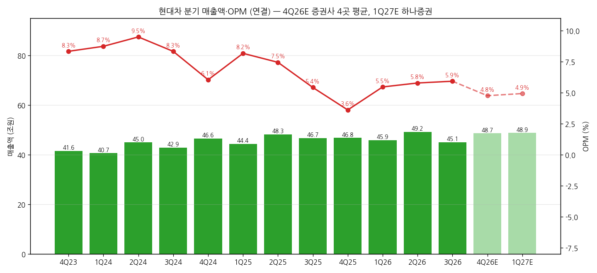
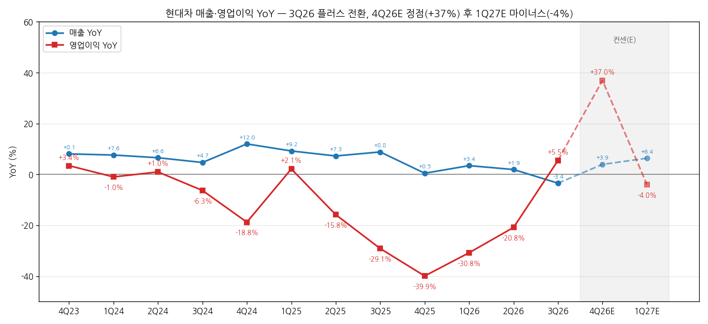
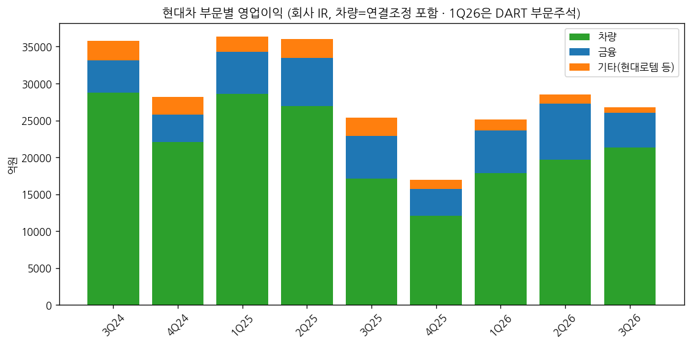

> 모드: 실적 리뷰 (v11)
> 종목: 현대차 (005380)
> 섹터: 로봇
> 서브섹터: 휴머노이드 완성체
> 분기: 2026-Q3
> 발표일: 2026-10-29
> 작성 시각: 2026-11-23 11:50 KST (v2 — 셀사이드 첨부 반영 풀 리뷰 업그레이드, v1 2026-11-14 21:30 숫자 중심본은 .bak_20261123)
> 분석 소스: 회사 3Q26 경영실적 발표 IR(2026-10-29) + OpenDART 분기 재무(1Q16\~3Q26, 3Q26 분기보고서 확정치) + DART 2026.1Q 분기보고서 영업부문 주석 + BT 첨부 셀사이드 10건 — 삼성증권(10/29·11/18), 메리츠증권(10/29·11/05 2027 Outlook), 상상인증권(10/29), 하나증권(10/30 컨콜 정리 포함·11/13 2027 전망), J.P. Morgan(10/26 Asia 마케팅 takeaways·10/29 Specialist Sales First Glance), Morgan Stanley(10/29) + 기존 미래에셋(10/30) 원문 + 웹 보도 인용(아시아경제 11/02 TP 집계, 이투데이 09/12, 헤럴드경제 05/18, SBS Biz 10/29·10/30)
> 리뷰 깊이: 풀 | 리서치 첨부 11건 (셀사이드 10 + 회사 IR 1)
> 비영업 요인: 일회성(판매보증충당부채 환율효과 — 기말 원/달러 1,548원 → 1,356원, 판매보증비 1조 2,570억 → 340억, YoY -1.22조, 영업이익에 포함) · 저기저(3Q25 미국 관세 25% 분기 — 하나 집계 관세 비용 1.82조, 미래에셋 관세 기저 +1.0조) · 영업외 외화환산손실(순이익에만 영향, 영업외 기타 +1,710억 → -5,640억)

# 현대차 3Q26 실적 리뷰

## 0. 한 줄 판정

> 성장 델타: 가속 | 내러티브: 약화 → 관찰 구간 (가속은 판매보증비 환율효과·관세 기저발 — 아래 ⚠ 플래그, 본업은 감익. 로봇 실체 이벤트 — 연말 로봇생산법인·BD 증자 — 확인 전까지 관망)

> ⚠ 비영업 요인 플래그: 영업이익 +1,400억(YoY +5.5%)을 만든 주된 원인 = **판매보증비 감소 1.22조**(기말환율 급락에 따른 충당부채 환율효과, 하나·삼성·JPM·MS 공통 지목) + 관세율 인하 기저. 판매보증비 감소분을 빼면 영업이익 약 1.45조, YoY 약 -43% `[추정, 회사 IR p.13 판관비 내역 단순 차감]` — 물량 -1.11조·믹스 -0.57조로 본업은 감익

→ 숫자(확정): 매출 45.11조(-3.4% YoY), 영업이익 2.68조(+5.5%), OPM 5.9% — OpenDART 3Q26 분기보고서 확정치가 10/29 발표치와 동일. 영업이익 YoY는 2Q26 -20.8% → +5.5%로 5개 분기 만에 플러스, **매출 YoY는 +1.9% → -3.4%로 마이너스 전환** → 판정은 보고 기준 영업이익 YoY 변화(-20.8% → +5.5%, +26.3%p)로 **가속** — 로봇 섹터 통합 검수(2026-11-23)에서 매출 방향과 무관하게 영업이익 YoY 중심으로 판정 기준을 통일 (매출 YoY 마이너스 전환은 보조 지표로만 표기, 이익 증가의 원천은 ⚠ 플래그)
→ 컨센 대비: 영업이익 FnGuide 2.44조 대비 +9.9%(삼성 집계), Bloomberg 2.61조 대비 +2.4%(메리츠), 2.34조 대비 +15%(MS·JPM). 지배순이익 1.70조는 -20\~-25% 하회
→ 쟁점: 10개 리포트 전부가 "beat의 질이 낮다"(보증충당부채 환입)에 동의하고, 갈리는 건 **2027년이 감익(삼성 -8%·메리츠 -8%)이냐 하반기 증익 전환(하나 -2%·상상인 +14%)이냐**. 로봇은 "실행 국면 진입"(하나)과 "협력의 실체 부재"(메리츠) 사이
→ TP: 원문 7곳 최신 평균 48.0만 원, 직전 대비 비교 가능한 6곳 57.8만 → 48.8만(-15.6%), FnGuide 컨센 TP 59.9만(25곳) → 51.7만(24곳, -13.7%). 하향 6건·유지 4건·상향 0건, **하향의 주된 원인은 멀티플**(삼성 Target P/E -25%, 하나 자동차 배수 9배, 메리츠 Peer PER 12.9 → 10.5배)
→ 다음 분기 관건: 4Q26E 영업이익 2.32조(4곳 평균, YoY +37% — 4Q25 저기저)가 컨센상 **YoY 정점**이고 1Q27E는 -4%(하나)로 다시 마이너스 → 1Q27에 꺾임 판정이 날 경로. 이를 뒤집을 변수는 4Q 도매 회복 강도(111만 대 역산)와 연말 로봇생산법인 설립·BD 1조 원+ 제3자 유증(삼성 11/18)

## 1. 숫자

① 연결 분기 표 (억원)

| 항목 | 4Q23 | 1Q24 | 2Q24 | 3Q24 | 4Q24 | 1Q25 | 2Q25 | 3Q25 | 4Q25 | 1Q26 | 2Q26 | **3Q26** | 4Q26E | 1Q27E |
|---|---|---|---|---|---|---|---|---|---|---|---|---|---|---|
| 매출액 | 416,325 | 406,585 | 450,206 | 429,283 | 466,237 | 444,078 | 482,867 | 467,214 | 468,386 | 459,389 | 492,153 | **451,102** | 486,830 | 488,680 |
| 영업이익 | 34,745 | 35,574 | 42,791 | 35,809 | 28,222 | 36,336 | 36,016 | 25,373 | 16,954 | 25,147 | 28,509 | **26,772** | 23,223 | 24,150 |
| OPM | 8.3% | 8.7% | 9.5% | 8.3% | 6.1% | 8.2% | 7.5% | 5.4% | 3.6% | 5.5% | 5.8% | **5.9%** | 4.8% | 4.9% |
| 매출 YoY | +8.1% | +7.6% | +6.6% | +4.7% | +12.0% | +9.2% | +7.3% | +8.8% | +0.5% | +3.4% | +1.9% | **-3.4%** | +3.9% | +6.4% |
| 영업이익 YoY | +3.4% | -1.0% | +1.0% | -6.3% | -18.8% | +2.1% | -15.8% | -29.1% | -39.9% | -30.8% | -20.8% | **+5.5%** | +37.0% | -4.0% |
| **매출 YoY 델타 (%p)** | — | -0.4 | -1.1 | -1.9 | +7.3 | -2.8 | -2.0 | +1.6 | -8.4 | +3.0 | -1.5 | **-5.4** | +7.3 | +2.5 |
| **영업이익 YoY 델타 (%p)** | — | -4.4 | +2.0 | -7.3 | -12.5 | +20.9 | -18.0 | -13.3 | -10.8 | +9.1 | +9.9 | **+26.4** | +31.5 | -41.0 |

→ (출처: 4Q23\~3Q26 OpenDART 연결 분기 — 3Q26은 분기보고서 확정치(2026-11-23 조회), 4Q = 연간 − 3Q 누적. 4Q26E = 분기 추정을 공개한 4곳 평균(삼성 11/18 매출 45.59조·OP 2.06조, 하나 11/13 49.49조·2.50조, 메리츠 11/05 50.06조·2.32조, 미래에셋 10/30 49.6조·2.41조). 1Q27E = 하나증권 11/13 단독 — 소수 의견)
→ 컨센 대비(3Q26): 매출 +0.7%·영업이익 +9.9%·지배순이익 -20.4% (FnGuide, 삼성 10/29 집계) / 영업이익 Bloomberg 2.61조 대비 +2.4%·지배순이익 -24.9% (메리츠) / 영업이익 2.34조 대비 +15% (MS·JPM 집계). 집계 기준에 따라 서프라이즈 폭이 +2\~+15%로 벌어진다 — 컨센이 2Q 발표 뒤 영업이익 -18% 하향 조정된 상태였다(메리츠)
→ 영업이익 YoY는 4Q25 -39.9%가 저점. 컨센 경로상 **4Q26E +37%가 정점**이고 1Q27E -4%(하나), 2Q27E -11%, 3Q27E -2%, 4Q27E +12%(하나)로 2027 상반기에 다시 마이너스 구간에 들어간다. 4Q26E의 +37%도 4Q25 OPM 3.6%라는 저기저 효과다 `[판단]`
→ OPM 수준은 1Q26 5.5% → 2Q26 5.8% → 3Q26 5.9%로 제자리, 4Q26E 4.8%로 오히려 하락 전망. 3Q 판관비율 10.3%(-2.0%p)가 보증비 환입으로 눌린 값이라 4Q에 되돌림이 예상된다(삼성 4Q26E OPM 4.5%)

→ (출처: OpenDART·회사 IR, 4Q26E 증권사 4곳 평균, 1Q27E 하나증권)

→ (출처: OpenDART·회사 IR, 4Q26E 증권사 4곳 평균, 1Q27E 하나증권)

② 사업부별 매출·영업이익 (억원)

| 부문 | 항목 | 3Q25 | 4Q25 | 1Q26 | 2Q26 | **3Q26** | QoQ | YoY |
|---|---|---|---|---|---|---|---|---|
| 차량 | 매출 | 367,150 | 365,900 | 345,380 | 368,320 | **330,580** | -10.2% | -10.0% |
| | 영업이익(연결조정 포함) | 17,110 | 12,090 | 17,880 | 19,710 | **21,350** | +8.3% | +24.8% |
| | OPM | 4.7% | 3.3% | 5.2% | 5.4% | **6.5%** | +1.1%p | +1.8%p |
| 금융 | 매출 | 71,890 | 74,320 | 89,920 | 95,040 | **91,900** | -3.3% | +27.8% |
| | 영업이익 | 5,760 | 3,640 | 5,790 | 7,590 | **4,710** | -37.9% | -18.2% |
| | OPM | 8.0% | 4.9% | 6.4% | 8.0% | **5.1%** | -2.9%p | -2.9%p |
| 기타(현대로템 등) | 매출 | 28,170 | 28,170 | 24,090 | 28,790 | **28,620** | -0.6% | +1.6% |
| | 영업이익 | 2,500 | 1,220 | 1,480 | 1,210 | **710** | -41.3% | -71.6% |

→ (출처: 회사 IR(십억원 → 억원 환산). 1Q26 부문 매출·영업이익은 하나증권 10/30·메리츠 10/29 분기 표(회사 IR 기준)로 보강 — v1의 DART 부문 주석 값과 영업이익 일치)
→ **델타를 끈 건 차량 OPM +1.8%p**(4.7% → 6.5%). 차량 매출은 -10%인데 이익은 +25% — 차량 영업이익 증가분(+4,240억)보다 판매보증비 감소(1.22조)가 크다. 즉 보증비 환입이 없었다면 차량 이익도 감소 `[판단]`
→ 금융은 매출 +27.8%인데 이익 -18.2%, OPM 5.1%는 3분기 기준 2018년 이후 최저(메리츠). 기타는 -71.6%. **차량 외 부문이 모두 역성장**

→ (출처: 회사 IR, 1Q26은 DART 부문 주석)

→ 로봇 매출: **분리 공시 없음**. BD는 HMG Global(현대차 49.5%, 지분법) 산하라 연결 매출 0, 손실은 지분법으로만 반영

(1) 영업이익 증감 분해 (십억원, 회사 IR p.12 + 컨콜 — 하나 10/30 정리)

| 요인 | 금액 | 내용 |
|---|---|---|
| 환율 | +1,283 | 평균환율 +38원 효과 약 +0.5조 + **기말환율 하락에 따른 판매보증충당부채 환율효과**(판매보증비 YoY -1.22조) |
| 물량 | -1,112 | 국내 파업·영업일수 감소로 수출 선적 감소, 중동 판매 축소 |
| 믹스(인센티브 합산) | -565 | 미국 비중·HEV 증가로 믹스 소폭 플러스, 인센티브 증가가 상쇄 |
| 금융 | -106 | 조달금리·중고차 매각손실·연체율 |
| 기타 | +640 | 원가 최적화(원자재 상승 -0.5조 상쇄) + 대미 관세율 차이 |
| **합계** | **+140** | 2,537 → 2,677 |

→ 하나증권 관세 비용 추정: 2Q25 -0.83조, 3Q25 -1.82조, 4Q25 -1.46조, 1Q26 -0.86조 — 3Q25가 관세 비용 최대 분기였던 만큼 3Q26의 YoY는 기저가 가장 낮은 분기와 비교된 값이다

(2) 판매·전동화 KPI (도매, 천 대, 회사 3Q26 IR p.5·9)

| | 3Q25 | 4Q25 | 1Q26 | 2Q26 | **3Q26** | YoY |
|---|---|---|---|---|---|---|
| 글로벌 도매 | 1,038 | 1,033 | 976 | 992 | **921** | -11.3% |
| HEV | 161 | 168 | 174 | 188 | **167** | +3.8% |
| EV | 76 | 57 | 59 | 69 | **69** | -9.2% |
| xEV 비중 | 24.3% | 22.7% | 24.9% | 26.9% | **26.7%** | +2.4%p |

→ 미국 소매 +3.5%, M/S 6.6%(6개 분기 연속 6%대), 미국 HEV 비중 26.8% 역대 최대 / 미국 도매 -9.9%, 유럽 도매 -18.0%, 국내 도매 -27.2%(파업·신차 순연) (회사 IR p.5\~8)

③ 연간 (억원)

| 항목 | 2023 | 2024 | 2025 | 2026E | 2027E |
|---|---|---|---|---|---|
| 매출액 | 1,626,636 | 1,752,312 | 1,862,545 | 1,886,160 | 1,931,000 |
| 영업이익 | 151,269 | 142,396 | 114,679 | 104,330 | 102,870 |
| OPM | 9.3% | 8.1% | 6.2% | 5.5% | 5.3% |
| 매출 YoY | +14.1% | +7.7% | +6.3% | +1.3% | +2.4% |
| 영업이익 YoY | +54.0% | -5.9% | -19.5% | -9.0% | -1.4% |

→ (출처: 2023\~2025 OpenDART. 2026E·2027E = 원문 6곳 최신 추정 평균 — 삼성 11/18, 하나 11/13, 메리츠 11/05, 상상인 10/29, MS 10/29, 미래에셋 10/30. 2027E 영업이익 범위 9.34조(삼성)\~12.08조(상상인))
→ 연간 컨센(FnGuide, 하나 리포트 표지 기준): 2026E 영업이익 10.46조(10/30) → 10.60조(11/13, +1.3%), **2027E 11.58조 → 11.08조(-4.3%)**. 발표 후 올해는 버텼고 내년이 깎이는 중
→ 원문 6곳 중 4곳(삼성·메리츠·미래·하나)이 2027E 영업이익을 2026E 이하로 본다. 2027년까지 연간 영업이익 YoY 플러스 전환은 컨센 평균상 보이지 않는다 `[전망]`

## 2. 시장 쟁점

① 2-0 지난 분기 체크

→ 첫 리뷰 — 직전 체크 없음 (2Q26 리뷰 미작성)

② 이번 분기 쟁점 5개

| # | 쟁점 | 언급 리포트 수 |
|---|---|---|
| (1) | 영업이익 beat의 질 — 판매보증충당부채 환입을 빼면 정상 이익은 얼마인가 | 7 (삼성·하나·상상인·메리츠·JPM Sales·MS·미래) |
| (2) | 가이던스 하향과 4Q 물량 회복 강도 → 2027년은 감익인가, 하반기 증익 전환인가 | 10 (전부) |
| (3) | 로봇(BD·아틀라스) — "실행 국면 진입"인가, "실체 없는 기대"인가 | 8 (삼성 11/18·하나 2건·메리츠 2건·JPM 2건·MS) + 미래 |
| (4) | 금융부문 수익성 — 일시적 금리·연체 vs 구조적 중고차 잔존가치 하락 | 5 (삼성 2건·하나·메리츠·MS) |
| (5) | 주주환원 재검토 — 4조 원 자사주 계획 축소와 Physical AI 투자 사이클 | 6 (삼성 2건·하나·상상인·메리츠·미래) |

③ 쟁점별 분해

(1) **영업이익 beat의 질 — 판매보증충당부채 환입을 빼면 정상 이익은 얼마인가**

(1-1) 회사 설명
→ "수요 감소 속 영업이익 YoY 5.5% 증가 … 영업이익률 5.9% 달성" (회사 3Q26 IR p.3)
→ 컨콜: "평균환율 +38원 상승으로 약 +5,000억원, 기말환율 하락에 따른 판매보증충당부채 환율효과 확대 … 판매관리비 4조 6,450억원(-19.2%), 기말환율 하락으로 판매보증충당부채 전입액 감소" (하나 10/30 컨콜 정리)
→ 원자재 상승 약 5,000억원을 원가 최적화로 상쇄, "원가절감 효과는 4분기에 더 커질 전망" (컨콜 Q&A, 하나 10/30)

(1-2) 증권사별 해석

| 증권사 | 핵심 가정·추정 | 논리 |
|---|---|---|
| 하나 (10/30) | 판매보증비 감소 -1.22조, 컨센 2.44조 상회 | "낮아진 기대치를 상회했지만 … 판매보증비 감소가 컸고 **실질 수익성은 물량 감소로 하락**" |
| 삼성 (10/29) | 판매보증비 1조 2,570억 → 340억, 당사 추정 대비 3,500억 작음 | 서프라이즈 = 보증비 차이. GPM 16.2%(-1.5%p)로 원가·고정비 부담은 그대로 |
| JPM Sales (10/29) | OP 컨센 대비 +15%, JPMe 대비 +24% | "beat은 주로 **기말 원화 강세에 따른 보증충당금 환입**으로 환율 역풍이 예상보다 작았던 효과 + 원가절감 -5,000억" |
| MS (10/29) | OP 2.68조 = MSe 2.70조 부합, 차량 OPM 6.5%(MSe 5.9%) | "Better than feared" — 원가 규율과 보증충당금 감소로 차량 이익 견조 |
| 메리츠 (10/29) | 영업이익은 Bloomberg 컨센 +2.4% "부합", 지배순이익 -25% 하회 | 매출·OP 컨센이 2Q 이후 -6%·-18% 낮아진 결과. 외화자산 평가손실, 지분법 손상 가능성 경고 |
| 상상인 (10/29) | 영업이익 FnGuide 2.5조 상회 | 평균환율 효과 + 보증충당부채 부담 완화. 재료비·원화강세 부담 여전 |
| 미래에셋 (10/30, v1) | 관세 기저 +1.0조·환율 +1.3조·원가절감 +0.5조 vs 물량 -1.1조·믹스 -0.57조 | 증익 3요인이 모두 판매와 무관 |

(1-3) 공통 vs 갈림
→ 공통: 7곳 모두 **증익의 주된 원천이 회계상 환율효과(보증충당부채)·원가절감·관세율 차이**이고 물량·믹스는 감익 요인이라는 데 동의. 순이익은 외화환산손실로 대폭 하회
→ 갈림: 평가의 톤. MS·JPM은 "우려보다 나았다(better than feared)" → 단기 심리 완화, 하나·메리츠는 "실질 수익성 하락" → 컨센 자체가 너무 낮았던 것. 서프라이즈 폭 산정(+2.4% vs +15%)도 집계 기준에 따라 갈린다

(1-4) [판단]
→ 보증비 환입 1.22조를 빼면 영업이익 1.45조, OPM 3.2%로 4Q25(3.6%)보다도 낮다 `[추정]`. 보증충당부채 환율효과는 **기말환율이 다시 오르면 반대로 비용이 된다** — 4Q 기말환율이 3Q 1,356원보다 높으면 4Q 판관비가 튀어 오를 수 있다(메리츠 4Q 기말 1,350원 가정). 3Q 숫자는 델타의 근거로 쓰기 어렵고, 보증비 정상화 후의 4Q가 진짜 시험대 `[판단]`

(2) **가이던스 하향과 4Q 물량 회복 강도 → 2027년은 감익인가, 하반기 증익 전환인가**

(2-1) 회사 설명
→ 2026 가이던스: 도매 415.8만 → 400만 대, 연결 OPM 6.3\~7.3% → 5.5\~6.5%(3Q 누적 5.7%), 매출 성장률 +1\~2% 유지, 자동차 투자 17.8조 → 16조(CAPEX 중심 1.8조 효율화, 핵심 R&D 유지), FCF -1.0\~+0.5조 유지 (컨콜, 하나 10/30)
→ "본질적 사업 경쟁력 악화가 아닌 통제하기 어려웠던 물량 차질과 원자재가 상승 반영" — 4Q는 생산 정상화와 아반떼·투싼·GV90·GV80 HEV 신차, 인센티브 축소로 수익성 개선 추진 (컨콜, 하나 10/30)

(2-2) 증권사별 해석

| 증권사 | 4Q26 도매 | 4Q26E 영업이익 | 2026E / 2027E 영업이익 | 2027 논리 |
|---|---|---|---|---|
| 삼성 (11/18) | 92.8만 대 | 2.06조 (OPM 4.5%) | 10.11조 / 9.34조 | **감익 사이클** — 2025 관세(연 4.2조), 2026 중국 경쟁, 2027 원화강세(평균 1,297원)로 영업이익 10조 하회. 글로벌 가동률 80% 미만 |
| 메리츠 (11/05) | 연결 103만 대 | 2.32조 | 10.36조 / 9.56조 | **감익** — 2027 매출 -3%, 주력 시장 경쟁 심화 + Robotics America·AIDC 투자로 수익성 악화. 중국산 수출 월 100만 대 돌파 |
| 미래에셋 (10/30) | 104만 대 | 2.41조 | 10.46조 / 9.67조 | 감익 — 원화 강세 |
| 하나 (11/13) | 110만 대 | 2.50조 | 10.54조 / 10.37조 | **상반기 저점, 하반기 증익** — 1H27 -7%, 2H27 +4%, 2028 +8%. 도매 419만 대(+5%) |
| MS (10/29) | — | 2.50조 (역산) | 10.55조 / 10.71조 | 회복 속도는 느리나 방향은 유지 — 모델 사이클·생산 정상화 |
| 상상인 (10/29) | — | 2.54조 (역산) | 10.59조 / 12.08조 | **가장 낙관** — 2027 영업이익 +14%, OPM 6.0% |
| JPM (10/26) | 112만 대 (회사 역산, 컨센 100만 대 대비 +10%) | — | — | "최악은 지났다" — 환율·모델 노후·파업·원가 압박이 바닥 근처 |

(2-3) 공통 vs 갈림
→ 공통: 2026E 영업이익은 10.1\~10.6조로 **가이던스 하단(약 10.4조)** 근처에 수렴. 4Q 회사 역산 111만 대는 대부분 증권사가 그대로 믿지 않는다(삼성 92.8만, 메리츠 103만)
→ 갈림: **2027년 방향** — 감익(삼성·메리츠·미래, 9.3\~9.7조) vs 보합·증익(하나 10.4조·MS 10.7조·상상인 12.1조). 갈리는 변수는 ① 원/달러 가정(삼성 1,297원·메리츠 1,330원) ② 신차 사이클이 중국 경쟁을 이길지 ③ 피지컬 AI 투자비

(2-4) [판단]
→ 감익 쪽 논리가 숫자와 더 맞는다. 3Q의 실질 OPM 3%대, 4Q26E 평균 OPM 4.8%, 1Q27E(하나조차) -4%. 하반기 증익론(하나)도 2027년 연간은 -2% — **증익론자조차 2027 상반기 마이너스 YoY를 인정**한다. 결론이 바뀌려면 4Q 도매가 105만 대 이상 나오고 4Q OPM이 5%대를 지켜야 한다 `[판단]`

(3) **로봇(BD·아틀라스) — "실행 국면 진입"인가, "실체 없는 기대"인가**

(3-1) 회사 설명
→ 3Q26 컨콜 Q&A(해외 자회사 중복상장 유권해석 관련): "현재 해외 자회사 관련 검토 중인 사항은 없음. 개별 기업의 의견은 답변하기 곤란" (하나 10/30 정리) → BD IPO 기대 소멸로 해석(아시아경제 11/02)
→ 그룹 계획: 2028 미국 로봇 생산시설 연 3만 대·액추에이터 연 35만 개, 그룹 공장 로봇 2만 5천 대 이상 투입 (헤럴드경제 05/18), 아틀라스 2028 HMGMA 투입 → 2030 조립 공정 확대 (SBS Biz 10/30)

(3-2) 증권사별 해석

| 증권사 | 로봇 가정·추정 | 논리 |
|---|---|---|
| 하나 (10/30·11/13) | BD/생산법인(RA) 지분구조 논의 결론 근접, 모비스 액추에이터 시제품 생산 | **"실행 국면 진입"** — 2027 RMAC 10배 확장·로봇 공장 착공, 2028 연산 3만 대 가동 + HMGMA 투입 → 그룹 공장 우선, 외부 판매 시작되며 본격 매출. 실체가 쌓이면 재평가 |
| 삼성 (11/18) | 연말 로봇생산법인 설립, **BD 1조 원 이상 증자(제3자 유증)** 예상 | 미국 빅테크 등이 유증 참여 시 로봇 모멘텀 재부각. RMAC 8월 말 개소, 2027 훈련, 2028 공장에 1만 대 규모 배포로 데이터 축적. Peer에 토요타 편입(로봇 진출·1조 엔 투자) |
| 메리츠 (10/29·11/05) | 상반기 787,000원(선행 PER 20배)은 Nvidia·Google 피지컬 AI 데이터 디바이스 기대 | **"확인되지 않는 기대"** — Nvidia 회동 2회, Google-BD 전략 파트너십(CES 1월) 이후 실체적 진전 필요. Nvidia가 다른 레거시 완성차·휴머노이드 업체와도 협력 → 차별화 근거 또는 기술 성과 필요 |
| JPM (10/26) | 2030 글로벌 휴머노이드 출하 175만 대 전망 | 투자자 다수가 175만 대를 공격적으로 보고 변곡점이 더 늦다고 봄. 단기 촉매(IPO 이벤트, 1월 CES 빅테크 휴머노이드 로드맵) 필요 |
| JPM Sales (10/29) | — | 단기 지지 요인: Tesla AI Day 로봇 헤드라인, 4Q 미국 로봇 OEM 상장 가능성, CES 2027. 공매도 많음, "더 높은 가격에서 숏 추가" 피드백 |
| MS (10/29) | 본업 P/E 9.5배에 BD 간접 지분 일부 내재 | 로봇·자율주행 = 장기 옵션 |
| 미래에셋 (10/30) | BD 기업가치 82.9조(2030 매출 3조 × PSR 27.6배), 지분가치 32.5조 → 25.6조 | 미국 생산 계획 모멘텀, 추가 자금조달·NDAA·FCC·Section 232 정책 리스크 |

(3-3) 공통 vs 갈림
→ 공통: 로봇은 **2028 양산 전까지 숫자(연결 매출)로 확인되지 않는 옵션**이고, 주가를 다시 움직이려면 근시일 이벤트가 필요하다는 데 동의. 아무도 로봇을 이유로 TP를 올리지 않았다
→ 갈림: **이벤트의 실재성** — 하나·삼성은 구체적 일정(연말 생산법인·BD 증자·2027 공장 착공)을 제시하며 "실행 단계", 메리츠·JPM 투자자는 "협력 내용과 수요(2030 175만 대)가 검증되지 않았다". BD 가치 산정도 PSR(미래)·본업 배수 내재(MS)·별도 산정 없음(삼성·하나·메리츠)으로 제각각

(3-4) [판단]
→ 회사가 IPO를 부인한 뒤 남은 가격 발견 수단은 **BD 제3자 유증**(삼성 11/18 연말 1조 원+ 예상)이다. 빅테크가 들어오면 BD 가치에 외부 가격이 붙어 내러티브가 "형성"으로 돌아갈 수 있고, 그룹 계열사만 참여하거나 지연되면 메리츠 논리(실체 부재)가 굳는다. 확인 시점은 2026.12\~CES 2027(1월) `[판단]`

(4) **금융부문 수익성 — 일시적 금리·연체 vs 구조적 중고차 잔존가치 하락**

(4-1) 회사 설명
→ "이자비용 증가가 핵심. 자산과 부채를 동일 만기로 매칭하는 구조상 장기금리 상승이 조달비용에 영향. 중고차 지수 하락(EV 중심)에 따른 반납 차량 매각손실 반영 … 연체율 상승으로 신용비용도 소폭 증가" (컨콜 Q&A, 하나 10/30)
→ HCA: 영업수익 +24%, 영업비용 +26%, 영업이익 -22%, 9월 말 유동성 190억 달러 (하나 10/30)

(4-2) 증권사별 해석

| 증권사 | 핵심 가정·추정 | 논리 |
|---|---|---|
| 삼성 (11/18) | 금융 = 연결이익의 20%, 리스 수익이 금융 수익의 45% | **구조적 리스크** — L2+·로보택시 확산 시 업그레이드 안 되는 차의 중고차 가치 하락 → 리스 반납 매각손실이 수년간 이어질 가능성 |
| 메리츠 (10/29) | 금융 OPM 5.1%, 3분기 기준 2018년 이후 최저. 4Q26E 금융 OPM 3.8% | 금리·중고차·대손 3중 부담. 2027E 금융 영업이익 -4.6% |
| 하나 (11/13) | 4Q26E 금융 OPM 4.8%, 2027E 6.0% 회복 | 일시적 — 2027 금융 영업이익 2.39조로 증가 |
| MS (10/29) | 금융 OP 4,710억, MSe 대비 -27% | 금융·기타 부진이 차량 견조함을 상쇄 |

(4-3) 공통 vs 갈림
→ 공통: 3Q 금융 이익 급감(-18%, QoQ -38%)의 원인 = 조달비용 + 중고차 매각손실 + 신용비용
→ 갈림: 지속성 — 삼성은 기술 변화(SDV)로 인한 잔존가치 하락을 **다년간 구조 문제**로, 하나는 2027 회복으로 본다

(4-4) [판단]
→ 금융은 2025년까지 차량 감익을 메워 주던 완충재였는데 3Q부터 같은 방향으로 꺾였다. 금융 OPM이 4Q에도 5% 아래면 삼성 논리가 맞는 쪽이고, 2027 감익 시나리오에 힘이 실린다 `[판단]`

(5) **주주환원 재검토 — 4조 원 자사주 계획 축소와 Physical AI 투자 사이클**

(5-1) 회사 설명
→ "2024년 밸류업 프로그램에서 최소 배당금 주당 1만원과 TPR 35%를 제시 … 경영환경 변화를 반영한 방향을 검토 중이며 주주와 소통하기 전까지 최소 배당금 주당 1만원은 준수" (컨콜 Q&A, 하나 10/30). 3년·4조 원 자사주 매입·소각 계획은 재검토 중

(5-2) 증권사별 해석

| 증권사 | 가정 | 논리 |
|---|---|---|
| 삼성 (11/18) | DPS 2027까지 1만 원 | **축소 예상** — 향후 3년 환경 대응 + 성장 투자 사이클(그룹 국내 125.2조 + 미국 260억 달러 ≈ 164조, 과거 5년의 2.2배) |
| 하나 (10/30) | DPS 1만 원 | 자사주 재검토는 아쉽지만 최소 배당 유지. 목표배수 하향 사유 중 하나 |
| 상상인 (10/29) | DPS 2026E 10,950원 → 2027E 11,670원 | 연간 배당 1만 원 유지 |
| 메리츠 (10/29) | DPS 1만 원 유지 | — |

(5-3) [판단]
→ 배당수익률 3.9%(삼성, 11/18 주가 259,000원 기준)는 하방 지지이지 상승 촉매가 아니다. 투자 사이클(데이터센터 SPC·로봇 공장·BD 증자)이 커질수록 자사주는 줄어드는 구도 `[판단]`

④ 낙관 vs 보수

→ 낙관(미래에셋 65만·상상인 60만): 미래에셋은 2027F 지배순이익 8.9조에 애플카 기대 구간 고점 PER 14배 + BD 지분가치 25.6조 — **멀티플과 로봇 옵션**이 근거. 상상인은 2027E 영업이익 12.08조(+14%), OPM 6.0%로 **이익 회복**을 가정한 유일한 곳
→ 보수(삼성 38만·메리츠 38만): 삼성은 2027E 영업이익 9.34조(원/달러 1,297원 가정)에 글로벌 상위 모빌리티 평균 P/E 12.7배, 메리츠는 2028E EPS 36,157원(2028년까지 3년 연속 감익)에 Tier-4 Peer PER 10.5배. 둘 다 **원화 강세 + 중국 경쟁에 따른 구조적 감익**을 가정
→ 핵심 차이: 같은 2027년을 두고 영업이익 9.3조 vs 12.1조(30% 차이), 원/달러 1,297원 vs 회복 시나리오. 로봇은 양쪽 모두 TP 근거에서 비중이 작다
→ 셀사이드 vs 바이사이드: 전원 매수(OW) 유지인데 주가는 10/29 292,500원 → 11/18 259,000원(-11%). JPM 세일즈는 "공매도가 많고 투자자들은 더 높은 가격에서 숏을 추가하겠다"고 전했다 — **바이사이드의 중기 바이어스는 부정적** `[판단]`

⑤ 추정치·TP 변화

| 증권사 | 직전 TP | 현재 TP | 4Q26 영업이익 E | 2026E / 2027E 영업이익 | 핵심 변화 한 줄 |
|---|---|---|---|---|---|
| 삼성 (10/29) | 500,000 | 410,000 | 2.49조 | 10.53조 / 9.35조 | Target P/E 25% 하향(→ 12.7배, Peer 교체), EPS 26E -0.7%·27E +4.2% → **멀티플** |
| 삼성 (11/18) | 410,000 | 380,000 | 2.06조 | 10.11조 / 9.34조 | P/E 12.7배 유지, EPS 26E -3.4%·27E -5.7% → **실적** |
| 하나 (10/30) | 510,000 | 480,000 | 2.50조 | 10.54조 / 10.37조 | 자동차 부문 목표배수 9배로 하향(경쟁·주주환원) → **멀티플** |
| 하나 (11/13) | 480,000 | 480,000 | 2.50조 | 10.54조 / 10.37조 | 유지, 2027 하반기 증익 전환·로보틱스 실행 국면 |
| 메리츠 (10/29) | 580,000 | 470,000 | 2.32조 | 10.36조 / 9.56조 | 27E 영업이익 -9.4%·순이익 -11.6%, 2028E EPS × PER 12.9배 → **실적 + 기준연도 변경** |
| 메리츠 (11/05) | 470,000 | 380,000 | 2.32조 | 10.36조 / 9.56조 | 같은 EPS에 Peer PER 12.9 → 10.5배 → **멀티플** |
| 상상인 (10/29) | 600,000 | 600,000 | 2.54조(역산) | 10.59조 / 12.08조 | 유지 (10/11에 70만 → 60만 선반영) |
| 미래에셋 (10/30) | 840,000 | 650,000 | 2.41조 | 10.46조 / 9.67조 | 본업 가치 -24%, BD 지분가치 32.5 → 25.6조 |
| J.P. Morgan (10/26·10/29) | 440,000 | 440,000 | — | — | OW 유지 (10/14에 54만 → 44만 선반영) |
| Morgan Stanley (10/29) | 미확인 | 430,000 | 2.50조(역산) | 10.55조 / 10.71조 | OW, "thesis 영향 없음", 2027 EPS × P/E 9.5배 + 인도법인 |
| IBK·키움·DB (보도) | 67만·60만·60만 | 46만·50만·50만 | — | — | 아시아경제 11/02 인용, 원문 미첨부 |

→ (출처: 각 증권사 원문. 역산 = 연간 추정 − 1\~3Q 실적. 삼성·메리츠·하나는 같은 분기에 두 번 발간 — 최신본 기준으로 평균)
→ 원문 7곳 최신 TP 평균 **48.0만 원**(삼성 38·하나 48·메리츠 38·상상인 60·미래 65·JPM 44·MS 43만). 직전 TP를 아는 6곳 평균 57.8만 → 48.8만(**-15.6%**). FnGuide 컨센 TP 598,800원(25곳, 삼성 10/29 표지) → 516,667원(24곳, 삼성 11/18 표지, **-13.7%**). TP 조정 10건 중 하향 6·유지 4·상향 0
→ **하향의 원인은 멀티플이 주, 실적이 부**: 10/29\~10/30 1차 하향(삼성·하나·메리츠·미래)은 2026E 이익을 거의 건드리지 않고(삼성 EPS -0.7%, 메리츠 영업이익 -0.4%) 목표 배수를 낮췄다. 11월 2차 하향은 갈린다 — 삼성(11/18)은 실적(EPS -3\~-6%), 메리츠(11/05)는 다시 멀티플(Peer PER -19%). 연간 컨센은 2026E 유지, **2027E만 -4.3%**

## 3. 내러티브 점검

① 성장 스토리 정의
→ "관세·환율을 버티는 글로벌 3위권 완성차 + **보스턴다이내믹스 아틀라스를 2028년 자사 공장에 대량 투입하고 Nvidia·Google의 피지컬 AI 데이터 디바이스가 되는 휴머노이드 완성체 회사**" — 2026 상반기 주가 고점(선행 PER 20배, 메리츠)은 후자를 샀다

② 이번 분기가 스토리에 준 영향
→ 본업: 영업이익 beat이지만 원천이 보증충당부채 환입, 가이던스 하향, 물량 -11%, 금융 수익성 최저, 2027E 컨센 -4.3% → **약화**
→ 로봇: 새 숫자 없음. IPO 부인(컨콜) + 피지컬 AI 협력 실체 부재(메리츠) + 투자자의 수요 전망 회의(JPM) → **약화**. 단 하나·삼성이 제시한 구체 일정(연말 로봇생산법인·BD 증자·2027 공장 착공)은 살아 있어 **훼손은 아님**
→ 셀사이드 반응: 10곳 전원 매수 유지, TP 하향 6건(멀티플 주도), 로봇을 이유로 TP를 올린 곳 0 — 판정표상 "스토리는 유지되나 타이밍 지연·마진 의문으로 추정치·멀티플 하향" = 약화

③ 국면 판단
→ 델타 유지(보고 기준 영업이익 YoY +5.5% vs 매출 YoY -3.4%, 방향 엇갈림. 영업이익 증가는 보증충당부채 환입 주도 — ⚠ 플래그) + 내러티브 약화 → **매매 제외 구간** (v1과 동일, 근거 교체)
→ 컨센 경로상 4Q26E YoY +37%가 정점, 1Q27E -4% — **다음 분기 숫자 가속은 저기저 착시이고, 그다음 분기 꺾임이 대기** 중이다. 로봇 섹터 관점에서 현대차는 숫자로 델타를 보여주는 종목이 아니라 이벤트(BD 증자·생산법인)로 움직이는 완성체 옵션 `[판단]`

④ 트리거와 리스크
→ 트리거: ① BD 제3자 유증에 미국 빅테크 참여(연말, 삼성) ② 로봇생산법인 설립·2027 공장 착공 확정 공시, BD/RA 지분구조 결론(하나) ③ 4Q 도매 105만 대+와 4Q OPM 5%대 유지 → 2027 하반기 증익론(하나) 신뢰도 상승
→ 리스크: ① 기말환율 반등 시 보증충당부채 역효과 + 2027 원화 강세(삼성 1,297원 가정) ② 금융부문 잔존가치 하락의 구조화(삼성) ③ 미국 Section 232 로봇·산업기계 관세(미래), Nvidia 협력의 비독점화(메리츠)

## 4. 향후 봐야 할 것

① **4Q26 영업이익과 1Q27 YoY 경로** (델타 판정을 바꿀 1순위)
→ 무엇을: 4Q26 영업이익 2.32조(4곳 평균, 범위 2.06\~2.50조, YoY +37%) 대비 실적, OPM 4.8% 상회 여부, 판매보증비 정상화 규모. 2027 가이던스 OPM과 1Q27 컨센(하나 2.42조, YoY -4%)이 마이너스로 굳는지 — 굳으면 1Q27 리뷰에서 **꺾임** 판정 경로
→ 어떤 데이터로: 4Q26 실적·컨콜, 2027 가이던스, FnGuide 1Q27 컨센
→ 언제: 2027.1 하순

② **로봇 실체 이벤트 — 로봇생산법인·BD 증자·지분구조**
→ 무엇을: 연말 로봇생산법인 설립, BD 1조 원+ 제3자 유증 참여자(미국 빅테크 여부)·밸류에이션, BD/RA 지분구조 결론, 2027 로봇 공장 착공·RMAC 10배 확장 공시, Nvidia·Google 협력 세부 내용. 리스크로 Section 232 로봇 관세(180일 시한 2027.4 전후)
→ 어떤 데이터로: 현대차·현대모비스 공시, BD 발표, CES 2027, 뉴스 키워드 "BD 유상증자", "Atlas 양산", "Robotics America"
→ 언제: 2026.12\~2027.1 (CES 2027 1월 초)

③ **환율 — 기말환율과 판매보증충당부채, 2027 평균환율**
→ 무엇을: 4Q 기말 원/달러가 3Q 1,356원보다 높으면 보증비 역효과. 2027 평균환율 가정 1,297원(삼성)\~1,330원(메리츠) 대비 실제 수준
→ 어떤 데이터로: 서울외환시장 기말·평균환율, 4Q 판관비 내 판매보증비
→ 언제: 2026.12.31 기말, 상시

④ **월별 판매와 인센티브**
→ 무엇을: 4Q 도매 회사 역산 111만 대 vs 증권사 92.8만(삼성)\~110만(하나), 신차(아반떼·투싼·GV80 HEV·아이오닉3) 효과, 미국 인센티브, HEV 비중 18%+, 유럽 회복
→ 어떤 데이터로: 회사 월별 판매(매월 1일), 미국 소매·인센티브 통계
→ 언제: 2026.12.1 / 2027.1.2

⑤ **금융부문 수익성과 주주환원 새 정책**
→ 무엇을: 금융 OPM 5% 회복 여부(메리츠 4Q26E 3.8%, 하나 4.8%), HCA 중고차 매각손실·연체율. 자사주 4조 원 계획 대체안(축소 폭), DPS 1만 원 유지
→ 어떤 데이터로: 4Q 컨콜 금융부문, 미국 중고차 지수(Manheim), 주주환원 정책 공시
→ 언제: 2027.1 하순 (주주환원은 CEO Investor Day 등 별도 공시 시)
