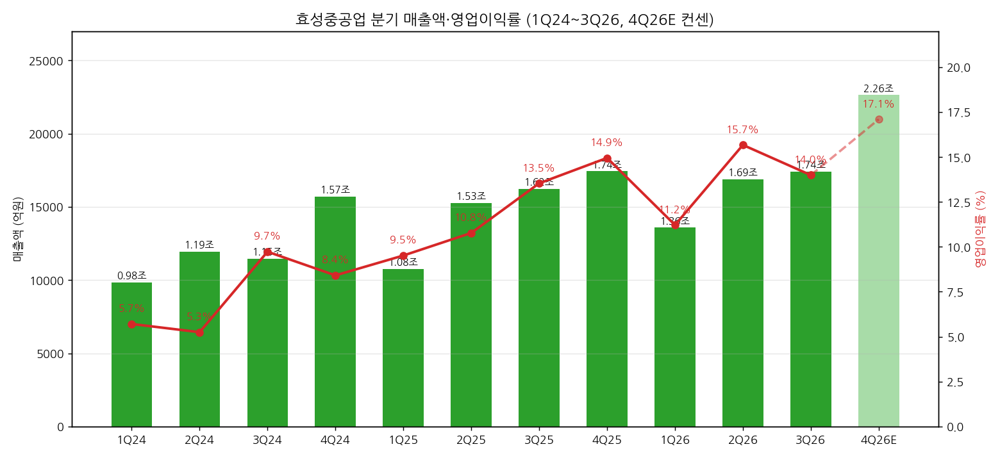
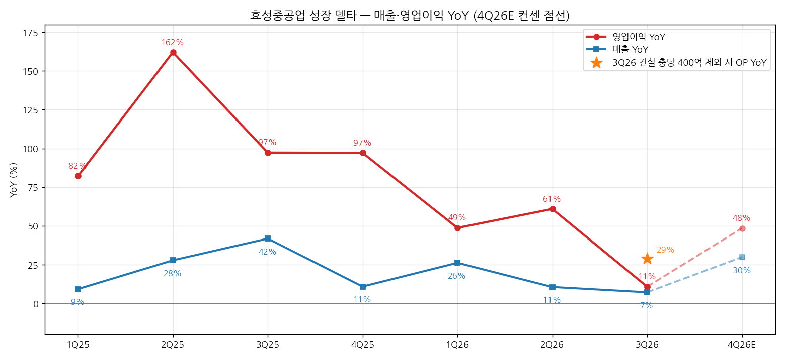
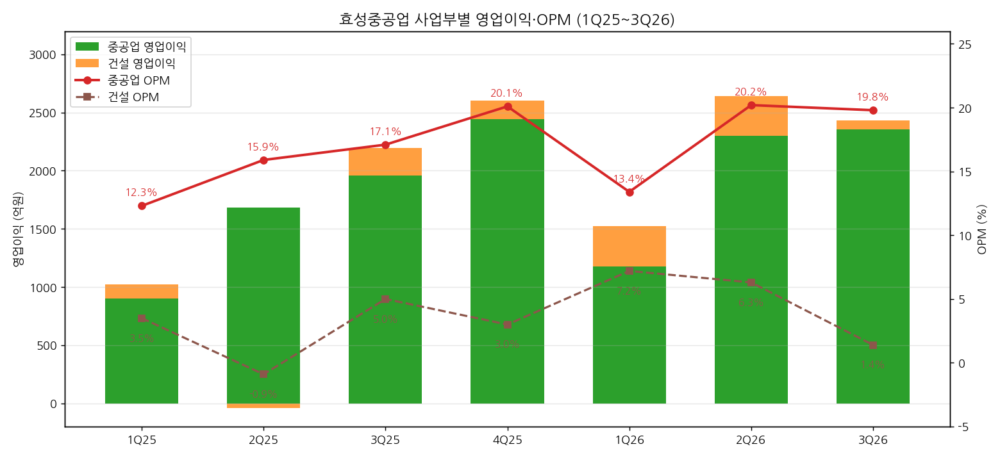

> 모드: 실적 리뷰 (v11)
> 종목: 효성중공업 (298040)
> 섹터: 전력 인프라
> 서브섹터: 송변전
> 분기: 2026-Q3
> 발표일: 2026-10-30 (잠정실적 + 애널리스트 브리핑)
> 작성 시각: 2026-11-03 12:30 KST
> 분석 소스: 셀사이드 7개 첨부 — 하나증권(11/2), 대신증권(11/2), SK증권(11/2), 한화투자증권(11/2), 미래에셋증권(11/2), J.P. Morgan(10/30), HSBC(10/30). 회사 설명은 증권사 리포트의 10/30 브리핑 정리로 인용. 웹서치 보완: 중간선거 데이터센터 주민투표 현황(Axios·Forbes·Ballotpedia, 4번 (3)항만). 직전 분기는 2026-Q1 리뷰 + 2026-Q2 팔로업 기준 (2Q26 리뷰 미작성)

# 효성중공업 3Q26 실적 리뷰 — 매출 이연과 건설 충당금, 수주는 역대 최대 잔고

> 성장 델타: 둔화 | 내러티브: 약화 → 델타 둔화 + 내러티브 약화 → 경계 구간 (4Q 이연분 인식 확인 전까지 관망)

→ **숫자**: 매출 1조 7,406억원(+7.2% YoY), 영업이익 2,435억원(+10.8% YoY, OPM 14.0%). 영업이익 YoY가 2Q26 +60.9%에서 +10.8%로 50%p 급감했고, FnGuide 컨센(3,060억원) 대비 -20.4% 미스다. 건설 충당금 400억원을 빼도 YoY +29%로 둔화 판정은 같다
→ **쟁점 ①**: 미국 원전향 GIS(태풍), 중동(물류), 영국(현장 지연) 매출 약 2,650억원이 4Q로 이연됐다. 증권사 7곳 모두 "일시적"으로 보지만, 중동분은 JPM만 4Q 인식이 불확실하다고 지적했다
→ **쟁점 ②**: 수주는 오히려 강하다. 중공업 신규수주 3.2조원(+122% YoY), 수주잔고 18.9조원(+71%, 역대 최대), 잔고 내 미국 비중 60%. 하이퍼스케일러 직접 발주(345~765kV 변압기 4억달러+)와 STATCOM 3,000억원 수주도 확인됐다
→ **쟁점 ③**: 7곳 중 5곳이 TP를 하향했다(평균 371만원 → 315만원, -15%). 이익 추정은 2~8% 하향에 그쳐, TP 하향의 주원인은 피어 멀티플 하락과 사이클 우려(HSBC 10/14 Hold 하향)다. 주가는 6개월 -53.8%로 고점(460만원) 대비 61% 빠진 상태다
→ **다음 분기 관건**: 4Q26 영업이익 3,800억원+(컨센 평균 3,869억원, YoY +48%) 달성 여부가 델타를 "가속"으로 되돌릴지 결정한다. 11/3 중간선거(데이터센터 주민투표)부터 12월 FERC·ERCOT 대형부하 접속 제도 결론까지가 멀티플의 방향을 정하는 구간이다

---

## 1. 숫자

① 연결 기준 분기 표 (단위: 억원, %)

| 항목 | 1Q24 | 2Q24 | 3Q24 | 4Q24 | 1Q25 | 2Q25 | 3Q25 | 4Q25 | 1Q26 | 2Q26 | **3Q26** | 4Q26E |
|---|---|---|---|---|---|---|---|---|---|---|---|---|
| 매출액 | 9,845 | 11,938 | 11,452 | 15,715 | 10,761 | 15,253 | 16,241 | 17,430 | 13,582 | 16,870 | **17,406** | 22,633 |
| 영업이익 | 562 | 627 | 1,114 | 1,322 | 1,024 | 1,643 | 2,198 | 2,605 | 1,523 | 2,643 | **2,435** | 3,869 |
| OPM | 5.7 | 5.3 | 9.7 | 8.4 | 9.5 | 10.8 | 13.5 | 14.9 | 11.2 | 15.7 | **14.0** | 17.1 |
| 매출 YoY | — | — | — | — | +9.3 | +27.8 | +41.8 | +10.9 | +26.2 | +10.6 | **+7.2** | +29.9 |
| 영업이익 YoY | — | — | — | — | +82.2 | +162.0 | +97.3 | +97.1 | +48.7 | +60.9 | **+10.8** | +48.5 |
| **매출 YoY 델타 (%p)** | — | — | — | — | — | +18.5 | +14.0 | -30.9 | +15.3 | -15.6 | **-3.4** | +22.7 |
| **영업이익 YoY 델타 (%p)** | — | — | — | — | — | +79.8 | -64.7 | -0.2 | -48.4 | +12.2 | **-50.1** | +37.7 |

→ (출처: 1Q24~4Q25는 효성중공업 IR(2026-Q1 리뷰 수록), 1Q25~3Q26은 하나·대신·SK·한화 분기 실적표, 4Q26E는 하나·대신·SK·한화·미래에셋 5곳 추정치 단순평균. 2023년 분기 데이터가 없어 2024년 YoY는 생략)
→ 3Q26 서프라이즈: 매출은 컨센 대비 -8.2%, 영업이익은 -20.4% (컨센 매출 1조 8,970억원·영업이익 3,060억원, FnGuide, 대신·SK 인용)
→ 영업이익 YoY의 정점은 2Q25(+162%)였고, 이후 +97% → +49% → +61% → +11%로 내려오는 추세다. 3Q26이 2024년 이후 가장 낮은 증가율이다
→ 컨센은 4Q26 +48%로 재가속한 뒤 2026년 연간 +41%, 2027년 +41%를 그린다. 컨센 경로상 YoY는 "정점 통과 후 30~50% 고원" 구간이다. 4Q가 이연분을 받아내지 못하면 2개 분기 연속 둔화로 "꺾임" 기준에 걸린다
→ **[판단] 델타 = 둔화**: 영업이익 YoY가 축소됐지만 플러스를 유지했다. 건설 충당금 400억원을 조정한 OP 2,835억원(YoY +29.0%) 기준으로도 2Q26 대비 둔화다

→ (출처: 효성중공업, 하나·대신·SK·한화·미래에셋 추정 평균. 4Q26E는 연한 막대·점선)

→ (출처: 동일. 별표는 건설 충당금 400억원 제외 시 3Q26 영업이익 YoY, [계산])

② 사업부별 매출·영업이익 (단위: 억원, %)

| 사업부 | 항목 | 1Q25 | 2Q25 | 3Q25 | 4Q25 | 1Q26 | 2Q26 | **3Q26** |
|---|---|---|---|---|---|---|---|---|
| 중공업 | 매출 | 7,319 | 10,621 | 11,448 | 12,136 | 8,815 | 11,379 | **11,932** |
| 중공업 | 영업이익 | 901 | 1,685 | 1,957 | 2,445 | 1,177 | 2,298 | **2,357** |
| 중공업 | OPM | 12.3 | 15.9 | 17.1 | 20.1 | 13.4 | 20.2 | **19.8** |
| 중공업 | 매출 YoY | — | — | — | — | +20.4 | +7.1 | **+4.2** |
| 중공업 | 영업이익 YoY | — | — | — | — | +30.6 | +36.4 | **+20.4** |
| 건설 | 매출 | 3,442 | 4,632 | 4,793 | 5,294 | 4,767 | 5,491 | **5,466** |
| 건설 | 영업이익 | 121 | -42 | 240 | 158 | 344 | 344 | **77** |
| 건설 | OPM | 3.5 | -0.9 | 5.0 | 3.0 | 7.2 | 6.3 | **1.4** |
| 건설 | 매출 YoY | — | — | — | — | +38.5 | +18.5 | **+14.0** |
| 건설 | 영업이익 YoY | — | — | — | — | +184.3 | 흑전 | **-67.9** |

→ (출처: 하나증권 도표 1, JPM Table 1. 3Q26 매출 비중은 중공업 68.6%·건설 31.4%)
→ 델타를 꺾은 것은 두 가지다. 중공업 매출 YoY가 +20% → +7% → +4%로 3개 분기 연속 둔화했고(이연 2,650억원 영향), 건설 영업이익이 충당금 400억원으로 344억원에서 77억원으로 줄었다
→ 중공업 OPM 19.8%는 2Q26(20.2%) 대비 -0.4%p에 그쳤고 3분기 기준으로는 최고치다. 중공업 영업이익 YoY도 +20%로 플러스를 유지했다
→ 중공업 지역 믹스는 미국 29%(2Q 38%), 한국 25%, 기타(말레이시아 등 아시아) 31%(2Q 26%), 중동 8%, 유럽 7%다 (JPM Table 2)

→ (출처: 하나증권 도표 1)

(1) 중공업 수주·잔고 — 선행지표 (단위: 십억원)

| 항목 | 1Q25 | 2Q25 | 3Q25 | 4Q25 | 1Q26 | 2Q26 | **3Q26** |
|---|---|---|---|---|---|---|---|
| 신규수주 | 2,008 | 2,197 | 1,456 | 1,966 | 4,174 | 3,324 | **3,233** |
| 수주잔고 | 10,429 | 10,718 | 11,079 | 11,957 | 15,062 | 17,507 | **18,899** |
| 잔고 내 미국 비중 (%) | — | — | 46 | — | 53 | 57 | **60** |

→ (출처: 대신증권 표 1, JPM Table 3)
→ 3Q26 미국 신규수주는 2.2조원(+308% YoY)으로 전체의 68%다. 9개월 누적 수주는 10.7조원으로, 연간 가이던스 12조원까지 4Q에 1.3조원만 남았다

③ 연간 (단위: 억원, %)

| 항목 | 2022 | 2023 | 2024 | 2025 | 2026E | 2027E |
|---|---|---|---|---|---|---|
| 매출액 | 35,101 | 43,006 | 48,950 | 59,685 | 70,590 | 84,269 |
| 영업이익 | 1,432 | 2,578 | 3,625 | 7,470 | 10,518 | 14,784 |
| OPM | 4.1 | 6.0 | 7.4 | 12.5 | 14.9 | 17.5 |
| 매출 YoY | +13.4 | +22.5 | +13.8 | +21.9 | +18.3 | +19.4 |
| 영업이익 YoY | +19.3 | +80.0 | +40.6 | +106.1 | +40.8 | +40.6 |

→ (출처: 2022~2025 KRX 재무추이, 2026E·2027E는 하나·대신·SK·한화·미래에셋·JPM 6곳 발표 후 추정치 단순평균)
→ 발표 후 연간 영업이익 추정치는 2026E가 FnGuide 발표 전 컨센 1조 972억원에서 6곳 평균 1조 518억원(-4.1%), 2027E가 1조 5,566억원에서 1조 4,784억원(-5.0%)으로 내려갔다 (발표 전 컨센 출처: 하나증권 Consensus Data)
→ 2026E 6곳 평균 기준 4Q26 내재 영업이익은 3,917억원이다 (9개월 누적 6,601억원 차감, [계산])

---

## 2. 시장 쟁점

① 지난 분기 체크 (2026-Q2 팔로업의 "봐야 할 것" 5개 기준. 2Q26 리뷰는 미작성)

| 직전 팔로업 항목 | 2Q26~3Q26 결과 | 판정 |
|---|---|---|
| (1) 2Q26 OPM 16% 회복 | 2Q26 15.7%(영업이익 2,643억원), 3Q26 14.0%로 재하락 | 2Q 근접 확인, 3Q 반대로 나옴 |
| (2) 765kV 후속 수주 2~3조원 → 가이던스 상향 | 2Q26 수주 3.3조원, 7/31 수주 가이던스 7.6조원 → 12조원 상향. 3Q 3.2조원 | 확인 |
| (3) HD현대일렉트릭 비교 | 본 리뷰 범위 밖 (HD현대일렉트릭 리뷰에서 다룸) | 미확인 |
| (4) SST 초도 수주 | 3Q 리포트 7곳 모두 언급 없음. 대신 765kV STATCOM 3,000억원 수주가 신규 제품 진입 사례 | 미확인 |
| (5) 미국 관세 환급 2H26 반영 | 3Q 리포트 7곳 모두 언급 없음 | 미확인 |

② 이번 분기 쟁점 4개

| # | 쟁점 | 언급 증권사 수 |
|---|---|---|
| (1) | 매출 이연 2,650억원은 일시적인가, 4Q에 다 들어오나 | 7/7 |
| (2) | 왜 OPM이 14.0%로 떨어졌나 — 일회성을 빼면 정상 마진은 몇 %인가 | 6/7 |
| (3) | 수주 모멘텀은 유지되나 — 12조원 가이던스와 765kV·하이퍼스케일러 | 7/7 |
| (4) | TP 하향은 실적 문제인가 멀티플 문제인가 — 사이클 우려와 미국 규제 | 7/7 |

③ 쟁점별 분해

(1) 매출 이연 — 일시적인가, 4Q에 다 들어오나

(1-1) 회사 설명 (10/30 애널리스트 브리핑, HSBC·JPM 정리)
→ 이연 매출 2,650억원은 4Q26 중에 인식한다. 미국 GIS(약 1억달러)는 11월 인도 예정이다 (JPM)
→ 중동분은 인도 시점의 불확실성이 더 크다고 인정했다 (JPM)
→ 중공업 연간 가이던스(매출 +25%, OPM 10%대 후반, 수주 12조원)는 유지했다 (HSBC)

(1-2) 증권사별 해석 편차

| 증권사 | 핵심 가정·추정 | 논리 |
|---|---|---|
| SK | 이연 2,600~2,700억원, 이 중 미국 GIS 약 1,400억원. 4Q 매출 2.33조원·OP 3,870억원 | 이연분 4Q 반영으로 실적 회복 |
| 한화 | 미국 GIS 1억달러 + 중동 700억원 + 영국 500억원. 4Q OP 4,010억원 | 대부분 4Q 인도, 건설 원가는 특정 현장에 국한 |
| 미래에셋 | 미국 GIS 1.06억달러 + 영국·중동 1,300억원. 4Q 매출 2.32조원·OP 3,538억원 | 가이던스(+25%) 충족에 4Q 매출 약 2조원 필요 → 4Q 서프라이즈 전망 |
| 대신 | 4Q 매출 2.30조원(+32%)·OP 4,034억원(+55%) | 미국·영국향 4Q 반영 + Quanta JV GCB 공급 본격화 |
| 하나 | 4Q 매출 2.23조원·OP 3,897억원 | 추가 이연이 없다면 유의미한 성장 확인 |
| JPM | 중동 700~800억원은 timing 불확실, 2026~28E OP 2~4% 하향 | 중동 이연 장기화 가능성 반영 |
| HSBC | 이연 2,650억원 4Q 인식 (회사 설명 그대로) | 일시적 부진 (TP·추정 변경 없음) |

(1-3) 공통 결론 vs 갈리는 지점
→ 공통: 7곳 모두 이연을 일시적으로 보고, 미국·영국분의 4Q 인식은 이견이 없다
→ 갈림: 중동분(700~800억원)의 4Q 인식 여부, 그리고 4Q OP 추정 폭이 3,538억원(미래에셋)에서 4,149억원(JPM 연간 추정 내재)까지 600억원 차이다

(1-4) **[판단]**
→ 미국 GIS는 태풍에 따른 물류 차질이고 11월 인도 일정까지 나와 있어 신뢰도가 높다. 중동은 정세와 물류가 원인이라 회사가 통제할 수 없는 변수다
→ 1Q26에도 미국향 차단기 약 400억원 영업이익이 "운송 중 재고"로 이연됐다가 2Q26에 인식됐다 (2026-Q1 리뷰). 1Q·3Q 두 번 연속 미국향 고마진 물량이 분기 말 인도 리스크에 노출된 셈이다. 이연 자체는 일시적이어도, 분기 실적의 변동성이 구조적으로 커졌다고 보는 편이 숫자와 맞다
→ 결론이 바뀌는 조건: 4Q26 영업이익이 3,500억원을 밑돌면 "이연"이 아니라 "수요·인도 차질"로 해석이 바뀐다

(2) OPM 14.0% — 일회성을 빼면 정상 마진은 몇 %인가

(2-1) 회사 설명
→ 건설은 약 4년 전 수주한 특정 현장에서 설계 변경과 자재비 상승이 발생해, 예상 비용 400억원을 3Q에 반영했다 (JPM)
→ 4Q에는 미국 비중이 다시 높아져 마진이 개선될 것이라고 했다. 중공업 FY26 OPM 10%대 후반 가정도 유지했다 (JPM)

(2-2) 증권사별 해석 편차

| 증권사 | 마진 하락 원인으로 지목한 것 | 논리 |
|---|---|---|
| JPM | 미국 매출 비중 38% → 29% + 건설 OPM 6.3% → 1.4% | 지역 믹스와 건설이 함께 끌어내렸다 |
| 한화 | 말레이시아 고객사 물량 집중으로 북미 비중 29%로 축소 | 지역 믹스가 핵심 |
| 하나 | 중공업 OPM 19.8%는 3분기 최대치, 미주 매출 비중이 잔고 비중보다 낮아 상승 여력 큼 | 마진 하락은 건설 일회성 |
| SK·미래에셋·대신 | 건설 원가 상승 400억원 + 고마진 전력기기 매출 이연 | 두 일회성의 합 |

(2-3) 공통 결론 vs 갈리는 지점
→ 공통: 건설 400억원은 일회성이다
→ 갈림: 미국 비중 하락(지역 믹스)이 마진을 얼마나 깎았는지에 대한 비중 판단이 다르다. JPM·한화는 믹스를, 하나는 건설을 주원인으로 본다

(2-4) **[판단]** — 숫자로 분해
→ 전사 OPM은 2Q 15.7%에서 3Q 14.0%로 1.7%p 내려갔다. 건설 영업이익을 2Q 수준(344억원)으로 되돌리면 3Q 영업이익은 약 2,702억원, OPM 15.5%다 ([계산]). **1.7%p 하락 중 약 1.5%p가 건설 충당금 효과다**
→ 중공업 OPM은 미국 비중이 9%p 빠졌는데도 20.2% → 19.8%로 0.4%p만 내려갔다. 지역 믹스의 마진 영향은 이번 분기에 크지 않았다는 뜻이다. 하나증권의 해석이 숫자와 더 맞다
→ 건설 400억원을 더한 3Q 조정 영업이익은 2,835억원(OPM 16.3%)이다. 이연 매출 2,650억원에 중공업 OPM 19.8%를 단순 적용하면 약 520억원이 더해져 약 3,360억원(OPM 16.8%)이 된다 ([추정]). 이 경우 컨센 3,060억원을 약 10% 웃돈다
→ 결론이 바뀌는 조건: 4Q에 건설 추가 충당금이 나오거나, 미국 비중이 회복됐는데도 중공업 OPM이 20%를 넘지 못하면 "정상 마진 16~17%" 가정을 다시 봐야 한다

(3) 수주 모멘텀 — 12조원 가이던스, 765kV, 하이퍼스케일러

(3-1) 회사 설명 (HSBC·JPM·SK·미래에셋 정리)
→ 2026 수주 가이던스 12조원을 유지했고, 일반 유틸리티와 하이퍼스케일러 수요로 상향 여지가 있다고 했다
→ 765kV는 현재 수주잔고의 약 10%(약 1.9조원)이며, 고객과 협의 중인 프로젝트 기준으로 향후 확보 물량의 2배를 훨씬 넘는 추가 수주를 기대한다. 2031~32년 납기 765kV 물량도 이미 논의 중이다
→ 하이퍼스케일러로부터 345~765kV 변압기를 4억달러 이상 수주했다. 미국 원전향 GIS와 765kV STATCOM도 수주했다
→ 리드타임은 초고압 변압기 3년, GIS 1.5년으로 전분기와 같고 가격도 안정적이다
→ GE Vernova가 Trench Group을 인수했지만, 부싱 조달처를 다변화해 문제가 없다고 했다 (HSBC)
→ 국내 초고압 변압기 추가 증설과 중저압 배전 변압기 capa 추가를 검토하고 있다 (HSBC)

(3-2) 증권사별 해석 편차

| 증권사 | 2026 중공업 수주 추정 | 논리 |
|---|---|---|
| JPM | 가이던스 대비 +15% 이상 초과 가능 (13.8조원+) | 4Q가 3Q 수준만 유지해도 초과 |
| 대신 | 14.8조원 | 미국 4대 RTO 765kV 송전망 총 1,160~1,340억달러 중 약 45% 승인. 765kV 누적 수주 1.8조원+ |
| 미래에셋 | 13.9조원 (2027E 10.1조원, -27%) | 2027년 수주는 역성장을 가정 |
| 하나 | 가이던스 12조원 충족 | 미국 비중 절대적, 고마진 믹스로 마진 우상향 |
| SK | — | 텍사스·오하이오 중심으로 2027년 상반기 765kV 수주 확대 기대 (Quanta Services 코멘트 인용) |
| 한화 | — | 수요처가 유틸리티에서 하이퍼스케일러로 확장, STATCOM 진입장벽 높은 765kV에서 첫 수주 |

(3-3) 공통 결론 vs 갈리는 지점
→ 공통: 수주는 이번 분기에서 가장 강한 숫자다. 수주잔고 18.9조원은 2025년 중공업 매출의 약 4.6배다 ([계산], 4.15조원 기준)
→ 갈림: 2027년 수주 경로다. 미래에셋은 2026년의 대형 765kV 수주가 일회성으로 몰렸다고 보고 2027년 -27%를 가정했다. 대신·SK는 미국 RTO 승인이 절반도 안 됐다는 점에서 추가 수주가 이어진다고 본다

(3-4) **[판단]**
→ 수주잔고가 빠르게 늘어나는데 매출 YoY가 둔화하는 것은 생산능력(capa)이 병목이라는 신호다. 멤피스 capa는 연 3억달러 → 2026년 말 4억달러 → 2028년 6월 7억달러로 늘어난다 (SK). 국내 HVDC 공장은 2027년 상반기 완공 예정이다 (하나)
→ 따라서 2027년 매출 가속은 수주보다 증설 일정에 달려 있다. 수주 성장률은 2027년에 꺾여도(미래에셋 가정) 잔고 소진으로 매출과 이익은 늘 수 있다
→ 결론이 바뀌는 조건: 4Q 수주가 1.3조원을 밑돌아 가이던스에 미달하거나, 리드타임·가격이 하락 전환하면 "수주 사이클 정점" 해석이 힘을 얻는다

(4) TP 하향은 실적 때문인가, 멀티플 때문인가 — 사이클 우려와 미국 규제

(4-1) 회사 설명
→ 해당 없음 (밸류에이션 쟁점)

(4-2) 증권사별 해석 편차

| 증권사 | 적용 멀티플 | 하향 이유 |
|---|---|---|
| 하나 | 2028E EPS × PER 24배 | 실적 하회 반영 |
| 대신 | 2027F EPS × 피어 2027F PER 26배 | 6개월 내 목표주가 현실화 등. 12월 미국 전력망 규제 불확실성 해소 시 저평가 탈피 기대 |
| 한화 | 2028E EPS × PER 26배 (피어 2028E 평균 +20% 할증) | 업종 전반 멀티플 하향 |
| 미래에셋 | 2028F EPS × PER 24.8배 (초고압 변압기 경쟁사 평균) | 상반기 급증한 수주가 안정되며 업종 기대감 조정 |
| JPM | SOTP: 전력기기 PER 30배 → 25배, 건설 5배 | 글로벌 피어 밸류에이션 하락 |
| HSBC | Hold, TP 250만원 (10/14 Buy → Hold, 400만원 → 250만원) | "Cycle concerns taking hold" — 사이클 우려 |
| SK | TP 250만원 유지 (10/19 400만원 → 250만원 기 하향) | 2027년 765kV 송전망 투자 수혜는 기대 |

(4-3) 공통 결론 vs 갈리는 지점
→ 공통: 이익 추정 하향은 2~8%에 그친다 (한화 2026E -8.2%·2027E -4.9%, JPM 2026~28E -2~4%, SK 2026E -2.3%). TP 하향 폭(9~25%)이 훨씬 크다
→ 갈림: 밸류에이션 기준 연도가 다르다. 대신·JPM은 2027년, 하나·한화·미래에셋은 2028년 EPS를 쓴다. 2028년 기준 증권사가 TP는 더 높지만, 그만큼 먼 미래 이익에 기댄다

(4-4) **[판단]**
→ 이번 TP 하향은 **실적 하향보다 멀티플 하향이 주원인**이다. 주가는 6개월 -53.8%, KOSPI 대비 -46.8%로 이미 크게 내려왔다. 현재 2027F PER은 15~16배다 (대신·JPM)
→ 대신이 짚은 미국 규제 변수가 멀티플의 열쇠다. FERC는 대형부하 계통접속 제도 개선과 관련해 11월 16~20일 6개 계통운영기관의 보고를 받고, 12월 16일 이해관계자 반론 시한을 거쳐 1H27에 시행할 예정이다. ERCOT은 12월 10일 적격성 감사를 끝내고 12월 중 본심사를 재개한다. 제도 개선안에는 망 보강비의 데이터센터 전액 부담, 착공 전 100% 재무 보증 등이 포함돼, 데이터센터 접속 속도에 영향을 준다 (대신 표 2)
→ 결론이 바뀌는 조건: 12월 FERC·ERCOT 결론이 데이터센터 접속을 크게 늦추는 방향이면, 하이퍼스케일러 직접 발주 스토리가 약해지고 멀티플 하향이 이어질 수 있다

④ 낙관 vs 보수 — 논리 대비
→ **가장 낙관(미래에셋 TP 400만원, 한화 350만원)**: 2028년 EPS를 기준으로 피어 평균 이상의 PER(24.8~26배)을 적용했다. 미래에셋은 4Q 매출 2.3조원으로 서프라이즈를, 한화는 2027년부터 765kV 매출 본격 기여를 가정했다
→ **가장 보수(HSBC Hold 250만원, SK 250만원)**: HSBC는 10월에 이미 "사이클 우려"로 등급을 내렸다. SK는 2027년 영업이익을 6곳 중 가장 높게(1조 6,160억원) 추정하면서도 TP는 가장 낮다. 이익보다 멀티플을 보수적으로 잡았다는 뜻이다
→ 셀사이드 vs 시장: 셀사이드 7곳 중 6곳이 매수(Buy·OW)를 유지했지만, 주가는 고점 대비 61% 하락했다. 현재가는 평균 TP 대비 +74% 상승여력이다. 셀사이드는 펀더멘털을 보고 시장은 사이클 정점을 반영하는, 심리가 어긋난 상태다

⑤ 추정치·TP 변화 (단위: 원, 억원)

| 증권사 | 직전 TP | 현재 TP | 4Q26 영업이익 E | 2026 / 2027 영업이익 E | 핵심 변화 한 줄 |
|---|---|---|---|---|---|
| 미래에셋 (11/2) | 4,400,000 | 4,000,000 (-9.1%) | 3,538 | 10,139 / 14,331 | 수주 안정화로 멀티플 하향, 4Q 서프라이즈 전망 |
| 한화 (11/2) | 4,500,000 | 3,500,000 (-22.2%) | 4,010 | 10,610 / 14,760 | 2026E OP -8.2%, 업종 멀티플 하향 |
| 하나 (11/2) | 4,300,000 | 3,400,000 (-20.9%) | 3,897 | 10,498 / 14,222 | 2028E PER 24배 |
| JPM (10/30) | 3,800,000 | 3,150,000 (-17.1%) | 4,149 [계산] | 10,750 / 14,580 | 전력기기 PER 30배 → 25배, 중동 timing 반영 |
| 대신 (11/2) | 4,000,000 | 3,000,000 (-25.0%) | 4,034 | 10,640 / 14,650 | 2027F 피어 PER 26배, 12월 규제 해소 기대 |
| SK (11/2) | 2,500,000 | 2,500,000 (유지) | 3,870 | 10,470 / 16,160 | 10/19 기 하향, 2027년 765kV 기대 |
| HSBC (10/30) | 2,500,000 | 2,500,000 (Hold) | — | — | 10/14 Hold 하향 유지, 추정 미제시 |

→ (출처: 각 증권사 리포트. JPM 4Q26 OP는 연간 추정 1조 750억원에서 9개월 누적 6,601억원을 뺀 값)
→ 평균 TP는 3,714,286원 → 3,150,000원(-15.2%)이다. 하향 5건, 유지 2건(SK·HSBC는 10월에 이미 하향)이다
→ 발표 전 대비 연간 영업이익 컨센은 2026E -4.1%, 2027E -5.0%다 (FnGuide 발표 전 vs 6곳 평균)
→ **TP 하향의 원인 = 멀티플 하향 (주) + 실적 하향 (부)**. 이익 추정은 2~8% 내려갔지만 TP는 평균 15% 내려갔다. 차이는 적용 PER 하락(JPM 30 → 25배 등)과 피어 밸류에이션 조정에서 나온다

---

## 3. 내러티브 점검

① 성장 스토리 정의
→ 미국 초고압(765kV) 송전망 투자와 하이퍼스케일러 직접 발주로 고마진 미국 수주가 쌓이고, 멤피스·창원 증설로 이 잔고가 매출화되면서 마진이 우상향한다. 시장은 "수주잔고 → 증설 → 미국 믹스 → 마진 확장"의 연결고리를 산다

② 이번 분기 평가
→ **강화된 부분**: 수주잔고 18.9조원(역대 최대), 잔고 내 미국 비중 60%, 하이퍼스케일러 직접 발주, STATCOM 신규 제품 진입, 리드타임·가격 안정. 스토리의 "수요" 쪽은 오히려 단단해졌다
→ **약해진 부분**: "매출화와 마진" 쪽이 두 분기 연속(1Q 운송 중 재고, 3Q 이연·충당금) 흔들렸다. 그 결과 셀사이드가 이익 추정과 멀티플을 함께 내렸고, HSBC는 사이클 우려로 등급을 낮췄다
→ **[판단] 내러티브 = 약화**: 스토리의 핵심 전제(미국 수요·점유율)는 깨지지 않았다. 하지만 타이밍 지연과 마진 의문으로 추정치·멀티플이 하향됐다. 기준표의 "약화" 정의에 정확히 해당한다
→ 1번 델타 "둔화"와 합치면 **경계 구간**이다. 4Q26에 이연분이 인식되고 OPM 17%가 확인되면 델타는 "가속", 내러티브는 "유지"로 돌아갈 수 있다

③ 스토리를 다시 강하게 만들 트리거
→ 4Q26 영업이익 3,800억원 이상, OPM 17% 이상으로 이연분 인식 확인 (1월 말 잠정실적)
→ 12월 FERC·ERCOT 대형부하 접속 제도가 데이터센터 접속을 허용하는 방향으로 결론
→ 765kV 대형 수주(텍사스·오하이오) 또는 국내 초고압 변압기 증설 공식 발표

④ 스토리를 깨뜨릴 리스크
→ 4Q에도 이연이 반복되거나(특히 중동), 건설 추가 충당금 발생
→ FERC 제도 강화로 하이퍼스케일러 데이터센터 접속이 지연돼 직접 발주가 둔화
→ 글로벌 전력기기 피어 멀티플의 추가 하락 (HSBC가 말하는 사이클 정점 우려의 확산)

---

## 4. 향후 봐야 할 것 (우선순위 순)

(1) **4Q26 영업이익 3,800억원 이상, OPM 17% 이상** — 델타 판정을 바꾸는 1순위 변수
→ 무엇을: 영업이익 3,800억원(컨센 평균 3,869억원, YoY +48%) 이상이면 "가속", 3,500억원 미만이면 2개 분기 연속 둔화로 "꺾임"
→ 어떤 데이터로: 4Q26 잠정실적, 11월 미국 GIS 인도 뉴스 (JPM), 중동 인도 여부
→ 언제: 2027년 1월 말

(2) **4Q 신규수주 1.3조원 이상, 2026년 수주 12조원 초과**
→ 무엇을: 연간 12조원 달성 여부, JPM 기준 13.8조원+ 초과 여부, 765kV·STATCOM 추가 수주
→ 어떤 데이터로: 수주 공시, 뉴스 키워드 "효성중공업 765kV", "Hyosung STATCOM", "Hyosung Memphis"
→ 언제: 11~12월 수시, 4Q 실적 발표 시 확정

(3) **11/3 중간선거 → 11월 RTO 보고 → 12월 FERC·ERCOT 결론** — 멀티플 방향을 정하는 섹터 공통 이벤트 구간
→ 무엇을: 세 이벤트 모두 "데이터센터 전력 비용을 누가 내나"를 다룬다. 중간선거에서 데이터센터 반대 주민투표가 연이어 통과하면, 12월 FERC 결론도 비용 전가 차단·재무 보증 강화 쪽으로 기울 가능성이 커진다
→ 효성중공업 영향 구분 [판단]: 765kV 송전망(RTO 승인 규제 투자)은 직접 영향이 작다. 반면 하이퍼스케일러 직접 발주(345~765kV 변압기 4억달러+)는 데이터센터 부지·접속 일정에 직접 연결돼 가장 민감하다. 12월 결론은 "전력망 투자 전체"보다 "데이터센터향 직접 수요"의 할인율을 정하는 이벤트다
→ 어떤 데이터로: (1) 11/3 데이터센터 관련 지역 주민투표 결과(10~13개 주 41~50건, 오하이오 21건 최다, 2026년 기결정 6건은 모두 개발 반대로 결론) + 9개 주 공공요금위원회 선거 결과 (2) FERC 대형부하 소명명령 관련 RTO 보고(11/16~20) (3) ERCOT 적격성 감사 완료(12/10)·본심사 재개 (4) FERC 이해관계자 반론 시한(12/16)
→ 언제: 11/3 ~ 12월 중순, 제도 시행은 1H27. HD현대일렉트릭·LS일렉트릭에도 같은 변수가 걸리는 섹터 공통 일정
→ (출처: 대신증권 표 2·본문, Axios 10/31, Forbes 11/2, Ballotpedia 11/2)

(4) **중공업 매출 내 미국 비중 35% 이상 회복**
→ 무엇을: 3Q 29%에서 4Q 35% 이상으로 회복하는지, 중공업 OPM 20% 이상 복귀
→ 어떤 데이터로: 4Q26 IR 자료의 지역별 매출 표, 수주잔고 미국 비중(현재 60%)
→ 언제: 2027년 1월 말

(5) **건설 OPM 정상화 (4~5%)**
→ 무엇을: 4Q 건설 OPM이 3Q 1.4%에서 4~5%로 돌아오는지, 같은 현장에서 추가 충당금이 나오는지
→ 어떤 데이터로: 4Q26 잠정실적 부문별 손익
→ 언제: 2027년 1월 말
