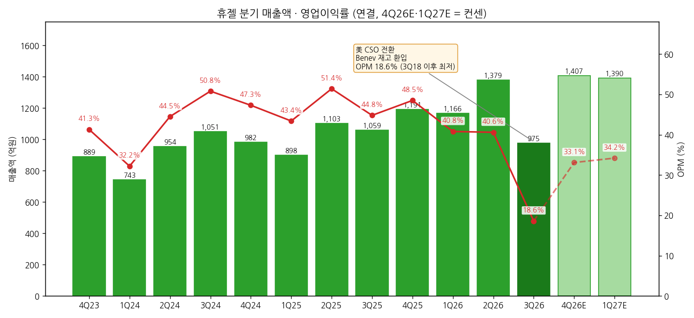
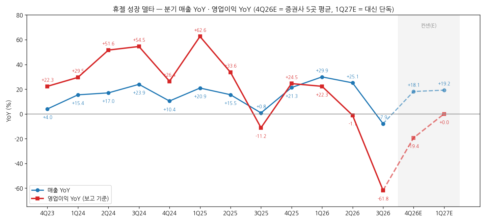
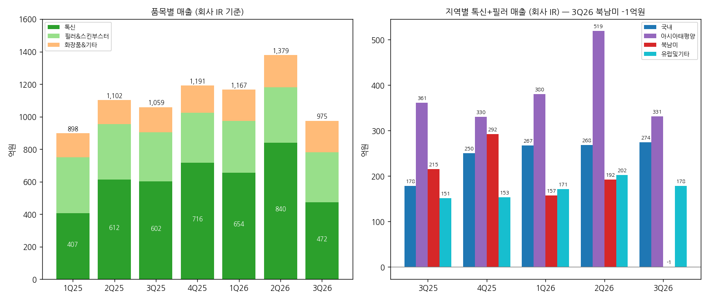

> 모드: 실적 리뷰 (v11)
> 종목: 휴젤 (145020)
> 섹터: 뷰티
> 서브섹터: 미용의료
> 분기: 2026-Q3
> 발표일: 2026-11-04 (연결 잠정실적 + IR 자료「2026년 3분기 실적」, 분기보고서 2026-11-13 공시 — 숫자 동일)
> 작성 시각: 2026-11-22 20:40 KST
> 분석 소스: 회사 IR「2026년 3분기 실적 / 3Q26 Earnings Release」(2026-11-04) + 셀사이드 첨부 5건 — 대신증권(11/05「3Q는 화나도 팔 때는 아님」), 신한투자증권(11/05「미국 재정비에 쉬어간 실적」), 유진투자증권(11/05「3Q26 Review 바닥 확인」), 키움증권(11/05「휴젤 붐은 온다」), 상상인증권(11/11「영업실적 점진적 회복 전망」). 5건 모두 첫 페이지로 휴젤(145020) 확인. 과거 분기 숫자는 휴젤 기업개요(2026-11-15, OpenDART 분기 시계열)로 교차검증. 컨콜 트랜스크립트 미첨부 — 회사 설명은 IR 각주와 증권사 리포트의 컨콜·회사 자료 인용. 웹서치 보완 없음
> 리뷰 깊이: 풀 | 리서치 첨부 5건
> 비영업 요인: 일회성(美 유통 구조 CSO 전환 — 기존 유통사 Benev 재고 재매입으로 북남미 매출 차감, 북남미 톡신+필러 -1억원) · 美 직판 조직 구축 판관비(+60% YoY) · 영업외 외화평가손실(순이익만, 영업이익 무관) · 4Q26부터 美 매출 인식 기준 변경(sell-out 총액 인식, ASP 약 2배)으로 기준 단절 — 판정은 보고 기준 그대로

# 휴젤 3Q26 실적 리뷰 — 미국 유통 전환이 한 분기 이익을 지웠다, 영업이익 YoY -1.1% → -61.8%

> 성장 델타: 꺾임(악화) | 내러티브: 약화 → 델타 꺾임(악화) + 내러티브 약화 → 매매 제외 구간 (4Q26 美 sell-out 매출 회복과 영업이익 YoY 플러스 복귀 확인 전까지 · 4Q26 컨센(-19%)대로면 꺾임(개선), 2개 분기 연속 개선 시 턴어라운드 후보)
>
> ⚠ 비영업 요인 플래그: 꺾임의 주된 원인은 美 유통 구조 전환(일회성 성격)이다. 북남미 톡신+필러 매출이 3Q25 215억원에서 -1억원으로 사라졌고(Benev 재고 재매입 차감, 美 톡신 단독 -121~-142억원 — 신한·유진 추정), 판관비는 549억원(+60% YoY, +206억원)으로 늘었다. 북남미를 빼면 매출은 976억원으로 3Q25 844억원 대비 +15.6%다([계산], 참고). 북남미 매출을 3Q25 수준으로 되돌리고(GPM 77% 적용 +166억원) 판관비를 2Q26 수준으로 놓아도(+52억원) 영업이익은 약 399억원, YoY -15.8%로 여전히 마이너스다([계산], 참고) — 조정치로 봐도 판정(꺾임)은 같다. 재고 재매입 총액은 회사 미공시 (분리 불가)

→ **숫자**: 매출 975억원(-7.9% YoY, -29.3% QoQ), 영업이익 181억원(-61.8% YoY, -67.7% QoQ), OPM 18.6%(-26.2%p YoY) — 3Q18(14.7%, 중국 따이공 단속) 이후 최저(키움). 영업이익 YoY는 2Q26 -1.1%로 이미 마이너스로 돌아섰고, 이번 분기 델타 -60.7%p로 2개 분기 연속 마이너스다. FnGuide 컨센(매출 1,048억원·영업이익 279억원) 대비 -6.9%·-35.2%로 큰 미스
→ **쟁점 ①**: 미스의 범인은 미국이다(대신). Benev 재고를 되사 오면서 북남미 매출이 0이 됐고, 미국 현지 조직·메디컬 마케팅 비용이 같은 분기에 들어왔다. 미국 밖은 견조했다 — 국내 톡신 +46%, 유럽 톡신 +44%, 브라질 분기 첫 100억원 돌파, 화장품 +25%. 반면 필러 수출은 -8%로 정체다
→ **쟁점 ②**: 5곳 모두 "3Q가 저점"에 동의한다. 4Q부터 美 매출이 최종 판매가(sell-out) 기준으로 잡혀 단가가 약 2배가 된다. 다만 4Q 영업이익 추정은 392~533억원(5곳 평균 466억원, YoY -19%)으로 36% 벌어져 있고, 美 직판 비용이 1H27까지 이어져 영업이익 YoY 플러스 복귀는 컨센상 1Q27(0%)~3Q27(저기저)이다
→ **쟁점 ③**: TP는 5곳 모두 하향(평균 31.8만원 → 27.0만원, -15.1%). 2027E 영업이익 -8~-10%, 목표 PER -10~-20% — 실적과 멀티플이 반반 내려갔다. 12MF PER 12~13.6배는 2016년 이후 최저(대신·유진)이고, 주가는 발표일 장중 -10% 후 회복해 셀사이드·수급 모두 "팔 때는 아님" 쪽이다
→ **다음 분기 관건**: 4Q26 영업이익이 컨센 466억원(YoY -19%)을 넘어 520억원(-10%) 이상이면 회복 경로가 앞당겨진다. 4Q25 578억원을 넘어야 YoY가 플러스로 돌아온다. 美 매출(북남미 톡신 250~450억원 추정 분산)과 판관비 정점(620~650억원)이 같이 확인돼야 하고, 2027 가이던스(내년 초)가 그 다음 관문이다

---

## 1. 숫자

① 연결 기준 분기 표 (단위: 억원, %)

| 항목 | 4Q23 | 1Q24 | 2Q24 | 3Q24 | 4Q24 | 1Q25 | 2Q25 | 3Q25 | 4Q25 | 1Q26 | 2Q26 | **3Q26** | 4Q26E | 1Q27E |
|---|---|---|---|---|---|---|---|---|---|---|---|---|---|---|
| 매출액 | 889 | 743 | 954 | 1,051 | 982 | 898 | 1,103 | 1,059 | 1,191 | 1,166 | 1,379 | **975** | 1,407 | 1,390 |
| 영업이익 (보고 기준) | 367 | 240 | 424 | 534 | 465 | 390 | 567 | 474 | 578 | 476 | 560 | **181** | 466 | 476 |
| OPM | 41.3 | 32.2 | 44.5 | 50.8 | 47.3 | 43.4 | 51.4 | 44.8 | 48.5 | 40.8 | 40.6 | **18.6** | 33.1 | 34.2 |
| 매출 YoY | +4.0 | +15.4 | +17.0 | +23.9 | +10.4 | +20.9 | +15.5 | +0.8 | +21.3 | +29.9 | +25.1 | **-7.9** | +18.1 | +19.2 |
| 영업이익 YoY | +22.3 | +29.5 | +51.6 | +54.5 | +26.4 | +62.6 | +33.6 | -11.2 | +24.5 | +22.3 | -1.1 | **-61.8** | -19.4 | 0.0 |
| **매출 YoY 델타 (%p)** | -16.0 | +11.4 | +1.6 | +6.9 | -13.5 | +10.5 | -5.4 | -14.7 | +20.5 | +8.6 | -4.8 | **-33.0** | +26.0 | +1.1 |
| **영업이익 YoY 델타 (%p)** | -17.2 | +7.2 | +22.1 | +2.9 | -28.1 | +36.2 | -29.0 | -44.8 | +35.7 | -2.2 | -23.4 | **-60.7** | +42.4 | +19.4 |
| (참고) 북남미 제외 매출 | | | | | | | | 844 | 899 | 1,009 | 1,187 | 976 (+15.6) | | |
| (참고) 3Q26 조정 영업이익 | | | | | | | | | | | | 약 399 (YoY -15.8) | | |

→ (출처: 4Q23~2Q26 = OpenDART 연결(휴젤 기업개요 분기 시계열, 4Q = 연간 − 3Q 누적), 3Q26 = 회사 IR 잠정(11/04, 분기보고서 11/13과 동일). 4Q26E = 대신·상상인·신한·유진·키움 5곳 평균, 1Q27E = 대신증권 단독 추정. 북남미 제외 매출 = 연결 매출 − IR 북남미 톡신+필러 [계산]. 조정 영업이익 = 북남미 매출 3Q25 수준 회복분 × GPM 77.1% + 판관비 2Q26 수준 환원분 [계산])
→ **YoY 계산 기준**: 보고 기준(K-IFRS 연결) 영업이익, 같은 분기 전년 대비. 3Q26 = 회사 IR 18.1십억원 vs 3Q25 IR 47.4십억원(DART 474억원과 동일) → -61.8%. 2Q26 = DART 560억원 vs 567억원 → -1.1%. 연결 범위 변경 없음. **기준 단절 예고**: 4Q26부터 美 매출이 Benev 공급가(sell-in) 대신 최종 고객 판매가(sell-out) 총액으로 인식되고 Benev에는 판매수수료(판관비)를 낸다(상상인·대신). 4Q26 이후 북남미 매출 YoY와 전사 매출 YoY는 단가 효과로 부풀려지므로, 영업이익 YoY를 우선해서 본다
→ 3Q26 서프라이즈: 매출 컨센 대비 -6.9%, 영업이익 -35.2% (FnGuide 컨센 매출 1,048억원·영업이익 279억원, 신한·유진 인용. 키움은 -7.0%·-35.1%, 대신은 -7%·-35%)
→ 영업이익 YoY의 최근 정점은 1Q25(+62.6%)다. 이후 +33.6% → -11.2%(3Q25 첫 마이너스) → +24.5% → +22.3% → -1.1% → -61.8%로, 3Q25 반짝 반등을 빼면 2025년 2분기부터 내려오는 흐름이다. 매출 YoY는 1Q26(+29.9%)이 정점이다
→ 컨센 경로: 4Q26E -19.4% → 1Q27E 0.0%(대신) → 2Q27E -1.4%(대신 552억원) → 3Q27E +223%(대신, 3Q26 저기저 효과) → 4Q27E +48%(대신). 보고 YoY가 크게 플러스로 돌아서는 시점은 3Q27이지만 저기저 효과다. **2027년 상반기까지는 YoY가 0% 언저리**에 머무는 경로다 [판단]
→ **[판단] 델타 = 꺾임**: 영업이익 YoY가 2Q26 -1.1%로 마이너스 전환한 데 이어 3Q26 -61.8%로 폭이 커졌다. 기준표상 "꺾임"(마이너스 전환 + 2개 분기 연속 둔화)이다. 비영업 요인 조정치(-15.8%)로 봐도 마이너스라 판정은 같다

→ (출처: OpenDART(휴젤 기업개요), 회사 IR 3Q26, 4Q26E 5곳 평균, 1Q27E 대신증권. 연한 막대·점선 = 추정)

→ (출처: 동일. 4Q26E 매출 YoY +18.1%에는 美 sell-out 총액 인식에 따른 단가 효과가 섞여 있다)

② 품목별·지역별 매출 (단위: 억원, %)

(1) 품목별 — 회사는 단일 영업부문, 품목별 영업이익 미공시 (셀사이드도 품목 이익을 추정하지 않음)

| 품목 | 항목 | 1Q25 | 2Q25 | 3Q25 | 4Q25 | 1Q26 | 2Q26 | **3Q26** |
|---|---|---|---|---|---|---|---|---|
| 톡신 | 매출 | 407 | 612 | 602 | 716 | 654 | 840 | **472** |
| 톡신 | 매출 YoY | +18.8 | +20.0 | -6.9 | +34.6 | +60.8 | +37.3 | **-21.6** |
| 톡신 | 비중 | 45.4 | 55.5 | 56.8 | 60.1 | 56.1 | 60.9 | **48.4** |
| 필러&스킨부스터 | 매출 | 344 | 341 | 302 | 309 | 321 | 341 | **309** |
| 필러&스킨부스터 | 매출 YoY | +17.7 | -6.6 | +1.0 | -3.2 | -6.8 | 0.0 | **+2.3** |
| 필러&스킨부스터 | 비중 | 38.3 | 30.9 | 28.5 | 26.0 | 27.5 | 24.7 | **31.7** |
| 화장품&기타 | 매출 | 147 | 149 | 155 | 166 | 192 | 198 | **194** |
| 화장품&기타 | 매출 YoY | +36.1 | +88.7 | +47.3 | +27.0 | +30.6 | +32.8 | **+25.2** |
| 화장품&기타 | 비중 | 16.3 | 13.5 | 14.6 | 13.9 | 16.4 | 14.4 | **19.9** |

→ (출처: 회사 IR 3Q26(3Q25~3Q26), 상상인·신한 분기 표(1Q25~2Q25). IR 기준이며 DART 제품별 차분과 소폭 다르다 — 3Q25 필러 IR 302억원 vs DART 276억원. 키움은 DART 기준으로 3Q26 필러 YoY를 +11.9%로 표기)
→ 델타를 끌어내린 품목은 톡신 하나다. 톡신 매출이 QoQ -368억원(840 → 472) 줄었는데 이는 전사 매출 감소(-404억원)의 91%다. 필러는 정체(+2%), 화장품은 +25%로 1H26(+31~33%)보다 둔화했지만 매출 비중은 20%로 최고다

(2) 지역별 톡신+필러 — 회사 IR (회사는 톡신·필러 합산만 지역별 공시)

| 지역 | 3Q25 | 4Q25 | 1Q26 | 2Q26 | **3Q26** | 3Q26 YoY | 3Q26 QoQ | 3Q26 비중 |
|---|---|---|---|---|---|---|---|---|
| 국내 | 178 | 250 | 267 | 268 | **274** | +54 | +2 | 35 |
| 아시아태평양 (중국·태국·호주 등) | 361 | 330 | 380 | 519 | **331** | -8 | -36 | 42 |
| 북남미 (미국·브라질·캐나다 등) | 215 | 292 | 157 | 192 | **-1** | N/M | N/M | 0 |
| 유럽 및 기타 | 151 | 153 | 171 | 202 | **178** | +18 | -12 | 23 |
| **합계** | **904** | **1,026** | **975** | **1,181** | **781** | **-14** | **-34** | 100 |

→ (출처: 회사 IR 3Q26 "지역별 / By Region", 십억원 → 억원 환산. 각주: "3Q26 북남미 매출은 미국 운영전략 변화로 인한 영향입니다")
→ 회사 전체로는 국내 매출 +38%(비중 45%, 약 439억원 [계산]), 해외 매출 -28%(비중 55%, 약 536억원 [계산])다 (IR)

(3) 품목 × 지역 분해 — 3Q26 (단위: 억원, YoY %)

| 품목 \ 지역 | 국내 | 아시아태평양 | 북남미 | 유럽 및 기타 | 합계 |
|---|---|---|---|---|---|
| 톡신 | 213 (+46) | 205 (-1) | -2 (N/M) | 56 (+44) | 472 (-22) |
| 필러&스킨부스터 | 61 (+87~91) | 126 | 1 | 122 | 309 (+2) |
| 화장품&기타 | 약 165 [계산] | — | — | — | 194 (+25) |
| 톡신+필러 소계 | 274 (+54) | 331 (-8) | -1 (N/M) | 178 (+18) | 781 (-14) |

→ (출처: 톡신 국내·지역 = 대신·신한·키움·상상인(4곳 일치), 필러 지역 = 키움(수출 248억원 = APAC 126 + 북남미 1 + 유럽 122), 필러 국내 YoY = 상상인 +90.6%·유진·키움 +87.1%. 4곳 숫자 합계는 IR 지역 소계와 일치)
→ 화장품&기타 국내 약 165억원은 IR 국내 매출 비중 45% × 975억원에서 국내 톡신+필러 274억원을 뺀 값이다 ([계산]). 비중이 반올림 값이라 ±5억원 오차가 있다. 이 계산대로면 화장품의 약 85%가 국내 매출로 잡힌다. 셀사이드는 화장품 성장이 "해외 채널 확대"(유진)·"올리브영·세포라 채널 확장"(신한) 덕분이라고 쓰는데, 국내 법인 매출로 잡히는 해외향 유통이 있는지는 확인하지 못했다 `[불확실]`
→ 톡신 지역 세부(셀사이드 추정): 미국 톡신 -121억원(신한) / -142억원(유진). 북남미 톡신 -2억원에서 빼면 미국 외 북남미(브라질 등)는 약 119~140억원이다 — 브라질 "분기 최초 100억원 돌파"(대신·신한·유진·키움). 중국 톡신 120억원(키움, +18% YoY, -51% QoQ) / 123억원(신한, +4%). 2Q 대량 선적 뒤 3Q 선적이 줄었다(키움)
→ **[판단]** 북남미를 뺀 매출은 +15.6% YoY로, 1H26 북남미 제외 성장률(+20.1%, 1H25 북남미 172억원 기준 [계산])보다 4.5%p 낮다. 게다가 이번 분기 미국 외 성장의 상당 부분이 브라질(재진출 1년 차 저기저)과 국내(셀르디엠 코프로모션 신규 편입)라는 "새로 붙은 매출"이다. 기존 최대 지역 APAC는 -8%로 역성장했다. 미국 외가 "견조"하다는 셀사이드 문구는 맞지만, 성장 엔진이 넓어졌다기보다 교체되는 중이다

→ (출처: 회사 IR 3Q26, 상상인·신한 분기 표)

③ 연간 (단위: 억원, %)

| 항목 | 2022 | 2023 | 2024 | 2025 | 2026E | 2027E |
|---|---|---|---|---|---|---|
| 매출액 | 2,817 | 3,197 | 3,730 | 4,251 | 4,927 | 6,208 |
| 영업이익 | 1,014 | 1,178 | 1,662 | 2,009 | 1,683 | 2,210 |
| OPM | 36.0 | 36.8 | 44.6 | 47.2 | 34.2 | 35.6 |
| 매출 YoY | +14.9 | +13.5 | +16.7 | +14.0 | +15.9 | +26.0 |
| 영업이익 YoY | +4.3 | +16.2 | +41.1 | +20.9 | -16.2 | +31.3 |

→ (출처: 2022~2025 OpenDART 연결(휴젤 기업개요). 2022 매출 YoY는 원공시 2021(2,452억원) 대비, 중단영업 재작성 2021(2,319억원) 대비로는 +21.5%. 2026E·2027E = 5곳 발표 후 추정치 단순평균)
→ 5곳 2026E 평균 기준 4Q26 내재 영업이익은 466억원이다 (3Q 누적 1,217억원 차감, [계산]). 분기 평균과 같다
→ 회사 가이던스: 9월 2026년 가이던스를 "매출 10%대 후반 성장, OPM 30%대 중반"으로 내렸다 (기업개요, 언론 인용 — 회사 공시 원문 미확인). 5곳 평균 2026E는 매출 +15.9%·OPM 34.2%로, 매출은 가이던스 하단에 못 미친다 [판단]. 2028년 목표(매출 9,000억원, 미국 비중 30% 이상, 美 톡신 볼륨 점유율 15%)는 유지했다 (대신·신한·키움)
→ 발표 전후 컨센 변화: 2026E 영업이익은 발표 전 FnGuide 컨센 1,854억원(신한 표 인용)에서 5곳 평균 1,683억원(-9.2%), 2027E는 2,542억원에서 2,210억원(-13.1%)으로 내려갔다. 집계 5곳 — 소수 의견 좌우 가능. 2027E 영업이익은 1,951억원(상상인)~2,389억원(신한)으로 22% 벌어져 있다

---

## 2. 시장 쟁점

① 지난 분기 체크
→ 첫 리뷰 — 직전 체크 없음 (2Q26 리뷰·팔로업 미작성)

② 이번 분기 쟁점 5개

| # | 쟁점 | 언급 증권사 수 |
|---|---|---|
| (1) | 3Q 쇼크의 분해 — 재고 환입(일회성)과 판관비(구조적)를 빼면 정상 마진은 몇 %인가 | 5/5 |
| (2) | 4Q 회복의 강도 — sell-out 인식으로 단가 2배, 그런데 비용은 더 빨리 늘어나나 | 5/5 |
| (3) | 미국 직판 전환의 성패 — CSO 과도기(~1H27) → 2H27 완전 직판, 의료진 채택이 되나 | 5/5 |
| (4) | 미국 밖 성장 엔진 — 국내·브라질·유럽·화장품은 강하고 APAC·필러 수출은 쉬었다 | 5/5 |
| (5) | TP 하향은 실적 때문인가 멀티플 때문인가 — PER 12배는 바닥인가 | 5/5 |

③ 쟁점별 분해

(1) 3Q 쇼크의 분해 — 정상 마진은 몇 %인가

(1-1) 회사 설명
→ IR 각주: "3Q26 북남미 매출은 미국 운영전략 변화로 인한 영향입니다." 북남미 톡신+필러 -0.1십억원, 판관비 54.9십억원(+60% YoY), GPM 74.9%(-2.2%p) (IR)
→ 9월 Hugel America와 Benev의 유통 계약을 CSO(영업대행) 계약으로 바꿨다. CSO 전환 전 Benev향 선적을 제한했고, 남아 있던 재고를 되사 오면서(buy back) 매출을 차감했다 (신한 "회사 자료" 인용, 상상인)
→ 판관비 증가는 현지 조직 구축과 메디컬 마케팅 때문이다 (신한). 영업외에서는 원화 강세로 외화평가손실이 생겨 지배순이익 34억원(-91%)이다 (유진)

(1-2) 증권사별 해석 편차

| 증권사 | 핵심 가정·추정 | 논리 |
|---|---|---|
| 대신 | 북남미 톡신 -2억원, 판관비 549억원(+60%). 3Q 추정 대비 영업이익 -35% | "범인은 미국." 미국을 빼면 국내·유럽 톡신·화장품 견조. 일회성 성격의 성장통 |
| 신한 | 美 톡신 -121억원, 판관비율 56.3% | 선적 제한 + 재고 환매로 매출 공백, 조직 구축 비용이 겹친 "실적 저점" |
| 유진 | 美 톡신 -142억원. "예상보다 큰 베네브 재고 바이백" | 재고 바이백에 따른 일회적 영향. 제목 "바닥 확인" |
| 키움 | OPM 18.6% = 24개 분기 만의 10%대, 3Q18 이후 최저 | 재고 조정 매출 감소는 3분기 일회성. 다만 미국 직판 투자·메디컬 마케팅 비용 압박은 상존 |
| 상상인 | 북남미 -2억원. 재고 재매입 + 현지 영업조직 구축 비용 | 일회성 매출 차감은 3Q에 반영 완료, 4Q부터 정상화 |

(1-3) 공통 결론 vs 갈리는 지점
→ 공통: 매출 차감은 일회성이고 3Q가 저점이다 (5/5). 재고 재매입 총액은 아무도 숫자로 제시하지 못했다 — 회사 미공시
→ 갈리는 지점: 판관비가 일회성인지다. 키움·상상인·유진은 美 인력 확충 비용이 1H27까지 "더 빠르게" 늘어난다고 본다(4Q 판관비 625~645억원 추정). 판관비 증가분(+206억원 YoY)은 일회성이 아니라 직판 체제의 새 비용 구조다

(1-4) **[판단]**
→ 정상 마진 추정: 북남미 매출을 3Q25 수준(215억원)으로 되돌리면 영업이익 약 347억원, OPM 약 29%다 ([계산]). 여기에 판관비까지 2Q26 수준으로 놓아도 약 399억원(OPM 약 33%)이다. 셀사이드 4Q26 OPM 추정(31.5~36.3%)과 같은 범위다. **휴젤의 "새 정상 OPM"은 40%대 후반이 아니라 30%대 중반**이다
→ 2024~2025년 OPM 45~51%는 Benev가 美 마케팅·영업 비용을 부담하던 sell-in 구조 위의 숫자였다. 직판 전환은 매출 단가를 올리는 대신 비용을 손익계산서 안으로 들여온다. 4Q 이후 OPM이 40%를 넘지 못하면 이 구조 변화가 확인되는 것이다

(2) 4Q 회복의 강도 — 단가 2배, 비용은 더 빨리 늘어나나

(2-1) 회사 설명
→ 9월 말부터 단가가 높은 美 현지 판매분이 Benev를 통해 휴젤 매출로 잡히기 시작했다 (유진). 4Q부터 직판·CSO 체제에서 최종 고객 판매가 기준으로 매출을 인식해 단가가 약 2배가 되고, 판매수수료·영업 인력·마케팅비로 판관비도 크게 늘어난다 (상상인·대신)
→ 회사 초기 지표: 핵심 타깃 고객(Strategic Account) 75곳 중 활성화 비중 9월 30% → 10월 50%. 활성 고객의 50% 이상이 Letybo 구매로 전환했고, 액티브 파이프라인 클리닉은 500곳 이상이다 (신한, 회사 자료 인용)

(2-2) 증권사별 해석 편차 (4Q26E, 억원)

| 증권사 | 매출 | 영업이익 (YoY) | OPM | 북남미/미국 톡신 | 판관비 |
|---|---|---|---|---|---|
| 신한 | 1,467 | 533 (-7.9%) | 36.3% | 북남미 449 (미국 309) | 625 |
| 유진 | 1,488 | 509 (-11.9%) | 34.2% | 미국 254 | 645 |
| 대신 | 1,384 | 464 (-19.8%) | 33.5% | 북남미 349 | 609 [계산] |
| 키움 | 1,364 | 430 (-25.7%) | 31.5% | 톡신 수출 564 | 632 |
| 상상인 | 1,330 | 392 (-32.2%) | 29.5% | 북남미 248 | 미표기 |
| **평균** | **1,407** | **466 (-19.4%)** | **33.1%** | | |

→ (출처: 각 증권사 분기 추정표. 대신 판관비 = 매출총이익 1,073억원 − 영업이익 464억원 [계산]. 상상인은 판관비 분기 추정 미표기)

(2-3) 공통 결론 vs 갈리는 지점
→ 공통: 4Q 매출은 QoQ +37~53%로 크게 반등하고 OPM은 30%대로 돌아온다. 그래도 영업이익 YoY는 5곳 모두 마이너스다
→ 갈리는 지점: 미국 매출 규모다. 북남미 톡신 추정이 248억원(상상인)~449억원(신한)으로 1.8배 차이가 난다. Benev가 가진 약 9,000개 고객과 점유율 3~4%(대신)를 직판 전환기에 얼마나 지키는지에 대한 가정 차이다

(2-4) **[판단]**
→ 4Q는 "단가 2배"가 매출에 바로 들어오는 첫 분기라 매출 YoY(+18%)는 좋아 보이지만, 이는 인식 기준 변경 효과다. 판정은 영업이익 YoY로 본다. 신한(533억원)처럼 나오면 YoY -8%로 꺾임 폭이 크게 줄고, 상상인(392억원)이면 -32%로 꺾임이 이어진다
→ 판단을 바꿀 숫자: 4Q 북남미 톡신 350억원 이상 + 판관비 650억원 이하. 이 둘이 같이 나오면 영업이익 500억원대가 가능하다

(3) 미국 직판 전환의 성패

(3-1) 회사 설명
→ 2027년 상반기까지는 Benev를 CSO로 쓰는 과도기를 거치고, 2027년 하반기부터 현지 법인 중심 완전 직판으로 간다 (상상인·대신). 2028년 美 톡신 시장 볼륨 점유율 15%, 미국 법인 현지 영업이익률 목표를 제시했다 (신한·키움, 회사 자료)
→ 메디컬 마케팅으로 Letybo의 차별성을 알려, 의료진이 낮은 공급가에도 프리미엄 수준 시술가를 유지하게 한다는 전략이다 (유진)

(3-2) 증권사별 해석 편차

| 증권사 | 2027E 북남미/미국 톡신 | 논리 |
|---|---|---|
| 신한 | 북남미 1,803억원 (미국 1,195억원) | 美 톡신 시장 견조(AbbVie·Galderma·Evolus 2~3Q26 코멘트). 27F PER 12.5배에서는 단기 수익성보다 외형 성장에 주목 |
| 대신 | 북남미 1,451억원 (2026년의 2배+) | 상반기엔 영업인력 채용으로 돈이 먼저 나가고 매출은 2H27 완전 직판 이후 본격화. 회사 목표보다 보수적으로 반영 |
| 유진 | 미국 907억원 (+239%) | 시장 의문은 "영업 활동이 실제 의료진 채택으로 이어지나". 투자자는 아직 보수적. BD·M&A로 직판망 활용도를 높이면 기대 상승 |
| 키움 | 별도 미표기 (2027E 톡신 3,572억원) | 리레이팅에는 내년 초 가이던스와 미국·브라질·유럽 전략 가시성 확인 필요 |
| 상상인 | 별도 미표기 | 북미 회복에 대한 확신이 있을 때 주가 본격 회복. 금리 상승으로 미용의료 투자심리도 좋지 않다 |

(3-3) 공통 결론 vs 갈리는 지점
→ 공통: 직판은 유통마진을 내재화해 중장기 매출·수익성을 높이는 전략이고 방향은 맞다 (5/5). 성과 확인 시점은 2H27이다
→ 갈리는 지점: 2027년 美 매출 규모(907억원~1,195억원, 미국 단독 기준)와 직판 비용이 얼마나 빨리 흡수되는지다. 2027E OPM 추정이 33.8%(상상인)~37.1%(대신)로 갈린다

(3-4) **[판단]**
→ 이 쟁점은 4Q26 한 분기로 결론이 나지 않는다. 4Q에 확인할 수 있는 것은 ① 활성 고객 수와 리오더(회사 KPI 업데이트) ② 美 sell-out 매출 수준이다. "75곳 중 50% 활성화"는 초기 지표일 뿐 매출 규모를 말해 주지 않는다
→ 결론이 바뀌는 조건: 2027 가이던스가 美 매출 1,000억원+를 제시하고 1Q27 북남미 매출이 4Q26 수준을 유지하면 직판 스토리가 숫자로 붙는다. 반대로 1Q27에 북남미가 4Q보다 크게 줄면(초기 채널 채우기 효과) 2H27 기대가 더 밀린다

(4) 미국 밖 성장 엔진

(4-1) 회사 설명
→ 국내 톡신+필러 +54%, 유럽 및 기타 +18%, APAC -8%, 화장품&기타 +25% (IR). 셀르디엠(한스바이오메드 hADM 스킨부스터) 코프로모션이 국내 필러에 들어왔다 (유진·키움). 2028년 브라질 톡신 점유율 25%가 목표다 (키움)

(4-2) 증권사별 해석 편차

| 증권사 | 핵심 가정·추정 | 논리 |
|---|---|---|
| 신한 | 중국 3Q 123억원(+4%), 4Q 비슷한 수준 | 중국·브라질 견조. 화장품 채널(올리브영·세포라) 확장으로 고성장 지속 |
| 키움 | 중국 120억원(+18%, -51% QoQ) | 2H25 sell-out 급증 → 1H26 재고 선적 → 2H26 선적 감소 흐름. 2026년 톡신 2,709억원(+17.5%) |
| 유진 | 톡신 수출 -43% | 중국·브라질이 미국 영향을 일부 상쇄. 필러는 수요 둔화 지속 |
| 상상인 | 필러 수출 -8%, 화장품 +30% 내외 지속 | 필러 수출은 정체, 내수로 성장 유지. 화장품은 K뷰티와 함께 30% 성장 유지 |
| 대신 | 국내 톡신 +46%, 유럽 톡신 +44% | 미국을 빼면 견조. 브라질 분기 처음 100억원 |

(4-3) 공통 결론 vs 갈리는 지점
→ 공통: 미국 외 시장은 견조하고 화장품은 고성장한다 (5/5). 필러 수출은 정체다 (4/5)
→ 갈리는 지점: 중국 톡신 YoY가 +4%(신한)인지 +18%(키움)인지 — 추정치라 차이가 크다. 4Q 중국은 "비슷한 수준"(신한)으로 보는 쪽이 많다

(4-4) **[판단]**
→ 미국 외 톡신 성장은 국내(저기저 + 코프로모션)와 브라질(재진출 1년 차)이 끌었다. 두 요인 모두 1년 뒤에는 기저가 높아진다. 기존 최대 시장인 APAC(톡신+필러 -8%)와 필러 수출(-8%)이 다시 플러스로 돌아오지 않으면 2027년 미국 외 성장률은 10%대 초반으로 낮아질 수 있다
→ 확인 데이터: 관세청 강원 춘천시 HS 3002.49(톡신) 국가별 월간 수출(중국·브라질·미국), HS 3304.99(필러) 수출 — 대신·신한·키움이 모두 트래킹

(5) TP 하향 — 실적 vs 멀티플, PER 12배는 바닥인가

(5-1) 회사 설명
→ 3Q26 말 현금+단기금융상품 5,869억원(시가총액의 약 25%), 차입금 0 (대신). 2026.11 자사주 30만주 소각(기업개요). 현금배당은 없다

(5-2) 증권사별 해석 편차

| 증권사 | 목표 PER | 기준 | 할인 논리 |
|---|---|---|---|
| 상상인 | 21.0배 | Forward(4Q26~3Q27) 순이익 | 수출 성장 잠재력 반영해 프리미엄 |
| 키움 | 20배 | 선행 4개 분기 EPS 11,330원 | 리레이팅은 가이던스·해외 가시성 확인 후 |
| 신한 | 18.5배 | 12MF EPS 15,046원 | 美 진출 기대 구간(2024.2~11) 평균 PER -10% — 수익성 개선 지연 |
| 대신 | 18.2배 | 12MF EPS 15,278원 | 2023~2025 평균 12MF PER 20.2배 -10% — CSO 전환 초기 불확실성 |
| 유진 | 18배 (종전 22배) | 2027E EPS 15,025원 | 2021년 이후 평균 22배 -20% — 피어 PER 하락 + 직판 모델 불확실성 |

(5-3) 공통 결론 vs 갈리는 지점
→ 공통: 5곳 모두 매수 유지, TP 하향. 현재 12MF PER 12~13.6배는 2016년 이후 최저(대신·유진)라는 데 동의한다
→ 갈리는 지점: 키움(TP 23만원)은 EPS를 "선행 4개 분기"로 잡아 2026년 4Q 직판 비용 구간이 들어가고, 대신·신한·유진(27~28만원)은 12MF·2027E EPS를 쓴다. TP 차이의 대부분이 이익 기준 시점 차이다

(5-4) **[판단]**
→ TP 하향은 **실적 하향과 멀티플 하향이 반반**이다. 2027E 영업이익이 -8~-10%(대신·신한·유진), 목표 PER이 -10~-20% 내려갔다. 평균 TP 하향 폭(-15%)이 두 효과의 합과 맞다
→ "PER 12배 = 바닥" 논리는 2027E EPS(약 14,000~15,000원)가 맞아야 성립한다. 2027E 영업이익 +31% 성장이 컨센인데, 그 대부분이 2H27 미국 완전 직판에 걸려 있다. BT 프레임에서는 밸류에이션 바닥과 델타 판정은 다른 축이다

④ 낙관 vs 보수 — 논리 대비
→ **가장 낙관(신한, 대신)**: 신한은 4Q 영업이익 533억원, 2027E 매출 6,609억원(+32.5%)·영업이익 2,389억원으로 5곳 중 최고다. 美 톡신 시장이 견조하고(AbbVie·Galderma·Evolus 코멘트), 4Q부터 ASP 상승으로 외형 성장이 부각된다고 본다. 대신은 2027E 북남미 톡신 1,451억원, OPM 37.1%로 비용 흡수를 가장 빠르게 가정한다
→ **가장 보수(상상인, 키움)**: 상상인은 4Q 영업이익 392억원(OPM 29.5%), 2027E 영업이익 1,951억원(OPM 33.8%)으로 비용이 매출보다 빨리 늘어난다고 본다. 그런데 목표 PER은 21배로 가장 높아 TP(29만원)는 오히려 최고다. 키움은 2027E OPM 34.6%, 선행 EPS 기준 TP 23만원으로 가장 낮다. 두 곳의 공통 가정은 "직판 비용이 1H27까지 매출 회복을 상쇄한다"는 것이다
→ 셀사이드 vs 시장: 발표일(11/4) 주가는 장중 167,400원(-10% 이상)까지 밀렸다가 184,000원에 마감했다 (키움). 11/9 199,300원(상상인), 11/13 192,300원(기업개요)으로 발표 뒤 반등했다. 10월부터 외국인(178억원)과 연기금(47억원)이 순매수로 돌아섰다 (대신). 시장은 3Q를 "예고된 바닥"으로 가격에 넣은 것으로 보인다 [판단]

⑤ 추정치·TP 변화 (단위: 원, 억원)

| 증권사 (발간일) | 직전 TP | 현재 TP | 4Q26 영업이익 E | 2026 / 2027 영업이익 E | 핵심 변화 한 줄 |
|---|---|---|---|---|---|
| 상상인 (11/11) | 330,000 | 290,000 (-12.1%) | 392 | 1,610 / 1,951 | 4Q26·2027 추정 하향, 목표 PER 21배 유지(프리미엄) |
| 대신 (11/05) | 340,000 | 280,000 (-17.6%) | 464 | 1,681 / 2,297 | 2026E OP -8.1%·2027E -8.2%, PER 기준 기간 변경 18.2배 |
| 신한 (11/05) | 300,000 | 280,000 (-6.7%) | 533 | 1,750 / 2,389 | 2026E OP -4.8%·2027E -10.3%, 목표 PER 10% 할인 18.5배 |
| 유진 (11/05) | 370,000 | 270,000 (-27.0%) | 509 | 1,727 / 2,287 | 2026E OP -3.0%·2027E -9.5%, 목표 PER 22배 → 18배 |
| 키움 (11/05) | 250,000 | 230,000 (-8.0%) | 430 | 1,647 / 2,125 | 선행 EPS 11,330원 × PER 20배 |

→ 평균 TP: 31.8만원 → 27.0만원 (-15.1%). 하향 5건, 유지·상향 0건. 투자의견은 5곳 모두 매수 유지
→ 연간 컨센: 2026E 영업이익 1,854억원 → 1,683억원 (-9.2%), 2027E 2,542억원 → 2,210억원 (-13.1%). 발표 전은 FnGuide(신한 표 인용), 발표 후는 5곳 평균
→ TP 하향 원인: **실적 하향과 멀티플 하향이 반반**. 유진(-27%)은 둘 다 크게 내렸고(EPS -11.5%, PER -18%), 신한(-6.7%)은 직전 TP가 이미 낮았다
→ 직전 TP·추정치 변경률은 각 리포트 표기 기준이다. 상상인·키움은 직전 추정치를 표기하지 않았다. 키움 직전 TP 25만원은 "-8.0% 하향"에서 역산했다 ([계산])

---

## 3. 내러티브 점검

① 성장 스토리 정의
→ "국내 1위 톡신 회사가 2024년 FDA 허가로 세계 최대 미용 톡신 시장(미국)에 들어가 매출 두 자릿수 성장과 OPM 40%대 후반을 같이 낸다. 미국 직판이 성공하면 Evolus형 고성장, 2028년 매출 9,000억원·미국 비중 30%." 시장은 이 종목을 "고마진 + 미국 옵션"으로 사 왔다

② 이번 분기가 스토리에 준 영향
→ **약화된 부분 (마진)**: OPM 40%대 후반 전제가 깨졌다. 직판 전환으로 美 영업·마케팅 비용이 손익계산서 안으로 들어왔고, 셀사이드는 2026~2027E OPM을 34~37%로 다시 잡았다. 이는 일회성이 아니라 새 비용 구조다
→ **약화된 부분 (타이밍)**: 美 성과 확인 시점이 2H27로 밀렸다. 5곳 모두 2027E 영업이익을 내렸고(-8~-13%), 목표 PER을 10~20% 깎았다
→ **유지된 부분 (수요·점유율)**: 美 톡신 시장은 견조하다(피어 코멘트, 신한). 초기 고객 활성화 지표(75곳 중 50%)는 긍정적이다. 미국 외에서 국내·브라질·유럽·화장품이 성장했다. 스토리의 핵심 전제(미국 시장 진입 자체, 제품 경쟁력)는 깨지지 않았다
→ **판정 = 약화**: 스토리는 유지되지만 타이밍 지연과 구조적 마진 하향으로 추정치와 멀티플이 같이 내려갔다. 훼손은 아니다 — 훼손은 직판 후 美 고객 이탈(Benev 9,000개 고객 기반 상실)이 숫자로 확인될 때다

③ 국면
→ 델타 꺾임(영업이익 YoY 2개 분기 연속 마이너스, -61.8%) + 내러티브 약화 → **매매 제외 구간**. 3Q가 저점이라는 셀사이드 판단은 아마 맞다. 그러나 컨센 경로상 영업이익 YoY는 4Q26 -19%, 1H27 0% 언저리라 "성장 델타가 커지는 구간"은 아직 오지 않았다
→ 다음 매매 구간 진입 신호는 ① 4Q26 영업이익 YoY가 컨센(-19%)보다 크게 좋아지거나 ② 1Q27 영업이익 YoY가 플러스(476억원 초과)로 돌아서는 것이다. 3Q27 YoY +200%대는 저기저 효과라 그 자체로 가속 신호가 아니다 [판단]

④ 트리거와 리스크
→ **트리거 (스토리 재강화)**: (1) 4Q26 美 sell-out 매출 300억원 이상 + 영업이익 500억원대 (2) 2027 가이던스(내년 초)에 美 매출 1,000억원+ 또는 OPM 37% 이상 제시 (3) 美 직판망을 활용한 BD·M&A(제품 추가) 구체화 (유진)
→ **리스크 (스토리 훼손)**: (1) 직판 전환기에 Benev 고객(약 9,000곳)이 이탈해 1Q27 북남미 매출이 4Q26보다 크게 줄어드는 경우 (2) 美 인력·마케팅 비용이 2H27 이후에도 매출보다 빨리 늘어 OPM 30% 초반에 고착되는 경우 (3) 중국 톡신 선적 감소가 4Q 이후 이어져 APAC 2개 분기 연속 역성장 (기업개요 재평가 트리거 (3))

---

## 4. 향후 봐야 할 것

(1) **4Q26 영업이익 466억원(컨센) 대비 실적과 YoY 개선 폭** — 델타 판정을 바꾸는 1순위 변수
→ 무엇을: 영업이익 520억원(YoY -10%) 이상이면 꺾임 폭이 크게 줄어 회복이 앞당겨진다. 컨센 466억원(-19%)이면 경로대로, 400억원(-31%) 미만이면 꺾임 지속. 4Q25 578억원을 넘어야 YoY 플러스. OPM 33% 기준선
→ 어떤 데이터로: 4Q26 잠정실적 공시·IR, 증권사 4Q 프리뷰(1월)
→ 언제: 2027년 2월 초~중순 (캘린더 예상 ~2027-02-10)
→ 주의: 4Q부터 美 매출이 sell-out 총액으로 잡혀 매출 YoY(+18% 컨센)는 단가 효과로 부풀려진다. 판정은 영업이익 YoY로 본다

(2) **美 sell-out 매출 규모와 고객 활성화 — 직판 전환의 첫 숫자**
→ 무엇을: 4Q 북남미 톡신+필러 매출(추정 분산 250~450억원, 350억원 이상이면 낙관 쪽), 회사 KPI(전략 고객 75곳 활성화율 50% → 70%+, 액티브 클리닉 500곳+), 리오더
→ 어떤 데이터로: 4Q IR 지역별 표, 관세청 강원 춘천시 HS 3002.49 미국향 월간 수출(11·12월분), 회사 미국 사업 업데이트, 뉴스 키워드 "Letybo", "휴젤 아메리카"
→ 언제: 12월 15일·1월 15일 수출입 통계(전월분), 2월 실적

(3) **판관비 정점과 새 정상 OPM**
→ 무엇을: 4Q 판관비 600억원대(추정 609~645억원)에서 멈추는지, 판관비율 45% 이하. 1H27까지 인력 확충이 이어진다는 셀사이드 가정이 맞는지. 2027년 OPM 34~37% 범위에서 어느 쪽인지
→ 어떤 데이터로: 4Q IR 판관비, 2026 사업보고서(3월) 판관비 세부(판매수수료·인건비·무형자산 상각), Hugel America 손익(사업보고서 종속기업 요약)
→ 언제: 2월(실적) / 3월(사업보고서)

(4) **2027 가이던스와 美 직판 로드맵**
→ 무엇을: 2027 매출·OPM 가이던스(컨센 매출 6,208억원 +26%, 영업이익 2,210억원 +31%), 美 매출 목표, 2H27 완전 직판 일정 유지, 2028 목표(매출 9,000억원·미국 30%+) 유지 여부, BD·M&A
→ 어떤 데이터로: J.P. Morgan Healthcare Conference(2026년 1월 美 직판 전략 발표 전례, 유진), 4Q 실적 IR, 언론
→ 언제: 2027년 1월 중순(JPMHC) ~ 2월(실적)

(5) **미국 밖 성장 — 중국 선적, 브라질, 필러 수출, 화장품**
→ 무엇을: 중국 톡신 4Q 120억원대 유지(2H26 선적 감소 흐름이 1Q27 반등으로 이어지나), 브라질 분기 100억원+ 지속, 필러 수출 플러스 전환(3Q -8%), 화장품 +25% 이상 유지
→ 어떤 데이터로: 관세청 춘천시 HS 3002.49 중국·브라질 월간 수출, HS 3304.99 필러 수출(폴란드·중국·영국 등), 사환제약 에스테틱 사업부 실적(HKEX, 키움 트래킹)
→ 언제: 매월 15일 수출입 통계, 2월 실적
