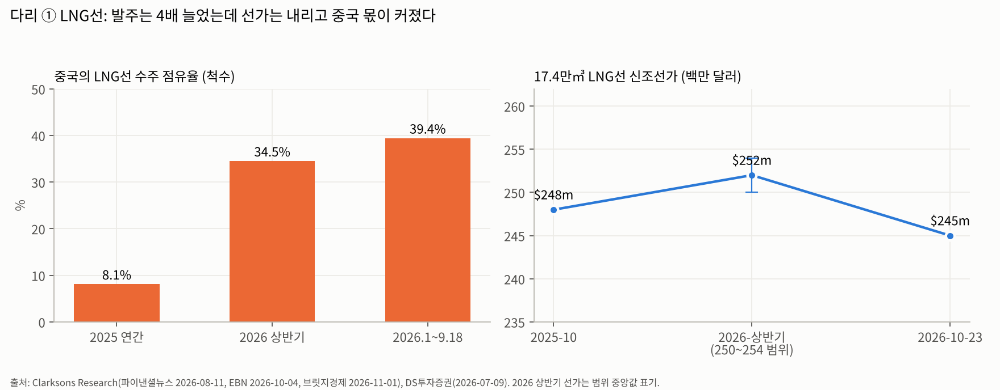
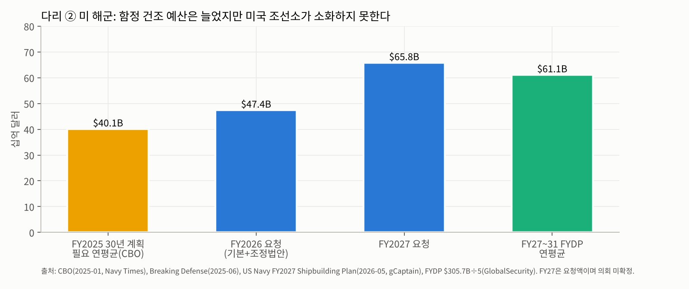

# K조선 '미 해군 × LNG선' 테마 분석 (1차)

> `[테마 분석 모드]` 1차 분석. 출발점은 `조선_산업기초.md`(2026-11-03)의 결론이다: **"주도주 후보가 나올 수 있는 유일한 교집합 = 한국 조선소 중 ①LNG선 독점적 지위(E) + ②미 해군 함정·MRO(B, 메가 트렌드 후보)를 동시에 가진 곳."** 이 문서는 그 교집합이 실제로 주도주를 낳을 수 있는지, 어떤 조건에서 재평가되는지를 검증한다.
>
> 표기: 사실은 그대로, 전망은 **[전망]**, 내 추정·시나리오는 **[추정]**. 워치리스트 자동 등록 없음(1차 분석).

---

## Executive Summary

1. **두 다리가 서로 반대 방향으로 움직이고 있다.** 다리 ①(LNG선)은 발주가 늘었는데도(2026년 10월 중순까지 76척, 전년 17척) **선가가 내렸고(2.48억 → 2.45억 달러) 중국 점유율이 8% → 39%로 뛰었다.** 다리 ②(미 해군)는 예산이 $47.4B → $65.8B로 늘고 미국 조선소가 감당하지 못하는 **진짜 공급 병목(A)**이다. 하지만 한국이 실제로 받은 일감은 MRO 11건과 상륙함 1척(2.69억 달러)뿐이다.
2. **교집합의 본질이 바뀌는 중이다.** 2023~26년에는 LNG선이 '이익 엔진'이고 미 해군은 '스토리'였다. 2027년 이후에는 LNG선이 '현금 창출원(고원)'으로 내려오고, **재평가 여부는 전적으로 다리 ②가 MOU에서 발주로 바뀌는지**에 달려 있다.
3. **한국의 해자(Moat)는 '한국에서 잘 짓는다'가 아니라 '미국 안에 조선소를 가졌다'로 옮겨 갔다.** 미국 법(반스-톨레프슨 수정법)이 해외 건조를 막고 있어서다. 그래서 **미국 내 조선소를 이미 운영하는 한화오션이 직접성 1위**, 2029년 가동을 목표로 하는 HD현대중공업이 2위, 미국 건조 거점이 없는 삼성중공업은 도전자다.
4. **주도 섹터 가능성 ★★☆(중간, 조건부).** 메가 트렌드(미·중 해양 패권) 안에 한국 Moat 기업이 있으므로 ★☆☆는 아니다. 하지만 ①MASGA 자금 집행 지연, ②미국 법 개정 미통과, ③캐나다 잠수함 탈락(지정학 한계), ④LNG 점유율 잠식 때문에 **'셀사이드 추정치 시계가 1→2→3년으로 늘어나는' 근거가 아직 숫자로 나오지 않았다.**
5. **재평가 트리거(우선순위)**: ①한화 필리 LSM 옵션 3척 행사와 추가 함정 수주, ②반스-톨레프슨 예외 입법(Ensuring Naval Readiness Act) 또는 대통령 면제, ③HD-HII 차세대 군수지원함(NGLS) 설계 수주, ④한국 LNG선 점유율 60% 이상 유지 + 선가 2.5억 달러 회복. **①~③ 중 2개가 동시에 나오면 ★★★ 재평가.**

---

# Step 0. 산업 기초 자동 참조

`조선_산업기초.md`(2026-11-03)에서 가져온 핵심 전제:

| 항목 | 산업기초 결론 | 이 테마에 주는 의미 |
|---|---|---|
| 상위 트렌드 | 조선 전체는 **사이클 반등**. 메가 트렌드 후보는 '미·중 해양 패권(함정·MRO·미국 조선 재건)'뿐 | 테마의 성장 엔진은 다리 ②여야 한다 |
| 4+5 종합 | 글로벌 상선 = D 후반(2028+ F 리스크), 한국 고부가 = E(가격 고원), 미 함정 = B(실물 2029+) | 다리 ①은 사이클 고원, 다리 ②는 초입 |
| 사이클 | 주가는 '선가 모멘텀 소멸 + 수주 점유율 하락'에 꺾인다(2025-09~2026-04 고점, −44~−62%) | 다리 ①만으로는 재평가 동력이 없다 |
| 밸류체인 | 이익이 꾸준한 곳은 라이선스(GTT 약 5%)·엔진. 함정은 국경으로 잘린 별개 시장 | 다리 ②는 상선 사이클과 상관관계가 낮다(HII 대비) |

---

# Step 1. 테마 정의 + 상위 트렌드 매핑

### 정의
**"한국 조선소가 ①LNG선(고부가 상선)에서 번 현금과 생산 노하우로 ②미 해군의 함정 건조·정비 공백을 메우는 사업 구조"**. 둘 중 하나만 있으면 이 테마가 아니다. LNG선만 있으면 상선 사이클주이고, 미 해군만 있으면 아직 실적 없는 스토리주다.

비유: LNG선은 **'본점 맛집'**(이미 줄 서는 가게, 이익의 원천), 미 해군은 **'해외 직영 2호점'**이다. 시장은 본점 매출이 정점에 가까워진 지금, 2호점이 실제로 문을 열고 손님을 받는지를 보고 있다.

### 상위 트렌드
- **메가 트렌드: 미·중 해양 패권 경쟁 → 미 해군 재건.** 미 해군 전투함은 291척으로 법정 목표 355척보다 64척 모자라다(Washington Times, 2026-05-12). FY2027 건조계획은 '골든 플릿(Golden Fleet)'으로 이름 붙었고 **5년(FY27~31) 122척 + 무인 63기, $305.7B**를 담았다(US Navy 2026-05, GlobalSecurity·AE Shoals 인용).
- **세큘러: LNG 교역 확대.** 미국 FID 물량 기준 **2032년까지 연평균 90~110척**의 LNG선 수요 [전망](DS투자증권 2026-07-09). 다만 2026년 호르무즈 사태가 카타르 증설 일정을 흔들었다.

### 형제 테마
- **K방산(함정·잠수함)**: KDDX(7.8조원, 한화오션 2026-07 본계약), 핵추진잠수함 '장보고-N'(국방부 기본계획 2026-05-26), 수출 잠수함(캐나다 탈락).
- **LNG 밸류체인**: GTT 화물창 로열티, 한국카본·동성화인텍(보냉재), 엔진.
- **미국 제조업 리쇼어링**: MASGA는 한국의 대미 투자 3,500억 달러 중 1,500억 달러 몫이다.

### 시장 narrative (현재 시장이 이해하는 틀)
- 2025~2026-04: "LNG선으로 돈 벌고 MASGA로 멀티플을 올린다" → 조선주 PER 확장.
- **2026-10 전환**: "MASGA는 1년째 서류 위에만 있다(코리아중앙데일리 2026-10). LNG선은 중국이 뺏기 시작했다." → 한 달 만에 시총 36조원 증발, 증권사 목표 PER 하향(현대차증권, 삼성중공업 17.8 → 13.8배).
- 2026-10-29 한화 LSM 첫 수주가 **narrative를 다시 숫자로 바꿀 첫 데이터 포인트**다.

---

# Step 2. 상위 산업 병목 역추적

### 미국 해군 조선 = 지금 세계에서 가장 뚜렷한 '공급 병목' 중 하나

| 지표 | 수치 | 출처 |
|---|---|---|
| 전투함 보유 vs 법정 목표 | 291척 vs 355척(−64척) | US Navy FY27 계획(Washington Times 2026-05-12) |
| 355척 도달 예상 | 2040년 이후 | AE Shoals(2026-05) |
| 버지니아급 잠수함 생산 | 연 1.1~1.3척 vs 목표 2척 | US Navy FY27 계획(AE Shoals 인용) |
| 지연 | 버지니아급 24~36개월, 컬럼비아급 1번함 12~16개월, DDG-51 지연 3년간 +25개월 | CBO 증언 |
| 단가 상승 | 컨스텔레이션급 호위함 3년간 +29% | CBO |
| 조선소 실행력 | **"전투함을 짓는 7개 조선소 중 해군 인도 목표를 맞출 수 있는 곳이 하나도 없다"** | GAO(2026-04) |
| 인력 | 향후 10년 숙련공 약 25만 명 채용 목표 | US Navy(Capstone DC 인용) |
| 정비 적체 | 미국 조선소 정비 적체 최대 4,000일 | Reuters(Defense Post 2024-01 인용) |

### 이 테마와 병목의 관계
- **다리 ② = '병목 해소형'.** 한국 조선소는 미국에 없는 것, 곧 **숙련 인력·생산관리·도크 회전율**을 가졌다. 한화 필리는 연 1~1.5척(이전 소유주 시절 약 8개월에 1척)에서 연 20척을 목표로 한다(iMarine 2026-08, Inquirer 2026-11-02).
- **다리 ① = '병목 수혜형'.** LNG선은 2021~24년 한국 도크 슬롯이 병목이던 구간에서 가격 결정력을 누렸다. 그런데 **중국이 LNG선 건조 조선소를 1곳에서 5곳으로 늘리면서**(EBN 2026-10-04, 파이낸셜뉴스 2026-08-11) 병목이 풀리는 중이다.

### 있을 때 vs 없을 때 (정량 비교)
| 비교 | 미국 조선소 단독 | 한국 생산 방식 적용 | 근거 |
|---|---|---|---|
| 필리 건조 속도 | 약 8개월에 1척 | 목표 '몇 주에 1척'(연 20척) | Inquirer 2026-11-02 [목표치] |
| 숙련공 임금 | 미국이 한국 대비 1.7~2배 | — | 나이스신평(데일리안 2026-01) |
| MRO | 미국 내 적체 | 한국 조선소에서 MSC 군수지원함 11건 수행·전부 완료, HD는 1번 함정에서 추가 정비 항목 100여 개를 발굴해 계약 범위 확대 | 중앙이코노미뉴스 2026-10 |

**결론**: 미 해군 조선은 '구조적으로 외부 역량이 필수'인 병목이다. 다만 **법이 외부 역량의 진입 경로를 '미국 땅 위의 조선소'로 제한**한다. 한국의 기여가 '한국에서 지어 보내기'가 아니라 '미국에 조선소를 세우고 운영하기'라는 형태로 굴절된다는 점이 이 테마의 핵심 구조다.

---

# Step 3. 밸류체인 + 병목 구간 + 병목 유형 — 핵심

## 3-1. 다리 ② 미 해군: 시장 구조와 접근 경로

### 기초 설명 — 왜 어려운가
미 해군 일감은 **세 개의 문**으로 나뉜다.

| 문 | 무엇 | 한국의 접근성 | 법적 근거 |
|---|---|---|---|
| **문 1. 해외 MRO** | 전방 배치(7함대) 함정, 주로 MSC 군수지원함의 정기 정비를 동맹국 조선소에서 | **열려 있음**: MSRA(함정정비협약) 인증 필요. 한화오션·HD현대중공업·HJ중공업 인증 | 10 U.S.C. 8680(FY21 NDAA로 예외 확대, CSIS) |
| **문 2. 미국 내 건조** | 미국 조선소에서 짓는 함정·관공선 | **'미국 조선소 소유'로만 가능**: 한화 필리(운영 중), HD키윗(2029 목표) | 존스법·바이 아메리칸 |
| **문 3. 해외 건조** | 동맹국 조선소에서 선체·상부구조물 건조 | **닫혀 있음**: 법 개정안(S.406·H.R.4951)은 발의 단계. 대통령 안보 면제 권한은 있으나 미사용 | 10 U.S.C. 8679(반스-톨레프슨) |

비유: 미 해군 시장은 **'외국인 출입 제한 구역'**이다. 문 1은 방문객 출입증(정비만), 문 2는 미국에 집을 사서 주민이 되는 길, 문 3은 국경 개방이다. 지금 한국이 쓸 수 있는 건 문 1과 문 2뿐이다.

### 주요 플레이어 상세

**미국 측 (기존 패권 = 국내 조선소)**

| 기업 | 역할 | 메모 |
|---|---|---|
| **HII**(Newport News·Ingalls) | 항모·잠수함·구축함·상륙함 최대 군함 조선사 | HD현대중공업과 군수지원함 공동 건조·블록 공급 MOU(2025-10) |
| General Dynamics(Electric Boat·NASSCO·Bath) | 잠수함·구축함·군수지원함 | — |
| Fincantieri Marinette | 호위함, LSM 초기 장납기 자재 계약(2026-04) | 이탈리아계 = 외국계 미국 조선소의 선례 |
| Austal USA(Mobile) | 알루미늄 함정·잠수함 모듈 | 한화가 10~12억 달러 인수 제안(2026-08, 비구속). FY26 미국 사업 약 A$1.75억 손실 예상(Naval Technology) |

**한국 측**

| 기업 | 문 1 (MRO) | 문 2 (미국 내 건조) | 문 3 대비 | 2026 성과 |
|---|---|---|---|---|
| **한화오션(+한화디펜스USA)** | MSRA 보유, **누적 7척 수주·완료**(2024-08 월리 쉬라 최초) | **필리조선소 운영 중**: 2024-12 1억 달러 인수, 3.5억 달러 투자 완료 + 2027년까지 4억 달러 추가 승인, 장기 50억 달러 계획, 47.5에이커 추가 임차(2026-09), 인력 약 2,300명 → 4,000명+ 목표 | Austal 지분 19.9%(실효), Austal USA 인수 제안 | **LSM 1척 2.69억 달러 + 옵션 3척(2026-10-29)**, MDA 미사일추적선 건조(TOTE VCM) |
| **HD현대중공업** | MSRA 보유, **누적 3척 수주·완료**(2025-08 앨런 셰퍼드 → 세사르 차베즈 → 리처드 E. 버드) | **HD키윗조선**(2026-10-22 계약, 2027 착공·2029 가동, 고용 3,000명). 과반 지분 → '외국 조선사 과반 지분 신설 조선소에 군함 최대 2척 본국 건조 허용' 조건과 맞물림(MTN 2026-10-26) | HII와 차세대 군수지원함(NGLS) 공동 설계·블록 공급 | 미 해군과 수주 물량 협의 중, 목표는 '콘솔탱커·로로선 등 지원함', 전투함은 추가 논의(3Q26 콜) |
| 삼성중공업 | 첫 입찰 결과 대기(2026-06 기준) | 없음. Vigor Marine(MRO·현대화)·사로닉(무인정) 협력 | 급유함 RFI 회신 | — |
| HJ중공업 | 첫 MRO 완료, 계약 범위 확대 | 없음 | — | — |

*출처: 중앙이코노미뉴스(2026-10), 조선비즈·이투데이(2026-04), Naval News·Inquirer(2026-10-30·11-02), 연합뉴스(2026-10-28), MTN(2026-10-26), Baird Maritime(2026-10).*

**경쟁국: 일본이 MRO의 최대 경쟁자다.** 일본은 7함대 모항이라 항모(로널드 레이건)·이지스 구축함까지 정비했다(아시아경제 2025-06). MHI 요코하마가 원정기지함(USS Miguel Keith)을 정비했고(gCaptain 2025-04), 스미토모중공업-ARMADA가 7함대 지원 동맹을 맺었다(2026-02). 한국 MRO는 **군수지원함 위주**이고 **전투함은 일본이 앞선다.**

### 수급 갭 정량화

| 항목 | 수요 (FY27~31) | 한국이 접근 가능한 공급 | 갭 해석 |
|---|---|---|---|
| 전체 함정 건조 | 122척 + 무인 63기, $305.7B(연 $61B) | 문 3이 닫혀 직접 접근 불가 | 미국 조선소 실행력 부족(GAO) → 장기적으로 문 3 개방 압력 |
| LSM(중형상륙함) | FYDP 23척, 전체 계획 35척. TOTE VCM 22억 달러 | 한화 필리 1척 + 옵션 3척 | 척당 2.69억 달러 → 4척 시 약 10.8억 달러 |
| 급유함(T-AO) | FYDP 7척 | HD-HII(NGLS), 3사 RFI 회신 | 미정 |
| 미 해군 MRO | 예산 $6B(2020) → $7.3B(2023), 국내 보도 '연 약 20조원' | 한국 누적 11건(2024-08~2026) | 계약금액 대부분 비공개. 건수는 2024년 1건 → 2025년 3~4건 → 2026년 상반기 4건으로 증가 |

### 공정 흐름 — 미국 내 함정 건조에서 어디가 병목인가
1. **설계·인증**(해군 설계 승인, 보안 인가) → 한국 약점: 미국식 MIL-SPEC, 보안 인가 인력
2. **강재·기자재 조달** → **미국 내 조달 의무(바이 아메리칸·베리 수정법)**. 방사청장: "필리조선소 자재를 모두 미국 안에서 만들 수 있을지 모르겠다"(Baird Maritime 2025-10)
3. **블록 제작·탑재** → 한국 강점(자동화·생산관리). 다만 **블록을 한국에서 만들어 보내는 것은 반스-톨레프슨상 선체 해외 제작 논란**
4. **의장·시운전** → 미국 숙련공 부족
5. **인도·MRO**

→ **병목은 1·2·4번(미국 내부 제도·인력)이고, 한국이 해결할 수 있는 건 3번(생산성)이다.** 그래서 한국의 실익은 '미국 조선소의 생산성을 올려 주는 대가로 받는 운영 이익'이지 '한국 도크의 일감'이 아니다. HD현대가 인수 대신 그린필드(HD키윗)를 택한 이유도 여기 있다. 노후 조선소를 사면 미국식 저생산성을 함께 사게 된다(MTN 2026-10-27).

## 3-2. 다리 ① LNG선: 독점이 깨지는 중

### 기초 설명
LNG를 −162℃로 싣고 다니는 배다. 화물창이 조금만 새도 선체 강재가 깨진다. 그래서 **'짓는 기술 + 무사고 실적'**이 진입장벽이다. 현재 운항 중인 LNG선의 70% 이상을 한국 빅3가 지었다(서울신문 2026-08-17).

### 주요 플레이어·점유율 변화 (Delta가 핵심)

| 구간 | 한국 | 중국 | 출처 |
|---|---|---|---|
| 2022 연간 | 113척(70% CGT) | 43척 | 반체로 코스타·산업부 |
| 2025 연간 | 국내 3사 31척(HD 7·한화 13·삼성 11) | 점유율 8.1% | 뉴스1(2026-01), Clarksons |
| 2026 상반기 | — | 19/55척(34.5%) | Clarksons(파이낸셜뉴스 2026-08-11) |
| 2026 상반기(다른 집계) | 37/90척 | **52/90척(57.8%)** | Veson Nautical(서울신문 2026-08-17) |
| **2026.1~9.18** | **40/66척(61.2%)** | **26/66척(39.4%)** | Clarksons(철강금속신문·EBN 2026-10) |

> **집계 차이 주의**: Clarksons는 대형(10만㎥+) 기준이고, Veson은 소형·벙커링선 등을 포함한 것으로 보인다. 대형 LNG선만 보면 한국 60% 안팎, **방향(중국 상승)은 두 출처가 같다.**

- 중국 LNG선 건조 가능 조선소: **1곳 → 5곳**. 중국산은 척당 약 2,000만 달러(4~8%) 싸고, 금융 지원에 '계약 전 선건조 후매각'까지 쓴다(EBN 2026-10-04, 글로벌이코노믹 2026-09-27).
- 한국 연간 LNG선 인도 능력: 4사 합계 70~75척(iM증권, 2026-01).
- 한화오션: 2025년 말 대형 LNG선 수주잔고 65척 = **상선 수주잔고의 51.6%**(주요 조선사 중 최고), LNG선 영업이익률 15~20% 수준(한경 유레카 2026).

### 수급 갭

| 항목 | 수치 | 출처 |
|---|---|---|
| 수요 [전망] | 2032년까지 연 90~110척(FID 기준) / 삼성중공업 전망: 2026년 100척, 2027년 70척 | DS투자증권(2026-07), 삼성중공업 IR(2026-02) |
| 2026 실제 발주 | 10월 중순까지 76척(전년 동기 17척, 약 4.5배) | Clarksons(브릿지경제 2026-11-01) |
| 한국 공급능력 | 연 70~75척 | iM증권 |
| 선가 | **2.48억(2025-10) → 2.45억 달러(2026-10-23)**, 중간에 2.50~2.54억 | Clarksons, DS투자증권 |
| 인도 | 2026년 94척, 2027년 92척 예정(선대 과잉은 2027년까지) | Drewry |

**해석**: 수요(발주 76척)가 한국 공급능력(70~75척/년)을 이미 넘었는데도 선가가 오르지 않았다. **넘친 물량을 중국이 받았기 때문**이다. 한국 조선소가 가격을 올리려 하면 선주는 중국으로 간다. **'독점적 지위(E)'라는 전제가 2026년에 처음으로 깨졌다.** 다만 쉐니에르·에퀴노르 등 주요 프로젝트는 아직 중국을 배제한다(finance-scope 2026-03, HD한국조선해양 IR 인용).

## 3-3. 기존 병목과 구조 비교

| 비교 대상 | 공통점 | 차이점 | 시사점 |
|---|---|---|---|
| **ESS 'FEOC 자리'**(본 프로젝트 2026-10) | 한국 해자 = 기술이 아니라 **규제·정치가 만든 자리** | ESS는 자리 안 경쟁 과잉(공급 > 수요). 미 해군은 자리 안 공급 부족 | 미 해군 자리는 ESS보다 질이 좋다. 단 **자리 크기(발주)가 의회에 묶여 있다** |
| **2023 에코프로 '시장 정의 소멸'** | LNG선 = 한국 독점 '자리' | 2023 삼원계는 LFP가 시장을 재정의. LNG선은 시장은 그대로 두고 경쟁자(중국)가 진입 | LNG선은 '시장 정의 소멸'이 아니라 **'자리 안 경쟁'** = 방어 가능하나 방어해야 함 |
| **HBM**(A 병목 교과서) | 공급 제한 × 수요 폭증 | HBM은 고객이 해외 공장 여부를 따지지 않는다. 미 해군은 국적이 진입 조건 | A 병목이어도 **한국이 받는 몫은 '현지 CAPA'로 상한이 정해진다** |

## 3-4. 병목 유형 분류 (결론)

산업기초 4+5 종합(글로벌 D 후반 / 한국 고부가 E 고원 / 미 함정 B) 위에서 테마를 다시 분해한다.

| 다리 | 수요 | 공급 | 카테고리 | 전환 방향 [전망] |
|---|---|---|---|---|
| **② 미 해군 건조·정비** | 급증(예산 +39%, 64척 부족) | **제한**(GAO "7곳 모두 목표 미달", 인력 25만 부족) | **A. 구조적 메가 병목** | 법 개정(문 3) 없이는 A가 오래간다. 한국 몫은 문 1·2의 CAPA로 제한 |
| ① LNG선 | 급증(2026 4.5배) | **증가**(중국 1 → 5곳) | **E → D 전환 중** | 중국 실적(인도 품질)이 확인되면 D → F 리스크(2028 인도 집중기) |

→ **메타데이터 `bottleneck_category`: "A(미 해군) × E→D(LNG선)"**. 이 테마의 A는 **미국의 병목이지 한국의 병목이 아니다.** 한국이 A의 이익을 가져가려면 '미국 내 CAPA'라는 깔때기를 지나야 한다.

---

# Step 4. Moat 기업 도출 — 주도주 후보 스크리닝

## 글로벌

| 기업 | 테마 직접성 | Moat 성격 | 비고 |
|---|---|---|---|
| HII | 미 해군 높음, LNG 없음 | 국적 + 항모·핵잠 독점 | 경쟁자이자 파트너(HD). 다리 ①이 없어 교집합 밖 |
| General Dynamics | 미 해군 높음 | 국적 + 잠수함 | 교집합 밖 |
| Fincantieri | 미 해군 중간(Marinette) | '외국계 미국 조선소'의 선례 | 한화 필리의 비교 모델 |
| CSSC 등 중국 | LNG선 상승 | 국가 자본·가격 | **미 해군 접근 원천 차단**(301조·NDAA 중국 배제 조항) → 교집합에 들어올 수 없다 |
| 일본 MHI·JMU | MRO 높음(7함대 모항), LNG 낮음 | 지리·동맹 | MRO에서 한국의 최대 경쟁자 |

**핵심**: 두 다리를 모두 가진 기업은 **한국에만 있다.** 중국은 다리 ②가 원천 봉쇄되고, 미국·일본은 다리 ①이 없다. **교집합 자체가 한국 고유 자리**라는 점이 이 테마의 존재 이유다.

## 한국 기업 (별도 섹션) — 직접성

| 순위 | 기업 | 다리 ① LNG | 다리 ② 미 해군 | 종합 직접성 | Moat 성격 | 재무(대략) |
|---|---|---|---|---|---|---|
| **1** | **한화오션(042660)** | **높음**: 대형 LNG선 잔고 65척, 상선 잔고의 51.6% | **최고**: 필리 운영, LSM 수주, MRO 7척, Austal 지분, KDDX | **높음** | 미국 내 조선소(문 2) + MSRA + 잠수함·수상함 실적 | 2025 매출 12.69조원(+18%)(finance-scope 2026-02). 2026E 매출 13.9~14.4조, OP 1.87~1.91조(OPM 13.2~13.4%)(키움증권 등 증권사 2곳, 2026-04). 특수선 2026E 매출 약 1.74조(전사의 약 12%), 4Q25 특수선 −872억 적자 |
| **2** | **HD현대중공업(329180)** | **높음**: 울산 LNG선 + 대형 LNG선(20만㎥급) 경험 | **높음(시차)**: MRO 3척, HII MOU, HD키윗(2029) | **높음(2029 이후)** | 세계 최대 조선소 생산성 + 엔진 내재화 + 함정(이지스 등) 실적 | 3Q26 매출 5.75조원, OP 8,992억(OPM 15.6%) |
| 3 | HD한국조선해양(009540) | 높음(삼호 LNG 매출 핵심) | 중간(자회사 경유) | 중간 | 중간지주: LNG(삼호) + 미국(HD현대중공업) + 엔진 | 2025 매출 29.93조, OP 3.90조(OPM 13.0%)(회사 공시 2026-02-09) |
| 4 | 삼성중공업(010140) | **높음**: LNG선·FLNG 특화, KC-2C 화물창 국산화 | 낮음: 미국 내 건조 거점 없음, MRO 입찰 단계 | **중간(다리 ① 편중)** | LNG·FLNG 실적, 화물창 기술 | 2025 OP 컨센서스 8,713억(에프앤가이드 2026-01), 3Q26 OP 3,384억 |
| 5 | HJ중공업(097230) | 낮음 | 중간(MRO 1건) | 낮음 | MSRA | 소형 |

> 재무 지표는 '감 잡기'용이고 정확도가 부족하다. 사업부별 LNG·특수선 이익 분리는 `[기업 분석 모드]`에서 다룬다. 기업 개요 파일은 HD현대중공업·한화오션 차트만 있고 md 본문이 없으므로, 실적 분석 세션에서 `[기업 개요 모드]`를 먼저 돌리는 게 좋다.

**스크리닝 결론**: 주도주 후보 = **한화오션(1순위), HD현대중공업(2순위)**.
- 한화오션은 **'지금 문 2를 통과한 유일한 회사'**이지만, 특수선 자체 이익이 아직 적자(4Q25)이고 필리 투자 부담이 있다.
- HD현대중공업은 **이익 체력(OPM 15%대)과 생산성 1위**이지만, 미국 매출은 2029년 이후다.
- 삼성중공업은 다리 ① 순수 노출이라 이 테마에서는 '사이클 고원' 쪽에 가깝다.

---

# Step 5. 시장 규모 (TAM) — PQ 분해

## 다리 ① LNG선

| 구분 | P | Q | TAM | 비고 |
|---|---|---|---|---|
| 글로벌 [전망] | 2.45~2.55억 달러 | 연 90~110척(~2032) | **연 220~280억 달러** | DS투자증권·Clarksons |
| 2025 실적 | 약 2.5억 | 36척(삼성중공업 IR) | 약 90억 달러 | 발주 공백기 |
| 2026(10월 중순까지) | 2.45~2.54억 | 76척 | 약 190억 달러+ | 4.5배 |

- **CAGR 분해**: P는 **보합~소폭 하락**(중국 진입, 2025-10 대비 −1.2%). Q는 **변동이 크다**(36 → 76~100 → [전망] 2027년 70척). 성장은 Q가 결정하고 P는 기여하지 않는다. 원화 기준 선가는 2022년부터 우상향이었지만(DS투자증권), 원화 강세가 이 효과를 되돌릴 수 있다.
- **한국 접근 가능 TAM [추정]** = 연 90~110척 × 2.5억 달러 × 점유율 50~65% = **연 110~180억 달러**. 단 한국 공급능력(70~75척/년) 때문에 상한은 약 **185억 달러**.

## 다리 ② 미 해군

| 구분 | 규모 | 한국 접근 경로 | 출처 |
|---|---|---|---|
| 신조 예산 | FY27 요청 $65.8B, FYDP $305.7B | 문 2(필리·HD키윗)만 | US Navy 2026-05 |
| 그중 한국이 현실적으로 노릴 함종 | LSM 23척(FYDP), 급유함 7척, 차세대 군수지원함·관공선(MDA 등) | 필리·HD키윗·HII 협력 | 〃 |
| MRO | 예산 $7.3B(2023), 국내 추정 연 약 20조원 | 문 1(7함대 MSC 위주) | Dredgewire 2026-01, 중앙이코노미뉴스 |

### 한국 접근 가능 TAM — 시나리오 [추정]

| 시나리오 | 조건 | 2030년 전후 한국계 연 매출(근사) | 한화오션 2025 매출 대비 |
|---|---|---|---|
| **비관** | 문 3 미개방, MASGA 자금 지연 지속, 필리 연 2~3척 | 필리 2~3척 × 약 3억 달러 + MRO = **약 7~12억 달러(약 1.0~1.7조원)** | +8~13% |
| **기준** | 필리 증설 1단계(연 5~6척) + HD키윗 가동 초기 + MRO 연 6~8건 | **약 20~30억 달러(약 2.8~4.2조원)** | +22~33% |
| **낙관** | 반스-톨레프슨 예외 입법 → 한국 건조 지원함·모듈 + 필리 연 20척 목표 근접 | **60억 달러+(약 8.4조원+)** | +65%+ |

*가정: 척당 약 2.7~3억 달러(LSM 2.69억, MARAD 훈련선 약 3억 달러, Inquirer), 환율 1,400원. MRO 계약금액은 비공개라 기준 시나리오에서 연 수천억 원으로 근사.*

**해석**: 기준 시나리오만 돼도 다리 ②는 한화오션 외형을 20~30% 늘린다. 그러나 **2026년 현재 확정된 것은 LSM 1척(2.69억 달러)뿐**이다. TAM은 크지만 '확정 수주 → 셀사이드 추정치 반영' 단계에 들어가지 않았다.

---

# Step 6. 산업 유형 + 주도 섹터 가능성

| 항목 | 판정 |
|---|---|
| 산업 유형 | **구조조정 + 메가(다리 ②) / 사이클 고원(다리 ①)**. 조선은 2009~2020년 구조조정을 마쳤고(산업기초 G → A 경로), 그 생존자가 미 해군이라는 새 수요를 만나는 구조. '구조조정 + 메가 트렌드'의 교과서 경로이지만 **메가 수요가 아직 발주로 전환되지 않았다** |
| 한국 Moat 기업 | **존재**(한화오션·HD현대중공업). 두 다리를 모두 가진 기업은 세계에서 한국에만 있다 |
| **주도 섹터 가능성** | **★★☆ (중간, 조건부)** |
| 분석 방향 | Step 7~8 전체 수행. 기업 분석은 한화오션 → HD현대중공업 순서 권장 |

### 왜 ★★★가 아닌가 (BT 기준: '셀사이드 추정치 시계가 1→2→3→4~5년으로 늘어나며 주가를 정당화하는가')
1. **다리 ①의 시계가 줄고 있다**: 2027~28년 매출은 이미 잔고로 확정됐지만, 2029년 이후 LNG선 이익 가정은 '선가 하락 + 중국 점유율 상승'으로 낮아질 방향이다.
2. **다리 ②의 시계는 아직 숫자가 없다**: MASGA는 "1년째 서류 위"이고(정부 vs 조선사 자금 선후 다툼, 코리아중앙데일리 2026-10), 필리 증설도 자금 대기로 일부 지연됐다(Baird Maritime). 셀사이드가 2029~2031년 미국 매출을 추정치에 넣을 근거(복수 발주·법 개정)가 없다.
3. **지정학 한계가 확인됐다**: 캐나다 잠수함은 성능 요건을 모두 충족하고도 'NATO 생태계'에 졌다(2026-07). 미국 시장도 결국 의회(지역구 조선소 이해관계)가 결정한다. 산업부 차관은 "미국 주정부가 기존 규제 법안을 놓지 않으려 한다"고 했다(2026-09-11).

### 왜 ★☆☆가 아닌가
1. 미 해군 병목은 **A 등급**이다. 예산 +39%, GAO의 "7곳 모두 목표 미달", 인력 25만 명 부족. 해소에 10년 이상이 걸리는 구조적 결핍이다.
2. 한국은 이미 **문 1(MRO 11건 완료)과 문 2(필리 운영, LSM 수주)를 통과**했다. 2025년의 '기대'가 2026년에 '첫 실적'으로 바뀌었다.
3. 교집합은 한국 고유 자리다. 중국은 원천 봉쇄되고, 일본은 상선 LNG가 없다.

### 재평가 조건 (★★★ 전환)
아래 중 **2개 이상 동시 충족** 시:
- R1. **필리 후속 함정 수주**: LSM 옵션 3척 행사, 급유함·지원함 등 신규 함종 수주(누적 4척 이상)
- R2. **법 개정·면제**: Ensuring Naval Readiness Act 또는 FY27 NDAA에 동맹국 건조 예외 반영, 또는 대통령 면제 사용
- R3. **HD 측 첫 미국 함정 수주**: NGLS 설계 수주, HD키윗 부지 확정 + 해군 물량 MOU → 발주
- R4(보조). **LNG선 방어 확인**: 한국 대형 LNG선 점유율 60% 이상 + 선가 2.5억 달러 회복

---

# Step 7. 리스크 팩터

| 리스크 | 내용 | 확률 | 임팩트 | 판정 |
|---|---|---|---|---|
| **MASGA 집행 지연** | 정부-조선사 자금 선후 다툼, 미국 발주 부재 | **높음**(진행 중) | 높음 | 다리 ②의 시계를 늦추는 1차 변수 |
| **미국 법 미개정** | 반스-톨레프슨·존스법·바이 아메리칸 유지, 의회 지역구 반발 | 높음 | 높음 | 기준 시나리오 상한을 '미국 내 CAPA'로 묶는다 |
| **중국의 LNG선 잠식** | 점유율 8% → 39%, 2,000만 달러 저가, 선건조 후매각 | 높음(진행 중) | 중~높음 | 다리 ① 수익성 하향. 단 중국산 인도 품질 문제가 생기면 반전 |
| **필리 수익성** | 미국 고임금·자재 국산화 의무·공간 부족, Austal USA 적자 사례 | 중 | 중 | 미국 사업이 매출은 늘리되 OPM은 낮출 수 있다(HII도 한 자릿수) |
| **일본과의 MRO 경쟁** | 7함대 모항, 전투함 정비 실적 | 중 | 중 | 한국은 지원함 위주로 밀릴 수 있다 |
| **중국 제재 재개** | 한화 미국 자회사 5곳 제재가 1년 유예(2025-11-10~). 미·중 휴전은 2027-01-10까지 연장 발표 | 중 | 중 | 301조 입항료와 연동. 휴전이 깨지면 재발 |
| **원화 강세** | 달러 수주 → 원화 매출 | 중 | 중 | 2026-10 급락 사유 중 하나 |
| **LNG 프로젝트 지연** | 카타르 증설 중단(호르무즈), 2026년 FID 4~5건으로 둔화(우드매켄지) | 중 | 중 | 2027년 발주 70척 [전망]으로 감소 |
| **미 해군 예산 축소** | FY27 요청 $65.8B는 의회 미확정. 중간선거 이후 변화 가능 | 낮~중 | 높음 | 문 2 물량 자체가 줄어든다 |

---

# Step 8. 트래킹 지표 + 모멘텀 이벤트

## 선행 트래킹 지표

| 지표 | 현재값 | 상방 신호 | 하방 신호 | 주기 |
|---|---|---|---|---|
| 한화 필리 미 정부 함정 수주(누적) | LSM 1척 + MDA선 | 옵션 행사·신규 함종 | 1년간 추가 없음 | 수시 |
| 한국 조선사 미 해군 MRO 건수 | 누적 11건 | 전투함 MRO 첫 수주 | 연 4건 미만 정체 | 수시 |
| 한국 대형 LNG선 수주 점유율 | 61%(2026.1~9.18) | 65%+ | 50% 하회 | 월간(Clarksons) |
| 17.4만㎥ LNG선 선가 | 2.45억 달러(2026-10-23) | 2.55억+ | 2.40억 하회 | 주간 |
| MASGA 펀드 집행 | 미집행 | 첫 프로젝트 승인·자금 지급 | 정부-업계 갈등 장기화 | 수시 |
| 미 해군 FY27 예산 의회 통과액 | 요청 $65.8B | 요청액 유지·증액 | 삭감 | 연간 |

## 모멘텀 이벤트 (날짜 확정·예상)

| 시점 | 이벤트 | 방향 |
|---|---|---|
| 2026-11-10 | 중국의 한화 미국 자회사 제재 유예 만료일(미·중 휴전 2027-01-10까지 연장 발표, 공식 고시 확인 필요) | 하방 리스크 |
| 2026-12-04 | IMO NZF 채택 표결 | 채택 시 이중연료 LNG선 수요 ↑ |
| 2027-01-09 | USTR 301조 입항료 유예 연장안 만료(예정) | 재부과 시 비중국 조선 반사이익 |
| 2027년 | 장보고-N(핵잠) 초기 사업 착수 [전망], HD키윗 착공 [전망] | 국내 특수선 경쟁 + 미국 거점 |
| 미정 | Austal USA 인수 여부(CFIUS·DCSA·호주 FIRB) | 상방: 한화 미 해군 CAPA 대폭 확대(직원 3,000명, 모빌 180에이커) |
| 미정 | FY27 NDAA 동맹국 건조 예외 조항 반영 여부 | 최대 상방(R2) |
| 미정 | NGLS 개념설계 수주 발표 | 상방(R3) |

## 하방 이벤트 체크리스트
- 필리 증설 투자 공식 보류·축소
- Ensuring Naval Readiness Act 폐기, NDAA에 '국내 건조 100%' 강화 조항
- 중국 조선소 대형 LNG선 무사고 인도 누적 → 선주들의 품질 우려 해소 → 한국 점유율 50% 하회
- 미 해군 LSM 프로그램 축소·재설계

---

## 차트

---

## 다음 단계 (How to apply)

1. **실적 분석 세션**: 한화오션·HD현대중공업 `[기업 개요 모드]` 선행(현재 md 본문 없음).
2. **이 세션**: `[기업 분석 모드] 한화오션` → 사업부별(상선 LNG / 특수선 / 필리) PQC 분리, 필리 단위 경제성(척당 이익) 추정.
3. 재평가 조건 R1~R3 중 2개가 충족되면 `[테마 분석 통합 모드] K조선 미해군×LNG (주도주: 한화오션, HD현대중공업)`.
4. 트래킹은 월간 Clarksons LNG 점유율과 미 해군·MASGA 뉴스. 분기 실적 때 특수선 부문 흑자 전환 여부를 점검한다.

## 출처 (주요)
- 미 해군: US Navy FY2027 Shipbuilding Plan(2026-05, gCaptain·GlobalSecurity·AE Shoals·Washington Times 인용), CBO 증언·보고서, GAO(2026-04, NSC Staffing 인용), Breaking Defense(2025-06), CSIS, Congress.gov(S.406·H.R.4951)
- 한화 필리·LSM: Naval News(2026-10-30), Philadelphia Inquirer(2026-10-30·11-02), Baird Maritime(WSJ 인용, 2026-10), 서울경제(2026-11-01), 코리아중앙데일리(2026-10), iMarine(2026-08), Maritime Executive(2026-08-10)
- HD현대: 연합뉴스(2026-10-23·28), MTN(2026-10-26·27), Korea Times·Korea Herald(2025-10)
- MRO: 중앙이코노미뉴스(2026-10), 조선비즈·이투데이(2026-04), 아시아경제(2025-06), gCaptain(2025-04), Dredgewire(2026-01)
- LNG선: Clarksons Research(파이낸셜뉴스 2026-08-11, EBN 2026-10-04, 철강금속신문, 브릿지경제 2026-11-01, 글로벌이코노믹 2026-09-27), Veson Nautical(서울신문 2026-08-17), DS투자증권(2026-07-09·16), iM증권(2026-01), 삼성중공업 IR(2026-02-09), Drewry, Wood Mackenzie(gasworld)
- 재무: HD한국조선해양 공시(2026-02-09), 한화오션 IR(finance-scope 2026-02), 키움증권(2026-04-28·29), 에프앤가이드(뉴스토마토 2026-01), 한국경제(2026-10-29)
- 산업기초: `조선_산업기초.md`(2026-11-03)
