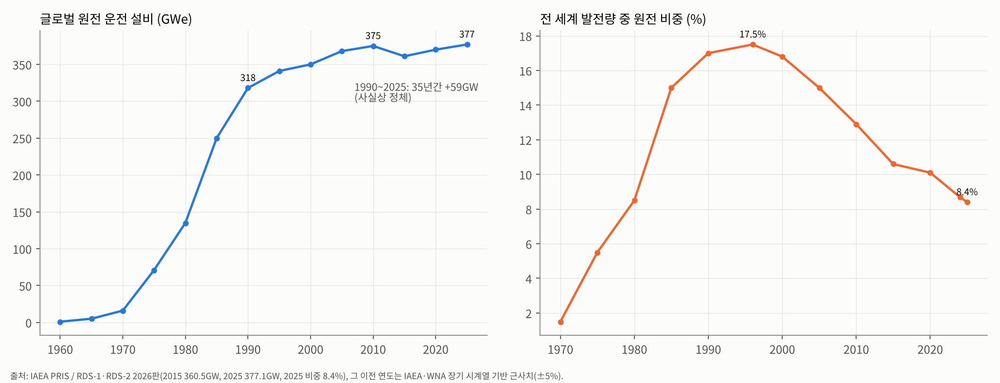
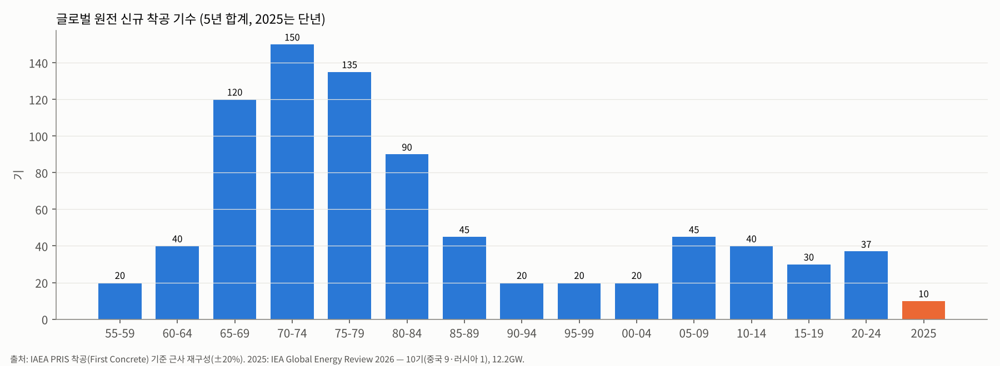
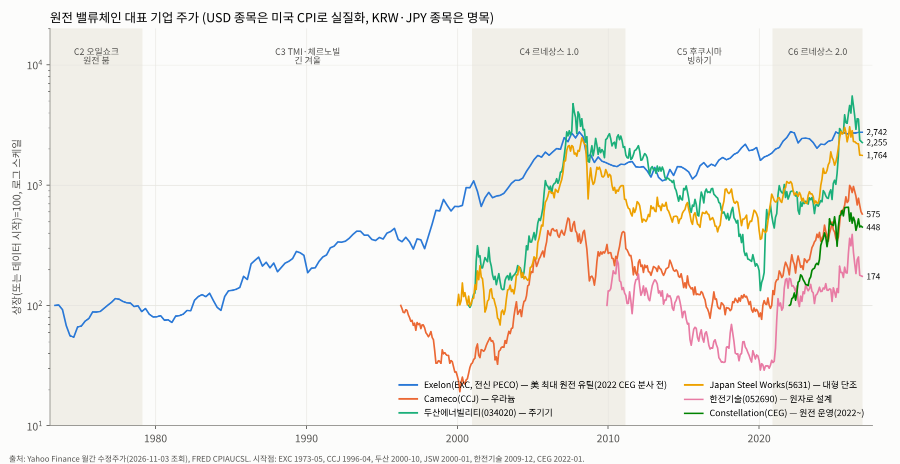
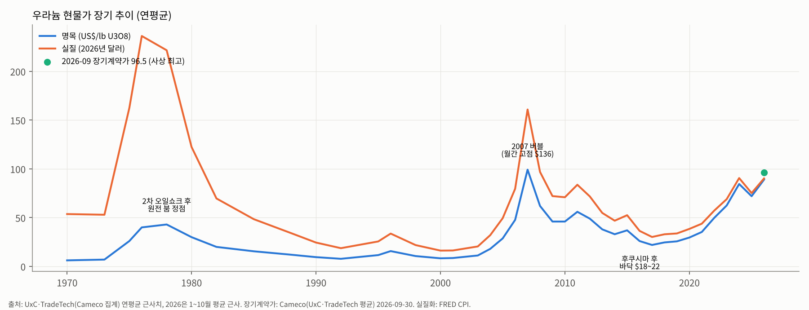
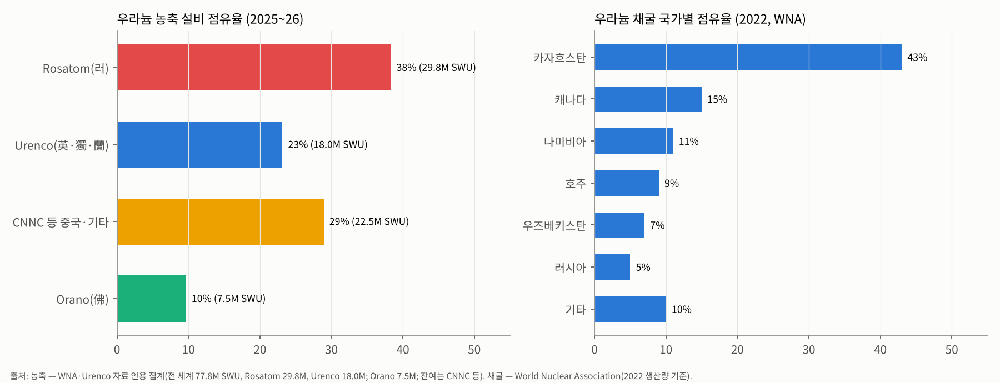

# 원전 산업 기초 분석 (Industry Basic — Nuclear Power)

> 본 문서는 셀사이드 init(데뷔) 자료 수준의 영구 reference 문서다. 원전 산업의 본질·역사·구조를 처음 접하는 사람이 한 번에 이해할 수 있도록 구성했다. 분기 실적·단기 수주 뉴스는 다루지 않는다(실적 분석·테마 분석 영역).
> 발전기기(가스터빈)·송변전 등 "전력 인프라" 공통 영역은 `전력 인프라_산업기초.md`를 참조.
> **이전 리포트 대비 Delta**: 2026-03-24 `산업분석_원전SMR` (구 형식)을 대체한다. 3월 대비 바뀐 사실은 문서 끝 "부록 A. 3월 리포트 대비 Delta"에 모았다.

---

## Executive Summary (5줄 이내)

1. 원전은 **"짓는 데 10~15년, 돌리는 데 60~80년"** 짜리 초장기 자본재 산업이다. 1942년 맨해튼 프로젝트의 군사기술이 1950년대 민수로 전환되며 탄생했고, 1970년대 오일쇼크 때 폭발했다가 TMI(1979)·체르노빌(1986)·후쿠시마(2011) 세 번의 사고로 **30년 넘게 정체**됐다 — 글로벌 설비는 1990년 318GW → 2025년 377GW로 35년간 +59GW에 그쳤고, 발전 비중은 1996년 17.5% → 2025년 8.4%로 반토막 났다(IAEA).
2. **사이클의 정수 — "에너지 안보 위기가 사이클을 켜고, 사고와 비용 초과가 끈다."** 주가 사이클은 15~25년 장주기 + 그 안의 3~5년 투기 사이클 구조. 우라늄 대표주 Cameco는 2000→2007 약 30배, 2007→2020 -85%, 2020→2026.1 약 16배. 두산에너빌리티는 2004→2007 약 27배, 2007→2020 -98%, 2020→2026.3 약 41배를 기록했다(Yahoo Finance 월말 종가).
3. **2026년 현재 산업 위치(4+5 종합 결론): 카테고리 A(구조적 메가 병목) — 단, "수요 선언 vs 실착공"의 시차가 큰 A.** 후쿠시마 이후 15년 구조조정으로 서방 공급망(농축·대형 단조·EPC·인력)이 극단적으로 얇아졌는데, 에너지 안보(러·우 전쟁·이란 전쟁)·AI 데이터센터 24/7 전력·탄소중립 3중 수요가 겹쳤다. 가격 신호는 이미 나왔다 — 우라늄 장기계약가 $96.5~99/lb 사상 최고(2026.9~10), 농축 SWU $200 수준(2018 저점 대비 약 5~6배).
4. **밸류체인 병목 위치**: 농축(러시아 Rosatom 약 38~43%, 미국 2028.1 수입 금지 waiver 종료) > 대형 단조·주기기(JSW·두산·중국 3강, 프레스 신설 7~10년) > 숙련 EPC·인력(미국은 30년 공백) > 우라늄 채굴(카자흐 43%). 원자로 설계사(Westinghouse·KHNP·EDF·Rosatom·CNNC)는 5사 과점이지만 **'설계를 팔아도 지을 사람이 없는'** 구조라 병목은 하부 공급망에 있다.
5. **한국은 "서방에서 유일하게 공기·예산 내 완공 능력을 유지한 나라"** — 주기기(두산에너빌리티, 직접성 높음), 설계(한전기술, 높음), EPC(현대건설·대우건설, 높음/중간), 운영·수출 총괄(한수원·한전). 2026년 한미 'Project Power'(1,200억달러, AP1000 6기+APR1400 2기)로 미국 본토 진입로가 열렸으나, 체코 두코바니 시공계약 결렬(2026.10.29)이 보여주듯 **"수주 → 이익"으로 가는 계약 리스크(총액확정 vs 실비정산)**가 산업의 핵심 변수로 부상했다.

---

## 1-pager 요약 표 (5단계 핵심 결론)

| 단계 | 핵심 결론 |
|---|---|
| **1. 역사** | 6 chunk: ① 1942–1973 탄생 — 군사기술 민수 전환, 미국 WH(PWR)·GE(BWR) 패권, "턴키 전쟁" ② 1973–1979 오일쇼크 원전 붐 — 프랑스 메스메르 계획, 미국 발주 정점, 우라늄 6배 ③ 1979–2000 TMI·체르노빌 긴 겨울 — 미국 발주 0·100기+ 취소, 프랑스·일본·한국 기술 자립, 운영 효율화(가동률 60→90%) ④ 2001–2011 르네상스 1.0 — Toshiba-WH, Areva, 우라늄 버블($136), 한국 UAE 수출 ⑤ 2011–2020 후쿠시마 빙하기 — 독일 탈원전, WH 파산(2017), Areva 해체, 한국 탈원전, 우라늄 $18 ⑥ 2021–2026 르네상스 2.0 — 에너지 안보·AI 전력·COP28 3배 선언, 미국 $80B WH 파트너십, 한미 Project Power |
| **2. 사이클** | 장주기(15~25년) 3회 확인: 1965–1979 상승→1979–2000 하락 / 2001–2007 상승→2007–2020 하락 / 2020–현재 상승. 상승기 진폭 +1,000~4,000%(고베타 주), 하락기 -85~98%. 장주기 안에 "투기 사이클"(2005–07, 2024–26) 내장 → 2026년 현재 장주기 상승 중 투기 사이클 조정(-40~60%) 국면 |
| **3. BM/밸류체인** | 5 layer: 연료(채굴→전환→농축→성형) → 원자로 설계·IP → 주기기(RPV·SG·터빈, 대형 단조) → EPC·시공 → 운영·O&M·PPA. 마진: 운영(규모 갖춘 미국 merchant 원전 EBITDA 30~40%) ≥ 농축(과점, 고마진) ≥ 채굴(가격 연동) > 설계·서비스 > 주기기(10~15%) > EPC(3~8%, 고위험). **가장 돈을 많이 잃은 곳 = 고정가 EPC**(WH 2017 파산, Areva OL3) |
| **4. 공급 (1980 vs 2026)** | 원자로 벤더: 1980 서방 약 10개사 → 2026 실질 5개 계열(WH·KHNP·EDF/Framatome·Rosatom·CNNC/CGN) + SMR 스타트업. 농축 CR3(Rosatom·Urenco·CNNC) 약 90%, 대형 단조 서방 접근 가능 3~4개 공장. 착공 기수: 1970년대 5년 합계 135~150기 → 2010s 30~40기 → 2025년 10기(9기 중국) |
| **5. 수요** | B2B(유틸리티·국가) 100% — 사실상 "국가가 고객". 수요 driver: 에너지 안보 > AI·전기화 > 탈탄소. 2025 운전 377GW → IAEA 2050 고성장 1,045GW / 2060 1,284GW(6년 연속 상향). 실제 착공은 중국 편중(건설 중 설비의 약 절반). 하이퍼스케일러 원전 계약 약 10GW(대부분 기존 원전 PPA·SMR 옵션) |
| **4+5 종합** | **카테고리 A (구조적 메가 병목)** — 단, 병목이 "설비"가 아닌 "공급망(연료·단조·인력)"에 있고, 수요 확정이 정부 재정·금리에 민감한 "지연형 A". 2026년 주가 조정은 펀더멘털(장기계약가 사상 최고)과 디커플링된 금리·밸류에이션·계약 리스크 이슈 |

---

# 1단계. 역사 — 1942년부터 2026년까지

> 원전 산업의 모든 장면에는 두 개의 손이 있다. **에너지 안보 위기라는 '켜는 손'**, 그리고 **사고와 비용 초과라는 '끄는 손'**. 6개 chunk는 이 두 손이 번갈아 산업을 움직인 기록이다.





---

## Chunk 1. 1942–1973 — 탄생: 폭탄에서 발전소로, 미국 PWR·BWR 패권

### (a) 매크로 배경
- 2차대전 **맨해튼 프로젝트(1942~)** — 시카고 파일-1(CP-1, 1942.12)에서 인류 최초의 연쇄반응. 원자력은 출발부터 '국가 기술'이었다.
- 1953년 아이젠하워 UN 연설 **"Atoms for Peace"** — 냉전 하에서 원자력을 우방국에 민수용으로 '수출'해 소련 영향력을 견제하는 외교 전략. 한국·일본·서독·이탈리아 등의 원자력 프로그램이 모두 이 틀에서 시작.
- 전후 고도성장 + 값싼 석유 시대. 전력 수요가 매년 7%씩 늘던(10년마다 2배) 시기라 "전기는 너무 싸서 계량할 필요도 없을 것(too cheap to meter)"이라는 낙관(1954, 미 AEC 위원장 Lewis Strauss)이 지배.

### (b) 패권자
- **미국**: Westinghouse(가압경수로 PWR — 원래 해군 잠수함 노틸러스호용으로 개발), GE(비등경수로 BWR). 둘 다 해군 핵추진 프로그램(리코버 제독)의 기술 유산이다. B&W, Combustion Engineering이 2선.
- **영국**(Calder Hall 1956, 세계 최초 상업 규모 원전·가스냉각로), **소련**(Obninsk 1954, 세계 최초 전력망 연결), **프랑스**(가스흑연로 → 1969년 미국 PWR로 전환 결정, Framatome가 WH 라이선스 획득), **캐나다**(CANDU 중수로).
- 결과적으로 **"경수로(LWR) = 미국 표준"**이 세계 표준이 됐다. 오늘날 운전 원전의 약 85%가 PWR·BWR 계열이다.

### (c) 산업 변화
- 1957 **Shippingport**(미국 최초 상업 원전, 60MW) — 사실상 해군 원자로의 육상판.
- 1963 GE가 **Oyster Creek**을 고정가 "턴키(Turnkey)"로 수주 — WH도 맞불. 1963~66년 두 회사가 약 12기를 손해 보며 턴키로 팔아 시장을 열었고(일종의 '로스리더' 전략), 이후 유틸리티들이 앞다퉈 발주하는 **"Great Bandwagon Market"**(1966~67)이 시작됐다.
- 비유: 테슬라가 초기에 차를 원가 이하로 팔아 시장을 연 것처럼, GE·WH는 원전을 손해 보고 팔아 표준을 선점했다. 단, 원전은 그 손실이 수억 달러 단위였다.
- 규모 경쟁: 1960년대 후반부터 단위 용량이 300MW → 1,000MW+로 3배 이상 커졌다. **"클수록 싸다"(규모의 경제)는 가정**이 이 시대의 신앙이었고, 이 신앙은 1970~80년대 비용 폭증으로 깨진다. (오늘날 SMR은 정확히 반대 가정 — "작게 많이 만들어 학습효과로 싸게" — 에서 출발한다.)
- 한국: 1958 원자력법 제정, 1959 원자력원 설립, **1971 고리 1호기 착공**(WH 턴키, 1978 상업운전).

### (d) 사이클 단계
- **산업 형성기 → 1966~73 1차 발주 붐**. 미국 연간 발주가 1967년 31기, 1973년 41기(사상 최대)에 달함(미 EIA·NRC 집계 기준 근사).

### (e) 대표 기업 주가
- 원전 순수 상장주는 없던 시대. WH·GE는 종합 전기기업으로 원전 비중이 작았다. 원전 비중이 큰 유틸리티(Commonwealth Edison, PECO 등)가 '성장 유틸리티'로 프리미엄을 받던 시기(1960년대 유틸리티 주가 PER 20배 내외).

### (f) 규제 layer
- 1946 원자력법(AEC 설립, 정부 독점) → **1954 원자력법 개정**(민간 원전 허용). 
- **1957 Price-Anderson Act** — 사고 배상책임 상한제. 보험이 안 되는 '꼬리 위험'을 국가가 떠안아줘야 민간이 진입할 수 있다는, 원전 산업의 구조적 특성을 보여주는 첫 사례.
- 1957 IAEA 설립(핵비확산·안전 국제 체제).

---

## Chunk 2. 1973–1979 — 오일쇼크와 원전 붐: "에너지 안보가 켜는 손"

### (a) 매크로 배경
- **1973 1차 오일쇼크** — 유가 4배(배럴 $3 → $12). 당시 세계 발전의 약 25%가 석유 화력이었다. 석유 없는 나라들에게 원전은 '선택'이 아니라 '생존'이 됨.
- 동시에 1970년대 스태그플레이션 — 고금리가 시작된다. **원전은 건설비가 총원가의 60~80%인 '금리 민감 자산'**이라 이 고금리가 Chunk 3의 비용 폭증 씨앗이 된다.

### (b) 패권자
- **프랑스**: 1974 **메스메르 계획(Messmer Plan)** — "석유는 없지만 아이디어는 있다." 표준화된 900MW·1,300MW PWR을 15년간 56기 건설. 비유하면 '같은 설계의 아파트를 같은 시공팀이 반복해서 짓는' 방식이라 비용이 낮게 유지됐다. EDF(국영 유틸)+Framatome(설계·주기기)+Alsthom(터빈) 수직 체계. 결과: 원전 비중 70%+ 달성.
- **일본**: 석유 의존 75% → 원전 국책화. Toshiba·Hitachi(GE BWR 라이선스), MHI(WH PWR 라이선스)가 국산화.
- **미국**: 발주는 1973년 정점이었으나, 1974년부터 **취소가 시작**됐다(수요 증가율 둔화 + 고금리).

### (c) 산업 변화
- 우라늄 가격 폭등: 1973년 약 $7/lb → 1976~78년 $40+(연평균, 약 6배). 
- **Westinghouse 우라늄 디폴트(1975)** — WH는 원자로를 팔면서 "연료(우라늄)도 고정가로 공급하겠다"고 약속해 둔 물량이 약 6,500만 lb에 달했는데, 가격이 5~6배 뛰자 공급 계약 이행 불가를 선언했다. 유틸리티 27곳이 소송. **교훈: 원전 공급자가 원자재·공사 가격 리스크를 고정가로 떠안으면 회사가 흔들린다** — 이 교훈은 2017년 WH 파산, 2026년 체코 시공계약 결렬까지 반복된다.
- 상업 원전의 '대형화·표준화 실패': 미국은 유틸리티마다 다른 설계, 다른 시공사 → 같은 노형도 모두 'FOAK(첫 호기)'처럼 지어졌다.

### (d) 사이클 단계
- **1차 원전 슈퍼사이클 절정**. 1970~79년 세계 착공 약 285기(5년 합계 150·135기, 근사). 오늘날 운전 중인 원전의 다수가 이 시기 착공분.

### (e) 대표 기업 주가
- 미국 유틸리티 주가는 고금리·인플레로 1973~74년 폭락(PECO 실질 주가 약 -45%, 차트 참조). **"원전 발주 붐 ≠ 원전 관련주 상승"**의 첫 사례 — 고금리가 할인율을 올려 장기자산 가치를 깎았기 때문. 2026년 금리 상승기의 원전주 조정과 같은 메커니즘이다.

### (f) 규제 layer
- **1974 Energy Reorganization Act → 1975 NRC 출범**(진흥 기능과 규제 기능 분리). 규제기관이 독립하면서 인허가가 길어지고 설계 변경 요구가 늘었다.
- 1974 인도 핵실험 → 1978 미국 핵비확산법(NNPA), 재처리 금지(카터 행정부, 1977). 미국은 이후 상업용 사용후핵연료 재처리를 하지 않는다.

---

## Chunk 3. 1979–2000 — TMI·체르노빌, 21년의 긴 겨울 (그리고 조용한 운영 혁명)

### (a) 매크로 배경
- **1979.3 TMI-2(스리마일섬) 부분 노심용융** — 사망자 0명이었지만 영화 '차이나 신드롬'(사고 12일 전 개봉)과 겹쳐 대중의 공포가 폭발.
- 1979 2차 오일쇼크 → 1980~81 폴 볼커의 20% 금리. 건설 중 원전의 이자비용이 폭증.
- **1986.4 체르노빌** — 유럽 전역 방사능 낙진. 이탈리아(1987 국민투표 탈원전), 스웨덴·독일·스페인 신규 중단.
- 1980년대 중반 이후 유가 하락(1986 역오일쇼크) + 가스 복합화력의 등장 → '켜는 손'이 사라짐.

### (b) 패권자
- **프랑스**(EDF·Framatome) — 유일하게 표준화 건설을 끝까지 밀어붙여 58기 함대 완성. 
- **일본**(도시바·히타치·MHI) — 1990년대 ABWR(가시와자키가리와 6·7호기, 1996~97) 등 세계 최초 3세대 원전 상용화.
- **한국** — 이 시기의 숨은 승자. 1987 영광 3·4호기에서 **미국 CE(Combustion Engineering)와 기술전수 조건 계약** → 한국표준형원전(KSNP, 후일 OPR1000) 개발 → 1990~2000년대 동일 노형 반복 건설로 '프랑스 모델'을 재현. 이 과정에서 한국중공업(현 두산에너빌리티)이 주기기 일괄 생산 체계를, 한국전력기술이 설계 역량을 갖췄다. **APR1400(2000년대 개발)의 뿌리가 CE 기술**이라는 점이 2022~2025년 WH와의 지식재산권 분쟁의 원인이 된다.
- **캐나다** Cameco(1988 설립, 사스캐처원 국영 2사 합병) — 고품위 우라늄(McArthur River) 장악.

### (c) 산업 변화
- **미국 신규 발주 0** — 1978년 이후 30년간 신규 발주가 사실상 없었고, 1974~1985년 사이 100기 이상이 취소됐다. 
- **WPPSS 디폴트(1983)** — 워싱턴주 공공전력 원전 5기 프로젝트가 비용 폭증으로 $2.25B 지방채 부도. 당시 미국 지방채 사상 최대 부도로, 원전의 별명이 "Whoops"가 됐다.
- 비용 폭증: 미국 원전 건설단가가 1970년대 초 대비 1980년대 말 실질 3~5배 상승(규제 강화로 인한 설계 변경·공기 지연·이자비용). 공기가 5년 → 10~12년으로 늘었다.
- **조용한 혁명 — 운영 효율화**: 신규 건설은 멈췄지만, 미국 원전 평균 가동률이 1980년대 약 60% → 2000년 약 90%로 뛰었다(정비 기간 단축, INPO 설립 후 운영 표준화). **새 원전 30기를 지은 효과**를 기존 함대에서 뽑아낸 셈. 1990년대 후반 전력 자유화로 원전 자산이 헐값에 거래되며, **운영 전문 회사로의 집약**이 시작 — 2000년 Unicom(ComEd)+PECO 합병으로 **Exelon** 탄생(미국 최대 원전 함대, 후일 2022년 Constellation으로 분사).
- 공급자 구조조정: 1999 영국 BNFL이 WH 원전사업 인수, 2000 CE 원전사업도 BNFL로 흡수. 2001 Framatome+Siemens 원전 → **Areva** 출범.

### (d) 사이클 단계
- **장기 침체·구조조정**. 다만 1980년대 중반까지는 1970년대 착공분의 완공이 이어져 설비는 1990년 318GW까지 늘었다(이후 정체). 세계 원전 발전 비중 정점은 1996년 17.5%.

### (e) 대표 기업 주가
- 우라늄 가격: 1978 연평균 $43 → 2000년 $8(-80%, 실질 -95%). 우라늄 광산의 장기 빙하기.
- Cameco: 1996년 미국 상장 이후 2000년 3월까지 약 -80%. 
- 미국 원전 유틸리티(PECO 등): 1980년대 고금리기 횡보 후 1990년대 운영 효율화·자유화로 재평가. 

### (f) 규제 layer
- TMI 이후 NRC 규제 대폭 강화(운전 중 원전 백피팅, 비상계획 요건).
- 1989 NRC Part 52(설계인증·건설운영 통합허가 COL) 도입 — "인허가를 한 번에" 하자는 개혁. 실제 첫 적용은 2010년대 Vogtle 3·4.
- 1987 미국 Yucca Mountain 단일 처분장 지정 → 정치적으로 표류(2010 사실상 중단). **고준위 폐기물 처분은 오늘날까지 미해결**.

---

## Chunk 4. 2001–2011 — 르네상스 1.0: 우라늄 버블과 서방 벤더의 확장

### (a) 매크로 배경
- 교토의정서(1997 채택, 2005 발효) — 탄소 감축 압력.
- 2000년대 원자재 슈퍼사이클 — 중국 고성장, 유가 $147(2008.7), 미국 천연가스가 $13/MMBtu까지 급등. 다시 '켜는 손'.
- 2008 글로벌 금융위기가 착공 붐의 자금줄을 끊음.

### (b) 패권자
- **Areva**(프랑스) — 우라늄 채굴부터 원자로·재처리까지 '원스톱' 수직계열화. EPR(1,600MW) 판매.
- **Toshiba-Westinghouse** — 2006 Toshiba가 BNFL로부터 WH를 약 $5.4B에 인수(시장 예상의 2배 이상). AP1000(피동안전 3세대+) 판매.
- **Rosatom**(2007 재편) — 러시아 국영 원자력 독점체. '건설+연료+금융+폐연료 회수' 패키지로 신흥국 공략.
- **한국** — **2009.12 UAE 바라카 4기 수주(약 $20B)**, 프랑스·미국·일본 컨소시엄을 제치고 따낸 첫 수출. 
- 중국 — 해외 3세대 노형 도입(Sanmen AP1000 2009 착공, Taishan EPR) 후 자체 노형(Hualong One)으로.

### (c) 산업 변화
- 착공 반등: 2005~2009 약 45기, 2010년 단년 16기(대부분 중국).
- **FOAK 비용 초과의 반복**: 핀란드 Olkiluoto 3(EPR, 2005 착공, 계약 약 €3B, 2009 완공 목표) → 2023년에야 상업운전, 총비용 약 €11B. 프랑스 Flamanville 3도 비슷한 경로. **"수십 년 쉬다 다시 지으면 공급망·인력이 없어 첫 호기는 반드시 비싸진다"**는 법칙이 확인됨.
- 대형 단조 병목 첫 부각: 2000년대 후반 RPV용 초대형 단조품을 만들 수 있는 곳이 JSW(일본) 사실상 독점이라 '단조 슬롯 예약'이 원전 발주의 선결 조건이 됨. JSW는 2008~2011년 약 ¥80B를 들여 연 RPV 생산능력을 4세트 → 12세트로 3배 확대했고(WNA), 두산중공업도 대형 단조 설비 투자.
- 우라늄: 2006년 Cigar Lake 광산 침수 + 금융투자 수요 → **2007.6 월간 고점 $136/lb**. 1980년대 이후 처음으로 '공급 부족' 서사가 시장을 지배했다.

### (d) 사이클 단계
- **2차 원전 사이클(르네상스 1.0) 상승기**. 그러나 실제 서방 착공은 미미했고(미국 Vogtle 3·4, VC Summer 2·3 단 4기, 2013 착공) **'말의 르네상스'**에 그쳤다는 평가.

### (e) 대표 기업 주가 (월말 종가, Yahoo Finance)
- Cameco: 2000.3 $1.73 → 2007.5 $51.97(**약 30배**).
- 두산중공업(현 두산에너빌리티): 2004.5 4,884원 → 2007.9 130,221원(수정주가, **약 27배**) — 원전 기자재 + 해수담수화 + 중국 기계 수요 복합.
- JSW: 2004.9 745엔 → 2008.4 10,950엔(수정주가, **약 15배**).
- 한전기술: 2009.12 상장 → 2010.8 141,000원(UAE 수주 효과).

### (f) 규제 layer
- 미국 **EPAct 2005** — 신규 원전에 대출보증·생산세액공제(PTC $18/MWh, 6GW 한도)·규제지연 보험. 
- NRC AP1000 설계인증(2006·2011 개정).
- 2008 인도-미국 원자력 협정(NSG 예외) → 인도 시장 개방.

---

## Chunk 5. 2011–2020 — 후쿠시마 빙하기: "끄는 손"과 서방 공급망의 붕괴

### (a) 매크로 배경
- **2011.3.11 후쿠시마 제1원전 사고** — 지진·쓰나미로 전원 상실, 3기 노심용융.
- **셰일 혁명** — 미국 천연가스 가격 $2~4/MMBtu로 폭락, 원전의 경제성을 잠식. 
- 재생에너지 비용 급락(태양광 모듈 2010~2020 약 -80~90%).
- 저금리(ZIRP) 시대였지만, 원전은 '수요 없음'이라 저금리의 혜택을 받지 못함.

### (b) 패권자
- **Rosatom** — 서방이 멈춘 사이 해외 신규 건설 수주의 과반을 차지(튀르키예 아쿠유, 이집트 엘다바, 방글라데시, 헝가리 팍스 II 등). 국가 금융을 붙인 패키지 수출.
- **CNNC·CGN(중국)** — 내수 연 5~10기 착공을 지속하며 Hualong One 자립. 중국 설비가 이 시기 약 11GW → 50GW로 증가.
- **한국** — 신고리·신한울 APR1400 연속 건설로 공급망 유지. 그러나 2017 문재인 정부 **탈원전 정책**(신규 6기 백지화, 월성 1호기 조기폐쇄) → 국내 생태계 위축, **두산중공업 2020년 채권단 관리(약 3조원 긴급 지원)**.

### (c) 산업 변화
- **독일**: 2011 즉시 8기 폐쇄, 2022년까지 전면 탈원전 결정(실제 마지막 3기 2023.4 폐쇄). **일본**: 54기 전기 정지, 2015년부터 신규제기준 하 순차 재가동.
- **미국 merchant 원전 조기 폐쇄**: 싼 셰일가스·전력 도매가 하락으로 Vermont Yankee(2014), Pilgrim(2019), Indian Point(2021), Palisades(2022) 등 경제성 폐쇄. 일리노이·뉴욕 등은 ZEC(무탄소 크레딧) 보조금으로 연명시킴(2016~).
- **Westinghouse 파산(2017.3, Chapter 11)** — Vogtle 3·4, VC Summer 2·3를 사실상 고정가로 수주했다가 비용이 폭증. 모회사 Toshiba는 약 $6B+ 손실로 존립 위기. VC Summer 2·3은 약 $9B를 쓰고 2017년 공사 중단. Vogtle 3·4는 7년 지연, 총비용 약 $35B로 2023·2024 완공(최초 추정의 2배+). 2018년 Brookfield가 WH를 약 $4.6B에 인수(이후 Cameco 49% 참여, 2023).
- **Areva 해체(2016~2018)** — OL3 손실 누적 → 원자로 사업은 EDF 산하 Framatome로, 연료주기 사업은 Orano로 분리.
- 우라늄 공급 감산: Cameco McArthur River 가동 중단(2018~2022), Kazatomprom 계획 대비 20% 감산(2018~). 생산자들이 '버티기'에 들어간 시기.
- SMR 개념 부상: NuScale(2007 설립, 2020 NRC 설계승인 — 첫 SMR 설계인증), TerraPower(빌 게이츠, 2008).

### (d) 사이클 단계
- **장기 하락·구조조정 완성기**. 서방 원전 공급망의 플레이어 수가 이 시기 극단적으로 줄었다 — 이것이 Chunk 6 병목의 직접 원인이다.

### (e) 대표 기업 주가
- Cameco: 2011.1 $41.5 → 2020.3 $7.64(**-82%**).
- 두산중공업: 2010.2 71,720원(수정) → 2020.2 3,072원(**-96%**).
- JSW: 2011.1 4,260엔 → 2020.2 1,308엔(-69%).
- 한전기술: 2012.1 103,000원 → 2020.5 15,000원(**-85%**).
- 우라늄 현물: 2016~2017년 $18~22(사상 최저권, 실질 기준 1990년대 수준).

### (f) 규제 layer
- 후쿠시마 이후 전 세계 안전규제 강화(외부 전원 상실·수소 폭발 대비 백피팅) → 운영비·재가동 비용 상승.
- 독일 원자력법 개정(2011), 일본 원자력규제위원회 신설(2012).
- 한국: 2017 에너지전환 로드맵(탈원전), 2018 원자력안전위원회 체계 강화.
- EU: 원전을 녹색분류(Taxonomy)에서 배제하는 논쟁 지속.

---

## Chunk 6. 2021–2026 — 르네상스 2.0: 에너지 안보 × AI 전력 × 탄소중립

### (a) 매크로 배경
- **2022 러·우 전쟁** — 유럽 천연가스 가격 10배 폭등, 에너지 안보가 1973년 이후 가장 강하게 부활. 서방이 러시아 핵연료 의존도(농축 약 40%)를 처음으로 '안보 리스크'로 인식.
- **AI 데이터센터 전력 수요** — 2023년 이후 미국 전력 수요가 20년 정체를 깨고 증가 전환. 하이퍼스케일러가 '24/7 무탄소 전원'을 찾으며 원전이 '기후 자산'에서 **'AI 인프라 자산'**으로 재정의됨.
- **2026 이란 전쟁** — 호르무즈 리스크로 에너지 안보 논리가 재점화(2026.3 이전 리포트 작성 배경).
- 고금리: 2026년 9월 미국 CPI 3.7%, 10년물 약 5.3%(2026.10, wisevoter 인용) — 원전은 금리 민감 자산이라 주가에 역풍.

### (b) 패권자
- **미국 정부가 다시 '구매자이자 투자자'로 등판** — Westinghouse(Brookfield 51%·Cameco 49%)와 2025.10 최소 $80B 전략 파트너십(정부는 $17.5B 초과 수익의 20% 참여권, 상장 시 지분 요구권).
- **운영사(Constellation·Vistra·Talen)** — 기존 원전이 AI 전력 PPA로 재평가된 최대 수혜자.
- **연료주기**: Cameco·Kazatomprom(채굴), Urenco·Orano·Centrus(농축 — 탈러시아 수혜).
- **중국** — 2022~2026년 매년 10기 이상 승인(누적 49기, 약 1조 위안), 건설 중 설비의 약 절반 보유. 2030년 110GW 목표.
- **한국** — 윤석열 정부(2022~) '원전 생태계 복원', 이재명 정부(2025~)도 2026.1 신규 대형 2기 계획대로 추진 결정(2037~38 준공 목표, 2026.6 영덕 부지 선정; SMR 1기 기장). 해외는 체코·미국.

### (c) 산업 변화
- **COP28(2023.12)** — 22개국 '2050년 원전 3배' 선언(이후 30개국+ 확대). 2024 세계은행·ADB의 원전 금융 금지 해제 논의.
- **하이퍼스케일러 계약 러시**: MS–Constellation TMI-1 재가동 20년 PPA(835MW, 2024.9), Amazon–Talen Susquehanna(960MW, 2024), Google–Kairos(500MW, 2024.10), Amazon–X-energy(최대 5GW, 2024.10), **Meta 최대 6.6GW(Vistra·TerraPower·Oklo, 2026.1.9)**. 공개 계약 누적 약 9.8GW(13개 프로젝트, 2026.5, Presenc 집계) — 대부분 기존 원전 PPA 또는 2030년대 SMR 옵션이다.
- **재가동(Restart)이라는 새 카테고리**: Palisades(미국 최초 폐쇄 원전 재가동, 2026.8 말 연료장전 개시), TMI-1(Crane, 2027 목표), Duane Arnold(검토). 일본 가시와자키가리와 6호기 재가동(2026.1~2, 도쿄전력의 후쿠시마 이후 첫 재가동).
- **미국 정책 대전환**: 2025.5.23 행정명령 4건 — 2050년 원전 400GW(현재 약 100GW의 4배), NRC 신규 인허가 18개월 상한, DOE 시험로 파일럿(2026.7.4 임계 목표). 2026.6 DOE AP1000 장납기 기자재용 $17.5B 조건부 대출 약정(5개 사이트 × 2기 = 10기). 2026.3 TerraPower Natrium 건설허가, **2026.9.29 TVA Clinch River BWRX-300 건설허가**(미국 최초 BWRX-300, NRC 14개월 심사).
- **한·미 원전 협력 구조 변화**: 2025.1 한전·한수원–WH 지재권 분쟁 합의(SA, 해외 수출 1기당 1조원+ 기술료 부담 + 시장 분할) → **2026.9~10 '한미 원전 프레임워크(Project Power)'** — 대미투자펀드 중 최대 1,200억달러로 미국에 AP1000 6기 + APR1400 2기 건설, SA 개정, 한전·한수원의 WH 소수지분(5~10%) 인수 추진.
- **체코 두코바니**: 2024.7 우선협상 → 2025.6 주계약(EDUⅡ, 약 26~27조원, APR1000 2기) → **2026.10.29 한수원–대우건설·두산 컨소시엄 시공계약 협상 결렬**(총액확정 vs 물량정산, 이견 1조원+). 주기기 공급계약(두산)은 유지, 2027.7 신규 시공사 선정 목표.
- **연료**: 미국 러시아산 농축우라늄 수입금지법(2024.8 발효, waiver 2028.1.1 종료). 2025년에도 미국 SWU 구매의 26%가 러시아산(EIA 2025 보고서). DOE $2.7B 농축 재건(2026.1, Centrus·General Matter·Orano 각 $900M).

### (d) 사이클 단계
- **3차 장주기 상승기(2020~)**. 단, 2026년 2분기 이후 **장주기 상승 중 투기 사이클 조정** — 원전·우라늄 관련주가 2026년 1~3월 고점 대비 -40~60% 하락. 반면 펀더멘털 가격지표(우라늄 장기계약가·SWU)는 사상 최고권 유지. **2007년(가격과 주가 동반 붕괴)과 다른 점**: 이번에는 주가만 빠지고 계약가격은 오르고 있다.

### (e) 대표 기업 주가 (월말 종가, Yahoo Finance, 2026-11-03 조회)
| 기업 | 바닥 | 고점 | 상승배수 | 현재(2026.11) | 고점 대비 |
|---|---|---|---|---|---|
| Cameco(CCJ) | 2020.3 $7.64 | 2026.1 $123.4 | 16.2x | $73.4 | **-41%** |
| 두산에너빌리티 | 2020.2 3,072원 | 2026.3 127,100원 | 41.4x | 52,200원 | **-59%** (장중 고점 139,200원 대비 -62%, 부산일보) |
| JSW | 2020.2 ¥1,308 | 2026.1 ¥10,220 | 7.8x | ¥5,855 | **-43%** |
| 한전기술 | 2020.5 15,000원 | 2026.3 188,600원 | 12.6x | 84,500원 | **-55%** |
| Constellation(CEG) | 2022.2 $43.9 | 2025.10 $389 | 8.9x | $257 | -34% |
| Oklo(OKLO) | — | 2025.10 $163 | — | $23.5 | **-86%** |
| NuScale(SMR) | — | 2025.7 $51.7 | — | $5.35 | **-90%** |

- 조정 원인(팩트): ① 금리 재상승(2026.9 CPI 3.7% → 연준 재긴축 우려, 10년물 약 5.3%) ② 무매출 SMR주의 대규모 유상증자(Oklo 2026 상반기 ATM $1.9B + 9월 $1B 추가 프로그램) ③ 체코 시공계약 결렬(2026.10.29, 두산 이틀간 -13.5%) ④ 2025~26 상승분의 밸류에이션 부담.

### (f) 규제 layer
- 미국: IRA(2022) 45U(기존 원전 PTC)·45Y/48E(신규 무탄소 세액공제, 원전 2030년대까지 유지), ADVANCE Act(2024, NRC 심사 효율화), 2025 행정명령 4건, 2026 NRC AP1000 설계인증 갱신(2026.10, Vogtle-4를 표준 참조 플랜트로).
- EU: 2022 Taxonomy에 원전 포함(조건부 녹색).
- 한국: 2026 신규 원전 2기 확정, 12차 전기본(2026~2040) 수립 중, 3차 고준위 방폐물 기본계획 초안(2026.11 — 기존 원전 저장시설 2030년부터 포화).
- 러시아 제재: 미국 수입금지(2024~2040), 영국 수입금지(2026.5).

---

# 2단계. 주가 사이클 — 정량 framework

## 통합 주가 차트 (1973~2026, USD 종목 인플레 조정·로그 스케일)



> 해석 가이드: 각 선은 데이터 시작점을 100으로 맞춘 누적 지수(로그). 기울기가 같으면 같은 수익률이다. Exelon(전신 PECO)은 2022년 Constellation 분사 이후 원전 노출이 없으므로 2022년 이후 구간은 참고용.

## 우라늄 가격 장기 추이 (1970~2026)



## 사이클 식별 — 3개의 장주기 + 2개의 투기 사이클

| 사이클 | 시작(바닥) | 정점 | 다음 바닥 | 길이(상승/하락) | 상승 진폭 | 하락 진폭 | 트리거(상승 → 하락) |
|---|---|---|---|---|---|---|---|
| **장주기 1** | 1965 | 1978 (우라늄 실질 $230+) | 2000 | 13년 / 22년 | 우라늄 실질 약 4배 | 우라늄 실질 -93% | 오일쇼크·발주 붐 → TMI·체르노빌·고금리·비용 폭증 |
| **장주기 2** | 2000.3 | 2007.5~2008.4 | 2020.2~3 | 7년 / 12년 | CCJ 30x, 두산 27x, JSW 15x | CCJ -85%, 두산 -98%, JSW -88% | 원자재 슈퍼사이클·르네상스 1.0 → GFC·후쿠시마·셰일·WH 파산 |
| **장주기 3** | 2020.2~3 | 2026.1~3 (진행 중) | — | 6년+ / — | CCJ 16x, 두산 41x, 한전기술 13x, JSW 8x | 현재 -41~-59% (조정) | 에너지 안보·AI 전력·COP28 → (?) |
| 투기 사이클 A | 2005 | 2007.6 우라늄 $136 | 2008 말 | 2년 / 1.5년 | 우라늄 현물 약 5배 | -55% | Cigar Lake 침수·금융 수요 → GFC |
| 투기 사이클 B | 2024 | 2025.10~2026.3 | 진행 중 | 2년 / — | OKLO·SMR 10x+ | OKLO -86%, SMR -90% | AI 전력·행정명령 → 금리·증자·무매출 |

## 사이클 패턴 framework — 정량 규칙

### 길이
- **장주기(산업 사이클) 상승 6~13년 / 하락 12~22년**. 하락이 상승보다 길다 — 원전은 '짓는 결정'보다 '안 짓는 결정'이 더 오래 지속되기 때문(한 번 무너진 공급망·인력을 복원하는 데 10년+).
- 장주기 안에 2~3년짜리 투기 사이클이 내장된다. 투기 사이클은 '가장 먼 미래를 파는 종목'(2007 우라늄 주니어 광산, 2025 SMR 스타트업)에서 가장 격렬하다.

### 진폭
- 상승기: 대형 주기기·연료 대표주 **+700~4,000%**(8~41배). 하락기: **-80~98%**. 일반 산업재(전력 인프라 장주기 상승 3~10배)보다 진폭이 크다 — 수요가 '국가의 결정' 하나에 0과 1 사이를 오가는 binary 성격 때문.
- 투기 사이클 조정: 2007~08 우라늄 현물 -55%, 2026 원전주 -40~60%, SMR주 -85~90%.

### 구조조정 트리거 (하락 전환 조건 — 역사적으로 3가지 중 2개 이상 동시 발생)
1. **안전사고**(TMI·체르노빌·후쿠시마) — 여론·규제 비용 동시 충격.
2. **경쟁 전원 가격 급락**(1986 역오일쇼크, 2010s 셰일가스·재생E) — '켜는 손'이 사라짐.
3. **금리 급등 + FOAK 비용 초과**(1979~82 볼커, 2017 WH 파산) — 원전은 건설비가 총원가의 60~80%인 금리 민감 자산.

> 2026년 점검: ① 사고 — 없음 ② 경쟁 전원 급락 — 없음(가스터빈은 오히려 수급 쇼티지, `전력 인프라_산업기초.md` 참조) ③ 금리 급등 — **있음**(10년물 5%대), FOAK 비용 리스크 — **잠재**(체코 시공비 분쟁이 그 전조). → 3개 중 1~1.5개: 장주기 하락 전환 조건은 아직 미충족, 투기 사이클 조정으로 판단 [전망].

### 사이클 transition 시점의 선행 지표
- **우라늄 장기계약가와 주가의 괴리**: 2007년엔 현물·장기·주가가 동반 하락 → 장주기 하락. 2026년엔 장기계약가 사상 최고($96.5~99) vs 주가 -40% → 투기 조정 패턴.
- **실착공(First Concrete) 기수**: 선언·MOU가 아니라 착공이 늘어야 장주기 상승이 이익으로 이어진다. 서방(중국 제외) 연간 착공이 5기 이상으로 늘어나는지가 핵심 확인 지표.

## 1단계 chunk와의 매핑 표

| Chunk | 기간 | 주가 사이클 위치 | 일치 여부 |
|---|---|---|---|
| C1 탄생 | 1942–1973 | 산업 형성, 상장 순수주 부재 | — |
| C2 오일쇼크 붐 | 1973–1979 | 장주기 1 상승 후반(우라늄 정점), 단 유틸리티 주가는 고금리로 하락 | ✓ (산업↑·주가 혼조) |
| C3 긴 겨울 | 1979–2000 | 장주기 1 하락(22년) | ✓ |
| C4 르네상스 1.0 | 2001–2011 | 장주기 2 상승(+투기 사이클 A) → 2008 GFC 하락 시작 | ✓ |
| C5 후쿠시마 빙하기 | 2011–2020 | 장주기 2 하락 후반·바닥 | ✓ |
| C6 르네상스 2.0 | 2021–2026 | 장주기 3 상승 + 투기 사이클 B 조정 중 | ✓ |

→ chunk 경계(1979·2000/01·2011·2020)가 사이클 변곡점과 정확히 일치. 원전은 '사건'이 사이클을 끊는 산업이다.

---

# 3단계. 비즈니스 구조 + 밸류체인

## 5 레이어 밸류체인 매핑

```
[업스트림: 핵연료 주기]
  우라늄 채굴(U3O8) ─→ 전환(UF6) ─→ 농축(SWU) ─→ 성형가공(연료집합체)
  Kazatomprom·Cameco   Cameco·Orano   Rosatom·Urenco·  WH·Framatome·
  Orano·CGN·Uranium1   ConverDyn·     CNNC·Orano·      KEPCO NF·GNF·TVEL
                        Rosatom        Centrus(HALEU)
                               │
[미드스트림 1: 원자로 설계·IP]   ▼
  WH(AP1000/AP300)·KHNP+한전기술(APR1400/APR1000/i-SMR)·EDF/Framatome(EPR)·
  Rosatom(VVER)·CNNC/CGN(Hualong One)·GE Vernova Hitachi(BWRX-300)·
  SMR 스타트업(NuScale·TerraPower·X-energy·Oklo·Kairos·Holtec)
                               │
[미드스트림 2: 주기기·기자재]     ▼
  대형 단조(JSW·두산·CFHI·Taewoong·OMZ) → RPV·증기발생기(SG)·원자로냉각재펌프·터빈발전기
  (두산·BWXT·Framatome·MHI·Curtiss-Wright·GE Vernova·Arabelle) / 보조기기·계측(비에이치아이·우진·우리기술 등)
                               │
[다운스트림 1: EPC·시공]         ▼
  Bechtel·Fluor·현대건설·대우건설·삼성물산·Rosatom(ASE)·CNNC(CNEC)
                               │
[다운스트림 2: 운영·O&M·PPA]     ▼
  Constellation·Vistra·Talen·Duke·Southern(미) / EDF(프) / 한수원(한) / CGN·CNNC(중)
  정비: 한전KPS·Framatome·WH 서비스 / 해체·사용후핵연료: Holtec·Orano·EnergySolutions
```

## 레이어별 BM·진입장벽·마진 정량 분석

| 레이어 | BM | 핵심 capabilities | 진입장벽 | 마진 구조 (대표 기업, 근사) | 자본집약도 |
|---|---|---|---|---|---|
| 우라늄 채굴 | U3O8 판매(장기계약 70~80% + 현물) | 고품위 광상·ISR 공법 | 광상 발견~생산 10~15년 | 가격 연동 고변동. 업사이클 EBITDA 40~60%(Kazatomprom) | 중 |
| 전환·농축 | SWU 서비스 판매(장기계약) | 원심분리기 기술(국가 기밀급) | 핵비확산 통제 + 시설 $2~5B + 5~10년 | 과점 고마진. Urenco EBITDA 50%+ (2024 실적 기준 근사) | 고 |
| 연료 성형가공 | 노형별 맞춤 연료집합체 | 노형 인증·라이선스 | 노형별 lock-in(사실상 벤더 종속) | 안정적 중마진(10~20%) | 중 |
| 원자로 설계·IP | 설계 용역 + 기술료(로열티) + 연료·서비스 장기 매출 | 설계인증(NRC DC 등)·실적(레퍼런스) | 인허가 10년+, 실적 없는 노형은 금융 불가 | 신규 건설 설계 마진은 낮고, **설치기반 서비스·연료 매출**이 본진(WH 매출의 약 2/3가 운영 원전 서비스·연료 — Brookfield 공시 기준 근사) | 저~중 |
| 주기기·대형 단조 | 수주 생산(장납기 3~5년, 진행률 인식) | 초대형 단조(14,000~17,000톤 프레스)·용접·ASME N-stamp | 프레스+제강 투자 $0.5~1B+, 신설 7~10년, 원전 품질 인증 | OPM 10~15%(두산 원자력 부문 추정), 단조 독과점은 그 이상 | 고 |
| EPC·시공 | 총액확정(LSTK) 또는 실비정산 | 원전급 숙련 인력·공정관리 | 원전 레퍼런스·인력 풀 | **OPM 3~8%, 꼬리 위험 무한대**(고정가 시 손실 가능) | 저(자산) / 고(위험) |
| 운영·PPA | 전력 판매(도매·PPA·용량시장) + 정부 크레딧 | 가동률 90%+ 운영 능력·규모 | 원전 자산 자체가 희소(신규 공급 10년+) | 감가 끝난 기존 원전은 한계비용 $25~35/MWh → PPA $80~100+ 시 고마진 | 고(이미 매몰) |

## BM 분석 — 산업의 구조가 어떻게 굳어졌는가

### 1) "가장 위험한 곳(EPC)에서 가장 적게 번다"
원전 프로젝트 총비용의 60~70%가 EPC·시공에 들어가지만, EPC 마진은 3~8%에 불과하고 공기 지연·설계 변경 위험은 무한대다. WH(2017 파산)·Areva(2016 해체)·Toshiba(존립 위기)는 모두 **설계사가 고정가 EPC 리스크까지 떠안다가 무너졌다**. 그래서 2020년대 계약 구조는 "설계·주기기는 고정가, 시공은 실비정산 또는 정부 백스톱"으로 이동 중이다 — 미국 DOE $17.5B 대출은 유틸리티·WH가 각 $500M씩 먼저 넣고 장납기 기자재를 고정가 일괄 발주하는 구조다(NEI Magazine). 2026.10 체코 시공계약 결렬도 같은 질문 — **"누가 물량 증가 위험을 지는가"** — 에서 터졌다.

### 2) 설치기반(Installed base)이 진짜 해자
원자로 1기가 60~80년 돌면서 같은 벤더의 연료·정비·부품을 쓴다. 신규 건설은 '면도기', 연료·서비스는 '면도날'이다. 그래서 WH의 기업가치는 신규 원전보다 전 세계 약 430기 중 약 절반이 WH 기술 기반이라는 설치기반에서 나온다(WH 자체 주장, 근사). 한국이 APR1400 4기(UAE)·국내 26기를 운영하는 것도 장기 서비스 매출의 원천이다.

### 3) 공급망 병목이 '설계'에서 '하부'로 이동
1970년대엔 원자로 설계가 희소했지만, 2020년대엔 설계는 넘친다(SMR 설계만 80종+, IAEA). 희소한 것은 ① 농축 SWU ② 초대형 단조 ③ 원전급 용접공·현장 PM ④ 인허가 심사 인력. **돈은 희소한 곳으로 흐른다** — 이것이 2020~2026년 주가 상승률이 설계사보다 주기기·연료·운영사에서 컸던 이유다.

### 4) 국가가 고객이자 보증인
원전은 사업비 $10~20B/2기, 공기 10년+라 민간 금융만으로는 조달이 불가능하다. 성공한 원전 프로그램(프랑스·한국·중국·UAE)은 모두 **국가가 수요를 보장하고 금리 리스크를 흡수**했다. 미국이 다시 원전을 짓기 시작한 계기도 정부가 $80B 파트너십·DOE 대출·세액공제로 리스크를 떠안으면서다. → **원전주의 최대 변수는 '정부 재정의 의지와 금리'**.

## 한국 기업의 밸류체인 위치 + 테마 직접성

| 기업 | 레이어 | 핵심 역량·사실 | 테마 직접성 |
|---|---|---|---|
| **두산에너빌리티(034020)** | 주기기·대형 단조 | RPV·SG·터빈 일괄 제작, 13,000톤·17,000톤 프레스. 3Q26 에너빌리티 수주잔고 26.6조원(YoY +70.9%), 1~3Q 누적 수주 10.0조원 중 원자력 0.4조원(가스터빈·복합화력이 72%). TerraPower SMR 핵심 기자재 계약(2026). 체코 주기기 계약 유지 | **높음** (단, 매출 내 원자력 비중은 가스터빈·밥캣 대비 소수 — 기업 분석에서 정량화 필요) |
| **한전기술(052690)** | 원자로 설계(종합설계·NSSS 설계) | APR1400/APR1000 설계 원천, 국내 신규 원전 설계 독점, 체코 종합설계(총액확정 계약 체결) | **높음** |
| **현대건설(000720)** | EPC(독자 해외 진출) | WH와 불가리아 코즐로두이 7·8호기, 페르미 아메리카 'Matador' AP1000 4기 FEED, 홀텍 팰리세이즈 SMR-300 시공, TerraPower Natrium 후속 최대 8기 EPC 우선권(2026.8)·초도기 EPC 2027년 말 목표 | **높음** |
| **대우건설(047040)** | EPC(한수원 종속형) | UAE·국내 시공 경험. 체코 시공계약 결렬(2026.10.29, 당일 -18.6%) — 재입찰 참여 허용 | **중간** (2026.10 이후 하향 가능성) |
| **한국전력(015760)·한수원(비상장)** | 운영·수출 총괄 | 국내 26기 운영(한수원), 해외 수출 주관(체코·미국 Project Power), WH 지분 인수 추진 | 중간(한전은 원전 외 송배전·요금 변수 지배적) |
| 한전KPS(051600) | O&M·정비 | 국내 원전 정비 독점적 지위, UAE 정비 | 중간 |
| 비에이치아이·우진·우리기술 등 | 보조기기·계측 | 국내 원전 정책 연동, 해외는 초기 | 중간~낮음 |
| KEPCO NF(한전원자력연료) | 연료 성형가공 | 국내 원전 연료 공급 | 중간 (농축은 해외 의존 — 한국은 농축 시설 없음) |

> 한국의 구조적 약점: **농축·채굴이 없다**(한미 원자력협정상 농축 제한). 연료 업스트림 병목의 수혜는 한국 상장사가 아닌 Cameco·Urenco·Centrus 등에 돌아간다. 한국의 강점은 미드스트림(주기기·설계)과 다운스트림(EPC·운영)에 집중되어 있다.

---

# 4단계. 공급 구조 점검 — 현재 정량 snapshot



## 4-1. 구조조정 이력 — "15년 빙하기가 남긴 얇은 공급망"

| 연도 | 이벤트 | 결과 |
|---|---|---|
| 1974–1985 | 미국 원전 100기+ 발주 취소, WPPSS 부도(1983) | 미국 신규 건설 산업 소멸 시작 |
| 1999–2000 | BNFL, WH·CE 원전 사업 인수 | 미국 원전 벤더 → 영국 소유 |
| 2001 | Framatome+Siemens 원전 → Areva | 유럽 벤더 단일화 |
| 2006 | Toshiba, WH 약 $5.4B 인수 | 일본 소유 |
| 2007 | GE+Hitachi 원전 합작(GEH) | 미·일 BWR 통합 |
| 2011–2023 | 독일 탈원전(17기 → 0) | 유럽 최대 산업국 공급망 이탈(Siemens 원전 철수 2011) |
| 2016–2018 | Areva 해체 → Framatome(EDF)·Orano | |
| 2017 | **WH Chapter 11 파산**, VC Summer 2·3 공사 포기 | 미국 EPC·현장 인력 공백 확대 |
| 2018 | Brookfield, WH 약 $4.6B 인수(2023 Cameco 49%) | |
| 2017–2022 | 한국 탈원전 → 두산중공업 채권단 관리(2020) | 국내 협력사 이탈 (2022 이후 복원 중) |
| 2022–2024 | 러시아 제재 → 서방 농축·연료 공급망 재편 | Rosatom 의존 해소가 과제로 |

**플레이어 수 비교 (근사)**

| 구분 | 1980 피크 | 2026 현재 |
|---|---|---|
| 서방 대형 원자로 벤더 | 약 8~10개사(WH·GE·B&W·CE·Framatome·KWU·ASEA-Atom·MHI·Toshiba·Hitachi) | **실질 3개 계열** (WH, EDF/Framatome, KHNP/한전기술) + GEH(BWRX-300) |
| 전 세계 수출 가능 대형 원자로 벤더 | — | **5개** (WH, KHNP, EDF, Rosatom, CNNC/CGN) |
| 상업 농축 사업자 | 미국 DOE·Eurodif·Urenco·소련 등 | **4개** (Rosatom, Urenco, Orano, CNNC) + 미국 재건 중(Centrus·Orano IKE·General Matter) |
| 원전 대형 단조(RPV급) 공장 | 미국·유럽·일본 다수 | 서방 접근 가능 **약 3~4곳**(JSW, 두산, Taewoong 15,000톤, Framatome Le Creusot) + 중국(CFHI·중국2중)·러시아(OMZ) |
| 미국 원전 건설 숙련 인력 | 1970s 수만 명 | Vogtle 3·4 이후 분산 — 30년 공백 |

## 4-2. 공급 집중도 — CR3·HHI

### 원자로 설계·건설(신규 착공 기준, 2016–2025 누적, 근사)
| 벤더 | 비중 | 비고 |
|---|---|---|
| CNNC·CGN(중국) | 약 50~55% | 거의 전량 내수 |
| Rosatom(러시아) | 약 25~30% | 해외 착공의 과반 |
| KHNP(한국) | 약 5~8% | 신한울 3·4(2024~25 착공), UAE 완료 |
| EDF·WH 등 서방 | 약 5~10% | Hinkley Point C, 중국 내 CAP1000 일부 |
→ CR3 약 85~90%, **HHI 약 3,500~4,000 (고집중)**. 서방 시장만 보면 WH·KHNP·EDF 3사 과점.

### 농축 (2025~26, 설비 기준)
| 사업자 | 설비(M SWU/년) | 점유율 |
|---|---|---|
| Rosatom | 약 29.8 | 약 38%(설비 기준; 다른 집계 43~44%) |
| CNNC 등 중국·기타 | 약 22.5 | 약 29% |
| Urenco | 약 18.0 | 약 23% |
| Orano | 약 7.5 | 약 10% |
→ 전체 약 77.8M SWU(Urenco·WNA 인용 집계). **CR3 약 90%, HHI 약 2,850**. 러시아·중국을 제외한 '서방 접근 가능' 공급은 약 25.5M SWU로 전체의 약 1/3.

### 우라늄 채굴 (2022, WNA)
카자흐스탄 43% · 캐나다 15% · 나미비아 11% · 호주 9% · 우즈베키스탄 7% · 러시아 5% → 국가 CR3 69%. 카자흐(Kazatomprom)는 2026년 황산 부족으로 생산 목표를 32,777tU → 29,697tU로 하향, 가이던스 27,500~29,000tU(Discovery Alert, 2026.10).

### 대형 단조
- JSW: 세계 대형 원전 단조 시장 점유율 약 80%(WNA·회사 주장), 14,000톤 프레스 2기, 과거 운전 중 RPV 약 130기 공급. 2028년까지 원전 부품 생산능력 2배 확대 계획(2026 발표, Environment+Energy Leader).
- 두산에너빌리티: 13,000톤·17,000톤 프레스. 2026.5 Rolls-Royce SMR이 두산·Škoda JS를 RPV 본체 등 제작 준비 파트너로 선정.
- **미국에는 RPV급 통합 대형 단조 공급망이 없다** — 1970년대 이후 재건하지 않음(WNA).

## 4-3. 가격결정력 변화

| 지표 | 저점 | 현재(2026) | 변화 | 출처 |
|---|---|---|---|---|
| 우라늄 현물 ($/lb U3O8) | $18~22 (2016~17) | $89.6 (2026.9 말), $89.9 (10.30) | **약 4~5배** | Cameco(UxC·TradeTech 평균), carboncredits |
| 우라늄 장기계약가 ($/lb) | $30 내외 (2017) | $96.5 (2026.9 말, 사상 최고) / TradeTech $99 (2026.10.31) | **약 3배** | Cameco, TradeTech |
| 농축 SWU 현물 ($/SWU) | $34~40 (2018) | 약 $200 (2025 말~2026.6) | **약 5~6배** | Urenco·WNA, GlobeNewswire |
| 대형 원전 건설단가 ($/kW, 서방) | 한국 APR1400 국내 약 $2,500~3,500 | 미국 Vogtle 3·4 약 $15,000 (총 약 $35B/2.2GW) | 국가별 4~5배 격차 | WoodMac 등 |
| 체코 두코바니 계약가 | — | 약 27조원/2기 = UAE 바라카 2기분 대비 2.62배, 신한울 3·4 대비 2.4배 | 한국 수출가도 상승 | 한수원(한국경제 2026.10.29) |

- 해석: **연료(채굴·농축)는 가격결정력이 공급자로 이동**. 장기계약가가 현물보다 약 7.7% 높은 '콘탱고 역전'은 유틸리티가 미래 공급 확보에 프리미엄을 내고 있다는 신호.
- 주기기: 공급자 수가 적어 가격결정력이 개선됐지만, **고정가 계약 관행**으로 인플레 전가는 제한적.
- EPC: 가격결정력은 개선 중이나 '위험 전가 협상력'이 핵심 — 체코 결렬은 시공사가 위험 프리미엄 없이 고정가를 받지 않겠다는 신호(시공사 측 "세계 최초 신규 노형(APR1000)에서 설계 권한 없는 시공사에 위험 전가는 글로벌 스탠더드 아님").

## 4-4. 진입장벽 변화

| 레이어 | 진입장벽(정량) | 추세 |
|---|---|---|
| 농축 | 시설 $2~5B, 건설 5~10년(Orano IKE 2031 램프업, Urenco 미국 추가 2.1M SWU는 2032~36), 핵비확산 통제 | **높아짐** — 신규 서방 설비가 2030년대에야 의미 있는 규모 |
| 대형 단조 | 프레스 1기 $140M+(15,000톤급) + 제강·열처리 통합, 신설 7~10년, ASME 인증 | 높음 유지 |
| 원자로 설계 | 인허가 비용 수억~$1B+, 기간 5~10년 | **낮아지는 중** — NRC 18개월 상한(행정명령), Clinch River 14개월 심사 |
| EPC | 원전급 인력·레퍼런스 | 높음 — 인력은 10년 단위로만 양성 |
| 인력 | 미국 원전 인력 약 10만 명 → 2050년 37.5만 명 필요(행정명령 목표 기준 추산) | 극심한 갭 |

---

# 5단계. 수요 구조 점검 — 현재 정량 snapshot

## 5-1. 수요처 구성
- **B2B 100%** — 고객은 유틸리티(국영·민영), 정부, 그리고 2024년부터 하이퍼스케일러(PPA·개발 투자). 사실상 **"국가가 최종 고객"**: 신규 원전의 승인·재원·전력가격 보장이 모두 정책에서 결정된다.
- 지역 분포(2025 말, 운전 377.1GW / 건설 중 72기 76.9~77.2GW, IAEA):
  - 운전: 미국 약 98GW(94기), 프랑스 약 63GW, 중국 약 60GW(60기), 러시아·한국(26기)·일본(재가동 15기)·캐나다 등.
  - **건설 중: 중국 약 39GW(약 절반)**, 인도·튀르키예 각 약 5GW, 일본·한국·영국 각 2기, 슬로바키아 1기(IEA GER 2026).
  - 2025년 착공 10기 중 9기가 중국(12.2GW, IEA).

## 5-2. 수요 집중도 (B2B)
- **신규 건설 수요 집중도 극히 높음**: 건설 중 설비의 약 50%가 중국 1개국 — 그러나 중국은 자국 벤더·자국 공급망만 쓰므로 **서방·한국 기업이 접근 가능한 시장(서방 TAM)은 별도로 봐야 한다**.
- 서방 TAM의 주요 '고객': 미국(정부 $80B + Project Power $120B), 체코·폴란드·불가리아·슬로베니아·네덜란드·스웨덴(유럽), 사우디·UAE·베트남(중동·아시아), 캐나다 온타리오(BWRX-300 4기).
- 하이퍼스케일러: Meta(최대 6.6GW)·Amazon·Google·Microsoft 4사가 공개 계약의 거의 전부.

## 5-3. 수요 사이클 위치
- **장기 트렌드**: 상승 전환. IAEA 2026판 전망 — 2050년 641GW(저성장)~1,045GW(고성장), 2060년 696~1,284GW. **6년 연속 상향**(2025 377GW 대비 2060 고성장 3.4배).
- **단기 사이클 위치**: '선언 → 승인 → 착공' 파이프라인의 **승인 단계 확대 국면**. 실착공은 아직 중국 외 미미 — 2025년 서방 착공 0기(러시아 1기 제외). 미국은 2030년까지 대형 10기 착공 목표(DOE).
- 주기 길이: 원전 수요 사이클 = 장주기 15~25년(1단계 참조).

## 5-4. 메가 트렌드 수요 비중
| 수요 동인 | 성격 | 비중 판단 [전망] |
|---|---|---|
| 에너지 안보(러·우, 이란, 탈러시아 연료) | 지정학 — 반복적이나 구조적 인식 전환 | 유럽·한국·일본 신규 수요의 1차 동인 |
| AI·데이터센터·전기화 | 기술 — 비가역적 | 미국 신규 수요(재가동·SMR·대형 10기)의 1차 동인. 하이퍼스케일러 계약 약 9.8GW는 2025 미국 원전 설비의 약 10% |
| 탄소중립(COP28 3배 선언) | 정책 — 비가역적이나 속도 가변 | 전 세계 공통 배경 |
| 기존 원전 계속운전(60→80년) | 구조적 | 서비스·연료 수요의 안정 기반 |
→ 신규 수요 중 '메가 트렌드 견인' 비중은 2020년 이전 거의 0%(중국 내수 제외) → 2026년 서방 신규 파이프라인의 대부분 [전망]. 단 **'계약 확정 수요'는 아직 작다** — Meta 6.6GW도 '최대치'이며 상당 부분이 2030년대 옵션(ExplainX 분석).

## 5-5. 대체재·보완재
| 대체/보완 | 관계 | 정량 |
|---|---|---|
| 가스 복합화력 | **대체재(단기 브리지)** | 하이퍼스케일러는 원전 가동 전(2030s)까지 가스로 브리지(Fierce Network) — 가스터빈 자체가 3~5년 백오더라 원전과 '공급 부족 동반' 관계 |
| 재생에너지+ESS | 대체재(에너지) / 보완재(믹스) | 재생E 연 800GW 신규(2025, IEA) vs 원전 연 3GW 신규. 단 24/7 무탄소는 원전·지열·장주기 저장만 가능 |
| 석탄 | 대체 대상 | 석탄 부지를 SMR 부지로 재활용(Coal-to-Nuclear) |
| 지열·핵융합 | 장기 대체재 | 핵융합은 2035 이전 상업화 불확실 — 원전 수요를 잠식하지 않음 |
| 기존 원전 재가동·출력증강(uprate) | 신규 원전의 대체(가장 빠르고 싸다) | Meta–Vistra uprate 433MW, Palisades 800MW급 재가동 |

## 5-6. 가격탄력성
- **저탄력(필수재)**: 원전 전력 수요자는 가격보다 '24/7 확실성·무탄소·장기 고정가'를 산다. 하이퍼스케일러 PPA가 시장가 대비 프리미엄($80~100+/MWh 추정)을 지불하는 이유.
- 단, **'건설 결정'은 고탄력** — 사업비가 $10B → $20B로 뛰면 프로젝트가 취소된다(VC Summer 2017, NuScale UAMPS 2023 취소: 목표 전력가 $58 → $89/MWh 상승 후 취소). → 원전은 **'전력은 저탄력, 설비 발주는 고탄력'** 이중 구조. P 전망의 한계는 연료(우라늄·SWU)는 상방 열려 있고, 설비 단가는 고객의 지불의사(정부 보증)가 상한을 정한다.

## 5-7. 수요 driver 분해 (2025→2035 신규 수요 기여도, [전망]·정성)
| driver | 기여도 | 근거 |
|---|---|---|
| 정책(국가 계획·보증) | ★★★★★ | 중국 연 10기 승인, 미국 $80B+$120B, 한국 2기, 유럽 신규국 |
| 기술 채택(AI 데이터센터) | ★★★★ | 미국 전력수요 증가 전환, 하이퍼스케일러 PPA |
| 에너지 안보(지정학) | ★★★★ | 유럽·한국·일본 |
| 소득·인구 | ★★ | 인도·동남아 장기 수요 |
| 소비 패턴 | ★ | 무관 |

## 5-8. 정부 정책 영향 (원전은 '정책 = 수요')
- 미국: 행정명령 4건(400GW·NRC 18개월), DOE $17.5B 대출·$2.7B 농축, IRA 세액공제, $80B WH 파트너십, Project Power($120B, 한국 재원).
- 중국: 연 10기+ 승인(2022~26 누적 49기), 2030 110GW.
- 유럽: EU Taxonomy 포함, 프랑스 EPR2 6기(+8기 옵션), 폴란드(AP1000 3기, EXIM 금융 2026.2·장납기 발주 2026.10), 체코(APR1000 2기), 스웨덴·네덜란드 신규.
- 한국: 신규 대형 2기+SMR 1기(영덕·기장, 2037~38), 12차 전기본에서 추가 가능성 열어둠.
- 일본: 재가동 15기(2026.8), '원전 최대 활용' 정책.

## 5-9. 글로벌 vs 한국 접근 가능 TAM
| 구분 | 내용 | 한국 접근성 |
|---|---|---|
| 중국 내수(건설 중의 약 50%) | 자국 벤더 전용 | **불가** |
| 러시아 수출(튀르키예·이집트·헝가리 등) | Rosatom 패키지 | 하도급 일부(이집트 엘다바 터빈동 등) |
| 미국 | 대형 10기(DOE)+Project Power 8기(AP1000 6·APR1400 2)+SMR | **높음** — 주기기(두산)·EPC(현대건설)·APR1400 직접 |
| 유럽(체코·폴란드·불가리아 등) | APR1000·AP1000 | 높음 — 체코(직접), 불가리아·폴란드(WH 협력) |
| 중동·아시아(사우디·베트남) | 협상·구상 단계 | 중간 |
| 국내 | 신규 2기+SMR 1기, 계속운전 | 높음(독점적) |
→ 한국 기업의 실질 TAM = 세계 신규 원전 수요에서 중국·러시아 블록을 뺀 '서방 블록' — 2025년 착공 기준으로는 매우 작지만, 2027~2030 미국·유럽 착공 파이프라인이 열리는 구간에서 점유율이 가장 높은 공급자가 한국(주기기·EPC)이다 [전망].

---

## 4+5 종합: 수급 매트릭스 현재 위치 결론

```
[4번 공급 fact]
- 15년 빙하기로 서방 공급망 극단적 과점화: 수출 가능 대형 원자로 벤더 5개, 농축 4개(CR3 ~90%),
  RPV급 대형 단조 서방 3~4곳, 미국 대형 단조·EPC·인력 30년 공백
- 신규 증설은 2030년대에야 의미 있는 규모(농축 Orano IKE 2031~, Urenco 미국 2032~36, Centrus HALEU 2029~,
  JSW 2028 2배)
- 가격 신호: 우라늄 장기계약가 $96.5~99 사상 최고, SWU 약 $200(2018 대비 5~6배)

[5번 수요 fact]
- 운전 377GW → IAEA 2050 고성장 1,045GW(2.8배), 6년 연속 상향
- 미국 정부 $80B + $120B(Project Power) + DOE 대출, 중국 연 10기+ 승인, 유럽 신규국 확대
- AI 하이퍼스케일러 계약 약 9.8GW(대부분 기존 원전 PPA·SMR 옵션)
- 단, 서방 실착공은 아직 미미(2025 착공 10기 중 9기 중국)

→ 현재 산업은 **A. 구조적 메가 병목** 위치
→ 근거: 공급 측 '구조적 제한'(신설 7~10년, 과점, 탈러시아로 서방 가용 공급 축소) + 수요 측 '급증'(3중 메가 트렌드, 정부 재정 동원)
→ 단서(A의 질): **"공급망 병목형·지연 실현형 A"**.
   ① 병목은 원전 설비 자체가 아니라 연료(농축)·단조·인력에 있다 → 수혜도 그 레이어에 집중
   ② 수요의 상당 부분이 '선언·MOU·옵션' 단계 → 실착공 전환 속도가 금리·재정·계약 구조에 좌우
   ③ 2026년 주가 조정은 펀더멘털 가격지표와 디커플링 → 장주기 하락 전환 조건(사고·경쟁전원 붕괴·금리+FOAK 비용) 중 금리 1개만 충족
```

---

# 부록 A. 2026-03-24 리포트(`산업분석_원전SMR`) 대비 Delta

| 항목 | 3월 리포트 | 11월 현재 (사실) | 판단 |
|---|---|---|---|
| 글로벌 설비 | 377GW(2024) | 377.1GW·413기(2025 말, IAEA). 건설 중 72기 76.9~77.2GW | 정체 지속 확인 |
| IAEA 2050 고성장 | 992GW | **1,045GW**(2026.9판), 2060 1,284GW | ↑ 상향 |
| 원전 발전 비중 | 9.15% | **8.4%**(2025, IAEA) | ↓ 하락(분모 증가) |
| 우라늄 | (명시 없음) | 현물 $89.6, 장기 $96.5~99 사상 최고 | ↑ 가격 신호 강화 |
| 농축 | Rosatom 40~44% | 동일 + 미국 2025 SWU의 26%가 러시아산, waiver 2028.1 종료, SWU 약 $200 | ↑ 병목 확인 |
| 미국 정책 | 행정명령·하이퍼스케일러 | +$80B WH 파트너십 구체화(DOE $17.5B 대출 2026.6), NRC AP1000 DC 갱신(2026.10), TerraPower(2026.3)·TVA(2026.9) 건설허가 | ↑ 진전 |
| 한국–미국 | 현대건설 페르미·홀텍 | **Project Power $120B(AP1000 6+APR1400 2), SA 개정, WH 지분 인수 추진**(2026.9~10). 현대건설–TerraPower 후속 8기 EPC 우선권 | ↑ 구조적 진입로 |
| 체코 | "본계약 체결, 공기 6년 목표" | 주계약 유지, **시공계약 결렬(10.29)**, 2027.7 신규 시공사 목표 | ↓ 계약 리스크 현실화 |
| 두산 SMR | X-energy 16기 예약, 2026E 수주 14.3조 | 2026 목표 13.3조, 1~3Q 10.0조(원자력 0.4조), TerraPower 기자재 계약 | → 원전 수주는 4Q 의존 |
| 하이퍼스케일러 | PPA ~10GW(2026E) | Meta 6.6GW(1월) 포함 약 9.8GW(5월) | → 전망 부합 |
| 주가 | 상승 국면 | 1~3월 고점 대비 -40~60%, SMR주 -85~90% | ↓ 투기 사이클 조정 |
| 산업 유형 | 구조조정+메가 트렌드(★★★) | **카테고리 A 유지, '지연 실현형'으로 단서 추가** | 유지(질 하향 조정) |

---

## 출처 (주요)
- IAEA, *Nuclear Power Reactors in the World* RDS-2 2026판 / *Energy, Electricity and Nuclear Power Estimates* RDS-1 2026판(2025 말 377.1GW, 413기, 8.4%)
- IEA, *Global Energy Review 2026* — Technology: Nuclear (2025 착공 10기·12.2GW, 건설 중 78GW)
- World Nuclear Association — Uranium Enrichment, US Nuclear Power, Heavy Manufacturing, US Nuclear Fuel Cycle
- Cameco Uranium Price page(UxC·TradeTech 월말 평균), TradeTech 보도자료(2026.10~11)
- NEI Magazine(DOE $17.5B, 2026.6), ANS Nuclear Newswire(Project Power, Clinch River), GE Vernova 보도자료(2026.9.29)
- 산업통상부·한수원 발표 보도(세계일보·머니투데이방송·허프포스트·한국경제·파이낸셜뉴스·부산일보, 2026.9~11), 두산에너빌리티 3Q26 잠정실적 보도(ZDNet·디지털데일리·한국금융신문 2026.10.29)
- Yahoo Finance 월간 주가(2026-11-03 조회), FRED CPIAUCSL
- 역사 서술(1942~2010): 미국 NRC·EIA 역사 자료, WNA 국가 프로필 기반의 일반 산업사 지식 — 세부 수치는 근사치로 표기
