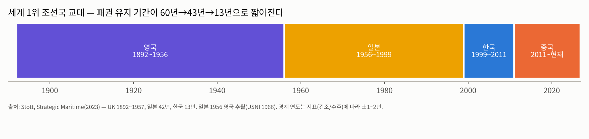
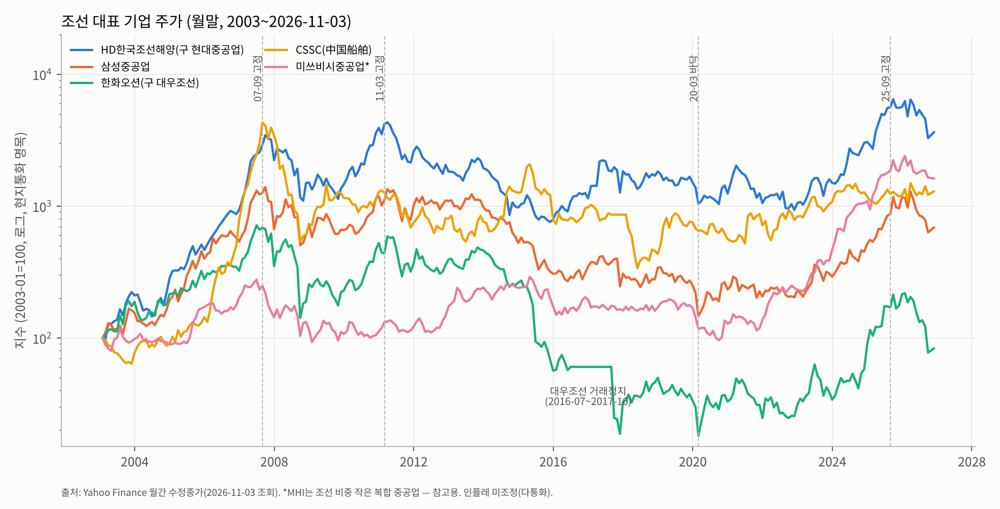
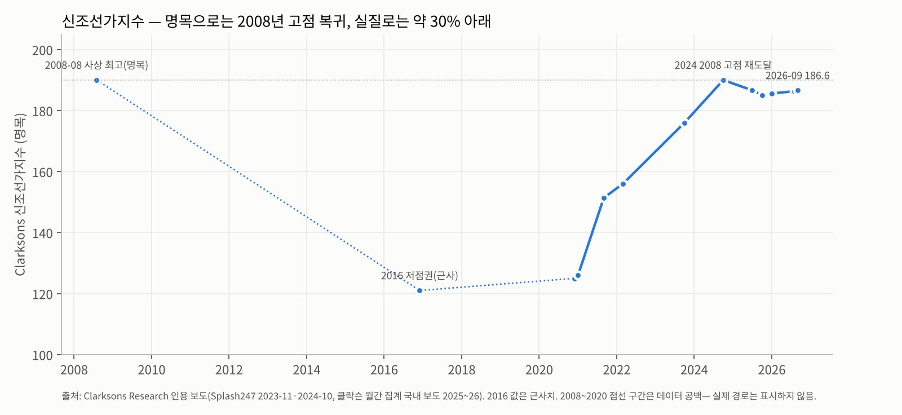
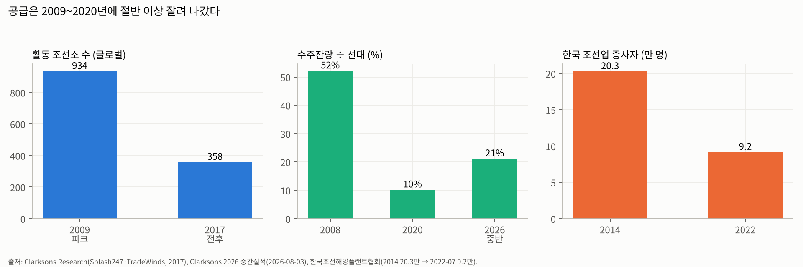
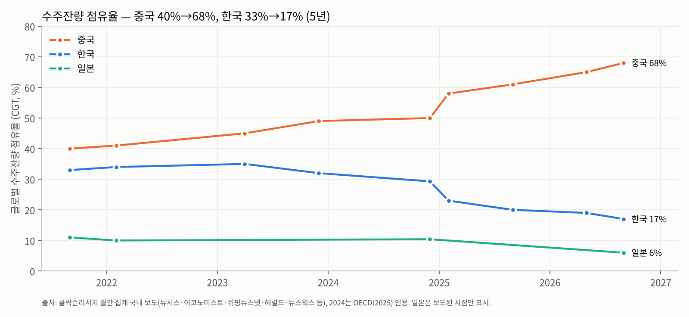
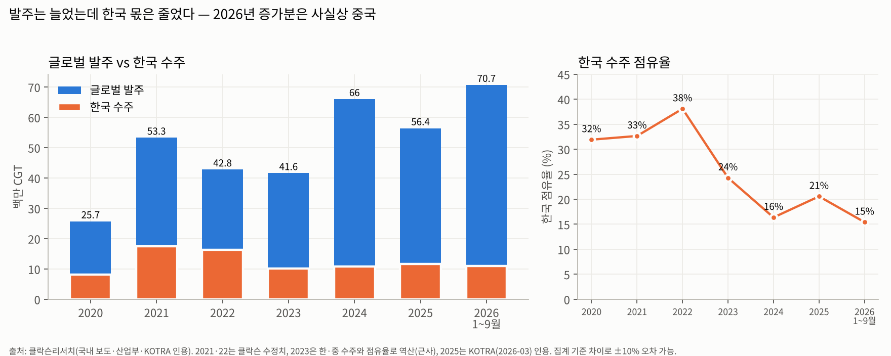

# 조선 산업 기초 분석 (Industry Basic — Shipbuilding)

> 셀사이드 init(데뷔) 자료 수준의 영구 reference 문서다. 조선을 처음 보는 사람이 한 번에 이해할 수 있게 짰다. 분기 실적·단기 narrative는 다루지 않는다(실적 리뷰·테마 분석 영역). 다만 작성 시점(2026-11-03)이 주가 급락 직후라, 현재 위치 판단에 필요한 사실은 4·5단계 snapshot에 담았다.
>
> **최초 작성본**이라 Delta 비교 대상 이전 리포트는 없다. 표기: 사실은 그대로, 전망은 **[전망]**, 근사·역산치는 **(근사)**.

---

## Executive Summary

1. **조선은 메가 트렌드 산업이 아니다.** 바다 위 운송 수요를 따라가는 **장주기 자본재 사이클 산업**이다. 지금 사이클 위에는 세 가지 흐름이 겹쳐 있다. ①노후선 교체(구조적이지만 결국 사이클), ②탈탄소 규제(IMO 표결이 2026-12-04로 미뤄져 불확실), ③미·중 해양 패권 경쟁에 따른 **함정·MRO·미국 조선 재건**. 이 가운데 메가 트렌드(5~20년)에 가장 가까운 것은 ③뿐이다.
2. **세계 1위 조선국은 영국(~1956) → 일본(~1999) → 한국(~2011) → 중국으로 넘어갔고, 1위 유지 기간은 60년 → 43년 → 13년으로 짧아졌다.** 2026년 9월 말 현재 중국은 글로벌 수주잔량의 68%, 한국은 17%를 가졌다(5년 전 40% 대 33%). **한국은 물량 경쟁에서 이미 졌고, 남은 자리는 LNG선(2026년 수주 점유율 59%)·대형 가스선·함정이다.**
3. **사이클 framework**: 주가 상승기 3.5~5년, 정점 대비 낙폭 −68%(1차 충격) → −82~−97%(장기 침체), 바닥권 5~7년 횡보. 2007~2025년 고점 간격은 **약 18년** 슈퍼사이클이다. 신조선가지수는 2024-10에 2008년 명목 고점(190)을 회복한 뒤 **2년째 185~187 고원**에 머물러 있다. 주가는 지수의 '수준'보다 '변화율'에 반응했다. 지수가 고원에 들어서고 11~19개월 뒤 주가가 꺾였다(2025-09/2026-04 고점 → 2026-11 −44~−62%).
4. **공급**: 2009~2020년 글로벌 활동 조선소가 934 → 358곳(−62%)으로 줄고, 한국 조선 인력은 20.3만 → 9.2만 명(−55%)으로 줄었다. 공급이 잘려 나간 것이 2021년 이후 가격 회복의 원인이었다. 그런데 **중국은 다시 늘린다.** 중국 조선소 인도 예정 물량은 2025년 22.7m CGT에서 2028년 44.0m CGT로 두 배다(BIMCO).
5. **4+5 종합**: 글로벌 상선 = **D(동반 확대) 후반**이고, 2028년 이후 **F(공급 과잉)** 전환 리스크가 있다. 한국 고부가 상선 = **E(점진적 가격 상승)이었다가 지금은 가격 고원**이다. 미국 함정·MRO = **B(수요 견인)**이지만 실물 매출은 2029년 이후다. 주도주 요건(메가 트렌드 × 병목 Moat)을 충족하는 구간은 **한국의 'LNG선 + 미국 해군' 교집합**뿐이다.

---

## 1-pager 요약 표

| 단계 | 핵심 결론 |
|---|---|
| **0. 상위 트렌드 판정** | **사이클 반등 + 세큘러(안보)**. 상선은 사이클, 탈탄소는 규제 의존 세큘러(표결 미정), 미국 함정·MRO는 메가 트렌드 후보(미·중 해양 패권, 20년+) |
| **1. 역사** | 7 chunk: ①1850~1956 영국 패권 ②1956~1973 일본 부상·VLCC 시대 ③1973~1987 오일쇼크 대불황·한국 진입 ④1988~2002 한국 추격·일본 추월 ⑤2003~2008 중국 WTO 슈퍼사이클 ⑥2009~2020 대불황·해양플랜트 손실·구조조정 ⑦2021~2026 친환경 교체·LNG·안보 사이클 |
| **2. 주가 사이클** | 고점 2007-09 → 2011-03(반등 고점) → 바닥권 2015~2022 → 고점 2025-09~2026-04. 상승기 +300~+3,800%, 하락기 −68~−97%. **주가는 수주·선가가 아니라 '선가 모멘텀 소멸'에 꺾인다** |
| **3. BM/밸류체인** | 후판·기자재 → 조선소 → 선주/해군. 조선소는 **선수금 구조의 수주 산업**(수주 2~3년 뒤 매출). 이익이 가장 안정적인 곳은 조선소가 아니라 **라이선스(GTT, 선가의 ~5%)·엔진 등 병목 기자재**. 한국 조선소 OPM은 2026-3Q 기준 10~16%로 역사적 고점 |
| **4. 공급** | 조선소 934 → 358곳(2009→2017 전후), 한국 인력 −55%. 국가 CR3(중·한·일) 수주잔량 91%. 중국은 증설, 한국·일본은 인력 제약으로 고정. 신조선가 186.6(2026-09), 2020년 저점 대비 +49% |
| **5. 수요** | 100% B2B(선사·에너지기업·해군). 수주잔량/선대 21~22%(2008년 52%의 절반 이하). 평균 선령 ~13.5년. 2026년 1~9월 발주 70.7m CGT(+57% YoY), 호르무즈 사태로 VLCC 상반기 150척+ 발주(1973년 이후 최다) |
| **4+5 종합** | 글로벌 = **D 후반 → F 리스크(2028+)**, 한국 고부가 = **E(가격 고원)**, 미국 함정/MRO = **B(2029+)**. 한국 주도주 후보는 'LNG선 × 미 해군' 교집합 |

---

# 0단계. 상위 트렌드 적합성 판정 (핵심 원칙 #9)

| 수요 동력 | 성격 | 지속 기간 | 판정 | 근거 |
|---|---|---|---|---|
| 노후선 교체 | 구조적 사이클 | 5~10년 | **사이클 반등** | 평균 선령 ~9년 → ~13년(Clarksons Research 2026-10). 교체 시점은 운임·금리·선가에 따라 앞당겨지거나 미뤄진다 |
| 탈탄소(이중연료·대체연료선) | 규제 의존 세큘러 | 10~25년 | **세큘러(조건부)** | IMO Net-Zero Framework 채택 표결이 2025-10에서 1년 연기됐고, 2026-12-04 재표결 예정. 채택돼도 2028년 이전에는 시행되지 않는다 |
| LNG 교역 확대 | 세큘러 | 10~15년 | **세큘러** | 미국·카타르 증설. 다만 2026년 호르무즈 사태로 카타르 증설 일정 불확실 |
| 미·중 해양 패권(함정·MRO·미국 조선 재건) | 지정학 구조 변화 | 20년+ | **메가 트렌드 후보** | MASGA 1,500억 달러, 미 해군 함정 증강, USTR 301조. 단 미 의회 절차(반스-톨레프슨 수정법·존스법)가 병목 |

**결론**: 조선 산업 전체는 **사이클 반등**으로 분류한다. 주도주 요건(메가 트렌드 안의 실적 + 스토리)을 만족할 수 있는 건 **미국 함정·MRO 노출이 있는 한국 조선소**와, LNG선처럼 **세큘러 수요 × 한국 독점에 가까운 공급**이 겹치는 세그먼트뿐이다. 범용 상선 물량은 사이클 매매 대상이다.

---

# 1단계. 역사 — 1850년부터 2026년까지

> 각 chunk를 (a)매크로 배경 (b)패권자 (c)산업 변화 (d)사이클 단계 (e)대표 기업 주가 (f)규제의 6 layer로 풀었다. 조선은 **(a) 매크로(전쟁·오일쇼크·교역)와 (f) 정부 정책**이 가장 두꺼운 산업이다. 조선소는 언제나 국가 산업화의 도구였기 때문이다.



### 먼저 알아둘 조선업의 구조 3가지 (비유)

1. **선수금 산업 = '아파트 분양'과 같다.** 배는 계약 → 착공(강재 절단) → 진수 → 인도까지 2~3년이 걸리고, 대금은 단계별로 받는다. 그래서 **수주 시점의 선가가 2~3년 뒤 이익을 결정한다.** 호황 끝물에 받은 비싼 일감은 불황 초입에 이익으로 찍히고, 불황 때 싸게 받은 일감은 회복 초입에 손실로 찍힌다. 이익은 업황보다 2~3년 늦게 움직인다.
2. **CGT(표준화물선환산톤수) = '난이도 가중 무게'.** 같은 크기라도 LNG선은 벌커보다 짓기가 몇 배 어렵다. CGT는 이 난이도를 반영한 단위다. 한국이 '척수'로는 중국의 1/7인데 'CGT'로는 1/5인 이유다(2026년 1~9월 한국 277척·1,093만 CGT, 중국 1,995척·5,391만 CGT. 클락슨리서치, 2026-10-07 보도).
3. **도크 = 고정된 생산 슬롯.** 조선소 생산능력은 도크·크레인·숙련 인력으로 정해지고, 늘리는 데 3~5년이 걸린다. 호황기 선가는 '남은 도크 슬롯'으로 결정된다(forward cover = 수주잔량 ÷ 연간 건조능력).

---

## Chunk 1. 1850–1956 — 철강·증기선 시대, 영국 패권

### (a) 매크로 배경
- 산업혁명과 대영제국 무역망. 세계 해상 교역의 중심이 영국이었고, 석탄·철강·기계 산업이 한 나라에 모여 있었다.
- 두 차례 세계대전이 조선 수요를 폭발시켰다. 특히 2차 대전 중 미국은 리버티선 대량 건조로 일시적인 건조량 1위에 올랐다(전시 특수, 이후 소멸).

### (b) 패권자
- **영국**: 1892~1957년 세계 1위(Stott, *Strategic Maritime*, 2023). Harland & Wolff(타이타닉 건조), John Brown, Swan Hunter, Vickers 등.

### (c) 산업 변화
- 목선 → 철선 → 강선, 범선 → 증기선 → 디젤선. 영국은 **리벳 공법·숙련공 도제 시스템**으로 경쟁력을 쌓았다.
- 2차 대전 후 독일·일본·스웨덴이 **용접 + 블록 공법**으로 재건했다. 배를 통째로 짓는 대신 레고처럼 블록을 만들어 도크에서 조립하는 방식이다. 영국은 이 전환이 늦었다.

### (d) 사이클 단계
- 전쟁 특수 → 전후 재건 수요 → 1950년대 교역 확대. 전쟁이 끝날 때마다 과잉 설비 → 불황이 반복됐다.

### (e) 대표 기업 주가
- 현대적 의미의 주가 데이터는 부재. 영국 조선소들은 1970년대 국유화(1977 British Shipbuilders)로 상장 시장에서 사라졌다.

### (f) 규제 layer
- 각국 해군 증강 정책이 조선업을 떠받쳤다(1차 대전 전 영·독 전함 경쟁).
- **1920 미국 존스법(Jones Act)**: 미국 연안 운송은 미국에서 건조한 선박만 쓸 수 있게 했다. 이후 100년 동안 미국 상선 조선을 보호했지만 경쟁력을 잃게 만든 법이고, 2025~26년 MASGA 논의의 핵심 장애물로 다시 등장한다.

---

## Chunk 2. 1956–1973 — 일본 부상, 초대형 유조선(VLCC) 시대

### (a) 매크로 배경
- **1956 수에즈 위기, 1967 6일 전쟁으로 수에즈 운하가 폐쇄됐다(1967~75).** 중동 원유가 아프리카 희망봉을 돌아가야 했고, 같은 양을 나르는 데 필요한 배가 늘었다. 더 멀리 돌수록 한 번에 많이 실어야 경제적이라 **유조선 대형화**가 폭발했다.
- 서방 고도성장으로 석유 소비가 급증했다.

### (b) 패권자
- **일본**: 1956년 영국을 넘어 세계 1위에 올랐다. 당시 점유율 22.1%, 1962년 26%(영국 12.8%로 하락)(USNI Proceedings, 1966-08).
- 미쓰비시중공업·IHI·가와사키·히타치조선·미쓰이.

### (c) 산업 변화
- 일본은 **대형 건식 도크 + 블록 공법 + 철강 일관 공급(신일철)**으로 대형선 원가를 떨어뜨렸다. 영국이 장인 방식이라면 일본은 공장식 대량 생산이었다.
- VLCC(20만 DWT 이상)가 등장했다. 배가 커질수록 톤당 원가가 떨어지니, 큰 도크를 가진 나라가 이긴다.

### (d) 사이클 단계
- 1960년대 후반~1973년: 역사상 가장 긴 유조선 붐. 1973년 발주 정점.

### (e) 대표 기업 주가
- 일본 중공업주가 고성장했다(장기 데이터 미확보). 다만 일본 조선사는 대부분 복합 중공업의 한 사업부여서 '순수 조선주'가 드물다. 이 구조는 지금도 같다(미쓰비시중공업의 현재 주가는 조선이 아니라 발전·방산이 움직인다).

### (f) 규제 layer
- 일본 정부의 계획조선(정책금융으로 자국 해운사에 선박 발주) + 수출 금융. **조선 = 국가 산업 정책**이라는 원형이 이때 만들어졌다.

---

## Chunk 3. 1973–1987 — 오일쇼크 대불황, 유럽 몰락, 한국 진입

### (a) 매크로 배경
- **1973·1979 두 차례 오일쇼크.** 유가가 4배 오르자 석유 수요가 꺾였고, 직전 붐에 발주한 유조선이 쏟아져 들어왔다. 신조 유조선이 인도되자마자 계선(운항 중단)되거나 해체됐다.
- **1985 플라자합의 → 엔화 급등.** 일본 조선의 원가 경쟁력이 크게 약해졌다.

### (b) 패권자
- 일본이 1위를 유지했지만 정부 주도로 설비를 감축했다. 유럽(스웨덴·영국·서독)은 사실상 퇴장했다.
- **한국이 진입했다.** 현대중공업(1972 울산 착공, 1974 첫 VLCC 인도), 삼성중공업(1974 설립, 거제), 대우조선공업(1978 옥포조선소 인수).

### (c) 산업 변화
- 한국은 일본 기술을 바탕으로 하되 **규모의 경제(초대형 도크)와 저임금**으로 승부했다(Bruno & Tenold, *Mariner's Mirror*, 2011). 조선소 건설과 동시에 VLCC를 수주한 현대의 일화는 "자본도 기술도 없이 시장부터 잡는다"는 한국 조선의 출발점이다.
- 유럽은 크루즈·특수선으로 후퇴했다. 지금도 크루즈는 이탈리아 Fincantieri·독일 Meyer Werft 영역이다.

### (d) 사이클 단계
- **1974~1987년: 조선 역사상 가장 길고 깊은 불황(약 13년).** 발주가 급감하고 선가가 붕괴했으며, 각국이 구조조정을 강제했다.

### (e) 대표 기업 주가
- 한국 조선사는 당시 비상장이거나 그룹 내 계열사였다. 일본 조선주는 장기 침체.

### (f) 규제 layer
- 일본: 정부 주도 설비 감축 카르텔(1979~80, 1987~88).
- 영국: 1977 조선소 국유화(British Shipbuilders) → 1980년대 민영화·폐쇄.
- 한국: **1973 중화학공업화 선언**. 조선이 6대 전략산업에 들어가며 정책금융을 집중 지원받았다.

> **교훈 1**: 조선의 대불황은 '수요 감소'보다 **'호황기 과잉 발주가 인도되는 시점'**에 온다. 1973년 발주 정점 → 1975~78년 인도 폭탄 → 장기 불황. 2007 → 2009~2012, 2013~14 해양플랜트 → 2015~16에서도 같은 패턴이 반복된다.

---

## Chunk 4. 1988–2002 — 한국 추격, 일본 추월, 외환위기

### (a) 매크로 배경
- 냉전 종식, 세계화로 컨테이너 교역이 늘었다.
- **1997 아시아 외환위기.** 원화 가치 폭락이 역설적으로 한국 조선의 달러 원가 경쟁력을 높였다.

### (b) 패권자
- **한국이 1990년대 후반 일본을 추월해 1위에 올랐다**(Stott 기준 한국 1위 13년 → 약 1999~2011). 경계 연도는 지표(수주·건조·잔량)에 따라 1~2년씩 다르다.
- 현대·삼성·대우의 '빅3' 체제가 굳어졌다. 1999 대우그룹 붕괴 → 2000 대우조선해양 분할(이후 2023년까지 산업은행이 최대주주).

### (c) 산업 변화
- 한국은 **LNG선(멤브레인형)·대형 컨테이너선·드릴십** 같은 고부가 선종으로 옮겨 갔다. LNG 화물창 원천 기술은 프랑스 GTT가 가졌고, 한국은 라이선스를 받아 짓는 구조가 이때 정착했다(현재 선가의 약 5% 로열티).
- 일본은 벌커 중심 + 자국 선주 의존으로 굳어졌다.

### (d) 사이클 단계
- 1988~1990년대 중반 완만한 회복 → 1990년대 후반 발주 둔화. 클락슨 집계 이래 반기 최저 발주는 1999년(658만 CGT)이었고, 2020년 상반기에 깨졌다(한국경제, 2020-07-07).

### (e) 대표 기업 주가
- 현대중공업 1999 상장. 2000~2002년 HD한국조선해양(구 현대중공업) 주가는 6,000~13,000원대에 머물렀다(수정주가, Yahoo Finance).

### (f) 규제 layer
- 1990년대 OECD 조선협정(보조금 규제) 시도 → 미국 비준 거부로 무산.
- 2002~2005 EU의 한국 조선 보조금 WTO 제소(대우조선 구제금융 문제).

---

## Chunk 5. 2003–2008 — 중국 WTO 슈퍼사이클 (역사상 최대 호황)

### (a) 매크로 배경
- **2001 중국 WTO 가입 → '세계의 공장'.** 철광석·석탄 수입과 제품 수출이 폭증했다. 벌커·컨테이너선 운임이 사상 최고를 기록했다.
- 유동성 팽창과 선박금융 붐(독일 KG펀드 등).

### (b) 패권자
- **한국 정점.** 빅3 + STX·성동·SPP 등 중형사가 난립했다.
- **중국 급부상.** CSSC·CSIC(국영 2대 그룹), Yangzijiang(민영), 지방 조선소 수백 곳이 생겼다. 중국 활동 조선소는 2010년 379곳에 달했다(BIMCO, Seatrade 2026-09 인용).

### (c) 산업 변화
- 2007년 발주량 172m GT로 사상 최대(Clarksons, Splash247 2024 인용). 2007년 상반기에만 4,619만 CGT가 발주됐다(한국경제 2020-07-07).
- **수주잔량/선대 비율 52~55%(2008 정점).** 지금 떠 있는 배의 절반 넘는 양이 추가로 건조 대기 중이었다는 뜻이다(Clarksons 2026 중간실적 자료).
- 신조선가지수 2008-08 사상 최고(190, 명목).

### (d) 사이클 단계
- 2003~2007 **수퍼 호황** → 2008-09 리먼 사태로 정점 붕괴.

### (e) 대표 기업 주가
- HD한국조선해양(구 현대중공업): 2002-08 저점 → 2007-09 고점 **+3,818%**(월말 수정주가 6,225 → 243,893원).
- 삼성중공업 2001-08 → 2007-09 **+1,652%**, 대우조선 2007-06 고점.
- CSSC(600150.SS) 2005 → 2007 **약 30배**, 2007-08 고점 이후 2008년 −87%.

### (f) 규제 layer
- 중국 정부 '조선 1위 국가' 육성 계획 + 국영은행 선박금융.
- IMO 단일선체 유조선 퇴출(MARPOL 개정)이 교체 수요를 보탰다.

> **교훈 2**: 슈퍼사이클 정점의 신호는 **"수주잔량/선대 50%+, 신규 조선소 난립, 투기적 선주(금융 투자자) 발주"**였다. 2026년 현재 수주잔량/선대는 21~22%로 2008년의 절반 이하다. 다만 **중국 증설**이라는 다른 형태의 공급 신호가 켜졌다(4단계).

---

## Chunk 6. 2009–2020 — 대불황, 해양플랜트 손실, 구조조정 (12년 겨울)

### (a) 매크로 배경
- 글로벌 금융위기 → 교역 둔화 → 2008년까지 발주된 배가 2010~2011년에 대거 인도됐다(인도량 약 54.4m CGT 정점, BIMCO). 운임이 붕괴했다.
- 2011~2014 고유가 → 해양플랜트(드릴십·FPSO) 붐 → **2014 셰일 혁명 + 유가 폭락** → 해양 프로젝트 취소.
- 2016-08 한진해운 파산.

### (b) 패권자
- **중국이 물량 1위**(2010~2011년 전후 한국 추월). 한국은 고부가 선종에서 버텼다.
- 일본은 장기 쇠퇴. 2010년대 내내 엔저에도 점유율이 하락했다.

### (c) 산업 변화
- **한국 빅3의 해양플랜트 참사.** 상선 일감이 끊기자 경험 없는 해양 EPC를 고정가로 대거 수주했다. 2014년 현대중공업 영업적자 3조 2,495억원(이투데이, 2015-07-15), 2015년 빅3 합산 손실 8조 5,000억원 이상(비즈워치, 2016-03-14), 2015년 2분기에만 3사 영업손실 4조 7,500억원(뉴스토마토, 2015-07-29).
- **대우조선해양 공적자금**: 2015년 4.2조 + 2017년 2.9조 = 약 7조원(산업은행 회장 국회 답변, 이코노미스트 2021-05 인용). 2016-07~2017-10 거래 정지.
- STX조선 2013 자율협약 → 2016 법정관리. 성동·SPP 등 중형사 퇴출.
- **인력 붕괴**: 한국 조선업 종사자 2014년 20.3만 명 → 2022-07 9.2만 명(−54.5%, 한국조선해양플랜트협회). 떠난 숙련공은 돌아오지 않았다. 이것이 2021년 이후 한국의 공급 상한을 정한 핵심 변수다.
- **글로벌 활동 조선소 934곳(2009 정점) → 358곳(−62%)**(Clarksons Research, Splash247). 대형 조선소 기준 321 → 131곳(2009 → 2022, Clarksons, TradeWinds). 중국 활동 조선소 379(2010) → 117(2019)(BIMCO).
- 2019 현대중공업-대우조선 합병 추진 → **2022-01-13 EU 불허**로 무산.

### (d) 사이클 단계
- 2009~2012 인도 폭탄 → 2013~2014 일시 반등(친환경 에코십) → 2015~2016 **바닥** → 2017~2019 미약한 회복 → 2020 코로나로 반기 발주 사상 최저(2020 상반기 575만 CGT, 1996 집계 이래 최저. 한국경제 2020-07-07).
- 신조선가지수: 2016년 저점권(약 121, 근사) → 2020-11 약 125.

### (e) 대표 기업 주가
- HD한국조선해양(구 현대중공업): 2011-03 반등 고점(305,336원) → 2015-11 저점(53,545원) **−82%(56개월)**.
- 삼성중공업: 2011-03 → 2020-02 **−89%(107개월)**.
- 대우조선해양(현 한화오션): 2007-06 고점 → 2020-02 **−97.5%**(감자 반영 수정주가 461,434 → 11,690원).
- 반면 **HII(미국 군함 전업)**: 2011 상장 후 2020년까지 약 6~7배. 같은 '조선'이라도 **정부 계약 기반 함정은 상선 사이클을 타지 않는다**는 대비가 이 시기에 처음 뚜렷해졌다.

### (f) 규제 layer
- 한국: 2016 조선업 특별고용지원업종 지정, 정부·채권단 주도 구조조정(빅3 → 빅2 시도).
- 중국: 2013~2015 '화이트리스트' 조선소 지정으로 부실 조선소 정리.
- IMO: 2020-01 황산화물 규제(IMO 2020), 2018 GHG 초기 전략(2050년 50% 감축) → 친환경선 교체 수요의 씨앗.

> **교훈 3**: 조선의 겨울은 길다. **바닥에서 5~7년을 횡보**하고, 그사이 공급(조선소·인력)이 절반 이상 사라진다. **다음 호황의 크기는 이 겨울의 깊이가 정한다.** 2021년 이후 회복이 빨랐던 건 수요보다 공급 소멸 덕이다.

---

## Chunk 7. 2021–2026 — 친환경 교체·LNG·해양 안보 사이클

### (a) 매크로 배경
- 코로나 물류 대란 → 2021~22 컨테이너선 발주 폭발. 2022 러-우 전쟁 → 유럽의 러시아 파이프가스 대체 → **LNG 운반선 수요 급증**.
- 2023~24 홍해 사태(후티 공격) → 희망봉 우회 → 톤마일 증가.
- **2026-02-28 미·이란 전쟁 → 호르무즈 해협 사실상 봉쇄.** 해상 원유 교역의 약 25~34%와 LNG 교역의 약 20%가 이 해협을 지난다. VLCC 운임은 전쟁 4일 만에 3배 이상 뛰었고(해진공 2026-03), 1분기 VLCC 수익은 평균 약 17.5만 달러/일로 분기 사상 최고였다(Hellenic Shipping News). 2026-07에는 카타르 LNG선이 피격돼 카타르가 증산을 중단했다.
- 미·중 패권 경쟁이 조선으로 번졌다. 2025-04 USTR 301조 중국 선박 입항 수수료 확정 → 2025-10-14 발효 → 중국이 한화오션 미국 자회사 5곳 제재 → 2025-11-10 부산 정상회담 합의로 양측 모두 1년 유예.

### (b) 패권자
- **중국: 물량 패권 확정.** 수주잔량 점유율 40%(2021-09) → 68%(2026-09), 2026년 1~9월 수주 76%(클락슨리서치). 2025-09 CSSC가 CSIC를 흡수합병해 세계 최대 상장 조선사가 됐다.
- **한국: 고부가·안보 패권.** 2026년 LNG선 수주 59%, VLAC·VLGC 65%(Clarksons, 글로벌이코노믹 2026-09-27). 2023-05 한화가 대우조선을 인수해 한화오션이 됐다(2022-09 산은 매각 결정). 2024-12 한화 필리조선소 인수, 2025-12 HD현대미포를 HD현대중공업에 합병.
- **일본: 재편.** 2026-01 이마바리조선이 JMU 지분 60%를 확보해 자회사화(iMarine 2026-01).
- **미국: 수요자로 재등장.** 미 해군은 함정 증강이 필요하지만 자국 조선 능력이 부족하다.

### (c) 산업 변화
- 2021 발주 53.3m CGT(2020년 25.7m의 2배+) → 2024 66m CGT(17년 만에 최대, Clarksons) → 2025 56.4m CGT → **2026년 1~9월 70.7m CGT(+57% YoY)**.
- **신조선가지수**: 2020-11 저점 약 125 → 2024-10 190(2008 고점과 같은 수준) → 2026-09 186.6. **명목으로는 2008년 수준이지만 인플레 조정 시 약 30% 아래**(Clarksons, Splash247 2023-11).
- 한국 조선 3사 연간 동반 흑자는 2024년이 2011년 이후 13년 만이었다(에프앤가이드, 파이낸셜뉴스 2025-01-19). 2026-3Q 영업이익은 HD현대중공업 8,992억(매출 5.75조, OPM 15.6%), 한화오션 4,857억(매출 3.41조, OPM 14.2%), 삼성중공업 3,384억(연합인포맥스·한국경제 2026-10).
- **해양 안보**: 2026-07 한화오션 KDDX(7.8조원, 7,000톤급 구축함 6척) 본계약. 2026-07-06 캐나다 잠수함(최대 60조원)은 **독일 TKMS가 우선협상자로 선정되고 한화오션 탈락**(NATO 상호운용성이 갈랐다). 2026-10-29 한화디펜스USA가 미 해군 중형상륙함(LSM) 1척(2.69억 달러)을 수주해 **MASGA 첫 함정 건조 수주**(파이낸셜뉴스 2026-11-01). 2026-10-22 HD현대-키윗 합작 'HD키윗조선' 설립 계약(2027 착공, 2029 가동 목표).

### (d) 사이클 단계
- 2021~2024 **회복 → 확장**(수주·선가 동반 상승) → 2024-10 이후 **선가 고원 + 물량은 중국 쏠림** → 2026년 발주는 VLCC(호르무즈)·컨테이너선이 주도.
- **[현재 위치 판단]** 수주(발주)는 아직 확장 국면이지만, **한국 조선소 입장에서 '가격 상승'이라는 엔진은 2024-10에 멈췄다.** 이익은 2023~25년에 받은 고가 일감이 매출로 인식되면서 2026~27년까지 늘어난다(선수금 구조의 후행성). 시장은 이 '이익 후행 구간'을 이미 할인하기 시작했다.

### (e) 대표 기업 주가
- HD한국조선해양: 2022-11 저점(66,040원) → 2025-09 고점(457,183원) **+592%** → 2026-11-03 256,500원 **−44%**.
- HD현대중공업(329180): 2026-04 월말 고점(676,706원, 장중 2026-05-27 765,000원) → 287,500원 **−57.5%**.
- 한화오션: 2020-02 저점 → 2026-01 고점 **+1,108%** → 2026-11-03 53,800원 **−62%**.
- 삼성중공업: 2020-02 → 2026-03 **+779%** → −47%.
- **2026년 10월 한 달 동안 4사 합산 시총 110.3조 → 74.3조원(−36조원)**(한국경제 2026-10-29). HD현대중공업 −36.8%로 삼성전자(−16.2%)·SK하이닉스(−20.2%)보다 더 빠졌다(뉴스1, 2026-11-01). 사유: 3Q 실적 컨센서스 3~10% 미달(조업일수 감소·비용), **"수주잔고보다 호황 지속성이 쟁점"**(메리츠증권), 한국 수주 점유율 15%, 원화 강세.
- 상대수익률: KOSPI는 2025-09 → 2026-11 +37%(4,108 → 5,649). 같은 기간 HD한국조선해양은 −44%. **상대 −59%p.**

### (f) 규제 layer
- **MASGA**(Make American Shipbuilding Great Again): 한국 대미 투자 3,500억 달러 중 1,500억 달러를 조선 협력에 배정. 2026-07-23 워싱턴 한미 조선협력센터 개소. 다만 2026-09 산업부 차관은 미 의회 절차 지연을 인정했다(네이트/뉴스 2026-09-11). 방사청은 미 함정 1·2번함 국내 건조, 3번함부터 현지 건조(핀란드 모델) 방침(2026-10-13 국감).
- **USTR 301조**: 중국 관련 선박 입항료는 2025-11-10부터 유예 중이고, 2026-10-26 USTR이 유예를 2027-01-09까지 연장하는 안의 의견 수렴을 시작했다(Thompson Hine 2026-10).
- **IMO NZF**: 2025-10-17 채택 표결 1년 연기(찬성 57·반대 49) → 2026-12-04 재표결 예정(Lloyd's Register, vesselchain 인용). 미국은 "완전 폐기"를 주장(Carbon Brief).
- **한국 핵추진잠수함**: 특별법 국회 제출, 2027년 초기 사업 착수 예상(HD현대 3Q26 콜).

---

# 2단계. 주가 사이클 — 정량 framework

## 통합 주가 차트 (2003~2026-11, 로그)



> 주의: 다통화(원·위안·엔)라 인플레 조정을 하지 않았다. 대우조선은 2016-07~2017-10 거래 정지 구간이 평평하게 나온다. 미쓰비시중공업은 조선 비중이 작은 복합 중공업이라 참고용이다.

## 신조선가지수 (가격 사이클)



## 사이클 식별

| 사이클 | 저점 → 고점 (HD한국조선해양, 월말) | 상승폭·기간 | 고점 → 저점 | 하락폭·기간 | 트리거 |
|---|---|---|---|---|---|
| **1차 (슈퍼)** | 2002-08 → 2007-09 | **+3,818%**, 61개월 | 2007-09 → 2008-10 | **−68%**, 13개월 | 중국 WTO 교역 붐 → 리먼 사태 |
| **2차 (반등)** | 2008-10 → 2011-03 | +293%, 29개월 | 2011-03 → 2015-11 | **−82%**, 56개월 | 해양플랜트·고유가 → 셰일·유가 붕괴·해양 손실 |
| **바닥 횡보** | 2015-11 ~ 2022-11 | 약 7년, 53,545~157,157원 박스 | — | — | 구조조정·인력 이탈·코로나 |
| **3차 (현재)** | 2022-11 → 2025-09 | **+592%**, 34개월 | 2025-09 → 2026-11(진행 중) | **−44%**, 14개월 | LNG·친환경·MASGA → 선가 고원·수주 점유율 하락·호황 지속성 의심 |

교차 확인(같은 구간, 다른 종목):

| 종목 | 직전 장기 저점 | 이번 고점 | 상승폭 | 2026-11-03 고점 대비 |
|---|---|---|---|---|
| 삼성중공업 | 2020-02 (3,679) | 2026-03 (32,350) | +779% | −47% |
| 한화오션 | 2020-02 (11,690) | 2026-01 (141,200) | +1,108% | −62% |
| HD현대중공업 | 2021-09 상장 | 2026-04 (676,706) | +511%(상장 대비) | −58% |
| CSSC(600150.SS) | 2018 (9.2위안) | 2026 (40.7위안) | +342% | 2007 고점(118위안)의 30% 수준 |

*출처: Yahoo Finance 월간 수정종가(2026-11-03 조회). 월말 기준이라 장중 고·저점과 다를 수 있다.*

## 사이클 패턴 framework — 정량 규칙

### 길이
- **고점 → 고점: 약 18년**(2007-09 → 2025-09). 중간에 반등 고점(2011)이 있다. 반도체(4~5년)·2차전지(약 4.7년)보다 훨씬 길다. 이유는 ①배 수명 20~25년(교체 주기), ②조선소·인력 공급 조정에 5~10년이 걸리기 때문이다.
- **바닥 횡보: 5~7년**(2015~2022). 1974~1987년에는 13년이었다.
- 관측 가능한 상장 주가 사이클은 **2회뿐**이라 통계적으로 신뢰하기 어렵다. 1970~80년대 사례(일본·유럽)를 정성적으로 보완해야 한다.

### 진폭
- 상승기: 슈퍼사이클 +1,600~+3,800%, 일반 회복기 +300~+1,100%.
- 하락기: 1차 충격 −64~−68%(약 1년) → 장기 침체 누적 **−82~−97%**. 조선주는 '바닥에서 사면 크게 벌고, 고점에서 사면 영원히 못 돌아오는' 비대칭 자산이다. CSSC는 2007 고점의 30%, 삼성중공업은 2007 고점을 19년 만에 겨우 회복했다(32,350 vs 35,039, 미달).

### 선행·후행 관계 (가장 중요)

| 지표 | 1차 사이클 | 3차 사이클 | 해석 |
|---|---|---|---|
| 신조선가지수 고점(또는 고원 진입) | 2008-08 | 2024-10 | — |
| 주가 고점 | 2007-09 (**11개월 선행**) | 2025-09 / 2026-04 (**11~18개월 후행**) | 1차는 금융위기가 주가를 먼저 꺾었다. 3차는 이익 증가(고가 일감 매출 인식)와 MASGA 스토리가 주가를 더 끌고 갔다 |
| 영업이익 고점 | 2008~2010 | [전망] 2026~2027 | 선수금 구조 때문에 이익은 선가보다 2~3년 늦다 |

**규칙**: 조선주는 **'이익 고점'이 아니라 '선가 모멘텀 소멸 + 수주 점유율 하락'이 보일 때** 꺾인다. 이익 증가가 확실한 구간에서 주가가 빠지는 2026년 10월(이익 +42~68% YoY인데 주가 −30% 이상)은 시장이 2~3년 뒤를 할인한다는 뜻이다. 반대로 **바닥은 '이익 최악'이 아니라 '공급 소멸(조선소·인력 퇴출) 완료 + 선가 반등 시작'**에서 나온다(2020-11 선가 저점 ↔ 2020-02~2022-11 주가 바닥).

### 구조조정 트리거 (반복 메커니즘)
과잉 발주(수주잔량/선대 50%+) → 2~3년 뒤 인도 폭탄 → 운임 붕괴 → 발주 절벽 → 저가 수주(도크를 채우려고) → 2~3년 뒤 손실 인식 → 조선소 퇴출·인력 이탈 → 공급 소멸 → 다음 사이클 가격 결정력.

## 1단계 chunk와의 매핑

| chunk | 사이클 위치 | 주가 변곡점 | 일치 여부 |
|---|---|---|---|
| ③ 1973~1987 | 대불황 | (데이터 없음) | — |
| ⑤ 2003~2008 | 1차 상승 | 2002-08 저점 / 2007-09 고점 | 일치 |
| ⑥ 2009~2020 | 하락 → 바닥 | 2008-10, 2011-03, 2015-11, 2020-02 | 일치(2011은 chunk 내부 반등) |
| ⑦ 2021~2026 | 3차 상승 → 정점 통과? | 2022-11 저점 / 2025-09~2026-04 고점 | 일치. chunk 경계(2021)보다 주가 저점(2022-11)이 늦다 — 이익 후행 |

---

# 3단계. 비즈니스 구조 + 밸류체인

## 밸류체인 매핑

| 레이어 | 구성 | 대표 기업 | 한국 기업 위치 |
|---|---|---|---|
| **업스트림: 소재** | 후판(선박용 두꺼운 강판), 특수강(LNG 화물창용 인바·스테인리스·고망간강) | POSCO, 현대제철, Nippon Steel, Baosteel | POSCO홀딩스·현대제철(**중간**: 조선 외 수요가 크다) |
| **업스트림: 라이선스** | LNG 화물창 설계(멤브레인), 엔진 설계 | **GTT**(화물창 80%+), MAN ES(엔진 라이선서), WinGD(CSSC 계열) | 없음. 한국형 화물창 KC-2C 2025-10 소형선 첫 상업 적용 |
| **미드: 핵심 기자재** | 2행정 저속엔진·4행정 발전기 엔진, 보냉재, 선박 전기·자동화, 배관 | HD현대중공업 엔진기계, 한화엔진, HD현대마린엔진, 한국카본·동성화인텍(보냉재), 중국 CMD·CSSC 엔진 | **높음**(엔진·보냉재) |
| **미드: 조선소** | 설계 → 강재 절단 → 블록 → 탑재 → 진수 → 시운전 → 인도 | CSSC, Yangzijiang, Hengli(中) / HD현대, 한화오션, 삼성중공업(韓) / 이마바리-JMU(日) / HII·General Dynamics(美 군함) | **높음** |
| **미드: 특수선·함정** | 구축함·잠수함·지원함, 해외 함정 MRO | HII, GD, TKMS, Fincantieri, Naval Group / 한화오션·HD현대중공업 | **높음**(국내) / **중간**(해외, 정치 변수) |
| **다운: 사후관리** | A/S·부품·개조(스크러버·이중연료 개조) | HD현대마린솔루션, Wärtsilä | **중간** |
| **다운: 수요자** | 컨테이너 선사, 탱커·벌커 선주, 에너지 기업(LNG 용선), 각국 해군 | MSC·Maersk·HMM, QatarEnergy·Shell, 미 해군 | — |

## 레이어별 BM·진입장벽·마진

| 레이어 | BM (어떻게 돈을 버나) | 핵심 capability | 진입장벽 | 마진 구조 | 자본집약도 |
|---|---|---|---|---|---|
| **GTT(화물창 라이선스)** | 척당 선가의 약 5% 로열티(조선소가 지급). 연간 LNG·에탄선 로열티 5억 5,250만 유로 = 매출의 86%(헤럴드경제 보도 기준 직전 연도) | 극저온 멤브레인 설계 특허 + 수십 년 운항 실적 | **최고**: 선주가 실적 없는 화물창을 안 받는다. KC-1은 결빙(cold spot) 결함으로 실패 | 매우 높음(로열티 모델) | 매우 낮음 |
| **엔진(2행정·4행정)** | 라이선스 받은 엔진을 제작·판매 + A/S 부품 | 대형 주조·가공 + 이중연료 엔진 양산 실적 | 높음: 생산능력 증설에 2~3년, 선주 지정 | 중~높음(인도 대기 길어지면 가격 결정력) | 중 |
| **보냉재** | LNG 화물창 단열 패널 공급(GTT 인증 필요) | 극저온 소재 가공 + GTT 인증 | 높음(인증 과점) | LNG선 발주에 강하게 연동 | 중 |
| **조선소(상선)** | 고정가 계약 + 단계별 선수금. 원가는 강재·인건비·기자재 | 도크 슬롯, 숙련 인력, 반복 건조 학습곡선, 설계 | 중~높음: 대형 도크 + 인력. 중국은 국가 자본으로 우회 | **변동이 극단적**: 한국 빅3 대규모 적자(2015, 3사 합산 −8.5조원+) ~ +16%(2026-3Q). 원가 중 인건비·강재·환율 민감 | 높음(도크·크레인) |
| **조선소(함정)** | 정부 계약(원가 가산 또는 고정가), 장기 MRO | 보안 인가, 전투체계 통합, 정치적 신뢰 | **최고**(국적 장벽: 반스-톨레프슨·존스법·NATO 생태계) | 낮지만 안정(HII OPM 대체로 한 자릿수 중반, 근사) | 높음 |
| **선주/해운** | 운임·용선료 | 선대 운용, 화주 계약 | 낮음(자본만 있으면 진입) | 운임 사이클에 극단적 연동 | 매우 높음 |

### 왜 이 구조로 굳어졌나 (Why)
1. **조선소는 '가격 수용자' 시간이 '가격 결정자' 시간보다 길다.** 공급(도크)은 3~5년마다 바뀌고 수요(발주)는 운임 따라 몇 달 만에 바뀐다. 호황 2~4년, 불황 5~12년. 그래서 조선소 평균 ROE는 낮다.
2. **이익은 '대체 불가 부품'으로 샌다.** 조선소가 아무리 많아져도 LNG선을 지으려면 GTT 라이선스가 필요하다. 한국 조선 3사가 30년간 GTT에 낸 로열티는 약 7조 2,900억원, 척당 평균 130억원이다(비즈한국). 2차전지에서 '이익은 양 끝단(광물·셀 1위)에만' 남았던 구조와 닮았다. 조선에서 꾸준히 버는 쪽은 **라이선스·엔진**이다.
3. **함정은 다른 산업이다.** 시장이 국경으로 잘려 있고 가격보다 신뢰가 우선이다. 상선 사이클과 상관관계가 낮다(HII vs 한국 조선주, 2011~2020).

## 한국 기업 별도 섹션 — 테마 직접성

| 기업 | 레이어 | 직접성 (상선 사이클) | 직접성 (미 해군·MASGA) | 메모 |
|---|---|---|---|---|
| HD한국조선해양(009540) | 중간지주(HD현대중공업·삼호 등) | **높음** | 높음 | 엔진(힘센) 육상발전 → AI 데이터센터 전력과 교차(3GW 캐파, 증설 검토. 아이뉴스24) → `전력 인프라_산업기초.md` 참조 |
| HD현대중공업(329180) | 조선소 + 엔진 + 함정 | **높음** | 높음 | 2025-12 미포 흡수. 함정 2위(KDDX 탈락). HD키윗조선(2029 가동) |
| 한화오션(042660) | 조선소 + 함정·잠수함 | **높음** | **최고** | 필리조선소(50억 달러 투자, 연 20척 목표), LSM 첫 수주, KDDX 수주, 캐나다 잠수함 탈락 |
| 삼성중공업(010140) | 조선소 + FLNG | **높음** | 중간 | LNG선·FLNG 특화, KC-2C 화물창 국산화 선도 |
| 한화엔진(082740)·HD현대마린엔진(071970) | 엔진 | 높음 | 낮음 | 조선소 인도 일정에 후행 |
| 한국카본(017960)·동성화인텍(033500) | LNG 보냉재 | 높음(LNG선 한정) | 낮음 | LNG선 발주 사이클 레버리지 |
| HD현대마린솔루션(443060) | A/S·개조 | 중간 | 낮음 | 선대 규모·노후화에 연동(신조 사이클보다 안정) |
| HJ중공업·대한조선·케이조선 | 중형 조선소 | 중간 | 중간(MRO) | 중형 탱커·컨테이너 |

---

# 4단계. 공급 구조 점검 — 현재 정량 snapshot





## 구조조정 이력 (시간순)

| 시기 | 이벤트 | 결과 |
|---|---|---|
| 1977~1980s | 영국 국유화·폐쇄, 스웨덴·서독 퇴출 | 유럽 상선 조선 소멸(크루즈·특수선만 생존) |
| 1979~80, 1987~88 | 일본 정부 주도 설비 감축 | 일본 성장 동력 상실 |
| 1997~2000 | 한라중공업 부도, 대우그룹 붕괴 → 대우조선 분할 | 한국 빅3 체제 |
| 2009~2017 | 글로벌 활동 조선소 934 → 358곳(−62%) | 중국 379 → 117곳(2010 → 2019) |
| 2014~2017 | 한국 해양플랜트 손실, STX·성동·SPP 퇴출, 대우조선 공적자금 약 7조원, 인력 −55% | 한국 생산능력 사실상 반토막 |
| 2019~2022 | 현대-대우 합병 시도 → EU 불허 | 빅3 유지 |
| 2023~2026 | 한화의 대우 인수, CSSC-CSIC 흡수합병(2025-09), 이마바리-JMU(2026-01), HD현대미포 흡수(2025-12) | **3국 모두 '국가대표 1~2개 그룹'으로 재편 완료** |

## 공급 집중도

| 구분 | 2008 | 2021-09 | 2024 | **2026-09** | 출처 |
|---|---|---|---|---|---|
| 중국 수주잔량 점유율 | — | 40% | 50.0% | **68%** | 클락슨리서치(국내 보도), OECD(2025) |
| 한국 | — | 33% | 29.3% | **17%** | 〃 |
| 일본 | — | 11% | 10.4% | **6%** | 〃 |
| **국가 CR3** | — | 84% | 89.7% | **91%** | 계산 |
| 글로벌 수주잔량(m CGT) | 195.4(당시 기록) | 87.6 | 132.8 | **223.7** | BIMCO·클락슨 |
| 수주잔량 ÷ 선대 | **52~55%** | — | 15%(dwt, 2024 말) | **21~22%** | Clarksons |

- 기업 단위: CSSC가 CSIC 합병 후 글로벌 수주잔량의 약 17%(530척+, dealroom 2025-08). HD현대그룹 2위(iMarine).
- **세그먼트별 집중도가 핵심이다**: LNG선 한국 59%(2026 수주), VLAC·VLGC 한국 65%. 반면 벌커·중소형 탱커는 중국 90% 이상(글로벌이코노믹 2026-09-27, 클락슨 인용).

## 가격결정력 변화

| 지표 | 저점 | 현재 | 변화 | 출처 |
|---|---|---|---|---|
| 신조선가지수 | 약 125 (2020-11) | 186.59 (2026-09) | **+49%** | Clarksons |
| VLCC 신조선가 | 약 8,500만 달러(2020 말, 역산) | 1억 3,100만 달러 (2026-09) | +50%+ | Clarksons(Splash247 2023, 빅데이터뉴스 2026-10) |
| 17.4만㎥ LNG선 | — | 약 2.5억 달러 | 고원 | 클락슨(헤럴드 2026-05) |
| 한국 조선소 OPM | 대규모 적자 (2015) | 14~16% (HD현대중·한화오션, 2026-3Q) | 역사적 고점권 | 회사 공시 |
| Forward cover(글로벌) | 2.4년 (2019-11) | 3.6~3.8년 (2023~24) | ↑ | Clarksons |

**Delta 경고**: 선가지수는 **2024-10 이후 2년간 185~190 고원**이다. 오르지도 내리지도 않는다. 한국 조선소의 OPM 상승은 **선가 상승이 아니라 '과거 고가 수주분의 매출 인식 + 반복 건조 생산성 + 환율'**에서 나왔다(키움증권: 한화오션 매출의 70%가 2024~25 고점 수주분. 딜사이트). 원화 강세는 이 레버를 거꾸로 돌린다.

## 진입장벽·공급 확장 변화

| 항목 | 내용 | 방향 |
|---|---|---|
| **중국 증설** | 중국 조선소 인도 예정 2025년 22.7m → 2028년 **44.0m CGT(약 2배)**. 글로벌 산출 2027 64m·2028 69m CGT(사상 최대 전망, Clarksons). 폐쇄됐던 STX대련·룽성 재가동, 헝리중공업 등 신흥사는 **LNG선을 계약 전에 먼저 짓는 '선건조 후매각'**까지 쓴다 | **공급 증가** |
| **한국 인력** | 2014 20.3만 → 2022 9.2만 명. 외국인 인력으로 보충 중. 미국 대비 숙련공 임금이 1/1.7~1/2(나이스신평) | **공급 고정** |
| **Coverage(BIMCO)** | 최근 5년 최대 산출 기준: 중국 4.2년 / 한국 1.9년 / 일본 1.7년. 2021~2030 최대 인도 예정 기준: 중국 2.1년 / 한·일 1.6년 | **한국 일감 상대적으로 짧아짐** |
| **LNG선 장벽** | GTT 라이선스 + 실적. 중국이 LNG선을 수주하기 시작했지만 2026년에도 한국 59% | 서서히 약화 |
| **함정 장벽** | 미국: 반스-톨레프슨 수정법(해외 건조 금지)이 유지되는 한, 한국은 '미국 내 조선소'를 가져야 한다(한화 필리, HD키윗) | 정치 의존 |

> **수주잔량 해석 주의**: 한국 수주잔량 3,817만 CGT(2026-09)를 2025년 인도량(1,220만 CGT, KOTRA)으로 나누면 **약 3.1년**이다. BIMCO의 '최대 산출 기준' 1.9년과 정의가 다르다. 어느 기준이든 **중국보다 짧고, 1년 전보다 덜 늘었다**(전년 대비 한국 +407만, 중국 +3,994만 CGT).

---

# 5단계. 수요 구조 점검 — 현재 정량 snapshot



## 1. 수요처 구성 (필수)
- **B2B 100%.** 수요자는 ①컨테이너 정기선사, ②탱커·벌커·가스선 선주(그리스·중국·일본·노르웨이 등), ③에너지 기업(LNG 프로젝트별 장기 용선), ④각국 해군·정부.
- 2024년 컨테이너선 발주 TEU의 72%가 정기선사였다(Clarksons 2025-01).
- 선종별: 2026년은 VLCC(상반기 150척+, 1973년 이후 연간 최다)·LPG선·컨테이너선이 주도(Clarksons 2026 중간실적, portnews).

## 2. 수요 집중도 (B2B)
- **컨테이너**: 상위 선사(MSC·Maersk·CMA CGM·COSCO 등) 몇 곳의 발주가 사이클을 좌우한다. 고객 집중도가 높다.
- **LNG선**: 카타르(QatarEnergy) 단일 발주처의 대규모 일괄 발주가 역사적으로 반복됐다(2020 카타르 100척 슬롯 약정, 2023 2차 40척+). 프로젝트 FID(최종투자결정)가 발주를 정한다.
- **함정**: 국가 1곳 = 고객 1곳. 한국 해군(KDDX·핵잠), 미 해군(LSM 35척 계획, 지원함·MRO), 수출(캐나다 탈락 → 다음 후보 시장).

## 3. 수요 사이클 위치 (필수)

| 지표 | 2008 정점 | 2020 저점 | 2026 현재 | 해석 |
|---|---|---|---|---|
| 연간 발주 | 172m GT(2007) | 25.7m CGT | 70.7m CGT(1~9월) | **2026년 연간 사상 최대권** [전망: Clarksons 'record tonnage 가능'] |
| 수주잔량 ÷ 선대 | 52~55% | 10% | 21~22% | 2008의 절반 이하 = 과열은 아니다 |
| 평균 선령(GT 가중) | — | — | 약 13.5년 (10여 년 전 약 9년) | **교체 수요의 구조적 근거** |
| ClarkSea 수익 지수 | 2008 기록 | — | 1H26 평균 3.87만 달러/일(+61%), 2008 기록 경신 | 선주 현금흐름 사상 최고 = 발주 여력 |

- 장기 트렌드: 선대 노후화 + 탈탄소 → 교체 수요가 바닥을 받친다.
- 단기 사이클: **선주 현금이 사상 최고(호르무즈 운임)라 발주는 강하다.** 그러나 그 발주의 76%를 중국이 가져간다. **'글로벌 발주 사이클'과 '한국 조선 사이클'이 디커플링됐다**는 점이 2026년의 핵심 Delta다.
- [전망] 수출입은행은 2026년 글로벌 발주를 −14.6%, 한국 수주를 900만 CGT로 봤다(2026-01). 실제로는 9월까지 글로벌 +57%, 한국 1,093만 CGT로 **전망을 크게 웃돌았다.** 그런데 주가는 빠졌다. 시장은 2027년 이후를 보고 있다.

## 4. 메가 트렌드 수요 비중 (필수)

| 구분 | 비중·규모 | 근거 |
|---|---|---|
| 친환경(대체연료) 선박 | 신규 발주 톤수의 약 절반이 대체연료 추진(대부분 LNG 이중연료) | Clarksons 2025-01 리뷰 |
| 에너지 절감 기술 장착 선대 | 선대 톤수의 48% | Clarksons 2026 중간실적 |
| 한국 수주 중 친환경선 | 2022년 한국이 글로벌 친환경선 발주의 50%(1,312만 CGT) 수주, 국내 수주의 92%가 LNG 추진 | 산업부 2023-01 |
| 함정·MRO(미 해군) | 한국 매출 기여 아직 미미. 2026 MRO 4건, LSM 1척(2.69억 달러). MASGA 1,500억 달러는 투자 '틀'이지 발주가 아니다 | 헤럴드·파이낸셜뉴스 |

**판정**: 탈탄소는 '수요 총량'보다 **'선종 믹스'**를 바꾼다(같은 배라도 이중연료로 → 선가 상승). 메가 트렌드로 수요 총량을 늘리는 것은 **해양 안보(함정)**뿐이고, 이 부분은 아직 숫자보다 스토리다.

## 5. 대체재·보완재 (필수)
- **중고선(S&P)**: 신조선이 비싸면 중고선을 산다. 2026년 15년 된 VLCC 가격이 신조선을 넘은 사례(VLCC 리세일 지수 2.4억 달러 기록)는 **신조 슬롯 부족의 극단적 증거**다(Seatrade, Clarksons).
- **개조(retrofit)**: 스크러버·이중연료 개조가 신조를 일부 대체(→ HD현대마린솔루션 수혜).
- **파이프라인 vs LNG선**: 러시아 파이프가스 단절이 LNG선 수요를 키웠다. 반대로 호르무즈 사태는 카타르 증산을 지연시켜 **단기적으로 LNG선 발주에 부정적**일 수 있다.
- **해체(scrapping)**: 보완재. 2026년 LNG선 해체 64척(전부 20년+ 스팀터빈선, 증권사 2026-07). 해체가 늘어야 교체 발주가 나온다.
- 함정: 무인수상정(USV) 등이 일부 유인 함정을 대체할 가능성(삼성중공업-사로닉 협력).

## 6. 가격탄력성 (필수)
- **선주 수요는 가격탄력성이 높다.** 신조 케이프사이즈 가격이 현 운임 기준 24년치 수익과 같았던 2023-10에는 벌커 발주가 억제됐다(2021년은 12년치. Clarksons).
- 단, **LNG선·함정은 저탄력**이다. LNG 프로젝트 FID가 나면 가격과 무관하게 배가 필요하고, 함정은 예산·안보가 결정한다.
- 결론: P(선가)를 계속 올릴 수 있는 곳은 저탄력 세그먼트(LNG·함정)뿐이다. 범용선 선가는 운임이 꺾이면 바로 꺾인다.

## 7. 수요 driver 분해 (필수)

| driver | 2021~2026 기여 | 방향 [전망] |
|---|---|---|
| 해상 교역 성장(톤마일) | 중: 홍해·호르무즈 우회로 톤마일 증가 | 우회가 끝나면 반납 |
| 선대 교체(노후화) | **상**: 평균 선령 13.5년 | 지속 |
| 환경 규제 | 중: IMO 2020·EEXI/CII·EU ETS·FuelEU | NZF 12-04 표결 결과에 좌우 |
| 지정학(운임 쇼크) | **상**(2026): VLCC 150척+ | 휴전·정상화 시 급감(2027 하방 리스크) |
| LNG 프로젝트 | 상: 미국 FID, 2032년까지 연 90척+ 필요(증권사 추정 2026-07) | 카타르 지연 변수 |
| 국가 안보 | 하 → 상승 중 | 2029년 이후 실물 |

## 8. 정부 정책 영향 (선택)
- **미국**: 301조 입항료(유예 → 2027-01-09까지 연장 추진), MASGA, 반스-톨레프슨·존스법 완화 논의, 미 해군 '외국 조선사 과반 지분 신설 조선소에 군함 최대 2척 본국 건조 허용' 조건(MTN 2026-10-26).
- **중국**: 국가 자본으로 조선소 증설·LNG선 진입, 대미 보복(한화 제재, 1년 유예).
- **IMO**: NZF 표결 2026-12-04. 채택 시 2028년 이후 시행.
- **한국**: 핵잠 특별법, LNG 화물창 국산화(2028 대형선 실증 → 2030 상용화 목표, 산업부).

## 9. 글로벌 vs 한국 접근 가능 TAM (선택)
- 한국이 실제로 경쟁하는 시장은 **글로벌 발주의 약 25~35%**(LNG선·대형 컨테이너·VLCC·가스선·함정). 벌커·중소형 탱커는 사실상 중국 시장이다.
- 2026년 1~9월 글로벌 수주 증가분(+2,253만 CGT, 1~8월 기준) 가운데 **중국 증가분이 약 2,216만 CGT**였다(아시아경제 2026-09-04). **글로벌 수요 증가가 한국 TAM 증가로 번역되지 않았다.**
- 한국 고유 TAM 확장 축: ①미 해군 함정·MRO(미국 내 조선소 경유), ②국내 함정(KDDX·핵잠), ③LNG선 교체(스팀터빈선 해체).

---

# 4+5 종합: 수급 매트릭스 현재 위치 결론

```
[4번 공급] 2009~2020 공급 소멸(조선소 −62%, 한국 인력 −55%)이 2021~24 가격 회복을 만들었다.
           2026년 현재 중국이 재증설 중: 인도 예정 2025 22.7m → 2028 44.0m CGT(2배).
           한국은 인력 제약으로 생산능력 고정. 신조선가는 2024-10부터 185~190 고원.
[5번 수요] 발주는 사상 최대권(2026 1~9월 70.7m CGT, +57%). 선주 현금 사상 최고(ClarkSea +61%).
           하지만 76%가 중국으로. 수주잔량/선대 21~22%로 과열은 아니다. 평균 선령 13.5년.
           2026 발주 급증의 일부는 호르무즈 운임 쇼크(일시적).

→ 세그먼트별 위치
  · 글로벌 범용 상선(벌커·중소형 탱커·중형 컨테이너) = D(동반 확대) 후반 → 2028년 이후 F(공급 과잉) 리스크
     근거: 수요 급증 × 중국 공급 증가. BIMCO "수주가 약해지면 가동률 저하 위험"
  · 한국 고부가 상선(LNG선·VLAC/VLGC·대형 컨테이너) = E(점진적 가격 상승) → 현재 '가격 고원'
     근거: 공급 제한(한국 인력·GTT) × 수요 일정~견조. 단 선가 2년째 정체, 중국 LNG선 진입
  · 미국 함정·MRO = B(수요 견인)
     근거: 미 해군 수요 급증 × 미국 내 공급 부족. 단 실물은 2029년 이후(HD키윗 2029, 필리 증설), 의회 절차가 병목
  · 국내 함정 = 정책 확정형(KDDX 2032~36 전력화, 핵잠 2027 착수)
```

**결론**: 조선 산업 전체는 **D(동반 확대) 후반**이다. 2차전지(F→G 이행 중)보다는 낫지만, **A(구조적 메가 병목)가 아니다.** 2026년 10월 급락은 "이익이 줄어서"가 아니라 **"다음 2~3년 동안 가격(P)을 더 올릴 근거가 보이지 않아서"**다. 이는 2026-10 ESS 판단에서 쓴 "셀사이드 추정치 시계가 1→2→3년으로 늘어날 수 있는가"라는 주도주 기준과 같은 질문이다.

**주도주 후보가 나올 수 있는 유일한 교집합**: 한국 조선소 중 **①LNG선 독점적 지위(E) + ②미 해군 함정·MRO(B, 메가 트렌드 후보)**를 동시에 가진 곳. 이 교집합의 재평가 트리거는 테마 분석에서 다룬다.

### 테마 분석으로 넘길 체크 항목 (자동 참조용)
1. **선가 모멘텀 재개 여부**: 신조선가지수 190 돌파(2024-10 이후 고원 탈출) / LNG선 2.6억 달러+
2. **한국 수주 점유율**: 월간 20%+ 회복이 지속되는가(2026 누적 15%)
3. **중국 LNG선 침투**: 한국 LNG선 점유율 59% → 50% 아래로 떨어지는가
4. **미국 이벤트**: 반스-톨레프슨 수정법 개정/면제, 미 해군 지원함·전투함 해외 건조 승인, LSM 후속 3척 옵션 행사
5. **IMO NZF 2026-12-04 표결**: 채택 → 이중연료·암모니아선 교체 가속 / 부결·폐기 → 탈탄소 수요 축소
6. **USTR 301조 2027-01-09 이후**: 재부과 시 중국 건조선 기피 → 한국 반사이익
7. **2028 공급 폭탄 점검**: 중국 인도 44m CGT가 실제로 실현되는가, 그 시점 발주가 받쳐주는가

---

## 부록: 용어 풀이

| 용어 | 뜻 | 비유 |
|---|---|---|
| CGT | 표준화물선환산톤수 = 건조 난이도 가중 톤수 | 같은 무게라도 시계와 쇳덩이는 다르다 |
| 수주잔량(Orderbook) | 계약됐지만 아직 인도 안 된 배 | 아파트 분양 후 미입주 물량 |
| Forward cover | 수주잔량 ÷ 연간 건조능력(년) | 몇 년치 일감이 있나 |
| 신조선가지수 | Clarksons의 선종 바스켓 신조 가격 지수(명목, 1988-01=100) | 조선의 '아파트 분양가 지수' |
| 헤비테일 | 선박 대금을 인도 시점에 몰아 받는 계약(불황기 관행) | 잔금 위주 분양 |
| MRO | 유지·보수·정비 | 자동차 정비소 |
| FID | LNG 프로젝트 최종투자결정 | 착공 결정 = LNG선 발주 신호 |
| 반스-톨레프슨 수정법 | 미 해군 함정의 해외 건조 금지 법 | 미국 군함은 미국에서만 |

## 출처 (주요)
- Clarksons Research: 2025 연간실적(2026-03-09), 2026 중간실적(2026-08-03), 월간 집계(국내 보도 인용), Splash247·TradeWinds·Seatrade 보도
- BIMCO: 수주잔량·Coverage 분석(Seatrade 2026-09, gCaptain 2026-04)
- 한국: 한국경제·파이낸셜뉴스·뉴스1·헤럴드경제·딜사이트·MTN·비즈한국 등(본문 개별 표기), 산업통상자원부(2023-01), KOTRA(2026-03-30), 한국조선해양플랜트협회
- 역사: Stott, *Strategic Maritime*(2023), USNI Proceedings(1966-08), Bruno & Tenold, *Mariner's Mirror*(2011)
- 정책: USTR(Thompson Hine 2026-10), King & Spalding·Carbon Brief(IMO NZF), 중국 상무부(세계일보 2025-11-10)
- 주가: Yahoo Finance 월간 수정종가(2026-11-03 조회)
- 역사 chunk의 일반 연혁(회사 설립·합병 연도 등)은 각사 연혁·언론 종합. 1973~1987 일본 설비 감축 비율 등 일부 수치는 제외하고 정성 서술
