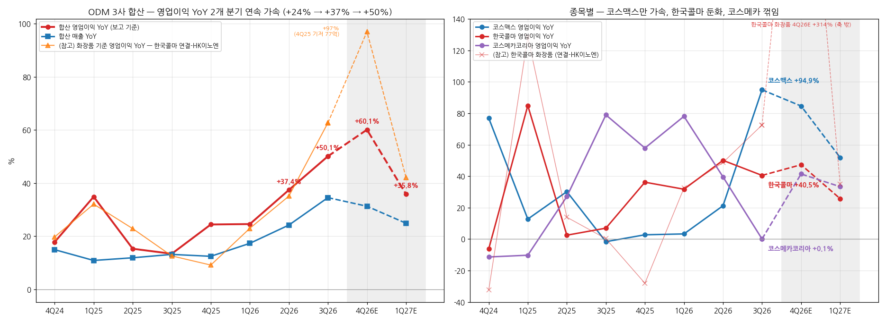
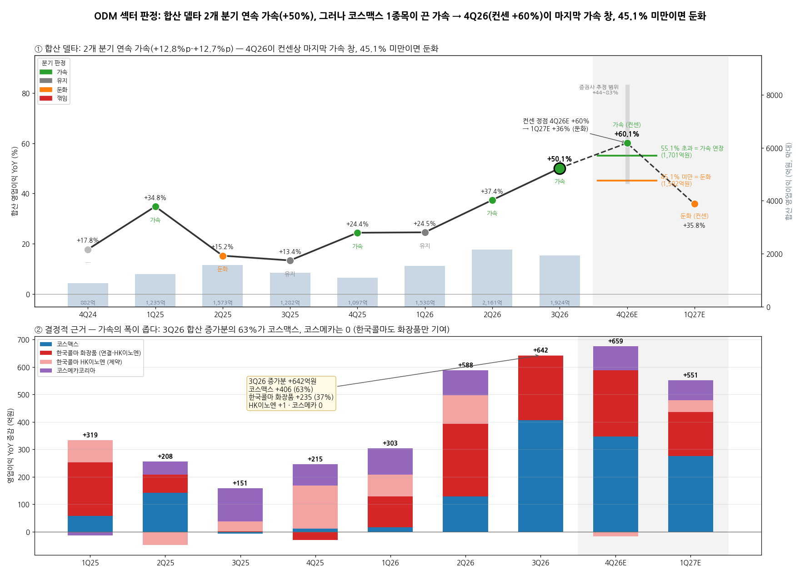

# 뷰티 · ODM 섹터 리뷰

> 현재 상태 (최신 분기 기준)
> 최신 분기: 2026-Q3
> 섹터 델타: 가속 | 내러티브: 유지
> 모멘텀 신호: 없음
> 활성 테마: 없음
> 포지셔닝: 서브섹터 확대 | 한국 해당 없음 | 1등 코스맥스
> 편입 종목: 코스맥스, 한국콜마, 코스메카코리아
> 갱신 시각: 2026-11-22 22:30 KST

## 누적 시계열

| 분기 | 편입 종목 | 합산 매출 | 합산 영업이익 | OPM | 매출 YoY | 영업이익 YoY | 영업이익 YoY 델타 (%p) | 섹터 델타 | 내러티브 | 모멘텀 신호 | 활성 테마 |
|---|---|---|---|---|---|---|---|---|---|---|---|
| 4Q23 | 코스맥스·한국콜마·코스메카 | 11,113억원 | 749억원 | 6.7 | — | — | — | — | - | - | - |
| 1Q24 | 동일 | 12,272억원 | 916억원 | 7.5 | — | — | — | — | - | - | - |
| 2Q24 | 동일 | 13,556억원 | 1,365억원 | 10.1 | — | — | — | — | - | - | - |
| 3Q24 | 동일 | 12,829억원 | 1,131억원 | 8.8 | — | — | — | — | - | - | - |
| 4Q24 | 동일 | 12,768억원 | 882억원 | 6.9 | +14.9 | +17.8 | — | — | - | - | - |
| 1Q25 | 동일 | 13,601억원 | 1,235억원 | 9.1 | +10.8 | +34.8 | +17.1 | 가속 | - | - | - |
| 2Q25 | 동일 | 15,161억원 | 1,573억원 | 10.4 | +11.8 | +15.2 | -19.6 | 둔화 | - | - | - |
| 3Q25 | 동일 | 14,510억원 | 1,282억원 | 8.8 | +13.1 | +13.4 | -1.9 | 유지 | - | - | - |
| 4Q25 | 동일 | 14,350억원 | 1,097억원 | 7.6 | +12.4 | +24.4 | +11.0 | 가속 | - | - | - |
| 1Q26 | 동일 | 15,951억원 | 1,538억원 | 9.6 | +17.3 | +24.5 | +0.2 | 유지 | - | - | - |
| 2Q26 | 동일 | 18,823억원 | 2,161억원 | 11.5 | +24.2 | +37.4 | +12.8 | 가속 | - | - | - |
| **3Q26** | 동일 | **19,515억원** | **1,924억원** | **9.9** | **+34.5** | **+50.1** | **+12.7** | **가속** | **유지** | **없음** | **없음** |

→ **합산 방식**: 3사 모두 K-IFRS 연결 **보고 기준** 매출·영업이익(억원) 단순 합이다. 한 통화(원화)라 환율 환산은 없다. 숫자는 각 종목 2026-Q3 리뷰 1번 ① 분기 표(OpenDART 연결, 4Q = 연간 − 3Q 누적, 3Q26 = 회사 IR·분기보고서·잠정실적)를 그대로 썼다. 한국콜마 3Q26은 잠정(감사 전)이다
→ **한국콜마 처리**: 한국콜마 연결에는 HK이노엔(제약·H&B, 지분 43%, 3Q26 연결 매출의 31%·영업이익의 32%)이 들어 있다. 스킬 규칙(보고 기준 합산, 사업부 분리가 있으면 그쪽에 합산)상 HK이노엔은 화장품 ODM이 아니지만, BT 결정(2026-11-16: 성장 델타는 보고된 분기 영업이익 YoY로 통일, 보정치는 참고만)에 맞춰 **누적 시계열·판정은 한국콜마 연결 보고 기준**으로 둔다. 화장품만 본 숫자(한국콜마 = 연결 − HK이노엔 사업부)는 ① 표 아래 "참고 행"으로만 병기한다. 뷰티 섹터 통합 리뷰에서 HK이노엔을 다른 서브섹터(제약 등)에 넣지 않는 한 중복 합산은 없다
→ **YoY는 같은 3사 구성(동일 표본)** 기준이다. 4Q23부터 숫자가 있어 YoY는 4Q24부터, 델타·판정은 1Q25부터 낸다. 판정은 섹터 기준(직전 대비 +5%p 초과 = 가속, ±5%p = 유지, -5%p 미만이지만 플러스 = 둔화, 마이너스 전환 또는 2개 분기 연속 둔화 + 정점 통과 = 꺾임)을 소급 적용했다
→ **BT 마이너스 YoY 표기 규칙(2026-11-22)** 대조: 합산 영업이익 YoY가 마이너스였던 분기는 없다 — "꺾임(개선)/꺾임(악화)"·턴어라운드 후보 해당 없음. 종목 단위로는 코스메카코리아 4Q24 -11.3% → 1Q25 -10.5%(꺾임(개선) 1회, 이후 2Q25 플러스 전환), 한국콜마 4Q24 -6.0%(1개 분기), 코스맥스 3Q25 -1.6%(1개 분기)뿐이고 3Q26 현재 마이너스 종목은 없다
→ 내러티브·모멘텀 신호·테마 열은 이번이 첫 ODM 섹터 리뷰라 소급 분기는 `-`로 두었다

---

## 2026-Q3 섹터 리뷰

> 대상: `earnings-review/2026-Q3_{코스맥스|한국콜마|코스메카코리아}_리뷰.md` (3사 통합 검수 완료본, 2026-11-22)
> 2층 구조의 서브섹터 리뷰다. 섹터 비중(1단계)과 서브섹터 순위(2단계)는 `뷰티_섹터리뷰.md`(섹터 통합 리뷰, 별도 작성)가 맡는다. 이 문서는 ODM 판정, ODM 안의 1등 종목(3단계)에 답한다
> 첫 ODM 섹터 리뷰라 직전 분기 관전 포인트·⑦ 콜 체크는 없다
> **국가 프레임 구멍**: ODM 편입 종목이 한국 3사뿐이라 같은 서브섹터 안 한국 vs 글로벌 비교가 안 된다. BT 확인 없이 진행했고(서브에이전트 작업), ⑦ (2)는 `비교 불가 — 편입 종목 없음`으로 두고 대체 축(국내 법인 vs 해외 법인)만 쓴다. 편입 후보는 ⑦ (2) 끝에 적었다

① 섹터 합산 숫자와 델타

| 항목 | 4Q24 | 1Q25 | 2Q25 | 3Q25 | 4Q25 | 1Q26 | 2Q26 | **3Q26** | 4Q26E | 1Q27E |
|---|---|---|---|---|---|---|---|---|---|---|
| 합산 매출 (억원) | 12,768 | 13,601 | 15,161 | 14,510 | 14,350 | 15,951 | 18,823 | **19,515** | 18,834 | 19,915 |
| 합산 영업이익 (억원) | 882 | 1,235 | 1,573 | 1,282 | 1,097 | 1,538 | 2,161 | **1,924** | 1,756 | 2,089 |
| OPM (%) | 6.9 | 9.1 | 10.4 | 8.8 | 7.6 | 9.6 | 11.5 | **9.9** | 9.3 | 10.5 |
| 매출 YoY (%) | +14.9 | +10.8 | +11.8 | +13.1 | +12.4 | +17.3 | +24.2 | **+34.5** | +31.2 | +24.9 |
| 영업이익 YoY (%) | +17.8 | +34.8 | +15.2 | +13.4 | +24.4 | +24.5 | +37.4 | **+50.1** | +60.1 | +35.8 |
| **영업이익 YoY 델타 (%p)** | — | +17.1 | -19.6 | -1.9 | +11.0 | +0.2 | +12.8 | **+12.7** | +10.0 | -24.2 |
| 판정 | — | 가속 | 둔화 | 유지 | 가속 | 유지 | 가속 | **가속** | 가속 (컨센) | 둔화 (컨센) |
| (참고) 화장품 기준 합산 영업이익 (한국콜마 = 연결−HK이노엔) | 638 | 981 | 1,378 | 1,023 | 696 | 1,206 | 1,861 | **1,664** | 1,371 | 1,714 |
| (참고) 화장품 기준 영업이익 YoY (%) | +19.7 | +32.0 | +22.8 | +12.5 | +9.1 | +22.9 | +35.1 | **+62.7** | +97.0 | +42.1 |
| (참고) 화장품 기준 매출 YoY (%) | +17.3 | +9.7 | +10.3 | +13.0 | +9.8 | +20.1 | +28.9 | **+42.1** | — | — |
| (참고) 비영업 요인 조정 합산 영업이익 YoY (%) | | | | | | | | **+53\~55** | | |

→ (출처: 3사 2026-Q3 리뷰 1번 ① 분기 표 [계산]. 4Q26E = 각 리뷰의 증권사 평균 — 코스맥스 6곳 755억원, 한국콜마 7곳 704억원, 코스메카코리아 5곳 297억원. 1Q27E = 코스맥스 NH 1곳·한국콜마 NH·한화 2곳·코스메카 3곳 평균이라 소수 의견 좌우 가능. 화장품 기준 = 한국콜마 리뷰의 "화장품 proxy(연결−HK이노엔)" 행과 한국콜마 기업개요 사업부 15분기 표(HK이노엔 매출·영업이익) 사용, 연결조정·기타법인이 섞인 대용치. 4Q26E·1Q27E 화장품 기준은 한국콜마 리뷰의 proxy E(319억원·617억원) 사용, HK이노엔 매출 E가 없어 매출 YoY는 공란)
→ **비영업 요인 조정(참고, 판정 미사용)**: 코스맥스 일회성 순효과 +4억원(대손 환입 +54·상여 충당금 -50) 제외, 한국콜마 재고자산평가충당금 20\~45억원 가산, 코스메카 성과급·인센티브 21\~30억원 가산 → 합산 1,961\~1,991억원, YoY +53\~55%. 보고 기준(+50.1%)과 같은 "가속"이다 [계산]. 인수 주도 가속 플래그가 붙은 종목은 없다 — 인수 편입분 영향 0%p
→ **이익 레벨**: 3Q26 합산 매출 1.95조원은 분기 최대다. 합산 영업이익 1,924억원은 2Q26(2,161억원)에 이어 두 번째로 크다. OPM 9.9%는 3Q 기준 최고다(3Q24 8.8%, 3Q25 8.8%)
→ **델타**: 합산 영업이익 YoY가 +24.5% → +37.4% → +50.1%로 2개 분기 연속 +13%p씩 커졌다. 매출 YoY도 +12% → +17% → +24% → +35%로 3개 분기 연속 확대다. 매출과 이익이 같은 방향으로 가속하고 있다
→ **화장품 기준이면 가속이 더 세다**: HK이노엔(3Q26 영업이익 YoY +0.4%)을 빼면 합산 영업이익 YoY는 +35.1% → +62.7%(+27.6%p)다. HK이노엔은 합산 영업이익의 13.5%(260억원)이고, 이번 분기 합산 증가분(+642억원)에는 +1억원만 기여했다. 즉 보고 기준 판정은 화장품 본업의 가속을 **덜** 보여주고 있고, 처리 방식이 판정 방향을 바꾸지는 않는다
→ **컨센 경로상 정점은 4Q26E(+60.1%)**다. 1Q27E +35.8%로 내려오고, 2027년 연간 합산 영업이익 컨센은 9,124억원(+23.6%, 2026E 7,380억원 대비)이다. 4Q26E의 높은 YoY에는 4Q25 저기저(합산 OPM 7.6% — 한국콜마 해외법인 -130억원, 코스맥스 OPM 6.8%, 코스메카 OPM 11.8%)가 섞여 있다

→ (출처: 3사 2026-Q3 리뷰 [계산]. 왼쪽 = ODM 3사 합산 영업이익·매출 YoY(보고 기준)와 화장품 기준 영업이익 YoY(참고) / 오른쪽 = 종목별 영업이익 YoY + 한국콜마 화장품(연결−HK이노엔, 참고). 회색 구간·점선 = 컨센 E. 3Q26 종목 YoY는 각 리뷰 발표치(코스맥스 +94.9%, 코스메카 +0.1%))

② 종목별 델타 판정표

| 델타 순위 | 종목 | 매출 YoY | 영업이익 YoY | 영업이익 YoY 델타 | 델타 판정 | 내러티브 | 비영업 요인 | 한 줄 |
|---|---|---|---|---|---|---|---|---|
| 1 | 코스맥스 | +49.5% | +94.9% | +73.7%p | **가속** | 강화 | 일회성 순효과 약 +4억원(대손 환입 +54·상여 -50) — 판정 영향 없음. 저기저(3Q25 -1.6%)지만 2년 전 대비 +92% | 한국 법인 매출 +61%·OPM 11.0%로 "비수기 소멸", 미국 OPM 5\~7%로 두 번째 엔진. 국내 가동률 85%+ 풀가동 |
| 2 | 한국콜마 | +21.3% | +40.5% | -9.7%p | **둔화** | 유지 | 재고자산평가충당금 20\~45억원(가산 시 YoY +44\~48%, 판정 동일). 연결 델타를 깎은 주원인은 HK이노엔 영업이익 YoY +53.8% → +0.4% | 별도 매출 +35%·OPM 14.5%로 화장품은 가속, 연결은 HK이노엔·해외 3법인(-98억원)이 깎음. 1H27 CAPA 공백 |
| 3 | 코스메카코리아 | +35.7% | +0.1% | -39.2%p | **꺾임** | 유지 | 성과급·인센티브 21\~30억원(가산 시 YoY +7.7%, 판정 동일). 미국 EWLK 고기저 | 한국 매출 +55%·영업이익 +61%를 미국(-80억원)이 상쇄. 외주·특근으로 한국 OPM 13.7% → 11.6% |
| (참고) | 한국콜마 화장품 (연결−HK이노엔) | +34.5% | +72.5% | +23.8%p | (참고 — 판정 미사용) | — | 연결조정·연우 흑자전환(-2 → +30억원) 포함 대용치. 별도만 보면 영업이익 YoY +44.5% → +42.0%로 완만한 둔화 | 순위·1등 선정에는 쓰지 않음 |

→ (출처: 각 종목 2026-Q3 리뷰 0번 판정·1번 숫자 그대로. 한국콜마 화장품 매출 YoY = 5,678억원 / 4,222억원 [계산])
→ **델타 순위 기준**: 보고 기준 영업이익 YoY 델타 큰 순서다. 코스맥스(+73.7%p)만 가속이고, 한국콜마(-9.7%p)·코스메카(-39.2%p)는 내려왔다. 한국콜마를 화장품 기준(+23.8%p)으로 바꿔도 순위는 같다
→ **섹터 델타를 끈 것은 코스맥스다**. 3Q26 합산 영업이익 YoY 증가분 +642억원(1,282 → 1,924억원) 중 코스맥스가 +406억원(63%), 한국콜마가 +236억원(37% — 화장품 +235, HK이노엔 +1), 코스메카가 0이다 [계산]. 2Q26(+588억원)에는 한국콜마 +368억원·코스맥스 +129억원·코스메카 +91억원으로 3사가 고르게 기여했다 — 3Q26에 가속의 폭이 좁아졌다
→ **선행 종목은 코스메카코리아**다. 영업이익 YoY 정점이 1Q26(+78.0%, 3Q25 +78.8%와 같은 고원)으로 가장 빨랐고, 3Q26에 가장 먼저 꺾였다. 다음이 한국콜마(정점 2Q26 +50.2%), 마지막이 코스맥스(3Q26 +94.9%, 컨센상 정점)다. ODM 3사의 이익 YoY 정점은 **코스메카 → 한국콜마 → 코스맥스** 순으로 한 분기씩 늦게 오고 있다
→ 정점 순서가 회사 크기·캐파 여유 순서와 반대라는 점이 중요하다 [판단]. 국내 매출 성장률은 3사 모두 +35\~61%로 높은데, 이익으로 바꾸는 능력은 캐파 여유(코스맥스 평택 증설분 3Q 말 일부 가동)·해외 법인 방향(코스맥스 미국 흑자 vs 코스메카 미국 -61%)이 갈랐다 (③ (1)·(3))

③ 섹터 공통 쟁점

(1) 수요는 3사 모두 가속, 성장 상한은 캐파 (3/3 — 3사 리뷰 모두 쟁점, 증권사 대부분 언급)

| 종목 | 3Q26 국내 법인 매출 (YoY) | 국내 OPM (3Q25 → 3Q26) | 가동률·병목 | 다음 캐파 |
|---|---|---|---|---|
| 코스맥스 | 6,161억원 (+60.7%) | 8.9% → 11.0% | 85% 이상(하나)·high-80%(JPM), 초과근무·아웃소싱 | 평택 1공장 증설분 3Q 말 일부 가동 → 1Q27 국내 캐파 +10% (연말 11억개) |
| 한국콜마 | 4,337억원 (+34.7%) | 13.8% → 14.5% | 82%(HSBC), 내용물 제조 풀캐파(교보·하나) | 세종 신공장 2027년 7월 완공, 1H27은 아웃소싱·인수·계열사 공장 검토 |
| 코스메카코리아 | 2,011억원 (+54.9%) | 11.2% → 11.6% (2Q26 13.7%) | 수주가 생산능력 초과 — 충진·포장 외주·특근, 별도 원가율 80.3%(+1.7%p QoQ) | 오창공장 2H27 시생산 (1,360억원) |
| **3사 국내 합** | **12,509억원 (+49.8%)** | **11.1% → 12.3%** | | |

→ (출처: 3사 2026-Q3 리뷰 1번 ②·2번 쟁점. 국내 법인 = 코스맥스 한국(별도), 한국콜마 별도, 코스메카 한국(별도). 국내 합 [계산])
→ 국내 3사 합산 매출 YoY는 2Q26 +31.3% → 3Q26 +49.8%, 영업이익 YoY는 +34.6% → +65.4%로 커졌다 [계산]. 3사 모두 "비수기 3Q에 분기 최대 국내 매출"이고 계절성 소멸(코스맥스 스킨케어 +100%, 한국콜마 선케어 +54%·비중 32%, 코스메카 기초 +92%)을 같은 말로 설명한다. 선행지표인 한국 화장품 수출(HS 3304)은 10월 +57%(잠정), 11월 1\~10일 +64%(NH, 코스맥스 리뷰 인용)로 3Q 평균(+38%)보다 강하다
→ 갈리는 지점: **캐파를 비용으로 넘느냐, 성장 상한으로 받아들이느냐**. 코스맥스는 증설분 일부 가동·아웃소싱으로 매출 +61%를 내면서 OPM도 +2.1%p 올렸다. 코스메카는 같은 외주·특근이 원가율을 올려 OPM이 QoQ -2.1%p였다. 한국콜마는 매출 +35%에 OPM +0.7%p YoY(QoQ -1.9%p)로 중간이다. 증권사 해석도 같은 축으로 갈린다 — 코스맥스는 JPM(중립, 캐파 의존) vs 하나(P·Q 동시 증가), 한국콜마는 하나·씨티(상한·비용) vs NH·한화(확보 시 업사이드), 코스메카는 다올(구조적 비용, 2027E -14%) vs 하나(점유율 확보, 2027E +8%)
→ **[판단]** 2027년 ODM 델타는 수요보다 **증설 일정**이 정한다. 3사 모두 다음 캐파가 2027년(코스맥스 1Q27, 한국콜마 7월, 코스메카 하반기)에 들어오는데, 컨센은 1Q27E 합산 영업이익 YoY +36%로 이미 감속을 그린다. 증설 전 1H27은 "수요 > 공급" 구간이라 매출은 이어지되 마진이 외주비에 먹히는 구간이 될 가능성이 크다. 이번 분기 코스맥스만 이 비용을 이겨냈다

(2) 해외 법인 — 국내 +65%, 해외 -15%로 갈렸다 (3/3)

| 종목 | 해외 법인 3Q25 → 3Q26 영업이익 (억원) | 미국 | 중국 |
|---|---|---|---|
| 코스맥스 | 84 → 156 (해외 및 기타, 국내 기타 자회사 포함) | 매출 695억원(+88%), 영업이익 약 35\~50억원(OPM 5\~7%, 추정) — 흑자 안착, 2026 OPM 가이던스 2회 상향 | 매출 1,770억원(+27%, QoQ -10%), CB 비용으로 순손실 -65억원 |
| 한국콜마 | -93 → -98 (중국·미국·캐나다 3법인) | 매출 180억원(+122%), 영업손실 -38억원(충당금 20\~25억원) | 무석 매출 -4.5%, 영업손실 -44억원 |
| 코스메카코리아 | 126 → 42 (미국 + 중국) | 잉글우드랩 영업이익 132 → 52억원(-61%) — EWLK 고객 발주 공백·고기저 | 매출 +18%, 영업손실 -10억원 |
| **3사 합** | **117 → 100 (-14.5%)** | | |

→ (출처: 3사 2026-Q3 리뷰 1번 ②. 3사 합 [계산]. 2Q26 합은 261 → 282억원(+8.0%)이었다)
→ 공통: 해외 법인은 3사 모두 연결 델타에서 국내만큼 기여하지 못한다. 중국은 3사 모두 매출 성장 대비 손익이 약하다
→ 갈리는 지점: **미국**. 코스맥스 미국은 6개 분기 연속 매출 YoY 확대 + 흑자 전환으로 델타를 보탰고(YoY 증가분 약 50\~70억원, 전사 증가분의 13\~17%), 코스메카 미국은 3Q25 정점에서 -80억원으로 델타를 지웠다. 한국콜마 미국은 매출은 +122%지만 아직 적자다
→ **[판단]** ODM 3사 합산 델타의 "종목 간 차이"는 거의 전부 해외 법인, 그중 미국에서 나왔다. 국내 법인만 보면 3사 모두 가속 또는 고성장 유지(국내 영업이익 YoY 코스맥스 +97%, 코스메카 +61%, 한국콜마 별도 +42%)다

(3) 국내 OPM — 레버리지냐 병목 비용이냐 (3/3)
→ 3사 국내 OPM은 YoY로는 모두 올랐다(코스맥스 +2.1%p, 한국콜마 +0.7%p, 코스메카 +0.4%p). QoQ로는 코스맥스만 올랐고(10.9% → 11.0%) 한국콜마(16.4% → 14.5%)·코스메카(13.7% → 11.6%)는 내려왔다
→ 증권사 2027E 국내 OPM 가정: 코스맥스 10.4\~11.0%(3Q26 수준 이하), 한국콜마 별도 13.5\~15.1%(2026E와 비슷), 코스메카 2027E 연결 OPM 12.4%(다올)\~13.9%(하나). 3사 모두 **"2027년 이익 성장은 매출이 끌고 마진은 횡보"**에 컨센이 모여 있다
→ **[판단]** ODM 국내 OPM은 과거 고점권(코스맥스 11\~12%, 한국콜마 별도 14\~16%)에 다시 올라왔지만 레벨업은 아니다. 다음 분기 판정에서 마진이 받쳐 줄 여지는 작고, 델타는 국내 매출 성장률과 해외 법인 손익 개선에 달렸다

(4) 순이익과 주가 — 영업이익과 다른 방향 (3/3)
→ 영업외: 코스맥스 외화 관련 손실 277억원·이자 138억원(세전 +21%), 코스메카 외화환산손실 약 103억원(지배순이익 -35%), 한국콜마 금융비용 167억원. 3사 모두 원화 방향에 따라 순이익이 흔들리는 구조다 — 판정(영업이익)과 무관
→ 추정치·TP: 코스맥스 2026E 영업이익 +4.9%·평균 TP +5.4%(상향 4곳), 한국콜마 -2.7%·-5.6%(하향 4곳), 코스메카 -2.9%·-0.3%. **3사 합산 연간 영업이익 컨센은 2026E 7,376억원 → 7,380억원(+0.1%), 2027E 9,034억원 → 9,124억원(+1.0%)으로 거의 그대로**다 [계산] — 코스맥스 상향이 두 회사의 하향을 메웠다
→ 주가(11/13 종가): 코스맥스 280,500원(52주 고점 대비 -9%), 한국콜마 102,900원(-36%), 코스메카 90,900원(-41%). 한국콜마·코스메카는 발표 후 -10\~-15% 추가 하락했다. 시장은 델타 판정 순서대로 반응하고 있다 [판단]

(5) 종목 고유 이슈
→ 코스맥스: 순차입금 1.12조원·부채비율 286%(증설 차입), 중국 CB 조기상환(4Q부터 분기 약 94억원 비용 소멸), 상위 인디 고객(메디큐브 등) 집중
→ 한국콜마: HK이노엔 케이캡 국내 출고량 조절(국내 매출 -15%, 처방은 +16.5%), HK이노엔 지분가치 할인율 25\~50%(증권사별 2,140\~5,310억원), 연우 턴어라운드
→ 코스메카코리아: 잉글우드랩 EWLK 대형 고객 1곳 발주 의존(1Q27 재개 전제), 오너 2세 관련 기소 보도·지배구조 할인

④ 섹터 판정

> 섹터 델타: **가속** | 내러티브: **유지** → **합산 영업이익 YoY는 +24% → +37% → +50%로 2개 분기 연속 가속했지만 폭이 좁다 — 3Q26 증가분의 63%가 코스맥스이고 코스메카는 0, 한국콜마도 화장품만 기여했다. 수요(국내 법인 매출 +50%)는 3사 공통으로 가속 중이고, 이익 전환은 캐파·미국 법인이 가른다. 컨센상 합산 YoY 정점은 4Q26E(+60%) — 4Q26이 마지막 가속 창이고, 합산 영업이익 YoY 45.1%(1,592억원) 미만이면 둔화**

→ (출처: 3사 2026-Q3 리뷰 [계산]. 상단 = ODM 3사 합산 영업이익 YoY(보고 기준, 점 색 = 분기별 판정, 막대 = 합산 영업이익)와 4Q26 판정선(45.1% 둔화선·55.1% 가속선)·증권사 추정 범위(+44\~83%) / 하단 = 합산 영업이익 YoY 증감(억원)의 종목별 분해 — 한국콜마는 화장품(연결−HK이노엔)과 HK이노엔으로 나눔)

→ **델타 판정 근거**: 합산 영업이익 YoY가 2Q26 +37.4%에서 3Q26 +50.1%로 12.7%p 커져 "가속"이다. 2Q26(+12.8%p)에 이어 2개 분기 연속 가속이고, 매출 YoY(+24.2% → +34.5%)도 같은 방향이다. 비영업 요인을 조정해도(+53\~55%), 한국콜마를 화장품 기준으로 바꿔도(+35.1% → +62.7%) 판정은 같다. 컨센 4Q26E +60.1%(+10.0%p)는 한 번 더 "가속", 1Q27E +35.8%(-24.2%p)는 "둔화" 경로다
→ **내러티브 판정 근거**: 종목별 내러티브는 강화 1(코스맥스), 유지 2(한국콜마·코스메카)다. ODM 공통 스토리 "K-뷰티 인디 브랜드 수출 → ODM 국내 공장 물량 → 영업 레버리지"에서 **수요 축은 3사 모두 숫자로 강화**됐다(국내 매출 +35\~61%, 계절성 소멸). 그러나 **레버리지 축은 1곳(코스맥스)만 확인**됐고 2곳은 캐파 비용·해외 법인에 막혔다. 3사 합산 연간 영업이익 컨센이 거의 변하지 않았다(2026E +0.1%, 2027E +1.0%) — 강화라고 하기엔 이익 추정이 움직이지 않았다 [판단]
→ **[판단] 결정적 근거는 가속의 폭(breadth)이다**. 2Q26 가속은 3사가 고르게 만들었고(한국콜마 63%·코스맥스 22%·코스메카 15%), 3Q26 가속은 코스맥스 한 곳(63%)이 만들었다. 합산 판정은 가속이지만 편입 종목 중 가속은 1/3이고, 선행 종목(코스메카)이 이미 꺾였다. "섹터 베타"보다 "섹터 안 1등 종목"이 중요한 구간이다
→ 직전 판정 대비: ODM 섹터 리뷰는 처음이다. 소급 궤적은 가속(1Q25) → 둔화 → 유지 → 가속(4Q25) → 유지 → 가속(2Q26) → 가속(3Q26)이다. 2025년의 출렁임(0\~35%)을 벗어나 2026년 들어 처음으로 2개 분기 연속 가속이 나왔다

⑤ 모멘텀 신호

→ **없음** — 활성 테마가 없어 "테마 종료 후보"는 해당하지 않는다
→ 델타 급증 후보 조건 대조
→ ① 섹터 영업이익 YoY 델타 뚜렷한 확대·2개 분기 연속 확대 — **충족** (+12.8%p → +12.7%p, +24% → +50%)
→ ② 편입 종목 과반 가속 — **미충족** (가속 1/3 — 코스맥스만. 한국콜마 둔화, 코스메카 꺾임)
→ ③ 내러티브 형성·강화 — **미충족** (유지. 종목별 강화 1·유지 2, 합산 이익 추정 변화 +0.1\~1.0%)
→ 조건 일부만 충족해 후보로 올리지 않는다
→ **다음 분기 후보로 올릴 조건**: 4Q26 합산 영업이익 YoY 55.1%(1,701억원) 초과(3개 분기 연속 가속) + 3사 중 2곳 이상 가속(컨센 경로상 한국콜마 +47%·코스메카 +42%가 가속, 코스맥스 +85%는 둔화) + 4Q 실적 후 합산 2027E 영업이익 컨센 상향(+5% 이상) 또는 증설 앞당김 발표. 컨센대로면 ①·② 숫자는 채워질 수 있다 — 그때 ③(이익 추정 상향)이 같이 나오는지가 관건이다
→ 연결될 만한 테마 키워드 (제안일 뿐): "K-뷰티 인디 브랜드 미국·유럽 수출 → ODM 캐파"
→ **반대 논거**
→ (1) 4Q26 컨센의 가속은 상당 부분 **4Q25 저기저**다 — 4Q25 합산 OPM 7.6%(한국콜마 해외법인 -130억원, 코스메카 OPM 11.8%, 코스맥스 6.8%). 한국콜마·코스메카의 4Q "가속"은 기저 정상화 성격이 크고, 1Q27E에 합산 YoY가 +36%로 바로 내려온다. 4Q 한 분기 숫자로 후보를 올리면 정점 직전에 올리는 셈이다
→ (2) 레이어 관점: ODM은 K-뷰티 브랜드사(에이피알 등)·유통(실리콘투)의 공급 측이다. 브랜드사 수출이 계속 늘면 ODM 수요는 따라오지만, 2027년 ODM 이익의 상한은 수요가 아니라 증설(1Q27\~2H27)이다. 증설분이 가동되는 2H27에 재가속 여지가 있다 — 델타 급증이 온다면 4Q26보다 2H27일 가능성이 있다 [판단]

⑥ 다음 분기 섹터 관전 포인트

| 순위 | 무엇을 (변수·임계값) | 어떤 데이터로 | 언제 |
|---|---|---|---|
| 1 | **4Q26 ODM 3사 합산 영업이익 YoY 45.1%(1,592억원) 이상 — 미만이면 둔화**. 55.1%(1,701억원) 초과면 가속 연장(3개 분기 연속). 컨센 1,756억원(+60.1%)은 가속. 증권사 추정 합 범위 1,577\~2,012억원(+44\~83%) | 3사 4Q26 잠정실적·IR | 코스메카 2027-02-19 전후, 코스맥스 02-23 전후, 한국콜마 02-25 전후 (실적 캘린더 추정, 확정 일정 미확인) |
| 2 | **가속의 폭 — 3사 중 2곳 이상 가속**. 종목별 판정선(각 리뷰 4번): 코스맥스 797억원(가속)·755억원(컨센, 둔화), 한국콜마 704억원(+47%, 가속)·640억원 미만 꺾임 검토, 코스메카 297억원(+42%, 가속)·210억원 미만 마이너스 전환. 한국콜마는 HK이노엔 4Q 영업이익 380억원대(4Q25 401억원 고기저) 유지가 연결 경로의 조건 | 같은 실적 | 2027-02 중하순 |
| 3 | **국내 법인 합산 매출 YoY +40% 이상·국내 OPM 12% 유지** — 캐파 병목 비용이 일시적인지. 코스맥스 국내 매출 QoQ 감소폭(6,161억원 대비), 한국콜마 별도 3,620억원(+35% 가이던스) 이상, 코스메카 별도 원가율 78%대 회복 | 3사 4Q IR 국내 법인 손익 | 2027-02 |
| 4 | **K-뷰티 수출 총량** — 한국 화장품 수출(HS 3304) 월간 YoY +30% 이상 유지(10월 +57%). +20% 아래로 내려가면 수요 축 재검토 | 관세청 수출입 통계(매월 1일·11일·21일 잠정), 브랜드사(에이피알 등) 4Q 실적 | 12/1, 1/1, 2/1 |
| 5 | **해외 법인 합산 영업이익 YoY 플러스 전환** (3Q26 -14.5%) — 코스맥스 미국 4Q 매출 600억원·OPM 5% 이상, 한국콜마 해외 3법인 적자가 4Q25(-130억원)보다 축소, 코스메카 EWLK 1Q27 발주 재개 | 3사 4Q IR 법인별 표, 잉글우드랩(950140) 실적 | 2027-02 / 1Q27 실적(5월) |

→ 1순위 판정선(45.1%)은 ④ 키 차트와 같다. 근거: 3Q26 +50.1%에서 "유지" 범위(±5%p)를 뺀 값이다. 이 아래면 둔화이고, 1Q27까지 둔화가 이어지면(컨센 +35.8%) 2개 분기 연속 둔화 + 정점 통과로 "꺾임"이다. 55.1%는 +5%p 위 "가속" 경계다. 금액은 4Q25 합산 영업이익 1,097억원 기준이다
→ 코스메카가 4Q26에 마이너스 YoY(210억원 미만)로 전환하면 그다음 분기부터는 BT 표기 규칙(꺾임(개선)/꺾임(악화), 2개 분기 연속 축소 시 턴어라운드 후보)으로 판정한다

⑦ 글로벌 PM 포지셔닝 — 결론

> **서브섹터: 확대 — 단, 코스맥스 집중. 4Q26 합산 YoY 45.1% 미만이면 유지로 하향, 1Q27까지 둔화가 이어지면 축소** | **서브섹터 내: 한국 vs 글로벌 비교 불가 (글로벌 ODM 미편입)** | **1등: 코스맥스 (한국 = 서브섹터 1등)**

(1) 서브섹터 판정 — 확대 / 유지 / 축소

| 판단 축 | 3Q26 근거 | 방향 |
|---|---|---|
| 이익 델타 (1순위) | 합산 영업이익 YoY +37.4% → +50.1%, 2개 분기 연속 가속. 가속 종목 1/3 | 확대 |
| YoY 정점 시점 | 컨센상 합산 정점 4Q26E(+60.1%), 1Q27E +35.8%. 정점 지난 종목 2/3(코스메카 1Q26, 한국콜마 2Q26) | 유지 |
| 수주·물량 선행지표 | 국내 3사 매출 +49.8%, 가동률 82\~85%+로 풀가동, 코스맥스 "신규 수주 둔화 없음" | 확대 |
| 최종 수요 | 한국 화장품 수출 10월 +57%(3Q 평균 +38%), 미국·유럽 인디·글로벌 MNC 오더 확대 | 확대 |
| 이벤트·정책 | 1Q27 코스맥스 평택 증설분, 1H27 한국콜마 CAPA 확보 결정, 미국 관세(3Q25 재고조정 사례) | 중립 |
| 밸류에이션 (2순위) | 코스맥스 12MF PER 13\~18배 기준 TP, 한국콜마 2027E PER 10.6\~11배, 코스메카 PER 15\~20배 기준 TP | 확대 (한국콜마·코스메카 디레이팅) |
| 이익 추정 방향 | 3사 합산 2026E +0.1%, 2027E +1.0% — 코스맥스 상향 vs 2사 하향 | 중립 |

→ **결론: 서브섹터 확대** [판단]. BT 프레임 1순위인 합산 델타가 2개 분기 연속 가속이고, 컨센상 4Q26E까지 한 분기 더 가속 경로다. 수요 지표(수출·국내 매출)도 아직 꺾이지 않았다. 다만 가속이 코스맥스 한 종목에 몰려 있어, 서브섹터 베타보다 **코스맥스로 집중한 확대**다. 뷰티 섹터 통합 리뷰에서 서브섹터 간 순위를 매길 때는 "가속 폭 1/3"과 "정점 4Q26E"를 같이 넘긴다
→ **유지로 하향 조건**: 4Q26 합산 영업이익 YoY 45.1%(1,592억원) 미만(둔화) 또는 한국 화장품 수출 월간 YoY +20% 하회
→ **축소 전환 조건**: 4Q26 둔화에 이어 1Q27도 둔화(컨센 +35.8% 경로) → 2개 분기 연속 둔화 + 정점 통과로 꺾임 — 2027년 5월 1Q27 실적에서 확정
→ **확대 유지·강화 조건**: 4Q26 55.1%(1,701억원) 초과 + 2곳 이상 가속 + 2027E 합산 영업이익 컨센 상향

(2) 같은 서브섹터 안 한국 vs 글로벌 — **비교 불가 — 편입 종목 없음**

→ ODM 편입 종목이 한국 3사뿐이라 서브섹터 내 효과(한국이 같은 ODM 안에서 이기는지)를 판단할 수 없다. 결론에서 국가 판단은 뺀다
→ **대체 축 — 국내 법인 vs 해외 법인** (3사 합, [계산])

| 축 | 국내 법인 (코스맥스 한국 + 한국콜마 별도 + 코스메카 한국) | 해외 법인 (코스맥스 해외 및 기타 + 한국콜마 해외 3법인 + 코스메카 미국·중국) | 우위 |
|---|---|---|---|
| 델타 방향 (1순위) | 영업이익 YoY +34.6% → +65.4% (가속) | 영업이익 YoY +8.0% → -14.5% (꺾임 — 마이너스 전환) | 국내 |
| 매출 성장 | 매출 YoY +31.3% → +49.8% | 코스맥스 미국 +88%·중국 +27% vs 코스메카 미국 -26%·한국콜마 중국 -5% | 국내 |
| 마진 레벨 | OPM 11.1% → 12.3% | 3사 합산 영업이익 100억원 — 적자 법인(한국콜마 3법인 -98억원, 중국 3사 모두 적자·저수익) 포함 | 국내 |
| 마진 방향 | YoY 3사 모두 상승, QoQ는 2사 하락(캐파 비용) | 코스맥스 미국만 개선 | 국내 |
| 생산 능력 | 풀가동, 증설 2027년 | 코스맥스 태국 신공장 12월, 인도네시아 2H27 | — |
| 환율 | 원화 방향에 외화 매출채권·차입 평가손익이 순이익을 흔듦 | 현지 통화 강세 시 원화 환산 매출 증가(코스맥스 태국은 반대) | — |

→ **결론 (대체 축)**: ODM의 델타는 **국내 공장이 만들고 해외 법인이 깎는다**. 3사 간 델타 차이의 대부분이 해외 법인(특히 미국)에서 나왔다. 해외 법인이 플러스로 돌아서는 종목(코스맥스 미국)이 서브섹터 1등이 된다
→ **비교 범위**: 한국 종목 리뷰 3건과 그 안의 법인별 표만 썼다. 글로벌 ODM 숫자는 없다 — 근거 얇음
→ **글로벌 편입 후보 (BT 판단 필요)**: (a) **Intercos (이탈리아, 밀라노 상장 ICOS)** — 글로벌 색조 ODM 1위권, 코스맥스·한국콜마와 글로벌 MNC 색조 오더에서 직접 맞붙는다. 상상인이 코스메카 밸류에이션에 Intercos 12MF PER을 썼다. 분기 손익 공시 범위(1Q·3Q에 매출만인지 EBITDA까지인지)는 확인 필요 — 반기 손익만이면 `반기 공시 종목` 규칙 적용 (b) **青松股份 (중국 선전 300132, 자회사 Nox Bellcow)** — 중국 화장품 ODM 대형사, A주라 분기 손익 공시. 코스맥스 중국 법인(상해·광저우)과 경쟁. 노션 실적 캘린더 발표일은 확인하지 않았다 [불확실]. 일본 ODM(일본콜마·토키와 등)은 비상장이라 제외

(3) ODM 1등 종목

| 구분 | 종목 | 델타 판정 | 근거 한 줄 |
|---|---|---|---|
| **서브섹터 1등 (= 한국 1등)** | 코스맥스 | 가속 · 강화 | 델타 순위 1위(+73.7%p), 영업이익 YoY +95%·매출 +50%로 매출·이익 동반 가속. 비영업 순효과 +4억원으로 오가닉 가속. 미국 흑자 전환으로 해외 법인이 델타를 보태는 유일한 회사. 단 컨센상 YoY 정점은 3Q26(4Q26E +85%로 둔화 경로) |
| 한국 2위 | 한국콜마 | 둔화 · 유지 | 델타 순위 2위(-9.7%p). 화장품(연결−HK이노엔)은 +72.5%로 가속이지만 판정 미사용. 4Q26 컨센 +47%로 가속 경로 — HK이노엔·해외법인이 변수 |
| 한국 3위 | 코스메카코리아 | 꺾임 · 유지 | 델타 순위 3위(-39.2%p). 선행 종목 — 이익 YoY 정점 1Q26. 4Q26 컨센 +42%는 4Q25 저기저 반등, 1Q27E +33%로 다시 낮아짐 |
| 글로벌 1등 | 비교 불가 | — | 글로벌 ODM 미편입 |

→ **선호 / 비선호** (ODM 안)
→ 선호: **코스맥스** — ODM 3사 중 유일한 가속·강화. 증설분(평택)이 가장 먼저 들어오고(1Q27), 미국 법인이 두 번째 엔진. 다만 4Q26 컨센(755억원)대로면 다음 분기 판정은 "둔화"(+85%)라, 4Q 797억원 이상이 나와야 가속이 이어진다
→ 반등 후보 (이벤트 드리븐, 델타 프레임 밖): **한국콜마** — 1H27 CAPA 확보 공시(외부 공장 인수·임차·계열사 공장 전환) + 2월 4Q26 실적에서 연결 704억원(+47%) 이상·HK이노엔 380억원대 확인 시. 2027E PER 약 11배·고점 대비 -36%로 디레이팅이 이익 경로보다 앞섰다. **코스메카코리아** — 4Q 별도 원가율 78%대 회복 + 2027-1Q 잉글우드랩 EWLK 발주 재개 확인 시. 4Q 숫자의 가속은 저기저(⚠)라 원가율 회복이 같이 나와야 한다
→ 비선호: **코스메카코리아** (꺾임 — 원가율 회복 확인 전까지)

(4) 콜을 바꾸는 조건과 일정

| 시점 | 이벤트 | 서브섹터 판정 | 1등 종목 |
|---|---|---|---|
| 12/1, 12/11, 12/21, 1/1 | 관세청 화장품 수출(11·12월) | +30% 이상 유지 → 확대 유지 / +20% 하회 → 유지로 하향 | — |
| 수시 (1H27 전) | 한국콜마 CAPA 확보 공시, 코스맥스 추가 증설(평택 2단계 등) | 증설 앞당김 → 2027 컨센 상향 → 확대 강화 | 한국콜마 공시 시 반등 후보 → 2위 상향 검토 |
| 2027-02-19 전후 | 코스메카 4Q26 잠정 | 297억원(+42%) 이상 + 원가율 회복 → 가속 폭 확대 | 코스메카 비선호 해제 검토 |
| 2027-02-23 전후 | 코스맥스 4Q26 | 797억원 이상 → 1등 유지·가속 연장 / 755억원 → 둔화(+85%) | 둔화여도 델타 순위 1위 유지 가능성 큼 |
| 2027-02-25 전후 | 한국콜마 4Q26 (합산 확정) | 합산 YoY 55.1% 초과 → 확대 유지 / 45.1% 미만 → 유지로 하향 | 704억원 이상 + HK이노엔 회복 → 1등 경쟁 |
| 2027-03 | 3사 사업보고서 (생산능력·가동률) | 가동률 추가 상승·외주 비중 확대 → 1H27 마진 압박 확인 | — |
| 2027-05 | 1Q27 실적 | 합산 YoY 둔화 2연속(컨센 +35.8%) → 꺾임 → 축소 | — |

→ 출처: 각 종목 2026-Q3 리뷰 2·4번 항목, `earnings_calendar.md`(4Q26 발표 추정일 — 확정 아님)
→ 밸류에이션 숫자는 각 종목 리뷰에 인용된 증권사 리포트(11/6\~11/16 발간) 기준이며 웹 자료는 쓰지 않았다
