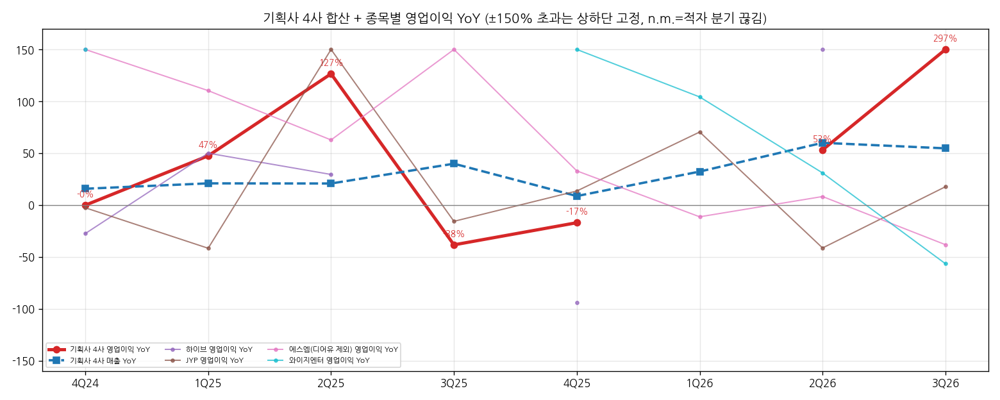
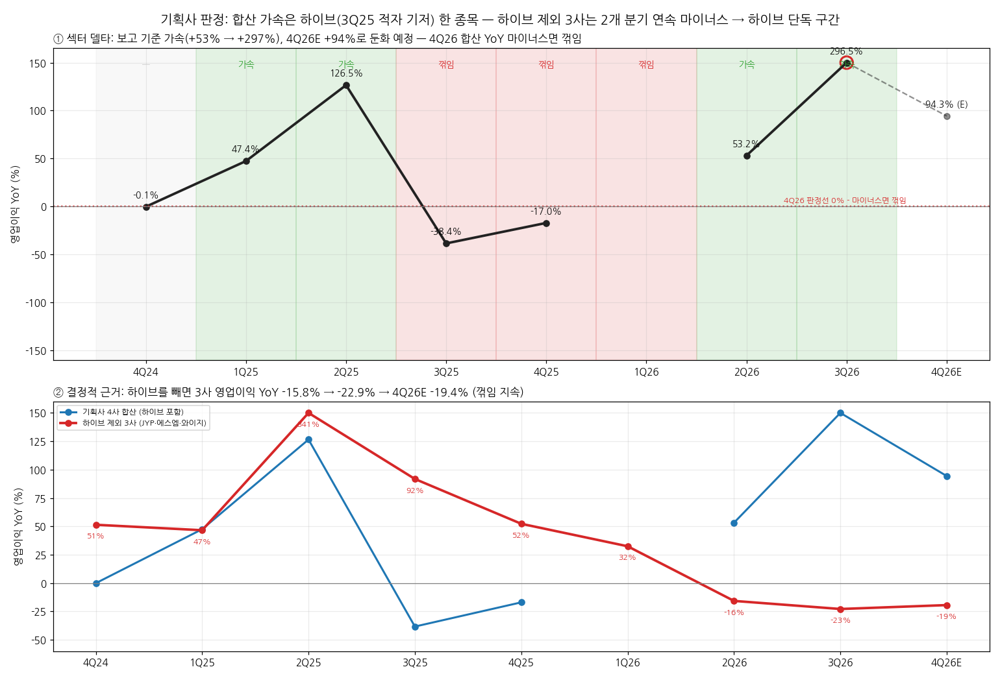

# 엔터 · 기획사 섹터 리뷰

> 현재 상태 (최신 분기 기준)
> 최신 분기: 2026-Q3
> 섹터 델타: 가속 | 내러티브: 약화
> 모멘텀 신호: 없음
> 활성 테마: 없음
> 포지셔닝: 서브섹터 유지 | 한국 해당 없음 | 1등 하이브
> 델타 근거: 3Q 가속은 적자 기저 효과 → 4Q 둔화, 2027 감익
> 내러티브 근거: 팬덤 확장은 확인, 2027 투어 공백이 멀티플 하향으로 반영
> PM 근거: 기저 효과를 빼면 꺾임이라 확대 근거 없어 유지
> 편입 종목: 하이브, JYP, 에스엠(디어유 연결분 제외), 와이지엔터 — 4사 모두 한국
> 갱신 시각: 2026-11-23 12:30 KST

## 누적 시계열

| 분기 | 편입 종목 | 합산 매출 | 합산 영업이익 | OPM | 매출 YoY | 영업이익 YoY | 영업이익 YoY 델타 (%p) | 섹터 델타 | 내러티브 | 모멘텀 신호 | 활성 테마 |
|---|---|---|---|---|---|---|---|---|---|---|---|
| 4Q24 | 4사 (에스엠은 디어유 제외) | 13,032억원 | 1,362억원 | 10.5 | +15.7% | -0.1% | n.m. | — | - | - | - |
| 1Q25 | 4사 (에스엠은 디어유 제외) | 9,730억원 | 833억원 | 8.6 | +20.9% | +47.4% | +47.6%p | 가속 | - | - | - |
| 2Q25 | 4사 (에스엠은 디어유 제외) | 13,045억원 | 1,674억원 | 12.8 | +20.8% | +126.5% | +79.1%p | 가속 | - | - | - |
| 3Q25 | 4사 (에스엠은 디어유 제외) | 14,322억원 | 692억원 | 4.8 | +39.9% | -38.4% | -164.9%p | 꺾임 | - | - | - |
| 4Q25 | 4사 (에스엠은 디어유 제외) | 14,160억원 | 1,130억원 | 8.0 | +8.7% | -17.0% | +21.3%p | 꺾임 | - | - | - |
| 1Q26 | 4사 (에스엠은 디어유 제외) | 12,871억원 | -1,149억원 | -8.9 | +32.3% | n.m. | n.m. | 꺾임 | - | - | - |
| 2Q26 | 4사 (에스엠은 디어유 제외) | 20,871억원 | 2,564억원 | 12.3 | +60.0% | +53.2% | n.m. | 가속 | - | - | - |
| **3Q26** | **4사 (에스엠은 디어유 제외)** | **22,151억원** | **2,744억원** | **12.4** | **+54.7%** | **+296.5%** | **+243.4%p** | **가속** | **약화** | **없음** | **없음** |

→ **합산 방식**: 4사 실적 리뷰(`earnings-review/2026-Q3_{하이브,JYP,에스엠,와이지엔터}_리뷰.md`) 1-1 표의 K-IFRS 연결 매출·영업이익(억원) 단순 합산
→ **에스엠은 디어유 제외**: 에스엠은 2Q25부터 디어유를 연결한다. 디어유는 팬덤 플랫폼 서브섹터로 따로 보므로 2Q25\~ 에스엠 숫자에서 디어유 매출·영업이익을 뺐다(디어유 리뷰 1-1 표). 중복 합산 방지 + 연결 편입 효과 제거
→ **3Q26 숫자**: 하이브는 IR 잠정치(분기보고서 전), JYP·에스엠·와이지는 분기보고서 확정치. 에스엠은 확정치(영업이익 336억)로 잠정치(355억)와 다름
→ 소급 분기 판정은 같은 기준으로 산정. 1Q26은 하이브 주식증여 비용 2,550억(일회성)으로 합산 영업이익이 적자 → YoY n.m., 판정 꺾임(보고 기준)

## 2026-Q3 섹터 리뷰

① 섹터 합산 숫자와 델타

| 구분 (억원, 고정환율) | 4Q24 | 1Q25 | 2Q25 | 3Q25 | 4Q25 | 1Q26 | 2Q26 | 3Q26 | 4Q26E |
|---|---|---|---|---|---|---|---|---|---|
| **기획사 4사** 매출 | 13,032 | 9,730 | 13,045 | 14,322 | 14,160 | 12,871 | 20,871 | 22,151 | 18,524 |
| 기획사 4사 영업이익 | 1,362 | 833 | 1,674 | 692 | 1,130 | -1,149 | 2,564 | 2,744 | 2,196 |
| 기획사 4사 매출 YoY | +15.7% | +20.9% | +20.8% | +39.9% | +8.7% | +32.3% | +60.0% | +54.7% | +30.8% |
| 기획사 4사 영업이익 YoY | -0.1% | +47.4% | +126.5% | -38.4% | -17.0% | n.m. | +53.2% | +296.5% | +94.3% |
| 기획사 4사 영업이익 YoY 델타 | n.m. | +47.6%p | +79.1%p | -164.9%p | +21.3%p | n.m. | n.m. | +243.4%p | |
| **하이브 제외 3사** 매출 | 5,768 | 4,724 | 5,989 | 7,050 | 6,996 | 5,888 | 6,371 | 6,894 | 6,445 |
| 하이브 제외 3사 영업이익 | 716 | 617 | 1,015 | 1,114 | 1,090 | 817 | 855 | 859 | 878 |
| 하이브 제외 3사 매출 YoY | +11.4% | +6.4% | +36.2% | +42.1% | +21.3% | +24.6% | +6.4% | -2.2% | -7.9% |
| 하이브 제외 3사 영업이익 YoY | +51.4% | +46.6% | +341.3% | +91.7% | +52.2% | +32.4% | -15.8% | -22.9% | -19.4% |
| 하이브 제외 3사 영업이익 YoY 델타 | n.m. | -4.8%p | +294.7%p | -249.6%p | -39.5%p | -19.8%p | -48.2%p | -7.1%p | |

→ (출처: 4사 실적 리뷰 1-1 표, 4Q26E는 각 리뷰의 국내 증권사 컨센 평균 — 하이브 10사·JYP 7사·에스엠 7사·와이지 6사)
→ **합산 YoY는 하이브 기저가 지배한다**: 3Q25 하이브 영업이익이 −422억(적자)이라 4사 합산 3Q25가 692억으로 낮다. 3Q26 합산 +296.5% 중 하이브 증가분(+2,307억)이 합산 증가분(+2,052억)보다 크다 — 나머지 3사 합계는 −255억 감소 [계산]
→ 컨센 경로상 4Q26E 합산 YoY +94%(하이브 4Q25 기저 40억)로 둔화, 하이브 제외 3사는 −19%로 마이너스 지속. 2027E는 하이브 −11%·와이지 −7% 감익 컨센, 에스엠만 증익 컨센 → **합산 YoY 정점은 3Q26**

→ (출처: 4사 실적 리뷰 1-1 표로 계산. 굵은 빨강 = 4사 합산 영업이익 YoY, 파랑 점선 = 합산 매출 YoY, 가는 선 = 종목별)

② 종목별 델타 판정표

| 델타 순위 | 종목 | 매출 YoY | 영업이익 YoY | 영업이익 YoY 델타 | 델타 판정 | 내러티브 | 비영업 요인 | 한 줄 |
|---|---|---|---|---|---|---|---|---|
| 1 | 하이브 | +109.8% | 흑자전환 (2Q26 +159.3%) | n.m. (증가액 +1,050억 → +2,307억) | 가속 | 약화 | 3Q25 적자 기저 / 1Q26 주식증여 2,550억 / ⚠ 2027E 감익 컨센 | BTS 투어로 분기 최대(영업이익 1,885억), 2027 하반기 공백이 멀티플 하향 |
| 2 | JYP | +15.0% | +17.6% | +59.0%p | 가속 | 약화 | 2Q25 고기저(+469%) / 출연 이벤트성 매출 | 스트레이키즈 서구권 음반·MD로 분기 최대, 4Q26E −35%로 정점 |
| 3 | 에스엠 | −10.4% | −30.3% (디어유 제외 −38.2%) | −41.4%p | 꺾임 | 유지 | 디어유 연결(2Q25\~), 외화평가손실(영업외) | 신보 판매 550만→167만 장, 본사 3개 분기 연속 감익 |
| 4 | 와이지엔터 | −9.5% | −56.6% | −87.6%p | 꺾임 | 약화 | 3Q25 BLACKPINK 투어 고기저 / YG인베스트 기타손익 −65억 | 본업 영업이익도 −48%, 2027E 감익 |

→ 판정·내러티브는 각 종목 리뷰 0번 그대로. 델타 순위는 영업이익 YoY 델타 큰 순, 하이브는 YoY n.m.이지만 이익 증가액 1위·흑자전환(가속)으로 1위에 둠 [판단]
→ **선행 종목**: 와이지(3Q25 정점)·에스엠(본사는 1Q26부터 감익)이 먼저 꺾였고, JYP는 3Q26 가속 후 4Q26E 꺾임 예고. 하이브가 가장 늦게 정점(4Q26E도 YoY 증가) — **정점 시차: 와이지 → 에스엠 → JYP → 하이브**

③ 섹터 공통 쟁점

(1) **투어 사이클이 델타를 만든다** — 4사 공통
(1-1) 하이브: 공연 매출 7,268억(+197%, BTS 'ARIRANG' 월드투어)이 매출 증가분의 60% / 와이지: 3Q25 BLACKPINK 투어 기저로 −57% / JYP: 콘서트 436억(−31%) / 에스엠: 공연 축소로 음반·공연 매출 감소 (각 리뷰)
(1-2) [판단] 기획사 이익 델타는 대형 IP의 투어 유무로 거의 결정된다. 3Q26은 하이브만 투어 정점에 있었고, 2027년은 BTS 투어 종료로 하이브도 같은 기저 문제를 맞는다

(2) **MD가 공통 성장 동력** — 4사 공통
(2-1) 하이브 MD 3,346억(+99%, BTS 북미 투어 MD 1,070억) / JYP MD 586억(+47%) / 와이지 MD 406억(+44.5%, 분기 최대) / 에스엠 MD·라이선싱 621억(+23.5%) (각 리뷰)
(2-2) [판단] 음반이 줄어도 MD는 4사 모두 두 자릿수 성장 — 팬덤 지출이 '앨범 → 굿즈·현장'으로 옮겨 가는 흐름. 다만 MD도 투어와 묶여 있어(투어 MD) 독립 성장 동력인지는 4Q 비투어 분기에서 확인 필요

(3) **음반 수요 둔화** — 에스엠·와이지·하이브
(3-1) 에스엠 신보 판매 550만 → 167만 장 / 와이지 음반 감소 / JYP는 스트레이키즈 서구권 음반 792억(+18%)으로 예외 (각 리뷰)
(3-2) [판단] 중국 공동구매 등 대량 구매 축소 이후 음반 매출은 IP별로 극명하게 갈린다 — 서구권 판매가 받쳐 주는 IP(스트레이키즈)만 버틴다

(4) **2027년 정점 우려 vs 증익 기대** — 셀사이드 해석이 종목별로 갈림
(4-1) 하이브: TP 평균 −8%(하향 5·유지 4·상향 1), 2027E 영업이익은 4,310억\~5,620억으로 BTS 하반기 활동 반영 정도에 따라 갈림 / JYP: 국내 TP 평균 54,100원, 외국계는 실적 추정까지 하향(JPM 2027/28E 영업이익 −33%/−40%) / 에스엠: 2027 'Full Cycle' 증익(+14\~38%) 유지로 TP −1.8% / 와이지: 2027E 영업이익 −7%, 삼성만 실적 하향으로 TP 하향 (각 리뷰 2-4)
(4-2) [판단] TP 하향의 원인이 하이브·에스엠·국내 JYP는 **멀티플**, 외국계 JYP·와이지(삼성)는 **실적 추정**. 실적 추정이 깎이기 시작한 쪽(JYP 외국계, 와이지)이 다음 분기 더 위험

(5) **원화 강세 외화평가손실** — 하이브·에스엠(·디어유)
(5-1) 3Q26 순이익이 영업이익 대비 크게 낮음(하이브 지배 순이익 −68억, 에스엠 순손실 −28억) — 영업외라 델타 판정과 무관 (각 리뷰)

→ 종목 고유 이슈: 하이브 — 방시혁 의장 주식증여 비용(1Q26)·북미 손상 / JYP — TWICE 재계약 이탈 인원(리포트마다 1명·3명으로 상이) / 에스엠 — IR 잠정치 vs 분기보고서 확정치 차이(영업이익 −19억, 원인 미공시) / 와이지 — 신인 보이·걸그룹 1H27 데뷔, 빅뱅 추가 회차

④ 섹터 판정

> 섹터 델타: **가속** | 내러티브: **약화** → **합산 가속은 하이브 한 종목(3Q25 적자 기저)이 만든 숫자 — 하이브를 빼면 3사는 2개 분기 연속 마이너스. 서브섹터 베타가 아니라 하이브 단독 구간이고, 하이브도 2027년 감익 컨센으로 정점 경계**

→ (출처: 4사 실적 리뷰 1-1 표·컨센으로 계산. 상단 = 4사 합산 영업이익 YoY와 분기별 판정 색(초록 가속·주황 둔화·빨강 꺾임), 점선 = 4Q26E 컨센, 빨간 점선 = 4Q26 판정선 / 하단 = 하이브 포함 합산 vs 하이브 제외 3사 영업이익 YoY)

→ 델타 판정 근거: 합산 영업이익 YoY +53.2%(2Q26) → **+296.5%**(3Q26)로 확대 = 가속(보고 기준). 컨센 경로상 4Q26E +94%로 둔화 예정, 2027E는 하이브·와이지 감익 → 경로대로면 4Q26 둔화, 1Q27 꺾임 [전망]
→ 비영업 요인 영향: 3Q25 하이브 적자(−422억) 기저가 합산 YoY를 수백 %로 부풀렸다. 하이브 제외 3사 합산은 −15.8% → −22.9%로 꺾임 — **서브섹터의 실질 델타는 꺾임, 보고 기준 가속은 하이브 개별 효과** [판단]
→ 내러티브 근거: 4사 중 3사 약화(하이브·JYP·와이지), 1사 유지(에스엠). 공통 스토리(글로벌 팬덤 확장·MD)는 숫자로 확인되지만, 이익을 끄는 투어 사이클이 2027년에 비어 있다는 점이 멀티플 하향으로 반영 중
→ 직전 분기 대비: 가속(2Q26) → 가속(3Q26). 소급 궤적은 가속(1Q25\~2Q25) → 꺾임(3Q25\~1Q26) → 가속(2Q26\~3Q26) — 투어 사이클과 같은 주기

⑤ 모멘텀 신호

→ 없음 (활성 테마 없음)
→ 조건 대조 — 델타 급증 후보: ① 섹터 델타 확대 — 충족(+243%p, 단 기저효과) ② 편입 종목 과반 가속 — 2/4로 미충족 ③ 내러티브 형성·강화 — 미충족(3사 약화) → 후보로 올리지 않음
→ 반대 논거: 하이브의 2027년 하반기 BTS 활동·KATSEYE·코르티스 투어 체급이 확인되면 2027년 감익 컨센이 깨질 수 있다. 에스엠은 2027 Full Cycle 증익 컨센 — 1Q27 영업이익 YoY 플러스 복귀면 하이브 이후 다음 가속 후보
→ 다음 분기 후보 조건: 4Q26에 하이브 제외 3사 중 2사 이상이 YoY 플러스 + 내러티브 강화

⑥ 다음 분기 섹터 관전 포인트

| 순위 | 무엇을 (변수·임계값) | 어떤 데이터로 | 언제 |
|---|---|---|---|
| 1 | **4Q26 기획사 4사 합산 영업이익 YoY 0% 판정선** — 플러스면 둔화(컨센 +94%), 마이너스면 꺾임. 하이브 제외 3사 −19%(컨센)도 함께 확인 | 4사 4Q26 잠정실적 | 2027년 2월 |
| 2 | 하이브 2027년 하반기 BTS 활동 공지 — 2027E 감익 컨센(−11%)을 바꿀 유일한 변수 | 하이브 공시·4Q26 컨콜 | 2027년 2월 |
| 3 | JYP 4Q26 영업이익 274억(−35%) 컨센 대비 — 외국계 실적 하향이 맞는지 | JYP 4Q26 실적 | 2027년 2월 |
| 4 | 에스엠 1Q27 영업이익 YoY 플러스 복귀(1Q26 기저 386억) — 다음 가속 후보 여부 | 에스엠 1Q27 실적 | 2027년 5월 |
| 5 | 4사 MD 매출 YoY — 비투어 분기(4Q)에도 두 자릿수인지 | 4사 IR | 2027년 2월 |

⑦ 글로벌 PM 포지셔닝 — 결론 (서브섹터 리뷰)

> **서브섹터: 유지 — 하이브 단독 구간, 4Q26 합산 YoY 마이너스면 축소** | **한국: 해당 없음 (4사 모두 한국 — 한국 vs 글로벌은 엔터 통합 리뷰에서 밸류체인 비교)** | **1등: 하이브**

(1) 서브섹터 판정 — 유지 [판단]
→ 보고 기준 델타는 가속이지만 하이브 1종목 효과이고, 하이브 제외 3사는 꺾임. 컨센 경로상 3Q26이 합산 YoY 정점 → 확대 근거 없음. 다만 하이브의 4Q26E도 YoY 증가라 즉시 축소할 근거도 없다 → **유지**
→ 축소 전환: 4Q26 합산 YoY 마이너스(판정선 0%) 또는 하이브 4Q26 영업이익 1,000억 미만(컨센 1,318억 대비 −24%)
→ 확대 전환: 하이브 2027년 하반기 BTS 활동 확정 + 하이브 제외 3사 중 2사 4Q26 YoY 플러스

(2) 같은 서브섹터 안 한국 vs 글로벌
→ 비교 불가 — 편입 종목 없음. 글로벌 레이블(UMG)은 음원 글로벌 서브섹터에 있고 사업 모델이 달라(저작권 카탈로그 vs 아티스트 매니지먼트) 같은 서브섹터로 묶지 않았다. 해외 아티스트 매니지먼트 상장사가 사실상 없어 구멍을 메울 후보도 마땅치 않다 — 국가 비교는 엔터 통합 리뷰 ⑦(2) 밸류체인 표로 갈음

(3) 서브섹터 1등 종목
→ **1등 하이브** — 가속·약화. 이익 증가액 1위(+2,307억), 4Q26E도 YoY 증가(4Q25 40억 기저)로 4사 중 유일하게 다음 분기까지 성장 경로. 2027년 감익 컨센이 리스크
→ 2등 JYP — 가속·약화. 3Q26 가속은 확인됐지만 4Q26E −35%로 다음 분기 꺾임 예고 — 델타 프레임에선 단기(3Q 실적 소화) 대상
→ 비선호 와이지엔터·에스엠 — 둘 다 꺾임. 에스엠은 2027 증익 컨센이 있어 **반등 후보(이벤트 드리븐)** — 확인 이벤트: 1Q27 영업이익 YoY 플러스

(4) 콜을 바꾸는 조건과 일정

| 시점 | 이벤트 | 서브섹터 비중 | 1등 종목 |
|---|---|---|---|
| 2027-02 초\~중 | 하이브·JYP·에스엠·와이지 4Q26 잠정실적 | 합산 YoY 마이너스면 축소 | 하이브 4Q 1,000억 미만이면 1등 재검토 |
| 2027-02 | 하이브 4Q26 컨콜 — 2027년 BTS 활동 계획 | 하반기 활동 확정이면 확대 검토 | 하이브 유지 |
| 2027-05 | 1Q27 실적 — 에스엠 YoY 플러스 복귀 여부 | 에스엠 복귀면 유지 | 에스엠 반등 후보 → 선호 |
