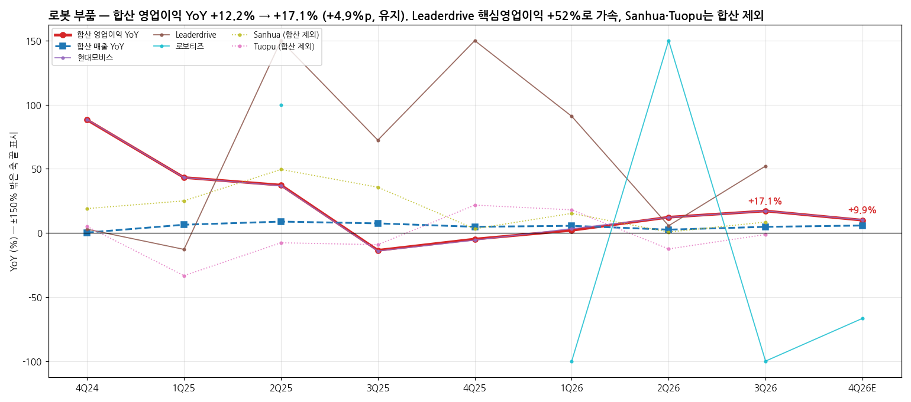
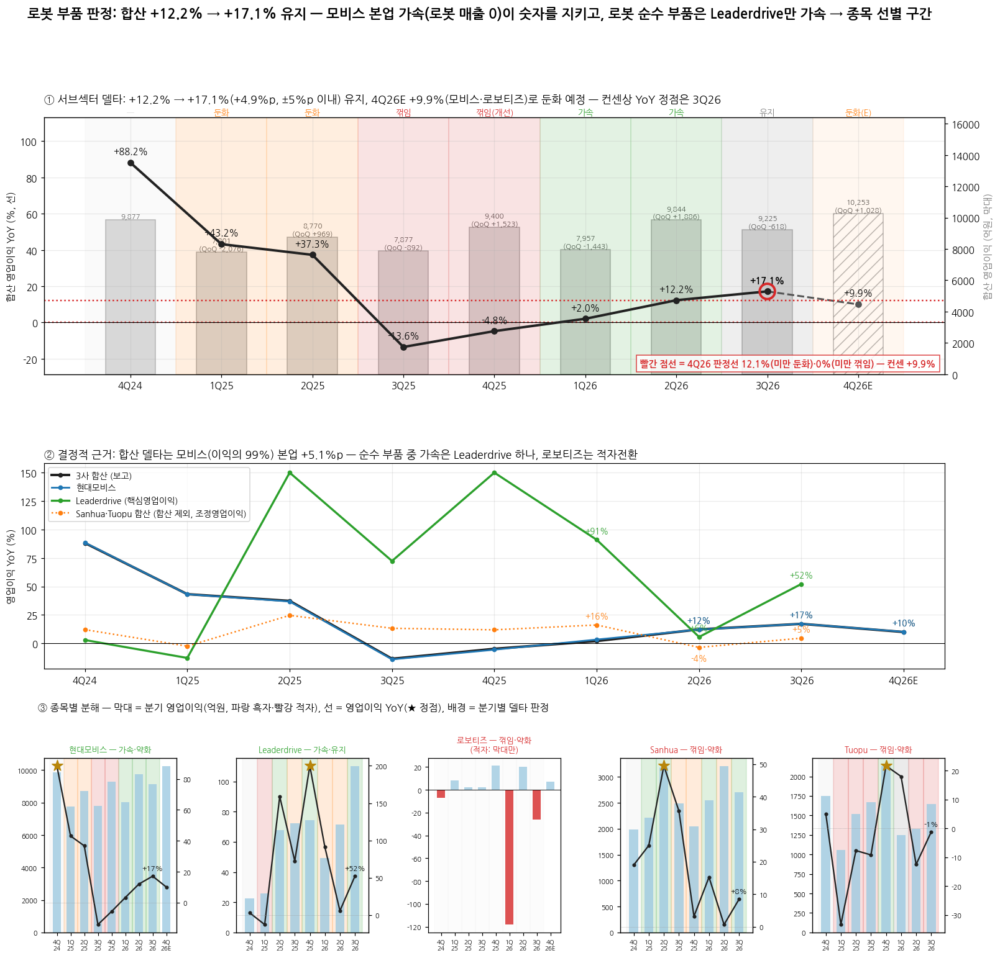

# 로봇 · 로봇 부품 섹터 리뷰

> 현재 상태 (최신 분기 기준)
> 최신 분기: 2026-Q3
> 섹터 델타: 유지 | 내러티브: 약화
> 모멘텀 신호: 없음
> 활성 테마: 없음
> 포지셔닝: 서브섹터 유지 | 한국 언더퍼폼 | 1등 Leaderdrive
> 편입 종목: 합산 3사 — 현대모비스, Leaderdrive, 로보티즈 · 합산 제외 — Sanhua·Tuopu(핵심 부품 기업, BT 결정 2026-11-14), 에스비비테크(트래킹 피어)
> 갱신 시각: 2026-11-23 14:30 KST

## 누적 시계열

| 분기 | 편입 종목 | 합산 매출 | 합산 영업이익 | OPM | 매출 YoY | 영업이익 YoY | 영업이익 YoY 델타 (%p) | 섹터 델타 | 내러티브 | 모멘텀 신호 | 활성 테마 |
|---|---|---|---|---|---|---|---|---|---|---|---|
| 4Q24 | 3사 (모비스·Leaderdrive·로보티즈) | 147,410억원 ($10.39B) | 9,877억원 ($696M) | 6.7 | +0.3% | +88.2% | n.m. | — | - | - | - |
| 1Q25 | 3사 | 147,829억원 ($10.42B) | 7,801억원 ($550M) | 5.3 | +6.4% | +43.2% | -45.0%p | 둔화 | - | - | - |
| 2Q25 | 3사 | 159,765억원 ($11.26B) | 8,770억원 ($618M) | 5.5 | +8.8% | +37.3% | -5.9%p | 둔화 | - | - | - |
| 3Q25 | 3사 | 150,738억원 ($10.62B) | 7,877억원 ($555M) | 5.2 | +7.4% | -13.6% | -50.8%p | 꺾임 | - | - | - |
| 4Q25 | 3사 | 154,441억원 ($10.88B) | 9,400억원 ($662M) | 6.1 | +4.8% | -4.8% | +8.7%p | 꺾임(개선) | - | - | - |
| 1Q26 | 3사 | 156,019억원 ($10.99B) | 7,957억원 ($561M) | 5.1 | +5.5% | +2.0% | +6.8%p | 가속 | - | - | - |
| 2Q26 | 3사 | 163,841억원 ($11.55B) | 9,844억원 ($694M) | 6.0 | +2.6% | +12.2% | +10.2%p | 가속 | - | - | - |
| **3Q26** | **3사 (Sanhua·Tuopu·에스비비테크 제외)** | **157,879억원 ($11.13B)** | **9,225억원 ($650M)** | **5.8** | **+4.7%** | **+17.1%** | **+4.9%p** | **유지** | **약화** | **없음** | **없음** |

→ **환율 (고정, 3Q26 평균)**: $1 = 1,419원, RMB 1 = 211원 (엔터·휴머노이드 섹터 리뷰와 같은 값). 괄호 달러는 같은 환율 환산 [계산]
→ **합산 방식**: 현대모비스·로보티즈 = K-IFRS 연결 영업이익(OpenDART). **Leaderdrive = 리뷰의 핵심영업이익(매출 − 원가 − 세금 − 판매·관리·연구개발비) [계산]** — 리뷰 판정 지표는 지배주주 순이익이지만, 중국식 营业利润에 투자수익·보조금이 순이익의 40%대로 섞여 있어 K-IFRS 영업이익에 가까운 핵심영업이익으로 합산(백만위안 × 2.11 = 억원)
→ **합산 제외**: Sanhua·Tuopu — 로봇 매출 미분리(Sanhua)·전사의 0.1%(Tuopu, 1H26 1,404.8만위안) → 2026-11-14 BT 결정으로 핵심 부품 기업 위치 유지, 섹터 델타 합산 제외 (숫자는 ② 표와 (트래킹) 섹션). 에스비비테크 — 트래킹 피어
→ **이익 비중**: 3Q26 합산 영업이익 9,225억원 중 현대모비스 99.1%, Leaderdrive 1.2%, 로보티즈 -0.3% [계산] — **합산 델타 = 현대모비스 자동차 부품 본업**. 모비스 로봇 매출은 분리 공시 없음(11월 액추에이터 시제품은 실비 정산)
→ 4Q26E: 컨센이 있는 모비스(국내 4사 평균)·로보티즈(4사 평균) 2사, Leaderdrive는 핵심영업이익 E가 없어 제외(4Q25도 같은 2사) [계산]

## 2026-Q3 섹터 리뷰

> 분석 대상 파일: `earnings-review/2026-Q3_현대모비스_리뷰.md`(풀, 셀사이드 10건), `2026-Q3_688017.SS_리뷰.md`(Leaderdrive, 숫자 중심), `2026-Q3_로보티즈_리뷰.md`(풀, 5건), `2026-Q3_002050.SZ_리뷰.md`(Sanhua, 숫자 중심), `2026-Q3_601689.SS_리뷰.md`(Tuopu, 숫자 중심), `2026-Q3_에스비비테크_리뷰.md`(풀, 1건 — 트래킹)

① 서브섹터 합산 숫자와 델타

| 구분 (억원, 고정환율) | 4Q24 | 1Q25 | 2Q25 | 3Q25 | 4Q25 | 1Q26 | 2Q26 | 3Q26 | 4Q26E |
|---|---|---|---|---|---|---|---|---|---|
| **로봇 부품 3사** 매출 | 147,410 | 147,829 | 159,765 | 150,738 | 154,441 | 156,019 | 163,841 | 157,879 | 162,976 |
| 로봇 부품 3사 영업이익 | 9,877 | 7,801 | 8,770 | 7,877 | 9,400 | 7,957 | 9,844 | 9,225 | 10,253 |
| 로봇 부품 3사 OPM | 6.7 | 5.3 | 5.5 | 5.2 | 6.1 | 5.1 | 6.0 | 5.8 | 6.3 |
| 로봇 부품 3사 매출 YoY | +0.3% | +6.4% | +8.8% | +7.4% | +4.8% | +5.5% | +2.6% | +4.7% | +5.8% |
| 로봇 부품 3사 영업이익 YoY | +88.2% | +43.2% | +37.3% | -13.6% | -4.8% | +2.0% | +12.2% | +17.1% | +9.9% |
| 로봇 부품 3사 영업이익 YoY 델타 | n.m. | -45.0%p | -5.9%p | -50.8%p | +8.7%p | +6.8%p | +10.2%p | +4.9%p | -7.2%p |
| **순수 부품 2사**(Leaderdrive+로보티즈) 영업이익 | 16 | 34 | 70 | 74 | 95 | -69 | 92 | 84 | — |
| 순수 부품 2사 영업이익 YoY | -8.1% | +64.3% | +156.7% | +165.7% | +511.6% | n.m.(로보티즈 성과급 118억) | +31.3% | **+13.1%** | — |
| (참고·합산 제외) Sanhua+Tuopu 조정영업이익 | 3,735 | 3,270 | 4,705 | 4,157 | 4,178 | 3,798 | 4,536 | 4,347 | — |
| (참고·합산 제외) Sanhua+Tuopu 조정영업이익 YoY | +12.0% | -2.5% | +24.6% | +13.2% | +11.9% | +16.1% | -3.6% | +4.6% | — |

→ (출처: 각 종목 실적 리뷰 1번 ① 표, 고정환율 원화 환산 [계산]. 4Q26E = 모비스 국내 4사(삼성·메리츠·하나·NH) 평균, 로보티즈 4사(KB·미래·한화·유진) 평균. Sanhua·Tuopu 조정영업이익 = 각 리뷰의 [계산] 행 — 판정 지표(순이익)와 다름)
→ **합산 델타 해부**: +12.2% → +17.1%(+4.9%p) — 모비스 +12.1% → +17.2%(+5.1%p)가 그대로 옮겨졌다. 모비스는 인도 공장 화재 비용 971억을 영업이익에서 떠안고도 +17.2%(화재 가산 시 약 +30%, 판정 미사용) — **비영업 가속이 아니라 본업**(모듈 흑전 335억, A/S). 반대로 고객사 비용 회수·보조금(금액 미공개)과 3Q25 관세 저기저가 받쳤다 (모비스 리뷰 ⚠)
→ 순수 부품 2사는 +31.3% → +13.1%로 둔화 — Leaderdrive 가속(+52.0%)을 로보티즈 적자전환(+2억 → -26억)이 상쇄
→ 컨센 경로: 4Q26E +9.9%(모비스 +10.1%)로 둔화 → **합산 YoY 정점은 3Q26**, 모비스 1Q27E +6.9%(하나 단독)로 한 자릿수 [전망]. 인수 편입으로 합산 YoY를 바꾼 종목 없음(로보티즈 JST 편입은 매출 3.75억·순손실 -2.07억으로 작음)

→ (출처: 3사 실적 리뷰로 계산. 굵은 빨강 = 3사 합산 영업이익 YoY, 파랑 점선 = 합산 매출 YoY, 가는 선 = 종목별(흑자 종목), 점선 = Sanhua·Tuopu(합산 제외, 조정영업이익). ±150% 밖은 축 끝)

② 종목별 델타 판정표

| 델타 순위 | 종목 | 국가 | 매출 YoY | 영업이익 YoY | 영업이익 YoY 델타 | 델타 판정 | 내러티브 | 비영업 요인 | 한 줄 |
|---|---|---|---|---|---|---|---|---|---|
| 1 | Leaderdrive | 중국 | +56.1% | 핵심영업이익 +52.0% (2Q26 +5.5%) / 순이익 +29.1% (+13.0%) | +46.5%p (순이익 +16.1%p) | 가속 | 유지 | 중국식 영업이익에 투자수익·보조금 혼재 (판정은 순이익) | 분기 최대 매출, GPM 33.4%(-6.2%p) — "물량은 늘고 마진은 내려가는" 성장 |
| 2 | 현대모비스 | 한국 | +4.6% | +17.2% (2Q26 +12.1%) | +5.1%p | 가속 | 약화 | ⚠ 인도 화재 비용 971억 부담(가산 시 +30%), 고객사 비용 회수·보조금·3Q25 관세 저기저 — **인수 주도 아님** | 모듈 흑전·4Q 사상 첫 1조원 컨센, 로봇 액추에이터 31종 시제품(매출 미미) |
| 3 | 로보티즈 | 한국 | +45.8% | 적자전환 (+2억 → -26억) | 적자전환 (직전 +722.9%) | 꺾임 | 약화 | ⚠ 판관비 +39억(성과급 미분리), JST 인수 편입(매출 +3.75억, 판정 조정 없음) | 모터·희토류 공급 차질로 고가 Y시리즈 막힘, GPM 64.8% → 52.6% |
| 제외 | Sanhua | 중국 | +7.8% | 순이익 -9.6% (2Q26 -7.5%) | -2.2%p | 꺾임 | 약화 | 환차손 3.83억위안(9M) — 조정영업이익은 +8.4% | 합산 제외(BT) — 로봇 액추에이터 매출 미분리, "배치 납품·램프업" 문구뿐 |
| 제외 | Tuopu | 중국 | +5.3% | 순이익 -4.8% (2Q26 -35.5%) | +30.7%p | 꺾임(개선) | 약화 | 환차손(재무비용 +133%) | 합산 제외(BT) — 로봇 액추에이터 1H26 1,405만위안(+83%, 전사 0.1%) |
| 트래킹 | 에스비비테크 | 한국 | +142.9% | 적자 축소 (-21.4억 → -17.4억, 축소율 -52.8% → +18.7%) | +71.5%p (축소율) | 가속 (적자 축소 전환) | 강화 | 없음 | 휴머노이드용 하모닉 감속기 33억(매출의 68%), 현금 2.6억·12월 차입 만기 50억 |

→ 판정·내러티브는 각 종목 리뷰 0번 그대로. 델타 순위 = 영업이익 YoY 델타 큰 순(Leaderdrive는 합산 지표인 핵심영업이익 델타 기준 — 판정 지표인 순이익 델타 +16.1%p로 봐도 1위)
→ **선행 종목**: Sanhua·Tuopu가 2025년에 먼저 꺾였고(순이익 YoY 정점 2Q25\~3Q25 / 3Q24), 로보티즈가 3Q26에 꺾였다. 가속은 Leaderdrive(오가닉, 로봇 감속기)와 모비스(자동차 부품 본업) 둘 — **로봇 매출로 가속한 종목은 Leaderdrive 하나**

③ 섹터 공통 쟁점

(1) **로봇 매출이 숫자로 안 잡힌다** — 모비스·Sanhua·Tuopu
(1-1) 모비스 액추에이터 시제품 31종(11월 납품)은 실비 정산, "2027년은 90대 분량"(NH), 대량 양산 2029년 이후(메리츠) / Sanhua 로봇 매출 미분리 / Tuopu 1H26 1,404.8만위안(전사 0.1%) (각 리뷰)
(1-2) [판단] 부품 서브섹터 합산 영업이익의 99%가 자동차 부품이다. "로봇 부품" 델타를 보려면 Leaderdrive·로보티즈·에스비비테크 같은 순수 부품주를 따로 봐야 하는데 이들은 규모가 너무 작아 합산에 흔적이 안 남는다

(2) **물량은 늘고 마진은 내려간다** — Leaderdrive·로보티즈·Tuopu
(2-1) Leaderdrive GPM 39.6% → 33.4%(증설 감가상각·판가) / 로보티즈 GPM 64.8% → 52.6%(저가 X시리즈 비중 확대) / Tuopu GPM 23.6%(4Q23) → 18.1% (각 리뷰)
(2-2) [판단] 휴머노이드 관절 부품은 중국 가격 하락(피지컬AI 테마분석: 중국산 롤러스크류 499위안 vs 수입산 5,000위안+)이 진행 중. 판가 하락을 물량·비용 레버리지로 버티는 쪽(Leaderdrive 판관비율 -6.1%p)과 못 버티는 쪽(로보티즈 판관비 +68%)이 갈렸다

(3) **공급 병목** — 로보티즈·에스비비테크
(3-1) 로보티즈 모터·희토류 수급 차질로 북미 방산향·Y시리즈 이연, 수주잔고 약 100만 개 vs 3Q 누적 출하 약 32\~33만 개 / 에스비비테크 수주잔고·감속기 초도 물량 (각 리뷰)
(3-2) [판단] 한국 순수 부품주는 수요가 아니라 공급(부품·자금)이 이익을 막는다 — 피지컬AI 테마분석의 '비중국 관절 = A(병목)' 레이어 진단과 맞지만, 병목 수혜가 아직 이익으로 넘어오지 않았다

(4) **환율** — Sanhua·Tuopu(위안 강세 환차손), 모비스(원화 강세 영업외 외환손실 -1,948억 — 순이익만)

(5) **TP 하향 = 멀티플** — 모비스
(5-1) 모비스 첨부 7곳 TP 58.3만 → 53.2만(-8.7%), 영업이익 추정은 유지\~상향인데 TP 하향 = 로봇 피어 멀티플·지분법 (모비스 리뷰). 로봇 액추에이터 가치는 TP에 0원 vs 8조원으로 갈림

→ 종목 고유 이슈: 모비스 — 인도 공장 화재(보험 회수), 2027년 모듈 영업이익 920억\~6,610억(7배 편차) / Leaderdrive — 9M26 영업CF -71.3백만위안·재고 +49.8% / 로보티즈 — 우즈벡 공장 2Q27 가동, 1Q26 자사주 성과급 117.8억 / Sanhua — 동오 4Q26E 순이익 +25%(4Q25 저기저) / Tuopu — 상위 5개 고객 65.8% / 에스비비테크 — 12월 차입 만기·자금조달

④ 섹터 판정

> 섹터 델타: **유지** | 내러티브: **약화** → **합산은 +12.2% → +17.1%(+4.9%p)로 유지 경계 — 숫자를 지킨 건 로봇 매출이 0인 현대모비스 본업이고, 순수 부품은 Leaderdrive만 가속·로보티즈 꺾임. 컨센상 3Q26이 합산 YoY 정점 → 서브섹터 베타가 아니라 Leaderdrive 선별 구간**

→ (출처: 각 실적 리뷰로 계산, 고정환율 원화 환산. 상단 = 3사 합산 영업이익 YoY(선)·합산 영업이익과 QoQ(막대)·판정 배경색, 점선 = 4Q26E, 빨간 점선 = 4Q26 판정선 12.1%·0% / 중단 = 결정적 근거 — 합산 vs 모비스 vs Leaderdrive vs Sanhua·Tuopu(합산 제외) / 하단 = 종목별 분해 — Sanhua·Tuopu 선은 조정영업이익 YoY(판정 지표는 순이익), Leaderdrive 선은 핵심영업이익 YoY)

→ 델타 판정 근거: 합산 영업이익 YoY +12.2%(2Q26) → **+17.1%**(3Q26), +4.9%p로 ±5%p 이내 = **유지**. 모비스 단독(+5.1%p)은 가속 경계를 0.1%p 넘었지만 Leaderdrive·로보티즈를 합치면 유지로 내려온다. 4Q26E +9.9%로 축소(둔화) 예정 [전망]
→ 비영업 요인 영향: 모비스 화재 비용 971억을 더하면 합산 YoY 약 +29%로 가속, 고객사 비용 회수·관세 저기저를 빼면 더 낮다 — 방향이 서로 상쇄돼 판정을 바꾸지 않음. 인수 주도 가속 없음
→ 내러티브 근거: 모비스 약화(TP 멀티플 하향), 로보티즈 약화(공급 차질·이익 2027 2Q 이후), Leaderdrive 유지 + 합산 제외 Sanhua·Tuopu 약화, 트래킹 에스비비테크 강화 → **약화** [판단]
→ 직전 분기 대비: 가속(2Q26) → 유지(3Q26). 소급 궤적: 둔화(1Q25\~2Q25) → 꺾임(3Q25, 관세) → 꺾임(개선)(4Q25) → 가속(1Q26\~2Q26) → 유지(3Q26) — 모비스 관세 사이클 회복이 3분기째, 컨센상 3Q26이 회복의 정점

⑤ 모멘텀 신호

→ 없음 (활성 테마 없음 — 피지컬AI 테마 sunset 2026-11-23 BT)
→ 조건 대조 — 델타 급증 후보: ① 섹터 델타 확대 — 미충족(유지) ② 편입 종목 과반 가속 — 2/3(모비스·Leaderdrive) 충족 ③ 내러티브 형성·강화 — 미충족(약화) → 후보로 올리지 않음
→ 반대 논거: 순수 부품만 보면 Leaderdrive(+52%)와 에스비비테크(적자 축소 전환·강화)가 동시에 좋아졌다 — 둘 다 하모닉 감속기. 감속기 레이어만 떼면 델타 확대 중 [판단]
→ 다음 분기 후보 조건: 4Q26에 Leaderdrive 순이익 YoY +100% 안팎(4Q25 저기저) + 에스비비테크 적자 축소 2개 분기 연속(-9.0억 이내) + 로보티즈 4Q 20.6억 초과 — 순수 부품 3사 동시 개선이면 "감속기·액추에이터" 레이어 후보 검토

⑥ 다음 분기 섹터 관전 포인트

| 순위 | 무엇을 (변수·임계값) | 어떤 데이터로 | 언제 |
|---|---|---|---|
| 1 | **4Q26 3사 합산 영업이익 YoY 판정선 — 12.1% 미만이면 둔화, 0% 미만이면 꺾임**(컨센 +9.9% = 둔화 예정, 4Q25 기저 9,400억원). 모비스 4Q 1.09조(가속 유지선) 동시 확인 | 모비스·로보티즈 4Q26 실적, Leaderdrive 연간 보고서 | 2027년 1월 말 / 3\~4월 |
| 2 | 모비스 로봇 액추에이터 전용 공장 입지·투자 공시 — 로봇 내러티브 재점화 트리거 | 현대모비스 공시 | 2026년 12월\~2027년 1Q |
| 3 | Leaderdrive 4Q26 매출 250\~263백만위안(+51\~60%) + 분기 GPM 33% 유지 | Leaderdrive 2026 연간 보고서 | 2027년 3\~4월 |
| 4 | 로보티즈 4Q26 영업이익 20.6억 초과(델타 반전) + 판관비 70억 이하 복귀 | 로보티즈 사업보고서 | 2027년 3월 |
| 5 | Sanhua·Tuopu 4Q26 순이익 YoY 플러스 전환(동오 +25% / +1%) + 로봇 액추에이터 매출 공시 여부 | 양사 2026 연간 보고서 | 2027년 3\~4월 |

⑦ 글로벌 PM 포지셔닝 — 결론 (서브섹터 리뷰)

> **서브섹터: 유지 — 4Q26 합산 YoY 12.1% 미만이면 축소 검토** | **한국: 언더퍼폼 (예외 현대모비스)** | **1등: Leaderdrive (한국 1등 현대모비스)**

(1) 서브섹터 판정 — 유지 [판단]
→ 합산 델타 유지, 컨센상 4Q26 둔화 예정. 그러나 순수 부품 중 Leaderdrive가 오가닉 가속 중이라 서브섹터를 줄이기보다 **Leaderdrive로 비중을 옮기는 구간**
→ 축소 전환: 4Q26 합산 YoY 12.1% 미만(둔화) + Leaderdrive GPM 30% 하회
→ 확대 전환: 모비스 액추에이터 공장 투자 공시 + 순수 부품 3사(Leaderdrive·로보티즈·에스비비테크) 4Q 동시 개선

(2) 같은 서브섹터 안 한국 vs 글로벌 — 한국 언더퍼폼 [판단]

| 경쟁력 축 | 한국 (모비스·로보티즈, 트래킹 에스비비테크) | 글로벌 (Leaderdrive, 합산 제외 Sanhua·Tuopu) | 우위 |
|---|---|---|---|
| 델타 방향 (1순위) | 2사 합산 +12.3% → +16.8%(+4.5%p 유지) — 모비스 가속, 로보티즈 꺾임 | Leaderdrive 핵심영업이익 +5.5% → +52.0% 가속 (Sanhua·Tuopu 포함 시 -3.5% → +5.4%) | 글로벌 (Leaderdrive) |
| 로봇 순수도 | 모비스 0%, 로보티즈 100%, 에스비비테크 감속기 68% | Leaderdrive ≈100%(감속기), Sanhua·Tuopu 0.1% 수준 | 글로벌 |
| 마진 레벨 | 모비스 5.8%, 로보티즈 -19.4%, 에스비비 -35.6% | Leaderdrive 핵심 21.5%, Sanhua 15.3%, Tuopu 9.3% | 글로벌 |
| 마진 방향 | 로보티즈 GPM -12.2%p | Leaderdrive GPM -6.2%p | 둘 다 하락 |
| 공급·생산 | 로보티즈 모터·희토류 차질, 우즈벡 2Q27 | Leaderdrive 증설 램프(감가상각) | 글로벌 |
| 고객 노출 | 모비스 BD 아틀라스 액추에이터 수주, 에스비비 국내 휴머노이드 감속기 42억 | Sanhua·Tuopu Tesla Optimus, Leaderdrive 산업로봇·구현형 AI | 동률 |
| 이익 추정 방향 | 모비스 영업이익 추정 유지\~상향(TP는 하향), 로보티즈 4Q 컨센 -67% | Leaderdrive 4Q 순이익 +98\~192% 역산 | 글로벌 |

→ 결론: **한국 언더퍼폼 = 서브섹터 내 효과** — ① 델타: 로봇 매출로 가속한 종목은 중국 Leaderdrive 하나, 한국 순수 부품(로보티즈)은 꺾임 ② 이익 추정: 로보티즈 4Q 컨센이 4Q25 대비 -67% ③ 구조: 한국은 공급(부품·자금) 병목, 중국은 판가 하락을 물량으로 상쇄
→ 반대 논거: '비중국·미국 현지 생산' 관절 프리미엄(피지컬AI 테마분석 A 레이어)은 한국(모비스 미국 연 30만 개 계획, 로보티즈 북미 방산)에만 열린다 — 미국 공급망 규제가 구체화되면 반대 결론
→ **예외 종목: 현대모비스** — 한국 언더퍼폼 안의 가속(본업). 다만 로봇 순수도 0%
→ 비교 범위: Leaderdrive·Sanhua·Tuopu 숫자 중심 리뷰(셀사이드 0건, 웹 공개 증권사 2건씩 인용) / 한국은 셀사이드 첨부 풀 리뷰 — 중국 쪽 근거가 얇다

(3) 서브섹터 1등 종목
→ **글로벌 1등 = 서브섹터 1등 Leaderdrive** — 가속·유지. 핵심영업이익 +52%, 순이익 +29%, 매출 분기 최대(+56%). 감점: GPM 하락, 9M 영업CF 마이너스
→ **한국 1등 현대모비스** — 가속·약화. 본업 가속(화재 비용 부담 후 +17.2%), 컨센상 3Q26이 YoY 정점 — 로봇은 옵션
→ 비선호: 로보티즈(꺾임·약화), Sanhua·Tuopu(꺾임·약화, 합산 제외)
→ **반등 후보 (이벤트 드리븐)**: 에스비비테크 — 확인 이벤트 4Q26 적자 -9.0억 이내(축소 2개 분기 연속 = 턴어라운드) + 12월 차입 만기 해소

(4) 콜을 바꾸는 조건과 일정

| 시점 | 이벤트 | 서브섹터 비중 | 1등 종목 |
|---|---|---|---|
| 2026-12 | 에스비비테크 차입 50억 만기(12-27)·조달 / 모비스 액추에이터 공장 공시 여부 | 공장 공시면 확대 검토 | 에스비비 반등 후보 점검 |
| 2027-01 말 | 현대모비스 4Q26 실적 | 1.09조 미만이면 둔화 확정 → 축소 검토 | 모비스 한국 1등 재검토 |
| 2027-03 | 로보티즈·에스비비테크 사업보고서 | 2사 개선이면 유지 → 확대 | 한국 순수 부품 1등 교체 검토 |
| 2027-03\~04 | Leaderdrive·Sanhua·Tuopu 연간 보고서 | Leaderdrive GPM 30% 하회면 축소 | Leaderdrive 유지 여부 |

→ 직전 분기 콜 체크: 첫 섹터 리뷰 — 직전 콜 없음

### (트래킹) Sanhua·Tuopu·에스비비테크 — 합산 제외 숫자 표

| 종목 | 분기 | 매출 | 이익 (지표) | 매출 YoY | 이익 YoY | 방향 (직전 대비) | 로봇 매출 | 출처 등급 |
|---|---|---|---|---|---|---|---|---|
| Sanhua | 3Q26 | 83.7억위안 (17,661억원) | 순이익 10.23억위안 / 조정영업이익 12.8억위안 | +7.8% | 순이익 -9.6% / 조정 +8.4% | 순이익 -7.5% → -9.6% 악화 | 미분리 ("배치 납품·램프업") | 거래소 원문 + 东方财富 F10 |
| Tuopu | 3Q26 | 84.2억위안 (17,766억원) | 순이익 6.40억위안 / 조정영업이익 7.8억위안 | +5.3% | 순이익 -4.8% / 조정 -0.4% | 순이익 -35.5% → -4.8% 개선 | 1H26 1,404.8만위안(+83%, 0.1%) | 거래소 원문 + 东方财富 F10 |
| 에스비비테크 | 3Q26 | 48.8억원 | 영업이익 -17.4억원 | +142.9% | 적자 축소 +18.7% | 적자 확대 → 축소 전환 | 감속기 33.0억(67.6%) | OpenDART 별도 |

→ Sanhua·Tuopu는 2026-11-14 BT 결정대로 "핵심 부품 기업 위치 유지 · 섹터 델타 합산 제외" — 로봇 액추에이터 매출을 별도 공시하기 시작하면 그 행만 합산 편입 검토
→ 에스비비테크는 트래킹 피어(합산 제외)지만 개별 리뷰가 있어 판정(가속·강화)을 ②에 함께 적었다
