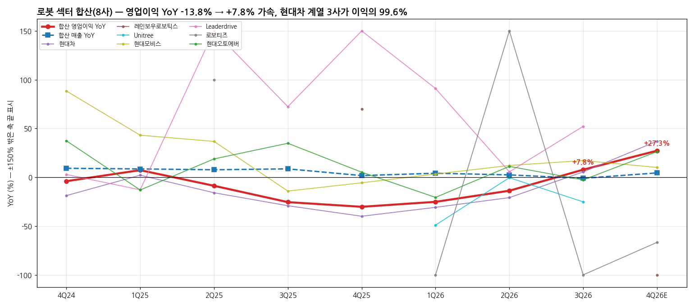
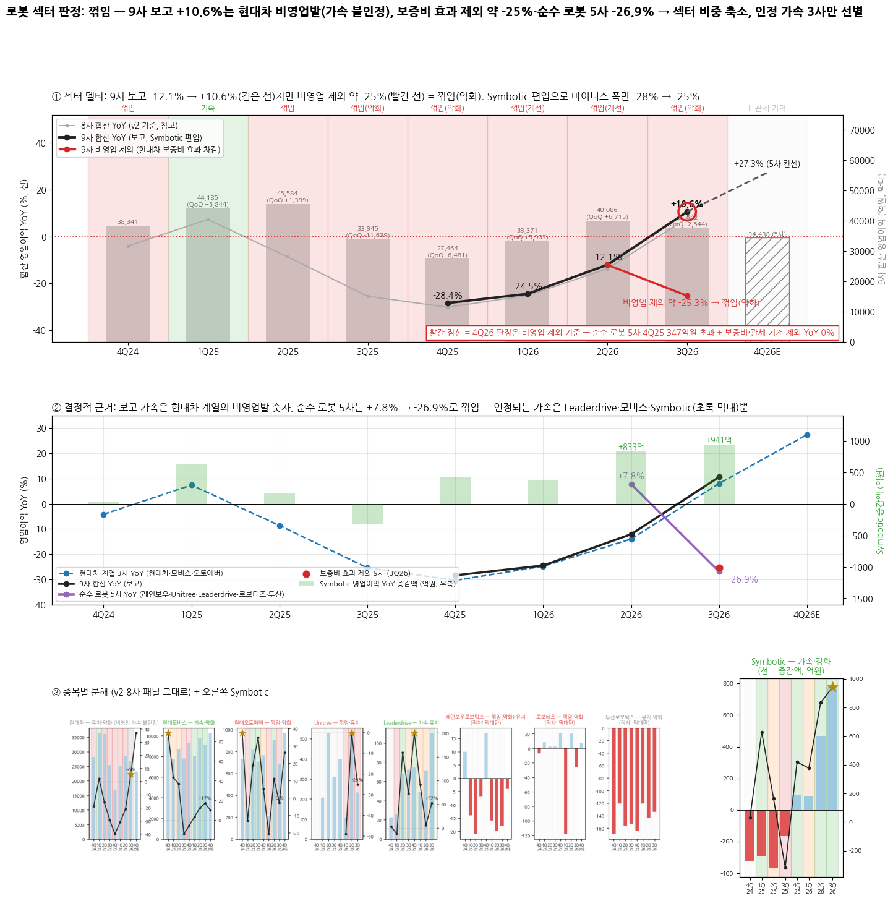

# 로봇 섹터 리뷰 (섹터 통합)

> 현재 상태 (최신 분기 기준)
> 최신 분기: 2026-Q3
> 섹터 델타: 꺾임 | 내러티브: 약화
> 모멘텀 신호: 없음
> 활성 테마: 없음
> 포지셔닝: 섹터 축소 | 한국 언더퍼폼 | 선호 Leaderdrive, 현대모비스
> 델타 근거: 보고 YoY -13.8→+7.8%는 보증비 환입·관세 기저발이라 불인정(본업 약 -28%) → 4Q 컨센 +27.3%도 저기저라 불인정
> 내러티브 근거: 합산 8사 중 약화 5·강화 0, 대형주 TP 하향이 모두 멀티플발로 로봇 옵션 가치가 깎이는 중
> PM 근거: 순수 로봇 5사도 +7.8→-26.9%로 꺾여 섹터 축소. 한국은 이익이 본업 꺾인 완성차에 몰리고 순수 3사 적자 확대로 언더퍼폼
> 편입 종목: 합산 8사 — 휴머노이드 완성체(현대차, 레인보우로보틱스, Unitree) + 로봇 부품(현대모비스, Leaderdrive, 로보티즈) + 산업·물류 자동화(현대오토에버, 두산로보틱스). 합산 제외: UBTech(반기), Sanhua·Tuopu(BT 결정), Tesla(확장), 에스비비테크·Teradyne(트래킹), Symbotic(발표 전 — 추가 예정)
> 갱신 시각: 2026-11-23 16:20 KST (v2 — BT 2026-11-23 결정: 비영업발 가속 불인정 반영)

## 누적 시계열

| 분기 | 편입 종목 | 합산 매출 | 합산 영업이익 | OPM | 매출 YoY | 영업이익 YoY | 영업이익 YoY 델타 (%p) | 섹터 델타 | 내러티브 | 모멘텀 신호 | 활성 테마 |
|---|---|---|---|---|---|---|---|---|---|---|---|
| 4Q24 | 7사 (Unitree 제외 — 분기 공시 1Q25\~) | 625,455억원 ($44.08B) | 38,667억원 ($2.72B) | 6.2 | +9.2% | -4.0% | n.m. | — | - | - | - |
| 1Q25 | 8사 레벨 / YoY 7사 | 600,861억원 ($42.34B) | 44,476억원 ($3.13B) | 7.4 | +8.6% | +7.3% | +11.3%p | 가속 | - | - | - |
| 2Q25 | 8사 레벨 / YoY 7사 | 654,267억원 ($46.11B) | 45,950억원 ($3.24B) | 7.0 | +7.7% | -8.7% | -16.0%p | 꺾임 | - | - | - |
| 3Q25 | 8사 레벨 / YoY 7사 | 629,529억원 ($44.36B) | 34,109억원 ($2.40B) | 5.4 | +8.6% | -25.5% | -16.7%p | 꺾임(악화) | - | - | - |
| 4Q25 | 8사 레벨 / YoY 7사 | 637,437억원 ($44.92B) | 27,371억원 ($1.93B) | 4.3 | +1.7% | -30.2% | -4.8%p | 꺾임(악화) | - | - | - |
| 1Q26 | 8사 | 625,901억원 ($44.11B) | 33,285억원 ($2.35B) | 5.3 | +4.2% | -25.2% | +5.1%p | 꺾임(개선) | - | - | - |
| 2Q26 | 8사 | 670,339억원 ($47.24B) | 39,619억원 ($2.79B) | 5.9 | +2.5% | -13.8% | +11.4%p | 꺾임(개선) | - | - | - |
| **3Q26** | **8사 (UBTech·Sanhua·Tuopu·Tesla·트래킹 제외, Symbotic 추가 예정)** | **622,932억원 ($43.90B)** | **36,766억원 ($2.59B)** | **5.9** | **-1.0%** | **+7.8% (비영업 제외 약 -28%)** | **+21.6%p (비영업 제외 약 -14%p)** | **꺾임(악화)** | **약화** | **없음** | **없음** |

→ **환율 (고정, 3Q26 평균)**: $1 = 1,419원, RMB 1 = 211원 — 엔터 섹터 리뷰와 같은 값(한국은행 원/달러 MBW 인용, 위안은 TME 3Q26 역산 교차환율). 전 분기 같은 환율 적용(YoY에 환율 효과 없음), 괄호 달러도 같은 환율 [계산]. 3Q26 합산에서 위안 종목(Unitree·Leaderdrive)은 영업이익의 0.9%라 환율 선택이 판정에 주는 영향은 없다
→ **합산 방식**: 서브섹터 리뷰 3개(`휴머노이드 완성체_섹터리뷰.md`, `로봇 부품_섹터리뷰.md`, `산업·물류 자동화_섹터리뷰.md`)의 합산을 더했다 — 종목 중복 없음(현대차 계열 3사는 각자 한 서브섹터에만). 동일 표본: Unitree는 YoY 1Q26부터 편입
→ **이익 비중 (3Q26)**: 현대차 72.8%, 현대모비스 24.9%, 현대오토에버 1.9% = **현대차 계열 3사 99.6%** / 순수 로봇 5사(레인보우·Unitree·Leaderdrive·로보티즈·두산로보틱스) 합계 164억원(0.4%) [계산] — **섹터 합산 델타는 로봇이 아니라 자동차·자동차 부품·그룹 IT 사이클을 반영한다.** BT가 핵심으로 지정해 합산에 넣었지만, 판정 해석은 아래 "로봇 순수도" 표와 함께 봐야 한다
→ **4Q26E 표본**: 컨센이 있는 5사(현대차·레인보우·모비스·로보티즈·오토에버), 4Q25도 같은 5사 [계산]

### 로봇 순수도 (로봇 매출 비중)

| 종목 | 서브섹터 | 로봇 매출 비중 | 근거 | 합산 |
|---|---|---|---|---|
| 현대차 | 휴머노이드 | 0% (연결) | BD는 HMG Global(현대차 49.5%) 산하 지분법 — 연결 매출 0 | 포함 |
| 레인보우로보틱스 | 휴머노이드 | ≈100% (휴머노이드 13.5%, 협동로봇 23.8%, 용역 등 57.8%) | DART 「주요매출 현황」 3Q26 | 포함 |
| Unitree | 휴머노이드 | 100% (2025 휴머노이드 51%, 사족 41%) | 2025 연간 제품별 [계산] | 포함 |
| UBTech | 휴머노이드 | ≈89% (풀사이즈 46.5%, 锋龙 편입분 제외) | 1H26 사업부 매출 | 제외(반기) |
| Tesla | 휴머노이드(확장) | 0% (Optimus 외부 인도 2027년 말) | 3Q26 리뷰 | 제외 |
| 현대모비스 | 부품 | ≈0% (액추에이터 시제품 실비 정산) | 회사 IR·삼성 인용 | 포함 |
| Leaderdrive | 부품 | ≈100% (로봇 감속기, 구현형 AI 비중 미공시) | 3Q26 리뷰 | 포함 |
| 로보티즈 | 부품 | 100% (액추에이터) | 3Q26 리뷰 | 포함 |
| Sanhua / Tuopu | 부품 | 미분리 / 0.1% | 3Q26 리뷰 | 제외(BT) |
| 에스비비테크 | 부품 | 감속기 67.6% | DART 3Q26 | 제외(트래킹) |
| 현대오토에버 | 산업·물류 | 미분리(≈0%) | 사업 품목 SI·ITO·차량SW | 포함 |
| 두산로보틱스 | 산업·물류 | 100% | 3Q26 리뷰 | 포함 |
| Teradyne Robotics | 산업·물류 | 100% (부문) | 10-Q 부문 | 제외(트래킹) |

→ 합산 영업이익 기준 로봇 순수도(로봇 매출 ≈100% 종목의 이익 비중)는 **0.4%** [계산]

## 2026-Q3 섹터 리뷰

> 분석 대상: 서브섹터 리뷰 3개(위) + 종목 실적 리뷰 14개(`earnings-review/2026-Q3_{현대차, 레인보우로보틱스, 688836.SS, TSLA, 002050.SZ, 601689.SS, 현대모비스, 688017.SS, 로보티즈, 에스비비테크, 두산로보틱스, 현대오토에버, TER}_리뷰.md`, `2026-Q2_9880.HK_리뷰.md`). Symbotic 리뷰 미작성(11/23 장후 발표)

① 섹터 합산 숫자와 서브섹터별 합산

| 구분 (억원, 고정환율) | 4Q24 | 1Q25 | 2Q25 | 3Q25 | 4Q25 | 1Q26 | 2Q26 | 3Q26 | 4Q26E |
|---|---|---|---|---|---|---|---|---|---|
| **로봇 합산(8사)** 매출 | 625,455 | 600,861 | 654,267 | 629,529 | 637,437 | 625,901 | 670,339 | 622,932 | 664,498 |
| 로봇 합산(8사) 영업이익 | 38,667 | 44,476 | 45,950 | 34,109 | 27,371 | 33,285 | 39,619 | 36,766 | 34,438 |
| 로봇 합산(8사) OPM | 6.2 | 7.4 | 7.0 | 5.4 | 4.3 | 5.3 | 5.9 | 5.9 | 5.2 |
| 로봇 합산(8사) 매출 YoY | +9.2% | +8.6% | +7.7% | +8.6% | +1.7% | +4.2% | +2.5% | -1.0% | +4.5% |
| 로봇 합산(8사) 영업이익 YoY | -4.0% | +7.3% | -8.7% | -25.5% | -30.2% | -25.2% | -13.8% | **+7.8%** | +27.3% |
| 로봇 합산(8사) 영업이익 YoY 델타 | n.m. | +11.3%p | -16.0%p | -16.7%p | -4.8%p | +5.1%p | +11.4%p | **+21.6%p** | +19.5%p |
| **휴머노이드 완성체** 영업이익 | 28,232 | 36,529 | 36,522 | 25,676 | 17,370 | 25,236 | 29,014 | 26,986 | 23,219 |
| 휴머노이드 영업이익 YoY | -18.2% | +2.1% | -15.8% | -29.1% | -39.9% | -30.9% | -20.6% | +5.1% | +36.8% |
| 휴머노이드 델타 | n.m. | +20.3%p | -17.9%p | -13.3%p | -10.7%p | +9.0%p | +10.4%p | +25.7%p | |
| **로봇 부품** 영업이익 | 9,877 | 7,801 | 8,770 | 7,877 | 9,400 | 7,957 | 9,844 | 9,225 | 10,253 |
| 로봇 부품 영업이익 YoY | +88.2% | +43.2% | +37.3% | -13.6% | -4.8% | +2.0% | +12.2% | +17.1% | +9.9% |
| 로봇 부품 델타 | n.m. | -45.0%p | -5.9%p | -50.8%p | +8.7%p | +6.8%p | +10.2%p | +4.9%p | |
| **산업·물류 자동화** 영업이익 | 558 | 146 | 658 | 555 | 601 | 91 | 761 | 555 | 966 |
| 산업·물류 영업이익 YoY | +12.0% | -38.7% | +8.6% | +29.4% | +7.7% | -37.7% | +15.7% | +0.0% | +26.3% |
| 산업·물류 델타 | n.m. | -50.7%p | +47.2%p | +20.8%p | -21.7%p | -45.4%p | +53.3%p | -15.7%p | |
| **현대차 계열 3사** 영업이익 YoY | -4.2% | +7.4% | -8.6% | -25.4% | -30.4% | -24.8% | -14.0% | +8.0% | +27.4% |
| **순수 로봇 5사** 영업이익 | -143 | 106 | 420 | 225 | 347 | -100 | 453 | 164 | — |
| 순수 로봇 5사 영업이익 YoY | n.m. | n.m. | n.m. | n.m. | n.m. | n.m.(로보티즈 성과급) | +7.8% | **-26.9%** | — |
| **한국 합계(6사)** 영업이익 YoY | -4.0% | +7.3% | -8.8% | -25.5% | -30.4% | -25.1% | -14.0% | +8.0% | +27.3% |
| **중국 합계(Unitree·Leaderdrive)** 영업이익 | 23 | 233 | 595 | 383 | 473 | 155 | 597 | 342 | — |
| 중국 합계 영업이익 YoY | +2.9% (LDR) | -12.9% (LDR) | +158.9% (LDR) | +72.4% (LDR) | +229.0% (LDR) | -33.5% | +0.3% | **-10.5%** | — |

→ (출처: 서브섹터 리뷰 3개·종목 리뷰 1번 ① 표, 고정환율 원화 환산 [계산]. 4Q26E = 5사 컨센(현대차 4곳·모비스 4사·오토에버 7사·로보티즈 4사·레인보우 1곳 평균). "(LDR)" = 그 분기 YoY 표본이 Leaderdrive 1사)
→ **합산 가속의 질**: 3Q26 합산 증가분 +2,657억원 중 현대차 +1,399억, 모비스 +1,338억, 오토에버 -19억, 순수 로봇 5사 -61억 [계산]. 현대차 증가분은 판매보증비 YoY -1.22조(충당부채 환율효과)·관세 기저발 — 이를 빼면 합산 영업이익 약 24,566억원, **YoY 약 -28%(꺾임)** [계산, 현대차 리뷰 ⚠의 단순 차감]. 모비스 증가분은 본업(화재 비용 971억 부담 후)
→ **비영업발 가속 불인정 (BT 2026-11-23 — "비영업 요인은 쳐주지 말아야 한다")**: 인수 주도 가속 규칙과 같은 방식으로, 현대차 판매보증비 환율효과·관세 기저가 만든 가속은 섹터 판정에서 가속으로 세지 않는다. 보고 합산 숫자는 표에 그대로 두고 **3Q26 섹터 판정은 비영업 제외 합산(약 -28%, 2Q26 -13.8%보다 마이너스 폭 확대) 기준 꺾임(악화)**. 현대차 종목 판정도 `유지 | 약화 → 매매 제외 구간`으로 수정됨
→ 컨센 경로: 4Q26E +27.3%(4Q25 OPM 4.3% — 현대차 관세 비용 1.46조(하나 집계) 저기저, 같은 원칙이면 가속으로 세지 않음) → 1Q27E 현대차 계열 3사 합산 -0.5%(현대차 -4%·모비스 +6.9%·오토에버 2곳 평균, 소수 의견) [계산] → **보고 합산 YoY 정점은 4Q26E(관세 기저), 1Q27에 보고 기준으로도 꺾임 경로** [전망]

→ (출처: 8사 실적 리뷰로 계산, 고정환율. 굵은 빨강 = 8사 합산 영업이익 YoY, 파랑 점선 = 합산 매출 YoY, 가는 선 = 종목별(흑자 종목))

② 서브섹터 델타 순위표

| 순위 | 서브섹터 | 합산 영업이익 YoY 2Q26 → 3Q26 (보고 / 비영업 제외) | 델타 (판정 기준) | 판정 | 1등 종목 | 비고 |
|---|---|---|---|---|---|---|
| 1 | 로봇 부품 | +12.2% → +17.1% | +4.9%p | 유지 | Leaderdrive (가속·유지) / 한국 현대모비스 (가속·약화) | 모비스 본업 가속(로봇 0%), 순수 부품 2사 +31.3% → +13.1% — `로봇 부품_섹터리뷰.md` |
| 2 | 산업·물류 자동화 | +15.7% → +0.0% | -15.7%p | 둔화 (잠정) | 두산로보틱스 (유지·약화) | 오토에버 ITO 200억 이연(타이밍 — 보정 금지), Symbotic 추가 예정 — `산업·물류 자동화_섹터리뷰.md` |
| 3 | 휴머노이드 완성체 | -20.6% → +5.1% / 비영업 제외 약 -42% | 약 -22%p (보고 +25.7%p) | 꺾임(악화) | 없음 (현대차 비영업 가속 불인정) | 순수 휴머노이드 2사 -0.2% → -29.4% — `휴머노이드 완성체_섹터리뷰.md` |

→ 판정은 서브섹터 리뷰 그대로(v2). 순위는 판정 기준 델타 순 — 휴머노이드는 비영업 제외 기준(BT 2026-11-23)이라 보고 델타 1위에서 3위로 내려갔다
→ 비영업 요인: 휴머노이드 = 현대차 판매보증비 환율효과·관세 기저(**가속 불인정**) / 부품 = 모비스 화재 비용(역방향)·고객사 비용 회수·관세 저기저(종목 리뷰가 "본업 가속, 인수·환입 아님"으로 판정 — 가속 유지) / 산업·물류 = 오토에버 매출 이연(타이밍) / UBTech = 주식보상 소멸·锋龙 인수(반기, 합산 제외)
→ **선행 종목**: 순수 로봇이 먼저 꺾였다 — Sanhua·Tuopu(2025), Unitree(1Q26\~), UBTech(1H26 둔화), 레인보우·로보티즈(3Q26). 인정되는 가속은 Leaderdrive(오가닉)·현대모비스(본업) 둘 — 8사 중 2사

③ 섹터 공통 쟁점

(1) **로봇 매출이 합산에 안 잡힌다** — 현대차·모비스·오토에버·Sanhua·Tuopu·Tesla
(1-1) 섹터 영업이익의 99.6%를 내는 현대차 계열 3사의 로봇 매출은 0에 가깝다(BD 지분법, 액추에이터 시제품 실비, 로봇 SI 미분리). 로봇 매출이 의미 있는 시점은 셀사이드 공통으로 2027 설비·2028 양산 (각 리뷰)
(1-2) [판단] 로봇 섹터 합산 델타는 2027년까지 "현대차 그룹 자동차 사이클 + 순수 로봇 적자 변화"의 합이다. 섹터 판정과 별개로 순수 로봇 5사 델타를 함께 보는 이중 프레임이 필요하다 — 이번 분기는 둘이 반대 방향(보고 합산 가속 vs 순수 꺾임) — BT 2026-11-23 결정으로 섹터 판정은 비영업 제외 기준(꺾임(악화))

(2) **매출은 빠르고 이익은 역성장 — 투자 국면** — Unitree·레인보우·로보티즈·두산로보틱스·UBTech·Tesla
(2-1) 순수 로봇 5사 매출 YoY +61.7%(3Q26) vs 영업이익 -26.9% [계산]. Unitree R&D +250%, 레인보우 인력 1.5배, 로보티즈 판관비 +68%, 두산 판관비 동반 증가, Tesla R&D +69% (각 리뷰)
(2-2) [판단] 피지컬AI 테마분석의 "수요 폭증 × 공급 증가(D)" 진단이 이익에서 확인된다 — 수요는 매출로 오는데 경쟁·투자가 이익을 다 먹는다

(3) **양산·공급 지연** — UBTech(광시 공장), 로보티즈(모터·희토류), 레인보우(RB-Y2 전환 공백), Tesla(Optimus 램프), 모비스(대량 양산 2029년 이후 — 메리츠)

(4) **마진 하락 = 가격 경쟁** — Unitree GPM 62.0% → 50.6%, Leaderdrive GPM -6.2%p, 로보티즈 GPM -12.2%p, Tuopu GPM 2년간 -5.5%p, UBTech 풀사이즈 평균단가 84.9 → 64.1만위안 (각 리뷰)

(5) **TP 하향 = 멀티플** — 현대차(-15.6%)·모비스(-8.7%)·오토에버(-14%): 세 리뷰 모두 이익 추정 하향보다 멀티플(로봇 피어·신사업 가치) 하향이 컸다. 두산로보틱스 고점 대비 -69%, 에스비비테크 -73%, 모비스 -55% (각 리뷰)
(5-1) [판단] 시장은 이미 "로봇 프리미엄"을 빼는 중 — 피지컬AI 테마 sunset(2026-11-23 BT)과 같은 방향

(6) **환율** — 원화 강세: 현대차 판매보증비 환입(영업이익 +)·모비스·오토에버 영업외 외환손실(순이익 -) / 위안 강세: Sanhua·Tuopu 환차손

→ 종목 고유 이슈: 현대차 — 연말 로봇생산법인·BD 1조원+ 유증 / 모비스 — 액추에이터 전용 공장 입지 / 오토에버 — GPUaaS 지분법 / 레인보우 — 삼성향 용역 / Unitree — 제품별 분기 미공시 / UBTech — 매출채권 1년 초과 7.67억위안 / 두산로보틱스 — CEO 교체·순현금 -440억 / 에스비비테크 — 12월 차입 만기

④ 섹터 판정

> 섹터 델타: **꺾임** | 내러티브: **약화** → **보고 합산 +7.8%(-13.8%에서 플러스 전환)는 현대차 판매보증비 환입·관세 기저가 만든 숫자라 가속으로 세지 않는다 — 비영업 제외 약 -28%로 마이너스 폭이 커졌고, 순수 로봇 5사도 +7.8% → -26.9%로 꺾였다. 로봇 섹터는 실적 모멘텀 구간이 아니라 이벤트(BD·액추에이터 공장·Optimus·CES) 구간. 4Q26E +27.3%도 관세 저기저라 가속으로 세지 않는다**

→ (출처: 8사 실적 리뷰로 계산, 고정환율 원화 환산. 상단 = 8사 합산 영업이익 YoY(검은 선 = 보고, 빨간 선 = 3Q26 비영업 제외)·합산 영업이익과 QoQ 증가액(막대)·분기별 판정 배경색(3Q26 = 비영업 제외 기준 꺾임(악화), 4Q26E = 관세 기저라 판정 보류), 점선 = 4Q26E(5사) / 중단 = 결정적 근거 — 8사 합산 vs 현대차 계열 3사 vs 순수 로봇 5사, 빨간 점 = 보증비 효과 제외 합산 / 하단 = 종목별 분해(막대 영업이익, 선 YoY ★ 정점, 배경 분기 판정 — 현대차 3Q26은 유지))

→ 델타 판정 근거: 보고 합산은 -13.8%(2Q26) → +7.8%(3Q26)로 숫자상 가속 조건이지만, 증가분 +2,657억원 중 현대차 +1,399억이 판매보증비 환율효과(-1.22조)·관세 기저발 → **가속 불인정**. 보증비 효과 제외 합산 약 -28%(마이너스 폭 확대), 순수 로봇 5사 +7.8% → -26.9% → **꺾임(악화)**
→ 비영업 요인 영향: 판정을 가른 요인 — 보고 기준이면 가속, 비영업 제외 기준이면 꺾임(악화). BT 2026-11-23 결정으로 후자를 섹터 판정으로 쓴다(인수 주도 가속 규칙과 같은 처리). 현대모비스 가속은 종목 리뷰가 본업(화재 비용 971억 부담 후)으로 판정해 그대로 인정
→ 내러티브 근거: 합산 8사 중 약화 5(현대차·모비스·로보티즈·두산·오토에버)·유지 3(레인보우·Unitree·Leaderdrive), 강화 0. 합산 제외 종목도 약화 3(UBTech·Sanhua·Tuopu)·유지 2(Tesla·Teradyne)·강화 1(에스비비테크) → **약화**. TP 하향이 세 대형주 모두 멀티플발 — "로봇 옵션 가치"가 깎이는 중
→ 직전 분기 대비: 꺾임(개선)(2Q26) → 꺾임(악화)(3Q26, 비영업 제외). 소급 궤적: 꺾임(2Q25, 관세 시작) → 꺾임(악화)(3Q25\~4Q25) → 꺾임(개선)(1Q26\~2Q26, 마이너스 폭 2개 분기 연속 축소 = 턴어라운드 패턴) → 3Q26 비영업 제외 시 다시 악화 — **턴어라운드 패턴은 본업 기준으로 이어지지 않았다**

⑤ 모멘텀 신호

→ 없음 (활성 테마 없음)
→ 테마 상태: **피지컬AI 테마는 2026-11-23 BT 판단으로 sunset**("시장 전체 테마 종료 상태", `earnings-theme/피지컬AI_테마분석.md`). 섹터 판정 꺾임(악화)은 그 판단과 같은 방향 — 테마 active_companies 중 theme_relevance high 종목(Unitree·Leaderdrive·로보티즈·레인보우)은 Leaderdrive만 가속, 3사 꺾임 [판단]. 테마는 이미 닫혔으므로 "테마 종료 후보"로 다시 올리지 않는다
→ 조건 대조 — 델타 급증 후보: ① 섹터 델타 확대 — 미충족(비영업 제외 꺾임(악화)) ② 편입 종목 과반 가속 — 2/8(모비스·Leaderdrive)로 미충족 ③ 내러티브 형성·강화 — 미충족(약화) → 후보로 올리지 않음
→ 반대 논거: ① 감속기 레이어(Leaderdrive 가속 + 에스비비테크 적자 축소 전환·강화)는 델타가 커지는 중 ② 4Q26E 보고 합산 +27%가 나오면 시장이 "실적 + 이벤트(로봇생산법인·액추에이터 공장)"로 읽을 수 있다 — 다만 관세 기저발이라 이 리뷰에서는 가속으로 세지 않는다
→ 다음 분기 후보 조건: 순수 로봇 5사 합산 영업이익 YoY 플러스 복귀(4Q25 기저 347억원 초과) + 순수 로봇 과반 가속 + 현대차 계열 본업(비영업 제외) YoY 플러스

⑥ 다음 분기 섹터 관전 포인트

| 순위 | 무엇을 (변수·임계값) | 어떤 데이터로 | 언제 |
|---|---|---|---|
| 1 | **4Q26 섹터 판정은 비영업 제외 기준** — 보고 합산 YoY(컨센 +27.3%, 4Q25 기저 27,371억원)는 현대차 관세 저기저라 가속으로 세지 않는다. 판정선: ① 순수 로봇 5사 영업이익 4Q25 347억원 초과(= 플러스 복귀) ② 현대차 판매보증비 되돌림·관세 기저를 걷어낸 본업 영업이익 YoY 0% 이상 — 둘 다 미달이면 꺾임 지속, 마이너스 폭 축소면 꺾임(개선) | 8사 4Q26 실적 (현대차 계열 1월 말, 한국 소형주 3월 사업보고서, 중국 2사 3\~4월 연간 보고서) | 2027년 1월 말 \~ 4월 |
| 2 | 현대차 연말 로봇생산법인 설립·BD 1조원+ 제3자 유상증자 / 모비스 액추에이터 전용 공장 투자 공시 — 로봇 실체 이벤트 | 현대차·모비스 공시 | 2026년 12월 \~ 2027년 1Q |
| 3 | 1Q27 현대차 계열 3사 합산 YoY 0% — 컨센 -0.5%(보고 기준으로도 꺾임 경로) 확인 | 현대차·모비스·오토에버 1Q27 실적·컨센 변화 | 2027년 4월 |
| 4 | Symbotic FY26 Q4 — 미국 물류 자동화 편입 후 산업·물류·섹터 합산 재계산 | Symbotic 8-K | 2026-11-24 KST |
| 5 | 순수 로봇 가격·마진 — Unitree GPM 50% 방어, Leaderdrive GPM 33% 유지, UBTech 2H26 매출 22\~27억위안 | 각 사 연간 보고서 | 2027년 3\~4월 |

⑦ 글로벌 PM 포지셔닝 — 결론

> **섹터: 비중 축소 — 순수 로봇 5사 YoY 플러스 복귀 + 현대차 계열 본업 YoY 플러스면 중립 복귀** | **서브섹터: 부품 유지(Leaderdrive 집중) > 산업·물류 유지(잠정) > 휴머노이드 축소** | **한국: 언더퍼폼 (예외 현대모비스)**

(1) 섹터 비중 — 축소 [판단]

| 판단 축 | 이번 분기 근거 (수치) | 방향 |
|---|---|---|
| 이익 델타 (1순위) | 비영업 제외 합산 -13.8% → 약 -28% 꺾임(악화) / 순수 로봇 5사 +7.8% → -26.9% 꺾임 / 보고 합산 +7.8%는 가속 불인정 | 축소 |
| YoY 정점 시점 | 보고 합산 컨센 정점 4Q26E(+27%, 관세 저기저), 1Q27E 보고 기준으로도 꺾임 경로. 순수 로봇은 Unitree·Sanhua·Tuopu 이미 정점 통과 | 축소 |
| 선행지표 | 로보티즈 수주잔고 약 100만 개(출하 32\~33만), 두산 북미 수주잔고 $9.1M(2개 분기 감소), 모비스 BD 액추에이터 수주 확정 | 중립 |
| 최종 수요 | 휴머노이드 출하 2026 상반기 약 2.5만 대(IDC, +432% — 피지컬AI 테마분석), Teradyne Robotics 매출 +27.6% | 확대 쪽 |
| 이벤트·정책 | 현대차 로봇생산법인·BD 유증(12월), 모비스 액추에이터 공장, CES 2027, Optimus 시연 | 양방향(이벤트 드리븐) |
| 밸류에이션 (2순위) | 현대차·모비스·오토에버 TP 하향은 멀티플 — 로봇 옵션 가치 축소 | 축소 쪽 |
| 주가 낙폭 | 모비스 -55%, 두산로보틱스 -69%, 에스비비테크 -73% (고점 대비, 각 리뷰) | 디레이팅 선행 |

→ 판정 기준 델타가 꺾임(악화)이고 순수 로봇도 꺾였다 → BT 프레임(델타가 꺾이면 매매하지 않음)대로 **축소**. 섹터 안에서 남길 것은 인정되는 가속 2종목(Leaderdrive·현대모비스)뿐
→ 중립 복귀: 4Q26에 순수 로봇 5사 합산 영업이익이 4Q25(347억원) 초과 + 현대차 계열 본업(보증비·관세 기저 제외) 영업이익 YoY 플러스
→ 확대 전환: 중립 복귀 조건 + 순수 로봇 과반 가속 + 현대차 로봇생산법인·모비스 공장 중 1개 실체 확인
→ 반대 논거: 주가 낙폭이 이미 크고(-55\~-73%), 4Q26E 보고 숫자(+27%)와 연말 이벤트가 겹치면 단기 반등이 나올 수 있다 — 델타 프레임 결론이며 이벤트 프레임이면 반대일 수 있다

(2) 한국 vs 글로벌 — 한국 언더퍼폼 [판단]

| 국가 | 합산 편입 종목 (이번 분기) | 영업이익 YoY 2Q26 → 3Q26 | 델타 판정 (판정 기준) | 제외 종목 (공시 주기) |
|---|---|---|---|---|
| 한국 | 현대차·레인보우·모비스·로보티즈·오토에버·두산로보틱스 | 보고 -14.0% → +8.0% / 비영업 제외 약 -28% (순수 3사: 적자 축소 +17.7% → 적자 확대 -12.7%) | 꺾임(악화) (현대차 가속 불인정) | 에스비비테크 (트래킹) |
| 중국 | Unitree·Leaderdrive | +0.3% → -10.5% | 꺾임 | UBTech (반기), Sanhua·Tuopu (BT 합산 제외) |
| 미국 | — | — | 비교 불가 — 합산 편입 종목 없음 | Symbotic (발표 전), Tesla (확장), Teradyne (트래킹) |

→ (한국 비영업 제외 = 6사 합산 36,424억원에서 현대차 판매보증비 효과 1.22조 차감 → 24,224억원 vs 3Q25 33,726억원 = 약 -28% [계산]. 한국 순수 3사 = 레인보우·로보티즈·두산: 2Q26 -144억 vs 2Q25 -175억, 3Q26 -178억 vs 3Q25 -158억 [계산])

**서브섹터 × 국가**

| 서브섹터 | 한국 (종목 · 영업이익 YoY 델타) | 글로벌 (종목 · 영업이익 YoY 델타) | 서브섹터 내 우위 | 한국 이익 비중 |
|---|---|---|---|---|
| 휴머노이드 완성체 | 현대차 보고 +26.4%p / 보증비 제외 약 -22%p(유지 — 가속 불인정), 레인보우 축소율 -147.8%p(꺾임(악화)) | Unitree -24.5%p(꺾임, 흑자), UBTech 축소율 +8.1%p(둔화, 1H — 비교 제외) | 글로벌 (덜 나쁨·마진 우위) | 99.1% |
| 로봇 부품 | 모비스 +5.1%p(가속), 로보티즈 적자전환(꺾임) | Leaderdrive +46.5%p(가속), Sanhua -2.2%p·Tuopu +30.7%p(둘 다 꺾임, 합산 제외) | 글로벌 (Leaderdrive) | 98.8% |
| 산업·물류 자동화 | 오토에버 -13.9%p(꺾임), 두산 축소율 +4.3%p(유지) | 비교 불가 — Symbotic 발표 전 (트래킹 Teradyne 유지) | 보류 | 100% |

→ 결론: **한국 언더퍼폼 = 믹스 효과 한국에 불리(크다) + 서브섹터 내 효과 한국에 불리(휴머노이드·부품)**. 한국 이익은 비영업 제외 시 꺾임(악화)인 휴머노이드(현대차)에 몰려 있고(믹스), 같은 서브섹터 안에서도 휴머노이드는 Unitree가 덜 나쁘고 부품은 Leaderdrive가 로보티즈를 이긴다(서브섹터 내)
→ 이유 3개: ① 델타 — 비영업 제외 한국 약 -28% vs 중국 -10.5%, 한국 순수 3사 적자 확대 ② 이익 추정 — 한국 대형 3사 TP 멀티플 하향·현대차 2027E -4.3%, 로보티즈 4Q 컨센 -67% / 중국은 공개 컨센 없음(Leaderdrive 4Q 역산 +98\~192%) ③ 구조 — 한국 로봇 이익은 그룹 수직계열(BD 지분법-모비스-오토에버) 안에 묻혀 숫자로 안 잡히고, 중국은 출하·가격 경쟁력으로 흑자
→ 반대 논거: 미국 공급망 규제(비중국 관절 프리미엄)가 구체화되면 한국(모비스 미국 연 30만 개 액추에이터 계획) 아웃퍼폼 — 이벤트 프레임이면 한국 쪽 레버리지가 크다. 델타 프레임 결론이며 이벤트 프레임이면 반대일 수 있다
→ **예외 종목: 현대모비스** — 한국 안에서 유일하게 인정되는 가속(본업, 인수·환입 아님) + 로봇 액추에이터 실행(31종 시제품). 다만 로봇 순수도 0%, 컨센상 3Q26이 YoY 정점
→ 비교 범위: 한국 6사 실적 리뷰(대형 3사 셀사이드 8\~10건 풀, 소형 3사 0\~5건) / 중국 2사(+UBTech·Sanhua·Tuopu) 숫자 중심 리뷰, 셀사이드 0건 / 미국 편입 종목 없음(Symbotic 발표 전) — **글로벌 쪽 근거 얇음**

(3) 서브섹터 순위와 선호 종목

| 순위 | 서브섹터 | 비중 | 근거 |
|---|---|---|---|
| 1 | 로봇 부품 | 유지 (Leaderdrive 집중) | 델타 유지(+4.9%p), 순수 부품 중 Leaderdrive만 오가닉 가속 — 서브섹터 안 비중을 Leaderdrive로 이동 |
| 2 | 산업·물류 자동화 | 유지 (잠정) | 둔화(0.0%, 오토에버 이연), 4Q 톱니 반등 컨센, Symbotic 반영 후 재판정 |
| 3 | 휴머노이드 완성체 | 축소 | 비영업 제외 꺾임(악화), 순수 완성체 3사 꺾임·둔화, 인정되는 가속 종목 없음 |

→ **선호 종목 원칙 (BT 승인 2026-11-23)**: 1등·선호 종목의 가속이 비영업발이면 1등·선호에서 제외한다 — 인수 주도 가속과 같은 처리. 이번 분기 현대차가 해당
→ **글로벌 선호**: Leaderdrive (가속·유지 — 핵심영업이익 +52%, 순이익 +29%, 로봇 순수도 ≈100%) / **글로벌 비선호**: Unitree (꺾임·유지 — R&D로 3개 분기 연속 역성장), Sanhua·Tuopu (꺾임·약화)
→ **한국 선호**: 현대모비스 (가속·약화 — 본업 가속, 액추에이터 실행) / **한국 비선호**: 현대차 (유지·약화 — 비영업발 가속 불인정, 매매 제외), 로보티즈 (꺾임·약화), 레인보우로보틱스 (꺾임(악화)·유지)
→ 상태 블록 선호 종목: 1위 서브섹터(부품)의 1등 Leaderdrive + 한국 예외 현대모비스 → **Leaderdrive, 현대모비스**
→ **반등 후보 (이벤트 드리븐)**: 현대차 — 확인 이벤트 연말 로봇생산법인·BD 1조원+ 유증 / 레인보우 — CES 2027 삼성 휴머노이드 + 4Q 흑자 17억 초과 / 에스비비테크 — 4Q 적자 -9억 이내(턴어라운드 2개 분기) + 12월 차입 만기 해소 / 오토에버 — 4Q 영업이익 900억+(이연 회수)

(4) 서브섹터별 1등 종목

| 서브섹터 | 서브섹터 1등 | 한국 1등 | 글로벌 1등 | 근거 한 줄 |
|---|---|---|---|---|
| 로봇 부품 | Leaderdrive (가속·유지) | 현대모비스 (가속·약화) | Leaderdrive | 로봇 매출로 가속한 유일한 종목 |
| 산업·물류 자동화 | 두산로보틱스 (유지·약화) | 두산로보틱스 | Symbotic 리뷰 후 결정 | "덜 나쁜 1등" — 적자 축소 4개 분기 연속, 폭 작음 |
| 휴머노이드 완성체 | 없음 | 없음 (현대차 비영업 가속 불인정) | 없음 (Unitree 꺾임 · UBTech 1H 둔화) | 인정되는 가속 종목 없음 |

(5) 콜을 바꾸는 조건과 일정

| 시점 | 이벤트 | 섹터 비중 | 한국 콜 |
|---|---|---|---|
| 2026-11-24 (KST) | Symbotic FY26 Q4 실적 | 산업·물류 재판정, 섹터 합산 재계산 | 미국 편입 → 국가 비교 칸 채움 |
| 2026-12 | 현대차 로봇생산법인·BD 유증 / 모비스 액추에이터 공장 / 에스비비테크 차입 만기 | 이벤트 — 숫자 콜 영향 없음(델타 조건과 함께여야 중립 복귀) | 실체 확인이면 언더퍼폼 → 중립 검토 |
| 2027-01 초 | CES 2027 (삼성 휴머노이드·BD) | 이벤트 — 숫자 콜 영향 없음 | 레인보우 반등 후보 점검 |
| 2027-01 말 | 현대차·모비스·오토에버·Tesla·Teradyne 4Q26 실적 | 현대차 계열 본업(비영업 제외) YoY 플러스면 중립 복귀 검토 | 모비스 1.09조 미만이면 예외 종목 해제 |
| 2027-03 | 레인보우·로보티즈·에스비비테크 사업보고서, UBTech 연간 | 순수 로봇 YoY 플러스 복귀면 중립 복귀 | 한국 순수 3사 적자 축소면 중립 검토 |
| 2027-03\~04 | Unitree·Leaderdrive·Sanhua·Tuopu 연간 보고서 | Leaderdrive GPM 30% 하회면 부품 선호 해제 | 중국 가속이면 언더퍼폼 강화 |
| 2027-04 | 1Q27 현대차 계열 실적 | 보고 기준으로도 0% 미만이면 축소 유지 | — |

→ 직전 분기 콜 체크: 첫 섹터 리뷰 — 직전 콜 없음. v1(같은 날 14:30)의 "섹터 중립 | 한국 중립"은 BT 2026-11-23 비영업 불인정 결정으로 "섹터 축소 | 한국 언더퍼폼"으로 수정

### (서브) UBTech — 어떻게 되고 있나

→ **3Q 합산·판정에는 넣지 않음** — 반기 공시(최신 1H26). 단독 판정 `둔화 | 약화 → 경계 구간 (2H26 매출 22\~27억위안 달성 확인 전까지)` (`2026-Q2_9880.HK_리뷰.md`, 3Q 분기 업데이트 덧붙임 없음)
→ 1H26 매출 12.69억위안(+104.2%), 영업적자 -2.79억위안(축소율 -44.5% → -36.4% 둔화), 주식보상 소멸분 제외 시 -42.4% → -23.9%로 둔화 폭 더 큼 (⚠ 비영업 플래그)
→ 섹터와 비교: 순수 완성체 중 매출 성장은 가장 빠르지만(풀사이즈 휴머노이드 +1,445%) 이익 개선 속도가 줄었다 — Unitree(흑자 감익)·레인보우(적자 확대)와 함께 "순수 완성체 3사 모두 이익 델타 약화"
→ 다음 손익: 2026 연간 실적(2027-03 말) — 2H26 영업적자 -1.89억위안 이하면 가속

### (서브) Tesla — 어떻게 되고 있나

→ **합산·판정에는 넣지 않음** — 단독 판정 `꺾임 | 유지 → 숫자 기준 매매 제외 구간` (`2026-Q3_TSLA_리뷰.md`). 주 섹터(미국 빅테크·소비자·모빌리티)에 이미 합산되고 Optimus 매출 0 — 상세는 `휴머노이드 완성체_섹터리뷰.md` (서브) 섹션
→ 섹터 관점 한 줄: 같은 자동차 사이클 안에서 Tesla는 -56%로 꺾여 있고 현대차는 관세 기저로 보고 +5.5%(가속 불인정, 종목 판정 유지) — 둘 다 이익 델타로는 매매 제외 구간 [판단]

### (추가 예정) Symbotic

→ FY26 Q4(캘린더 3Q26) 2026-11-23 미국 장 마감 후 발표. 실적 리뷰 작성 후 `산업·물류 자동화_섹터리뷰.md`와 이 문서의 3Q26 행·① 표·⑦ 국가 표를 갱신한다(원화 환산 $1 = 1,419원)
