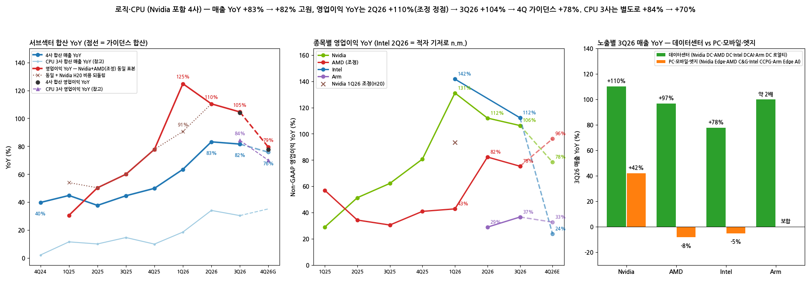
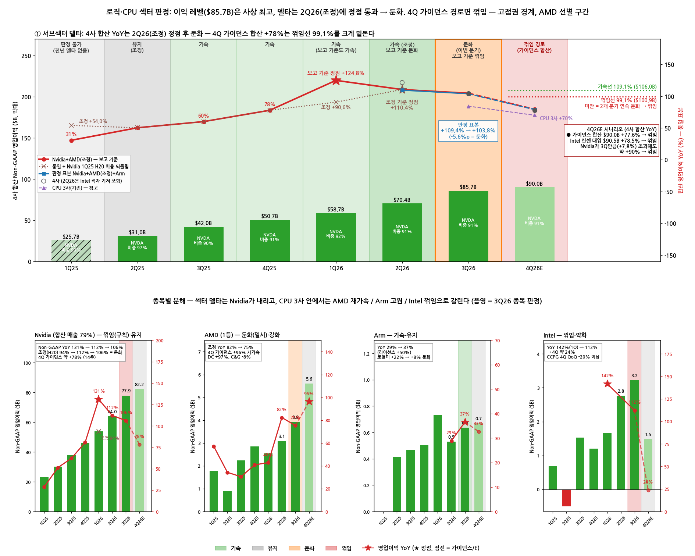

# 반도체 · 로직·CPU 섹터 리뷰

> 현재 상태 (최신 분기 기준)
> 최신 분기: 2026-Q3
> 섹터 델타: 둔화 | 내러티브: 유지
> 모멘텀 신호: 테마 종료 후보 — 에이전트AI
> 활성 테마: 에이전트AI (2026-Q2～)
> 포지셔닝: 서브섹터 유지 | 한국 해당 없음 | 1등 AMD
> 편입 종목: Nvidia, AMD, Intel, Arm
> 갱신 시각: 2026-11-22 22:46 KST

**갱신 기록** — 2026-11-22: Nvidia 3Q FY27 리뷰(`2026-Q3_NVDA_리뷰.md`) 편입, 4사 합산으로 재판정. 11/16판(CPU 3사: 유지 | 유지 | 모멘텀 없음) → 4사: 둔화 | 유지 | 테마 종료 후보. 11/16판 원문은 `로직·CPU_섹터리뷰.md.bak`

## 누적 시계열

| 분기 | 편입 종목 | 합산 매출 | 합산 영업이익 | OPM | 매출 YoY | 영업이익 YoY | 영업이익 YoY 델타 (%p) | 섹터 델타 | 내러티브 | 모멘텀 신호 | 활성 테마 |
|---|---|---|---|---|---|---|---|---|---|---|---|
| 4Q23 | 매출 4사 | $44,501M (CPU 3사 $22,398M) | — | — | +68.5 [역산] (3사 +10.0) | — | — | — | - | - | - |
| 1Q24 | 매출 4사 (YoY = Arm 제외) | $45,169M ($19,125M) | — | — | +82.3 (Arm 제외 3사) / CPU 3사 — (AMD+INTC +6.6) | — | — | — | - | - | - |
| 2Q24 | 매출 4사 | $49,647M ($19,607M) | — | — | +52.8 [역산] (+3.3) | — | — | — | - | - | - |
| 3Q24 | 매출 4사 | $56,029M ($20,947M) | — | — | +44.1 [역산] (+0.9) | — | — | — | - | - | - |
| 4Q24 | 매출 4사 | $62,232M ($22,901M) | — | — | +39.8 (+2.2) | — | — | — | - | - | - |
| 1Q25 | 매출 4사 / 이익 Arm 제외 3사 (YoY = NVDA+AMD) | $65,408M ($21,346M) | $25,744M (Arm 제외) / 3사 $2,469M (2사) | 40.1 (Arm 제외) | +44.8 (+11.6) | +30.6 (H20 되돌림 +54.0) | — | — (산정 불가) | - | - | - |
| 2Q25 | 4사 (YoY = NVDA+AMD 조정) | $68,340M ($21,597M) | $30,971M ($806M) | 45.3 (3.7) | +37.7 (+10.1) | +50.3 | +19.7 (조정 -3.7) | 유지 (조정) / 가속 (보고) | - | - | - |
| 3Q25 | 4사 (YoY = NVDA+AMD) | $81,040M ($24,034M) | $41,981M ($4,229M) | 51.8 (17.6) | +44.6 (+14.7) | +60.0 | +9.7 | 가속 | - | - | - |
| 4Q25 | 4사 (YoY = NVDA+AMD) | $93,313M ($25,186M) | $50,671M ($4,564M) | 54.3 (18.1) | +49.9 (+10.0) | +77.8 | +17.8 | 가속 | - | - | - |
| 1Q26 | 4사 (YoY = NVDA+AMD, Arm 제외 3사 병기) | $106,935M ($25,320M) | $58,722M ($4,939M) | 54.9 (19.5) | +63.5 (+18.6) | +124.8 (H20 되돌림 +90.6) / Arm 제외 3사 +125.3 / CPU AMD+INTC +70.4 | +47.0 (조정 +12.8) | 가속 | - | - | - |
| 2Q26 | 4사 (YoY = Intel 제외 3사, 4사 병기) | $125,174M ($28,953M) | $70,351M ($6,395M) | 56.2 (22.1) | +83.2 (+34.1) | +109.4 (Intel 제외) / NVDA+AMD +110.4 / 4사 +121.4 / CPU AMD+ARM +71.9 | -14.4 (NVDA+AMD) / 조정 +19.8 | 가속 (조정) / 둔화 (보고) | - | - | 에이전트AI (2026-Q2～) |
| **3Q26** | **4사 (델타 = Intel 제외 3사)** | **$147,177M ($31,333M)** | **$85,678M ($7,795M)** | **58.2 (24.9)** | **+81.6 (+30.4)** | **+103.8 (Intel 제외) / 4사 +104.1 / CPU 3사 +84.3 / CPU AMD+ARM +68.6** | **-5.6 (판정 표본) / CPU -3.3** | **둔화 (보고 기준 꺾임)** | **유지** | **테마 종료 후보 — 에이전트AI** | **에이전트AI (2026-Q2～)** |

→ **표기**: 합산 매출·영업이익·OPM·매출 YoY의 괄호 안은 CPU 3사(AMD·Intel·Arm, 11/16판 기준) 값이다. 영업이익 YoY는 분기마다 같은 회사 구성으로 낼 수 있는 표본을 앞에 쓰고 나머지를 병기했다 [계산]
→ **합산 기준 — Non-GAAP(조정) 영업이익, 달러 단일 통화**. 4사 모두 Non-GAAP을 주 지표로 쓴다. Nvidia는 리뷰의 판정 기준이 GAAP이지만, 이 문서는 Intel 구조조정·손상(3Q24 -$9.1B, 1Q26 -$3.1B)과 Arm 주식보상비용 때문에 GAAP 합산을 쓸 수 없어 Nvidia도 리뷰의 Non-GAAP 참고 시계열(FactSet, 삼성·신한 정리)을 가져왔다. 3Q26 기준 Nvidia GAAP $77,520M vs Non-GAAP $77,883M로 차이는 0.5%다 (`2026-Q3_NVDA_리뷰.md` 1번 ①)
→ **캘린더 정렬**: Nvidia 회계분기는 캘린더보다 1개월 늦다(3Q26 = FQ3 FY27, 2026년 8～10월). 다른 3사는 7～9월(Arm은 FQ2 FY27로 캘린더와 같음)이다. Nvidia는 리뷰 표기대로 가장 가까운 캘린더 분기에 매핑했고 월 단위로 재배분하지 않았다 — Micron(9～11월 → 4Q)과 같은 처리다. 따라서 4사 3Q26은 2026년 7～10월에 걸친 합산이다. 4Q26E Nvidia(FQ4 FY27, 11～1월)는 14주 분기다(1주 추가, 리뷰)
→ **Nvidia Non-GAAP 전년 분기(1Q24～4Q24)는 역산**: 리뷰의 Non-GAAP YoY(+28.9% / +51.3% / +62.2% / +80.7%)로 역산하면 $18,057M / $19,937M / $23,275M / $25,516M [역산]. 1Q25～4Q25의 NVDA+AMD YoY는 이 역산치와 AMD 리뷰 1번 표(4Q23부터 Non-GAAP)로 냈다. Intel(1Q25～)·Arm(2Q25～) Non-GAAP 전년치가 없어 2Q26 이전 4사 YoY는 나오지 않는다
→ **Nvidia 1Q25 H20 비용**: 1Q25(FQ1 FY26) H20 재고·구매약정 비용 $4.5B가 Nvidia 1Q25 이익을 눌렀다 (리뷰 ⚠ 비영업 요인 플래그). 이 비용은 Non-GAAP에도 포함돼 있어 Non-GAAP 1Q26 YoY(+131.1%)도 부풀었다. 되돌리면 Nvidia 1Q25 Non-GAAP 약 $27,775M, 1Q26 YoY 약 +93.6%, NVDA+AMD 1Q25 YoY +54.0%·1Q26 +90.6% [계산]. 판정 열은 조정 기준을 앞에, 보고 기준을 괄호에 적었다
→ **Intel 2Q25 적자 기저·AMD 2Q25 MI308 비용**: 11/16판과 같이 AMD는 리뷰의 조정 기저($1,697M)를 쓰고, Intel 2Q25 Non-GAAP 적자(-$503M)는 판정 표본에서 뺐다. Nvidia가 들어오면서 Intel 기저 왜곡은 4사 합산에서 작아졌지만(4사 2Q26 +121.4%로 n.m. 아님), 같은 기준을 유지하려고 2Q26 → 3Q26 델타 판정 표본은 **Intel 제외 3사(Nvidia+AMD 조정+Arm)**로 둔다. 4사 기준으로 봐도 +121.4% → +104.1%(-17.3%p)로 같은 둔화다
→ **소급 판정 열**: NVDA+AMD가 1Q25부터 끊기지 않는 유일한 동일 표본이라(4사 영업이익의 약 95%) 2Q25～1Q26 판정은 이 표본으로 기준표대로 산정했다 [계산]. 내러티브·모멘텀 열은 소급 분기에 리뷰가 없어 `-`. 활성 테마 2Q26은 메모리 섹터 리뷰와 같은 기준(에이전트AI 2026-Q2～)
→ **Intel은 연결 기준, Arm은 캘린더 분기 정렬**: 11/16판과 같다. Intel Foundry 내부 매출은 연결 조정으로 지워지고, Arm 3Q26 = FQ2 FY27(7～9월)
→ **11/16판 대비 정정**: 3사 행을 4사로 다시 썼다. CPU 3사 수치는 괄호 안에 그대로 남겼고 바뀐 숫자는 없다. 3Q26 판정은 유지(CPU 3사) → 둔화(4사)로 바뀌었다

---

## 2026-Q3 섹터 리뷰

> 대상: `earnings-review/2026-Q3_{NVDA|AMD|INTC|ARM}_리뷰.md`. 2026-11-22 Nvidia 편입 갱신 (11/16 초판은 CPU 3사)
> 2층 구조의 서브섹터 리뷰다. 섹터 비중(1단계)과 서브섹터 순위(2단계)는 반도체 통합 리뷰(`반도체_섹터리뷰.md`, 미작성)가 맡는다. 이 문서는 로직·CPU 판정, 서브섹터 내 대비, 1등 종목(3단계)에 답한다
> **11/16판 체크**: 관전 포인트 2순위 "Nvidia 편입 후 재판정"을 이번 갱신으로 처리했다. 11/16판 콜 표는 "Nvidia 영업이익 YoY 가속 → 확대 검토 / 둔화 → 유지"였다 — Nvidia는 꺾임(규칙)·둔화(조정)로 나와 **서브섹터 유지**가 그대로 맞다. 1등 교체 조건("Nvidia 델타가 AMD보다 좋으면")은 미충족(4Q 가이던스 델타 Nvidia -27.9%p vs AMD +20.9%p)

① 섹터 합산 숫자와 델타

| 항목 | 1Q25 | 2Q25 | 3Q25 | 4Q25 | 1Q26 | 2Q26 | **3Q26** | 4Q26E |
|---|---|---|---|---|---|---|---|---|
| 합산 매출 — 4사 ($M) | 65,408 | 68,340 | 81,040 | 93,313 | 106,935 | 125,174 | **147,177** | 164,040 |
| └ Nvidia | 44,062 | 46,743 | 57,006 | 68,127 | 81,615 | 96,221 | **115,844** | 130,000 |
| └ CPU 3사 | 21,346 | 21,597 | 24,034 | 25,186 | 25,320 | 28,953 | **31,333** | 34,040 |
| Nvidia 매출 비중 (%) | 67.4 | 68.4 | 70.3 | 73.0 | 76.3 | 76.9 | **78.7** | 79.2 |
| 합산 Non-GAAP 영업이익 — 4사 ($M) | 25,744 (Arm 제외) | 30,971 | 41,981 | 50,671 | 58,722 | 70,351 | **85,678** | 90,010 |
| └ Nvidia | 23,275 | 30,165 | 37,752 | 46,107 | 53,783 | 63,956 | **77,883** | 82,250 |
| └ CPU 3사 | 2,469 (2사) | 806 | 4,229 | 4,564 | 4,939 | 6,395 | **7,795** | 7,760 |
| OPM — 4사 (%) | 40.1 (Arm 제외) | 45.3 | 51.8 | 54.3 | 54.9 | 56.2 | **58.2** | 54.9 |
| 매출 YoY — 4사 | +44.8 | +37.7 | +44.6 | +49.9 | +63.5 | +83.2 | **+81.6** | +75.8 |
| **영업이익 YoY — 판정 표본 (Nvidia+AMD 조정+Arm)** | — | — | — | — | — | +109.4 | **+103.8** | +79.0 |
| 영업이익 YoY — 4사 | — | — | — | — | — | +121.4 (Intel 적자 기저) | **+104.1** | +77.6 |
| 영업이익 YoY — Nvidia+AMD (조정, 최장 동일 표본) | +30.6 | +50.3 | +60.0 | +77.8 | +124.8 | +110.4 | **+104.6** | +79.4 |
| └ Nvidia 1Q25 H20 비용 되돌림 | +54.0 | +50.3 | +60.0 | +77.8 | +90.6 | +110.4 | **+104.6** | +79.4 |
| **영업이익 YoY 델타 (%p)** | — | +19.7 (조정 -3.7) | +9.7 | +17.8 | +47.0 (조정 +12.8) | -14.4 (조정 +19.8) | **-5.6 (판정 표본)** | -26.5 (4사) |
| **판정 (조정 / 보고)** | — | 유지 / 가속 | 가속 | 가속 | 가속 / 가속 | 가속 / 둔화 | **둔화 / 꺾임** | 꺾임 경로 |
| 영업이익 YoY — CPU 3사 (참고) | — | — | — | — | — | n.m. | **+84.3** | +70.0 |
| 영업이익 YoY — CPU AMD+Arm (11/16 판정 표본) | — | — | — | — | — | +71.9 | **+68.6** | +86.7 |
| 영업이익 YoY — CPU AMD+Intel | — | — | — | — | +70.4 | n.m. | **+90.2** | +74.7 |

→ (출처: 4사 2026-Q3 리뷰 1번 분기 표 [계산]. Nvidia = `2026-Q3_NVDA_리뷰.md` 1번 ① Non-GAAP(FactSet) 행, 4Q26E = 가이던스 매출 $130.0B × GPM 71.5% - Non-GAAP 영업비용 약 $10.7B = 약 $82,250M(리뷰 계산). AMD 4Q26E = 가이던스 매출 $17.0B·하나증권 계산 영업이익 약 $5.6B, Intel = 가이던스 중간값 $15.5B·리뷰 계산 약 $1,490M, Arm = 가이던스 $1.54B·유진 $670M)
→ **"Nvidia 포함 4사" vs "CPU 3사(기존)"** — 두 기준의 결론이 다르다

| 기준 | 3Q26 매출 | 3Q26 Non-GAAP 영업이익 | 영업이익 YoY 직전 → 이번 (판정 표본) | 델타 | 판정 | 4Q26E YoY | 다음 분기 판정선 |
|---|---|---|---|---|---|---|---|
| **Nvidia 포함 4사** | $147,177M | $85,678M (OPM 58.2%) | +109.4% → +103.8% (Intel 제외 3사) / 4사 +121.4% → +104.1% | -5.6%p / -17.3%p | **둔화** (보고 기준 꺾임) | +77.6% (가이던스) | 99.1% 미만이면 꺾임 |
| CPU 3사 (기존) | $31,333M | $7,795M (OPM 24.9%) | +71.9% → +68.6% (AMD+Arm) / 3사 레벨 +84.3% | -3.3%p | 유지 | +70.0% (가이던스) | 79.3% 미만이면 둔화 |

→ (출처: 위 표 [계산]. CPU 3사 기준·판정선은 11/16판 그대로)
→ **Nvidia 기준 편차 — FactSet vs Visible Alpha**: Nvidia 3Q25 Non-GAAP 기저가 출처별로 다르다($37,752M FactSet vs $36,097M Visible Alpha). Visible Alpha 기저면 Nvidia 3Q26 YoY +115.8%, 판정 표본 3Q26 약 +112.5%로 델타가 플러스가 된다 [계산]. 다만 Visible Alpha 2Q25 기저는 리뷰에 없어 같은 출처로 2Q26을 다시 낼 수 없다. 이 문서는 리뷰와 같은 FactSet 시계열로 통일했다 — 판정 표본 델타 -5.6%p는 유지(±5%p) 경계를 0.6%p 넘은 값이라 출처에 민감하다는 점을 ④에 적는다
→ **이익 레벨**: 3Q26 4사 합산 Non-GAAP 영업이익 $85.7B, OPM 58.2%로 둘 다 표본 내 최고다. 4Q26E도 $90.0B로 레벨은 더 오른다(Nvidia +$4.4B, AMD +$1.7B, Intel -$1.7B) [계산]
→ **3Q26 증가분의 출처**: 4사 합산 영업이익 YoY 증가 +$43,697M 중 Nvidia +$40,131M(91.8%), Intel +$1,710M(3.9%), AMD +$1,685M(3.9%), Arm +$171M(0.4%) [계산]. 4Q26E 증가분 +$39,339M도 Nvidia +$36,143M(91.9%)이다. 이 서브섹터의 델타는 사실상 Nvidia의 델타다
→ **컨센 경로상 정점**: 4사 합산 영업이익 YoY 정점은 보고 기준 1Q26(+124.8%), H20 비용을 되돌린 조정 기준 2Q26(+110.4%)이다. 어느 기준이든 3Q26은 정점 이후이고, 4Q 가이던스 합산 +77.6%는 세 번째(보고)·두 번째(조정) 감속이다. 1Q27E Nvidia GAAP 영업이익 YoY는 모건스탠리 +72% ～ HSBC +91%로 넓다(Nvidia 리뷰 1번 (1)) — HSBC 경로면 1Q27에 한 번 재가속, 모건스탠리 경로면 감속 지속 [전망]
→ **CPU 3사만 보면** 11/16판 결론(유지, 4Q 가이던스 합산은 둔화 경로, 정점 여부는 Intel 4Q가 정함)이 그대로다

→ (출처: 4사 2026-Q3 리뷰 [계산]. 왼쪽 = 4사 합산 매출 YoY와 CPU 3사 매출 YoY(참고), Non-GAAP 영업이익 YoY(빨강 = Nvidia+AMD 조정 동일 표본, 갈색 점선 = Nvidia 1Q25 H20 비용 되돌림, 검정 점 = 4사, 보라 = CPU 3사) / 가운데 = 종목별 Non-GAAP 영업이익 YoY(Nvidia FactSet, AMD 조정 기준, Intel 2Q26 n.m., × = Nvidia 1Q26 조정치) / 오른쪽 = 3Q26 노출별 매출 YoY — 데이터센터(Nvidia Data Center·AMD Data Center·Intel DCAI·Arm 데이터센터 로열티) vs PC·모바일·엣지(Nvidia Edge Computing·AMD Client&Gaming·Intel CCPG·Arm Edge AI 로열티). 점선 = 4Q 가이던스)

② 종목별 델타 판정표

| 델타 순위 | 종목 | 구분 | 매출 YoY | Non-GAAP 영업이익 YoY | 영업이익 YoY 델타 | 4Q 가이던스 YoY (델타) | 델타 판정 | 내러티브 | 비영업 요인 | 한 줄 |
|---|---|---|---|---|---|---|---|---|---|---|
| 1 | Arm | 확장 · IP/Arm 진영 | +27.1% | +36.6% | +7.7%p | 약 +32.7% (-3.9%p) | 가속 | 유지 | — (라이선스 일시 급증은 영업 요인) | 라이선스 +50%가 만든 가속, 로열티는 +22% → +8% 둔화. AGI CPU 누적 가시성 $20억으로 2배 상향 |
| 2 | Nvidia | 핵심 · GPU/AI 시스템 (매출 비중 79%) | +103.2% | +106.3% (GAAP +115.3%) | -5.7%p (GAAP -8.8%p) | 약 +78.4% (-27.9%p) | 꺾임 (규칙, 보고 기준) | 유지 | ⚠ 1Q25 H20 비용 $4.5B 저기저 → 1Q26 정점 부풀림. 되돌리면 105 → 124 → 115 = 둔화. 4Q 14주 분기·경영진 교체 비용 | 매출 $115.8B(순증 $19.6B 역대 최대), 컨센 대비 영업이익 +8%, FY28 +70% → +75% 상향. 그러나 CEO 퇴진·조사·BIS로 멀티플 하향, 4Q GPM 71～72% 저점 |
| 3 | AMD | 핵심 · x86 | +44.7% | +75.3% (조정) | -7.0%p | 약 +96.2% (+20.9%p) | 둔화 (일시) | 강화 | 2Q25 MI308 재고 비용 약 $0.8B (조정 기저 사용) | 데이터센터 +97%, PC·게이밍 -8%. 4Q 가이던스 +96%로 재가속, 2027 매출 +80% 이상 |
| 4 | Intel | 확장 · x86 | +20.9% | +112.2% | -29.5%p (1Q26 대비) | 약 +23.7% (-88.5%p) | 꺾임 | 약화 | 2Q25 Non-GAAP 적자 기저 (2Q26 YoY n.m.), Fab 28 사고 (4Q 매출 -$0.3B) | DCAI +78%인데 공급 제약, CCPG 4Q QoQ -20% 이상. 4Q 가이던스 처음으로 컨센 하회, 2027 FCF 적자 |

→ (출처: 각 종목 2026-Q3 리뷰 0번 판정 그대로. Nvidia 판정은 리뷰 기준(GAAP 영업이익 YoY +147% → +124% → +115%, 4Q 가이던스 약 +85%)이고, 이 표의 YoY·델타는 섹터 합산 기준인 Non-GAAP(FactSet: 2Q26 +112.0% → 3Q26 +106.3%, 4Q 약 +78.4%)을 앞에, GAAP을 괄호에 썼다. AMD 델타는 2Q25 MI308 재고 비용 조정 기준(82.3% → 75.3%). Intel 2Q26 YoY는 적자 기저로 n.m.이라 델타는 1Q26(+141.7%) 대비)
→ **델타 순위 기준**: 이번 분기 Non-GAAP 영업이익 YoY 델타 큰 순서 — Arm(+7.7%p) > Nvidia(-5.7%p) > AMD(-7.0%p) > Intel(-29.5%p). 4Q 가이던스 델타로 보면 AMD(+20.9%p) > Arm(-3.9%p) > Nvidia(-27.9%p) > Intel(-88.5%p)로 바뀐다. Nvidia는 이번 분기 델타로는 2위지만 다음 분기 경로가 세 번째로 나쁘다 — 4Q GPM 저점(74.9% → 71.5%)과 영업비용 +20%(14주·경영진 교체) 때문이다 (Nvidia 리뷰 1번 (2)) [판단]
→ **Nvidia 판정의 기준 문제**: 리뷰 판정은 규칙대로 "꺾임"이지만, 꺾임을 만든 정점(1Q26)은 H20 비용 저기저가 만든 값이다. 비용을 되돌리면 Nvidia 단독도 "가속 후 1회 둔화 = 둔화"다. 이 문서는 종목 판정을 리뷰 그대로 가져오고(스킬 규칙), 섹터 판정에서만 조정 기준을 쓴다 — ④에서 영향을 설명한다
→ **섹터 델타를 끈 것과 내린 것**: 3Q26 4사 합산 YoY 증가분의 92%가 Nvidia다. 섹터 델타 -5.6%p도 Nvidia(-5.7%p) 그대로다. CPU 3사 안에서는 Intel·AMD가 반씩 끌었고(증가분 48% vs 47%), 4Q부터는 AMD 혼자 끈다 [계산]
→ **선행 종목은 Intel, 다음이 Nvidia**다. Intel은 Non-GAAP 영업이익 YoY 정점(1Q26 +142%)·매출 YoY 정점(2Q26 +25.4%)이 가장 빨랐고 가장 먼저 꺾였다. Nvidia는 보고 기준 정점이 같은 1Q26(+131%), 조정 기준 2Q26(+112%)이다. 정점 시차는 Intel(1Q26) → Nvidia(1Q26 보고 / 2Q26 조정) → Arm(3Q26) → AMD(정점 미도래, 4Q 가이던스 +96%) 순서다 [판단]

③ 섹터 공통 쟁점

(1) 메모리 가격 상승 → PC·스마트폰 수요 급감 (4사 공통)

| 종목 | 소비자 노출 부문 3Q26 | 4Q 이후 가이던스·코멘트 | 회사가 든 원인 |
|---|---|---|---|
| Nvidia | Edge Computing $8,234M (+42.2% YoY, 매출 비중 7.1%) — 블랙웰 워크스테이션·피지컬 AI가 끌었고 소비자 PC 수요는 약해짐 | 부문 가이던스 없음 | "메모리·시스템 가격 상승으로 소비자 PC 수요 약화" (KB 11/20) |
| AMD | Client & Gaming $3,722M (-8.1% YoY, 영업이익 -33.9%) | 4Q C&G QoQ -20% 이상, 2027 PC 시장 두 자릿수 감소 전제 | "부품 가격 상승이 시스템 가격에 전가" |
| Intel | CCPG $8,097M (-5.1% YoY, -8.8% QoQ, 영업이익 -15.2%) | 4Q CCPG QoQ -20% 이상, 2026 PC TAM -12%(하반기 -20% 이상)·2027 -10% | "메모리 가격 상승과 가용성 악화로 OEM 재고조정 가속" |
| Arm | 로열티 +8.1% (Edge AI 보합) | FQ3 로열티 "한 자릿수 초반", 2027 스마트폰 출하 보합 전제 | "메모리 가격 → 스마트폰 출하 감소" |

→ (출처: 4사 2026-Q3 리뷰 1번 ②·2번 쟁점. Nvidia 1번 ②(3), AMD 쟁점 4, Intel 쟁점 1, Arm 쟁점 1)
→ 공통: 원인이 같다. 메모리 사이클이 강할수록 세트 가격이 오르고, 그 비용을 소비자 출하로 치른다
→ 갈리는 지점: 노출 크기와 재고조정 기간이다. Nvidia는 소비자 노출이 매출의 7%이고 그마저 워크스테이션·피지컬 AI가 덮었다. Intel 셀사이드는 재고조정 종료를 1Q27(대신·NH) vs 2Q27까지 + 메모리 정상화 2028(삼성)로 본다
→ **[판단]** 노출 비중이 결과를 갈랐다. 3Q26 매출 중 소비자 노출은 Intel 49%(CCPG), AMD 28%(C&G), Nvidia 7%(Edge, 일부만 소비자), Arm은 로열티의 대부분이 모바일이다. 이 쟁점은 섹터 합산(Nvidia 79%)에는 작고, CPU 3사 안 순위에는 크다. 메모리 가격이 2027 상반기에도 오르면 Intel·Arm의 PC·모바일 역풍이 길어진다

(2) 데이터센터 수요 > 공급 — 에이전틱 AI가 GPU·CPU 수요를 함께 키운다 (4사 공통)

| 종목 | 데이터센터 3Q26 | 공급 상황 | 2027 성장 가이던스·코멘트 |
|---|---|---|---|
| Nvidia | Data Center $107,610M (+110.1%, 매출 비중 92.9%). Hyperscale +71%·ACIE +195%, Vera Rubin 첫 분기 약 $20B | 구매 약정 $279B → $390B(대부분 다년 메모리), 기판(Kinsus·삼성전기)·패키징(SPIL) 신규 계약. "성장 제약은 수요가 아니라 공급" | FY28(CY27) 매출 +70% → +75%, FY28 CPU 매출·엔터프라이즈 매출 각각 2배 이상 (모건스탠리·KB) |
| AMD | Data Center $8,546M (+96.9%, OPM 33.7%). 서버 CPU 클라우드·엔터프라이즈 YoY 2배 이상 | TSMC 기반, 패키징 장비 직접 매입·재고 +$3B로 공급 선확보 | 서버 CPU 약 2배(직전 +70%), 전사 매출 +80% 이상 |
| Intel | DCAI $7,318M (+77.8%, OPM 41.5%) — 15년 만의 성장 | Intel 3 수율·EMIB 기판·Fab 28로 출하 제약, 기판 증설은 2027 하반기 | 4Q DCAI 연율 약 $30B 중반이 2027 출발점 → 2027 DCAI +30% 안팎 [리뷰 계산] |
| Arm | 데이터센터 로열티 약 2배, 하이퍼스케일러 CPU 내 Arm 점유율 2026년 말 60% 돌파 전망 | AGI CPU 웨이퍼·기판·메모리 공급망 확보 진전 | 데이터센터 로열티 "수년간 세 자릿수 성장", AGI CPU FY27～28 누적 $20억, Nvidia Vera 출하 2026년 말 본격화 |

→ (출처: 4사 2026-Q3 리뷰. Nvidia 1번 ②·쟁점 2, AMD 쟁점 1·4, Intel 쟁점 2, Arm 쟁점 3·4·2-0)
→ 공통: 수요는 문제가 아니다. 4사 모두 "수요 > 공급"을 말했다. Nvidia는 클라우드 수주잔고 $2.0T → $2.5T와 에이전틱 토큰(오픈라우터 주간 토큰 YoY 35배, 80%가 에이전틱)을, Intel은 "서버 CPU TAM 5년 내 $40B → $200B 이상"을, Arm은 "2030 CPU 시장 $2,000억 이상 거론"을 근거로 들었다
→ 갈리는 지점: **누가 공급을 가졌나**. 구매 약정으로 메모리·기판·패키징을 먼저 묶은 Nvidia와 TSMC·패키징 장비를 선확보한 AMD는 데이터센터 +97～110%, 자체 팹·기판에 묶인 Intel은 +78%. Arm은 하이퍼스케일러 자체 칩과 Nvidia Vera(Arm 기반 CPU)로 x86 공백을 메운다 — Nvidia FY28 CPU 매출 2배 이상 전망은 Arm 데이터센터 로열티의 재료다 (Arm 리뷰 2-0: Vera 출하 확인, 로열티 반영 2027)
→ **[판단]** 에이전틱 수요의 수혜가 공급을 가진 쪽으로 쏠리는 구도는 Nvidia가 들어와도 같다. 다만 Nvidia의 델타가 내려가는 이유는 수요·공급이 아니라 기저(3Q25 Nvidia Non-GAAP YoY +62%)와 4Q 마진 저점이다 — 데이터센터 노출이 가장 큰 회사가 델타는 가장 먼저 내려가는 중이다

(3) 마진 — 메모리·HBM 원가와 하드웨어 믹스가 GPM을 누른다 (4사 공통)

| 종목 | 3Q26 GPM·OPM | 다음 분기 | 원인 |
|---|---|---|---|
| Nvidia | Non-GAAP GPM 74.9%, Non-GAAP OPM 67.2% | 4Q GPM 71～72%(저점) → FY28 72～73% 회복, 2027 초 출하분 ASP 15% 이상 인상(유진) | Rubin 초기 생산 비용, 메모리 원가 — 기존 주문을 이전 가격으로 이행 |
| AMD | Non-GAAP GPM 55.9% (-0.3%p QoQ), OPM 29.3% | GPM 55% 가이던스, Citi 2027 GPM 54.2% → 2027 EPS -11% | AI GPU 믹스, HBM 원가 |
| Intel | Non-GAAP GPM 44.1% (+2.3%p), OPM 19.6% (8개 분기 최고) | GPM 38% 가이던스 (Fab 28 -2%p 포함) | PC 물량 감소로 가동률 하락, 맞춤형 실리콘 믹스 |
| Arm | Non-GAAP OPM 44.2% | AGI CPU 1세대 GPM 30%대 후반～40%대 초반, FY28 GPM 91.2%(FY26 98.2%, 유진) | IP → 하드웨어 믹스, 메모리 원가 |

→ (출처: 4사 2026-Q3 리뷰. Nvidia 쟁점 3, AMD 쟁점 2, Intel 쟁점 1, Arm 쟁점 3)
→ **[판단]** 4사 모두 4Q에 마진이 내려가는 구간이다. 메모리 3사의 HBM 가격 인상은 Nvidia·AMD·Arm에 원가다. 갈리는 지점은 **원가를 넘길 수 있느냐**다 — Nvidia는 판가 15% 인상으로 넘기고(FY28 GPM 회복), AMD는 고객과 분담하며 GPM 55%에 묶였다(Nvidia 리뷰 쟁점 3-4). Intel은 가동률 하락으로 4Q GPM이 6%p 빠진다. 섹터 합산 OPM이 4Q26E 58.2% → 54.9%로 내려가는 것도 Nvidia GPM 저점 때문이다 [계산]

(4) 주가 — 이익 추정은 오르는데 멀티플이 먼저 빠졌다 (4사 공통)

| 종목 | 주가 낙폭 | 이익 추정 방향 | 밸류에이션 |
|---|---|---|---|
| Nvidia | 11/17 $155.46(1개월 -27%) → 11/19 $145.98 | 상향 — FY28 Non-GAAP 영업이익 컨센 +2.9%, 하우스 추정 전부 상향. 하우스 TP는 멀티플 하향으로 평균 -1.1% | 12MF P/E 10.8배(5년 평균 33.5배, 대신) |
| AMD | 52주 고점($658.52, 10/6) 대비 약 -39% (11/5 $404.4) | 상향 — 4Q 영업이익 컨센 +6～10%, 2027 매출 상향 (Citi는 GPM 하향으로 2027 EPS -11%) | 12MF P/E 33배 (삼성) |
| Intel | 10/29 $92.07 → 10/30 $65.80 (-28.5%) | 하향 — 2026E 영업이익 -5.6%, 2027E -15.4% | 2027E PER 약 46배 (리뷰 계산), 선행 PER 45.4배 (대신) |
| Arm | 52주 고점($439.5, 6/18) 대비 -56% (11/4 $191.8) | 보합 — FY27 EPS $2.30 → $2.2대 | FY27 PER 85배대 (유진·NH) |

→ (출처: 4사 2026-Q3 리뷰 2-3·2-4)
→ 공통: 11/5 S&P 500 -4.4%·반도체 동반 급락(AMD 리뷰), "AI CapEx 지속성 의심"(Arm 리뷰), 발표 전 테크 투자자 심리 "4년 내 가장 약세"(Nvidia 리뷰, JPM) — 섹터 멀티플이 이익보다 먼저 빠졌다
→ **[판단]** 이익 하향과 멀티플 하향이 겹친 곳은 Intel뿐이다. Nvidia·AMD는 이익이 올라가는데 주가가 빠졌고(Nvidia 컨센 TP 대비 +57～81% 괴리), Arm은 이익이 그대로인데 멀티플만 빠졌다. Nvidia 멀티플 하향의 원인은 섹터 공통이 아니라 고유 이슈(CEO 공백)가 크다

(5) 종목 고유 이슈
→ Nvidia: 창업자 CEO 퇴진(11/12 8-K)·이사회 복귀 불가 명시·후임 시한 없음, DOJ·SEC·내부 조사 보도, 신규 BIS 수출통제(제한 지역 데이터센터 렌털)·중국 Hopper 출하 중단, 네오클라우드 지원 '선별' 전환(총 약정 $518B·보증 $118B), 매출채권 $81.0B(DSO 64일)
→ AMD: FCF $0.55B(-64%)·재고 +$3B 선투자, 고객사 워런트 비현금 비용 $1.1B와 희석
→ Intel: Fab 28(이스라엘) 사고(4Q 매출 -$0.3B, 1Q에도 영향), 2027 CapEx "대폭 증액" + FCF 적자, Foundry 외부 고객(EMIB 패키징 2개 분기 내 발표)
→ Arm: 라이선스 $773M의 지속성(1Q26 $819M → 2Q26 $574M → 3Q26 $773M), 데이터센터 로열티 4개 고객 집중

④ 섹터 판정

> 섹터 델타: **둔화** | 내러티브: **유지** → **Nvidia 포함 4사 합산 이익 레벨($85.7B, OPM 58%)은 사상 최고, 델타는 2Q26(조정)에 정점 통과 — 판정 표본 +109% → +104%. 4Q 가이던스 합산 +78%는 꺾임선 99.1%를 크게 밑돌아 경로대로면 다음 분기 꺾임. 고점권 경계 구간, 서브섹터 베타보다 AMD 선별. CPU 3사만 보면 유지(+72% → +69%)**

→ (출처: 4사 2026-Q3 리뷰 [계산]. 상단 = 4사 합산 Non-GAAP 영업이익(막대, 1Q25는 Arm 제외, 막대 안 = Nvidia 비중)과 동일 표본별 YoY(빨강 = Nvidia+AMD 조정 보고 기준, 갈색 점선 = Nvidia 1Q25 H20 비용 되돌림, 파랑 = 판정 표본 Nvidia+AMD+Arm, 검정 점 = 4사, 보라 = CPU 3사 참고), 배경 = 분기별 섹터 델타 판정(조정 기준, 보고 기준 병기), 4Q26 판정선(꺾임 99.1% / 가속 109.1%)과 시나리오 / 하단 = 종목별 Non-GAAP 영업이익과 YoY — Nvidia·AMD(조정 기준)·Arm·Intel, 음영 = 3Q26 종목 판정)

→ **델타 판정 근거**: 2Q26 → 3Q26 판정 표본(Nvidia+AMD 조정+Arm) 합산 영업이익 YoY가 +109.4% → +103.8%(-5.6%p)로 줄었지만 플러스다 — 기준표의 "둔화". 4사 기준(+121.4% → +104.1%, -17.3%p)과 NVDA+AMD 최장 표본(+110.4% → +104.6%, -5.8%p)도 같은 둔화다
→ **꺾임 vs 둔화 — Nvidia 기준 문제가 섹터 판정에 주는 영향**: 보고 기준이면 NVDA+AMD 표본이 1Q26 +124.8%(정점) → 2Q26 +110.4% → 3Q26 +104.6%로 2개 분기 연속 둔화 + 정점 통과 = **꺾임**이다(Nvidia 리뷰의 규칙 판정과 같은 구조). 그러나 1Q26 정점은 Nvidia 1Q25 H20 비용 $4.5B 저기저가 만든 값이고, 되돌리면 1Q26 +90.6% → 2Q26 +110.4%(가속, 정점) → 3Q26 +104.6%(1회 둔화) = **둔화**다. 스킬 기준("기저효과·일회성으로 왜곡되면 조정 기준으로 판정하고 병기")에 따라 섹터 판정은 **둔화**, 보고 기준 꺾임을 병기한다 [판단]
→ **기준 문제가 바꾸는 것과 바꾸지 않는 것**: 바꾸는 것은 꺾임의 시점뿐이다 — 보고 기준은 이미 꺾임, 조정 기준은 4Q26이 한 번 더 둔화하면 꺾임이다. 4Q 가이던스 합산(+77.6%)은 조정 기준 꺾임선(99.1%)보다 21%p 아래라, 두 기준은 다음 분기에 같은 "꺾임"으로 합쳐질 가능성이 높다. 바꾸지 않는 것은 ⑤ 모멘텀 신호다 — 테마 종료 후보 조건 ①(섹터 델타 둔화·꺾임 전환)은 두 기준 모두 충족한다. 또 하나의 민감도: 판정 표본 델타 -5.6%p는 유지 범위(±5%p)를 0.6%p 넘은 값이고, Nvidia 3Q25 기저를 Visible Alpha로 쓰면 델타가 플러스가 된다(①). 세 가지 기준 편차가 모두 "정점 부근 고원"을 가리킨다는 점에서, 판정의 실질은 "가속은 끝났다"이다 [판단]
→ **다음 분기 예고**: 4Q 가이던스 합산은 4사 +77.6%(-26.5%p)다. Intel을 발표 후 Bloomberg 컨센($1.95B)으로 바꿔도 +78.5%, Nvidia가 3Q만큼(Non-GAAP 영업이익 컨센 대비 +7.8%) 가이던스를 넘어도 약 +90%로 꺾임선 99.1%($100.9B) 아래다 [계산]. 경로대로면 4Q26은 2개 분기 연속 둔화 + 정점(2Q26) 통과 = 꺾임
→ **내러티브 판정 근거**: 종목별 내러티브는 강화 1(AMD)·유지 2(Nvidia·Arm)·약화 1(Intel)이다. 서브섹터 공통 스토리("에이전틱 AI로 데이터센터 컴퓨트 수요 > 공급")는 4사 모두 숫자로 확인됐다(데이터센터 매출 Nvidia +110%, AMD +97%, Intel +78%, Arm 로열티 약 2배, Nvidia FY28 +75% 상향). 약화 요인은 스토리가 아니라 회사 고유 문제다 — Intel은 공급·PC, Nvidia는 CEO 공백·규제로 멀티플이 깎였다. 서브섹터 스토리는 "유지" [판단]
→ **직전 판정 대비**: 11/16판(CPU 3사) 유지 → 11/22판(4사) 둔화. 소급 궤적(NVDA+AMD 표본, 조정 기준)은 2Q25 유지 → 3Q25～2Q26 4개 분기 가속 → 3Q26 둔화로, 6분기 만의 첫 둔화다. 이익 레벨은 계속 오르지만(1Q25 $25.7B → 3Q26 $85.7B → 4Q26E $90.0B) 증가율이 정점을 지났다

⑤ 모멘텀 신호

→ **테마 종료 후보 — 에이전트AI (로직·CPU 레이어) · BT 판단 필요**

| 근거 | 이번 분기 | 충족 |
|---|---|---|
| ① 섹터 델타 둔화·꺾임 전환 | 2Q26 가속(조정) → 3Q26 둔화(조정) / 보고 기준 꺾임. 4Q 가이던스 경로 꺾임(+77.6% vs 꺾임선 99.1%) | 충족 (두 기준 모두) |
| ② 선행 종목 꺾임 | Intel 꺾임(정점 1Q26, 4Q 가이던스 +24%), Nvidia 꺾임(규칙 판정, 4Q 가이던스 GAAP 약 +85%) | 충족 |
| ③ 주가 | Nvidia 1개월 -27%·12MF P/E 10.8배, AMD 고점 -39%, Arm -56%, Intel 실적 후 -28.5% — 4사 모두 이익보다 멀티플이 먼저 빠짐 | 참고 |

→ 11/16판은 ①이 미충족(CPU 3사 유지)이라 후보로 올리지 않았다. Nvidia가 들어오면서 ①이 충족됐다. 11/16판이 제시한 다음 분기 후보 조건("4Q26 3사 합산 79.3% 미만 + Intel 1Q27 YoY 마이너스")보다 한 분기 빨리 올린다
→ **레이어 종료 vs 테마 종료**: 에이전트AI 테마는 메모리 + 하이퍼스케일러 + 로직·CPU에 걸쳐 있다. 메모리 레이어는 BT가 2026-Q3에 "레이어 모멘텀 종료 — 에이전트AI 유지"로 정리했다(`메모리_섹터리뷰.md`). 로직·CPU 신호는 **이 레이어(컴퓨트 공급자)의 이익 델타 종료 후보**이지 테마 전체 종료 근거는 아니다 — 수요 측(하이퍼스케일러 CapEx·클라우드 매출 가속, Nvidia 리뷰: 클라우드 수주잔고 $2.5T)은 이 문서 범위 밖이다. BT가 "테마 유지 + 레이어 모멘텀 종료"로 판단하면 메모리와 같은 표기로 기록한다 [판단]
→ **반대 논거**
→ (1) 기준 문제: 조정 기준 둔화는 1회뿐이고 델타 -5.6%p는 유지 경계다. Nvidia 3Q 자체는 QoQ 가속 분기였다(매출 QoQ +17.9% → +20.4%, 영업이익 QoQ +19.0% → +21.6%, Nvidia 리뷰 1번 (2)) — YoY 감속은 고기저 효과다
→ (2) 4Q는 마진 저점 분기다: Nvidia 4Q GPM 71.5%는 기존 주문을 이전 가격으로 이행한 결과이고 FY28 72～73%로 회복한다. HSBC 경로(1Q27 GAAP 영업이익 +91%)면 1Q27에 섹터 YoY가 한 번 재가속할 수 있다
→ (3) 이익 레벨·추정치는 계속 오른다: Nvidia FY28 +75% 상향·추정치 전원 상향, AMD 4Q 가이던스 +96%·2027 매출 +80% 이상, Arm AGI CPU·Vera 로열티는 2027 재료다. 델타 종료가 이익 감소를 뜻하지 않는다
→ (4) 레이어 성격: 메모리 가격 상승은 로직·CPU에 원가·PC 역풍이다. 메모리 가격이 안정되면 로직·CPU의 마진·PC 역풍이 함께 풀린다 — 두 레이어는 엇갈려 움직일 수 있다
→ 델타 급증 후보 조건 대조: ① 델타 뚜렷한 확대 — 미충족(-5.6%p) ② 편입 종목 과반 가속 — 미충족(가속 1/4, 라이선스발) ③ 내러티브 형성·강화 — 미충족(유지)

⑥ 다음 분기 섹터 관전 포인트

| 순위 | 무엇을 (변수·임계값) | 어떤 데이터로 | 언제 |
|---|---|---|---|
| 1 | **4Q26 4사 합산 Non-GAAP 영업이익 YoY 99.1% 이상 — 미만이면 꺾임**(2개 분기 연속 둔화 + 정점 통과). 금액으로는 $100.9B 이상(4Q25 $50,671M 기준). 109.1%($106.0B) 이상이면 가속. 가이던스 합산 $90.0B(+77.6%)는 꺾임. 종목별 기준선: Nvidia $82.25B(+78%)·AMD $5.6B(+96%)·Intel $1.49～1.95B·Arm $670M. CPU 3사 보조선: 79.3% 미만이면 3사도 둔화 | Intel 4Q26(1월 하순), AMD·Arm 4Q26(2월 초), Nvidia 4Q FY27(2월 하순) | 2027-01 하순 ～ 02 하순 |
| 2 | **Nvidia 1Q FY28 가이던스 — 이익 재가속 여부**. 내재 GAAP 영업이익 YoY +85% 이상($99B 이상)·GPM 72% 이상이면 1Q27 섹터 재가속 후보, 모건스탠리 경로($92.1B, +72%)면 꺾임 지속. CEO 후임 선임 시점 | Nvidia 4Q FY27 실적·컨콜, 8-K Item 5.02 | 2027-02 하순 (CEO는 상시) |
| 3 | **PC·모바일 재고조정 깊이** — Intel CCPG·AMD C&G 4Q QoQ -20% 이상 범위 내인지, 1Q27 가이던스에서 CCPG QoQ 플랫 이상인지, Arm FQ3 로열티 한 자릿수 초반(약 $760M) 이상인지 | IDC·Gartner 4Q PC 출하(1월 중순), DRAM 계약가, 3사 컨콜 | 2026-12 ～ 2027-02 |
| 4 | **데이터센터 공급·점유율** — AMD 데이터센터 +50% QoQ(약 $12.8B), Intel DCAI 4Q 약 $8.4B·기판 증설 일정, Nvidia ACIE QoQ(3Q +17.8%)와 Vera CPU 출하(Arm 로열티 재료), Arm 데이터센터 로열티 비중 1/3 | 4사 4Q 실적, 하이퍼스케일러 4Q CapEx·2027 가이던스 | 2027-01 ～ 02 |
| 5 | **마진·원가** — Nvidia 4Q GPM 71～72% 실현·2027 초 ASP 15% 인상 반영, AMD 1Q27 GPM 54% 이상, Intel GPM 38%에서 반등, Arm AGI CPU 첫 매출 GPM 30%대 후반 | 4사 컨콜, SK하이닉스·삼성전자 4Q 컨콜(HBM 가격), Micron FQ1(12월) | 2026-12 ～ 2027-05 |

→ 1순위 판정선(99.1%)은 ④ 키 차트와 같다. 근거: 3Q26 4사 합산 YoY +104.1%에서 "유지" 범위(±5%p)를 뺀 값이다. 4Q25 기저는 4사 모두 흑자라 4Q26은 4사 전체로 판정한다(판정 표본 구분 불필요). 3Q26 판정에 쓴 Intel 제외 3사는 보조로 함께 적는다
→ 11/16판 2순위(Nvidia 편입 후 재판정)는 이번 갱신으로 처리했다. 11/16판 1순위(CPU 3사 79.3%)는 보조선으로 남겼다

⑦ 글로벌 PM 포지셔닝 — 결론

> **서브섹터: 유지 — 4Q26 4사 합산 YoY 99.1% 미만(꺾임 확정)이면 축소, Nvidia 1Q FY28 가이던스 재가속(+85% 이상) + AMD 4Q 가이던스 달성이면 유지 연장** | **서브섹터 내: 한국 해당 없음 (대체 축 = 데이터센터 노출 > PC·모바일 노출, 단 Nvidia는 고기저로 예외)** | **1등: AMD (글로벌) / 한국 비교 불가 — 편입 종목 없음**

→ **11/16판 콜 체크**: 11/16판은 "서브섹터 유지, Nvidia 둔화면 유지 / 가속이면 확대 검토"였다. Nvidia는 꺾임(규칙)·둔화(조정)로 나와 유지가 맞았다. 확대 전환 조건(②Nvidia 가속)은 미충족

(1) 서브섹터 판정 — 확대 / 유지 / 축소

| 판단 축 | 3Q26 근거 | 방향 |
|---|---|---|
| 이익 델타 (1순위) | 판정 표본 +109.4% → +103.8%(둔화, 보고 기준 꺾임). CPU 3사는 유지(+71.9% → +68.6%). 종목은 가속 1·둔화 1·꺾임 2 | 유지 → 축소 쪽 |
| YoY 정점 시점 | 4사 합산 정점 1Q26(보고)/2Q26(조정) 통과, 4Q 가이던스 +78%. 정점 지난 종목 3/4(Intel·Nvidia·Arm), AMD만 정점 미도래(4Q +96%) | 축소 쪽 |
| 선행지표 | Nvidia 구매 약정 $390B·FY28 +75% 상향, AMD 2027 매출 +80% 이상·서버 CPU 약 2배, Intel 서버 CPU TAM 5배·공급 부족 2028까지, Arm 라이선스 +50%·AGI CPU 가시성 2배 | 확대 |
| 최종 수요 | 데이터센터는 4사 모두 가속·고성장(+78～110%), 클라우드 수주잔고 $2.0T → $2.5T. PC·모바일은 CPU 3사 역성장·보합 | 유지 |
| 이벤트·정책 | Nvidia CEO 공백(후임 시한 없음)·DOJ·SEC 조사 보도·신규 BIS 렌털 규제(HSBC 민감도 FY28 매출 최대 -11%), AI CapEx 지속성 의심 | 축소 쪽 |
| 이익 추정 방향 | 상향 2(Nvidia·AMD) / 보합 1(Arm) / 하향 1(Intel 2027E -15%). 합산 가중으로는 상향 | 확대 |
| 밸류에이션·낙폭 (2순위) | Nvidia 12MF P/E 10.8배(5년 평균 33.5배)·1개월 -27%, AMD 12MF P/E 33배·고점 -39%, Intel 선행 PER 45배, Arm FY27 PER 85배·고점 -56% | 확대 쪽 (Nvidia·AMD 저평가) |

→ **결론: 서브섹터 유지** [판단]. 이익 델타(1순위)는 둔화로 내려왔고 경로상 다음 분기 꺾임이 유력하다. 그래도 지금 축소하지 않는 이유는 (a) 꺾임 판정의 정점이 일회성 저기저(H20)에 걸려 있고 조정 기준 둔화는 1회뿐이며 (b) 11/16판에서 정한 Nvidia 결과별 콜("둔화 → 유지")을 따르고 (c) 이익 레벨·추정치는 계속 오르고 있어서다. 대신 서브섹터 안 비중을 델타가 남은 AMD로 옮기고, 4Q26 판정선에서 축소 여부를 정한다. 델타 프레임 결론이며, 밸류에이션 프레임(Nvidia P/E 10.8배)이면 확대 결론이 나올 수 있다
→ **확대 전환 조건**: ① 4Q26 4사 합산 영업이익 YoY 109.1% 이상($106.0B) ② Nvidia 1Q FY28 가이던스 내재 GAAP 영업이익 YoY +85% 이상 ③ Nvidia 후임 CEO 선임. ①은 가이던스 대비 +18%라 사실상 ②+③ + AMD 가이던스 초과가 필요하다
→ **축소 전환 조건**: 4Q26 4사 합산 99.1% 미만(꺾임 확정) + Nvidia 1Q FY28 가이던스 내재 영업이익 YoY +85% 미만 — 둘이 함께 나오면 2027-02 하순 축소. Intel 1Q27 YoY 마이너스 가이던스·메모리 가격 2027 상반기 추가 상승은 축소를 앞당기는 보조 조건

(2) 같은 서브섹터 안 한국 vs 글로벌 — **한국 해당 없음**

→ 편입 종목에 한국 종목이 없어 서브섹터 내 한국 vs 글로벌은 `비교 불가 — 편입 종목 없음`이다. 결론에서 국가 판단은 뺀다
→ **편입 후보 점검 (구멍)**: 적합한 한국 종목이 없다. 삼성전자 System LSI(Exynos)는 DS 부문 안에 묶여 부문 영업이익이 따로 공시되지 않아 합산 기준을 만들 수 없다. 국내 AI 반도체 팹리스(리벨리온·퓨리오사 등)는 분기 실적 공시 여부 확인이 필요하다 [판단]. 한국 투자자가 이 서브섹터의 델타를 담는 경로는 메모리(원가 상대방 — Nvidia 구매 약정 $390B 대부분이 다년 메모리)·기판(삼성전기 — Nvidia 신규 기판 계약) 등 공급망 쪽이며, 해당 서브섹터 리뷰에서 다룬다
→ 대체 대비 축 — **데이터센터 노출 vs PC·모바일 노출** (서브섹터 안 승패를 가르는 축)

| 경쟁력 축 | 데이터센터 노출 | PC·모바일·엣지 노출 | 우위 |
|---|---|---|---|
| 델타 방향 (1순위) | Nvidia Data Center $107,610M (+110.1%) / AMD Data Center + Intel DCAI 합산 매출 $15,864M (+87.6%), 부문 영업이익 $5,919M (+190.5%) [계산] | Nvidia Edge $8,234M (+42.2%) / AMD C&G + Intel CCPG 합산 매출 $11,819M (-6.1%), 부문 영업이익 $2,858M (-19.8%) [계산] | 데이터센터 |
| 다음 분기 방향 | AMD DC 약 +138% (QoQ +50%), Intel DCAI 약 +78%, Nvidia는 ACIE가 4Q 최대 성장 기여(회사) | AMD C&G 약 -24%, Intel CCPG 약 -21% | 데이터센터 |
| Arm 내부 | 데이터센터 로열티 약 2배 | Edge AI(모바일) 로열티 보합, 전체 로열티 +8% | 데이터센터 |
| 마진 레벨 | AMD DC OPM 33.7%, Intel DCAI 41.5% (Nvidia 부문 영업이익 미공개, 전사 OPM 66.9%) | AMD C&G 15.4%, Intel CCPG 28.2% | 데이터센터 |
| 마진 방향 | AMD DC +9%p YoY, Intel DCAI +18%p YoY | AMD C&G -6%p, Intel CCPG -3%p | 데이터센터 |
| 공급 | 수요 > 공급 (Nvidia 구매 약정 선점, Intel 기판·Intel 3 제약) | 출하가 수요보다 더 빠짐 (OEM 재고조정) | — |
| 비용 변수 | HBM·메모리 원가가 GPM을 누름 (Nvidia는 판가 인상으로 전가) | 메모리 가격이 세트 수요를 누름 | 둘 다 메모리 가격의 함수 |

→ (출처: Nvidia 리뷰 1번 ②(1)(3), AMD 리뷰 1번 ②(1)(2), Intel 리뷰 1번 ②(1)(2)(3), Arm 리뷰 1번 ②. 전년 분기 부문값은 리뷰의 부문 YoY로 역산 [계산]. Nvidia Edge는 워크스테이션·피지컬 AI 포함이라 순수 소비자 PC가 아님)
→ **결론: CPU 3사 안 승패 = 데이터센터 매출 비중, 다만 Nvidia는 예외** [판단]. 3Q26 기준 데이터센터 비중은 Nvidia 93%, AMD 64%, Intel 44%(DCAI), Arm 로열티 내 1/3 미만이다. CPU 3사는 이 비중 순서가 4Q 가이던스 델타 순서(AMD > Arm > Intel)와 거의 같다. Nvidia는 비중이 가장 높은데 4Q 가이던스 델타는 세 번째다 — 노출이 아니라 고기저(3Q25 Nvidia Non-GAAP YoY +62%, 매출은 1년 새 2배)와 4Q 마진 저점이 델타를 내린다. "데이터센터 노출 = 델타"는 성장 초입 회사에 맞는 축이고, 데이터센터 매출이 이미 연율 약 $430B(3Q26 × 4) [계산]인 Nvidia에는 "기저"가 더 맞는 축이다
→ 이유 (1) 델타 방향: CPU 2사 데이터센터 부문 영업이익 +190% vs PC -20%
→ 이유 (2) 이익 추정: 데이터센터 비중이 큰 Nvidia·AMD만 이익 추정이 올라갔다
→ 이유 (3) 구조: 2027 PC는 두 자릿수 역성장(AMD·Intel 공통 전제), 데이터센터는 공급 부족이 2028까지(Intel)·FY28 +75%(Nvidia)
→ x86 vs Arm vs GPU 축 보조: 하이퍼스케일러 CPU 내 Arm 점유율 2024년 15% → 2026년 말 60% 초과 전망(유진), Nvidia FY28 CPU 매출 2배 이상(Arm 기반 Vera). x86 안에서는 공급을 가진 AMD가 Intel 공백을 가져간다 — "공급을 가진 쪽 vs 못 가진 쪽"이 3Q26 델타를 가장 잘 설명한다 [판단]
→ **반대 논거**: 메모리 가격이 안정되면 PC·모바일 노출이 큰 Intel·Arm이 반등 탄력이 가장 크다. Intel PC 재고조정이 1Q27에 끝나면(대신·NH) CCPG 바닥 확인이 이벤트가 된다. Nvidia는 CEO 선임·조사 종결이 멀티플 이벤트다. 모두 델타 프레임 밖 반등 시나리오다
→ **비교 범위**: 글로벌 편입 4사 리뷰(셀사이드 첨부: Nvidia 14건·AMD 8건·Intel 6건·Arm 2건)만 썼다. 하이퍼스케일러 자체 Arm CPU(Graviton·Axion·Cobalt)는 숫자가 없다. Arm 리뷰는 셀사이드 2건이라 근거가 얇다. Nvidia는 사업부 영업이익이 미공개라 부문 영업이익 비교에서 빠진다

(3) 로직·CPU 1등 종목

| 구분 | 종목 | 델타 판정 | 근거 한 줄 |
|---|---|---|---|
| **글로벌 1등 (서브섹터 1등)** | AMD | 둔화(일시) · 강화 | 이번 분기 델타 순위 3위지만 4Q 가이던스 델타 1위(+20.9%p, 영업이익 YoY +96%) — 4사 중 유일하게 정점 미도래. 데이터센터 비중 64%, 이익 추정 상향, 12MF P/E 33배·고점 -39% |
| 2위 | Arm | 가속 · 유지 | 이번 분기 델타 1위(+7.7%p)지만 라이선스발(증가분 84%), 로열티 +8%로 둔화, 4Q 가이던스 -3.9%p. 재진입은 FQ4 27 AGI CPU 첫 매출 + Vera 로열티 재가속 |
| 3위 | Nvidia | 꺾임(규칙) · 유지 | 이번 분기 델타 2위(-5.7%p, 조정 기준 둔화)지만 4Q 가이던스 델타 -27.9%p(+106% → +78%). 이익 레벨·추정치는 4사 최강(FY28 +75%), 12MF P/E 10.8배. 델타 매매 구간이 아니라 밸류에이션·이벤트(CEO 선임) 구간 (Nvidia 리뷰 3번 ③) |
| 4위 | Intel | 꺾임 · 약화 | DCAI +78%에도 공급 제약·CCPG -20% 이상·2027 FCF 적자, 2027E 영업이익 컨센 -15%. 매매 제외 구간 |
| 한국 1등 | 비교 불가 — 편입 종목 없음 | — | — |

→ **1등을 AMD로 유지한 이유** [판단]: 델타 프레임은 "다음 분기에 증가율이 더 붙느냐"를 본다. 4사 중 다음 분기 영업이익 YoY가 올라가는 회사는 AMD뿐이다(+75% → +96%). Nvidia는 이익 규모·추정 상향·밸류에이션 모두 가장 좋지만 4Q 경로가 +106% → +78%로 내려가고, 재가속 여부는 1Q FY28 가이던스(2027-02 하순)에서야 보인다. Arm의 가속은 대형 라이선스 계약 시점이 만든 "질 낮은 가속"이라 2위에 둔다. 11/16판의 1등 교체 조건("Nvidia 델타가 AMD보다 좋으면")은 미충족
→ **선호 / 비선호** (로직·CPU 안)
→ 선호: AMD — 4Q 실적이 가이던스(매출 $17B·영업이익 $5.6B)를 확인하면 "가속" 복귀
→ 반등 후보 (이벤트 드리븐, 델타 프레임 밖): **Nvidia** — 확인 이벤트 = 후임 CEO 선임·조사 결과, 1Q FY28 가이던스 GPM 72% 이상 + 내재 영업이익 YoY +85% 이상(델타 재가속). 12MF P/E 10.8배는 가치 프레임의 매수 근거지만 델타 프레임의 근거는 아니다. **Arm** — FQ3(2월 초) 로열티 바닥 + FQ4 AGI CPU 본격 매출 가이던스 확인 후. **Intel** — 1Q27 가이던스 QoQ 플랫 이상(PC 바닥 + DCAI 공급 증가) 확인 후
→ 비선호: Intel (1Q27 가이던스 전까지)

(4) 콜을 바꾸는 조건과 일정

| 시점 | 이벤트 | 서브섹터 판정 | 1등 종목 |
|---|---|---|---|
| 상시 | Nvidia 후임 CEO 선임·DOJ·SEC·내부 조사 결과 | 기술·공급망 연속성 있는 선임 → 멀티플 회복, 델타 판정에는 영향 없음 | Nvidia 반등 후보 → 1Q FY28 가이던스 재가속과 함께면 1등 경합 |
| 2026-12 | Micron FQ1 FY27, DRAM·HBM 계약가, BIS 렌털 규정 세부 | 메모리 가격 추가 상승 → PC·모바일 역풍 연장·마진 압박, 축소 쪽. BIS 범위 확대 → Nvidia FY28 +75% 하향 위험, 축소 쪽 | Intel·Arm 반등 지연 |
| 2027-01 중순 | IDC·Gartner 4Q PC 출하 | PC -20% 이상 → 축소 쪽 | Intel 비선호 강화 |
| 2027-01 하순 | Intel 4Q26 실적·1Q27 가이던스·2027 CapEx, 하이퍼스케일러 4Q 실적(2027 CapEx) | Intel 1Q27 YoY 마이너스면 축소 보조 조건 충족. 하이퍼스케일러 2027 CapEx 상향 → 유지 근거 | QoQ 플랫 이상이면 Intel 반등 후보 |
| 2027-02 초 | AMD 4Q26, Arm FQ3 FY27 실적 | CPU 3사 합산 79.3% 미만 → CPU 3사도 둔화 | AMD 가이던스 달성 → 1등 유지. Arm 로열티 두 자릿수 가이던스 → Arm 재진입 |
| 2027-02 하순 | **Nvidia 4Q FY27 실적·1Q FY28 가이던스** | **4사 합산 99.1% 미만 + 1Q FY28 내재 +85% 미만 → 축소 / 1Q FY28 +85% 이상 → 유지 연장 / 109.1% 이상 → 확대 검토** | 1Q FY28 재가속 + CEO 선임이면 Nvidia 1등 교체 검토 |

→ (출처: 각 종목 2026-Q3 리뷰 4번 항목. Nvidia 리뷰 4번 1～4순위, AMD 리뷰 4번 3순위(HBM·Micron FQ1 12월), Intel 리뷰 4번 3순위(PC 출하 1월 중순))

---

> Sources: `earnings-review/2026-Q3_NVDA_리뷰.md`(SEC XBRL·EDGAR 8-K, GS·MS·HSBC·JPM·IBK·SK·삼성·대신·KB·신한·NH·하나·유진 인용, Non-GAAP 시계열 FactSet), `2026-Q3_AMD_리뷰.md`(Citi·IBK·KB·삼성·신한·하나·NH 인용), `2026-Q3_INTC_리뷰.md`(SEC XBRL, 대신·삼성·IBK·유진·하나·NH 인용), `2026-Q3_ARM_리뷰.md`(SEC XBRL, 유진·NH 인용), `sector-review/메모리_섹터리뷰.md`(활성 테마·레이어 모멘텀 종료), `earnings-theme/에이전트AI_테마분석.md`(로직·CPU 레이어 편입), `sector-review/로직·CPU_섹터리뷰.md.bak`(11/16판 CPU 3사)
