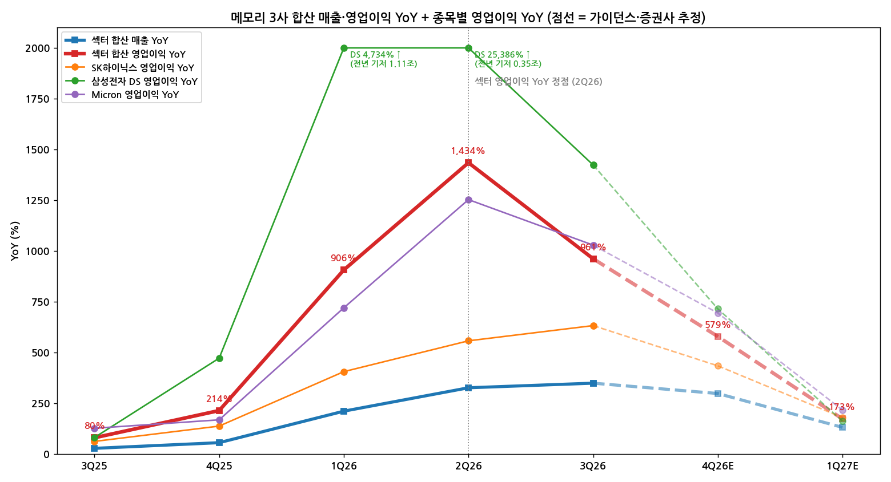

# 반도체 · 메모리 섹터 리뷰

> 현재 상태 (최신 분기 기준)
> 최신 분기: 2026-Q3
> 섹터 델타: 둔화 | 내러티브: 강화
> 모멘텀 신호: 테마 종료 후보 — 에이전트AI
> 활성 테마: 에이전트AI (2026-Q2～)
> 편입 종목: SK하이닉스, 삼성전자, Micron
> 갱신 시각: 2026-11-01 13:10 KST

## 누적 시계열

| 분기 | 편입 종목 | 합산 매출 | 합산 영업이익 | OPM | 매출 YoY | 영업이익 YoY | 영업이익 YoY 델타 (%p) | 섹터 델타 | 내러티브 | 모멘텀 신호 | 활성 테마 |
|---|---|---|---|---|---|---|---|---|---|---|---|
| 4Q23 | SK하이닉스, 삼성전자 DS, Micron | 392,383억원 ($29.7B) | −30,906억원 (−$2.3B) | −7.9 | — | — | — | — | - | - | - |
| 1Q24 | 동일 | 433,101억원 ($32.6B) | 50,711억원 ($3.8B) | 11.7 | — | — | — | — | - | - | - |
| 2Q24 | 동일 | 543,179억원 ($39.6B) | 132,101억원 ($9.6B) | 24.3 | — | — | — | — | - | - | - |
| 3Q24 | 동일 | 573,645억원 ($42.2B) | 132,597억원 ($9.8B) | 23.1 | — | — | — | — | - | - | - |
| 4Q24 | 동일 | 620,365억원 ($44.4B) | 142,944억원 ($10.2B) | 23.0 | +58.1 | 흑전 | — | — | - | - | - |
| 1Q25 | 동일 | 544,710억원 ($37.5B) | 114,662억원 ($7.9B) | 21.1 | +25.8 | +126.1 | — | — | - | - | - |
| 2Q25 | 동일 | 631,686억원 ($45.0B) | 130,560억원 ($9.3B) | 20.7 | +16.3 | −1.2 | −127.3 | 꺾임 | - | - | - |
| 3Q25 | 동일 | 732,639억원 ($52.8B) | 238,556억원 ($17.2B) | 32.6 | +27.7 | +79.9 | +81.1 | 가속 | - | - | - |
| 4Q25 | 동일 | 965,405억원 ($66.9B) | 448,490억원 ($31.1B) | 46.5 | +55.6 | +213.8 | +133.9 | 가속 | - | - | - |
| 1Q26 | 동일 | 1,692,788억원 ($115.5B) | 1,153,930억원 ($78.7B) | 68.2 | +210.8 | +906.4 | +692.6 | 가속 | - | - | - |
| 2Q26 | 동일 | 2,691,069억원 ($179.2B) | 2,003,289억원 ($133.4B) | 74.4 | +326.0 | +1,434.4 | +528.0 | 가속 | - | - | 에이전트AI |
| **3Q26** | 동일 | **3,287,652억원 ($231.5B)** | **2,531,931억원 ($178.3B)** | **77.0** | **+348.7** | **+961.4** | **−473.0** | **둔화** | **강화** | **테마 종료 후보 — 에이전트AI** (BT 판단: 테마 유지, 메모리 레이어 모멘텀 구간 종료) | **에이전트AI** |

→ 적용 환율(원/달러, 분기 평균): 4Q23 1,320 · 1Q24 1,329 · 2Q24 1,371 · 3Q24 1,358 · 4Q24 1,397 · 1Q25 1,453 · 2Q25 1,404 · 3Q25 1,387 · 4Q25 1,444 · 1Q26 1,466 · 2Q26 1,502 · 3Q26 1,420 · 4Q26E 1,340 · 1Q27E 1,330
→ (환율 출처: 3Q25·1Q26～1Q27E = BNK·하나증권 리포트 가정치(3Q26은 1,418·1,423 평균), 4Q25 = BNK 2025 연평균 1,422에서 역산, 4Q23～2Q25 = 분기 평균 근사치 [근사]. Micron은 회계분기를 캘린더 분기 라벨에 맞춰 해당 분기 환율 적용 — 실제 회계기간(예: FQ4 26 = 6～8월)과 1개월 어긋남)
→ 소급 행(4Q23～2Q26)의 내러티브·모멘텀 신호는 당시 섹터 리뷰가 없어 `-`. 활성 테마 열의 2Q26은 에이전트AI 통합본 v5(2026-06-21) 기준 [추정]

---

## 2026-Q3 섹터 리뷰

> 대상: SK하이닉스 3Q26, 삼성전자 3Q26(DS 부문), Micron 3Q26(FQ4 26) — `earnings-review/2026-Q3_{SK하이닉스|삼성전자|MU}_리뷰.md`
> 첫 섹터 리뷰 — 직전 분기 섹터 관전 포인트 체크 없음

① 섹터 합산 숫자와 델타

(1) 합산 5지표

단위: 억원 (달러 환산), %

| 항목 | 4Q24 | 1Q25 | 2Q25 | 3Q25 | 4Q25 | 1Q26 | 2Q26 | **3Q26** | 4Q26E | 1Q27E |
|---|---|---|---|---|---|---|---|---|---|---|
| 합산 매출 | 620,365 ($44.4B) | 544,710 ($37.5B) | 631,686 ($45.0B) | 732,639 ($52.8B) | 965,405 ($66.9B) | 1,692,788 ($115.5B) | 2,691,069 ($179.2B) | **3,287,652 ($231.5B)** | 3,840,100 ($286.6B) | 3,910,983 ($294.1B) |
| 합산 영업이익 | 142,944 ($10.2B) | 114,662 ($7.9B) | 130,560 ($9.3B) | 238,556 ($17.2B) | 448,490 ($31.1B) | 1,153,930 ($78.7B) | 2,003,289 ($133.4B) | **2,531,931 ($178.3B)** | 3,044,132 ($227.2B) | 3,146,305 ($236.6B) |
| OPM | 23.0 | 21.1 | 20.7 | 32.6 | 46.5 | 68.2 | 74.4 | **77.0** | 79.3 | 80.4 |
| 매출 YoY | +58.1 | +25.8 | +16.3 | +27.7 | +55.6 | +210.8 | +326.0 | **+348.7** | +297.8 | +131.0 |
| 영업이익 YoY | 흑전 | +126.1 | −1.2 | +79.9 | +213.8 | +906.4 | +1,434.4 | **+961.4** | +578.8 | +172.7 |
| **매출 YoY 델타 (%p)** | — | −32.3 | −9.5 | +11.4 | +27.9 | +155.2 | +115.2 | **+22.7** | −50.9 | −166.8 |
| **영업이익 YoY 델타 (%p)** | — | — | −127.3 | +81.1 | +133.9 | +692.6 | +528.0 | **−473.0** | −382.6 | −406.1 |

→ 합산 기준: SK하이닉스 연결 + **삼성전자 DS 부문**(메모리 + S.LSI·Foundry, 회사 공시치) + Micron Non-GAAP 영업이익(원화 환산). 삼성 메모리 단독 영업이익은 미공시라 DS를 사용 — DS에는 S.LSI·Foundry 적자(3Q26 약 −1.3～−2.0조원 [추정])가 섞여 메모리 이익을 약간 과소 계상
→ 출처: 각 종목 리뷰 1-1 표(SK하이닉스·Micron), 삼성전자 DS 분기치(삼성전자 IR·키움증권 정리, 2024년 분기는 회사 공시). E = SK하이닉스 발표 후 증권사 중간값, 삼성 DS 4Q26E 3개사(키움·메리츠·하나) 중간값·1Q27E 하나(영업이익)·BNK(매출), Micron 4Q26 가이던스 중간값·1Q27E Bloomberg 컨센(9/30) [계산]

(2) 기저효과 조정 — QoQ로 다시 보기

| 항목 | 1Q26 | 2Q26 | **3Q26** | 4Q26E | 1Q27E |
|---|---|---|---|---|---|
| 합산 영업이익 QoQ | +157% | +74% | **+26%** | +20% | +3% |
| 합산 영업이익 증가액 | +70.5조원 | +84.9조원 | **+52.9조원** | +51.2조원 | +10.2조원 |

→ 3Q26 증가액 52.9조원 중 SK하이닉스 +22.8조원, 삼성 DS +17.3조원, Micron +12.8조원(원화 환산, 환율 하락분 포함) [계산]
→ YoY·QoQ 모두 **2Q26이 섹터 가속의 꼭대기**. 4Q26E까지는 분기마다 50조원씩 더 버는 속도가 유지되지만, 컨센 경로상 1Q27E에 QoQ가 +3%로 평탄화된다

(3) 컨센 경로상 섹터 YoY 정점
→ 영업이익 YoY 정점은 **2Q26(+1,434%)** 으로 이미 통과. 매출 YoY는 3Q26(+349%)이 정점이고 4Q26E부터 하락 [계산]
→ 3사 주가 52주 고점이 모두 6월 하순(Micron 6/25, SK하이닉스 6/22, 삼성전자 6월)에 몰려 있다 — **섹터 영업이익 YoY 정점(2Q26)과 주가 고점이 같은 분기** [판단]

→ (출처: 각 종목 3Q26 리뷰, 원화 환산 합산 [계산]. 삼성 DS 1Q26·2Q26 영업이익 YoY는 전년 기저(1.11조·0.35조원)가 낮아 차트 상단에서 잘림)

② 종목별 델타 판정표

| 종목 | 매출 YoY | 영업이익 YoY | 영업이익 YoY 델타 | 델타 판정 | 내러티브 | 한 줄 |
|---|---|---|---|---|---|---|
| Micron (FQ4 26) | +379.3% ($ 기준) | +1,028.6% | −224.1%p | **둔화** (정점 2Q26) | 강화 | 이익 레벨업은 진행 중이지만 델타 매매 구간은 지나간 고점권 경계 |
| SK하이닉스 | +327.9% | +632.1% | +74.9%p | **가속** (단, 이번 분기가 YoY 정점) | 강화 | 마지막 가속 — 주가는 델타 정점을 선반영해 고점 대비 −49% |
| 삼성전자 | +126.9% (전사) / DS +344.3% | +782.8% (전사) / DS +1,423.3% | −1,029.4%p (전사) | **둔화** (정점 2Q26, 4Q26 QoQ 재가속 예상) | 강화 | 메모리 3사 중 델타 수명이 가장 긴 종목, 환원 타이밍 실망 |

→ 판정은 각 종목 리뷰 0번 그대로. 삼성전자 판정은 전사 기준(종목 리뷰) — DS 기준으로 봐도 영업이익 YoY 25,386%(2Q26) → 1,423%(3Q26)로 같은 '둔화'
→ **선행 종목 = Micron.** 가장 먼저 가속(1Q26 +720%)했고 가장 먼저 정점(2Q26)을 지났다. 다음 분기 가이던스(QoQ +14%)대로면 판정 기준상 '꺾임'에 먼저 도달할 종목
→ **섹터 델타를 끄는 종목 = SK하이닉스.** 3사 중 유일하게 3Q26에도 YoY 가속, 3Q26 섹터 증가액의 43%(22.8조원). 단 한 분기 늦은 정점일 뿐 경로는 같다
→ **후행 종목 = 삼성전자.** 3Q 출하 부진(DRAM +3%)으로 일시 감속 후 4Q26E QoQ +24%로 재가속 — 섹터에서 가장 늦게 꺾일 종목 [판단]

③ 섹터 공통 쟁점

(1) 2028년 이후 사이클 지속성과 CapEx (3/3 종목)
→ Micron: FY27 CapEx >$50B(2배 이상), "증액분은 CY2028 말 이후 클린룸 건설". 키움·KB 판단 유보
→ SK하이닉스: 2027 투자 "상당한 증가", Shell 선건설·클린룸 단계 오픈. **2028E 영업이익 범위 94조원(BNK)～583조원(SK증권)**
→ 삼성전자: 2027 CapEx 100～108조원(다올·유안타). 2028E BNK 122조원(−72%) / 키움 337조원(−11%)
→ 셀사이드 해석 차이: 3사 모두 "2027 공급 부족"은 만장일치. 갈림은 2028년 — 한국 2사는 BNK·키움이 공개적으로 2028 이익 감소를 추정에 넣었고, Micron 커버 국내사는 2028E에서도 +5～10% 증익(컨센 경로상 OPM만 하락)
→ [판단] 3사 동시 "건설 먼저, 장비는 수요 보고" 전략은 2027 공급을 묶는 대신 **2028 말～2029 공급 증가를 예약**한 것. 2028 논쟁은 이번 분기 숫자로 끝나지 않고, 2028 물량 장기계약 체결 속도로 판가름 난다

(2) 장기공급계약 확대 — 이익 하방 상승, 상방 제한 (3/3 종목)
→ Micron: SCA 16 → 26건, 2030년까지 매출 35%+, 약 75%는 가격 하한·상한 밴드, RPO $150B
→ SK하이닉스: LTA 14개사, 2027～28 Capa 50%+, "2029년까지 DRAM·HBM 사실상 완판", 가격은 협의 범위 내 시장 반영
→ 삼성전자: 대형 고객 10개사 LTA + 10개사 협상, LTA 매출 비중 60～70% 가이던스, KB "2030년까지 생산능력의 70%"
→ 셀사이드 해석 차이: 한국 2사 커버리지는 LTA를 "재평가 근거"(KB·SK증권·교보)로, Micron 커버리지(키움)는 "예상 범위, 서프라이즈 아님"으로 본다
→ [판단] 장기계약 비중은 삼성(60～70%) > SK하이닉스(50%+) > Micron(35%+) 순. 이익 변동성은 줄지만 가격 상단 밴드가 있어 **델타 재가속은 어렵게 만드는 구조** — 모멘텀 관점에서는 "꺾임 폭 축소"가 장점, "재가속 제한"이 단점

(3) HBM과 범용 DRAM의 마진 역전 (3/3 종목)
→ Micron: CMBU(HBM 포함) GPM 83% < CDBU·MCBU 90%. 한화 "원가 높은 HBM이 이익 개선 폭 희석"
→ SK하이닉스: "2027 HBM 거래조건 마무리, HBM–범용 수익성 격차 유의미한 축소". 3Q26 DRAM OPM 83%로 HBM 중심 구조에서도 범용 가격이 이익을 끌었다
→ 삼성전자: HBM은 DRAM 매출의 10% 미만(유안타) — 이익 개선 대부분이 범용 DRAM 가격. 2027 HBM ASP +150%(KB)
→ [판단] 이번 사이클의 이익 레버리지는 HBM이 아니라 **범용 DRAM 가격**이 쥐고 있다. 범용 노출이 큰 순서(삼성 > Micron > SK하이닉스)대로 2026 이익 서프라이즈가 컸고, 같은 순서로 2027 하반기 범용 가격 하락에 가장 민감하다

(4) 주주환원과 멀티플 압축 (3/3 종목)
→ Micron: 순현금 $68.3B, 자사주 한도 $2.2B(CHIPS법 제약) → 12/9 이사회 확대 예정. 발표 후 주가 약 −8%
→ SK하이닉스: FY2026 약 100조원, 분기별 자사주 매입 → 발표일 +10.9%
→ 삼성전자: 잔여 55～75조원, 2027년 1월 말 이사회로 이연 → 발표일 −4.1%
→ 공통: 추정치 상향에도 TP 유지·하향 — 하나증권(SK하이닉스·삼성전자 모두) "글로벌 반도체 업체 멀티플 하향 반영", KB(SK하이닉스) 추정 상향에도 TP 하향. Micron 12MF PER 6.7배(2년 평균 12.9배)
→ [판단] 섹터 전체가 "이익 상향 + 멀티플 하향"의 사이클 고점 패턴에 있다. 환원은 하방을 지지하지만 멀티플을 되돌리지는 못하고 있으며, 3사 주가 차이는 실적보다 **환원 실행 속도**에서 났다

(5) 1Q27 모바일·범용 DRAM 가격 인상 (2/3 종목 — 한국 2사 직접, Micron 간접)
→ SK하이닉스·삼성전자 커버리지(메리츠·SK증권·대신)가 공통으로 1Q27 모바일 DRAM +30～50% 인상을 2027 추정 상향 근거로 사용. Micron은 MCBU가 비트 감소에도 가격으로 매출 +14%
→ [판단] 2027 추정치가 더 올라갈지를 가장 먼저 보여줄 데이터이자, BNK의 "고객이 용량을 줄인다(원가 한계)" 가설의 첫 검증 지점

종목 고유 이슈
→ Micron: FQ1 27 GPM 가이던스 86.25% < 컨센 87% — GPM 상승 정지 신호
→ SK하이닉스: 영업외 손실 34.5조원(외환 11.6조원·Kioxia 등 평가손 22.9조원)으로 순이익 컨센 −31%. 솔리다임 IPO 중단
→ 삼성전자: DX 적자 확대(MX 3Q25 3.6조원 → −0.6조원) — 메모리 원가 상승이 세트 마진을 잠식

④ 섹터 판정

> 섹터 델타: **둔화** | 내러티브: **강화** → **이익 레벨은 사상 최고, 델타는 2Q26에 정점 통과 — 섹터 전체가 '고점권 경계 구간', 종목 간 정점 시차(Micron → SK하이닉스 → 삼성전자)만 남았다** [판단]

→ 근거: 합산 영업이익 YoY +1,434%(2Q26) → +961%(3Q26), 축소했지만 플러스 = 둔화. 컨센 경로상 4Q26E +579%로 2개 분기 연속 둔화가 예정돼 있어, 4Q26 실적이 경로대로면 다음 분기 판정은 기준상 **'꺾임'**
→ 내러티브 '강화': 3개 종목 리뷰 모두 강화 — 장기계약·2027 공급 부족·HBM 경쟁 구도 정리 모두 숫자로 확인
→ 직전 분기 대비 변화: **가속(2Q26, 소급) → 둔화(3Q26)**

⑤ 모멘텀 신호 (후보 — BT 판단 필요)

> **테마 종료 후보 — 에이전트AI** (메모리 레이어 기준)

| 근거 | 수치 |
|---|---|
| 섹터 델타 전환 | 가속(2Q26) → 둔화(3Q26), 합산 영업이익 YoY 델타 −473%p. 4Q26E도 −383%p로 2개 분기 연속 둔화 예정 |
| 선행 종목 | Micron 2Q26 정점 후 둔화, FQ1 27 가이던스(QoQ +14%)대로면 다음 분기 '꺾임' |
| 주가 | 3사 52주 고점이 모두 2026년 6월 하순 — SK하이닉스 −49%, 삼성전자 −36%, Micron 약 −22% |

→ **BT 판단 필요.** 에이전트AI 테마는 메모리 외에 하이퍼스케일러·로직·CPU·전력 레이어에도 걸쳐 있어, 메모리 섹터의 둔화만으로 테마 전체 종료를 결정할 근거는 아니다. 메모리 레이어의 델타 매매 구간이 끝났다는 신호로 읽는 것이 적절 [판단]
→ 반대 논거: 삼성전자 4Q26 QoQ 재가속(+24%), 섹터 분기 증가액 4Q26E까지 50조원대 유지, 2027 추정치 상향 사이클(메리츠) — 4Q26 실적이 컨센을 크게 넘으면 '유지'로 돌아설 여지

(1) BT 판단 (2026-11-01)
→ **에이전트AI 테마는 유지** — 2027년 개인용 에이전트 AI 기대감으로 테마 추적 계속
→ **메모리 레이어는 모멘텀 구간 종료(2026-Q3)** 로 표기. 에이전트AI 테마 리뷰에서 메모리는 이 표기로 갈음
→ 활성 테마 상태 변경 없음 (에이전트AI 2026-Q2～)

⑥ 다음 분기 섹터 관전 포인트

| 순위 | 무엇을 (변수·임계값) | 어떤 데이터로 | 언제 |
|---|---|---|---|
| 1 | **4Q26 섹터 합산 영업이익 304조원(중간값) 대비 실적** — 하회·부합이면 섹터 '꺾임' 확정, 크게 상회하면 '둔화' 유지 | Micron FQ1 27(12월 중하순) → 삼성전자 잠정(1월 초) → SK하이닉스·삼성 확정(1월 말) | 2026-12 ～ 2027-01 |
| 2 | **1Q27 범용·모바일 DRAM 계약가** — 모바일 +30% 이상, 서버 DRAM 두 자릿수 유지 여부 | TrendForce·DRAMeXchange 계약가, 한국 반도체 수출 단가, Micron FQ1 27 가이던스 ASP 코멘트 | 2026-12 ～ 2027-01 |
| 3 | **2028 물량 장기계약 체결** — Micron SCA 30건+, SK하이닉스 LTA 추가·연장, 삼성 10개사 협상 완료 | 3사 컨콜·IR | 2026-12 ～ 2027-01 |
| 4 | **3사 2027 CapEx 확정치와 장비 발주** — 건설 vs 장비 비중, 2028 비트 공급 시사점 | 3사 가이던스, ASML·AMAT·LRCX 메모리 수주 코멘트 | 2027-01 |
| 5 | **주주환원 실행** — Micron 12/9, 삼성 1월 말, SK하이닉스 4Q 자사주 | 각 사 이사회 결의 | 2026-12-09 / 2027-01 말 |

→ 1순위가 섹터 판정을 바꾼다. Micron FQ1 27이 섹터의 첫 데이터이자 선행 종목의 '꺾임' 여부를 확인하는 자리
