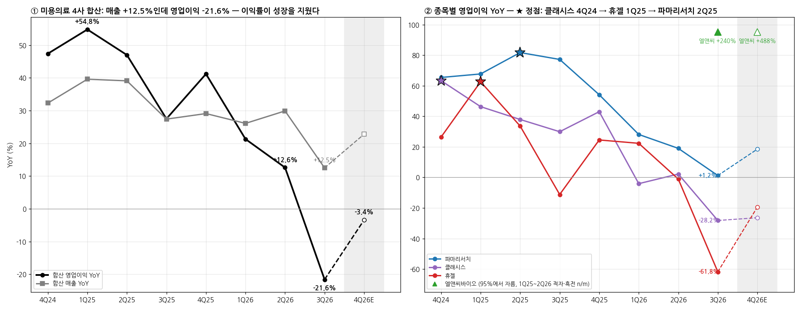
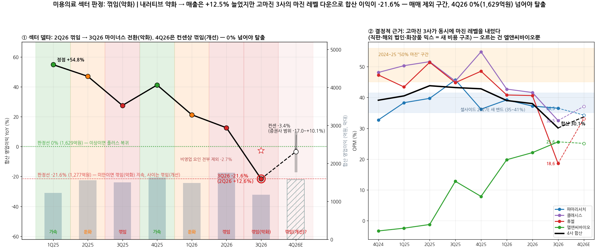

# 뷰티 · 미용의료 섹터 리뷰

> 현재 상태 (최신 분기 기준)
> 최신 분기: 2026-Q3
> 섹터 델타: 꺾임 | 내러티브: 약화
> 모멘텀 신호: 없음
> 활성 테마: 없음
> 포지셔닝: 서브섹터 축소 | 한국 해당 없음 | 1등 엘앤씨바이오
> 델타 근거: 2개 분기 연속 꺾임 → 4Q 컨센도 역성장
> 내러티브 근거: 해외 확장은 확인, 직판 전환으로 고마진이 깨져 약화
> PM 근거: 연속 꺾임과 구조적 마진 하락으로 축소
> 편입 종목: 파마리서치, 클래시스, 엘앤씨바이오, 휴젤
> 갱신 시각: 2026-11-22 22:30 KST

## 누적 시계열

| 분기 | 편입 종목 | 합산 매출 | 합산 영업이익 | OPM | 매출 YoY | 영업이익 YoY | 영업이익 YoY 델타 (%p) | 섹터 델타 | 내러티브 | 모멘텀 신호 | 활성 테마 |
|---|---|---|---|---|---|---|---|---|---|---|---|
| 4Q23 | 파마·클래시스·엘앤씨·휴젤 | 2,229억원 | 783억원 | 35.1 | — | — | — | — | - | - | - |
| 1Q24 | 동일 | 2,160억원 | 789억원 | 36.5 | — | — | — | — | - | - | - |
| 2Q24 | 동일 | 2,551억원 | 1,057억원 | 41.4 | — | — | — | — | - | - | - |
| 3Q24 | 동일 | 2,722억원 | 1,175억원 | 43.2 | — | — | — | — | - | - | - |
| 4Q24 | 동일 | 2,948억원 | 1,154억원 | 39.1 | +32.3 | +47.4 | — | — | - | - | - |
| 1Q25 | 동일 | 3,016억원 | 1,221억원 | 40.5 | +39.6 | +54.8 | +7.4 | 가속 | - | - | - |
| 2Q25 | 동일 | 3,548억원 | 1,554억원 | 43.8 | +39.1 | +47.0 | -7.7 | 둔화 | - | - | - |
| 3Q25 | 동일 | 3,469억원 | 1,498억원 | 43.2 | +27.4 | +27.5 | -19.5 | 꺾임 | - | - | - |
| 4Q25 | 동일 | 3,805억원 | 1,629억원 | 42.8 | +29.1 | +41.2 | +13.7 | 가속 | - | - | - |
| 1Q26 | 동일 | 3,802억원 | 1,481억원 | 39.0 | +26.1 | +21.3 | -19.9 | 둔화 | - | - | - |
| 2Q26 | 동일 | 4,609억원 | 1,750억원 | 38.0 | +29.9 | +12.6 | -8.7 | 꺾임 | - | - | - |
| **3Q26** | 동일 | **3,904억원** | **1,175억원** | **30.1** | **+12.5** | **-21.6** | **-34.2** | **꺾임(악화)** | **약화** | **없음** | **없음** |

→ **합산 방식**: 4사 모두 한국 종목이라 원화(억원) 그대로 합산했다. 각 종목 2026-Q3 실적 리뷰 1번 ① 분기 표(K-IFRS 연결 **보고 기준** 영업이익)를 그대로 썼다. 4사 모두 단일 보고부문이라 사업부 기준 합산은 하지 않았다
→ **표본**: 4Q23\~3Q26 전 분기 같은 4사(동일 표본). 엘앤씨바이오는 4Q23·4Q24·1Q25·2Q25 영업적자였지만 합산에는 그대로 넣었다(적자도 합산 이익의 일부)
→ **소급 판정**: 4Q24는 직전 분기 YoY가 없어 판정 없음(4Q23 이전 분기 숫자는 종목 리뷰 표에 없음). 1Q25 이후는 스킬 기준(확대 = 가속 / ±5%p 이내 = 유지 / 축소 + 플러스 = 둔화 / 마이너스 전환 또는 2개 분기 연속 둔화 + 정점 통과 = 꺾임)을 그대로 적용했다. 3Q25·2Q26 "꺾임"은 2개 분기 연속 둔화 + 정점(1Q25 +54.8%) 통과 규칙 결과다
→ **3Q26 "꺾임(악화)"**: BT 표기 규칙(2026-11-22)을 따랐다. 영업이익 YoY가 +12.6% → -21.6%로 마이너스 전환하며 폭이 커졌다. 상태 블록은 대시보드 배지 키라 `꺾임`만 쓴다
→ 내러티브·모멘텀 신호·테마 열은 이번이 첫 서브섹터 리뷰라 소급 분기는 `-`

---

## 2026-Q3 섹터 리뷰

> 대상: `earnings-review/2026-Q3_{파마리서치|클래시스|엘앤씨바이오|휴젤}_리뷰.md` (4사 통합 검수 완료본)
> 2층 구조의 **서브섹터 리뷰**다. 뷰티 섹터 비중(1단계)과 서브섹터 순위(2단계)는 `뷰티_섹터리뷰.md`(섹터 통합 리뷰)가 맡는다. 이 문서는 미용의료 판정, 미용의료 1등 종목(3단계)에 답한다
> 첫 미용의료 리뷰라 직전 분기 관전 포인트·⑦ 콜 체크는 없다
> **국가 프레임 구멍**: 편입 4사가 모두 한국이다. 서브섹터 안 한국 vs 글로벌 비교는 `비교 불가 — 편입 종목 없음`으로 두고 결론에서 국가 판단은 뺀다. 편입 후보는 ⑦(2)에 적었다 (BT 판단 필요)

> **이번 분기 한 줄** — 미용의료 4사는 "수출은 달리는데 이익이 멈춘" 분기를 같이 냈다. 합산 매출은 +12.5% 늘었지만 합산 영업이익은 -21.6%다. 원인은 수요 붕괴가 아니라 마진 레벨이다. 고마진 3사(파마리서치·클래시스·휴젤)가 해외 직판·해외 법인·화장품 믹스로 비용 구조를 동시에 바꾸면서 OPM이 43%(3Q25)에서 30%로 내려왔다. 이익률이 오르는 곳은 엘앤씨바이오 하나다.

① 섹터 합산 숫자와 델타 (단위: 억원, %)

| 항목 | 4Q24 | 1Q25 | 2Q25 | 3Q25 | 4Q25 | 1Q26 | 2Q26 | **3Q26** | 4Q26E |
|---|---|---|---|---|---|---|---|---|---|
| 합산 매출 | 2,948 | 3,016 | 3,548 | 3,469 | 3,805 | 3,802 | 4,609 | **3,904** | 4,672 |
| 합산 영업이익 | 1,154 | 1,221 | 1,554 | 1,498 | 1,629 | 1,481 | 1,750 | **1,175** | 1,573 |
| OPM | 39.1 | 40.5 | 43.8 | 43.2 | 42.8 | 39.0 | 38.0 | **30.1** | 33.7 |
| 매출 YoY | +32.3 | +39.6 | +39.1 | +27.4 | +29.1 | +26.1 | +29.9 | **+12.5** | +22.8 |
| 영업이익 YoY | +47.4 | +54.8 | +47.0 | +27.5 | +41.2 | +21.3 | +12.6 | **-21.6** | -3.4 |
| **영업이익 YoY 델타 (%p)** | — | +7.4 | -7.7 | -19.5 | +13.7 | -19.9 | -8.7 | **-34.2** | +18.1 |
| 판정 | — | 가속 | 둔화 | 꺾임 | 가속 | 둔화 | 꺾임 | **꺾임(악화)** | 꺾임(개선) (컨센) |
| 참고: 엘앤씨바이오 제외 3사 영업이익 YoY | +46.8 | +58.7 | +49.0 | +25.2 | +38.7 | +16.0 | +6.9 | **-26.7** | -9.4 |
| 참고: 비영업 요인 전부 제외 영업이익 YoY | | | | | | | | **-2.7** | |

→ (출처: 4사 2026-Q3 실적 리뷰 1번 ① 분기 표 [계산]. 4Q26E = 각 리뷰의 컨센 — 파마리서치 615억원(5곳 평균), 클래시스 377억원(8곳 평균), 엘앤씨바이오 115억원(신한 발표 전 단독), 휴젤 466억원(5곳 평균). 1Q27E는 4사 중 2사(파마리서치 630억원 다올 단독, 휴젤 476억원 대신 단독)만 있어 합산하지 않았다)
→ **이익 레벨**: 3Q26 합산 영업이익 1,175억원은 3Q24(1,175억원)와 같은 2년 전 수준이다. 합산 OPM 30.1%는 이 표본 12개 분기 중 최저다(직전 최저 4Q23 35.1%)
→ **델타**: 합산 영업이익 YoY 정점은 1Q25 +54.8%다. 4Q25 +41.2%로 한 번 반등한 뒤 +21.3% → +12.6% → **-21.6%**로 3개 분기 연속 내려와 마이너스가 됐다. 매출 YoY는 +30% 안팎을 2Q26까지 지키다 3Q26에 +12.5%로 꺾였다(휴젤 북남미 매출 소멸이 대부분)
→ **YoY 감소분(-323억원)의 분해**: 휴젤 -293억원(91%), 클래시스 -106억원(33%)이 끌어내렸고 파마리서치 +7억원, 엘앤씨바이오 +69억원이 일부 메웠다 [계산]. 2Q26에는 4사 합계 +196억원(파마리서치 +106·엘앤씨 +88·클래시스 +9·휴젤 -7억원)이었다
→ **컨센 경로상 정점**: 1Q25에 이미 지났다. 4Q26E는 -3.4%로 마이너스 폭이 줄어드는 경로다(BT 표기 = 꺾임(개선)). 다만 4Q26E의 개선은 저기저(파마리서치 4Q25 OPM 36.2%, 엘앤씨바이오 4Q25 영업이익 20억원)와 휴젤 3Q 일회성 소멸 효과가 크다. 엘앤씨바이오를 빼면 4Q26E는 -9.4%다 [판단]
→ **비영업 요인 영향 (스킬 규칙)**:
→ 인수 편입분 — **인수 주도 가속 종목은 없다.** 클래시스 브라질 MedSystems 연결(1Q26\~)은 매출을 YoY +109억원 더했지만 이익에는 마이너스였다(회사 브리지: 남미 운영·마케팅비 +30억원, 고원가 재고로 연결 GPM 약 -2%p). 인수 편입분은 합산 매출 YoY를 약 +3.1%p 올렸고(제외 시 +9.4%), 합산 영업이익 YoY는 올리지 않았다(남미 비용 30억원만 되돌려도 -19.6%, 오가닉 영업이익은 분리 불가) [계산]. 파마리서치 CG USA 인수비용 35억원(일회성 자문·법률 20억원 포함)도 이익 감소 요인이다
→ 일회성 — 휴젤 美 Benev 재고 환입(북남미 매출 -1억원)과 직판 판관비. 휴젤 리뷰 조정 영업이익 약 399억원을 쓰면 합산 YoY는 -7.0%다
→ 세 가지(파마리서치 +35억원, 클래시스 남미 비용 +30억원, 휴젤 조정 399억원)를 모두 되돌려도 합산 영업이익 1,458억원, **YoY -2.7%**로 여전히 마이너스다. 2Q26(+12.6%) 대비 -15.3%p라 **조정 기준으로도 판정(꺾임)은 같다** [계산]
→ 저기저 — 엘앤씨바이오는 3Q25 영업이익 29억원 기저라 +240%다. 엘앤씨를 빼면 3사 합산 YoY는 -26.7%로 보고 합산보다 5.1%p 더 나쁘다

→ (출처: 4사 2026-Q3 실적 리뷰 [계산]. 왼쪽 = 4사 합산 영업이익 YoY(검정)·매출 YoY(회색), 음영·점선 = 4Q26E 컨센 / 오른쪽 = 종목별 영업이익 YoY, ★ = 종목별 정점. 엘앤씨바이오는 전년 동기가 흑자인 3Q26·4Q26E만 표시하고 95%에서 잘랐다 — 1Q25\~2Q26은 적자·흑전으로 % 산출 불가)

② 종목별 델타 판정표

| 델타 순위 | 종목 | 매출 YoY | 영업이익 YoY | 영업이익 YoY 델타 | 델타 판정 | 내러티브 | 비영업 요인 | 한 줄 |
|---|---|---|---|---|---|---|---|---|
| 1 | 엘앤씨바이오 | +70.4% | +239.8% | n/m (2Q26 흑전) — 대용: YoY 증가액 +88억 → +69억원 | 둔화 | 약화 | ⚠ 저기저 (1Q25·2Q25 적자, 3Q25 OPM 12.8%) — 4Q26 기계적 가속(+488%) 예고 | OPM 25.6% 사상 최고, 그런데 리투오가 CAPA(월 8만개)에 막혀 처음 QoQ 정체 |
| 2 | 파마리서치 | +26.7% | +1.2% | -17.8%p | 꺾임 | 약화 | ⚠ 인수비용 — CG USA 35억원(일회성 20억원), 제외 시 +6.8%(판정 동일) / 고기저(3Q25 OPM 45.7%) | 수출 비중 47.6% 사상 최고인데 내수 리쥬란 YoY 0%, OPM 밴드 37\~40% → 35\~37%로 하향 |
| 3 | 클래시스 | +0.0% (남미 제외 -14.1%) | -28.2% | -30.4%p | 꺾임(악화) | 훼손 | ⚠ 인수 편입 — 브라질 MedSystems(매출 +109억원, 이익엔 마이너스) → 인수 주도 가속 아님, 제외해도 판정 같거나 더 나쁨 / 영업외 외환손실 -151억원(순이익만) | 국내 -36%(소모품 -29%) + 직판 비용, OPM 32.5% 상장 이래 최저, 어닝쇼크(-40.5%) |
| 4 | 휴젤 | -7.9% (북남미 제외 +15.6%) | -61.8% | -60.7%p | 꺾임(악화) | 약화 | ⚠ 일회성 — 美 Benev 재고 환입(북남미 매출 -1억원)·직판 판관비 +60%, 조정 시 약 399억원·-15.8%(판정 동일) / 4Q26부터 美 매출 인식 기준 변경(sell-out) | 美 CSO 전환이 한 분기 이익을 지웠다, OPM 18.6%는 3Q18 이후 최저 |

→ (출처: 각 종목 2026-Q3 리뷰 0번 판정 그대로 — 이 문서는 다시 판정하지 않는다. "꺾임(악화)"는 BT 표기 규칙(2026-11-22)으로, 리뷰 0번 표기와 같다)
→ **델타 순위 기준**: 영업이익 YoY 델타 큰 순서다. 엘앤씨바이오는 %p 델타가 n/m이라 판정(둔화 — 4사 중 유일하게 꺾임 아님)과 마진 방향(OPM +3.5%p QoQ, 사상 최고)으로 1위에 놓았다. 나머지 3사는 %p 델타 순서다
→ **참고 — 비영업 요인 조정 순위**: 조정치로 보면 순위 2\~4위 간격이 좁아진다. 파마리서치 +19.0% → +6.8%(-12.2%p), 휴젤 -1.1% → -15.8%(-14.7%p), 클래시스는 조정치를 낼 수 없다(인수 효과를 빼면 더 나쁨). 일회성 비용은 스킬 규칙상 표시만 하고 순위는 보고 기준으로 둔다
→ **선행 종목 = 클래시스**: 영업이익 YoY 정점이 4Q24(+63.3%)로 가장 빨랐고, 1Q26(-4.1%)에 4사 중 처음 마이너스로 돌아섰다. 다음이 휴젤(정점 1Q25 +62.6%, 3Q25 한 번 마이너스 후 2Q26부터 연속 마이너스), 파마리서치(정점 2Q25 +81.7%, 5개 분기 연속 둔화 후 +1.2%)다. 엘앤씨바이오는 리투오 출시(3Q25)로 사이클이 1년 늦게 시작한 후행 종목이다
→ **섹터 델타를 끌어내린 것은 휴젤과 클래시스**다. 두 회사가 YoY 감소분의 124%를 만들었고, 파마리서치(+7억원)는 버티기만 했다. 3Q26 합산 영업이익 비중은 파마리서치 53% · 클래시스 23% · 휴젤 15% · 엘앤씨바이오 8%다

③ 섹터 공통 쟁점

(1) "50% 마진" 시대의 종료 — 해외 직판·해외 법인·믹스로 비용 구조가 바뀌었다 (파마리서치·클래시스·휴젤, 3사 공통)

| 종목 | 3Q26 OPM (YoY) | 마진을 낮춘 원인 | 회사·셀사이드의 새 마진 밴드 |
|---|---|---|---|
| 파마리서치 | 36.5% (-9.2%p) | 화장품 비중 26% → 36%(원가율 +4.8%p), CG USA 손실·해외 법인 판관비 | 회사 OPM 밴드 37\~40% → **35\~37%**, 2027E 셀사이드 5곳 35.0\~35.7% |
| 클래시스 | 32.5% (-12.8%p) | 국내 매출 감소 레버리지 역전(약 6%p) + 남미·일본 직판·美 홈뷰티 비용(약 6%p) + 남미 고원가 재고 | 2027E 8곳 중 7곳 **37\~44%** (유진만 48%) |
| 휴젤 | 18.6% (-26.2%p) | 美 Benev 재고 환입(일회성) + 美 직판 조직·메디컬 마케팅 판관비 +206억원(구조적) | 4Q26E 29.5\~36.3%, 2027E **33.8\~37.1%** |
| (대비) 엘앤씨바이오 | 25.6% (+12.8%p) | 리투오 믹스로 GPM 62.2%, 판관비 -9억원 QoQ | 신한 2027E 25.7%, 회사 2030 목표 32% |

→ (출처: 4사 2026-Q3 리뷰 1번·2번 쟁점)
→ 공통: 3사 모두 성장 축을 "국내 고마진 + 대리점 수출"에서 "해외 직판·현지 법인·신규 카테고리"로 옮기고 있다. 매출 단가(직판 sell-out, 현지 최종가)는 오르지만 영업·마케팅·인건비가 손익계산서 안으로 들어온다. 휴젤 리뷰의 표현대로 "2024\~2025년 OPM 45\~51%는 Benev가 美 비용을 부담하던 sell-in 구조 위의 숫자"였다
→ 셀사이드 해석 차이: 클래시스(유진 48%)와 휴젤(신한 36%)의 낙관 쪽은 "일시적 비용"으로, 다수는 "구조적 레벨 다운"으로 본다. 파마리서치는 회사가 직접 밴드를 낮춰 논쟁이 없다
→ **[판단]** 미용의료의 OPM 레벨은 40%대 중반에서 30%대 중반으로 한 단계 내려왔다. 이건 일회성이 아니라 사업 모델 전환의 비용이다. 따라서 2027년 이익 성장률은 매출 성장률보다 낮게 나오는 구조이고(파마리서치 2027E 매출 +23% vs 영업이익 +18%), 섹터 델타가 다시 커지려면 "마진 회복"보다 "매출 레벨이 한 번 더 뛰는 것"이 필요하다

(2) 국내 수요의 둔화와 스킨부스터·EBD 경쟁 (파마리서치·클래시스·엘앤씨바이오·휴젤)

| 종목 | 3Q26 국내 | 해석 |
|---|---|---|
| 파마리서치 | 내수 의료기기(리쥬란) 571억원, YoY 0% (3개 분기 연속 둔화) | 외국인 비중 2Q 40% → 3Q 34\~35%, 회사 "급격한 외국인 유입은 한동안 어렵다" — 리뷰 판단 "내수 성숙 신호" |
| 클래시스 | 국내 의료기기 176억원, YoY -36% (소모품 -29%) | 세대교체 공백(회사·대신·NH) vs 국산 EBD 경쟁 심화(씨티·IBK·키움) — 리뷰 판단 "경쟁 해석이 숫자와 더 맞다" |
| 엘앤씨바이오 | 인체조직 274억원, QoQ -0.4% (첫 정체) | 공급(CAPA 8만개, 가동률 87.7%) 제약 — 리뷰 판단 "공급 해석이 맞다", 4Q 300억원 미만이면 "수요"로 전환 |
| 휴젤 | 국내 톡신+필러 274억원, YoY +54% | 국내 톡신 +46%, 필러 +87\~91%는 셀르디엠(hADM 스킨부스터) 코프로모션 신규 편입 효과 포함 |

→ 공통: 국내 미용의료 시장 안에서 **스킨부스터 카테고리 경쟁**이 숫자로 나타나기 시작했다. 리쥬란(PN)이 멈춘 분기에 리투오(ECM)는 공급 한도까지 팔렸고, 휴젤은 hADM 스킨부스터를 들여와 국내 필러를 키웠다. 파마리서치는 "ECM 선호 변화는 아직 뚜렷하게 체감되지 않는다"고 했고, 엘앤씨바이오 리뷰는 리쥬란·쥬베룩 경쟁을 리스크로 꼽았다
→ 외국인 의료관광은 7\~8월 약세 후 9월 반등(외국인 피부과 소비 7월 MoM -18% → 9월 +12%, 다올 — 파마리서치 리뷰)이다. 국내 장비(클래시스)는 수요 둔화보다 점유율 문제다
→ **[판단]** 국내는 "시장 전체 둔화"라기보다 **카테고리 안 점유율 이동**이다. 리쥬란 → ECM·hADM 스킨부스터, 슈링크·볼뉴머 → 국산 경쟁 EBD로 옮겨가는 중이다. 섹터 합산 관점에서는 국내 총수요가 크게 줄지 않았어도, 기존 1등 제품(리쥬란·슈링크)을 가진 대형 2사의 이익이 먼저 깎인다. 이 흐름이 엘앤씨바이오를 4사 중 유일한 델타 생존 종목으로 만든 배경이다. 4Q에 엘앤씨 인체조직이 CAPA 증설 후 300억원을 넘고 파마리서치 내수 의료기기가 597억원(4Q25)을 밑돌면 "이동"이 확정된다

(3) 수출은 강하다 — 그런데 이익으로 안 바뀐다 (파마리서치·클래시스·휴젤)

| 종목 | 3Q26 해외 | 이익 기여 |
|---|---|---|
| 파마리서치 | 수출 816억원 +61.5%(비중 47.6% 사상 최고) — 화장품 +92%, 의료기기 +53%(유럽 +104%) | 해외는 대리점 경유·화장품 믹스라 이익률이 내수보다 낮다 [추정] — 매출 +361억원 중 86%가 수출인데 영업이익은 +7억원 |
| 클래시스 | 해외 의료기기 643억원 +21.6% (남미·일본 제외 대리점 +1.1%) | 브라질 법인 인수 후 7개월 누적 순손실 175억원, 직판 판관비 약 95억원(1년 전 약 9억원) |
| 휴젤 | 북남미 제외 매출 976억원 +15.6% (브라질 분기 첫 100억원, 유럽 톡신 +44%) / APAC -8%, 필러 수출 -8% | 美 직판 비용이 2H27 완전 직판까지 먼저 나간다 |
| (대비) 엘앤씨바이오 | 해외 매출 아직 미미(9M26 인체조직 수출 31억원) — 美 조직은행 5년 최소 6,000만달러 계약(2027\~) | 델타 기여는 2027년부터 |

→ 공통: 4사 모두 "해외가 다음 성장 축"이라는 스토리는 숫자로 확인됐다. 문제는 **해외 확장이 지금은 이익을 깎는 단계**라는 것이다(직판 비용·현지 법인·인수 손실)
→ **[판단]** 미용의료의 2027년 이익 델타는 수출 매출 증가율보다 "해외 법인이 고정비를 흡수하는 시점"이 정한다. 클래시스 남미 분기 200억원, 휴젤 美 sell-out 분기 350억원, 파마리서치 CG USA 손실 축소가 각각 그 판정선이다

(4) TP 하향 = 실적 하향 + 멀티플 하향, PER은 역사적 저점권 (4사 공통)

| 종목 | 평균 TP 변화 | 하향 원인 | 현재 밸류·주가 |
|---|---|---|---|
| 파마리서치 | 48.0 → 43.0만원 (-10.4%, 하향 3·유지 1·상향 1) | 실적(미래 -16%)과 멀티플(대신 -10%)이 섞임 | 12MF PER 11\~12배, 2025.07 고점 대비 -63% |
| 클래시스 | 5.74 → 3.34만원 (-41.8%, 8곳 전부 하향, DB Hold) | 실적 약 -22% + 멀티플 약 -25% | 2027E PER 약 10배, 52주 고점 대비 -69% |
| 휴젤 | 31.8 → 27.0만원 (-15.1%, 5곳 전부 하향) | 2027E 영업이익 -8\~-10% + 목표 PER -10\~-20% | 12MF PER 12\~13.6배(2016년 이후 최저) |
| 엘앤씨바이오 | 산출 불가 (발표 후 리포트 0건) | 멀티플(+수급)이 주원인 [판단] | 수정 52주 고점 대비 -67% |

→ (출처: 4사 리뷰 2번 ⑤ 추정치·TP 변화, 주가는 각 리뷰 기준일)
→ 공통: 셀사이드는 4사 모두 "역사적 저평가"를 말하지만, 같은 분기에 이익 추정치와 목표 배수를 함께 내렸다. 적용 멀티플이 "성장주 프리미엄"에서 "국내 의료미용 피어 평균(11\~15배)"으로 옮겨 가는 중이다(클래시스 씨티·DB·IBK·삼성·유진, 휴젤 유진 22배 → 18배)
→ **[판단]** 밸류에이션 바닥 논리는 BT 프레임에서 2순위다. 주가 낙폭(-63\~-69%)이 이미 커서 하방은 줄었지만, 델타가 다시 커지는 증거(⑥ 1순위)가 나오기 전까지는 "싸다"가 매수 근거가 되지 않는다

(5) 원화 강세와 영업외 외환손실 (파마리서치·클래시스·휴젤)
→ 파마리서치 영업외 -185억원(순이익 -40.6%), 클래시스 외환 순손실 -151억원(순이익 -81%), 휴젤 외화평가손실(지배순이익 -91%). 3사 모두 영업이익 판정에는 영향이 없지만 EPS 기반 TP 하향 폭을 키웠다
→ 3Q26 원화는 2Q26 대비 강세였고, 수출 비중이 높은 파마리서치(48%)는 환산 매출도 같이 깎였다(의료기기 수출 판매량은 최대, 금액은 QoQ -7%)

(6) 종목 고유 이슈
→ 파마리서치: 2027.10부터 CVC RCPS 2,000억원 상환 청구 가능 / RF 디바이스 리넥스 11월 허가·1Q27 출시 / 키움의 "손지훈 대표 휴젤 데자뷔" 논쟁
→ 클래시스: 최대주주(베인 BCPE) 인수금융 LTV 이슈(키움 단독 추정) / 12월 중국 볼뉴머 NMPA 허가 / 2026 매출 가이던스(4,300\~4,600억원) 미달 확정적
→ 엘앤씨바이오: 美 FDA 361 HCT/P 경로 불확실성 / 중국 영업권 1,239억원 손상 테스트 / 유·무상증자 신주 상장 수급(11/12 종료)
→ 휴젤: 4Q26부터 美 매출 sell-out 총액 인식(단가 약 2배)으로 매출 YoY 기준 단절 / 2027 가이던스(1월 JPMHC 전후)

④ 섹터 판정

> 섹터 델타: **꺾임** | 내러티브: **약화** → **미용의료 4사 합산 영업이익 YoY +12.6% → -21.6%로 마이너스 전환(2Q26 꺾임에 이은 악화) — 매출은 +12.5% 늘었지만 고마진 3사가 해외 직판·현지 법인·믹스로 마진 레벨을 한 단계 내렸다(OPM 43% → 30%). 비영업 요인을 다 빼도 -2.7%로 마이너스. 매매 제외 구간이고, 4Q26은 컨센(-3.4%)대로면 꺾임(개선) — 0%(1,629억원) 이상이면 플러스 복귀, -21.6%(1,277억원) 미만이면 악화 지속. 섹터 안에서 델타가 살아 있는 건 엘앤씨바이오(둔화) 하나**

→ (출처: 4사 2026-Q3 실적 리뷰 [계산]. 왼쪽 = 패널 A 델타 궤적: 4사 합산 영업이익 YoY(선, 분기별 섹터 델타 판정 배경색 — 가속 초록·둔화 주황·꺾임 빨강)와 합산 영업이익 레벨(막대), ☆ = 3Q26 비영업 요인 전부 제외 -2.7%, 4Q26E 회색 막대 = 증권사 추정 하단·상단 조합 범위, 점선 = 판정선 0%·-21.6% / 오른쪽 = 패널 B 결정적 근거: 종목별·합산 OPM, 주황 음영 = 2024\~25 "50% 마진" 구간, 파랑 음영 = 셀사이드 2027E 새 밴드)

→ **델타 판정 근거**: 합산 영업이익 YoY가 2Q26 +12.6%에서 3Q26 -21.6%로 마이너스 전환했다(-34.2%p, 판정 가능한 1Q25 이후 최대 낙폭). 2Q26이 이미 "2개 분기 연속 둔화 + 정점(1Q25) 통과"로 꺾임이었고, 3Q26은 마이너스 전환으로 폭이 커져 BT 표기상 **꺾임(악화)**다. 비영업 요인(CG USA·남미 비용·Benev 환입)을 모두 되돌린 조정치도 -2.7%라 판정이 같다. 인수 주도 가속 종목은 없어 집계 조정은 필요 없다
→ **다음 분기 예고**: 4Q26E 컨센 합산 1,573억원(-3.4%)이면 마이너스 폭이 18.1%p 줄어 **꺾임(개선)** 1회째다. 증권사 추정 하단·상단을 조합한 범위(1,352\~1,793억원, -17.0\~+10.1% — 엘앤씨바이오는 리뷰 4번 기준 100\~115억원)가 모두 -21.6%보다 위라 "악화 지속"은 낮은 확률이다. 다만 개선분의 상당 부분이 저기저(파마리서치·엘앤씨바이오)와 휴젤 일회성 소멸이다. **턴어라운드 후보(마이너스 폭 2개 분기 연속 축소)는 1Q27(기저 1,481억원) 확인이 필요**하다
→ **내러티브 판정 근거**: 종목 내러티브 분포는 약화 3(파마리서치·엘앤씨바이오·휴젤) · 훼손 1(클래시스)이다. 섹터 공통 스토리 "고마진 K-미용의료가 해외 확장으로 고성장"에서 **해외 확장은 숫자로 확인됐고(수출 +15\~62%), 고마진은 깨졌다(3사 OPM 밴드 하향)**. 스토리의 수요 전제는 살아 있어 훼손이 아니라 약화다. 클래시스 한 곳의 훼손(국내 점유율·구조적 마진)은 ③(2) 점유율 이동의 가장 극단적 사례다 [판단]
→ **직전 분기 대비 변화**: 꺾임(2Q26) → 꺾임(악화)(3Q26). 소급 시계열상 궤적은 가속(1Q25 정점) → 둔화 → 꺾임 → 가속(4Q25 반등) → 둔화 → 꺾임 → 마이너스 전환이다. 4Q25 반등은 클래시스 대손충당금 환입(+43%)과 휴젤 저기저(+24.5%)가 낀 일시 반등이었다. 2025년 중반 이후 섹터 델타는 내려오는 추세 한 방향이다

⑤ 모멘텀 신호 — 없음

→ **활성 테마 없음** — 이 서브섹터에 걸린 테마가 없어 "테마 종료 후보"는 해당 없다
→ **델타 급증 후보 조건 대조**: ① 섹터 영업이익 YoY 델타 확대 — 미충족(-34.2%p) ② 편입 종목 과반 가속 — 미충족(가속 0/4, 꺾임 3/4) ③ 내러티브 형성·강화 — 미충족(약화) → 후보로 올리지 않음
→ **턴어라운드 후보 (BT 규칙 2026-11-22) 조건 대조**: 마이너스 폭 2개 분기 연속 축소 — 섹터 합산은 3Q26이 첫 마이너스(축소 0회), 휴젤(-1.1% → -61.8%)·클래시스(+2.2% → -28.2%)는 이번 분기 폭이 커졌다(축소 0회) → **해당 없음**
→ 가장 가까운 후보: **휴젤** — 컨센 경로가 4Q26E -19.4%(축소 1회) → 1Q27E 0.0%(대신 단독, 축소 2회)라 경로대로면 1Q27 발표(2027년 5월)에 조건을 채운다. **섹터 합산**도 4Q26E -3.4%(축소 1회)라 1Q27이 0%를 넘거나 마이너스 폭이 더 줄면 후보가 된다. 클래시스는 4Q26E -26.4%로 축소 폭이 1.8%p뿐이고 1Q27 추정이 없다
→ **다음 분기에 후보로 올릴 조건**: 4Q26 합산 영업이익 YoY가 -21.6%보다 개선(꺾임(개선)) + 1Q27에 한 번 더 개선이면 섹터 "턴어라운드 후보". 4Q26에 0%를 넘고 4사 중 2사 이상이 가속·개선이면 "델타 급증 후보" 검토
→ **반대 논거**: ① 4Q26 개선은 상당 부분 기저·일회성 소멸이라 "가짜 개선"일 수 있다(파마리서치 4Q25 저기저, 엘앤씨바이오 4Q25 20억원, 휴젤 3Q 환입 소멸) ② 엘앤씨바이오는 CAPA가 월 8만개 → 15만개(+87.5%)로 늘어 4Q\~1Q27에 매출이 계단식으로 뛸 수 있다 — 종목 단위 델타 급증은 섹터 신호와 따로 볼 필요가 있다 ③ 휴젤은 4Q부터 美 sell-out 인식으로 매출 단가가 2배가 되어, 이익 개선이 컨센보다 빠를 수 있다(신한 533억원)

⑥ 다음 분기 섹터 관전 포인트

| 순위 | 무엇을 (변수·임계값) | 어떤 데이터로 | 언제 |
|---|---|---|---|
| 1 | **4Q26 합산 영업이익 YoY 0%(1,629억원) 이상이면 플러스 복귀, -21.6%(1,277억원) 이상이면 꺾임(개선), 미만이면 꺾임(악화) 지속** — 판정선 근거: 0% = 4Q25 기저, -21.6% = 3Q26 YoY. 컨센 1,573억원(-3.4%), 증권사 조합 범위 1,352\~1,793억원 | 4사 4Q26 잠정실적 | 파마리서치 \~2/3 → 휴젤 \~2/10 → 클래시스 \~2/12 → 엘앤씨바이오 \~2/26 (2027) |
| 2 | **휴젤 4Q26 영업이익 466억원(컨센, YoY -19%) 대비, 520억원 이상이면 회복 앞당김** + 美 sell-out 매출 350억원 이상·판관비 650억원 이하 | 4Q IR 지역별 표, 관세청 춘천시 HS 3002.49 미국향 월간 수출, 1월 JPMHC 2027 가이던스 | 12/15·1/15 수출입 통계, 1월 중순, 2월 실적 |
| 3 | **클래시스 중국 볼뉴머 NMPA 허가(12월) + 4Q 남미 매출 200억원·연결 GPM 75% 이상** — 4Q 영업이익 394억원 이상이면 꺾임(개선), 330억원 미만이면 추가 악화 | 회사 공시·보도자료, 4Q IR 채널별 매출 | 2026년 12월, 2027년 2월 |
| 4 | **파마리서치 내수 의료기기 597억원(4Q25) 이상 + OPM 33% 이상** — 4Q 영업이익 552억원 이상이면 숫자상 가속(저기저), 519억원 미만이면 YoY 마이너스 | 한국관광데이터랩 외국인 피부과 소비(월간), 강릉시 HS 3304.99 화장품 수출, 4Q IR | 매월, 2월 실적 |
| 5 | **엘앤씨바이오 인체조직이식재 분기 매출 300억원 이상** (CAPA 월 15만개 효과) — 274억원 근처면 "공급이 아니라 수요" | 4Q 잠정실적, 2026 사업보고서 분말 라인 생산실적 | 2월 말, 3월 |

→ 다음 섹터 리뷰(2026-Q4)는 이 목록을 먼저 체크한다

⑦ 글로벌 PM 포지셔닝 — 결론

> **서브섹터: 축소 — 4Q26 합산 영업이익 YoY 0%(1,629억원) 이상 + 1Q27 플러스 유지면 유지로 상향, -21.6%(1,277억원) 미만이면 축소 유지** | **서브섹터 내: 한국 vs 글로벌 비교 불가 — 편입 종목 없음 (대체 축 = 직판 전환 중 2사 < 국내·대리점 중심 2사)** | **1등: 엘앤씨바이오 (한국) / 글로벌 비교 불가 — 편입 종목 없음**

(1) 서브섹터 판정 — 확대 / 유지 / 축소 → **축소** [판단]

| 판단 축 | 이번 분기 근거 (수치) | 방향 |
|---|---|---|
| 이익 델타 (1순위) | 합산 영업이익 YoY +21.3%(1Q26) → +12.6% → **-21.6%**, 2개 분기 연속 꺾임. 조정 기준도 -2.7% | 축소 |
| YoY 정점 시점 | 합산 정점 1Q25(+54.8%) 통과. 4사 중 3사(클래시스 4Q24·휴젤 1Q25·파마리서치 2Q25) 정점 통과, 엘앤씨바이오만 %가 4Q26E(+488%, 저기저)에 정점 | 축소 |
| 수출 등 선행지표 | 파마리서치 수출 +61.5%, 휴젤 북남미 제외 +15.6%, 클래시스 해외 대리점 +2.1%(남미·일본 제외 +1.1%) — 레벨은 높고 증가율은 종목별로 갈림 | 중립 |
| 최종 수요 지표 | 외국인 의료관광: 파마리서치 외국인 비중 2Q 40% → 3Q 34\~35%, 9월 반등. 국내는 카테고리 내 점유율 이동(리쥬란·슈링크 → ECM·국산 EBD) | 중립\~약세 |
| 이벤트·정책 | 12월 클래시스 볼뉴머 NMPA, 1월 휴젤 2027 가이던스(JPMHC), 1Q27 파마리서치 리넥스 출시, 엘앤씨바이오 CAPA 15만개 가동 | 상방 이벤트 다수 |
| 밸류에이션·멀티플 (2순위) | TP 하향은 4사 모두 실적 + 멀티플. 12MF PER 10\~13.6배(역사적 저점권) | 중립 (하방 제한) |
| 주가 낙폭 | 고점 대비 파마리서치 -63% · 클래시스 -69% · 엘앤씨바이오 -67% — 디레이팅이 이익 경로보다 먼저 왔다 | 반대 논거 |

→ 이익 델타가 2개 분기 연속 꺾였고 3Q26에 마이너스로 내려왔다. 마진 레벨 다운이 사업 모델 전환에서 온 구조 변화라, 4Q26의 숫자상 개선(기저 효과)만으로는 델타 재가속을 말하기 어렵다. 델타 1순위 프레임에서 **축소**가 맞다
→ 델타 방향과 밸류가 엇갈린다: 주가는 이미 -63\~-69% 빠졌고 PER은 저점권이다. "가치 프레임이면 반대(저점 매수)일 수 있다"는 점을 명시한다. 이 문서의 결론은 델타 프레임 결론이다
→ **유지 상향 조건**: 4Q26 합산 영업이익 YoY 0%(1,629억원) 이상 + 1Q27 YoY 플러스 유지(턴어라운드 확인), 또는 4Q26·1Q27 연속 꺾임(개선)으로 턴어라운드 후보 성립 시 유지 검토
→ **축소 유지 조건**: 4Q26 합산 영업이익 1,277억원(-21.6%) 미만(꺾임(악화) 지속), 또는 1Q27에 마이너스 폭이 다시 커질 때

(2) 같은 서브섹터 안 한국 vs 글로벌 — **비교 불가 — 편입 종목 없음**

→ 편입 4사가 모두 한국 종목이라 서브섹터 내 효과(한국 vs 글로벌)를 판단할 수 없다. 결론에서 국가 판단은 뺀다. 뷰티 섹터 통합 리뷰의 서브섹터 × 국가 표에서도 미용의료 글로벌 칸은 `비교 불가`가 된다
→ **편입 후보 (BT 판단 필요)** — 스킬 선정 기준 (a) 국가별 섹터 사이클 대표 (b) 한국 편입 종목과 실제로 맞붙는 회사:
→ Evolus (EOLS, 미국) — 美 톡신 시장에서 휴젤 Letybo와 직접 경쟁, 분기 영업이익 공시. (a)+(b) 교집합
→ InMode (INMD, 이스라엘·미국 상장) — RF·EBD 장비, 클래시스와 장비 시장에서 경쟁, 분기 영업이익 공시. (b)
→ Galderma (GALD, 스위스) — 톡신(Dysport)·필러(Restylane)·스킨부스터(Sculptra) 글로벌 대표. 분기엔 매출만, 손익은 반기 공시라 스킬 규칙상 1·3분기 합산에서 빠지고 매출로만 비교. (a)
→ (참고) AbbVie(Allergan Aesthetics) — 톡신·필러 1위지만 사업부 영업이익 미공시라 트래킹 피어(매출만) 성격
→ 노션 실적 캘린더 등록 여부·발표일은 확인하지 못했다. 편입하면 각 종목 숫자 중심 리뷰부터 쓴다
→ **대체 축 — 사업 모델(직판 전환 여부)**: 국가 축 대신 섹터 안에서 대비가 가장 뚜렷한 축으로 같은 표를 쓴다

| 축 | 직판 전환 중 2사 (클래시스·휴젤) | 국내·대리점 중심 2사 (파마리서치·엘앤씨바이오) | 우위 |
|---|---|---|---|
| 델타 방향 (1순위) | 합산 영업이익 YoY +9.0%(1Q26) → +0.2% → **-46.9%**, 4Q26E -22.7% / 판정 꺾임(악화) 2 | +42.9%(1Q26) → +34.8% → **+11.7%**, 4Q26E +35.4%(저기저) / 판정 꺾임 1 · 둔화 1 | 국내·대리점 중심 |
| 마진 레벨 | OPM 클래시스 32.5% · 휴젤 18.6% | 파마리서치 36.5% · 엘앤씨바이오 25.6% | 국내·대리점 중심 |
| 마진 방향 | 3Q YoY -12.8%p · -26.2%p | -9.2%p · +12.8%p | 국내·대리점 중심 |
| 해외 매출 | 클래시스 해외 +21.6%(인수 효과 포함), 휴젤 북남미 제외 +15.6% | 파마리서치 수출 +61.5%, 엘앤씨 해외 미미 | 파마리서치 |
| 비용 구조 | 직판 판관비 2H27까지 선투자(클래시스 연결-별도 판관비 약 95억원, 휴젤 판관비 +206억원) | CG USA 분기 15억원 손실, 엘앤씨 CAPA 고정비 | 국내·대리점 중심 |
| 이익 추정 방향 | 2027E 영업이익 클래시스 -21.5%, 휴젤 -13.1% | 파마리서치 2026E -3.9%, 엘앤씨 거의 유지 | 국내·대리점 중심 |
| 밸류·낙폭 (2순위) | 클래시스 2027E PER 약 10배·-69%, 휴젤 12MF 12\~13.6배 | 파마리서치 12MF 11\~12배·-63%, 엘앤씨 -67% | 비슷 |

→ (출처: 4사 리뷰 1번 ① 분기 표 [계산], 2번 쟁점)
→ 결론: 직판 전환 2사가 섹터 꺾임의 대부분(YoY 감소분의 124%)을 만들었다. 이유 3개 — ① 델타: 직판 2사는 2Q26 0% 언저리에서 -47%로 급락, 국내·대리점 2사는 둔화지만 플러스 ② 이익 추정: 직판 2사 2027E -13\~-22% 하향 vs 국내·대리점 2사 소폭 ③ 구조: 직판 비용은 2H27 완전 직판(휴젤)·남미 정상화(클래시스)까지 매출보다 먼저 나간다 [판단]
→ 반대 논거: 직판 전환 2사는 4Q26부터 기저(3Q 일회성)가 사라지고 매출 단가가 오른다. 2027년 상반기 델타 반등 폭은 직판 2사가 더 클 수 있다(휴젤 1Q27E 0.0%, 3Q27E 저기저 +223%) — 단 저기저 효과다
→ 예외 종목: 국내·대리점 중심 2사 안에서도 파마리서치는 꺾임이다. 엘앤씨바이오만 둔화다

(3) 미용의료 1등 종목

| 구분 | 종목 | 델타 판정 | 근거 한 줄 |
|---|---|---|---|
| 한국 1등 | **엘앤씨바이오** | 둔화 (내러티브 약화) | 4사 중 유일하게 꺾임이 아니고, OPM 25.6%로 사상 최고·유일한 마진 상승. 정체 원인이 공급(CAPA)이라 10월 월 15만개 증설이 4Q\~1Q27 매출 계단의 근거 — 단 델타는 대용 지표 판정, 4Q26 YoY +488%는 저기저 |
| 글로벌 1등 | 비교 불가 — 편입 종목 없음 | — | 편입 후보 Evolus·InMode·Galderma (⑦(2)) |

→ **선호**: 엘앤씨바이오 — 조건부다. 4Q26 인체조직이식재 매출 300억원 이상(QoQ +10%)이 확인되어야 1등을 유지한다. 274억원 근처에 머물면 "수요" 해석으로 바뀌어 선호에서 뺀다. 섹터가 축소인 만큼 "섹터 안에서 남긴다면"의 답이다
→ **비선호**: 휴젤(꺾임(악화), 델타 순위 4위 — -60.7%p, 美 직판 비용이 1H27까지 지속), 클래시스(꺾임(악화), 내러티브 훼손 — 국내 소모품 -29%는 설치기반 반복 매출 전제 훼손)
→ **중립**: 파마리서치(꺾임, 델타 순위 2위 — 이익 레벨은 섹터의 53%로 가장 크고 수출 체급은 상승 중. 내수 의료기기 YoY 플러스 복귀와 OPM 35\~37% 밴드 확인 전까지 매매 제외)
→ **반등 후보 (이벤트 드리븐)**: 클래시스 — 12월 중국 볼뉴머 NMPA 허가가 내러티브(멀티플) 쪽 신호를 먼저 줄 수 있다. 델타 판정이 바뀔 수 있는 첫 분기는 1Q27(기저 372억원) / 휴젤 — 4Q26 美 sell-out 매출 350억원 이상 + 1월 2027 가이던스. 둘 다 델타 프레임 밖이며 확인 이벤트 전까지 비중을 두지 않는다

(4) 콜을 바꾸는 조건과 일정

| 시점 | 이벤트 | 서브섹터 판정 | 1등 종목 |
|---|---|---|---|
| 2026-12 | 클래시스 중국 볼뉴머 NMPA 허가 (보완 요청 시 지연) | 영향 작음(내러티브) — 지연 시 축소 강화 | 허가 시 클래시스 반등 후보 유지 |
| 2026-12\~2027-01 | 관세청 11·12월 수출(휴젤 美 톡신, 파마리서치 화장품), 엘앤씨 CAPA 15만개 실가동 | 휴젤 美 수출 급증 시 4Q 개선 기대 | — |
| 2027-01 중순 | 휴젤 2027 가이던스(JPMHC 전후) — 美 매출 1,000억원+·OPM 37%+ 제시 여부 | 상향 제시 시 턴어라운드 경로 신뢰 상승 | — |
| \~2027-02-03 | 파마리서치 4Q26 — 영업이익 552억원 이상(숫자상 가속, 저기저) / 519억원 미만(마이너스) | 1순위 판정선 기여 최대(이익 비중 53%) | — |
| \~2027-02-10 | 휴젤 4Q26 — 520억원 이상이면 회복 앞당김, 400억원 미만이면 꺾임(악화) 지속 | | 휴젤 비선호 유지/해제 |
| \~2027-02-12 | 클래시스 4Q26 — 394억원 이상 꺾임(개선), 330억원 미만 추가 악화 | | |
| \~2027-02-26 | 엘앤씨바이오 4Q26 — 인체조직 300억원 이상 | 4사 합산 확정 → **0%(1,629억원) 이상이면 유지 상향 검토, 1,277억원 미만이면 축소 유지** | 300억원 미만이면 1등 재검토(파마리서치로 이동 후보) |
| 2027-05 | 4사 1Q27 — 마이너스 폭 2개 분기 연속 축소 여부 | 턴어라운드 후보 판정 | |

→ (일정: earnings_calendar.md 예상일 기준, 4Q26 실적은 "\~" 표시 예상일)
