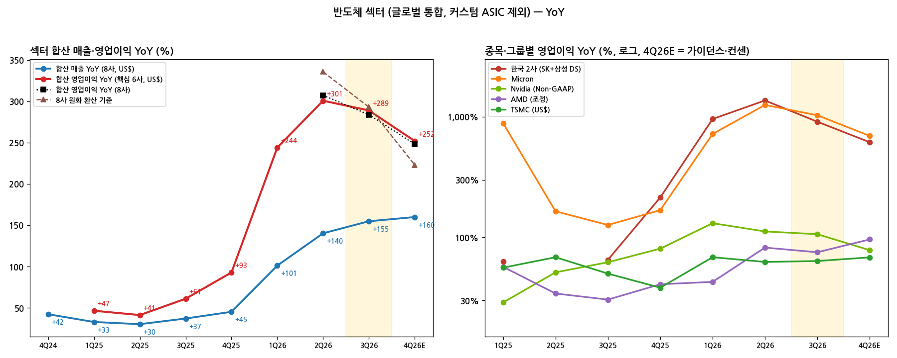

# 반도체 섹터 리뷰 (섹터 통합)

> 현재 상태 (최신 분기 기준)
> 최신 분기: 2026-Q3
> 섹터 델타: 둔화 | 내러티브: 강화
> 모멘텀 신호: 테마 종료 후보 — 에이전트AI
> 활성 테마: 에이전트AI (2026-Q2～)
> 포지셔닝: 섹터 중립 | 한국 언더퍼폼 | 선호 TSMC, AMD
> 편입 종목: SK하이닉스, 삼성전자(DS), Micron, Nvidia, AMD, Intel, Arm, TSMC (커스텀 ASIC 12월 편입 예정)
> 갱신 시각: 2026-11-23 06:35 KST

**갱신 기록** — 2026-11-16 한국 기준 잠정(SK하이닉스+삼성전자 전사, 둔화 | 강화) → 2026-11-23 글로벌 통합(메모리 3 + 로직·CPU 4 + 파운드리 1 = 8사, 커스텀 ASIC 제외, BT 지시 "엔비디아 끝나면 ASIC 제외하고 전체 섹터 리뷰로 이어가자"). 11/16판 원문은 `반도체_섹터리뷰.md.bak`, 한국 기준 판정은 아래 "한국 기준 (11/16 잠정판, BT 지시)"에 비교용으로 보존

## 누적 시계열 (글로벌 통합 기준)

| 분기 | 편입 종목 | 합산 매출 | 합산 영업이익 | OPM | 매출 YoY | 영업이익 YoY | 영업이익 YoY 델타 (%p) | 섹터 델타 | 내러티브 | 모멘텀 신호 | 활성 테마 |
|---|---|---|---|---|---|---|---|---|---|---|---|
| 4Q23 | 매출 8사 | 1,238,780억원 ($93.9B) | — | — | — | — | — | — | - | - | - |
| 1Q24 | 매출 8사 / 이익 핵심 6사 | 1,284,179억원 ($96.6B) | 411,136억원 ($30.9B, 6사) | — | — | — | — | — | - | - | - |
| 2Q24 | 동일 | 1,509,282억원 ($110.1B) | 544,100억원 ($39.7B, 6사) | — | — | — | — | — | - | - | - |
| 3Q24 | 동일 | 1,653,649억원 ($121.8B) | 623,514억원 ($45.9B, 6사) | — | — | — | — | — | - | - | - |
| 4Q24 | 동일 | 1,865,260억원 ($133.5B) | 711,691억원 ($50.9B, 6사) | — | +42.3 | — | — | — | - | - | - |
| 1Q25 | 동일 | 1,866,039억원 ($128.4B) | 658,578억원 ($45.3B, 6사) | — | +32.9 | +46.5 (6사, H20 되돌림 +61.1) | — | — | - | - | - |
| 2Q25 | 8사 (YoY = 6사) | 2,013,362억원 ($143.4B) | 774,729억원 ($55.2B) | 38.5 | +30.3 | +41.3 (6사) | −5.2 (H20 조정 −19.8) | 둔화 | - | - | - |
| 3Q25 | 8사 (YoY = 6사) | 2,315,761억원 ($167.0B) | 1,053,155억원 ($75.9B) | 45.5 | +37.1 | +61.0 (6사) | +19.7 | 가속 | - | - | - |
| 4Q25 | 8사 (YoY = 6사) | 2,799,906억원 ($193.9B) | 1,443,132억원 ($99.9B) | 51.5 | +45.2 | +92.8 (6사) | +31.8 | 가속 | - | - | - |
| 1Q26 | 8사 (YoY = 6사) | 3,786,749억원 ($258.3B) | 2,320,602억원 ($158.3B) | 61.3 | +101.1 | +243.9 (6사, H20 조정 +212.9) | +151.1 (조정 +120.1) | 가속 | - | - | - |
| 2Q26 | 8사 (델타 = Intel 제외 7사) | 5,174,986억원 ($344.5B) | 3,424,046억원 ($228.0B) | 66.2 | +140.3 | +298.7 (7사) / 8사 +307.2 / 6사 +300.7 | +56.8 (6사) | 가속 | - | - | 에이전트AI |
| **3Q26** | **8사 (델타 = Intel 제외 7사)** | **6,040,989억원 ($425.4B)** | **4,137,923억원 ($291.4B)** | **68.5** | **+154.8** | **+287.3 (7사) / 8사 +283.8 / 6사 +288.9** | **−11.4 (7사) / 8사 −23.4 / 6사 −11.8** | **둔화** | **강화** | **테마 종료 후보 — 에이전트AI** | **에이전트AI** |

→ **편입**: 메모리 핵심 3사(SK하이닉스 연결, 삼성전자 **DS 부문**, Micron Non-GAAP) + 로직·CPU 4사(Nvidia, AMD, Intel, Arm — Non-GAAP 영업이익) + 파운드리 TSMC(회사 영업이익). 커스텀 ASIC(Broadcom·Marvell)은 3Q26 실적이 12/1·12/9라 **합산 제외** — 아래 ① 참고 행. 메모리 확장 3사(SanDisk·WDC·Seagate)도 메모리 서브섹터 리뷰와 같이 합산 밖
→ **핵심 6사** = 메모리 3사 + Nvidia + AMD + TSMC. Intel(Non-GAAP 1Q25～)·Arm(2Q25～) 전년치가 없어 2Q26 이전 YoY를 낼 수 있는 가장 긴 동일 표본이다. 3Q26 기준 8사 영업이익의 98.7%를 차지한다 [계산]
→ **판정 표본 (2Q26 → 3Q26)** = Intel 제외 7사 — 로직·CPU 리뷰와 같은 기준(Intel 2Q25 Non-GAAP 적자 −$503M 기저). AMD 2Q25는 MI308 비용 조정 기저($1,697M). 4Q26은 4Q25 기저가 8사 모두 흑자라 8사로 판정
→ **소급 판정 열**은 6사 YoY로 기준표대로 산정했다 [계산]. 내러티브·모멘텀 열은 소급 분기에 통합 리뷰가 없어 `-`. 활성 테마 2Q26은 서브섹터 리뷰들과 같은 기준
→ 출처: `메모리_섹터리뷰.md` ① 표(억원), `로직·CPU_섹터리뷰.md` ① 표($M), `파운드리_섹터리뷰.md` ① 표(US$), 종목 리뷰 `earnings-review/2026-Q3_{MU|AMD|INTC|ARM|NVDA|TSM}_리뷰.md` 1번 표 [계산]

---

## 2026-Q3 섹터 리뷰 (글로벌 통합)

> 대상: 서브섹터 리뷰 3개 — `메모리_섹터리뷰.md`(11/16), `로직·CPU_섹터리뷰.md`(11/22, Nvidia 편입), `파운드리_섹터리뷰.md`(11/16). 참고: `커스텀 ASIC_섹터리뷰.md`(준비판, 2026-Q2 숫자)
> **11/16 잠정판 콜 체크**: 잠정판은 "섹터 중립(잠정) | 파운드리 확대 > 로직·CPU 유지 > 메모리 축소 | 한국 언더퍼폼(믹스 효과)", Nvidia 콜은 "가속이면 섹터 확대 검토"였다. Nvidia는 꺾임(규칙)·둔화(조정)로 나와 확대 조건 미충족 — **중립 유지, 서브섹터 순위·한국 콜 모두 그대로 맞았다.** 관전 포인트 2순위(글로벌 통합 재판정)는 이번 판으로 처리, ASIC 편입만 남았다

① 섹터 합산 숫자와 델타

(1) 합산 5지표 — 글로벌 8사

단위: US$B (억원), %

| 항목 | 2Q25 | 3Q25 | 4Q25 | 1Q26 | 2Q26 | **3Q26** | 4Q26E |
|---|---|---|---|---|---|---|---|
| 합산 매출 | 143.4 (2,013,362) | 167.0 (2,315,761) | 193.9 (2,799,906) | 258.3 (3,786,749) | 344.5 (5,174,986) | **425.4 (6,040,989)** | 503.9 (6,752,456) |
| 합산 영업이익 | 55.2 (774,729) | 75.9 (1,053,155) | 99.9 (1,443,132) | 158.3 (2,320,602) | 228.0 (3,424,046) | **291.4 (4,137,923)** | 347.8 (4,660,976) |
| OPM | 38.5 | 45.5 | 51.5 | 61.3 | 66.2 | **68.5** | 69.0 |
| 매출 YoY (8사, US$) | +30.3 | +37.1 | +45.2 | +101.1 | +140.3 | **+154.8** | +159.9 |
| 영업이익 YoY — 핵심 6사 (최장 동일 표본) | +41.3 | +61.0 | +92.8 | +243.9 (H20 조정 +212.9) | +300.7 | **+288.9** | +251.9 |
| **영업이익 YoY — 판정 표본 (Intel 제외 7사)** | — | — | — | — | +298.7 | **+287.3** | +250.8 |
| 영업이익 YoY — 8사 | — | — | — | — | +307.2 | **+283.8** | +248.0 |
| 영업이익 YoY — 8사 원화 환산 기준 | — | — | — | — | +335.7 | **+292.9** | +223.0 |
| **영업이익 YoY 델타 (%p)** | −5.2 (6사) | +19.7 | +31.8 | +151.1 | +56.8 | **−11.4 (7사)** | −35.8 (8사) |
| 판정 | 둔화 | 가속 | 가속 | 가속 | 가속 | **둔화** | 꺾임 경로 |

→ **통화**: US$를 판정 기준으로 쓰고 원화를 괄호에 적었다 [판단]. 8사 중 7사가 달러 공시(또는 달러 환산 주지표)이고, 원화로 합산하면 4Q26E 원화 강세(1,420 → 1,340원)가 섹터 YoY를 25%p 깎아 판정이 환율에 걸린다. 원화 환산 기준은 행으로 병기했다 — 방향(둔화 → 꺾임 경로)은 같고 폭만 크다
→ **원/달러 (분기 평균, 메모리 리뷰 표 그대로)**: 4Q23 1,320 · 1Q24 1,329 · 2Q24 1,371 · 3Q24 1,358 · 4Q24 1,397 · 1Q25 1,453 · 2Q25 1,404 · 3Q25 1,387 · 4Q25 1,444 · 1Q26 1,466 · 2Q26 1,502 · 3Q26 1,420 · 4Q26E 1,340 (BNK·하나증권 가정치·근사치 — `메모리_섹터리뷰.md` 누적 시계열 주석)
→ **NT$/US$ (TSMC, NT$ 매출 ÷ US$ 매출)**: 4Q24 32.3 · 1Q25 32.9 · 2Q25 31.1 · 3Q25 29.9 · 4Q25 31.0 · 1Q26 31.6 · 2Q26 31.6 · 3Q26 32.0 · 4Q26G 31.8. TSMC는 US$ 매출 × 회사 OPM(파운드리 리뷰)으로 합산에 넣었다 — 파운드리 서브섹터 판정은 NT$ 기준이지만 섹터 합산은 US$다
→ **캘린더 정렬**: 3Q26 합산은 2026년 6～10월에 걸친다. Micron 3Q26 = FQ4 FY26(6～8월), Nvidia 3Q26 = FQ3 FY27(8～10월), Arm = FQ2 FY27(7～9월), 나머지 7～9월. 월 단위 재배분 없이 가장 가까운 캘린더 분기에 매핑(서브섹터 리뷰와 같은 처리). Nvidia 4Q26E(FQ4 FY27)는 14주 분기
→ **같은 표본 YoY — 서브섹터 기준을 그대로 따랐다**: 메모리 = 삼성 DS(메모리 리뷰 기준, 전사 아님), 로직 = Non-GAAP(Nvidia도 Non-GAAP, GAAP과 3Q26 차이 0.5%), TSMC = 회사 영업이익. 2Q26 → 3Q26 델타는 로직 리뷰와 같이 Intel 제외. Nvidia 1Q25 H20 비용($4.5B) 저기저가 1Q26 YoY를 부풀린 효과는 조정값으로 병기했다(로직 리뷰와 같은 처리) — 섹터 판정은 바뀌지 않는다(1Q26 가속, 2Q26 가속)
→ **4Q26E**: 메모리 = 메모리 리뷰 E(SK 증권사 중간값·삼성 DS 3사 중간값·Micron 가이던스), 로직 = 4사 가이던스 합산($90.0B), TSMC = 가이던스 중간값(US$30.65B)
→ **이익 레벨**: 3Q26 8사 영업이익 $291.4B(413.8조원), OPM 68.5% — 둘 다 표본 최고. 4Q26E $347.8B로 레벨은 계속 오른다 [계산]
→ **컨센 경로상 정점**: 섹터 영업이익 YoY 정점은 **2Q26**(6사 +300.7%, 7사 +298.7%)으로 이미 통과. 매출 YoY는 4Q26E(+160%)까지 오르지만 증가 폭이 줄어든다(+14.5 → +5.1%p) [계산]
→ 비영업 요인: 인수 주도 가속 없음. 일회성은 Nvidia 1Q25 H20·AMD 2Q25 MI308(조정 병기), SK하이닉스 3Q26 영업외 손실(영업이익 무관)

(2) 서브섹터별 합산 행

| 서브섹터 | 3Q26 매출 | 3Q26 영업이익 | 영업이익 비중 | 영업이익 YoY 2Q26 → 3Q26 (서브섹터 리뷰 판정 기준) | 델타 | US$ 환산 YoY 2Q26 → 3Q26 → 4Q26E | 판정 | 출처 |
|---|---|---|---|---|---|---|---|---|
| 메모리 (3사) | $231.5B (3,287,652억원) | $178.3B (2,531,931억원) | 61.2% | +1,434.4% → +961.4% (원화) | −473.0%p | +1,334 → +937 → +631 | 둔화 | 메모리 리뷰 |
| └ 한국 2사 (SK하이닉스 + 삼성 DS) | $177.3B | $133.7B | 45.9% | — | — | +1,364 → +909 → +615 | (둔화) | [계산] = 메모리 − Micron |
| └ Micron | $54.2B | $44.6B | 15.3% | +1,252.7% → +1,028.6% | −224.1%p | 동일 | 둔화 | MU 리뷰 |
| 로직·CPU (4사) | $147.2B | $85.7B | 29.4% | +109.4% → +103.8% (Intel 제외 3사) | −5.6%p | 동일 (4사 4Q26E +77.6) | 둔화 (보고 기준 꺾임) | 로직·CPU 리뷰 |
| 파운드리 (TSMC) | $46.7B (NT$1,494.2십억) | $27.4B (NT$876.4십억) | 9.4% | +65.5% → +75.0% (NT$) | +9.5%p | +62.5 → +63.7 → +68.3 | 가속 (US$ 유지) | 파운드리 리뷰 |
| **섹터 합산 (판정 표본)** | **$425.4B** | **$291.4B** | 100% | **+298.7% → +287.3% (US$)** | **−11.4%p** | 8사 +307.2 → +283.8 → +248.0 | **둔화** | [계산] |
| (참고) 커스텀 ASIC — **합산 제외 (12/1·12/9 실적 후 편입)** | 2Q26 $32.3B | 2Q26 $21.1B | — | 1Q26 +51.1% → 2Q26 +89.2% (Non-GAAP) | +38.1%p | 3Q26G +90.5 | 가속 [준비판] | 커스텀 ASIC 리뷰 |

→ **3Q26 YoY 증가액 $215.5B의 출처** [계산]: 한국 2사 +$120.4B(55.9%), Micron +$40.7B(18.9%), 로직·CPU +$43.7B(20.3%, 이 중 Nvidia +$40.1B), TSMC +$10.7B(5.0%). **섹터 이익 증가의 75%가 메모리, 56%가 한국**이다. 4Q26E 증가액 $247.9B에서는 한국 비중이 61.1%로 더 커진다 — 섹터 YoY가 메모리 YoY에 끌려 내려가는 구조
→ **ASIC 편입 민감도** [계산]: Intel 제외 7사 + ASIC(2Q26 실적, 3Q26은 가이던스 중간값 $24.1B)이면 +264.1% → +258.6%(−5.5%p)로 **둔화 경계**까지 좁혀진다. ASIC 캘린더(5～7월 = 2Q26)가 다른 서브섹터보다 1개월 이르고 3Q26은 가이던스라 판정에는 쓰지 않는다. 12/9 Broadcom 실적이 가이던스를 크게 넘으면 섹터 판정이 "유지"로 바뀔 수 있다 — ⑥ 2순위
→ 메모리 확장 3사(SanDisk·WDC·Seagate)는 합산 밖이다. HDD 2사는 아직 가속(메모리 리뷰 (서브))이지만 규모가 작아 넣어도 섹터 판정은 바뀌지 않는다 [판단]

→ (출처: 서브섹터 리뷰 3개·종목 리뷰 [계산]. 왼쪽 = 8사 합산 매출 YoY, 핵심 6사 영업이익 YoY(최장 동일 표본), 8사 영업이익 YoY, 8사 원화 환산 기준 / 오른쪽 = 한국 2사(SK하이닉스 + 삼성 DS)·Micron·Nvidia(Non-GAAP)·AMD(조정)·TSMC(US$) 영업이익 YoY, 로그 축. 노란 음영 = 3Q26)

② 서브섹터 델타 순위표

| 순위 | 서브섹터 | 합산 영업이익 YoY 직전 → 이번 | 델타 | 판정 | 내러티브 | 서브섹터 판정 | 1등 종목 | 한국 편입 |
|---|---|---|---|---|---|---|---|---|
| 1 | 파운드리 | +65.5% → +75.0% (NT$) / US$ +62.5% → +63.7% | +9.5%p (US$ +1.2%p) | 가속 | 강화 | 확대 | TSMC | 없음 (삼성 파운드리 미분리) |
| 2 | 로직·CPU | +109.4% → +103.8% (Intel 제외 3사) | −5.6%p | 둔화 (보고 기준 꺾임) | 유지 | 유지 | AMD | 없음 |
| 3 | 메모리 | +1,434.4% → +961.4% | −473.0%p | 둔화 | 강화 | 축소 | SK하이닉스 (한국 1등) / Micron (글로벌) | SK하이닉스·삼성전자 |
| 참고 | 커스텀 ASIC (합산 제외, 2Q26) | +51.1% → +89.2% | +38.1%p | 가속 [준비판] | 강화 | 확대 | Broadcom | 없음 |

→ (출처: 각 서브섹터 리뷰 상태 블록·④·⑦. 판정은 서브섹터 리뷰 그대로)
→ **순위 기준**: 델타 큰 순서. 메모리는 레벨(+961%)이 압도적이지만 방향이 가장 나쁘다. 파운드리 가속 라벨은 대만달러 약세(격차 +11.3%p)에 기대지만 US$로도 +1.2%p로 3개 중 유일하게 플러스다 [판단]
→ **정점 시차**: 메모리(2Q26) = 로직·CPU(2Q26 조정 / 1Q26 보고) → 파운드리(4Q26～1Q27 예상) → 커스텀 ASIC(정점 미도래, 3Q26G +90.5%). AI 반도체 안에서 델타의 무게중심이 **메모리·GPU → 파운드리·커스텀 ASIC**으로 옮겨 가는 중 [판단]
→ 선행 서브섹터 = 메모리(Micron이 선행 종목). 로직·CPU 안 선행은 Intel → Nvidia

③ 섹터 공통 쟁점 (서브섹터 리뷰 2개 이상에 나온 것)

(1) 메모리 가격 상승의 양면 (메모리 · 로직·CPU · 파운드리)
→ 메모리: 범용 DRAM 가격이 이익 레버리지를 쥐었다(메모리 리뷰 ③(3)), 1Q27 모바일 DRAM +30～50% 인상 시도
→ 로직·CPU: 4사 모두 "메모리 가격 → PC·스마트폰 출하 감소". Intel CCPG 4Q QoQ −20% 이상, AMD C&G −20% 이상, Arm 로열티 +8%. Nvidia·AMD GPM은 HBM 원가에 눌림(Nvidia 4Q GPM 71～72%, 판가 15% 인상으로 전가)
→ 파운드리: TSMC 스마트폰 매출 YoY −1%. 메모리 확장층 HDD는 원가 전가 부담(WDC 원가 절감률 10% 하회)
→ [판단] 메모리 가격이 오를수록 섹터 안 이익이 메모리(= 한국)로 이동하고 나머지 층의 마진·물량이 깎인다. 섹터 합산 기준으로는 메모리 이익 증가($161B YoY)가 로직 소비자 부문 역풍(CPU 2사 PC 부문 영업이익 −20%)보다 압도적으로 크다. 2027 하반기 메모리 가격이 꺾이면 순서가 뒤집힌다 — 한국 반도체가 섹터 안에서 역헤지 성격이라는 잠정판 판단 유지

(2) 데이터센터 수요 > 공급 — 제약은 공급 (전 서브섹터)
→ 메모리: 2027 공급 부족 만장일치, SK하이닉스 "2029년까지 DRAM·HBM 사실상 완판". 로직: 4사 모두 "수요 > 공급", Nvidia 클라우드 수주잔고 $2.0T → $2.5T, 데이터센터 매출 Nvidia +110%·AMD +97%·Intel +78%. 파운드리: TSMC "수요 > 공급", 2027 선단 가동률 100% 초과(BofA), HPC +22% QoQ. ASIC(참고): Broadcom FY27 AI 매출 약 $115B 전망
→ [판단] 내러티브 '강화'의 근거. 수요 스토리는 모든 층에서 숫자로 확인됐다. 서브섹터 간 차이는 수요가 아니라 **기저와 가격 탄력**(누가 아직 YoY를 올릴 수 있나)에서 난다

(3) 공급망 선확보 — 장기계약과 구매 약정이 맞물린다 (메모리 · 로직·CPU)
→ 메모리: 장기계약 비중 삼성 60～70%·SK하이닉스 50%+·Micron 35%+, Micron RPO $150B. 로직: Nvidia 구매 약정 $279B → $390B(대부분 다년 메모리), AMD 재고 +$3B·패키징 장비 직접 매입
→ [판단] Nvidia의 구매 약정은 메모리 3사 장기계약의 거울이다. 메모리 이익의 하방은 받치지만(가격 밴드), 섹터 델타의 재가속은 제한한다 — 2027 섹터 이익은 "레벨 유지, 증가율 감속" 경로에 묶인다

(4) 2027 CapEx 한 단계 상승 (메모리 · 파운드리 · 로직)
→ Micron FY27 >$50B, SK하이닉스 "상당한 증가", 삼성 2027 100～108조원. TSMC 2027E US$80～90B. Intel 2027 CapEx "대폭 증액" + FCF 적자
→ [판단] 3사 메모리 "건설 먼저" + TSMC 선단 증설이 같은 해에 겹친다. 2028 말～2029 공급 증가를 예약한 것이라 2028 이익 논쟁(BNK 2028 SK하이닉스 −72% vs SK증권 증익)은 이번 분기 숫자로 끝나지 않는다

(5) 이익 상향 + 멀티플 하향 (전 서브섹터)
→ 고점 대비: SK하이닉스 −49%, 삼성 −36%, Micron 약 −22%, AMD −39%, Arm −56%, Intel 실적 후 −28.5%, Nvidia 1개월 −27%(12MF P/E 10.8배), TSMC ADR −17.9%
→ [판단] 섹터 전체가 "AI CapEx 지속성 의심"으로 디레이팅 중. 델타가 꺾인 메모리와 델타가 남은 TSMC의 낙폭 차이(−36～−49% vs −18%)는 방향은 맞지만, 델타 차이만큼 벌어지지는 않았다

종목 고유 이슈
→ Nvidia: CEO 퇴진·DOJ·SEC 조사 보도·신규 BIS 렌털 규제 — 멀티플 이벤트
→ 삼성전자: 주주환원 1월 말 이연, DX 적자 확대 / SK하이닉스: 영업외 손실 34.5조원
→ TSMC: 대만달러 약세가 NT$ 델타를 부풀림 / Intel: Fab 28 사고·공급 제약

④ 섹터 판정

> 섹터 델타: **둔화** | 내러티브: **강화** → **글로벌 반도체 이익 레벨은 사상 최고($291B, OPM 68.5%), 섹터 YoY는 2Q26 정점 통과 — 섹터 둔화의 대부분은 메모리(= 한국)에서 나왔고 ex-한국은 +154% 고원. 컨센 경로상 4Q26 꺾임, 섹터 베타보다 서브섹터 이동(메모리 → 파운드리) 구간** [판단]

→ (출처: 서브섹터 리뷰 3개·종목 리뷰 [계산]. 상단 = 핵심 6사 합산 영업이익(막대, US$)과 합산 영업이익 YoY(빨강, 핵심 6사 최장 동일 표본), 검정 점선 = 8사, × = Nvidia H20 비용 되돌림, 배경색 = 분기별 섹터 델타 판정(4Q26E는 컨센 경로상 판정), 점선 가로선 = 4Q26 판정선 +278.8%와 시나리오 범위 / 하단 왼쪽 = 서브섹터별 영업이익 YoY(로그, US$), 회색 점선 = 커스텀 ASIC 참고(합산 제외, 3Q26은 가이던스) / 하단 오른쪽 = 한국 2사(SK하이닉스 + 삼성 DS) vs 글로벌 ex-한국(Micron·Nvidia·AMD·TSMC) 영업이익 YoY, 로그)

→ **델타 근거**: 판정 표본(Intel 제외 7사) 합산 영업이익 YoY +298.7%(2Q26) → +287.3%(3Q26), −11.4%p — 축소했지만 플러스 = **둔화**. 8사(−23.4%p)·6사(−11.8%p)·원화 기준(−42.8%p) 모두 둔화. 4Q26E 8사 +248.0%(−35.8%p)면 2개 분기 연속 둔화 + 2Q26 정점 통과 = 기준상 **꺾임**
→ **결정적 근거 = 한국 vs ex-한국** [계산]: 한국 2사 YoY +1,364% → +909%(−455%p), ex-한국(Micron·Nvidia·AMD·TSMC) +153.7% → +153.5%(−0.2%p, 고원). 섹터 둔화는 메모리, 그중 한국 2사가 만들었다. 다만 4Q26E에는 ex-한국도 +130%로 내려간다(Micron 가이던스 감속 + Nvidia 4Q 마진 저점) — 4Q26 꺾임 경로는 메모리만의 문제가 아니다
→ **내러티브 근거**: 서브섹터 내러티브 강화 2(메모리·파운드리, 영업이익 비중 71%)·유지 1(로직·CPU). 로직의 '유지'는 스토리가 아니라 Nvidia CEO 공백·Intel 공급 문제 등 회사 고유 요인 때문이다(로직 리뷰 ④). 데이터센터 수요 스토리는 전 층에서 숫자로 확인 → **강화**
→ **직전 판정 대비**: 11/16 잠정판(한국 기준) 둔화 | 강화 → 11/23 글로벌 통합 둔화 | 강화 — **같은 판정**. 소급 궤적(6사) = 둔화(2Q25) → 가속 4분기 연속(3Q25～2Q26) → **둔화(3Q26)**

(1) 한국 기준 (11/16 잠정판, BT 지시) — 비교용 보존

> 11/16 BT 지시: "이번 AI 반도체 사이클의 핵심 층이 메모리이고 한국 반도체가 곧 메모리 2사" → 섹터 판정을 한국 2사(SK하이닉스 + **삼성전자 전사**, 원화) 합산으로 먼저 냈다. 숫자는 11/16판 그대로 (출처: `2026-Q3_SK하이닉스_리뷰.md`·`2026-Q3_삼성전자_리뷰.md` 1번 표 [계산])

| 분기 | 합산 매출 | 합산 영업이익 | OPM | 매출 YoY | 영업이익 YoY | 델타 (%p) | 판정 |
|---|---|---|---|---|---|---|---|
| 4Q24 | 95.56조원 | 14.57조원 | 15.2 | +20.8 | +359.6 | — | — |
| 1Q25 | 96.78조원 | 14.13조원 | 14.6 | +14.7 | +48.7 | −310.9 | 둔화 |
| 2Q25 | 96.80조원 | 13.89조원 | 14.3 | +7.0 | −12.7 | −61.4 | 꺾임 |
| 3Q25 | 110.51조원 | 23.55조원 | 21.3 | +14.3 | +45.3 | +58.0 | 가속 |
| 4Q25 | 126.67조원 | 39.24조원 | 31.0 | +32.6 | +169.3 | +124.0 | 가속 |
| 1Q26 | 186.45조원 | 94.84조원 | 50.9 | +92.7 | +571.2 | +401.9 | 가속 |
| 2Q26 | 250.82조원 | 150.03조원 | 59.8 | +159.1 | +980.1 | +408.9 | 가속 |
| **3Q26** | **299.87조원** | **190.75조원** | **63.6** | **+171.4** | **+710.0** | **−270.1** | **둔화** |
| 4Q26E | — | 235.2조원 | — | — | +499.4 | −210.6 | 꺾임 경로 |

| 기준 | 영업이익 YoY 2Q26 → 3Q26 | 델타 | 판정 | 4Q26 경로 | 4Q26 판정선 |
|---|---|---|---|---|---|
| **한국 기준 (11/16 잠정)** — SK하이닉스 + 삼성전자 전사, 원화 | +980.1% → +710.0% | −270.1%p | **둔화 / 강화** | +499.4% → 꺾임 | 316조원(+705%) 이상이면 유지 |
| **글로벌 통합 (11/23)** — 8사, US$ (판정 표본 Intel 제외 7사) | +298.7% → +287.3% | −11.4%p | **둔화 / 강화** | +248.0% → 꺾임 | 8사 $378.6B(+278.8%) 이상이면 유지 |

→ **판정 일치 — 둔화 | 강화, 4Q26 꺾임 경로까지 같다.** 이유도 같다: 글로벌 섹터 이익 증가의 56%가 한국 2사, 75%가 메모리라 섹터 델타가 메모리 델타를 따라간다 [계산]
→ 다른 점 두 가지: (a) **폭** — 한국 기준 −270%p vs 글로벌 −11%p. 로직(29%)·TSMC(9%)가 고원을 유지해 섹터 둔화를 희석한다 (b) **삼성 범위** — 잠정판은 전사(DX 적자 포함), 글로벌은 DS. 같은 한국 2사라도 DS 기준 YoY는 +1,364% → +909%(US$)다
→ [판단] 한국 기준은 "메모리 = 사이클의 핵심 층"이라는 판단이 맞았다는 것을 글로벌 합산이 확인해 준 셈이다. 글로벌로 넓혀도 결론이 바뀌지 않으므로 상태 블록은 글로벌 판정으로 바꾸되 숫자상 결론은 같다

⑤ 모멘텀 신호 (후보 — BT 판단 필요)

> **테마 종료 후보 — 에이전트AI** (반도체 섹터 레벨 · BT 판단 필요)

| 근거 | 수치 | 충족 |
|---|---|---|
| 섹터 델타 전환 | 가속(2Q26) → 둔화(3Q26), 4Q26E 8사 +248%면 꺾임(2개 분기 연속 둔화 + 정점 통과) | 충족 |
| 선행 서브섹터 꺾임 | 메모리 둔화(Micron 다음 분기 꺾임 1순위), 로직·CPU 둔화(보고 기준 꺾임, Intel·Nvidia 꺾임) | 충족 |
| 주가 | 전 서브섹터 고점 대비 −18～−56% — 이익보다 멀티플 먼저 하락 | 참고 |

→ **서브섹터별 신호 요약 (판단하지 않음)**

| 서브섹터 | 신호 | BT 판단 |
|---|---|---|
| 메모리 | 테마 종료 후보 → **레이어 모멘텀 종료 (2026-Q3) — 에이전트AI 유지** | 판단 완료 (2026-11-01) |
| 로직·CPU | 테마 종료 후보 — 에이전트AI (11/22 Nvidia 편입으로 발생) | **필요** |
| 파운드리 | 없음 (델타 급증 후보 조건 부분 충족, TSMC를 active_companies 편입 제안) | 제안 대기 |
| 커스텀 ASIC (참고) | 델타 급증 후보 [준비판] | 12월 실적 후 |

→ **레이어 종료 vs 테마 종료**: 에이전트AI 테마는 메모리·로직·CPU·하이퍼스케일러·전력 등에 걸쳐 있다. 반도체 섹터 신호는 **공급 측 반도체 레이어의 델타 종료 후보**이고, 반도체 안에서도 파운드리·커스텀 ASIC은 델타가 살아 있다. BT 선택지 [판단]: (a) 테마 유지 + 로직·CPU도 레이어 모멘텀 종료로 기록(메모리와 같은 표기) — 반도체 안 델타가 남은 층(파운드리·ASIC)으로 테마 레이어를 옮김 (b) 테마 유지 + 로직·CPU 보류(Nvidia 1Q FY28 가이던스 2027-02 하순까지) (c) 테마 종료
→ **반대 논거**
→ (1) ex-한국은 고원(+153.7% → +153.5%)이다 — 섹터 둔화는 메모리 기저(1년 전 이익 $9～17B)가 만든 산술적 감속이 크다
→ (2) 커스텀 ASIC이 들어오면 3Q26 델타가 −5.5%p로 경계까지 좁혀진다. Broadcom FY27 AI 매출 2배 전망이 확인되면 반도체 안 새 델타 층이 생긴다
→ (3) 이익 레벨·추정치는 계속 오른다: 4Q26E $347.8B, 메모리 2027 추정 상향 사이클, Nvidia FY28 +75%
→ 델타 급증 후보 조건 대조: ① 섹터 델타 뚜렷한 확대 — 미충족(−11.4%p) ② 서브섹터 과반 가속 — 미충족(가속 1/3) ③ 내러티브 형성·강화 — 충족(강화)

⑥ 다음 분기 섹터 관전 포인트

| 순위 | 무엇을 (변수·임계값) | 어떤 데이터로 | 언제 |
|---|---|---|---|
| 1 | **4Q26 8사 합산 영업이익 YoY +278.8% 이상 — 미만이면 꺾임**. 금액 $378.6B 이상(4Q25 $99.9B 기준), +288.8%($388.6B) 이상이면 가속. 컨센 $347.8B(+248.0%)는 꺾임. 메모리가 E보다 10%, 로직이 Nvidia 3Q 수준(+7.8%)만큼 넘어도 +277.8%로 선 아래 — 경로상 꺾임 가능성이 높다 | Micron FQ1 27(12월 중하순) → 삼성 잠정(1월 초) → TSMC 4Q(1월 중순) → SK·삼성·Intel(1월 하순) → AMD·Arm(2월 초) → Nvidia(2월 하순) | 2026-12 ～ 2027-02 |
| 2 | **커스텀 ASIC 편입** — Marvell FQ3 FY27·Broadcom FQ4 FY26 리뷰 → ASIC 서브섹터 갱신 → 통합 합산 편입·3Q26 재판정. ASIC 3Q26 YoY가 가이던스(+90.5%)를 넘어 9사 델타가 −5%p 안쪽이면 섹터 "유지"로 정정 | 2사 실적·가이던스, ASIC 리뷰 판정선(84.2%) | 2026-12-01 / 12-09 (ET) |
| 3 | **메모리 4Q26 304조원 대비** — Micron FQ1 27 영업이익 QoQ +14% 이상, 삼성 DS QoQ +24% 이상 | Micron 실적, 삼성 잠정 | 2026-12 중하순 / 2027-01 초 |
| 4 | **TSMC 4Q NT$ 영업이익 YoY 70% 이상** (11+12월 매출 합 NT$1,083십억 이상), 2027 가이던스 매출 +35% 이상 | TSMC 월매출(12/10·1/10), 4Q 컨콜 | 2026-12-10 ～ 2027-01 중순 |
| 5 | **Nvidia 1Q FY28 가이던스 내재 영업이익 YoY +85% 이상** — 로직 재가속·섹터 1Q27 재가속 여부 | Nvidia 4Q FY27 | 2027-02 하순 |

→ 1순위 판정선(+278.8%)은 ④ 키 차트와 같다. 근거: 3Q26 8사 YoY +283.8%에서 유지 범위(±5%p)를 뺀 값. 4Q25 기저가 8사 모두 흑자라 4Q26은 8사로 판정. 원화 기준이면 컨센 +223%로 더 깊은 꺾임 경로
→ 한국 기준 보조선(잠정판): 4Q26 한국 2사(전사) 316조원(+705%) — 컨센 235.2조원

⑦ 글로벌 PM 포지셔닝 — 결론

> **섹터: 중립 — 4Q26 8사 합산 YoY +278.8% 미만(꺾임 확정) + Nvidia 1Q FY28 가이던스 +85% 미만이면 축소** | **서브섹터: 파운드리 확대 > 로직·CPU 유지 > 메모리 축소 (커스텀 ASIC 확대 — 12월 편입 후 확정)** | **한국: 언더퍼폼 — 믹스 효과 크다 + 서브섹터 내 효과는 아웃퍼폼 (SK하이닉스 상대 우위)** [판단]

→ 11/16 잠정판 콜 체크: "섹터 중립(잠정)" → 글로벌 통합 후에도 중립으로 확정. Nvidia 확대 조건 미충족, 한국 언더퍼폼 콜 유지

(1) 섹터 비중 — 중립

| 판단 축 | 이번 분기 근거 (수치) | 방향 |
|---|---|---|
| 이익 델타 (1순위) | 판정 표본 +298.7% → +287.3%(둔화), 4Q26E +248%(꺾임 경로). 서브섹터 가속 1·둔화 2 | 축소 쪽 |
| YoY 정점 시점 | 섹터 정점 2Q26 통과. 메모리·로직 정점 통과, 파운드리 4Q26～1Q27, ASIC 미도래 | 축소 쪽 |
| 선행지표 | 장기계약 35～70%, Nvidia 구매 약정 $390B, TSMC 2027 가동률 100% 초과, 클라우드 수주잔고 $2.5T | 확대 |
| 최종 수요 | 데이터센터 수요 > 공급(전 층), PC·스마트폰은 역성장 | 확대 (데이터센터) |
| 이벤트·정책 | Nvidia CEO 공백·BIS 렌털 규제, Section 232 반도체 관세, 삼성 환원 1월 말 | 중립 |
| 이익 추정 방향 | 메모리 2027 상향, Nvidia·AMD 상향, Intel 하향, TSMC 2027E EPS +4% | 확대 |
| 밸류에이션·멀티플 (2순위) | Nvidia 12MF P/E 10.8배, Micron 6.7배, TSMC 2027E 14～15배, AMD 33배 — TP 하향은 멀티플 탓 | 확대 쪽 |
| 주가 낙폭 | 고점 대비 −18～−56% — 디레이팅이 이익 경로보다 앞섬 | 확대 쪽 |

→ **결론: 중립** [판단]. 이익 델타(1순위)는 둔화 → 꺾임 경로라 확대 근거가 없다. 그래도 지금 축소하지 않는 이유: (a) 둔화의 대부분이 메모리 기저 효과이고 ex-한국은 고원 (b) 델타가 살아 있는 파운드리·커스텀 ASIC이 섹터 안에 있다 (c) 이익 레벨·추정치 상향 + 낙폭이 이미 크다. 섹터 베타는 중립, 섹터 안 비중을 옮기는 구간
→ **축소 전환 조건**: 4Q26 8사 합산 YoY +278.8% 미만(꺾임 확정) **그리고** Nvidia 1Q FY28 가이던스 내재 영업이익 YoY +85% 미만 → 2027-02 하순 축소. 보조: Micron FQ1 27 QoQ +10% 미만(12월), ASIC 3Q26 둔화(84.2% 미만, 12/9)
→ **확대 전환 조건**: 4Q26 8사 +288.8%($388.6B) 이상, 또는 ASIC 편입 후 섹터 델타 플러스 전환 + TSMC 4Q NT$ +80% 이상

(2) 국가 프레임 — 서브섹터 × 국가

| 서브섹터 | 한국 (종목 · 영업이익 YoY 델타) | 글로벌 (종목 · 영업이익 YoY 델타) | 서브섹터 내 우위 | 한국 매출 비중 |
|---|---|---|---|---|
| 메모리 | SK하이닉스 +74.9%p(가속) · 삼성전자 −1,029%p(전사, 둔화) | Micron −224.1%p(둔화) | **한국** (정점 후행, 장기계약 비중 높음) | 메모리 매출의 76.6% |
| 로직·CPU | 비교 불가 — 편입 종목 없음 | Nvidia −5.7%p · AMD −7.0%p · Arm +7.7%p · Intel 꺾임 | — | 0% |
| 파운드리 | 비교 불가 — 삼성 파운드리 미분리 | TSMC +9.5%p (NT$, 가속) | — | 0% |
| 커스텀 ASIC (참고) | 비교 불가 | Broadcom +39.8%p · Marvell +12.7%p (2Q26) | — | 0% |
| **섹터 합산** | 한국 2사(SK + 삼성 DS) +1,364% → +909% (US$, −455%p) | ex-한국 +153.7% → +153.5% (−0.2%p) | 글로벌 (델타 방향) | **섹터 매출의 41.7%** |

→ (출처: 서브섹터 리뷰 ⑦(2)·② 표, 섹터 합산 [계산])
→ **결론: 한국 언더퍼폼 = 믹스 효과 크다 + 서브섹터 내 효과는 작다(오히려 아웃퍼폼).** 한국 반도체는 델타가 가장 나쁜 메모리에 100% 몰려 있다(믹스). 같은 메모리 안에서는 SK하이닉스·삼성이 Micron보다 정점이 늦고 장기계약 비중이 높아 델타 수명이 길다(서브섹터 내 아웃퍼폼) [판단]
→ 이유 (1) 델타 방향: 한국 2사 −455%p vs ex-한국 −0.2%p (2) 이익 추정: 한국 2사 2027 상향 중이지만 2028E 범위가 넓다(BNK −72% ～ SK증권 증익) (3) 구조: 2027 하반기 범용 DRAM 가격 하락 민감도는 삼성이 가장 크다
→ **반대 논거**: 메모리 가격이 1Q27에 +30～50% 오르면 한국 2사 추정 상향이 이어지고, 고점 대비 낙폭(−49%·−36%)이 Nvidia 외 글로벌보다 크다. 원화 강세(4Q26E 1,340원)는 원화 이익을 깎지만 달러 투자자에겐 중립. 가치 프레임이면 반대 결론 가능
→ **예외 종목**: SK하이닉스 — 3Q26 메모리 유일한 가속, 한국 1등. 다음 분기 1등 후보는 삼성전자(4Q26 DS QoQ +24% 재가속 예상)
→ **비교 범위**: 글로벌 편입 종목은 모두 풀 리뷰(셀사이드 포함). 로직·파운드리·ASIC에 한국 종목이 없어 서브섹터 내 비교는 메모리 1곳뿐 — 한국 국가 판단의 근거는 메모리 안 비교 + 섹터 믹스

(3) 서브섹터 순위·비중

| 순위 | 서브섹터 | 비중 | 근거 (델타 방향·마진·수요 노출) |
|---|---|---|---|
| 1 | 파운드리 | **확대** | 유일한 가속·강화, US$로도 고원(+63.7%). 정점 4Q26～1Q27로 가장 늦음. OPM 58.7%. 단 환율 순풍 축소 |
| 2 | 로직·CPU | **유지** | 둔화(보고 기준 꺾임), 4Q 가이던스 +78%로 꺾임 경로. 안에서 AMD(4Q +96%)로 이동 |
| 3 | 메모리 | **축소** | 둔화, 섹터 정점 2Q26 통과, BT 레이어 모멘텀 종료. 안에서 SK하이닉스 > 삼성 > Micron, HDD 확장층만 가속 |
| 참고 | 커스텀 ASIC | 확대 (준비판) | 2Q26 가속 +89.2%, 3Q26G +90.5%. 12/1·12/9 실적 후 순위 편입 — 파운드리와 1위 경합 후보 |

→ **글로벌 선호**: TSMC(파운드리 1등), AMD(로직 1등). **글로벌 비선호**: Intel(꺾임·약화), Micron(메모리 선행, 다음 분기 꺾임 1순위)
→ **한국 선호**: SK하이닉스(메모리 한국 1등) — 섹터 언더퍼폼 안의 상대 선호. **한국 비선호**: 삼성전자(1월 말 환원 확인 전, 단 4Q 재가속 시 1등 후보)
→ **반등 후보 (이벤트 드리븐)**: Nvidia — 후임 CEO 선임·조사 결과 + 1Q FY28 가이던스 +85% 이상. 삼성전자 — 1월 말 이사회 환원 55～75조원 실행

(4) 서브섹터별 1등 종목

| 서브섹터 | 비중 | 글로벌 1등 | 한국 1등 | 델타 판정 | 근거 한 줄 |
|---|---|---|---|---|---|
| 파운드리 | 확대 | TSMC | 없음 | 가속 · 강화 | HPC 비중 68%, 4Q 가이던스 컨센 +5.9%, 2026 성장률 세 번째 상향 |
| 로직·CPU | 유지 | AMD | 비교 불가 | 둔화(일시) · 강화 | 4사 중 유일하게 4Q 가이던스 재가속(+75% → +96%) |
| 메모리 | 축소 | Micron (글로벌 단독) | SK하이닉스 | 가속 · 강화 (SK) | 3Q26 유일한 가속, 섹터 증가액 43% — 단 이번 분기가 정점 |
| 커스텀 ASIC (참고) | 확대 [준비판] | Broadcom | 없음 | 가속 · 강화 | AI 반도체 +221%, FY27 AI 약 $115B |

→ 상태 블록 선호 = TSMC(1위 서브섹터 1등), AMD(2위 서브섹터 1등). 한국 선호는 SK하이닉스

(5) 콜을 바꾸는 조건과 일정

| 시점 | 이벤트 | 섹터 비중 | 한국 콜 |
|---|---|---|---|
| 2026-12-01 (ET) | Marvell FQ3 FY27 | ASIC 판정 1차 | — |
| 2026-12-09 (ET) | Broadcom FQ4 FY26 + FQ1 FY27 가이던스 | ASIC 편입 → 9사 재판정. 델타 −5%p 안쪽이면 섹터 "유지" 정정 검토 | 믹스 효과 확대(한국 ASIC 없음) |
| 2026-12-10 | TSMC 11월 매출 | 파운드리 확대 1차 확인 | — |
| 2026-12 중하순 | Micron FQ1 27 | QoQ +10% 미만이면 축소 쪽 | Micron 꺾임 확정 시 메모리 안 한국 우위 강화 |
| 2027-01 초 | 삼성전자 4Q26 잠정 | — | DS QoQ +24% 이상이면 언더퍼폼 완화 |
| 2027-01 중순 | TSMC 4Q26·2027 가이던스 | NT$ +80% + 매출 +35%면 확대 쪽 | — |
| 2027-01 하순 | SK하이닉스·삼성 확정, Intel | 메모리 304조원 10% 이상 상회 시 메모리 유지 복귀 | 한국 2사(전사) 316조원 이상이면 중립 상향 |
| 2027-02 하순 | Nvidia 4Q FY27·1Q FY28 가이던스 | **8사 +278.8% 미만 + 1Q FY28 +85% 미만 → 축소** / +288.8% 이상 → 확대 | 섹터 축소 시 한국 언더퍼폼 유지 |

---

### (참고) 커스텀 ASIC — 합산 제외 (12/1·12/9 실적 후 편입)

→ **합산·판정에는 넣지 않음.** BT 지시(2026-11-22): "ASIC 2개사는 12월 실적 발표라서 미리 섹터 리뷰 작성해서 추후 업데이트". 준비판(`커스텀 ASIC_섹터리뷰.md`)의 2026-Q2 판정을 인용: **가속 | 강화**, 델타 급증 후보 (BT 판단 필요), 서브섹터 확대, 1등 Broadcom
→ 2Q26 합산 Non-GAAP 영업이익 $21.1B(OPM 65.3%), YoY +51.1% → +89.2%. 증가분의 97%가 Broadcom(AI 반도체 $16.7B, +221%). 3Q26 가이던스 +90.5%(유지 경로), OPM 63.6%로 처음 하락
→ 섹터와의 관계 [판단]: 반도체 안에서 델타가 가장 위로 열린 층이다. 편입 시 섹터 3Q26 델타가 −11.4%p → 약 −5.5%p로 줄어(①(2) 민감도) 판정이 둔화/유지 경계에 선다. 순위는 파운드리와 1위 경합
→ 편입 절차: 12/1 Marvell·12/9 Broadcom 실적 리뷰(v11) → ASIC 서브섹터 리뷰 3Q26 갱신 → 이 문서 ① 합산·② 순위·⑦ 재작성. 캘린더 정렬: Broadcom FQ4 FY26·Marvell FQ3 FY27 = 2026년 8～10월 → 3Q26 (Nvidia와 같은 처리)

### (참고) 메모리 확장층 — 합산 제외

→ SanDisk(NAND, 둔화)·WDC·Seagate(HDD, 가속)는 메모리 서브섹터 리뷰 (서브) 섹션 그대로 합산 밖. HDD는 반도체 섹터에서 델타가 플러스인 마지막 메모리 층이지만 규모가 작다. 별도 레이어 판단은 BT (`메모리_섹터리뷰.md` (서브))

---

> Sources: `sector-review/메모리_섹터리뷰.md`(2026-11-16, 원/달러 환율표·BT 판단 11/01), `sector-review/로직·CPU_섹터리뷰.md`(2026-11-22, Nvidia 편입), `sector-review/파운드리_섹터리뷰.md`(2026-11-16, NT$ 환율), `sector-review/커스텀 ASIC_섹터리뷰.md`(준비판 2026-11-22), `earnings-review/2026-Q3_{SK하이닉스|삼성전자|MU|NVDA|AMD|INTC|ARM|TSM}_리뷰.md`, `sector-review/반도체_섹터리뷰.md.bak`(11/16 한국 기준 잠정판). 계산 스크립트: `outputs/scripts/semi_global_data.py`·`semi_global_chart.py`
