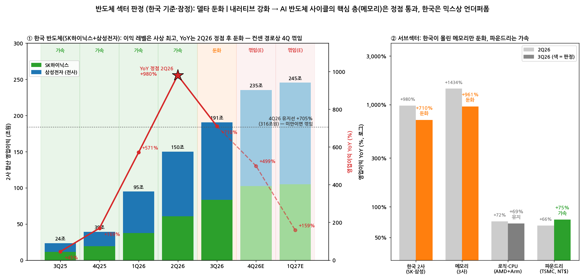

# 반도체 섹터 리뷰 (섹터 통합)

> 현재 상태 (최신 분기 기준)
> 최신 분기: 2026-Q3
> 섹터 델타: 둔화 | 내러티브: 강화
> 모멘텀 신호: 레이어 모멘텀 종료 (2026-Q3) — 에이전트AI 유지 (BT)
> 활성 테마: 에이전트AI (2026-Q2～)
> 포지셔닝: 섹터 중립 (잠정) | 한국 언더퍼폼 (믹스 효과) | 선호 TSMC, SK하이닉스
> 편입 종목: 한국 기준 잠정 — SK하이닉스, 삼성전자 (글로벌 통합은 Nvidia·Marvell·Broadcom 실적 후)
> 갱신 시각: 2026-11-16 16:00 KST

> **잠정판 (2026-11-16, BT 지시)**: 섹터 통합 리뷰는 원래 서브섹터 4개(메모리·로직·CPU·파운드리·커스텀 ASIC) 리뷰가 끝난 뒤 쓴다. 이번 AI 반도체 사이클의 핵심 층이 메모리이고 한국 반도체가 곧 메모리 2사라서, **섹터 델타·내러티브 판정은 한국 2사(SK하이닉스·삼성전자) 합산 기준**으로 먼저 낸다. Nvidia(11/17)·Marvell(12/1)·Broadcom(12/9) 실적 후 글로벌 통합 합산으로 다시 판정하고, 그때 한국 기준 행은 비교용으로 남긴다

## 누적 시계열 (한국 2사 합산 기준)

| 분기 | 편입 종목 | 합산 매출 | 합산 영업이익 | OPM | 매출 YoY | 영업이익 YoY | 영업이익 YoY 델타 (%p) | 섹터 델타 | 내러티브 | 모멘텀 신호 | 활성 테마 |
|---|---|---|---|---|---|---|---|---|---|---|---|
| 4Q24 | SK하이닉스, 삼성전자 | 95.56조원 | 14.57조원 | 15.2 | +20.8 | +359.6 | — | — | - | - | - |
| 1Q25 | 동일 | 96.78조원 | 14.13조원 | 14.6 | +14.7 | +48.7 | −310.9 | 둔화 | - | - | - |
| 2Q25 | 동일 | 96.80조원 | 13.89조원 | 14.3 | +7.0 | −12.7 | −61.4 | 꺾임 | - | - | - |
| 3Q25 | 동일 | 110.51조원 | 23.55조원 | 21.3 | +14.3 | +45.3 | +58.0 | 가속 | - | - | - |
| 4Q25 | 동일 | 126.67조원 | 39.24조원 | 31.0 | +32.6 | +169.3 | +124.0 | 가속 | - | - | - |
| 1Q26 | 동일 | 186.45조원 | 94.84조원 | 50.9 | +92.7 | +571.2 | +401.9 | 가속 | - | - | - |
| 2Q26 | 동일 | 250.82조원 | 150.03조원 | 59.8 | +159.1 | +980.1 | +408.9 | 가속 | - | - | 에이전트AI |
| **3Q26** | 동일 | **299.87조원** | **190.75조원** | **63.6** | **+171.4** | **+710.0** | **−270.1** | **둔화** | **강화** | **레이어 모멘텀 종료 (2026-Q3) — 에이전트AI 유지 (BT)** | **에이전트AI** |

→ 합산 기준: SK하이닉스 연결 + **삼성전자 전사**(DS만이 아니라 전사 — 한국 투자자가 실제로 들고 있는 종목 단위, 각 종목 리뷰 0번 판정과 같은 기준). 삼성 DX(세트) 적자 확대가 섞여 반도체 순수 이익보다 약간 낮게 잡힌다
→ 출처: `earnings-review/2026-Q3_SK하이닉스_리뷰.md`·`2026-Q3_삼성전자_리뷰.md` 1번 분기 표 [계산]. 4Q23～3Q24 기저: SK 0.35·2.89·5.47·7.03조원, 삼성 2.82·6.61·10.44·9.18조원 (같은 표)
→ 원화 단일 통화라 환율 환산 없음

---

## 2026-Q3 섹터 리뷰 (잠정 — 한국 기준)

> 대상: 한국 2사 종목 리뷰 + 서브섹터 리뷰 3개(`메모리_섹터리뷰.md`, `로직·CPU_섹터리뷰.md`, `파운드리_섹터리뷰.md`). 커스텀 ASIC(Broadcom·Marvell)은 실적 전이라 미작성
> 첫 섹터 통합 리뷰 — 직전 콜 체크 없음

① 섹터 합산 숫자와 델타 — 한국 2사 + 서브섹터별 행

| 구분 | 2Q26 영업이익 YoY | **3Q26 영업이익 YoY** | 델타 (%p) | 판정 | 4Q26 경로 | 출처 |
|---|---|---|---|---|---|---|
| **한국 2사 합산 (판정 기준)** | +980.1 | **+710.0** | **−270.1** | **둔화** | +499.4 (235.2조원) → 2분기 연속 둔화 + 정점 통과 = 꺾임 경로 | 종목 리뷰 [계산] |
| SK하이닉스 | +557.2 | +632.1 | +74.9 | 가속 (이번 분기가 정점) | +434.2 | SK하이닉스 리뷰 |
| 삼성전자 (전사) | +1,812 | +782.8 | −1,029 | 둔화 | +561.7 (QoQ +24% 재가속) | 삼성전자 리뷰 |
| 서브섹터 · 메모리 (3사) | +1,434.4 | +961.4 | −473.0 | 둔화 | +578.8 | 메모리 섹터 리뷰 |
| 서브섹터 · 로직·CPU (AMD+Arm 판정 표본) | +71.9 | +68.6 | −3.3 | 유지 | 3사 가이던스 합산 +70.0 (둔화 경로) | 로직·CPU 섹터 리뷰 |
| 서브섹터 · 파운드리 (TSMC, NT$) | +65.5 | +75.0 | +9.5 | 가속 | +72.5 (US$ +68.3) | 파운드리 섹터 리뷰 |
| 서브섹터 · 커스텀 ASIC | — | — | — | 미작성 | Marvell 12/1·Broadcom 12/9 | — |

→ 한국 2사 합산: 매출 299.87조원(+171.4% YoY), 영업이익 190.75조원(OPM 63.6%) — 이익 레벨은 사상 최고. 매출 YoY는 아직 오르는 중(+159% → +171%)이지만 영업이익 YoY는 2Q26(+980%)이 정점 [계산]
→ 컨센 경로: 4Q26E 235.2조원(+499%), 1Q27E 245.4조원(+159%) — 분기 이익은 계속 늘지만 YoY는 급감속. 섹터 YoY 정점은 **2Q26으로 이미 통과** [계산]
→ 글로벌 통합 합산은 미작성 — 통화(원·달러·대만달러)·회계분기 정렬이 필요하고 Nvidia가 들어오면 합산 규모가 크게 바뀐다

② 서브섹터 델타 순위표

| 순위 | 서브섹터 | 합산 영업이익 YoY 2Q26 → 3Q26 | 델타 | 판정 | 1등 종목 | 한국 편입 |
|---|---|---|---|---|---|---|
| 1 | 파운드리 | +65.5% → +75.0% (NT$) | +9.5%p | 가속 | TSMC | 없음 |
| 2 | 로직·CPU | +71.9% → +68.6% (AMD+Arm) | −3.3%p | 유지 | AMD | 없음 |
| 3 | 메모리 | +1,434% → +961% | −473%p | 둔화 | SK하이닉스 | SK하이닉스·삼성전자 |
| — | 커스텀 ASIC | — | — | 미작성 | — | 없음 |

→ (출처: 각 서브섹터 리뷰 상태 블록·① 표)
→ 성장률 레벨은 메모리가 압도적(+961%)이지만 **방향은 정반대** — 메모리는 정점을 지나 둔화, 파운드리는 가속. AI 반도체 안에서 델타의 무게중심이 메모리 → 파운드리(TSMC)로 옮겨 가는 중 [판단]
→ 메모리 안에서도 HDD(WDC·Seagate)는 아직 가속 — 메모리 섹터 리뷰 (서브) 층별 정점 차트 참고

③ 섹터 공통 쟁점 (서브섹터 리뷰에서 2개 이상 겹친 것)

(1) 메모리 가격 상승의 양면 — 메모리에는 이익, 로직·CPU·HDD에는 원가·수요 역풍
→ 메모리: 범용 DRAM 가격이 2026 이익을 끌었다(메모리 리뷰 쟁점 3). 로직·CPU: AMD·Intel·Arm 모두 메모리 가격 → PC·스마트폰 출하 감소(로직·CPU 리뷰 쟁점 1). HDD: WDC 원가 절감률 10% 하회. 파운드리: TSMC 스마트폰 매출 YoY −1%
→ [판단] 메모리 가격이 오를수록 한국 2사는 좋고 나머지 층은 나빠진다. 메모리 가격이 꺾이는 2027 하반기에는 순서가 뒤집힐 수 있다 — 한국 반도체가 섹터 안에서 역(逆)헤지 성격

(2) 데이터센터 수요 > 공급 (전 서브섹터 공통)
→ 메모리 2027 공급 부족 만장일치, 서버 CPU 수요 > 공급, TSMC "수요 > 공급, AI CAGR 아마 더 높아질 것"
→ [판단] 수요 스토리는 모든 층에서 숫자로 확인 — 내러티브 '강화'의 근거. 차이는 **누가 아직 가격·물량을 더 올릴 수 있나**에서 난다

(3) 이익 상향 + 멀티플 하향 (전 서브섹터 공통)
→ 한국 2사 고점 대비 SK하이닉스 −49%, 삼성 −36%. AMD −39%, Arm −56%, TSMC ADR −8%(발표 후), Micron 약 −22%
→ [판단] 섹터 전체가 "AI CapEx 지속성 의심"으로 디레이팅 중. 이익이 꺾인 층(메모리)과 안 꺾인 층(파운드리)의 낙폭 차이가 아직 작다 — 델타 차이가 주가에 덜 반영됐다

④ 섹터 판정 (한국 기준 · 잠정)

> 섹터 델타: **둔화** | 내러티브: **강화** → **이번 AI 반도체 사이클의 핵심 층인 메모리(= 한국 반도체)는 2Q26에 이익 YoY 정점을 지났다. 이익 레벨은 사상 최고지만 컨센 경로상 4Q26에 꺾임 — 섹터 안 델타의 무게중심은 파운드리로 이동 중** [판단]

→ (출처: SK하이닉스·삼성전자 3Q26 리뷰, 서브섹터 리뷰 3개 [계산]. 왼쪽 = 한국 2사 합산 영업이익(막대, SK하이닉스 + 삼성전자 전사)과 합산 영업이익 YoY(선), 배경색 = 분기별 섹터 델타 판정(4Q26E·1Q27E는 컨센 경로상 판정), 점선 = 4Q26 유지선. 오른쪽 = 한국 2사·서브섹터별 영업이익 YoY 2Q26 vs 3Q26(로그 축, 색 = 3Q26 판정))

→ 델타 근거: 한국 2사 합산 영업이익 YoY +980%(2Q26) → +710%(3Q26), 축소했지만 플러스 = **둔화**. 컨센 4Q26E +499%면 2개 분기 연속 둔화 + 정점 통과 = 기준상 **꺾임**
→ 내러티브 근거: SK하이닉스·삼성전자 리뷰 모두 '강화'(장기계약 50～70%, 2027 공급 부족, HBM4 경쟁력). 서브섹터 내러티브도 강화 2(메모리·파운드리)·유지 1(로직·CPU) — 수요 스토리는 훼손되지 않았다
→ 직전 판정 대비: 첫 통합 리뷰. 소급 궤적 = 꺾임(2Q25) → 가속 4분기 연속(3Q25～2Q26) → **둔화(3Q26)**

⑤ 모멘텀 신호

→ 메모리 섹터 리뷰의 BT 판단(2026-11-01)을 그대로 따른다: **에이전트AI 테마 유지, 메모리 레이어 모멘텀 종료(2026-Q3)**. 한국 반도체 = 메모리라서 한국 기준 섹터 신호도 같다
→ 파운드리(가속·강화)는 델타 급증 후보 조건 일부만 충족(가속은 대만달러 약세 효과가 커 달러 기준은 고원) — 후보로 올리지 않음 (파운드리 섹터 리뷰 ⑤)
→ 반대 논거: 삼성전자 4Q26 QoQ +24% 재가속, 1Q27 모바일 DRAM +30～50% 인상 — 4Q26 2사 합산이 316조원(+705%)을 넘으면 '유지'로 돌아선다. 다만 컨센(235조원)과 격차가 커 가능성은 낮다 [판단]

⑥ 다음 분기 섹터 관전 포인트

| 순위 | 무엇을 (변수·임계값) | 어떤 데이터로 | 언제 |
|---|---|---|---|
| 1 | **4Q26 한국 2사 합산 영업이익 316조원(YoY +705%) 이상이면 유지, 미만이면 꺾임** — 컨센 235.2조원(+499%)은 꺾임 경로 | 삼성전자 4Q26 잠정(1월 초), SK하이닉스·삼성 확정(1월 말) | 2027-01 |
| 2 | **글로벌 통합 재판정** — Nvidia(11/17)·Marvell(12/1)·Broadcom(12/9) 리뷰 후 커스텀 ASIC 서브섹터 리뷰 → 글로벌 합산 | 각 사 실적 | 2026-11-17 ～ 12-09 |
| 3 | **Micron FQ1 27** — 메모리 선행 종목의 꺾임 확정 여부, NAND·DRAM 가격 코멘트 | Micron 실적 | 2026-12 중하순 |
| 4 | **TSMC 월매출·2027 가이던스** — 파운드리 가속 지속 여부(11+12월 합 NT$1,083십억 이상) | TSMC 월매출(12/10, 1/10), 4Q 컨콜 | 2026-12 ～ 2027-01 |
| 5 | **1Q27 메모리 계약가** — 한국 2사 2027 추정 상향 지속 여부 | TrendForce·DRAMeXchange | 2026-12 ～ 2027-01 |

⑦ 글로벌 PM 포지셔닝 — 결론 (잠정)

> **섹터: 중립 (잠정) — 글로벌 통합 후 확정** | **서브섹터: 파운드리 확대 > 로직·CPU 유지 > 메모리 축소** | **한국: 언더퍼폼 — 믹스 효과 (메모리 쏠림), 서브섹터 내 효과는 아웃퍼폼** [판단]

(1) 섹터 비중 — 중립 (잠정)

| 판단 축 | 근거 | 방향 |
|---|---|---|
| 이익 델타 (1순위) | 한국 2사 둔화(−270%p), 서브섹터는 가속 1·유지 1·둔화 1 | 중립 |
| YoY 정점 | 메모리 2Q26 통과, 파운드리 4Q26～1Q27 예상, 로직·CPU 미확정(Nvidia 대기) | 중립 |
| 최종 수요 | 데이터센터 수요 > 공급 — 전 서브섹터 공통 | 확대 |
| 밸류에이션 (2순위) | 이익 상향 + 멀티플 하향, 고점 대비 −8～−56% | 중립 |

→ 섹터 베타는 중립, 섹터 안에서 비중을 메모리 → 파운드리로 옮기는 구간. Nvidia가 들어오면 섹터 비중 판단이 바뀔 수 있다

(2) 국가 프레임 — 서브섹터 × 국가

| 서브섹터 | 한국 (종목 · 영업이익 YoY 델타) | 글로벌 (종목 · 영업이익 YoY 델타) | 서브섹터 내 우위 | 한국 매출 비중 |
|---|---|---|---|---|
| 메모리 | SK하이닉스 +74.9%p(가속) · 삼성전자 −1,029%p(둔화) | Micron −224%p(둔화) | 한국 (정점 후행) | 100% |
| 로직·CPU | 비교 불가 — 편입 종목 없음 | AMD −7.0%p · Arm +7.7%p · Intel 꺾임 | — | 0% |
| 파운드리 | 비교 불가 — 삼성 파운드리 미분리 | TSMC +9.5%p(가속) | — | 0% |
| 커스텀 ASIC | 비교 불가 | 미작성 | — | 0% |

→ 결론: **한국 언더퍼폼 = 믹스 효과 크다 + 서브섹터 내 효과는 오히려 아웃퍼폼.** 한국 반도체는 델타가 가장 먼저 꺾인 메모리에 100% 몰려 있다. 같은 메모리 안에서는 SK하이닉스·삼성이 Micron보다 정점이 늦어 델타 수명이 길다
→ 반대 논거: 메모리 가격이 1Q27에도 크게 오르면(모바일 +30～50%) 한국 2사 추정 상향이 이어지고, 고점 대비 낙폭(−49%·−36%)이 이미 크다 — 가치 프레임이면 반대 결론 가능

(3) 서브섹터별 1등 종목

| 서브섹터 | 비중 | 1등 종목 | 근거 |
|---|---|---|---|
| 파운드리 | 확대 | TSMC | 유일한 가속·강화, 4Q 가이던스 YoY +58%(US$) |
| 로직·CPU | 유지 | AMD | 4Q 가이던스 영업이익 YoY +96% 재가속 (Nvidia 편입 후 재판정) |
| 메모리 | 축소 | SK하이닉스 (한국 1등) | 3Q26 유일한 가속, 단 이번 분기가 정점. 다음 분기는 삼성전자(4Q QoQ +24%)가 1등 후보 |

(4) 콜을 바꾸는 조건과 일정

| 시점 | 이벤트 | 섹터 비중 | 한국 콜 |
|---|---|---|---|
| 2026-11-17 (ET) | Nvidia 3Q FY27 | 가속이면 섹터 확대 검토 | 언더퍼폼 강화 (믹스 효과 확대) |
| 2026-12-01 / 12-09 | Marvell·Broadcom | 커스텀 ASIC 판정 → 글로벌 통합 | — |
| 2026-12 중하순 | Micron FQ1 27 | — | Micron 꺾임 확정 시 메모리 내 한국 우위 유지 |
| 2027-01 | 한국 2사 4Q26 실적 | — | 2사 합산 316조원 이상이면 한국 중립으로 상향 |
