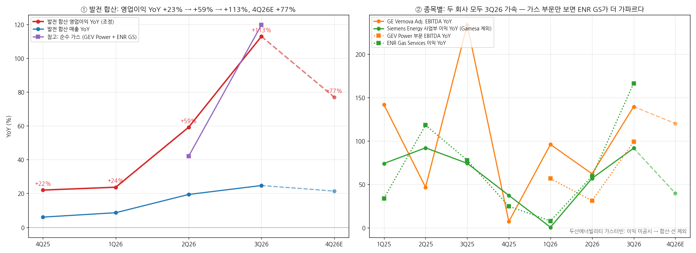
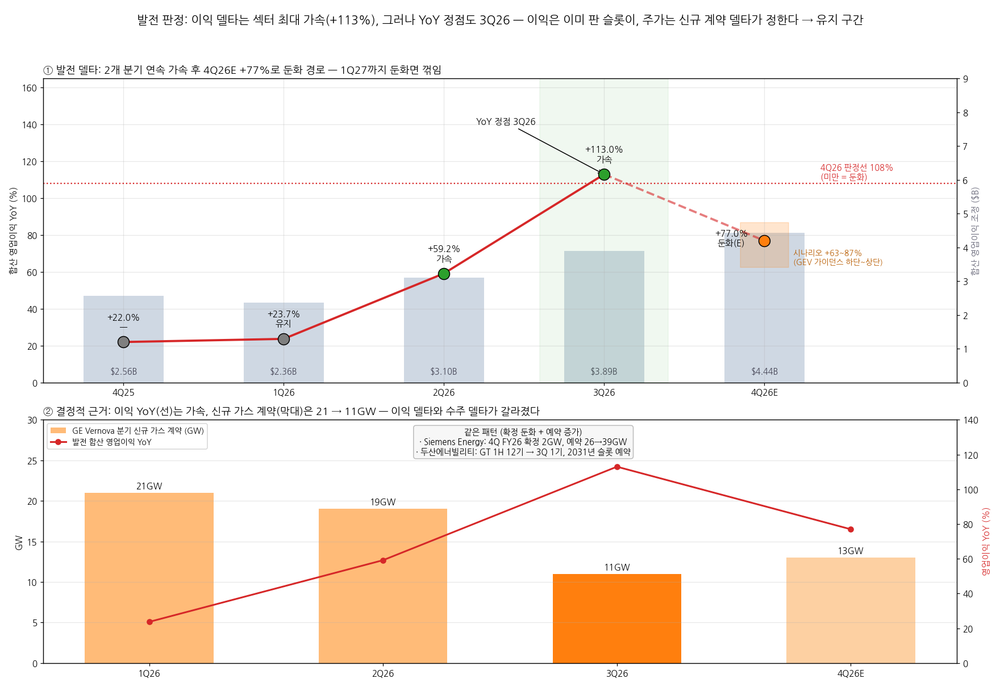

# 전력 인프라 · 발전 섹터 리뷰

> 현재 상태 (최신 분기 기준)
> 최신 분기: 2026-Q3
> 섹터 델타: 가속 | 내러티브: 유지
> 모멘텀 신호: 없음
> 활성 테마: 없음
> 포지셔닝: 서브섹터 유지 | 한국 중립 | 1등 GE Vernova
> 델타 근거: 3Q 가속(+59.2→+113.0%, +53.8%p)이 YoY 정점 → 4Q 컨센 +77.0%로 둔화 예상
> 내러티브 근거: 가스터빈 가격·마진 스토리는 확인됐지만 신규 계약 감소와 멀티플발 TP 하향이 겹쳐 유지
> PM 근거: 이익 델타는 최대지만 YoY 정점과 신규 계약 꺾임(21→11GW)이 겹쳐 유지, 한국은 이익 미공시로 근거 얇아 중립
> 편입 종목: GE Vernova, Siemens Energy (합산) + 두산에너빌리티 발전 파트 (이익 미공시 — 수주·슬롯만 비교)
> 갱신 시각: 2026-11-15 15:00 KST

## 누적 시계열

| 분기 | 편입 종목 | 합산 매출 | 합산 영업이익 | OPM | 매출 YoY | 영업이익 YoY | 영업이익 YoY 델타 (%p) | 섹터 델타 | 내러티브 | 모멘텀 신호 | 활성 테마 |
|---|---|---|---|---|---|---|---|---|---|---|---|
| 1Q24 | GEV·ENR | 215,961억원 ($16.25B) | 4,965억원 ($0.37B) | 2.3 | — | — | — | — | - | - | - |
| 2Q24 | 동일 | 242,370억원 ($17.68B) | 7,908억원 ($0.58B) | 3.3 | — | — | — | — | - | - | - |
| 3Q24 | 동일 | 266,285억원 ($19.61B) | 2,062억원 ($0.15B) | 0.8 | — | — | — | — | - | - | - |
| 4Q24 | 동일 | 280,924억원 ($20.11B) | 22,250억원 ($1.59B) | 7.9 | — | — | — | — | - | - | - |
| 1Q25 | 동일 | 268,980억원 ($18.51B) | 20,489억원 ($1.41B) | 7.6 | +15.9 | — | — | — | - | - | - |
| 2Q25 | 동일 | 283,072억원 ($20.16B) | 18,724억원 ($1.33B) | 6.6 | +10.9 | — | — | — | - | - | - |
| 3Q25 | 동일 | 307,205억원 ($22.15B) | 18,879억원 ($1.36B) | 6.1 | +9.2 | — | — | — | - | - | - |
| 4Q25 | 동일 | 320,684억원 ($22.21B) | 36,185억원 ($2.51B) | 11.3 | +6.0 | +22.0 | — | — | - | - | - |
| 1Q26 | 동일 | 313,474억원 ($21.38B) | 33,101억원 ($2.26B) | 10.6 | +8.6 | +23.7 | +1.7 | 유지 | - | - | - |
| 2Q26 | 동일 | 366,741억원 ($24.42B) | 47,126억원 ($3.14B) | 12.8 | +19.4 | +59.2 | +35.5 | 가속 | - | - | - |
| **3Q26** | 동일 (두산 발전 파트는 합산 제외) | **387,144억원 ($27.26B)** | **52,520억원 ($3.70B)** | **13.6** | **+24.7** | **+113.0** | **+53.8** | **가속** | **유지** | **없음** | **없음** |

→ **합산 방식**: 전력 인프라 통합 리뷰와 같은 기준이다. 매출·영업이익 레벨은 GE Vernova(매출, Adj. EBITDA) + Siemens Energy(매출, Profit before Special items — Gamesa 포함 보고치)를 분기 평균 달러/유로로 달러 환산해 더하고, 원화는 분기 평균 원/달러로 다시 환산했다
→ **영업이익 YoY(판정 기준)**: GE Vernova Adj. EBITDA + **Siemens Energy Gamesa 제외 사업부 이익**(Gas Services + Grid Technologies + Transformation of Industry)을 이번 분기 환율로 맞춘 고정환율 YoY다. 전년 Gamesa 적자 기저로 ENR 보고 YoY(+227%)가 부풀어 있어서다. 조정 이익은 4Q24부터 있어 YoY는 4Q25부터 나온다. 매출 YoY는 두 회사 전체 매출(고정환율) 기준이다
→ **참고 — 보고 기준 영업이익 YoY**(ENR Gamesa 포함, 고정환율): 1Q25 +283% · 2Q25 +130% · 3Q25 +832% · 4Q25 +53% · 1Q26 +49% · 2Q26 +133% · 3Q26 +174%. 저기저 왜곡이 커 판정에 쓰지 않는다 [계산]
→ **"발전"의 범위**: 회사 단위 합산이라 순수 발전만이 아니다. GE Vernova에는 Electrification(그리드)·Wind가, Siemens Energy 조정 이익에는 Grid Technologies·TI가 들어 있다. 풍력은 ENR Gamesa만 빠지고 GEV Wind(3Q26 EBITDA +$72M, 7개 분기 만의 흑자)는 들어 있다. 그래서 ①에 **순수 가스 참고 행**(GEV Power 부문 + ENR Gas Services)을 따로 둔다
→ **두산에너빌리티 발전 파트**: 가스터빈 매출·영업이익을 회사가 공시하지 않아 합산·델타 판정에서 뺐다(스킬 규칙: 이익 미공시 → 합산 제외, 사업부 분리 없음 → 중복 합산 금지). 주 섹터 리뷰의 가스터빈 블록 숫자(수주·대수·슬롯·증권사 매출 추정)로만 ②·⑦에 남긴다
→ **적용 환율** (분기 평균): 달러/유로 1Q24 1.086 [근사] · 2Q24 1.077 · 3Q24 1.098 · 4Q24 1.068 · 1Q25 1.052 · 2Q25 1.134 · 3Q25 1.168 · 4Q25 1.163 · 1Q26 1.170 · 2Q26 1.163 · 3Q26 1.14 [근사] · 4Q26E 1.12. 원/달러 1Q24 1,329 [근사] · 2Q24 1,371 · 3Q24 1,358 · 4Q24 1,397 · 1Q25 1,453 · 2Q25 1,404 · 3Q25 1,387 · 4Q25 1,444 · 1Q26 1,466 · 2Q26 1,502 · 3Q26 1,420 · 4Q26E 1,340. 출처는 `전력 인프라_섹터리뷰.md`와 같다 (1Q24는 이번에 추가한 근사치)
→ 소급 행의 판정은 같은 기준으로 계산했다. 내러티브·모멘텀·테마 열은 당시 리뷰가 없어 `-`

---

## 2026-Q3 섹터 리뷰

> 대상: `earnings-review/2026-Q3_GEV_리뷰.md`, `2026-Q3_ENR_리뷰.md`, `2026-Q3_두산에너빌리티_리뷰.md`의 "③ 가스터빈 (전력 인프라 교차 참조)" 블록과 2번 쟁점 (4)
> 첫 서브섹터 리뷰 — 직전 체크 없음. 상위 문서 `전력 인프라_섹터리뷰.md`(11/14)의 발전 행(+113.0%)과 숫자를 맞췄다
> 이 문서가 답하는 질문: 3단계 — 발전 안에서 델타가 가장 좋은 종목은? + 발전 서브섹터 판정(확대/유지/축소) + 발전 안에서 한국 vs 글로벌

① 섹터 합산 숫자와 델타

| 항목 | 4Q25 | 1Q26 | 2Q26 | **3Q26** | 4Q26E |
|---|---|---|---|---|---|
| 합산 매출 ($B) | 22.21 | 21.38 | 24.42 | **27.26** | 26.46 |
| 합산 영업이익 — 보고 ($B) | 2.51 | 2.26 | 3.14 | **3.70** | 4.37 |
| 합산 영업이익 — 조정, Gamesa 제외 ($B) | 2.56 | 2.36 | 3.10 | **3.89** | 4.44 |
| OPM — 보고 (%) | 11.3 | 10.6 | 12.8 | **13.6** | 16.5 |
| 매출 YoY (고정환율) | +6.0 | +8.6 | +19.4 | **+24.7** | +21.4 |
| **영업이익 YoY (조정, 고정환율)** | +22.0 | +23.7 | +59.2 | **+113.0** | +77.0 |
| **영업이익 YoY 델타 (%p)** | — | +1.7 | +35.5 | **+53.8** | -36.0 |
| 판정 | — | 유지 | 가속 | **가속** | 둔화 |
| 참고: 순수 가스 이익 YoY (GEV Power + ENR GS) | — | — | +42.0 | **+119.8** | — |

→ (출처: GEV·ENR 2026-Q3 리뷰 1번 분기 표 [계산]. 4Q26E = GEV Bloomberg 컨센 Adj. EBITDA $2,551M + ENR FY27 가이던스 비례 [추정](PbSI €1,624M, Gamesa 제외 이익 YoY 약 +40%). 순수 가스 행은 GEV Power 부문 EBITDA(2Q26 $1,031M, 3Q26 $1,297M)와 ENR Gas Services 이익(2Q26 €648M, 3Q26 €669M, 전년은 리뷰의 YoY로 역산) [계산])
→ **이익 레벨**: 3Q26 합산 영업이익 $3.70B(5.25조원)로 분기 최대, 마진 13.6%. 4Q26E $4.37B·16.5%로 다시 최대 경로다
→ **델타**: 조정 영업이익 YoY가 +24% → +59% → +113%로 2개 분기 연속 가속했고 매출 YoY도 +9% → +19% → +25%로 함께 올라 "강한 가속"이다. 전력 인프라 세 서브섹터 중 가장 큰 가속이다 (통합 리뷰: 송변전 +32%, 배전·DC +27%)
→ **회사 단위가 아니라 가스만 봐도 같다**: GEV Power + ENR GS는 +42% → +120%로 가속했다. 그리드·풍력 효과가 아니라 가스터빈 가격 사이클이 이익을 끌었다
→ **컨센 경로상 발전 YoY 정점은 3Q26**이다. 4Q26E +77%(-36%p)로 둔화하고, GEV 4Q26E +120%·1Q27E +104%, ENR 1Q FY27 약 +40% 경로다. 레벨은 계속 오르지만 델타는 다음 분기부터 내려간다

→ (출처: GEV·ENR 2026-Q3 리뷰 [계산]. 왼쪽 = 발전 합산 영업이익 YoY(조정, 고정환율)·매출 YoY와 순수 가스 참고선 / 오른쪽 = 종목별 이익 YoY — 실선 회사 단위(GEV Adj. EBITDA, ENR Gamesa 제외 사업부), 점선 가스 부문(GEV Power, ENR Gas Services). 250% 상한, 점선 연장 = 4Q26E)

② 종목별 델타 판정표

| 델타 순위 | 종목 | 국가 | 매출 YoY | 영업이익 YoY | 영업이익 YoY 델타 | 델타 판정 | 내러티브 | 한 줄 |
|---|---|---|---|---|---|---|---|---|
| 1 | GE Vernova | 미국 | +26.8% (organic +18%) | +139.6% (Adj. EBITDA) | +77.3%p | 가속 | 유지 | Power 마진 21.4%, 고가 수주분 첫 5GW 출하. 신규 가스 계약 21 → 19 → 11GW로 수주 델타는 꺾였다 |
| 2 | Siemens Energy | 유럽 | +23.0% (comp. +21.5%) | +91.8% (Gamesa 제외) | +34.7%p | 가속 | 강화 | GS·GT 이익 반반 기여, FY27 마진 14~16%·FY30 20~22%. 4Q 확정 가스 2GW, 예약 26 → 39GW |
| 순위 외 | 두산에너빌리티 (발전 파트) | 한국 | GT 매출 미공시 (대신 추정 2025 0.38조 → 2026F 1.17조원) | 미공시 | — | 발전 파트: 수주 델타 가속, 매출 델타 가속(추정) | 강화 (발전 파트) / 약화 (회사 전체) | 9M26 가스 수주 3.8조원(연간 계획 119%), GT 13기 ≈ 4.9GW. 3Q 확정 GT 1기, 2031년 슬롯까지 예약 |

→ (출처: 각 종목 2026-Q3 리뷰 0번 판정. 두산은 주 섹터 리뷰의 가스터빈 블록 판정 — 회사 전체 판정은 "가속 | 약화 → 관찰 구간"이며 원전 수주 타이밍이 이유다)
→ **델타 순위 기준**: 회사 주 지표 영업이익 YoY 델타. GEV(+77%p)가 ENR(+35%p)보다 크다. GEV 수치에는 Prolec 연결(1Q26~)이 들어 있지만 2Q·3Q 모두 연결 분기라 델타 자체는 왜곡되지 않고, organic Adj. EBITDA도 +124%다 (GEV 리뷰)
→ **가스 부문만 보면 순서가 바뀐다**: ENR Gas Services 이익 YoY +60% → +167%(+107%p) vs GEV Power +31% → +99%(+68%p). 회사 단위 1등은 GEV, 가스 부문 1등은 ENR이다 [계산]. 내러티브도 ENR(강화)이 GEV(유지)보다 한 단계 높다
→ **선행 종목은 없다**: 두 회사가 같은 분기(3Q26)에 동시에 가속했고, 컨센상 YoY 정점도 둘 다 3Q26이다. 두산은 사이클 위치가 1~2년 뒤(수주 확정 → 2026~28 매출 램프업)라 이익 정점 시점이 다르다 [판단]

③ 섹터 공통 쟁점

(1) 확정 수주는 줄고 슬롯 예약은 쌓인다 — 3사 공통

| 종목 | 3Q26 확정 수주 | 슬롯 예약·계약 총량 | 생산능력 | 회사 해석 |
|---|---|---|---|---|
| GE Vernova | 신규 계약 11GW (예약 8 + 확정 3), 기존 예약 13GW 확정 전환 | 122GW (확정 64 + 예약 58), 연말 130GW+ 목표, 2032년 슬롯 다수 판매 | 연 20GW → 2028년 24GW | "SRA 해지·전환 둔화·자금조달 차질 없다". 2027년 분기 계약 11~13GW 제시 |
| Siemens Energy | 4Q FY26 확정 2GW (FY26 연간 42GW) | 104GW (확정 65 + 예약 39, 예약 26 → 39GW) | 중형 연 50 → 80기, 대형 증설 FY27~ | "타이밍 효과, 1Q FY27도 자신". 기한 미전환 슬롯은 회수·재배정 |
| 두산에너빌리티 | GT 1기 (1H 12기 중 7기가 xAI 단일 계약) | 2031년 착수분까지 예약, 상당한 예약금 수령 | 연 약 8기 → 12기 (2028년) | 2030년 슬롯은 2027년, 2031년 슬롯은 2028년에 확정 또는 소멸 |

→ (출처: GEV 리뷰 1번 (1)·2번 (2), ENR 리뷰 1번 (1)·2번 (1), 두산 리뷰 1번 ③·2번 (4))
→ **공통 결론**: 3사 모두 같은 분기(7~9월)에 확정 수주가 줄고 예약이 늘었다. 수요 둔화가 아니라 **2030~32년까지 슬롯이 찬 상태에서 확정 속도를 슬롯 배분이 정하는 구조**라는 데 회사·셀사이드 모두 동의한다
→ 갈리는 지점: 예약의 질. Bernstein(두산)은 "잔고의 다음 층", MS(두산)는 "아직 잔고가 아니다", ENR은 스스로 "슬롯 회수·재배정"을 먼저 꺼냈다
→ **[판단]** 이익은 2028~29년까지 이미 판 슬롯이 정하므로 이익 델타와 수주 델타가 갈라지는 구간이다. 시장은 수주 델타에 멀티플을 매긴다 — 두 회사 모두 이익 상향에도 TP는 내려갔다(GEV 평균 -5.2%, ENR -4.4%). 4Q에 GEV 신규 계약 13GW+, ENR 예약 확정 전환 10GW+가 나와야 "타이밍" 설명이 맞다

(2) 가스터빈 가격 — ENR은 "더 오른다", GEV는 "4Q 단가 하락"

| 종목 | 회사 설명 | 숫자 |
|---|---|---|
| GE Vernova | 3Q 가스 수주 kW당 가격 4Q25 대비 +20% 이상(항공파생형 영향 포함). 4Q는 항공파생형 감소·50Hz 증가로 kW당 가격이 3Q보다 낮다 | 2026년 연간 수주 가격 2025년 대비 약 +50%. Power 마진 21.4% (항공파생형 출하 13대, 전년 6대 — 믹스 착시 가능) |
| Siemens Energy | "내년(FY27)에는 2026년보다 높은 가격으로 수주한다. FY30 목표에는 추가 가격 인상을 넣지 않았다" | 가스 신규 유닛 잔고 마진 FY22 대비 +26%p (FY26에만 +14%p). GS 마진 16.0% (신규 유닛 비중 확대로 전분기 17.3%보다 낮음) |
| 두산에너빌리티 | 미공시. "원자력·가스터빈 중심 고수익 Mix로 에너빌리티 OPM 상승" | 에너빌리티 OPM 6.7% |

→ **[판단]** 같은 시장에서 방향이 갈린 것처럼 보이지만 믹스 차이로 설명된다. GEV의 4Q 단가 하락은 항공파생형(kW당 고가)이 줄고 50Hz가 늘어서고, ENR은 원래 50Hz 비중이 높아 같은 현상이 기저에 이미 있다. **가격 사이클이 꺾였다는 증거는 아직 없다.** 확인 변수는 GEV 4Q Power 마진 23% 이상(믹스가 아닌 가격 효과 확정)과 ENR 1Q FY27 GS 마진 18% 진입이다

(3) 증설 — 공급 부족이 가격을 지탱하는 동안만 마진이 오른다

→ GEV 연 20GW → 24GW(2028), ENR 중형 50 → 80기·대형 FY27부터, 두산 8 → 12기(2028, 추가 증설 검토). 3강 + 두산 모두 2028년 전후에 증설분이 들어온다
→ 두산의 위치: 연간 수주 규모는 GEV의 약 1/8이다. 3강의 슬롯이 2030~32년까지 찬 상태에서 나오는 **넘침(overflow) 수요를 4번째 공급자로 받는 구조**다 (두산 리뷰 [판단]). 미국 첫 출하(xAI, 3Q26)가 납품 실적이 됐다
→ **[판단]** 증설이 끝나는 2028년 이후에도 연 140~150GW 시장(ENR 추정)이 유지되면 가격은 버틴다. 2027년 중 예약 전환율이 떨어지면 "공급 부족 → 넘침 수요" 전제가 먼저 약해지는 곳은 4번째 공급자(두산)다

(4) 12월 FERC·ERCOT, 텍사스 모라토리엄 — 발전은 상대적으로 우호적

→ GEV: 가스 고객의 약 80%가 전통 고객(유틸리티), 데이터센터는 약 20%. 온사이트용 항공파생형 수주가 3Q 57대(전년 9대)로 급증했다. 계통 접속 비용·대기가 길어질수록 데이터센터는 계통 밖(behind-the-meter) 자가발전으로 기운다 (GEV 리뷰 4번 (3))
→ ENR: 데이터센터 잔고 €15B(전체의 10% 미만), 미국 매출 비중 27%. "중간선거 영향은 아직 보이지 않는다" (ENR 리뷰 2번 (3))
→ 두산: xAI 누적 12기, 텍사스·국내 집중 (두산 리뷰 1번 ③)
→ **새 변수 — 텍사스 데이터센터 모라토리엄**: 11/3 중간선거 후 텍사스 주지사 당선인이 신규 데이터센터 모라토리엄을 공약했다(1/19 취임). 텍사스는 미국 계획 데이터센터 전력의 약 27~30%다. 대상은 "신규 승인"이라 기존 잔고에는 영향이 없다 (2026-Q3_VRT_리뷰.md 2번 (4), Trefis·TIKR 11/4~10)
→ **[판단]** FERC 결론이 데이터센터 비용 부담 강화 쪽이면 전력 인프라 안에서 발전(자가발전)이 그리드보다 상대적으로 낫다. 반면 텍사스 모라토리엄은 전원 방식과 무관하게 데이터센터 개발 자체를 막는다 — 텍사스 집중도가 높은 두산(xAI)과 GEV 항공파생형 온사이트 수요가 이 변수에는 더 노출된다

(5) YoY 정점은 이번 분기 — 두 회사 동시

→ GEV Adj. EBITDA YoY 3Q26 +140% → 4Q26E +120% → 1Q27E +104% → 2027 연간 +50% (Bloomberg 컨센, GEV 리뷰)
→ ENR Gamesa 제외 이익 YoY 3Q26 +92% → FY27 가이던스 경로 약 +36~40% (ENR 리뷰)
→ 발전 합산은 +113% → +77%(4Q26E). 이익 레벨은 2027년까지 계속 오르지만 델타는 감속 경로다

(6) 종목 고유 이슈
→ GE Vernova: Trench Group $9.0B 인수(절반 차입, 2027년 말 종결) — 단기 이익 기여 없음. Electrification organic +29% → +16% 둔화(발전 합산에 들어 있는 그리드 부분)
→ Siemens Energy: Gamesa 2개 분기 연속 흑자(€75M → €23M), FY27 Gamesa 마진 0~2%. TI 법적 분리 FY27 초 착수. FY27 순이익 가이던스 €5B < 컨센 €5.5B
→ 두산에너빌리티: 회사 전체는 원전 수주 타이밍(SMR·AP1000 장납기)이 주가를 정한다. 에너빌리티 순차입금 4.48조원 → 연말 3조원 목표. 90MW 중형 GT 2H28 상업화

④ 섹터 판정

> 섹터 델타: **가속** | 내러티브: **유지** → **이익 델타는 전력 인프라 최대 가속(+113%, 2개 분기 연속)이지만 컨센 경로상 YoY 정점도 3Q26 — 이익은 이미 판 2028~29년 슬롯이 정하고, 주가는 21 → 11GW로 꺾인 신규 계약 델타가 정한다. 유지 구간. 4Q26 합산 영업이익 YoY 108% 미만이면 둔화(컨센 +77%가 기본 경로), 1Q27까지 둔화가 이어지면 꺾임**

→ (출처: GEV·ENR·두산 2026-Q3 리뷰 [계산]. 상단 = 발전 합산 영업이익 YoY(조정, 고정환율. 점 색 = 분기별 판정, 막대 = 합산 조정 영업이익 $B)와 4Q26 판정선·시나리오 범위(GEV 가이던스 하단 $2.19B ~ 상단 $2.80B + ENR 가이던스 비례) / 하단 = GE Vernova 분기 신규 가스 계약 GW(막대, 4Q26E는 회사 제시 13GW+)와 발전 합산 영업이익 YoY(선), ENR·두산의 같은 패턴 주석)

→ **델타 판정 근거**: 조정 영업이익 YoY가 2Q26 +59.2%에서 3Q26 +113.0%로 53.8%p 커져 "가속"이다. 2개 분기 연속 가속이고 매출 YoY(+19.4% → +24.7%)도 같이 올랐다. 순수 가스(+42% → +120%)로도 같다. 컨센 4Q26E +77.0%(-36.0%p)는 "둔화" 경로다
→ **내러티브 판정 근거**: 종목별 내러티브는 GEV 유지, ENR 강화, 두산 발전 파트 강화(회사 전체는 약화)다. 공통 스토리 "가스터빈 공급 부족 → 가격 상승 → 고가 잔고 매출화 → 마진 확장"은 숫자로 확인됐다(GEV Power 21.4%, ENR 잔고 마진 +14%p). 그러나 신규 확정 수주가 3사 모두 줄었고, 이익 추정 상향에도 GEV·ENR TP는 멀티플 때문에 내려갔다. 통합 리뷰와 같은 기준(강화 = TP 상향 동반)으로 "유지"다
→ **[판단] 결정적 근거는 이익 델타와 수주 델타의 분리다**. 이익 YoY는 3Q26에 사이클 최고였지만 GEV 신규 가스 계약은 21 → 19 → 11GW로 반토막 났고, ENR 확정 2GW·두산 GT 1기도 같은 방향이다. 이익은 2028~29년까지 이미 정해져 있어 델타가 갑자기 꺾일 위험은 작지만, 모멘텀 매매가 보는 "다음 델타"(수주)는 2H26부터 마이너스다
→ 직전 판정 대비: 첫 서브섹터 리뷰. 소급 궤적은 유지(1Q26) → 가속(2Q26) → 가속(3Q26) → 둔화(4Q26E 컨센)

⑤ 모멘텀 신호

→ **없음** — 활성 테마가 없어 "테마 종료 후보"는 해당 없음
→ 델타 급증 후보 조건 대조: ① 섹터 영업이익 YoY 델타 확대 — **충족** (+53.8%p, 2개 분기 연속) ② 편입 종목 과반 가속 — **충족** (GEV·ENR 2/2) ③ 내러티브 형성·강화 — **미충족** (유지)
→ 조건 2/3 충족이지만 후보로 올리지 않는다. 컨센상 YoY 정점이 바로 이번 분기이고, 다음 델타(신규 계약)가 이미 꺾였다. "새 델타 급증"이 아니라 "가속의 마지막 분기"로 본다 [판단]
→ 다음 분기 후보로 올릴 조건: 4Q26 합산 YoY 108% 이상(가속 유지) + GEV 4Q 신규 가스 계약 15GW 이상 + ENR 예약 확정 전환 10GW 이상 + TP 상향 전환
→ **반대 논거**: (1) 이익 YoY 절대 수준은 4Q26E +77%, 1Q27E도 GEV +104%로 전력 인프라에서 가장 높다. "둔화"여도 성장 속도는 섹터 최고다 (2) FERC 강화 결론이면 발전은 자가발전 수혜로 섹터 안에서 상대 우위가 커진다 — 레이어 성격상 그리드 둔화가 발전에는 수요 강화일 수 있다
→ 테마 키워드 제안 (제안일 뿐): "데이터센터 온사이트 발전 — 항공파생형·중형 가스터빈·BTM 전원" (GEV 항공파생형 57대, 두산 xAI, Vertiv UIG와 연결)

⑥ 다음 분기 섹터 관전 포인트

| 순위 | 무엇을 (변수·임계값) | 어떤 데이터로 | 언제 |
|---|---|---|---|
| 1 | **4Q26 발전 합산 영업이익 YoY(조정, 고정환율) 108% 이상 — 미만이면 둔화**. 금액으로 4Q26 환율 기준 $5.22B 이상 (GEV Adj. EBITDA + ENR Gamesa 제외 사업부 이익). 컨센 경로 $4.44B(+77%)는 둔화가 기본값. GEV 가이던스 하단이면 +63% | GEV 4Q 실적(1월 말), ENR 1Q FY27 실적(2/11) | 2027-01 말 ~ 2/11 |
| 2 | 신규 가스 계약 — GEV 4Q 13GW 이상(15GW 이상이면 수주 델타 우려 해소, 10GW 미만이면 "수요 정점" 해석), ENR 예약 39GW 중 확정 전환 10GW 이상, 두산 4Q 복합화력 주기기 0.5조원 | 각 사 수주 보도자료·IR 대수 표 | 11~12월 수시, 1월 말~2/11 확정 |
| 3 | 가스터빈 가격 — GEV 4Q Power 마진 23% 이상(가격 효과 확정), ENR 1Q FY27 GS 마진 18% 진입, ENR "FY27 수주 가격 > FY26" 확인 | 4Q·1Q 사업부 손익, 컨콜 kW당 가격 코멘트 | 2027-01 말 ~ 2/11 |
| 4 | 12월 FERC·ERCOT 결론 + 1/19 텍사스 주지사 취임 후 모라토리엄 실행 여부 — 강화 결론은 발전 상대 우위, 모라토리엄 실행은 텍사스 집중 온사이트 수요에 부정적 | FERC RTO 보고(11/16~20), ERCOT 감사(12/10), FERC 반론 시한(12/16), 텍사스 첫 행정명령 | 11월 중순 ~ 1월 말 |
| 5 | 증설과 예약 전환 — 두산 2차 증설 발표, 2030년 슬롯 예약의 2027년 확정 전환율, GEV 2032년 슬롯 판매 | 수주 공시, IR | 2027년 분기마다 |

→ 1순위 판정선(108%)은 ④ 키 차트와 같다. 근거: 3Q26 +113.0%에서 "유지" 범위(±5%p)를 뺀 값이다. 이 아래면 둔화, 1Q27까지 둔화가 이어지면 "2개 분기 연속 둔화 + 정점(3Q26) 통과"로 꺾임이다

⑦ 글로벌 PM 포지셔닝 — 결론

> **서브섹터: 유지 — 이익 델타는 전력 인프라 최대지만 YoY 정점이 이번 분기이고 신규 계약 델타가 먼저 꺾였다. 4Q 신규 계약 15GW+ 확인 시 확대** | **한국: 중립 (근거 얇음 — 이익 미공시)** | **1등: 글로벌 GE Vernova (가스 부문 기준 Siemens Energy) · 한국 두산에너빌리티**

(1) 서브섹터 판정 — 확대 / 유지 / 축소

| 판단 축 | 3Q26 근거 | 방향 |
|---|---|---|
| 이익 델타 (1순위) | 조정 영업이익 YoY +24% → +59% → +113%, 2개 분기 연속 가속. 전력 인프라 서브섹터 중 최대 | 확대 |
| YoY 정점 시점 | 컨센상 정점 3Q26, 4Q26E +77%. GEV·ENR 둘 다 3Q26 정점 | 축소 |
| 수주 선행지표 | GEV 신규 계약 21 → 19 → 11GW, ENR 확정 2GW, 두산 GT 1기. 예약은 증가(GEV 122GW, ENR 104GW) | 중립 |
| 가격 | ENR "FY27 > FY26", GEV 4Q 단가 하락은 믹스. 꺾임 증거 없음 | 확대 |
| 이벤트 | FERC 강화 시 자가발전 상대 수혜, 텍사스 모라토리엄은 부정 | 중립 |
| 밸류에이션 (2순위) | GEV 12M Fwd P/E 55 → 38배, ENR FY27 약 25배. 두 회사 TP 하향은 멀티플 | 확대 |

→ **결론: 유지** [판단]. 델타만 보면 확대지만, 가속이 확인된 분기가 컨센상 정점 분기와 겹치고 다음 델타(신규 계약)는 이미 꺾였다. 통합 리뷰(11/14)의 "발전 유지"와 같다
→ **확대 전환**: GEV 4Q 신규 계약 15GW 이상 + ENR 예약 확정 전환 10GW 이상 + 4Q 합산 YoY 108% 이상 (1월 말~2/11)
→ **축소 전환**: 4Q 합산 YoY +63% 미만(GEV 가이던스 하단 경로) 또는 GEV 4Q 신규 계약 10GW 미만 + ENR 예약 전환 부진 (1월 말~2/11)

(2) 같은 서브섹터 안 한국 vs 글로벌 — 서브섹터 내 효과

| 국가 | 종목 | 이익 YoY (직전 → 이번) | 델타 판정 | 수주 방향 | 사이클 위치 |
|---|---|---|---|---|---|
| 미국 | GE Vernova | +62% → +140% | 가속 | 신규 계약 21 → 11GW (둔화), 잔고+예약 122GW | 고가 잔고 매출화 — 이익 정점권 |
| 유럽 | Siemens Energy | +57% → +92% (Gamesa 제외) | 가속 | 확정 2GW (둔화), 예약 26 → 39GW | 고가 잔고 매출화 — 이익 정점권 |
| 한국 | 두산에너빌리티 발전 파트 | 미공시 (GT 매출 추정 2025 0.38조 → 2026F 1.17조 → 2027F 2.39조원) | 수주 가속 (발전 파트) | 9M 3.8조원, 연간 계획 119%. 3Q 확정 GT 1기 | 수주 확정 → 매출 램프업 초입 (1~2년 뒤) |

| 경쟁력 축 | 한국 (두산) | 글로벌 (GEV·ENR) | 우위 |
|---|---|---|---|
| 델타 방향 (1순위) | 이익 미공시 — 비교 불가. 매출(추정)은 2026~28년 가속 경로 | 이익 델타 가속, 정점 3Q26 | 비교 불가 |
| 수주 델타 | 연간 계획 조기 초과, 3Q 둔화 | 2H26부터 마이너스 | 한국 (작은 기저) |
| 규모·점유율 | GEV의 약 1/8, 4번째 공급자 | 3강 | 글로벌 |
| 생산능력 | 8 → 12기 (2028), 추가 증설 검토 | GEV 20 → 24GW, ENR 중형 +60% | 글로벌 |
| 가격·마진 | 미공시 (에너빌리티 OPM 6.7%) | GEV Power 21.4%, ENR GS 16.0% | 글로벌 |
| 노출 리스크 | 텍사스·xAI 집중, 주가는 원전이 결정 | 고객 분산(GEV 80% 유틸리티) | 글로벌 |

→ **비교 범위**: 글로벌 편입 종목 리뷰 2건(GEV·ENR) vs 한국은 두산 주 섹터 리뷰의 가스터빈 블록(회사 IR 수주·대수 + 대신증권 매출 추정). **근거 얇음 — 이익 미공시**
→ **결론: 한국 중립** [판단]. 사이클 위치로는 두산이 1~2년 뒤라 피어의 수주 둔화가 같은 크기의 악재가 아니고 매출 델타는 2027~28년에 커진다. 그러나 이익이 공시되지 않아 델타 프레임으로 확인할 수 없고, 두산 주가는 가스터빈이 아니라 원전 수주 타이밍이 정한다 (회사 전체 판정 "가속 | 약화 → 관찰 구간"). 발전 노출 수단으로서 순도가 낮다
→ 반대 논거: 가스터빈만 떼면 수주·매출 델타가 둘 다 가속이고 내러티브도 강화다. 2027년에 GT 매출이 2배(대신 추정)가 되면 에너빌리티 마진 기여가 숫자로 드러날 수 있다. 회사가 가스터빈 손익을 따로 공시하기 시작하면 판정을 다시 한다

(3) 서브섹터 1등 종목

| 구분 | 종목 | 델타 판정 | 근거 한 줄 |
|---|---|---|---|
| 글로벌 1등 | **GE Vernova** | 가속 · 유지 | 회사 단위 영업이익 YoY 델타 +77%p로 1위 (organic Adj. EBITDA +124%). Power 마진 21.4%로 가격 인플렉션. 단 신규 계약 델타 둔화가 멀티플을 누른다 |
| 글로벌 2등 (가스 부문 1등) | Siemens Energy | 가속 · 강화 | 가스 부문 델타는 GS +107%p로 GEV Power(+68%p)보다 크다. 내러티브 강화(FY30 20~22%), FY27 P/E 약 25배로 GEV(38배)보다 싸다 |
| 한국 1등 | 두산에너빌리티 (발전 파트) | 발전 파트 수주·매출 가속 (이익 미공시) | 한국 유일. 2031년 슬롯 예약, 증설 +50%. 발전 노출 수단으로는 원전 변수가 더 크다 |

→ [판단] 델타 순위 규칙(회사 주 지표 영업이익 YoY 델타)대로 1등은 GE Vernova다. 다만 내러티브·가스 부문 델타·밸류에이션까지 넣으면 Siemens Energy가 앞선다. 통합 리뷰(11/14)는 글로벌 선호를 Siemens Energy, 비선호를 GE Vernova로 뒀으므로 통합 리뷰 갱신 때 이 차이를 정리해야 한다

(4) 콜을 바꾸는 조건과 일정

| 시점 | 이벤트 | 서브섹터 판정 | 한국 콜 |
|---|---|---|---|
| 11~12월 수시 | GEV·ENR·두산 가스터빈 수주·예약 전환 공시 | GEV 분기 15GW+ 페이스면 확대 검토 | 두산 4Q 복합화력 주기기 0.5조원 확정 시 유지 |
| 11/16~20, 12/10, 12/16 | FERC RTO 보고 → ERCOT 감사 → FERC 반론 시한 | 강화 결론 → 발전 상대 비중 확대 검토 (그리드 대비) | 영향 작음 |
| 1/19 | 텍사스 주지사 취임 — 데이터센터 모라토리엄 실행 여부 | 실행 시 온사이트 수요 할인 → 확대 보류 | 두산(xAI·텍사스 집중) 하향 검토 |
| 2027-01 말 | GEV 4Q 실적·2027 가이던스 | 합산 YoY 108% 이상이면 가속 유지 → 확대, 63% 미만이면 축소 | — |
| 2027-01 말 | 두산 4Q 실적·IR — 가스터빈 수주·대수 | — | GT 손익 공시 시작 또는 2차 증설 발표 시 아웃퍼폼 검토 |
| 2/11 | ENR 1Q FY27 실적 | GS 마진 18%+·예약 전환 10GW+면 확대 | — |
