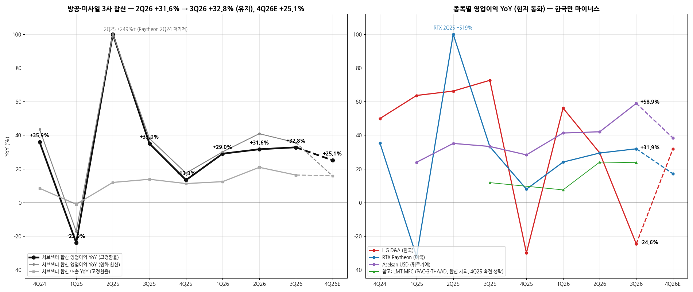
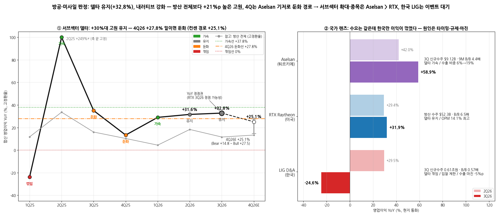

# 방산 · 방공·미사일 섹터 리뷰

> 현재 상태 (최신 분기 기준)
> 최신 분기: 2026-Q3
> 섹터 델타: 유지 | 내러티브: 강화
> 모멘텀 신호: 없음
> 활성 테마: 없음
> 포지셔닝: 서브섹터 확대 | 한국 언더퍼폼 | 선호 Aselsan, RTX
> 델타 근거: 3Q 정점권 유지 → 4Q 컨센 둔화(계절 기저)
> 내러티브 근거: 다년 계약·해외 수주로 잔고 사상 최대가 확인돼 강화
> PM 근거: 성장 레벨이 방산 최고에 수요도 확대라 확대, 한국은 이익 역성장으로 언더퍼폼
> 편입 종목: LIG D&A, RTX(Raytheon), Aselsan (3Q26 합산 3사)
> 갱신 시각: 2026-11-15 11:40 KST

## 누적 시계열

| 분기 | 편입 종목 | 합산 매출 | 합산 영업이익 | OPM | 매출 YoY | 영업이익 YoY | 영업이익 YoY 델타 (%p) | 섹터 델타 | 내러티브 | 모멘텀 신호 | 활성 테마 |
|---|---|---|---|---|---|---|---|---|---|---|---|
| 4Q24 | 2사 (LIG·Raytheon) — Aselsan 전년 기저 없음 | 111,553억원 ($7.99B) | 11,996억원 ($0.86B) | 10.8 | +14.3 / +8.4 | +43.5 / +35.9 | — | —† | - | - | - |
| 1Q25 | 3사 (+Aselsan) | 110,075억원 ($7.59B) | 12,503억원 ($0.86B) | 11.4 | +7.3 / -1.0 | -17.2 / -23.9 | -59.8 | 꺾임† | - | - | - |
| 2Q25 | 3사 (동일) | 117,894억원 ($8.44B) | 14,591억원 ($1.04B) | 12.4 | +14.0 / +11.9 | +255.2 / +249.1 | +273.0 | 가속‡ | - | - | - |
| 3Q25 | 3사 (동일) | 119,376억원 ($8.61B) | 15,128억원 ($1.09B) | 12.7 | +16.2 / +13.8 | +38.0 / +35.0 | -214.1 | 둔화 | - | - | - |
| 4Q25 | 3사 (동일) | 154,215억원 ($10.65B) | 20,742억원 ($1.43B) | 13.4 | +15.0 / +11.2 | +17.4 / +13.3 | -21.7 | 둔화 | - | - | - |
| 1Q26 | 3사 (동일) | 124,764억원 ($8.53B) | 16,267억원 ($1.11B) | 13.0 | +13.3 / +12.4 | +30.1 / +29.0 | +15.7 | 가속 | - | - | - |
| 2Q26 | 3사 (동일) | 152,278억원 ($10.15B) | 20,554억원 ($1.37B) | 13.5 | +29.2 / +20.9 | +40.9 / +31.6 | +2.6 | 유지 | - | - | - |
| **3Q26** | **3사 (동일)** | **141,696억원 ($10.00B)** | **20,513억원 ($1.45B)** | **14.5** | **+18.7 / +16.3** | **+35.6 / +32.8** | **+1.2** | **유지** | **강화** | **없음** | **없음** |

→ **표기**: YoY 칸은 `원화 환산 / 고정환율`. 판정은 방산 전체 리뷰(`sector-review/방산_섹터리뷰.md`, 2026-11-14)와 같은 **고정환율 기준**(전년 분기 값도 당해 분기 평균 환율로 환산) [계산]
→ **델타 칸 = 같은 표본 직전 분기 대비**. 1Q25는 Aselsan 4Q23 값이 없어 2사(LIG·Raytheon) 기준 4Q24 YoY +35.9%를 직전값으로 썼다 [계산]
→ **†** 4Q24는 소급 첫 행(2사)이라 판정 없음. 1Q25 "꺾임"은 규칙대로(마이너스 전환) 산정했지만, Raytheon 1Q24 영업이익이 매각이익 포함 분기(OPM 15.0% 역산 — 방산 전체 리뷰 ① 주석, RTX 리뷰 0번 "1Q24 매각이익 분기")라 기저 왜곡이 크다
→ **‡** 2Q25 +249%는 Raytheon 2Q24 영업이익 $130M(법적 합의·계약 해지, OPM 2.0%)의 저기저 효과다 (방산 전체 리뷰 ‡ 주석과 같음)
→ 소급 행의 내러티브·모멘텀 신호·테마 열은 당시 섹터 리뷰가 없어 `-`

분기 평균 환율: 방산 전체 리뷰 표와 같다 — USD/KRW 2Q26 1,500.9원 → 3Q26 1,417.0원 → 4Q26 QTD(10/1~11/13) 1,338.1원 (Yahoo Finance `KRW=X` 일간 종가 평균, 2026-11-14 조회). 이 서브섹터는 원화(LIG)와 달러(Raytheon·Aselsan USD 환산)만 있어 USD/KRW 한 줄로 충분하다

---

## 2026-Q3 섹터 리뷰

> 대상: 2026-Q3 실적 리뷰 3건 — `earnings-review/2026-Q3_LIG D&A_리뷰.md`(2026-11-14 16:20), `2026-Q3_RTX_리뷰.md`(11-14 18:30), `2026-Q3_ASELS_리뷰.md`(11-14 18:30)
> 편입 범위: 워치리스트 "섹터 리뷰 단위" 표 방산 · 방공·미사일 — 핵심 LIG D&A·RTX + 확장 Aselsan (BT 지시로 확장 포함). 국가 = 한국 1 / 미국 1 / 기타(튀르키예) 1. 트래킹 피어 없음
> 참고(편입 아님): Lockheed Martin MFC(PAC-3·THAAD) 부문 — `2026-Q3_LMT_리뷰.md` 1-② 사업부 표. LMT는 방산 전체 리뷰에서 "항공" 서브섹터 핵심이라 이 서브섹터 합산·판정에 넣지 않고 ①·⑦ 비교표에 참고로만 둔다
> 상위 판단: 방산 전체(15사) = 섹터 델타 둔화 · 내러티브 유지 · 섹터 중립 · 한국 언더퍼폼 (방산 전체 리뷰 ⑦)
> 직전 섹터 리뷰: 없음 (이 서브섹터 첫 리뷰). 활성 테마: 없음

① 섹터 합산 숫자와 델타

(1) 서브섹터 합산 (억원·$B, 3Q26 합산 3사)

| 항목 | 4Q24 | 1Q25 | 2Q25 | 3Q25 | 4Q25 | 1Q26 | 2Q26 | **3Q26** | 4Q26E |
|---|---|---|---|---|---|---|---|---|---|
| 합산 편입 (사) | 2 | 3 | 3 | 3 | 3 | 3 | 3 | **3** | 3 |
| 합산 매출 (억원) | 111,553 | 110,075 | 117,894 | 119,376 | 154,215 | 124,764 | 152,278 | **141,696** | 166,351 |
| (달러 환산, $B) | 7.99 | 7.59 | 8.44 | 8.61 | 10.65 | 8.53 | 10.15 | **10.00** | 12.43 |
| 합산 영업이익 (억원) | 11,996 | 12,503 | 14,591 | 15,128 | 20,742 | 16,267 | 20,554 | **20,513** | 24,020 |
| (달러 환산, $B) | 0.86 | 0.86 | 1.04 | 1.09 | 1.43 | 1.11 | 1.37 | **1.45** | 1.80 |
| OPM (%) | 10.8 | 11.4 | 12.4 | 12.7 | 13.4 | 13.0 | 13.5 | **14.5** | 14.4 |
| 매출 YoY — 원화 환산 (%) | +14.3 | +7.3 | +14.0 | +16.2 | +15.0 | +13.3 | +29.2 | **+18.7** | +7.9 |
| 매출 YoY — 고정환율 (%) | +8.4 | -1.0 | +11.9 | +13.8 | +11.2 | +12.4 | +20.9 | **+16.3** | +15.8 |
| 영업이익 YoY — 원화 환산 (%) | +43.5 | -17.2 | +255.2 | +38.0 | +17.4 | +30.1 | +40.9 | **+35.6** | +15.8 |
| **영업이익 YoY — 고정환율 (%)** | +35.9 | -23.9† | +249.1‡ | +35.0 | +13.3 | +29.0 | +31.6 | **+32.8** | +25.1 |
| 직전 분기 YoY (같은 표본, 고정환율) | — | +35.9 | -23.9 | +249.1 | +35.0 | +13.3 | +29.0 | **+31.6** | +32.8 |
| **영업이익 YoY 델타 (%p)** | — | -59.8 | +273.0 | -214.1 | -21.7 | +15.7 | +2.6 | **+1.2** | -7.7 |
| 판정 | — | 꺾임† | 가속‡ | 둔화 | 둔화 | 가속 | 유지 | **유지** | (둔화 경로) |
| ㄴ 한국 제외 2사 (Raytheon·Aselsan) 영업이익 YoY (고정환율) | +35.3 | -27.6 | +273.5 | +33.2 | +14.7 | +26.4 | +31.7 | **+36.3** | +25.0 |
| ㄴ 한국 (LIG D&A) 영업이익 YoY | +49.9 | +63.6 | +66.2 | +72.6 | -30.0 | +56.1 | +29.5 | **-24.6** | +31.8 |

→ (출처: 각 종목 리뷰 1번 표의 섹터 합산용 방산 기준 값 — 방산 전체 리뷰 계산 데이터와 동일 — 을 분기 평균 환율로 원화 환산해 합산 [계산]. YoY는 같은 분기에 숫자가 있는 종목끼리(동일 표본))
→ **방산 기준 (각 리뷰 명시값, 방산 전체 리뷰와 동일)**: LIG D&A = 전사(K-IFRS 연결, 사업부 손익 미공시) / **RTX = Raytheon 부문**(GAAP 사업부 영업이익, Collins 방산·P&W 군용은 영업이익 미공시라 제외 — RTX 리뷰 (2-1)) / **Aselsan = USD 환산 핵심 영업이익**(매출총이익 − 판관비 − R&D, IAS 29 분기말 구매력 TL ÷ 분기 평균 USDTRY — Aselsan 리뷰 1-①)
→ **이익 지표 정의가 다르다**: K-IFRS 영업이익 / US GAAP 사업부 영업이익 / 핵심 영업이익(기타영업손익 제외). OPM 레벨 비교는 참고용, 판정은 각 사 같은 지표의 YoY다
→ **역산·추정값**: Raytheon 4Q23~2Q25 영업이익은 기업개요 분기표 매출 × OPM 역산(4Q24 = FY24 $2,594M − 9M) [계산 — 방산 전체 리뷰와 같음]. **4Q26E**: LIG = 리뷰 발표 후 7곳 평균 510억원(범위 253~640억원) / Raytheon = 리뷰 (2-1) 추정 $1,036M(범위 $1,011~1,061M) / **Aselsan 핵심 영업이익 E는 리뷰에 없어 방산 전체 리뷰의 [추정] $721M**(4Q25 $521M × İş Yatırım EBITDA E YoY +38.4%)을 그대로 썼다
→ **이익 레벨**: 3Q26 합산 영업이익 20,513억원($1.45B), OPM 14.5%로 시계열 최고. 방산 전체 13사 합산 영업이익(98,955억원)의 20.7%다. 서브섹터 안의 비중은 **Raytheon 78.3% / Aselsan 18.4% / LIG 3.3%** — 레벨과 델타는 사실상 Raytheon이 정하고, Aselsan이 방향을 더한다 [계산]
→ **델타**: 고정환율 영업이익 YoY +31.6%(2Q26) → **+32.8%(3Q26), +1.2%p → 유지**. 3Q26 증가액 +5,065억원(3Q26 환율 고정) = Raytheon +3,882억원 + Aselsan +1,403억원 − LIG 220억원 [계산]. **한국 제외 2사는 +31.7% → +36.3%(+4.6%p, 유지 상단)**로 높아졌고, 한국(LIG)만 +29.5% → -24.6%로 마이너스 전환했다
→ **표본 경고 [판단]**: 3사 표본이고 Raytheon이 영업이익의 78%를 차지해 사실상 "Raytheon + α" 지표다. 스킬 규칙의 소수 표본(1~2사)은 아니지만 집중도가 높아, 판정에 Raytheon 단독 YoY(+29.4% → +31.9%, 유지)와 한국 제외 2사(유지)를 함께 대조했다 — 세 기준 모두 "유지"로 같다. 반기 공시 종목은 이 서브섹터에 없다
→ **컨센 경로상 서브섹터 YoY 정점은 3Q26(+32.8%)**으로 본다 [판단]. 4Q26E +25.1%는 Aselsan 4Q25 기저(연 매출의 48%, Aselsan 리뷰)와 Raytheon 4Q 가이던스 역산 OPM 11.9%(RTX 리뷰 (2-1))가 누른다. RTX 리뷰도 "YoY 정점은 3Q26일 가능성"으로 봤다. 1Q27은 Aselsan 1Q 기저가 작아(1Q26 $785M) 반등 여지가 있다 — 꺾임이 아니라 계절 기저에 의한 둔화 경로다 [전망]
→ **방산 전체와의 차이 (고정환율)**: 3Q26 서브섹터 영업이익 YoY **+32.8% vs 방산 전체 13사 +12.1% → +20.7%p 높다** (2Q26 같은 표본 +31.6% vs +18.3%, +13.3%p → 격차 확대). 4Q26E도 +25.1% vs +13.6%(조정)로 +11.5%p [계산]

(2) 참고 — LMT MFC(PAC-3·THAAD) 부문 (합산 제외, $M)

| 항목 | 3Q25 | 4Q25 | 1Q26 | 2Q26 | **3Q26** |
|---|---|---|---|---|---|
| MFC 매출 | 3,624 | 4,020 | 3,649 | 4,101 | **4,501** |
| MFC 영업이익 | 510 | 535 | 500 | 594 | **631** |
| MFC OPM (%) | 14.1 | 13.3 | 13.7 | 14.5 | **14.0** |
| MFC 영업이익 YoY (%) | +11.8 | 흑전 | +7.5 | +24.0 | **+23.7** |

→ (출처: `2026-Q3_LMT_리뷰.md` 1-② 사업부 표. MFC 잔고 $46.7B(FY25말) → $142.5B(3Q26), 그중 PAC-3 MSE 7년 다년계약 $52.5B — LMT 리뷰 1-(1))
→ 참고 계산: MFC를 넣은 4사 기준 고정환율 영업이익 YoY는 2Q26 +29.2% → 3Q26 +29.9%(유지)로 판정이 같다 [계산 — 2Q25 MFC 영업이익은 2Q26 $594M ÷ 1.240(리뷰 YoY)로 역산]. 미국 방공 수요는 Raytheon 하나가 아니라 LMT MFC(+24%)에서도 같은 크기로 확인된다

→ (출처: 각 종목 리뷰 1번 표, 방산 전체 리뷰 데이터 [계산]. 왼쪽 = 서브섹터 합산(검은 굵은 선 = 고정환율 영업이익 YoY, 회색 = 원화 환산, 연회색 사각 = 매출 YoY, 4Q26E 점선, 2Q25는 축 끝 고정) / 오른쪽 = 종목별 영업이익 YoY(현지 통화 — LIG 원화, Raytheon 달러, Aselsan 달러 환산), 초록 삼각 = 참고 LMT MFC(합산 제외), ±축 밖은 끝에 고정)

② 종목별 델타 판정표

| 서브섹터 내 델타 순위 | 종목 | 국가 | 매출 YoY | 영업이익 YoY | 영업이익 YoY 델타 | 델타 판정 | 내러티브 | 한 줄 |
|---|---|---|---|---|---|---|---|---|
| **1위** | Aselsan (USD) | 기타(튀르키예) | +49.4 | +58.8 | +16.7%p | **가속** | 강화 | 핵심 영업이익 USD YoY 2개 분기 연속 확대, 잔고 $30.7B·9M B/B 4.4배, 수출 비중 6% → 19%. FCF TL -19.0bn·순차입금 +54% |
| **2위** | RTX (Raytheon) | 미국 | +14.0 | +31.9 | +2.5%p [계산] | **유지** | 강화 | 방산 수주 $52.3B(B/B 6.5배), 방산 잔고 $119B → $164B, Raytheon OPM 14.1% 최고. 연결 GAAP OP +31.0% → +32.3% 고원, 3Q26 YoY 정점 가능성 |
| **3위** | LIG D&A | 한국 | +2.1 | -24.6 | -54.1%p | **꺾임** | 약화 | 천궁-II 납품 이연(한화 대전 사고, 매출 400~500억원)·연구개발 비중 24.5%·수출 마진 -5%p. 입찰참가자격 2년 제한, 평균 TP -44% |
| 참고 (합산 제외) | LMT MFC | 미국 | +24.2 | +23.7 | -0.3%p [계산] | — | — | PAC-3·THAAD +$480M, MFC 잔고 $142.5B. LMT 전사 판정은 가속·강화(항공 서브섹터) |

→ (출처: 각 종목 리뷰 0번 판정·1번 표. 판정은 리뷰 0번 그대로. Aselsan 영업이익 YoY는 리뷰 표기 +58.8%, 방산 전체 리뷰 데이터로 계산하면 +58.9% — 반올림 차이)
→ **판정 기준 주석**: RTX 리뷰 0번 판정은 **연결 GAAP 영업이익**(+31.0% → +32.3%, +1.3%p) 기준 "유지"다. 섹터 합산은 Raytheon 부문을 쓰며, Raytheon 단독 델타 +2.5%p(+29.4% → +31.9%)도 같은 "유지" [계산]
→ **델타 순위 기준**: ① 델타 판정(가속 > 유지 > 꺾임) ② 같으면 영업이익 YoY 델타(%p). Aselsan은 레벨(+58.8%)과 델타(+16.7%p) 모두 1위
→ **누가 끌고 누가 먼저 꺾였나**: 서브섹터 델타를 끄는 건 **Raytheon(증가액의 77%)과 Aselsan(28%)**이고, LIG(-4%)는 레벨이 작아 서브섹터를 꺾지 못했다 [계산]. **선행 종목** — 먼저 꺾인 쪽 = LIG(영업이익 YoY 정점 3Q25 +72.6% → 4Q25 -30% → 1Q26 반등 → 3Q26 다시 마이너스, LIG 리뷰), 먼저 가속한 쪽 = Aselsan(1Q26 +41% → 2Q26 +42% → 3Q26 +59%). Raytheon은 1Q26 +24% → 3Q26 +32%로 완만히 올라온 뒤 4Q26E +17%로 내려가는 후행 정점 경로 [판단]

③ 섹터 공통 쟁점

(1) 다년 계약·대형 수주 → 잔고 폭증, "언제 매출이 되나" (3사 + 참고 LMT)
→ RTX: Raytheon 방산 수주 $52.3B(토마호크 약 $23B·AMRAAM $14.3B), 방산 잔고 $103B → $164B(+59% YoY). 회사 "생산율 2~4배, 2027부터 매출 램프, 2030 최대 생산율", 프레임 계약은 2027년 현금 기준 대략 중립 (RTX 리뷰 쟁점 1)
→ Aselsan: 3Q 신규수주 $9.12B(10월 상반 계약 포함), 잔고 $17.9B → $30.7B(+72%), 9M B/B 4.4배. 쟁점은 "인도 속도 = 증설 속도" — 9M CapEx $684M(+228%) (Aselsan 리뷰 쟁점 2·3)
→ LIG: 3Q 신규수주 6,125억원(B/B 0.57배 [계산]), 잔고 24.54조원(중동 천궁-II 10.03조원). 회사가 연간 신규수주 가이던스 5조 → 6조원+, 연말 잔고 25조 → 26~28조원으로 올렸지만 4Q에만 약 5조원이 필요하다 (LIG 리뷰 쟁점 4)
→ 참고 LMT: MFC 잔고 $142.5B(PAC-3 MSE 7년 $52.5B), "MFC 5년 mid-teens 매출 성장", 2030년까지 증설 $8B (LMT 리뷰 쟁점 1)
→ 해석 차이: 미국은 "수주 확정 → 생산 능력·램프 비용·마진"을, 튀르키예는 "증설과 현금흐름"을, 한국은 "다음 수주가 언제 오나"를 묻는다 — 같은 수요에 대해 질문의 단계가 다르다
→ `[판단]` 서브섹터 수요는 의심할 여지가 없다. 3Q26에 **수주가 이익보다 앞서 달린 곳은 미국·튀르키예이고, 한국은 수주 공백(4Q 대기)에 납품 이연까지 겹쳤다**. 2027년 델타의 확실성은 Raytheon(다년 계약 잔고) > Aselsan(잔고·증설) > LIG(기존 천궁 3국 잔고는 확실, 추가분은 4Q 계약 의존) 순이다

(2) 중동 방공 경쟁 — 천궁-II vs 패트리어트·HİSAR/SİPER·SAMP/T (3사)
→ RTX: Raytheon 잔고의 해외 비중 37%(토마호크·AMRAAM 제외 52%), 해외 수주 YTD 약 2.5배, 패트리어트·GEM-T 현지 파트너 생산 확대, Etihad Engineering과 중동 MRO 협력. FMS 매출 +14%·해외정부 직접 +18% (RTX 리뷰 쟁점 3)
→ Aselsan: 10~11월 비공개 해외 방공·레이더 약 $2.1B(€488.5M·$442.5M·$1.1B) — 2025년 연간 수출 수주($2.1B)와 맞먹는다. 리뷰는 이를 "한국 방공 수출의 경쟁 강도 상승 신호"로 판단 (Aselsan 리뷰 쟁점 4)
→ LIG: 카타르·쿠웨이트 천궁-II(각 약 1.5조원, DS 추정)·UAE L-SAM 교전통제(약 1조원)가 4Q 대기. KB는 "미국산 방공미사일 공급이 수년간 제한돼 한국 외 대안이 없다", 회사는 "누가 주계약을 맡든 주된 계약업체는 당사" (LIG 리뷰 쟁점 4)
→ 유럽(SAMP/T): Thales 9M 중동 수주 +210%, SAMP/T NG 수출 논의 (방산 전체 리뷰 ③(3) — Thales는 이 서브섹터 편입 아님)
→ 해석 차이: RTX 리뷰는 "패트리어트 증산이 2027~2030에 걸쳐 진행되는 동안 천궁-II 납기 우위가 살아 있는 창"으로, 방산 전체 리뷰는 "미국 2~4배 증산과 유럽·튀르키예 경쟁 체계 확대로 시간이 지날수록 약해지는 논거"로 본다
→ `[판단]` 한국(천궁-II)의 무기는 **납기·가격**, 미국은 **동맹·실전 검증·다년 증산**, 튀르키예는 **비공개 고객 대상 빠른 수출 계약 누적**이다. 3Q26 숫자로는 튀르키예와 미국이 해외 수주를 늘렸고 한국은 4Q 대기 상태다 — 창이 열려 있는 동안 계약으로 확정되지 않으면 한국의 납기 우위는 경쟁 체계 증산에 잠식된다

(3) 마진의 질 — 믹스가 OPM을 정한다 (3사)
→ RTX: Raytheon OPM 12.2% → 14.1%, 해외 계약 변경·오프셋 약 $85M 제외 시 약 13.0%. 4Q26E 가이던스 역산 약 11.9% (RTX 리뷰 쟁점 2)
→ Aselsan: 핵심 OPM 20.7% → 22.0%, EBITDA 마진 27.6%(+2.9%p). 개선은 원가가 아니라 판관비 레버리지(GPM 30.7%, 2Q 32.5%) (Aselsan 리뷰 쟁점 1)
→ LIG: OPM 8.5% → 6.3%. 수출 비중 오르면 OPM 상승, 연구개발 비중(24.5%) 오르면 하락. 수출 마진 15~20%(회사) vs 20~25%(JP모간·미래에셋) (LIG 리뷰 (2-1)·쟁점 2)
→ `[판단]` 세 회사 모두 **수출·해외 믹스가 마진의 상단**을 만든다. 3Q26에 해외 믹스를 늘린 Raytheon·Aselsan은 마진이 올랐고, 해외 매출이 줄고(UAE 천궁 이연) 국내 개발이 늘어난 LIG만 마진이 내려갔다

(4) 멀티플 디레이팅 — 이익 추정 방향이 갈린다 (3사)
→ LIG: 평균 TP 104.3만 → 58.0만 원(-44%), 2027E 영업이익은 -10% → **하향의 대부분은 멀티플**(할증 제거·축소 + 글로벌 피어 배수 하락) (LIG 리뷰 ⑤)
→ Aselsan: İş Yatırım 목표 EV/EBITDA 20 → 17.5배로 낮췄지만 EBITDA 추정 +11~15%로 TP 450 → 535 TL 상향. 주가 USD 5월 고점 대비 약 -29% (Aselsan 리뷰 쟁점 5)
→ RTX: 2026 조정 EPS 가이던스 중간값 $7.18 → $7.70(+7.3%), 주가 8월 고가 대비 -12.5%, 발표일 반응 +0.6% (RTX 리뷰 ⑤·④)
→ `[판단]` 방산 전체 리뷰 ③(5)와 같은 구도다 — 글로벌(RTX·Aselsan)은 **이익 추정 상향 속 배수 하락**, 한국(LIG)은 **이익 추정 하향 + 배수 하락**

(5) 종목 고유 이슈
→ LIG D&A: 방사청 입찰참가자격 2년 제한(2026.10.29~2028.10.28), 11/20 전후 집행정지 결정. 기각 시 KF-21 장거리 공대공 유도탄(약 1.9조원) 등 국내 신규 사업 2028년까지 차단. Ghost Robotics 적자(2027 손익분기 목표)
→ RTX: Raytheon은 전사 영업이익의 32%(사업부 합계 기준)뿐 — Collins 관세 환급, P&W 고객 파산 충당 -$0.4B 등 민항 변수가 연결 판정을 흔든다. FY27 CR(12/11 만료)로 다년 계약 집행 지연 리스크
→ Aselsan: FCF TL -19.0bn, 순차입금/EBITDA 0.8배(1H 0.55배), 3Q 잔고에 10월 계약 포함, IAS 29·리라 환산 오차

④ 섹터 판정

(1) 판정 한 줄

> 섹터 델타: **유지** | 내러티브: **강화** → **방공·미사일 3사 영업이익 YoY +32.8%(고정환율)로 +30%대 고원 유지 — 방산 전체(+11.6%)보다 21%p 높고, 다년 계약·해외 방공 수주로 잔고가 사상 최대. 끄는 건 Raytheon·Aselsan, 꺾인 건 한국 LIG 하나(서브섹터 이익의 3%). 3Q26이 YoY 정점권이라 4Q26 +27.8% 미만이면 둔화(컨센 경로 +25.1%) — 서브섹터 비중은 확대, 종목은 Aselsan > RTX > LIG(이벤트 대기)**

(2) 키 차트

→ (출처: 각 종목 리뷰·방산 전체 리뷰 데이터 [계산]. 왼쪽 = 3사 합산 영업이익 YoY(고정환율, 검은 선 — 점 색 = 분기별 판정, 3Q26 강조, 2Q25는 축 끝 고정), 회색 = 참고 방산 전체 12~13사, 주황 일점쇄선 = 4Q26 둔화선 +27.8%, 초록 점선 = 가속선 +37.8%, 빨간 점선 = 꺾임선 0%, 오차 막대 = 4Q26E 시나리오 +14.8~+27.5% / 오른쪽 = 종목별 영업이익 YoY 2Q26(연한 막대)·3Q26(진한 막대)과 3Q 수주·B/B·판정 근거)

(3) 근거
→ **델타 = 유지**: 고정환율 영업이익 YoY +31.6%(2Q26) → +32.8%(3Q26), +1.2%p로 ±5%p 안 → 유지. 원화 환산으로는 +40.9% → +35.6%(-5.3%p)로 내려가지만 원화 강세(USD/KRW 1,500.9 → 1,417.0원) 효과라 판정에 쓰지 않는다 [계산]. Raytheon 단독(+29.4% → +31.9%)·한국 제외 2사(+31.7% → +36.3%)도 같은 "유지"다. 컨센 경로상 4Q26E +25.1%는 -7.7%p로 **둔화 예고**(Aselsan 4Q 계절 기저)
→ **내러티브 = 강화**: 종목 분포는 강화 2(RTX·Aselsan) / 약화 1(LIG)이고, 서브섹터 이익의 97%를 차지하는 두 회사가 강화다. 공통 스토리("재무장·실전 검증 → 방공·유도탄 다년 계약 → 잔고 사상 최대 → 증설 후 매출 램프")가 이번 분기 수주·잔고 숫자로 확인됐다(③(1), 참고 LMT MFC 잔고 3배). LIG의 약화는 수요가 아니라 납품 타이밍·국내 규제·마진 문제다(LIG 리뷰 3-②) [판단]
→ **직전 대비**: 첫 섹터 리뷰. 소급 궤적은 1Q25(†Raytheon 매각이익 기저) → 2Q25 +249%(‡저기저) → 3Q25 +35% → 4Q25 +13%(LIG 충당금·Raytheon 4Q 저성장) → 1Q26 +29% → 2Q26 +32% → 3Q26 +33%. **기저 왜곡이 빠진 3Q25 이후로 보면 +13~35% 범위에서 3개 분기 연속 올라온 상단**이다 [판단]

⑤ 모멘텀 신호

→ **없음** (조건 대조)
→ 테마 종료 후보: **해당 없음** — 방공·미사일에 걸린 활성 테마가 없다(`earnings-theme/`에 방산 테마 분석 없음)
→ 델타 급증 후보: **미충족** — ① 서브섹터 영업이익 YoY 델타 뚜렷한 확대 — 미충족(+1.2%p, 2개 분기 연속 소폭 확대지만 기준 ±5%p 안) ② 편입 종목 과반 가속 — 미충족(가속 1/3, Aselsan) ③ 내러티브 형성·강화 — **충족**(강화)
→ **다음 분기에 아래가 함께 나오면 "델타 급증 후보"로 올린다**: 4Q26 3사 고정환율 YoY +37.8% 이상(가속) + Raytheon·Aselsan 중 둘 다 가속(또는 LIG 포함 2사 이상 가속) + 1월 RTX 2027 가이던스에서 Raytheon 매출 +10% 이상·마진 개선. 연결될 만한 테마 키워드 제안: **"미·유럽·중동 방공 다년 프레임 계약 → 2027 증산 램프"** — 방산 전체 리뷰 ⑤의 제안과 같은 축이며, 이 서브섹터가 그 테마의 중심 레이어다 (제안일 뿐, 판단은 BT)
→ 반대 논거: (a) 컨센 경로(4Q26E +25.1%)는 다음 분기 둔화를 가리킨다 — 3Q26이 정점권이면 "급증"이 아니라 "고원 후 둔화" (b) 반대로 RTX는 2026년에 가이던스를 세 번 올렸고(4Q 내재치 = 하한선, RTX 리뷰), Aselsan 4Q는 매출 $2.4~2.8B 범위 상단이면 +30%대가 가능하다 (c) Raytheon·LMT MFC 다년 계약의 매출 램프는 2027년부터라, 델타 급증 후보는 2027년 상반기에 올 가능성이 있다

⑥ 다음 분기 섹터 관전 포인트

| 순위 | 무엇을 (변수·임계값) | 어떤 데이터로 | 언제 |
|---|---|---|---|
| 1 | **4Q26 3사 합산 영업이익 YoY (고정환율) +27.8% 이상이면 유지, +37.8% 이상 가속, 미만이면 둔화, 0% 미만이면 꺾임**. 컨센 경로 +25.1%(둔화 경로), 시나리오 Bear +14.8% ~ Bull +27.5%. 레벨로는 4Q25 기저(4Q26 QTD 환율 환산) 19,201억원 × 1.278 = **약 2.45조원** | 3사 4Q26 실적 | 2027-01 하순(RTX) ~ 02 초(LIG 잠정) ~ 02 하순(Aselsan FY26) |
| 2 | RTX 2027 가이던스 — Raytheon 매출 +10% 이상·마진 13%대, 4Q Raytheon 영업이익 약 $1.0B(OPM 12%) 대비 실제 | RTX 4Q26 보도자료·컨콜 | 2027-01 하순 |
| 3 | LIG 이벤트 2건 — 11/20 전후 입찰참가자격 제한 집행정지 인용 여부, 연내 카타르·쿠웨이트 천궁-II(각 약 1.5조원) 계약 공시 → 연말 잔고 26~28조원 | 회사 공시·DART 단일판매공급계약, 법원 결정 보도 | 11/20 전후 ~ 12월 |
| 4 | Aselsan 4Q 매출 $2.4B 이상·EBITDA 마진 27%+, 순차입금/EBITDA 1배 미만·4Q FCF 플러스 전환 | KAP FY26 재무제표 | 2027-02 하순 |
| 5 | 중동 방공 경쟁 결과 — 패트리어트·LTAMDS 해외 FMS 통보, Aselsan 해외 방공 계약(비공개 고객), 천궁-II 추가국. 미 FY27 세출·CR(12/11 만료)로 다년 계약 집행 여부 | DSCA FMS 통보, KAP 공시, 의회 세출법 | 상시 ~ 12월 |

→ 판정선 근거: 3Q26 +32.8%에서 ±5%p 안(27.8~37.8%)이면 유지. 3Q26이 "유지"라 4Q26이 플러스 둔화여도 "2개 분기 연속 둔화" 조건이 아니어서 꺾임은 **마이너스 전환(0% 미만)**일 때다. ④ 키 차트 판정선과 같은 값이다
→ 시나리오 [추정]: Bear = LIG 253억원(7곳 범위 하단) + Raytheon $1,011M(리뷰 범위 하단) + Aselsan $617M(리뷰 4Q 매출 하단 $2.4B × 4Q25 핵심 OPM 25.7%) → +14.8% / Bull = LIG 640억원 + Raytheon $1,061M + Aselsan $721M → +27.5%. **컨센 범위 안에서는 둔화가 기본 경로**이고, 유지가 나오려면 Raytheon이 4Q 가이던스 역산(OPM 11.9%)을 크게 넘어야 한다 [계산·판단]
→ 원화 환산 숫자는 판정선으로 쓰지 않는다 — 4Q26 QTD 환율이 이어지면 원화 환산 YoY(+15.8%)는 고정환율(+25.1%)보다 약 9%p 낮다 [계산]

⑦ 글로벌 PM 포지셔닝 — 결론

> **서브섹터: 비중 확대 (방산 내) — 4Q26 3사 YoY +14.8%(Bear) 미만 또는 방산 전체 대비 격차 +10%p 미만이면 유지로 하향, RTX 2027 가이던스 Raytheon 매출 +10% 이상이면 확대 유지** | **한국: 언더퍼폼** | **선호: Aselsan (유일한 가속, 영업이익 YoY +42% → +59%), 차순위 RTX (유지, 서브섹터 이익의 78%·수주 B/B 6.5배)**

→ 비교 범위: **글로벌 편입 종목 2사(RTX·Aselsan 숫자 중심 리뷰) + 한국 1사(LIG 리뷰, 셀사이드 9곳)**. 참고로 LMT MFC 부문 수치(LMT 리뷰)와 방산 전체 리뷰의 유럽(Thales SAMP/T) 언급을 썼다. 트래킹 피어 없음. 국가별 표본이 1사씩이라 **국가 비교는 종목 비교와 같다 — 근거 얇음**. 국가 렌즈를 넓히려면 LMT MFC를 방공·미사일 참고 행으로 계속 두고, 유럽 방공(MBDA 비상장 — 편입 불가, Thales Defence·Saab Dynamics 부문)을 이 서브섹터의 참고 행으로 추가하는 것을 제안한다
→ 직전 콜 체크: 첫 리뷰라 없음. 상위 콜(방산 전체 "섹터 중립 · 한국 언더퍼폼 · 선호 GD, Aselsan") 안에서, 이 서브섹터는 섹터 평균보다 델타가 높아 **방산 안의 비중을 이쪽으로 옮기는 근거**가 된다. 한국 언더퍼폼·Aselsan 선호는 상위 콜과 같은 방향

(1) 서브섹터 비중 (방산 내) — 확대 / 유지 / 축소

| 판단 축 | 3Q26 근거 | 방향 |
|---|---|---|
| 이익 델타 (1순위) | 3사 고정환율 영업이익 YoY +31.6% → +32.8%(유지), 한국 제외 2사 +31.7% → +36.3%. 방산 전체 +11.6% 대비 +21.2%p. 가속 1 / 유지 1 / 꺾임 1 | 확대 |
| YoY 정점 시점 | 컨센 경로상 3Q26 정점권(4Q26E +25.1%), RTX 리뷰 "3Q26 정점 가능성", Aselsan 4Q 기저 둔화 후 1Q27 반등 여지 | 유지 쪽 |
| 수주·잔고 선행지표 | Raytheon 방산 수주 $52.3B(B/B 6.5배)·방산 잔고 $164B, Aselsan 잔고 $30.7B(+72%), LIG 잔고 24.54조원(수출 잔고 반등), 참고 LMT MFC 잔고 $142.5B | 확대 |
| 최종 수요 지표 | 미 다년 프레임 계약(토마호크·AMRAAM·PAC-3·THAAD), 유럽 GEM-T·패트리어트, 중동 방공 입찰(천궁-II·패트리어트·HİSAR/SİPER·SAMP/T) 동시 진행 | 확대 |
| 이벤트·정책 | 미 FY27 CR(12/11 만료) — 다년 계약 연간 집행 변수, LIG 11/20 집행정지, 4Q 중동 천궁-II, RTX 2027 가이던스(1월) | 중립 |
| 밸류에이션·멀티플 (2순위) | Aselsan 2026T EV/EBITDA 19.5배(피어 대비 14% 할인, İş), LIG 목표 P/E 20~29배로 하향(셀사이드), RTX 발표 후 반응 +0.6%("기대가 이미 높았다", RTX 리뷰) | 중립 |
| 주가 낙폭 | LIG 52주 고점 대비 -68%, Aselsan USD 5월 고점 대비 약 -29%, RTX 8월 고가 대비 -12.5% (각 리뷰) | 중립 |

→ **결론: 서브섹터 비중 확대 (방산 내)** [판단]. BT 프레임 1순위인 이익 델타가 서브섹터 단위로 "유지"이지만 레벨이 방산 전체의 약 3배(+32.8% vs +11.6%)이고, 잔고·수요 선행지표가 모두 확대 쪽이다. 섹터 베타(방산 전체 중립)를 유지한 채 방산 안에서 이 서브섹터로 비중을 옮기는 구도다
→ **반대 논거 (정점 시점)**: 델타 방향은 유지인데 정점 시점은 3Q26으로 보인다 — 4Q26 컨센 경로(+25.1%)는 둔화다. 그래도 확대로 두는 이유는 (a) 4Q 둔화의 주원인이 Aselsan 계절 기저(꺾임이 아님) (b) 둔화해도 방산 전체 대비 +11.8%p 격차가 남는다 (c) 다년 계약 램프는 2027년부터라 정점 이후 재가속 경로가 잔고로 그려져 있다 [판단]
→ **확대 유지 조건**: ① 4Q26 3사 YoY +27.8% 이상(유지) 또는 둔화라도 방산 전체 YoY 대비 +10%p 이상 격차 ② 1월 RTX 2027 가이던스 Raytheon 매출 +10% 이상·마진 개선
→ **유지(중립) 하향 조건**: 4Q26 3사 YoY +14.8%(Bear) 미만, 또는 방산 전체 대비 격차 +10%p 미만, 또는 RTX 2027 Raytheon 성장률 한 자릿수 + FY27 장기 CR로 다년 계약 집행 지연. **축소**: 4Q26 YoY 마이너스(꺾임)

(2) 한국 vs 글로벌 — 아웃퍼폼 / 중립 / 언더퍼폼

국가별 델타 표 (고정환율, 국가별 1사)

| 국가 | 합산 편입 종목 (3Q26) | 영업이익 YoY 2Q26 → 3Q26 | 델타 판정 | 수주·잔고 방향 | 제외 종목 (공시 주기) |
|---|---|---|---|---|---|
| 미국 | RTX (Raytheon) | +29.4% → +31.9% | 유지 | 급증 — 방산 수주 $52.3B, B/B 6.5배, 방산 잔고 +59% YoY | — (참고 LMT MFC +24.0% → +23.7%, 잔고 $142.5B — 합산 제외) |
| 한국 | LIG D&A | +29.5% → -24.6% | 꺾임 | 정체 — 3Q B/B 0.57배, 잔고 24.57 → 24.54조원(수출 잔고만 반등), 4Q 대형 수출 대기 | — |
| 기타 (튀르키예) | Aselsan | +42.0% → +58.9% | 가속 | 급증 — 3Q 신규수주 $9.12B, 잔고 +72% YoY, 수출 수주 9M $1.93B | — |
| 유럽 | 편입 없음 | — | — | 참고: Thales 9M 중동 수주 +210%, SAMP/T NG 수출 논의 (방산 전체 리뷰) | — |

→ (출처: ① 표 [계산], 수주·잔고는 각 리뷰. LIG B/B = 3Q 신규수주 6,125억원 ÷ 매출 10,713억원 [계산])

한국 vs 글로벌 경쟁력 축 — "이 제품군에서 한국이 이기고 있나"

| 경쟁력 축 | 한국 (LIG D&A, 천궁-II) | 글로벌 (RTX 패트리어트·Aselsan HİSAR/SİPER, 참고 LMT PAC-3) | 우위 |
|---|---|---|---|
| 델타 방향 (1순위) | 영업이익 YoY +29.5% → -24.6%(꺾임). 일회성 제외로도 -3% | Raytheon +29.4% → +31.9%(유지), Aselsan +42.0% → +58.9%(가속), 참고 MFC +24% | 글로벌 |
| 마진 레벨 | OPM 6.3%(3Q), 수출 마진 15~20%(회사) | Raytheon 14.1%, Aselsan 핵심 22.0%, MFC 14.0% (지표 정의 차이) | 글로벌 |
| 마진 방향 | 8.5% → 6.3%, 수출 마진 약 -5%p(환율), 연구개발 비중 24.5% | Raytheon 12.2% → 14.1%, Aselsan 20.7% → 22.0% | 글로벌 |
| 수주·출하 증가율 | 3Q B/B 0.57배, 천궁-II 수출 매출 1Q26 1,700억 → 3Q26 1,000억원 정체(JP모간 추정) | Raytheon B/B 6.5배, Aselsan 9M B/B 4.4배, 수출 매출 USD 4.5배 | 글로벌 |
| 생산 능력·납기 | 협력사 한화 대전 사고로 UAE 납품 이연, 김천·구미 증설 2028년경 | RTX 생산율 2~4배(2030 최대, 고체 로켓 모터 병목), Aselsan CapEx 2배, LMT MFC 증설 $8B — 미국 증산 완료 전까지 공급 제약 | 한국 (납기 창 — 단 이번 분기엔 한국도 납기 차질) |
| 가격·경쟁 | 납기·가격 우위, 중동 3국 잔고 10.03조원, 카타르·쿠웨이트 대기 | 미 동맹·실전 검증, 해외 수주 YTD 2.5배(RTX), Aselsan 비공개 고객 방공 약 $2.1B(10~11월) | 비슷 (중동 = 경합 심화) |
| 관세·규제 | 방사청 입찰참가자격 2년 제한(집행정지 11/20) — 국내 신규 사업 리스크 | 미 다년 예산·FMS(CR 리스크), 튀르키예 SSB·NATO 수요 | 글로벌 |
| 환율 | 원화 강세 → 수출 마진·영업외 환손실 400~500억원 | 달러 기준 이익(Raytheon), Aselsan 잔고 USD 54%·EUR 42% | 글로벌 |
| 이익 추정 방향 | 2026E -9%, 2027E -10%(9곳 평균), TP 9곳 전부 하향 | RTX 2026 EPS 가이던스 3회 상향, Aselsan EBITDA 추정 +11~15% | 글로벌 |
| 밸류에이션·낙폭 (2순위) | 52주 고점 -68%, 목표 P/E 20~29배로 하향 | Aselsan USD -29%·EV/EBITDA 19.5배, RTX 8월 고가 -12.5% | 한국 (2순위) |

→ (출처: 각 종목 리뷰. 밸류에이션 기준일 2026-10-28~11-13)
→ **결론: 한국 언더퍼폼** [판단] — 이 제품군에서 한국은 **지금은 지고 있다**
→ 이유 (1) **델타 방향이 반대**다. 같은 분기에 미국(유지)·튀르키예(가속)는 올랐고 한국만 마이너스로 꺾였다 — 수요는 같은데(③(1)·(2)) 이익이 꺾인 원인은 **타이밍(한화 사고 납품 이연) + 마진(연구개발 비중·환율)**이다
→ 이유 (2) **이익 추정이 한국만 내려갔다**. RTX·Aselsan은 가이던스·추정 상향, LIG는 9곳 전부 하향(2027E -10%)
→ 이유 (3) **구조 요인 — 규제와 수주 타이밍**: 국내는 입찰 제한으로 "국내 독점이 바닥을 받친다"는 전제에 균열, 해외는 3Q 수주에서 미국·튀르키예가 앞섰고 한국은 4Q 계약 대기다. 납기 우위의 창은 RTX·LMT 증산(2027~2030)과 Aselsan 수출 확대로 좁아지는 중이다(③(2))
→ 무엇이 승부를 가르나: **델타 = 타이밍(한국 열세) / 수주 = 4Q 대기(한국 미확정) / 가격·납기 = 한국 우위가 남아 있으나 축소 중 / 규제 = 한국 고유 악재**. 즉 한국의 패인은 수요·제품 경쟁력이 아니라 실행(납품)·규제·환율이고, 4Q 계약 2건과 11/20 결정으로 짧은 기간에 뒤집힐 수 있는 성격이다 [판단]
→ 반대 논거: (a) LIG 2027E 영업이익 +40%(9곳 평균)는 이미 계약된 천궁 3국 잔고 매출화로 그려져 있어 "수주 없이도 증익" 구조다(LIG 리뷰 쟁점 3) (b) 4Q26E LIG +31.8%(4Q25 충당금 기저)로 컨센상 플러스 복귀 경로다 (c) 고점 대비 -68% 낙폭·할증 제거로 하방이 작다. 이 결론은 델타 프레임이며, 가치·이벤트 프레임이면 반대일 수 있다
→ 예외 종목: 한국 종목이 LIG 하나라 해당 없음

(3) 서브섹터 안 종목 순위와 선호 종목

| 순위 | 종목 | 비중 | 근거 (델타 방향·마진·수요 노출) |
|---|---|---|---|
| 1 | Aselsan | 확대 | 유일한 가속(+42% → +59%), 수출 비중 6% → 19%, 잔고 $30.7B, 이익 추정 상향. 약점은 FCF 적자·순차입금 +54%·리라 환산, 4Q 계절 기저로 YoY 둔화 예정 |
| 2 | RTX | 유지~확대 | 유지·강화, 서브섹터 이익의 78%, 방산 수주 B/B 6.5배·Raytheon OPM 14.1%. 약점은 3Q26 YoY 정점 가능성(4Q 내재 매출 +5%), Raytheon이 전사 이익의 32%뿐(민항 변수) |
| 3 | LIG D&A | 축소 (반등 후보) | 꺾임·약화, 2027E 하향, 입찰 제한. 단 2027E +40% 경로·4Q 이벤트 2건 |

→ **글로벌 선호**: **Aselsan** — 델타 1위(가속·강화), 핵심 영업이익 USD +58.8%(+16.7%p), 방산 전체 리뷰 선호와 같다 / 차순위 **RTX** — 유지·강화, 서브섹터 레벨을 정하는 종목. 1월 2027 가이던스에서 Raytheon +10% 이상이면 선호 1순위 경합
→ **글로벌 비선호**: 해당 없음 (글로벌 2사 모두 유지 이상)
→ **한국 선호 / 비선호**: 한국 종목은 LIG 하나 — 델타 프레임상 **비선호**
→ **반등 후보 (이벤트 드리븐, 델타 프레임 밖)**: **LIG D&A** — ① 11/20 전후 집행정지 인용 ② 12월 카타르·쿠웨이트 천궁-II 계약(각 약 1.5조원) → 연말 잔고 28조원. 둘 다 나오면 "실적은 그대로인데 멀티플만 깎인" 상태(평균 TP -44% vs 2027E -10%)가 되어 되돌림 여지가 생긴다(LIG 리뷰 쟁점 5). 1Q27 UAE 천궁 분기 매출 1,000억원+ 회복이 델타 복귀 확인 조건

(4) 콜을 바꾸는 조건과 일정

| 시점 | 이벤트 | 서브섹터 비중 | 한국 콜 |
|---|---|---|---|
| 11/20 전후 | LIG 입찰참가자격 제한 집행정지 결정 | 변화 없음 | 인용 → 반등 후보 조건 ① 충족 / 기각 → 언더퍼폼 강화 (11/21부터 제한, LS) |
| 11월 | UAE 대통령 방한 — L-SAM 교전통제(약 1조원, DS 추정) 등 | 변화 없음 | 계약 시 중립 검토 조건 ② 일부 |
| 12월 | 카타르·쿠웨이트 천궁-II 계약 공시, 미 FY27 세출·CR(12/11 만료) | 장기 CR 시 확대 → 유지 쪽 | 2건 계약 시 언더퍼폼 → 중립 검토 |
| 상시 | 패트리어트·LTAMDS FMS 통보, Aselsan 해외 방공 계약 | 확대 근거 보강 | 경쟁국 대형 계약이 중동에서 나오면 언더퍼폼 강화 |
| 2027-01 하순 | RTX 4Q26 + 2027 가이던스 | Raytheon 매출 +10% 이상이면 확대 유지 / 한 자릿수면 유지로 하향 | — |
| 2027-02 초 | LIG 4Q26 잠정실적 — 매출 1.40조원+·영업이익 약 430억원+(연 OPM 8%) | 3사 YoY 판정(+27.8% / +37.8%) | 4Q YoY 플러스 + 2027E 하향 멈춤이면 중립 검토 |
| 2027-02 하순 | Aselsan FY26 — 4Q 매출 $2.4B+, 2027 가이던스 | 4Q 표본 완성 → 서브섹터 판정 확정 | — |

→ 한국 콜 중립 상향 조건: ① 집행정지 인용 ② 중동 천궁-II 대형 계약 1건 이상(연간 신규수주 6조원+ 달성) ③ 4Q26 LIG 영업이익 YoY 플러스 + 2027E 추정 하향 멈춤. 셋 중 둘 이상 충족 시 중립
→ 다음 섹터 리뷰(2026-Q4)에서는 위 서브섹터 확대 유지/하향 조건과 한국 콜 조건 충족 여부를 먼저 체크한다
