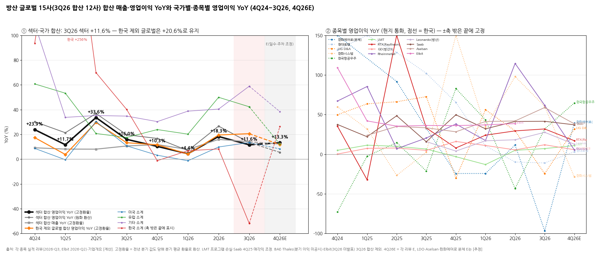
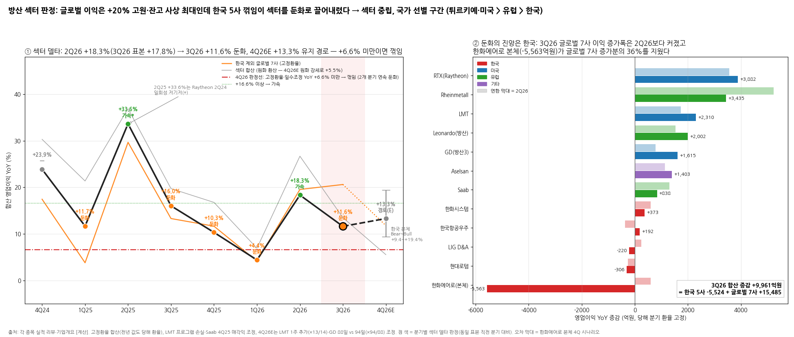

# 방산 · 방산 섹터 리뷰

> 현재 상태 (최신 분기 기준)
> 최신 분기: 2026-Q3
> 섹터 델타: 꺾임 | 내러티브: 약화
> 모멘텀 신호: 없음
> 활성 테마: 없음
> 포지셔닝: 섹터 축소 | 한국 언더퍼폼 | 선호 한국항공우주
> 편입 종목: 한화에어로스페이스(본체), 현대로템, LIG D&A, 한화시스템, 한국항공우주
> 갱신 시각: 2026-11-14 16:45 KST

## 누적 시계열

| 분기 | 편입 종목 | 합산 매출 | 합산 영업이익 | OPM | 매출 YoY | 영업이익 YoY | 영업이익 YoY 델타 (%p) | 섹터 델타 | 내러티브 | 모멘텀 신호 | 활성 테마 |
|---|---|---|---|---|---|---|---|---|---|---|---|
| 1Q24 | 5사 (한화에어로 = 본체) | 38,804억원 | 2,038억원 | 5.3 | +11.8 | -38.7 | — | 꺾임† | - | - | - |
| 2Q24 | 동일 | 51,503억원 | 5,868억원 | 11.4 | +32.8 | +222.6 | +261.3 | 가속† | - | - | - |
| 3Q24 | 동일 | 55,139억원 | 7,598억원 | 13.8 | +29.9 | +202.3 | -20.2 | 둔화† | - | - | - |
| 4Q24 | 동일 | 85,968억원 | 11,106억원 | 12.9 | +36.1 | +93.6 | -108.8 | 둔화† | - | - | - |
| 1Q25 | 동일 | 50,451억원 | 7,248억원 | 14.4 | +30.0 | +255.6 | +162.1 | 가속† | - | - | - |
| 2Q25 | 동일 | 62,329억원 | 9,968억원 | 16.0 | +21.0 | +69.9 | -185.8 | 둔화 | - | - | - |
| 3Q25 | 동일 | 67,239억원 | 10,649억원 | 15.8 | +21.9 | +40.2 | -29.7 | 둔화 | - | - | - |
| 4Q25 | 동일 | 95,928억원 | 10,973억원 | 11.4 | +11.6 | -1.2 | -41.4 | 꺾임 | - | - | - |
| 1Q26 | 동일 | 62,453억원 | 7,744억원 | 12.4 | +23.8 | +6.8 | +8.0 | 가속 | - | - | - |
| 2Q26 | 동일 | 76,388억원 | 10,791억원 | 14.1 | +22.6 | +8.3 | +1.4 | 유지 | - | - | - |
| **3Q26** | 동일 | **64,933억원** | **5,125억원** | **7.9** | **-3.4** | **-51.9** | **-60.1** | **꺾임** | **약화** | **없음** | **없음** |

→ **합산 방식**: 5사 매출·영업이익 단순 합산(원화, 억원) [계산]. 종목 간 내부거래(한화시스템 → 한화에어로 납품, 한화에어로 → LIG D&A 고체연료 등)는 빼지 않았다
→ **한화에어로스페이스 = "본체"(지상방산 + 항공우주, 회사 IR 사업부)만 합산**. 한화에어로 연결에는 한화시스템(지분 연결)·한화오션이 들어 있어, 한화시스템은 별도 종목으로 한 번만 넣고 한화오션은 제외했다(조선 섹터 리뷰에서 다룸). IR "기타·연결조정"(필리조선소·쎄트렉아이·HOESS·PPA 상각 등, 3Q26 영업이익 -1,521억원)도 본체에서 뺐다. 이 기준은 BT 지정 기준이다
→ **한화시스템 = 필리조선소 제외 계속영업 기준**(회사 3Q26 IR p.9 별첨 분기표 재작성치). 2023년은 필리 편입(2024.12.31) 이전이라 보고치와 같다
→ **분기 데이터 출처**: 1Q24~3Q26은 각 종목 2026-Q3 리뷰 1번 표(회사 IR·DART). 리뷰 12분기 표 밖의 2023년 기저는 `company-overview/{종목}_기업개요.md`(v1.1, IR 분기 시계열)에서 보충했다 — 한화에어로 사업부 1Q23~4Q23(지상방산·항공우주 매출·영업이익), 현대로템 1Q23~3Q23(사업부 합산: 매출 6,844·9,868·9,270억원, 영업이익 319·673·411억원), 한화시스템 1Q23~3Q23(4Q25 IR p.11), 한국항공우주 1Q23~3Q23, LIG D&A 1Q23~2Q23. 리뷰에 적힌 YoY(예: 현대로템 1Q24 +40.1%, 한화시스템 1Q24 +124.1%)와 재계산이 일치함을 확인했다
→ **동일 표본**: 전 분기 5사 같은 구성. 한화에어로 본체는 2023년 인적분할 재작성(IR) 기준으로 2023~2026 연속 비교 가능
→ **†** 2024년~1Q25 YoY는 한화에어로 본체 저기저(1Q24 영업이익 -14억원, 2Q23 274억원)와 폴란드 1차 인도 집중으로 크게 출렁인다. 판정은 규칙대로 계산했다. 4Q24는 2개 분기 연속 둔화지만 다음 분기(1Q25)에 재가속해 정점 통과로 보지 않고 "둔화"로 두었다
→ 소급 행의 내러티브·모멘텀 신호·테마 열은 당시 섹터 리뷰가 없어 `-`로 두었다

---

## 2026-Q3 섹터 리뷰

> 대상: 2026-Q3 실적 리뷰 5건 — `earnings-review/2026-Q3_{한화에어로스페이스|현대로템|LIG D&A|한화시스템|한국항공우주}_리뷰.md` (한화에어로 2026-10-30, 나머지 4건 2026-11-14 작성)
> 직전 섹터 리뷰: 없음 (첫 섹터 리뷰). 편입 종목은 워치리스트 "섹터 리뷰 단위" 표의 방산 핵심 3사(한화에어로스페이스·현대로템·LIG D&A) + 확장 2사(한화시스템·한국항공우주) — BT가 5사 전부 지시
> 활성 테마: 없음 (`earnings-theme/`에 방산 테마 분석 없음)
> 쟁점 근거 보조: `sectors/방산/market_signals.md` (2026-Q3 시그널 빈도)

① 섹터 합산 숫자와 델타

| 항목 | 1Q25 | 2Q25 | 3Q25 | 4Q25 | 1Q26 | 2Q26 | **3Q26** | 4Q26E |
|---|---|---|---|---|---|---|---|---|
| 합산 매출 (억원) | 50,451 | 62,329 | 67,239 | 95,928 | 62,453 | 76,388 | **64,933** | 111,893 |
| 합산 영업이익 (억원) | 7,248 | 9,968 | 10,649 | 10,973 | 7,744 | 10,791 | **5,125** | 13,861 |
| OPM (%) | 14.4 | 16.0 | 15.8 | 11.4 | 12.4 | 14.1 | **7.9** | 12.4 |
| 매출 YoY (%) | +30.0 | +21.0 | +21.9 | +11.6 | +23.8 | +22.6 | **-3.4** | +16.6 |
| 영업이익 YoY (%) | +255.6 | +69.9 | +40.2 | -1.2 | +6.8 | +8.3 | **-51.9** | +26.3 |
| **영업이익 YoY 델타 (%p)** | +162.1 | -185.8 | -29.7 | -41.4 | +8.0 | +1.4 | **-60.1** | +78.2 |
| 판정 | 가속† | 둔화 | 둔화 | 꺾임 | 가속 | 유지 | **꺾임** | (반등 경로) |
| ㄴ 한화에어로 본체 영업이익 | 3,055 | 5,105 | 5,756 | 6,223 | 2,313 | 5,700 | **193** | 8,666 [추정] |
| ㄴ 현대로템 | 2,029 | 2,576 | 2,777 | 2,675 | 2,242 | 2,324 | **2,471** | 2,762 |
| ㄴ LIG D&A | 1,096 | 816 | 896 | 387 | 1,711 | 1,057 | **676** | 510 |
| ㄴ 한화시스템 (필리 제외) | 600 | 619 | 618 | 918 | 807 | 1,226 | **991** | 655 |
| ㄴ 한국항공우주 | 468 | 852 | 602 | 770 | 671 | 484 | **794** | 1,268 |
| 참고: 본체 제외 4사 매출 YoY (%) | +20.1 | +16.3 | +18.6 | +24.3 | +30.0 | +25.2 | **+14.4** | +11.9 |
| 참고: 본체 제외 4사 영업이익 YoY (%) | +104.3 | +51.7 | +50.1 | +64.8 | +29.5 | +4.7 | **+0.8** | +9.4 |

→ (출처: 각 종목 2026-Q3 리뷰 1번 표, 한화에어로 본체는 한화에어로 리뷰 1-(1) 표의 사업부 매출 + 기업개요 v1.1 사업부 영업이익(회사 IR) [계산]. 한화에어로 본체 매출은 1Q25~3Q26 16,884 / 24,221 / 27,138 / 38,294 / 18,823 / 28,675 / **19,054**억원)
→ **4Q26E 기준**: 현대로템(5곳)·LIG D&A(7곳)·한화시스템(7곳)·한국항공우주(10곳)는 각 리뷰의 발표 후 증권사 평균. **한화에어로 본체 4Q26E는 리뷰에 없어 [추정]**: 지상방산 매출 3.94조원(리뷰 4-(2-2) 표의 발표 후 7개사 평균) × OPM 22%(리뷰 독자 Base 22% — JPM 21.8%와 근접, 1순위 관전 포인트 "지상방산 OPM 20%+ 회복"과 정합) = 8,666억원, 항공우주는 매출 8,031억원(4Q25 7,368억원 × 3Q26 YoY +9% 가정)·영업이익 0원(리뷰 연결 OP 가정 "항공우주 손익분기")
→ 한화에어로 본체 시나리오(리뷰 ⑤-(2-1)): Bear 지상방산 OP 4,500억원 → 합산 9,695억원(YoY -11.6%) / 리뷰 Base 7,900억원 → 1조 3,115억원(+19.5%) / Bull 1.2~1.4조원 → 최대 2조 307억원(+85%, 다른 4사도 증권사 추정 상단 적용) [계산]. 4Q26E 합산 범위 -24% ~ +85%
→ **이익 레벨**: 3Q26 합산 영업이익 5,125억원은 1Q24(2,038억원) 이후 최저, OPM 7.9%도 1Q24(5.3%) 이후 최저다. 한화에어로 본체 영업이익이 5,756억원 → 193억원으로 사라진 것이 거의 전부다
→ **델타**: 합산 영업이익 YoY +8.3%(2Q26) → -51.9%(3Q26), 마이너스 전환 → 꺾임. 본체를 빼도 4사 영업이익 YoY는 +64.8%(4Q25) → +29.5% → +4.7% → **+0.8%**로 3개 분기 연속 둔화해 사실상 정체다. "한화 하나의 사고"가 아니라 섹터 전체가 이미 평탄해져 있던 위에 한화 본체 공백이 겹친 구조다 [판단]
→ **컨센 경로상 섹터 YoY 정점은 1Q25(+256%)로 이미 지났다.** 4Q26E +26%는 한화 폴란드 이연 물량(본체 +2,443억원)과 KAI LAH 재개(+498억원)의 회수 성격이고, 4사 기준으로는 +9.4%에 그친다. 다음 성장 구간은 2027년(연간 +29% [추정 포함]) — 이미 계약된 잔고(LIG 천궁 3국, 한화시스템 중동 MFR, KAI KF-21·LAH 이연분, 한화 폴란드 2차)의 매출화로 그려져 있다

연간 합산 (억원, %)

| 항목 | 2023 | 2024 | 2025 | 2026E | 2027E |
|---|---|---|---|---|---|
| 합산 매출 | 179,108 | 231,414 | 275,947 | 315,667 | — |
| 합산 영업이익 | 13,396 | 26,610 | 38,838 | 37,521 | 48,451 [추정 포함] |
| OPM | 7.5 | 11.5 | 14.1 | 11.9 | — |
| 매출 YoY | — | +29.2 | +19.2 | +14.4 | — |
| 영업이익 YoY | — | +98.6 | +46.0 | **-3.4** | +29.1 |
| 참고: 본체 제외 4사 영업이익 | 7,666 | 11,399 | 18,699 | 20,649 | 26,341 |
| 참고: 4사 영업이익 YoY | — | +48.7 | +64.0 | +10.4 | +27.6 |

→ (출처: 2023~2025 = 분기 합산 [계산]. 2026E = 1~3Q 실적 + 위 4Q26E. 2027E = 현대로템 1조 220억원(7곳)·LIG D&A 5,591억원(9곳)·한화시스템 4,951억원(7곳)·한국항공우주 5,579억원(10곳) 각 리뷰 연간 평균 + **한화에어로 본체 2조 2,110억원 [추정]** = 지상방산 2026E 매출 8.51조원 × 1.15(회사 2027~29 연 +15% 가이던스) × OPM 22%(리뷰 독자 판단 22~24%의 하단) + 항공우주 2026E 수준 572억원 유지. 2027E 매출은 한화 본체 추정이 없어 생략 — 4사 기준 2026E 20.17조원 → 2027E 23.77조원(+17.9%))
→ 2026년은 합산 영업이익이 **처음으로 연간 감익(-3.4%)**하는 해다. 4사만 보면 +10.4%로 플러스지만 2025년(+64%)의 6분의 1 속도다

→ (출처: 각 종목 2026-Q3 리뷰·기업개요 v1.1 [계산]. 굵은 검은 선 = 섹터 합산 영업이익 YoY, 회색 굵은 선 = 섹터 합산 매출 YoY, 가는 선 = 종목별 영업이익 YoY(한화에어로는 본체), 점선 = 4Q26E. ±300% 밖 값은 축 끝에 수치 표기, 한화에어로 본체 1Q25는 적자 기저(1Q24 -14억원)라 표시 제외)

② 종목별 델타 판정표

| 종목 | 매출 YoY | 영업이익 YoY | 영업이익 YoY 델타 | 델타 판정 | 내러티브 | 한 줄 |
|---|---|---|---|---|---|---|
| 한화에어로스페이스 (연결)* | -6.0 | -46.2 | -104.7%p | 꺾임* | 약화* | 영업이익 4,520억원, 컨센 -61%. 지상방산 매출 -41%·OPM 1.7% — 폴란드 4Q 쏠림 + 대전 사고 + 비폴란드 수출 마진 10%대. 본체 기준 매출 -29.8%·영업이익 -96.6% |
| 현대로템 | +0.1 | -11.0 | -1.2%p | 꺾임 | 약화 | 영업이익 YoY 2개 분기 연속 마이너스. 방산 OPM 28.1%로 마진은 버텼지만 회사가 2027 방산 감익을 사실상 인정, 수출 2호 계약 시점 불명 |
| LIG D&A | +2.1 | -24.6 | -54.1%p | 꺾임 | 약화 | UAE 천궁 납품 이연(한화 대전 사고) + 개발 비중 24.5% + 수출 마진 -5%p. 입찰참가자격 제한으로 프리미엄 해체(평균 TP -44%) |
| 한화시스템 (필리 제외) | +30.1 | +60.4 | -37.7%p | 둔화 | 유지 | 중동 MFR 수출·ICT로 본업 확인(OPM 11.9%). 4Q26E는 개발비 집중으로 -29% 예고, UAE 통합대공망 본계약 대기 |
| 한국항공우주 | +51.6 | +31.9 | +75.1%p | 가속 | 유지 | KF-21 첫 양산 납품 + 1.45조 비공개 수출 수주. 환율 예정원가 +400억·일회성 -300억 상쇄, 4Q 인니 KF-21·LAH 3차가 관건 |

→ (출처: 각 종목 리뷰 0번 판정·1번 표. 현대로템·LIG D&A·한화시스템·한국항공우주의 판정은 리뷰 0번 그대로)
→ **\* 한화에어로스페이스: 리뷰 원문에 v11 판정 없음 → 섹터 리뷰에서 산정.** 리뷰(2026-10-30)는 v11 이전 형식이라 0번 판정 줄이 없다. 리뷰 본문 숫자에 v11 기준을 적용했다 — 연결 영업이익 YoY +58.5%(2Q26, 13,655 / 8,614억원) → -46.2%(3Q26)로 마이너스 전환 = **꺾임**(본체 기준도 +11.7% → -96.6%). 내러티브는 **약화** — 2026E 영업이익 컨센 -17%·2027E -8%, 평균 TP -13~-19%, MS "논지 약화(Weakens)", 지상방산 잔고 37.2조원(2025말) → 35.0조원 감소, "폴란드 = 수출 = 고마진" 전제 붕괴. 반면 천무 연간 인도 40대+ → 60대+ 상향·2027~29 +15% 가이던스 유지·13개사 전원 매수라 훼손은 아니다 [판단]
→ **섹터 델타를 끄는 곳 = 한화에어로 본체**: 3Q26 합산 영업이익 감소분 -5,524억원 중 -5,563억원이 본체다. 나머지 4사 증감 합계는 +39억원(로템 -306·LIG -220 vs 시스템 +373·KAI +192) [계산]
→ **선행 종목 = 한화에어로 본체와 현대로템**: 본체는 4Q25(-24.3%)·1Q26(-24.3%)에 섹터에서 가장 먼저 마이너스로 내려갔고, 현대로템은 영업이익 YoY 정점(1Q25 +354%) 이후 6개 분기 내리 둔화해 2Q26부터 2개 분기 연속 마이너스다. 둘 다 "폴란드 1차 수출" 이익을 주도했던 종목이다 — **폴란드 1차 사이클이 먼저 끝났다** [판단]
→ **후행 종목 = 한국항공우주**: 유일한 가속. 2025년 3분기까지 바닥(-21%)을 다진 뒤 KF-21·FA-50 진행률로 늦게 올라왔고, 컨센상 YoY 정점(2Q27E)이 아직 앞에 있다. 한화시스템은 그 중간 — 2Q26 +98%로 정점을 찍고 둔화 중이다

③ 섹터 공통 쟁점

(1) 인도 타이밍·국내 생산 차질 — 3Q 미스의 공통 원인 (5사)
→ 한화에어로: 고마진 폴란드 K9·천무가 4Q로 몰림(수출 매출 -50%), 대전 사업장 사고로 국내 손익분기~적자(일회성 약 460억원), 2027년 상반기 정상화 목표 (한화에어로 리뷰 ③-(1)·(2))
→ 현대로템: 폴란드 K2 3Q 인도 14대(보도 46대), 4Q 44대 예정 → 연 58대 유지 (현대로템 리뷰 쟁점 1)
→ LIG D&A: **협력사 한화 대전사업장 사고로 UAE 천궁-II 납품 지연** → 3Q 매출 400~500억원 이연 (LIG 리뷰 쟁점 1). 한화 사고가 섹터 내 두 종목의 3Q를 동시에 깎았다
→ 한국항공우주: LAH 엔진 결함으로 3Q 납품 0대, 약 20대 2027년 이연, 2026 매출 가이던스 5.73조원 → 약 5.2조원 (KAI 리뷰 쟁점 2)
→ 한화시스템: 방산 QoQ 감익 원인으로 조업일수·폴란드 K2 사격통제 매출 감소 (한화시스템 리뷰 1-②)
→ 셀사이드 해석 차이: 한화에어로·로템·KAI는 "물량 소멸이 아닌 시점 이동"으로 대부분 수용(4Q 추정 하향 폭 작음). 다만 삼성증권은 한화에 대해 "인도 일정 정보 접근이 어려워 분기 이익 추정 가시성이 구조적으로 낮아졌다"고 지적했고, 신한은 LIG의 미스 절반을 구조(개발 비중)로 본다
→ [판단] 4Q26E 합산 +26%의 대부분이 이 이연 물량 회수다. 4Q에 회수되면 "타이밍"이 확인되지만, 회수돼도 1Q27E에는 "이연 소진 후 공백" 우려가 다시 붙는다(한화 1Q27E 컨센 -12~-20% 하향). 한 분기 숫자로 델타 회복을 판단하기 어려운 이유다

(2) 원화 강세 → 수출 매출·마진 하향 (5사, market_signals 4종목 Mid + 한화)
→ 한화에어로: 원화 강세가 3Q 영업이익을 약 10% 낮춤(회사), DB·미래에셋은 약 -70억원 추정
→ 현대로템: 삼성증권은 원화 강세를 핵심 변수로 2027E EPS -24%
→ LIG D&A: 수출 마진 20~25% → 15~20%(SK·DS, 약 -5%p), 영업외 환손실 400~500억원
→ 한화시스템: 헤지 포함 외환손실 약 300억원(영업외)
→ 한국항공우주: **방향이 반대** — 진행기준 예정원가 재조정으로 영업이익 +400억원, 영업외 외환손실 399억원으로 상쇄
→ [판단] 진행기준 수출(KAI·LIG 천궁)은 환율이 원가 재조정·영업외로 나뉘어 영업이익 단의 방향이 종목마다 다르다. 공통된 건 **순이익 단의 손실**과 **2027E 수출 마진 가정 하향**이다. 원/달러가 지금 수준이면 2027E 컨센의 수출 마진(한화 수출 OPM 30%대, LIG 20%대)은 추가 하향 여지가 있다

(3) 수출 신규 수주 공백 → 수주잔고 감소 vs 4Q 백엔드 기대 (5사, market_signals "중동 대형 수주" 3종목·"수출 2호국 공백" 2종목·"잔고 연속 감소" 2종목)
→ 잔고가 줄어드는 쪽: 한화에어로 지상방산 37.2조원 → 35.0조원, 현대로템 AD&RH 잔고 4분기 연속 감소(9.52조원, 3Q 누계 방산 신규수주 3,445억원), 한화시스템 방산 잔고 9.30조원 → 8.40조원(3분기 연속 감소)
→ 잔고가 반등한 쪽: LIG D&A 수출 잔고 14.04조원 → 14.56조원, KAI 완제기 잔고 5.0조원 → 6.2조원(비공개 1.45조원 수주)
→ 4Q 대기 중인 대형 건: UAE(EDGE 통합대공망 — 한화시스템·한화에어로, 11월 UAE 대통령 방한), 카타르·쿠웨이트 천궁-II(LIG, 각 약 1.5조원 DS 추정, 연간 신규수주 가이던스 5조원 → 6조원+), 인니 KF-21(KAI, 약 4조원)·LAH 3차(약 3조원), 폴란드 K2 EC3 초청장·페루 예산(현대로템), 사우디(한화 — 역내 군사 행동으로 지연)
→ 셀사이드 해석 차이: 국내 증권사는 대부분 "시점의 문제"로 보고 연내 일부 체결을 가정, 해외(JPM·맥쿼리·MS)는 "반복된 지연 이력 — 확인 전까지 반영 안 함"
→ [판단] 수요 부재가 아니라는 데는 5개 리뷰 모두 일치한다. 그러나 **3Q26 실적 시즌에 숫자로 확인된 대형 수출 신규 계약은 KAI 비공개 1.45조원 하나**다. 4Q 백엔드가 비면 섹터 내러티브는 "약화"에서 한 단계 더 내려간다

(4) 방산 멀티플 디레이팅 — TP 하향의 주원인은 이익이 아니라 배수 (5사)
→ 평균 TP 변화 vs 2027E 영업이익 변화: 한화에어로 -13~-19% vs -8%, 현대로템 -32% vs -16%, LIG D&A -44% vs -10%, 한국항공우주 -8% vs -1%, 한화시스템 -7.7% vs +10.8%(필리 제외 효과, TP 하향은 조선 지분·필리 가치 제거)
→ 공통 근거: 글로벌 방산 피어 배수 하락(SK·LS·JPM·미래에셋), 국내 방산 할증 축소·제거(신한 한화 할증 70% → 50%, 로템 50% → 15%, LIG 130% → 60%, KB·삼성 LIG 할증 제거), 분기 변동성 확대에 대한 할인
→ [판단] 이익 추정이 덜 깎인 종목(KAI)일수록 TP 하향이 작다. 디레이팅이 이익 경로보다 앞서 진행돼 하방은 줄었지만, BT 프레임에서 멀티플 정상화는 델타가 돌아온 뒤에 따라오는 2순위 변수다

(5) 수출 마진의 2층 구조 — 수출 비중·믹스가 OPM을 결정 (4사)
→ 한화에어로: 폴란드 직수출(30%대) vs 비폴란드 현지 생산형(10%대) — 3Q26에 처음 수치로 드러남
→ 현대로템: 수출 마진은 30% 후반으로 회복했지만 수출 비중이 72%(2025) → 63%(2027E) → 55%(2028E, 다올)로 내려가 방산 OPM이 희석
→ LIG D&A: 수출 비중이 오르면 OPM 상승, 연구개발 비중(24.5%, +5.7%p)이 오르면 하락 — 개발 잔고 4.81조원으로 2027년까지 지속 가능성(신한)
→ 한화시스템: 수출 비중 22%로 낮았지만 방산 OPM 12.3%, 2027년 수출 비중 30.5%(다올) vs 49.6%(대신) 가정 차이가 2027E 영업이익을 1.6배 갈라놓음
→ [판단] 2024~2025년 섹터 OPM 레벨업(11.5% → 14.1%)은 폴란드 1차 직수출이 만든 것이다. 2026~2027년 수출은 현지화·다변화로 넓어지지만 평균 마진은 희석된다. **섹터 합산 OPM이 2025년 14.1%를 다시 넘기 어렵다**는 것이 이번 시즌의 구조적 결론이다

(6) 종목 고유 이슈
→ 한화에어로스페이스: 순차입금 9.85조원(연초 대비 +5.36조원), 2028년까지 11조원+ 투자 / 항공우주 GTF RSP 손실 구조
→ 현대로템: 현대위아 특수사업부 인수(3,584억원), 다목적 무인차량·KF-21 장거리 공대공 유도탄 입찰 실패
→ LIG D&A: 방사청 입찰참가자격 2년 제한(2026.10.29~2028.10.28), 11/20 전후 집행정지 결정
→ 한화시스템: 위성 20조원·AI DC 3조원 투자(2040년까지) 자본조달 부담, 4Q 자체 투자개발비 집중
→ 한국항공우주: 차입금 3.05조원·운전자본 부담, 이라크 수리온 대금 미회수(반복 충당금), 2026 매출 가이던스 6년 연속 미달

④ 섹터 판정

(1) 판정 한 줄

> 섹터 델타: **꺾임** | 내러티브: **약화** → **글로벌 방산 수요는 사상 최대 잔고로 가속 중인데 한국 5사 이익 델타는 꺾였다 — 문제는 수요가 아니라 인도 타이밍·수주 공백·원화 강세. 4Q 반등(컨센 +26%)은 이연 물량 회수라 수주 확인 전까지 섹터 베타는 관망, 종목은 KAI만 예외. 4Q26 합산 영업이익 YoY 0%(1조 973억원) 미만이면 꺾임 지속**

(2) 키 차트

→ (출처: 각 종목 2026-Q3 리뷰·기업개요 v1.1 [계산]. 왼쪽 = 섹터 합산 영업이익(막대, 조원)과 합산 영업이익 YoY(검은 선, 점 색 = 분기별 판정), 파란 선 = 한화에어로 본체 제외 4사 YoY, 빨간 점선 = 4Q26 판정선 YoY 0%, 회색 범위 = 4Q26E 시나리오(-24%~+85%) / 오른쪽 = 종목별 영업이익 YoY 증감액(억원)과 합산 증감(검은 마름모), 1Q26~4Q26E)

(3) 근거
→ **델타 = 꺾임**: 합산 영업이익 YoY +8.3%(2Q26) → -51.9%(3Q26), 마이너스 전환이다. 본체 제외 4사도 +29.5% → +4.7% → +0.8%로 3개 분기 연속 둔화해, 한화 본체 일회성만으로 설명되지 않는다. 컨센 경로상 4Q26E는 +26.3%(본체 [추정] 포함)로 반등하지만 4사 기준은 +9.4%다. 연간으로는 2026E가 첫 감익(-3.4%)이다
→ **내러티브 = 약화**: 종목 판정 분포는 약화 3(한화에어로·현대로템·LIG D&A)·유지 2(한화시스템·KAI)다. 섹터 공통 스토리("K방산 수출 = 고마진 + 연속 수주")의 두 다리가 모두 숫자로 약해졌다 — 수출 마진은 비폴란드·현지화·원화 강세로 희석(③(2)·(5)), 연속 수주는 3Q에 대형 신규 계약이 KAI 1건뿐(③(3)). 5사 모두 TP 하향의 주원인이 멀티플이라는 점(③(4))이 공통 스토리 약화의 증거다. 다만 수요(중동 방공·유럽 재무장) 자체는 5개 리뷰 모두 "훼손 아님"으로 판단했다
→ **직전 대비**: 첫 섹터 리뷰다. 소급 시계열상 궤적은 2024~1Q25 폴란드 1차 인도 구간의 고성장(+94~+256%) → 2Q25~3Q25 둔화 → 4Q25 첫 마이너스(-1.2%, 4Q24 폴란드 대량 인도 기저) → 1Q26~2Q26 한 자릿수 플러스(가속·유지) → 3Q26 꺾임(-51.9%). **섹터 영업이익 YoY는 1Q25 정점 이후 6개 분기 중 5개 분기가 30% 미만**이다 — 3Q26은 갑작스러운 붕괴가 아니라 이미 평탄해진 델타의 마이너스 전환이다

⑤ 모멘텀 신호

→ **없음** (조건 대조)
→ 테마 종료 후보: **해당 없음** — 방산에 걸린 활성 테마가 없다(`earnings-theme/`에 방산 테마 분석 없음)
→ 델타 급증 후보: **미충족** — ① 섹터 영업이익 YoY 델타 확대 — 미충족(-60.1%p) ② 편입 종목 과반 가속 — 미충족(가속 1/5, KAI) ③ 내러티브 형성·강화 — 미충족(약화)
→ **다음 분기에 아래가 함께 나오면 "델타 급증 후보"로 올린다**: 4Q26 합산 영업이익 YoY +26% 이상(컨센 경로) + 본체 제외 4사 YoY 가속(+9.4% 이상) + 5사 중 3사 이상 "가속" + 중동(UAE·카타르·쿠웨이트)·인니 대형 수출 계약 2건 이상. 연결될 만한 테마 키워드 제안: **"중동 방공 수출(천궁-II·MFR·통합대공망)"** — LIG D&A·한화시스템·한화에어로가 한 체계로 묶이는 유일한 공통 수요다 (제안일 뿐, 판단은 BT)
→ 반대 논거: (a) 글로벌 피어는 같은 분기에 잔고 사상 최대·가이던스 상향(LMT·RTX·BAE)으로 수요 사이클이 가속 중이라, 한국 꺾임은 실행·타이밍 문제일 가능성이 크다 (b) 2027E 합산 영업이익 +29% [추정 포함]은 대부분 이미 계약된 잔고의 매출화라 수주 없이도 그려진 경로다 (c) 결론을 바꿀 이벤트(11/20 LIG 집행정지, 11월 UAE 방한, 12월 인니·LAH·EC3)가 6주 안에 몰려 있다 — 델타보다 이벤트가 먼저 움직일 수 있다

⑥ 다음 분기 섹터 관전 포인트

| 순위 | 무엇을 (변수·임계값) | 어떤 데이터로 | 언제 |
|---|---|---|---|
| 1 | **4Q26 섹터 합산 영업이익 YoY 0% 이상 (합산 1조 973억원 이상)** — 미만이면 2개 분기 연속 마이너스로 꺾임 지속. 컨센 경로 1조 3,861억원(+26.3%, 본체 [추정] 포함), 시나리오 8,354억~2조 307억원(-24%~+85%). 본체 제외 4사는 5,195억원(+9.4%) | 5사 4Q26 잠정실적(한화에어로는 IR 사업부 지상방산·항공우주) | 2027년 1월 하순(현대로템) ~ 2월 초 |
| 2 | 한화에어로 지상방산 4Q 매출 3.58조원(회사 "2026년 성장 지속" 역산 하한) 이상 + OPM 20% 이상 — 폴란드 K9 30문+·천무 60대+ 인식 | 관세청 월별 수출(폴란드·루마니아향), 4Q26 IR | 12월 1일·1월 1일 수출 통계, 2월 초 실적 |
| 3 | 중동 대형 수출 계약 1건 이상 — UAE EDGE 통합대공망 본계약(한화시스템·한화에어로), 카타르·쿠웨이트 천궁-II(LIG, 연말 잔고 26~28조원) | DART 단일판매·공급계약 공시, UAE 대통령 방한 결과 | 11월 방한 ~ 12월 |
| 4 | 인니 KF-21(약 4조원)·LAH 3차(약 3조원) 체결, 폴란드 K2 EC3 초청장·페루 2027 예산 — 수출 2호국 공백 해소 여부 | 회사 공시, 인니 재무부·폴란드 군비청·페루 의회 | 11월(페루 예산) ~ 12월 |
| 5 | LIG D&A 입찰참가자격 제한 집행정지 인용 여부 + 원/달러와 4Q 컨콜의 수출 마진(LIG 15~20% vs 20~25%, 한화 수출 OPM 30% 회복) | 법원 결정·회사 공시, 4Q 컨콜 | 11/20 전후, 2월 초 |

→ 판정선 근거: 3Q26이 -51.9%라 4Q26 YoY가 그보다 높으면 규칙상 "가속"으로 읽힌다. 그래서 의미 있는 선은 **플러스 복귀(0%)**로 둔다 — 0% 미만이면 2개 분기 연속 마이너스(꺾임 지속), 0~26%면 "기저·이연 반등"(가속 판정이되 4사 YoY와 함께 표기), 26% 이상 + 4사 가속이면 델타 급증 후보 검토(⑤). ④ 키 차트의 판정선과 같은 값이다

⑦ 글로벌 PM 포지셔닝 — 결론

> **섹터: 비중 축소 — 4Q26 합산 영업이익 YoY 0% 이상 + 중동·인니 대형 수출 계약 1건 이상 확인 시 중립 복귀** | **종목: 한국항공우주 유지 > 한화시스템 중립 > 한화에어로스페이스 축소 > LIG D&A 축소 > 현대로템 축소** | **한국: 언더퍼폼 vs 글로벌 방산 (한국항공우주만 예외)**

→ 비교 범위: 편입 종목이 한국 5사뿐이라 글로벌 피어는 ① 한화에어로 리뷰 ②-(4)의 피어 비교(LMT·RTX 3Q26 8-K, Rheinmetall H1) ② 각 리뷰의 피어 P/E 인용 ③ 웹 확인한 3Q26 실적 3건(General Dynamics 8-K 2026-10-30, Rheinmetall 9M 분기 보고 2026-11-05, BAE Systems 반기 2026-07-30)으로 대신한다. BAE의 11월 trading update는 찾지 못해 반기 수치를 쓴다

(1) 방산 섹터 비중 — 확대 / 중립 / 축소

| 판단 축 | 3Q26 근거 | 방향 |
|---|---|---|
| 이익 델타 (1순위) | 합산 영업이익 YoY +8.3% → -51.9%(마이너스 전환), 본체 제외 4사 +4.7% → +0.8%(3개 분기 연속 둔화). 가속 1 / 둔화 1 / 꺾임 3 | 축소 |
| YoY 정점 시점 | 섹터 정점 1Q25(+256%) 통과. 컨센 경로 4Q26E +26%(이연 회수) → 2026E 연간 -3.4% → 2027E +29% [추정 포함]. 정점을 지난 종목 4/5(KAI만 정점 미도달) | 축소 (2027 재가속은 미확인) |
| 수주·잔고 선행지표 | 잔고 감소 3사(한화 지상방산 -2.2조원, 로템 4분기 연속, 시스템 3분기 연속) vs 반등 2사(LIG 수출, KAI 완제기). 3Q 대형 신규 수출 계약 1건(KAI 1.45조원) | 축소 |
| 최종 수요 지표 | 글로벌 방산 잔고 사상 최대(LMT $292B·RTX $340B·Rheinmetall €78.0B·BAE £84.0B), 유럽 재무장·중동 방공 수요 견조 — 5개 리뷰 모두 "수요 부재 아님" | 확대 |
| 이벤트·정책 | 11/20 LIG 집행정지, 11월 UAE 방한, 12월 인니 KF-21·LAH 3차·K2 EC3 — 모두 미확인. EU 역내 조달(SAFE) 블록화(한화 루마니아 IFV 패배)는 역풍 | 중립 (이벤트 전) |
| 밸류에이션·멀티플 (2순위) | 5사 평균 TP -8~-44%, 2027E 영업이익 -1~-16% → 하향 대부분이 멀티플. 한화에어로 2027E P/E 12.5배 vs Rheinmetall 22.5배(한화투자증권), 현대로템 2026E P/E 약 11배 | 확대 (2순위) |
| 주가 낙폭 | 52주 고점 대비 한화에어로 -50.6%(키움), LIG D&A -68%, 한화시스템 약 -61%, KAI 6개월 -42%, 현대로템 발표 후 -24%(52주 최저권) — 디레이팅이 이익 경로보다 앞섰다 | 중립 |

→ **결론: 비중 축소** [판단]. BT 프레임 1순위인 이익 델타가 마이너스로 꺾였고, 본체를 빼도 4사 델타가 0%에 수렴했다. 4Q26E 반등은 이연 물량 회수라 "가속 재개"로 읽기 어렵고, 2027년 재가속(+29%)은 수주·인도 실행이 확인되기 전까지 컨센 경로일 뿐이다
→ 수요(글로벌 잔고)와 밸류(-50~-68% 낙폭, 피어 대비 P/E 할인)는 확대 쪽이지만 각각 "한국이 수주로 연결하지 못하고 있는 수요"와 2순위 변수다. 가치 프레임이라면 "중립~확대"가 나올 수 있다 — 이 결론은 델타 프레임 결론이다
→ **중립 복귀 조건**: ① 4Q26 합산 영업이익 YoY 0% 이상(1조 973억원 이상, ④ 판정선·⑥ 1순위와 같은 값) ② 중동(UAE 통합대공망·카타르·쿠웨이트 천궁-II) 또는 인니 KF-21 대형 수출 계약 1건 이상. ①+② 충족 시 중립
→ **확대 전환 조건**: ① 4Q26 합산 YoY +26.3% 이상(컨센 1조 3,861억원) + 본체 제외 4사 YoY +9.4% 이상 ② 대형 수출 계약 2건 이상으로 섹터 잔고 순증 전환 ③ 1Q27 발표 후 2027E 합산 영업이익 추정 상향 전환
→ **축소 강화 조건**: 4Q26 합산 YoY 0% 미만(2개 분기 연속 마이너스) 또는 연내 대형 수출 계약 0건 + LIG 집행정지 기각

(2) 한국 vs 글로벌 — 아웃퍼폼 / 중립 / 언더퍼폼

| 경쟁력 축 | 한국 5사 | 글로벌 (미국·유럽) | 우위 |
|---|---|---|---|
| 델타 방향 (1순위) | 합산 영업이익 YoY +8.3% → -51.9%, 4사 +0.8%. 꺾임 3·둔화 1·가속 1 | GD 3Q 영업이익 +14.7%(매출 +12.9%), Rheinmetall 9M 영업이익 +68%(매출 +38%), BAE H1 EBIT +11%, LMT·RTX 매출 +11%(RTX Raytheon 영업이익 +32%) | 글로벌 |
| 마진 레벨 | 3Q26 합산 OPM 7.9%(4사 10.7%) | GD 10.5%, Rheinmetall 9M 16.0%, LMT MFC 14.0%, Raytheon 14.1% | 글로벌 |
| 마진 방향 | 합산 OPM 15.8%(3Q25) → 7.9%. 수출 마진 희석(비폴란드 10%대·LIG -5%p) | GD +0.2%p, Rheinmetall 13.1% → 16.0%. 단 GD Combat Systems OPM 14.9% → 13.8% | 글로벌 |
| 수주·잔고 | 잔고 감소 3사, 3Q 대형 신규 수출 1건 | LMT·RTX·Rheinmetall·BAE 잔고 사상 최대, GD $220.3B | 글로벌 |
| 생산 능력·현지화 | 대전 사고(2027H1 정상화), LAH 엔진 병목, 현지 생산형 전환기(초기 비용) | Rheinmetall도 Arminius·탄약 검수 지연으로 FY26 매출 가이던스 €13.7~14.2B → 약 €13.2B 하향 — 실행 지연은 한국만의 문제는 아님 | 비슷 (근소 글로벌) |
| 가격·경쟁력 | 빠른 납기·가격 경쟁력은 유지(리뷰 공통), 미국 K9MH 시제 단독 선정 | 미국산 방공미사일 공급 수년 제한(KB, LIG 리뷰) → 한국 방공 체계 대체 수요 | 한국 |
| 관세·규제 | EU 역내 조달(SAFE) 블록화, LIG 국내 입찰 제한 | 자국 국방예산 다년 계약 중심(매출 인식 평탄) | 글로벌 |
| 환율 | 원화 강세가 수출 마진·영업외를 깎음(5사) | 자국 통화 매출·원가 | 글로벌 |
| 이익 추정 방향 | 발표 후 2027E 하향 4사(한화 -8%·로템 -16%·LIG -10%·KAI -1%), 상향 1사(시스템 +11%, 필리 제외 기준 효과) | LMT·RTX·BAE 가이던스 상향, Rheinmetall 하향 | 글로벌 |
| 밸류에이션·낙폭 (2순위) | 한화 2027E P/E 12.5배, 셀사이드 목표 배수 17~30배로 하향, 고점 대비 -42~-68% | Rheinmetall 22.5배(한화투자증권), 해외 피어 평균 약 20.7배(한화투자증권 현대로템 17배 = 피어 -18% 역산), 글로벌 피어 27F 18.7배(미래에셋) | 한국 (2순위) |

→ (출처: LMT·RTX·Rheinmetall H1은 한화에어로 리뷰 ②-(4) 표(LMT 8-K 10/22, RTX 8-K 10/20). [General Dynamics 3Q26 8-K Ex.99.1 (2026-10-30)](https://www.sec.gov/Archives/edgar/data/0000040533/000004053326000036/gd-20261004exhibit991.htm) — 매출 $14,566M(+12.9%), 영업이익 $1,527M(+14.7%), Combat Systems 매출 +6.0%·영업이익 -1.5%, 잔고 $220.3B. [Rheinmetall Quarterly Statement Q3 2026 (2026-11-05)](https://www.rheinmetall.com/en/media/news-watch/news/2026/11/2026-11-05-rheinmetall-news-quarterly-statement-q3) — 9M 매출 €8,376M(+38%), 영업이익 €1,339M(+68%), Backlog €78.0B, FY26 가이던스 하향. [BAE Systems H1 2026 (UK Defence Journal, 2026-07-30)](https://ukdefencejournal.org.uk/bae-systems-upgrades-guidance-after-strong-first-half/) — 매출 £15,772M(고정환율 +9%), underlying EBIT £1,701M(+11%), 잔고 £84.0B, FY26 매출 가이던스 8~10%로 상향. 한국 피어 P/E는 각 종목 리뷰 인용, 기준일 2026-10-29~11-11)
→ **결론: 한국 언더퍼폼 (vs 글로벌 방산)** [판단]
→ 이유 (1) 델타 방향이 반대다. 같은 분기에 글로벌 피어는 영업이익 +11~+68%로 성장을 유지했는데 한국 5사 합산은 -52%, 4사도 +0.8%다
→ 이유 (2) 이익 추정이 한국만 내려갔다. 5사 중 4사의 2027E가 발표 후 하향됐고, 원인(원화 강세·수출 마진 희석·인도 지연)이 4Q·2027년에도 남는다. 글로벌은 Rheinmetall을 빼면 가이던스를 올렸다
→ 이유 (3) 구조 요인: 한국 방산 이익은 수출 인도 기준이라 분기 변동성이 구조적으로 크고(한화 리뷰 ②-(4-1)), 폴란드 1차 직수출의 고마진 구간이 끝나 현지화·다변화로 넘어가는 전환기다. 미국 피어는 자국 예산 다년 계약이라 인식이 평탄하다
→ 반대 논거: (a) 밸류에이션 할인(한화 12.5배 vs Rheinmetall 22.5배)과 고점 대비 -50~-68% 낙폭으로 하방이 작다 (b) 미국산 방공미사일 공급 제약으로 중동 방공 수요는 한국 외 대안이 적다 — UAE·카타르·쿠웨이트 계약이 몰리면 반등 탄력은 한국이 크다 (c) Rheinmetall도 실행 지연으로 가이던스를 내려 "실행 리스크"는 글로벌 공통이다. 이 결론은 델타 프레임이고, 가치 프레임이라면 반대일 수 있다
→ **예외: 한국항공우주**. 5사 중 유일한 가속(영업이익 YoY -43% → +32%), 2027E 영업이익 컨센이 발표 후에도 거의 그대로(-1.2%, +73%), YoY 정점(2Q27E)이 아직 앞에 있다. 수주(완제기 잔고 반등)와 델타가 같은 방향인 유일한 종목이다

(3) 종목 순위와 선호 종목

| 순위 | 종목 | 비중 | 근거 (델타 방향·마진·수요 노출) |
|---|---|---|---|
| 1 | 한국항공우주 | 유지 (섹터 내 선호) | 유일한 가속, 2027E +73% 경로 유지, 완제기 잔고 반등. 다만 이익의 질(환율 예정원가 +400억원)·현금 전환(차입금 3조원)이 약점이라 "확대"는 4Q 인니·LAH 체결 후 |
| 2 | 한화시스템 | 중립 | 둔화지만 플러스(+60%), 본업 OPM 11.9%·ICT 가속. 4Q26E -29%는 예고된 개발비 이벤트. 1Q27 YoY +20% 미만이면 꺾임으로 판정 변경(리뷰) |
| 3 | 한화에어로스페이스 | 축소 | 꺾임·약화. 4Q 폴란드 이연 회수로 숫자는 반등하겠지만 비폴란드 수출 마진 10%대·잔고 감소·순차입금 9.85조원이 2027E 컨센(+37%)의 신뢰도를 낮춘다 |
| 4 | LIG D&A | 축소 | 꺾임·약화. 2027E +40%는 계약된 천궁 3국 잔고라 경로 자체는 탄탄하지만, 개발 비중·수출 마진 -5%p·입찰 제한으로 프리미엄이 걷혔다 |
| 5 | 현대로템 | 축소 | 꺾임·약화, 5사 중 유일하게 2027E 증가율이 한 자릿수(+4%, 방산 본업은 감익 컨센). 다음 성장은 2028년(신규 수주) — 델타가 가장 먼 종목 |

→ **한국 선호**: 한국항공우주 — 섹터 안에서 델타·수주가 같은 방향인 유일한 종목
→ **한국 비선호**: 현대로템 — 선행 꺾임 종목, 2027 감익 경로, 수출 2호국 시점 불명
→ **반등 후보 (이벤트 드리븐, 델타 프레임 밖)**: LIG D&A — 11/20 집행정지 인용 + 연내 카타르·쿠웨이트 천궁-II 공시가 겹치면 "실적은 그대로인데 멀티플만 깎인" 상태라 되돌림 탄력이 가장 크다(고점 대비 -68%). 한화에어로스페이스·한화시스템 — 11월 UAE 방한 전후 EDGE 통합대공망 본계약. 현대로템 — 페루 예산·EC3 초청장
→ **글로벌 비교 메모**: 델타·잔고 기준으로는 Rheinmetall(9M 영업이익 +68%)·RTX(Raytheon 영업이익 +32%)가 한국 5사보다 우위다. 워치리스트 리뷰 커버리지 밖이라 선호 종목으로 올리지 않는다

(4) 콜을 바꾸는 조건과 일정

| 시점 | 이벤트 | 섹터 비중 | 한국 콜 |
|---|---|---|---|
| 11/20 전후 | LIG D&A 입찰참가자격 제한 집행정지 결정 | 인용 → 변화 없음(이벤트 반등) / 기각 → 축소 강화 조건 일부 | 기각 시 언더퍼폼 강화 |
| 11월 | UAE 대통령 방한 — EDGE 통합대공망·천궁-II 패키지, 페루 2027 예산 심의(K2) | 본계약 → 중립 복귀 조건 ② 충족 | 계약 시 한국 중립 상향 검토(미국산 대체 수요 확인) |
| 12월 | 카타르·쿠웨이트 천궁-II(LIG), 인니 KF-21·LAH 3차(KAI), 폴란드 K2 EC3 초청장(로템), 관세청 11월 수출(폴란드향) | 대형 계약 2건 이상 → 확대 전환 조건 ② | KAI 인니 체결 시 예외 강화 |
| 2027-01 | LMT·RTX·GD 4Q 실적·2027 가이던스 | 글로벌 수요 가속 지속 확인 | 글로벌 가속 + 한국 수주 공백 지속 → 언더퍼폼 유지 |
| 2027-01 하순~02 초 | 5사 4Q26 실적 | 합산 YoY 0% 이상 + 계약 1건 → 중립 / +26% 이상 + 4사 가속 → 확대 검토 / 0% 미만 → 축소 강화 | 4사 YoY 가속 + 2027E 상향 → 한국 중립 |
| 2027-02 | 한화에어로 투자 계획 업데이트, 한화시스템 위성 투자·2027 개발비 계획, KAI 2027 가이던스 | 자본조달(증자) 우려 확인 시 축소 유지 | — |

→ 직전 분기 ⑦ 콜 체크: 첫 섹터 리뷰라 해당 없음. 다음 섹터 리뷰(2026-Q4)에서 위 중립 복귀·확대·축소 강화 조건 충족 여부를 먼저 체크한다
