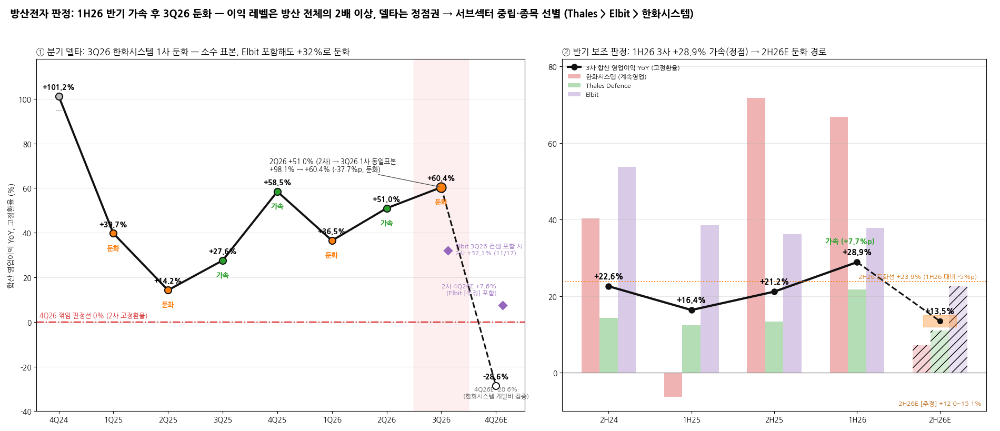

# 방산 · 방산전자 섹터 리뷰

> 현재 상태 (최신 분기 기준)
> 최신 분기: 2026-Q3
> 섹터 델타: 유지 | 내러티브: 유지
> 모멘텀 신호: 없음
> 활성 테마: 없음
> 포지셔닝: 서브섹터 중립 | 한국 언더퍼폼 | 선호 Thales
> 편입 종목: 한화시스템, Thales, Elbit Systems (3Q26 합산 1사 — Thales·Elbit 제외, 소수 표본)
> 갱신 시각: 2026-11-15 11:50 KST

## 누적 시계열

| 분기 | 편입 종목 | 합산 매출 | 합산 영업이익 | OPM | 매출 YoY | 영업이익 YoY | 영업이익 YoY 델타 (%p) | 섹터 델타 | 내러티브 | 모멘텀 신호 | 활성 테마 |
|---|---|---|---|---|---|---|---|---|---|---|---|
| 4Q24 | 2사 (한화시스템·Elbit) — Thales 분기 이익 미공시 | 36,271억원 ($2.60B) | 2,264억원 ($162M) | 6.2 | +24.0 / +18.9 | +110.9 / +101.2 | — | —† | - | - | - |
| 1Q25 | 2사 (동일) | 33,216억원 ($2.29B) | 2,770억원 ($191M) | 8.3 | +27.4 / +18.8 | +49.3 / +39.7 | -61.5 | 둔화 | - | - | - |
| 2Q25 | 2사 (동일) | 33,755억원 ($2.42B) | 2,824억원 ($202M) | 8.4 | +15.8 / +14.1 | +15.7 / +14.2 | -25.5 | 둔화† | - | - | - |
| 3Q25 | 2사 (동일) | 33,022억원 ($2.38B) | 2,993억원 ($216M) | 9.1 | +11.4 / +9.4 | +29.8 / +27.6 | +13.3 | 가속 | - | - | - |
| 4Q25 | 2사 (동일) | 43,768억원 ($3.02B) | 3,705억원 ($256M) | 8.5 | +20.7 / +17.4 | +63.6 / +58.5 | +30.9 | 가속‡ | - | - | - |
| 1Q26 | 2사 (동일) | 38,470억원 ($2.63B) | 3,807억원 ($260M) | 9.9 | +15.8 / +14.9 | +37.5 / +36.5 | -22.0 | 둔화 | - | - | - |
| 2Q26 | 2사 (동일) | 43,200억원 ($2.88B) | 4,510억원 ($300M) | 10.4 | +28.0 / +20.7 | +59.7 / +51.0 | +14.5 | 가속 | - | - | - |
| **3Q26** | **1사 (한화시스템) — Thales 분기 이익 미공시, Elbit 3Q26 11/17 발표** | **8,316억원 ($0.59B)** | **991억원 ($70M)** | **11.9** | **+30.1 / +30.1** | **+60.4 / +60.4** | **-37.7** | **유지 (분기 1사 둔화 × 반기 3사 가속)** | **유지** | **없음** | **없음** |

→ **표기**: YoY 칸은 `원화 환산 / 고정환율`, 판정은 방산 전체 리뷰와 같은 **고정환율 기준**(전년 분기 값을 당해 분기 평균 환율로 환산). 3Q26은 원화 단일 종목이라 두 값이 같다 [계산]
→ **델타 칸 = 같은 표본 직전 분기 대비**: 3Q26은 1사 표본이라 2Q26도 한화시스템 단독 YoY(+98.1%)로 다시 계산해 뺐다 → +98.1% → +60.4% = -37.7%p [계산]
→ **합산 기준**: 한화시스템 = 필리조선소 제외 계속영업(회사 3Q26 IR p.9 별첨 분기표 재작성치 — 방산 전체 리뷰와 동일), Elbit = 전사 GAAP 영업이익(전사 = 방산, ESLT 리뷰 1-②), Thales = Defence 부문 Adj. EBIT이지만 **반기만 공시해 분기 합산·판정에서 항상 제외**(전년 동기도 제외 — 동일 표본). Thales는 아래 ① (2) 반기 보조 판정과 ⑦ 국가 렌즈에만 넣었다
→ **3Q26 판정 "유지"의 이유**: 분기 합산(한화시스템 1사)은 -37.7%p로 기준상 "둔화"이지만, 반기 3사 합산(1H26)은 +21.2% → +28.9%(+7.7%p)로 "가속"이다. 스킬 기준 "엇갈림 = 유지"를 적용했다. 분기 판정만 보면 둔화다 [판단]
→ **†** 4Q24는 소급 첫 행이라 판정 없음. 2Q25는 2개 분기 연속 축소지만 다음 분기(3Q25) 재가속해 정점 통과로 보지 않고 "둔화"로 두었다(방산 전체 리뷰와 같은 처리)
→ **‡** 4Q25 +58.5%는 한화시스템 4Q24 영업이익 291억(OPM 3.1%, 개발비 집중 — 한화시스템 리뷰 1-①)의 저기저 효과가 크다. 판정은 규칙대로 산정
→ 소급 행의 내러티브·모멘텀 신호·테마 열은 당시 섹터 리뷰가 없어 `-`
→ 환율: 방산 전체 리뷰 환율표(Yahoo Finance 일간 종가 분기 평균, 2026-11-14 조회)를 그대로 썼다. USD/KRW 4Q24 1,395.5 / 1Q25 1,449.5 / 2Q25 1,397.1 / 3Q25 1,385.8 / 4Q25 1,447.7 / 1Q26 1,462.9 / 2Q26 1,500.9 / 3Q26 1,417.0 / 4Q26 QTD 1,338.1, EUR/KRW 1H25 1,554.2 / 2H25 1,651.0 / 1H26 1,727.9 / 2H26(3Q26 + 4Q26 QTD) 1,562.4 (반기 = 두 분기 평균 [계산])

---

## 2026-Q3 섹터 리뷰 — 방산전자 (한화시스템·Thales·Elbit)

> 대상: `earnings-review/2026-Q3_한화시스템_리뷰.md`(2026-11-14), `2026-Q2_HO_리뷰.md`(Thales 1H26 반기 리뷰 + 3Q26 수주·매출 업데이트 덧붙임), `2026-Q2_ESLT_리뷰.md`(Elbit 2Q26 — 3Q26 11/17 미발표)
> 편입 범위: 워치리스트 `방산전자` 서브섹터 — 핵심 한화시스템·Thales, 확장 Elbit Systems. 국가 = 한국 1 / 유럽 1 / 기타(이스라엘) 1. 트래킹 피어 없음. 참고(합산·판정 제외): Leonardo Defence Electronics 부문(`2026-Q3_LDO_리뷰.md` 1-②)
> 상위 리뷰: `sector-review/방산_섹터리뷰.md`(15사, 2026-11-14) — 합산 기준·환율·동일 표본 규칙을 그대로 재사용했다
> **소수 표본 경고**: 3Q26 분기 합산 표본은 한화시스템 1사뿐이다(Thales는 분기 이익을 공시하지 않고, Elbit은 11/17 발표). 분기 판정은 사실상 한화시스템 단독 판정이고, **서브섹터 판정의 실질 근거는 ① (2) 반기 3사 보조 판정**이다

① 섹터 합산 숫자와 델타

(1) 분기 합산 (4Q24~2Q26 = 한화시스템·Elbit 2사, 3Q26·4Q26E = 한화시스템 1사)

| 항목 | 4Q24 | 1Q25 | 2Q25 | 3Q25 | 4Q25 | 1Q26 | 2Q26 | **3Q26** | 4Q26E |
|---|---|---|---|---|---|---|---|---|---|
| 합산 편입 (사) | 2 | 2 | 2 | 2 | 2 | 2 | 2 | **1** | 1 |
| 합산 매출 (억원) | 36,271 | 33,216 | 33,755 | 33,022 | 43,768 | 38,470 | 43,200 | **8,316** | 13,403 |
| (달러 환산, $B) | 2.60 | 2.29 | 2.42 | 2.38 | 3.02 | 2.63 | 2.88 | **0.59** | 1.00 |
| 합산 영업이익 (억원) | 2,264 | 2,770 | 2,824 | 2,993 | 3,705 | 3,807 | 4,510 | **991** | 655 |
| (달러 환산, $M) | 162 | 191 | 202 | 216 | 256 | 260 | 300 | **70** | 49 |
| OPM (%) | 6.2 | 8.3 | 8.4 | 9.1 | 8.5 | 9.9 | 10.4 | **11.9** | 4.9 |
| 매출 YoY — 고정환율 (%) | +18.9 | +18.8 | +14.1 | +9.4 | +17.4 | +14.9 | +20.7 | **+30.1** | +5.8 |
| 영업이익 YoY — 원화 환산 (%) | +110.9 | +49.3 | +15.7 | +29.8 | +63.6 | +37.5 | +59.7 | **+60.4** | -28.6 |
| **영업이익 YoY — 고정환율 (%)** | +101.2 | +39.7 | +14.2 | +27.6 | +58.5‡ | +36.5 | +51.0 | **+60.4** | -28.6 |
| 직전 분기 YoY (같은 표본, 고정환율) | — | +101.2 | +39.7 | +14.2 | +27.6 | +58.5 | +36.5 | **+98.1** | +60.4 |
| **영업이익 YoY 델타 (%p)** | — | -61.5 | -25.5 | +13.3 | +30.9 | -22.0 | +14.5 | **-37.7** | -89.0 |
| 판정 (분기 기계 판정) | — | 둔화 | 둔화 | 가속 | 가속 | 둔화 | 가속 | **둔화** | (경로상 마이너스) |
| ㄴ 한화시스템 방산 부문 영업이익 (억원) | 278 | 503 | 525 | 498 | 765 | 690 | 1,037 | **760** | 757 (다올 단독) |
| ㄴ 방산 부문 영업이익 YoY (%) | +19.8 | +47.9 | -13.8 | +7.6 | +175.2 | +37.2 | +97.5 | **+52.6** | -1.0 |
| ㄴ 방산 부문 OPM (%) | 3.7 | 11.7 | 11.2 | 10.3 | 7.2 | 14.6 | 14.8 | **12.3** | 8.6 |

→ (출처: 한화시스템 = 리뷰 1-① 계속영업 분기표(회사 3Q26 IR p.9), 4Q26E = 증권사 7곳 평균. 방산 부문 = 리뷰 1-②(3Q25~3Q26)와 `company-overview/한화시스템_기업개요.md` v1.1 IR 별첨 분기표(1Q23~2Q25), 4Q26E = 다올 매출 8,805억 × 방산 OPM 8.6%(리뷰 (2-1)) [계산]. Elbit = ESLT 리뷰 1-① GAAP. 원화 환산·합산 [계산])
→ **3Q26 합산: Thales·Elbit 제외** — Thales는 1·3분기에 매출·수주만 발표(HO 리뷰 3Q 업데이트), Elbit은 3Q26을 2026-11-17에 발표(ESLT 리뷰 헤더). 4Q26E도 한화시스템 1사(Elbit 4Q26E 영업이익은 리뷰에서 OPM 가정 [추정]이라 방산 전체 리뷰와 같게 제외)
→ **이익 지표 정의**: 한화시스템 = K-IFRS 영업이익(계속영업), Elbit = US GAAP 영업이익(Non-GAAP 아님), Thales = Adjusted EBIT(PPA 상각 등 제외, 회사 주 지표). 레벨(OPM) 비교는 참고용
→ **한화시스템 방산 부문 행을 따로 둔 이유**: 3Q26 계속영업 영업이익 991억 중 방산 760억(77%), ICT 240억. 방산 부문 YoY는 +97.5% → +52.6%(-44.9%p)로 계속영업(-37.7%p)보다 더 꺾였고, ICT는 +92.6% → +100.0%로 가속했다(한화시스템 리뷰 1-②). **방산전자 본업 기준으로는 둔화가 더 뚜렷하다**
→ **Elbit 3Q26 시나리오 (11/17 발표 시 2사 합산)**: 리뷰 [추정] 컨센 GAAP 영업이익 $214M(YoY +24.9%)이면 2사 3Q26 고정환율 YoY **+32.1%** → 2Q26 2사 +51.0% 대비 -18.9%p **둔화**. Elbit 30%대 유지($223M, +30.1%)여도 +36.2%로 둔화, $190M(+10.9%)이면 +20.9% [계산, 3Q26 USD/KRW 1,417.0]. **어느 경우든 2사 분기 판정은 둔화**다
→ **컨센 경로상 분기 YoY 정점은 2Q26**: 한화시스템 2Q26 +98.1%(4Q26E -28.6%는 자체 투자개발비 집중 — 회사 예고), Elbit 2Q26 +38.7%(컨센 3Q26E 약 +25%, 4Q26E 약 +21% — 리뷰 [추정]). 2사 4Q26E는 Elbit [추정] 포함 시 +7.6% [계산]

(2) **반기 보조 판정 — 3사 합산 (서브섹터 판정의 실질 근거)**

| 항목 | 2H24 | 1H25 | 2H25 | **1H26** | 2H26E [추정] |
|---|---|---|---|---|---|
| 3사 합산 매출 (억원, $B) | — | 153,918 ($10.81B) | 186,558 ($13.17B) | **190,784 ($12.87B)** | — |
| 3사 합산 영업이익 (억원, $B) | — | 16,755 ($1.18B) | 21,534 ($1.52B) | **23,434 ($1.58B)** | — |
| OPM (%) | — | 10.9 | 11.5 | **12.3** | — |
| 매출 YoY 원화 환산 / 고정환율 (%) | — | +21.1 / +14.6 | +20.0 / +11.7 | **+24.0 / +15.0** | — |
| 영업이익 YoY 원화 환산 (%) | — | +23.3 | +31.7 | **+39.9** | — |
| **영업이익 YoY 고정환율 (%)** | +22.6 | +16.4 | +21.2 | **+28.9** | +12.0 ~ +15.1 |
| **델타 (%p)** | — | -6.2 | +4.8 | **+7.7** | -13.8 ~ -16.9 |
| **반기 판정** | — | 둔화 | 유지 | **가속** | (둔화 경로) |
| 한화시스템 계속영업 영업이익 YoY (%) | +40.3 | -6.2 | +71.8 | **+66.8** | +7.2 |
| ㄴ 방산 부문 영업이익 YoY (%) | +30.0 | +8.3 | +70.4 | **+68.0** | — |
| Thales Defence Adj. EBIT YoY (%) | +14.3 | +12.4 | +13.4 | **+21.8** | +8.8 ~ +13.3 |
| Elbit 영업이익 YoY (GAAP, %) | +53.8 | +38.6 | +36.2 | **+37.9** | +22.6 |
| 1H26 영업이익 비중 (원화 환산, %) | | | | 한화시스템 8.7 / **Thales 64.5** / Elbit 26.8 | |

→ (출처: 한화시스템 = 리뷰 1-① 분기 합산(반기 = 2개 분기 합) [계산], 방산 부문 = 기업개요 v1.1 IR 분기표 합산 [계산] / Thales Defence = HO 리뷰 1-② 반기 표(1H23·2H23은 회사 재작성 2023 기준 576·694 — HO 리뷰 각주), 1H26 YoY는 리뷰 공시값 +21.8%(€m 반올림 재계산 시 +21.9%) / Elbit = ESLT 리뷰 1-① 분기 합산 [계산]. 3사 합산은 반기 평균 환율(두 분기 평균)로 원화 환산 [계산]. 2H24 원화 환산 YoY는 3Q23 환율이 환율표에 없어 고정환율만)
→ **판정 = 가속 (1H26)**: 3사 고정환율 영업이익 YoY +21.2%(2H25) → +28.9%(1H26), +7.7%p로 ±5%p 밖 확대. 증가액(1H26 환율 고정)은 2H25 +3,762억원 → 1H26 +5,252억원 — Thales +2,713억원, Elbit +1,725억원, 한화시스템 +814억원 [계산]
→ **반기 합산은 Thales가 결정한다**: 1H26 영업이익의 64.5%가 Thales Defence다. 3사 가속은 사실상 **Thales Defence EBIT YoY +13.4% → +21.8%(+8.4%p)**의 가속이고, Elbit은 +36.2% → +37.9%로 유지, 한화시스템은 +71.8% → +66.8%(-5.0%p)로 유지 경계다
→ **2H26E [추정] = 둔화 경로**: 한화시스템 = 3Q26 실적 991억 + 4Q26E 655억(7곳 평균) = 1,646억(+7.2%) / Elbit = 3Q26E $214M + 4Q26E $232M(리뷰 [추정]) = $446M(+22.6%) / **Thales Defence = 리뷰에 2H26 Defence 이익 추정이 없어 [추정]**: 3Q26 Defence 매출 €3,043m + 4Q26E €4.2~4.5bn(HO 리뷰 가이던스 역산 [추정]) × 마진 13.5%(HO 리뷰가 제시한 "방산 가속 지속 조건") = €978~1,018m(+8.8~+13.3%). 3사 합산 +12.0~+15.1%(중앙 +13.5%) [계산]. Thales 2H 마진이 14%여도 +16.3% — **1H26이 반기 기준 정점**일 가능성이 높다 [판단]
→ **방산 전체 대비 서브섹터 YoY 차이**: 3Q26 서브섹터(1사) +60.4% vs 방산 전체 12사 +11.6% → **+48.8%p**(1사라 대표성 약함). 2Q26 기준(2사 +51.0% vs 13사 +18.3%) +32.7%p [계산 — 방산 전체 리뷰 ①(1)]

→ (출처: 각 종목 리뷰·한화시스템 기업개요 [계산]. 검은 굵은 선 = 서브섹터 합산 영업이익 YoY(고정환율 — 4Q24~2Q26 2사, 3Q26·4Q26E 한화시스템 1사), 회색 = 합산 매출 YoY, 빨강 실선 = 한화시스템 계속영업, 빨강 점선 = 한화시스템 방산 부문, 보라 = Elbit(3Q26E·4Q26E 리뷰 [추정] 점선), 초록 별 = Thales Defence 반기 EBIT YoY(2H24·1H25·2H25·1H26을 각 반기 끝 분기에 표시). ±축 밖 값은 끝에 고정)

② 종목별 델타 판정표

| 종목 | 국가 | 매출 YoY | 영업이익 YoY | 영업이익 YoY 델타 | 델타 판정 | 내러티브 | 서브섹터 내 델타 순위 | 한 줄 |
|---|---|---|---|---|---|---|---|---|
| Thales (Defence) (2026-Q2 리뷰, 3Q 업데이트 덧붙임) | 유럽 | H1 +12.9 / Q3 +14.1 (유기적 +12.8) | H1 EBIT +21.8 (분기 미공시) | +8.4%p (반기) | **방산 가속** (그룹 유지) | 강화 | **1위** | Defence 마진 13.8% 반기 최고, 9M 중동 수주 +210%. 그룹은 Cyber & Digital -27%가 희석 |
| Elbit Systems (2Q26) | 기타 (이스라엘) | +15.9 | +38.7 | +1.6%p | 유지 | 유지 | **2위** | 영업이익 YoY 35~39% 6개 분기 고원, 잔고 $32.0B(+34%). 컨센은 3Q26 약 +25%로 둔화 [추정] |
| 한화시스템 (필리 제외) | 한국 | +30.1 | +60.4 | -37.7%p | 둔화 | 유지 | **3위** | 중동 MFR·ICT로 레벨은 최고, 4Q26E -29%(개발비). 방산 잔고 3분기 연속 감소, UAE 본계약 대기 |
| ㄴ 한화시스템 방산 부문 | 한국 | +28.3 | +52.6 | -44.9%p [계산] | (참고 — 리뷰 판정은 계속영업 기준) | — | — | 방산 OPM 14.8% → 12.3%, 수출 비중 22% |

→ (출처: 각 종목 리뷰 0번 판정·1번 표. Thales는 반기 공시 종목이라 0번 판정이 반기 기준 — 그룹 "유지", 방산(Defence) "가속". 섹터 합산 기준이 Defence라 방산 판정을 썼다)
→ **순위 기준 = 델타 방향(리뷰 0번 판정) 1순위, 내러티브 2순위, 이익 레벨 3순위**(BT 프레임). 레벨로만 보면 한화시스템(+60%) > Elbit(+39%) > Thales(+22%)로 순서가 정반대다 — **이 서브섹터는 "레벨이 높은 쪽이 델타가 꺾이는" 구간**이다 [판단]
→ **누가 끄나**: 반기 합산 가속은 Thales Defence(이익 비중 64.5%)가 끌었다. Elbit은 고원 유지, 한화시스템은 분기로는 2Q26 +98%가 정점이었다
→ **선행 종목**: 먼저 꺾이는 쪽 = 한화시스템(2Q26 정점 → 3Q26 둔화 → 4Q26E 마이너스 예고) / 뒤따를 쪽 = Elbit(컨센 3Q26부터 20%대 둔화) / 마지막 = Thales(1H26 가속, 2H26 확인은 2027-03) [판단]

③ 섹터 공통 쟁점

(1) 중동 방공 수요 — 3사 모두, 그러나 숫자로 들어오는 시점이 다르다
→ 한화시스템: UAE·사우디·이라크 3개국 M-SAM MFR 매출 본격화는 **2027년부터**(회사, 신한·다올 Q&A). 3Q26 수출 비중 22%로 오히려 낮아졌다(리뷰 (2-1)). UAE 통합대공망은 2026-09-15 EDGE 그룹과 Term Sheet 체결 — **본계약은 11월 UAE 대통령 방한 전후 협상 중**이고 잔고에 미반영(리뷰 쟁점 (4))
→ Thales: 9M 중동 수주 €1,909m(+210% 유기적)·매출 €1,288m(+48.9%) — **이미 수주·매출로 들어왔다**. 1H26 Defence 마진 13.8%도 "중동 고객의 단·중기 소요 대응" 생산 증설 효과(회사). CEO는 SAMP/T NG가 Patriot보다 납기가 빠르다(2028 vs 2032)며 수출 논의 중(HO 리뷰 3Q 업데이트·쟁점 (1))
→ Elbit: 2Q26 이스라엘 매출 비중 37.4%, 증분 매출의 59%가 이란 분쟁 후 재고 보충(ESLT 리뷰 (2-1)·쟁점 (3)). 수요 성격이 "자국 전쟁 소요"라 중동 수출 시장과는 결이 다르다
→ 셀사이드 해석 차이: 한화시스템은 "UAE 본계약이 언제 오나"(7/7곳이 주가 촉매로 지목, 신한만 2028 매출 반영), Thales는 "Defence 마진 13%+가 구조적인가"(Jefferies), Elbit은 "이스라엘 수요가 꺼질 때 유럽 잔고가 제때 매출이 되나"(Jefferies 질문)
→ `[판단]` 같은 중동 방공 수요인데 **Thales는 2026년 숫자에 이미 반영됐고, 한화시스템은 2027년 매출·UAE 계약으로 미뤄져 있다**. 또 HO 리뷰가 지적했듯 SAMP/T NG 수출이 붙으면 중동·유럽 장거리 방공에서 천궁-II(한화시스템 MFR 탑재)의 경쟁 상대가 하나 늘어난다

(2) 수주잔고 → 매출 전환 — 방향이 갈린다
→ Elbit: 잔고 $32.0B(+34%), 잔고/TTM 매출 3.2배 → 3.7배, "향후 약 1.5년 내 수행" 비중 46% → 42% — 전환이 수주를 못 따라간다. CapEx $220M → $300M(ESLT 리뷰 쟁점 (1))
→ Thales: Defence 잔고 €41.1bn(Defence 매출 3.2년치), 9M Defence 수주 €11,315m(+14%), Book-to-bill 1.21. 3Q Defence 수주는 -5%(3Q25 +51% 고기저)(HO 리뷰)
→ 한화시스템: 방산 잔고 9.30조원(4Q25) → 8.40조원(3Q26, -9.7% YTD, 3분기 연속 감소), 잔고/최근 4분기 방산 매출 3.7배 → 2.9배(리뷰 (2-2))
→ `[판단]` 글로벌 2사는 "잔고는 넘치고 생산이 병목", 한국은 "생산은 되는데 신규 수주가 공백". 방산 전체 리뷰 ③(1)의 "글로벌은 수주가 이익보다 앞서 달리고, 한국은 이익이 수주 공백을 먼저 맞았다"가 방산전자에서도 같다

(3) 마진 레벨업의 지속성 — 3사 모두 1H26에 마진 최고치, 2H26이 시험대
→ Thales Defence 1H 마진 12.3%(1H23) → 12.9 → 12.8 → 13.8%(1H26). 2H26 13.5% 미만이면 믹스 효과, 14% 이상이면 구조적 레벨업(HO 리뷰 (1-3))
→ Elbit GAAP OPM 9.6%(Non-GAAP 10.4%) 사상 최고 — ESA "일회성 유리한 믹스"·R&D 장려법 효과가 섞였다. 컨센 3Q26E EPS가 2Q 실적보다 낮다(ESLT 리뷰 쟁점 (2))
→ 한화시스템 방산 OPM 14.6%(1Q26) → 14.8%(2Q26) → 12.3%(3Q26) → 4Q26E 한 자릿수(4Q 개발비 370~620억, 리뷰 쟁점 (2)). 수출 비중 22%로도 OPM 12%대 — 수출 OPM 30% 추정(DS)
→ `[판단]` 2H26 둔화 경로(① (2) +12~15%)는 매출 둔화보다 **마진 정상화(일회성 믹스 소멸·개발비)** 쪽에서 나온다. 3사 공통으로 "1H26 마진 = 정점권"이 이번 서브섹터의 핵심 리스크다

(4) 이익 추정은 유지·상향인데 TP는 하향 — 멀티플 디레이팅 (방산 전체 리뷰 ③(5)와 같은 흐름)
→ 한화시스템: 2027E 영업이익 7곳 평균 +10.8%(대부분 필리 제외 효과), 평균 TP 101,667원 → 93,833원(-7.7%) — 조선 지분·필리 가치 제거(다올 -38%)·차입금 반영(대신)(리뷰 ⑤)
→ Thales: Oddo TP €288 → €287, DZ €298 → €286, 등급 유지. 1H 랠리(+16%)를 4개월 만에 반납(HO 리뷰 ④⑤)
→ Elbit: JPMorgan TP $950 → $885(Neutral), EPS 30일 상향 1·하향 0, 2026E P/E 약 43배(ESLT 리뷰 쟁점 (4))
→ `[판단]` 3사 모두 TP 하향의 원인은 이익이 아니라 배수다. BT 프레임상 배수 하락은 2순위 — 델타 순위를 바꾸지 않는다

(5) 유럽 재무장 노출 — Thales·Elbit은 유럽 신규 수주를 받고, 한화시스템은 유럽 노출이 줄었다
→ Thales: 루마니아 GM200 MM/A 레이더 12기(EU SAFE), 9M 기타 유럽 수주 +46%(1H), 독일군 옵트로닉스(HO 리뷰)
→ Elbit: 유럽 $1.4B 현대화·그리스 PULS 약 $750M·9월 약 $235M·11월 약 $260M NATO 국가. 다만 2Q 유럽 매출은 -0.1%(ESLT 리뷰)
→ 한화시스템: 3Q 방산 QoQ 감익 원인 중 하나가 폴란드 K2 사격통제시스템 매출 감소(SK, 리뷰 1-②)
→ `[판단]` 방산 전체 리뷰 ③(2)의 SAFE 블록화가 방산전자에서도 보인다 — 유럽 레이더·전자전 신규 물량은 역내(Thales)와 기존 공급망(Elbit)으로 간다

(6) 종목 고유 이슈
→ 한화시스템: 필리조선소 60% 매각(3,251억원)·한화오션 PRS 회수 3.4조원 vs 위성 20조원·AI DC 3조원 투자(2040년까지) — 2027-02 투자 계획이 밸류에이션 분기점(리뷰 쟁점 (5))
→ Thales: Cyber & Digital EBIT -26.9%가 그룹 델타를 깎음, F126 종료 특별손실 약 €450m(Adj. EBIT 제외), IRIS² 추가 약 €2bn 기대(HO 리뷰)
→ Elbit: Pillar II로 실효세율 5.6% → 16.4%(EPS 전환율 하락), 레이저(Iron Beam) 해외 관심, 일부 국가 이스라엘산 무기 거래 제한 리스크(ESLT 리뷰)

④ 섹터 판정

(1) 판정 한 줄

> 섹터 델타: **유지** | 내러티브: **유지** → **1H26 반기 3사 합산 이익 YoY +28.9%로 가속(Thales Defence 주도)했지만 3Q26 분기(한화시스템 1사·소수 표본)는 +98.1% → +60.4% 둔화, 2H26 추정 경로 +12~15%로 둔화 예고 — 이익 레벨은 방산 전체의 2배 이상, 델타는 정점권. 서브섹터 중립, 종목 선별(Thales > Elbit > 한화시스템). 4Q26 2사 고정환율 YoY 0% 미만이면 꺾임**

(2) 키 차트

→ (출처: 각 종목 리뷰·한화시스템 기업개요 [계산]. 왼쪽 = 분기 합산 영업이익 YoY(고정환율, 검은 선 — 점 색 = 분기별 판정: 초록 가속·주황 둔화, 3Q26 강조·분홍 음영 = 한화시스템 1사 표본), 보라 다이아몬드 = Elbit 포함 2사 시나리오(3Q26 컨센 [추정] +32.1%, 4Q26E [추정] +7.6%), 빨간 일점쇄선 = 4Q26 꺾임 판정선 0% / 오른쪽 = 반기 3사 합산 영업이익 YoY(검은 선, 2H26E 점선·주황 범위 [추정] +12.0~15.1%), 막대 = 종목별 반기 영업이익 YoY(빨강 한화시스템·초록 Thales Defence·보라 Elbit, 빗금 = 2H26E), 주황 점선 = 2H26 둔화선 +23.9%)

(3) 근거
→ **델타 = 유지 (엇갈림)**: 분기 합산은 한화시스템 1사라 +98.1% → +60.4%(-37.7%p) "둔화"이고, Elbit이 11/17 컨센대로 나와도 2사 +51.0% → +32.1%(-18.9%p)로 둔화다. 반면 반기 3사 합산은 +21.2% → +28.9%(+7.7%p) "가속". 두 판정이 엇갈려 기준상 "유지"로 둔다. 다만 **방향은 둔화 쪽**이다 — 2H26E [추정] +12~15%면 반기도 "둔화"로 바뀌고, 4Q26E 한화시스템 -28.6%·Elbit 컨센 +21%로 분기 경로도 내려간다 [계산·판단]
→ **내러티브 = 유지**: 3사 분포 강화 1(Thales)·유지 2(한화시스템·Elbit). 공통 스토리("중동 방공·유럽 재무장 → 레이더·전자전 수요 → 마진 레벨업")는 Thales 숫자로 강화됐지만, 한화시스템은 수주 공백(잔고 3분기 연속 감소)·UAE 미확정, Elbit은 주가·멀티플 약화로 상쇄 [판단]
→ **직전 판정 대비**: 첫 서브섹터 리뷰라 직전 섹터 판정 없음. 소급 분기 판정은 2Q26 가속 → 3Q26 분기 둔화(1사), 반기는 2H25 유지 → 1H26 가속. 궤적상 **2Q26(분기)·1H26(반기)이 이번 사이클의 델타 정점**으로 그려진다 [판단]
→ **방산 전체 대비**: 3Q26 서브섹터 +60.4%(1사) vs 방산 12사 +11.6% → +48.8%p, 2Q26 2사 +51.0% vs 13사 +18.3% → +32.7%p. 레벨 격차는 크지만 델타는 방산 전체(둔화)와 같은 방향이다

⑤ 모멘텀 신호 (후보 — 판단은 BT)

→ **없음**. 조건 대조: ① 섹터 영업이익 YoY 델타 뚜렷한 확대 — 반기 +7.7%p 충족(1회), 분기 -37.7%p 미충족 ② 편입 종목 과반 가속 — 1/3(Thales) 미충족 ③ 내러티브 형성·강화 — 유지, 미충족 → 후보로 올리지 않음
→ 활성 테마가 없어 "테마 종료 후보"는 해당 없음
→ **다음에 "델타 급증 후보"로 올릴 조건**: 2H26 3사 합산 YoY +23.9% 이상(= Thales 2H Defence 마진 14%+ & EBIT YoY 20%대 유지) + 한화시스템 1Q27 영업이익 YoY +20% 이상·수출 비중 30% 이상 + UAE 통합대공망 본계약 체결. 연결될 만한 테마 키워드 제안: **"중동·유럽 방공 센서(MFR·GM200·SAMP/T NG 레이더)"** — 제안일 뿐, 판단은 BT
→ 반대 논거: (a) 3사 잔고는 Thales·Elbit 사상 최대, 중동 MFR 3개국은 계약 완료 물량이라 2027년 매출 성장은 이미 그려져 있다(한화시스템 7곳 2027E 영업이익 +35%) — 2H26 둔화는 마진 정상화 성격일 수 있다 (b) 한화시스템 4Q26E -29%는 예고된 개발비 이벤트로 리뷰가 "꺾임"으로 보지 않는다 (c) Thales는 분기 이익이 없어 2H26 실제 숫자가 나오기 전(2027-03)까지 추정 경로의 오차가 크다

⑥ 다음 분기 섹터 관전 포인트

| 순위 | 무엇을 (변수·임계값) | 어떤 데이터로 | 언제 |
|---|---|---|---|
| 1 | **4Q26 서브섹터 판정선: 2사(한화시스템+Elbit) 고정환율 영업이익 YoY 0% — 미만이면 꺾임** (4Q26 환율 기준 4Q25 레벨 3,494억원). 추정 경로 +7.6%(한화시스템 컨센 655억 + Elbit [추정] $232M). 반기 보조: 2H26 3사 합산 YoY **+23.9% 미만이면 둔화**(추정 +12.0~15.1%), 0% 미만이면 꺾임 | 한화시스템 4Q26 잠정실적, Elbit 4Q26 보도자료, Thales FY2026(2H = 연간 − 1H) | 2027-02 초 / 2027-03 |
| 2 | Elbit 3Q26 GAAP 영업이익 $214M(+24.9%, 리뷰 [추정] 컨센) 대비 — 30%대($223M+) 유지면 2사 3Q26 +36.2%, $190M 이하면 +20.9%. 이스라엘 비중 33% 이하에서 매출 +15% 유지 여부 | Elbit 3Q26 보도자료·컨콜 | **2026-11-17** |
| 3 | UAE 통합대공망 본계약 — 한화시스템 몫(체계종합·MFR·C2)과 금액, EDGE JV | DART 단일판매·공급계약 공시, UAE 대통령 방한 결과 | 2026-11 방한 전후 ~ 연내 |
| 4 | Thales 2H26 Defence 마진 — 14% 이상이면 구조적 레벨업(서브섹터 가속 연장), 13.5% 미만이면 1H26 믹스 효과(둔화 확정). 2028 마진 목표(13~14%) 재검토 | Thales FY2026 보도자료, 중기 목표 | 2027-03 초 |
| 5 | 한화시스템 1Q27 영업이익 YoY +20% 이상·수출 비중 30% 이상 — 미만이면 리뷰 판정이 "꺾임"으로 바뀜 | 1Q27 IR·컨콜, 관세청 레이다 수출 | 2027-04 하순 |

→ 판정선 근거: 1순위 0%는 스킬 기준상 "마이너스 전환 = 꺾임" 경계. 2H26 +23.9%는 1H26 +28.9% − 5%p(유지 하단) [계산]. 2사 4Q26E·2H26E 경로는 ① (1)(2)의 [추정] 합산

⑦ 글로벌 PM 포지셔닝 — 결론

> **서브섹터: 비중 유지 (방산 내) — 2H26 3사 합산 YoY +23.9% 이상 + UAE 본계약이면 확대, 4Q26 2사 YoY 0% 미만 또는 2H26 3사 +10% 미만이면 축소** | **한국: 언더퍼폼 (한화시스템 — 델타 둔화·수주 공백, UAE 본계약 시 중립 검토)** | **선호: Thales (Defence 반기 EBIT YoY +13.4% → +21.8% 가속, 마진 13.8% 최고, 내러티브 강화)**

→ 직전 콜 체크: 첫 서브섹터 리뷰. 상위 방산 전체 리뷰(2026-11-14)는 섹터 중립·한국 언더퍼폼·한화시스템 "중립"(한국 5사 내 2위) — 이번 서브섹터 결론과 같은 방향

(1) 서브섹터 비중 (방산 내) — 확대 / 중립 / 축소

| 판단 축 | 이번 분기 근거 (수치) | 방향 |
|---|---|---|
| 이익 델타 (1순위) | 분기(1사) +98.1% → +60.4% 둔화 / 반기(3사) +21.2% → +28.9% 가속 — 엇갈림 | 중립 |
| YoY 정점 시점 | 분기 정점 2Q26(한화시스템 +98%, Elbit +38.7% — 컨센상 3Q부터 20%대), 반기 정점 1H26(2H26E [추정] +12~15%) | 축소 쪽 |
| 방산 전체 대비 레벨 | 3Q26 +60.4%(1사) vs 방산 12사 +11.6%(+48.8%p), 반기 3사 +28.9% vs 방산 2Q26 +18.3% | 확대 |
| 수주·잔고 선행지표 | Elbit 잔고 $32.0B(+34%), Thales 9M Defence 수주 +14%·B/B 1.21·Defence 잔고 €41.1bn / 한화시스템 방산 잔고 -9.7% YTD | 확대 (2/3) |
| 최종 수요 지표 | Thales 9M 중동 수주 +210%·매출 +49%, 이스라엘 재고 보충(Elbit 매출 비중 37%), 유럽 SAFE 레이더(GM200), 중동 MFR 3개국 2027 양산 | 확대 |
| 마진 | 3사 모두 1H26 마진 최고(Thales Defence 13.8%, Elbit GAAP 9.6%, 한화시스템 방산 1H 14.7%) — 2H26 정상화 리스크 | 중립 |
| 이벤트·정책 | 11/17 Elbit 3Q26, 11월 UAE 방한(통합대공망 본계약), 2027-03 Thales FY·중기 목표 | 중립 (이벤트 전) |
| 밸류에이션·멀티플 (2순위) | 3사 모두 이익 추정 유지·상향 속 TP 하향(멀티플). Elbit 2026E P/E 약 43배, 한화시스템 셀사이드 목표 배수 2028E EPS × 30~41배(다올·SK·한화) | 중립 |
| 주가 낙폭 | 한화시스템 52주 고점 대비 약 -61%, Elbit 3/17 고점 대비 -30%, Thales 1H 랠리(+16%) 전부 반납(€227) | 중립 |

→ 결론: **비중 유지(중립)**. 이익 레벨과 수요·잔고는 방산 전체보다 확실히 좋지만(레벨 +33~49%p), BT 프레임의 1순위인 델타가 분기·반기 모두 정점권이다 — 1H26 가속은 Thales 1사(이익 비중 64.5%)가 만든 것이고, 2H26 추정 경로는 3사 모두 내려간다 [판단]
→ 델타와 정점 시점이 엇갈리는 판단: 반기 가속 확인 분기(1H26) = 반기 정점 분기다. 서브섹터 베타를 늘리기보다 **서브섹터 안에서 델타가 마지막까지 남는 종목(Thales)으로 비중 이동**이 맞다 [판단]
→ **확대 전환 조건**: ① 2H26 3사 합산 고정환율 영업이익 YoY +23.9% 이상(Thales FY2026, 2027-03 초 — 사실상 Thales 2H Defence 마진 14%+ & EBIT YoY 20%대 필요) ② UAE 통합대공망 본계약(한화시스템 수주 공백 해소) ③ Elbit 3Q26 영업이익 YoY 30%대 유지(11/17). ①+② 충족 시 확대
→ **축소 전환 조건**: ① 4Q26 2사 고정환율 영업이익 YoY 0% 미만(④ 판정선·⑥ 1순위와 같은 값 — 한화시스템 4Q 개발비가 컨센 하단 240억 수준이고 Elbit도 20% 미만일 때) 또는 ② 2H26 3사 합산 +10% 미만(Thales 2H Defence 마진 13% 이하). 둘 중 하나면 축소

(2) 한국 vs 글로벌 — 국가 렌즈 (방산전자)

| 국가 | 합산 편입 종목 (3Q26) | 영업이익 YoY 직전 → 이번 | 델타 판정 | 수주·잔고 방향 | 제외 종목 (공시 주기) |
|---|---|---|---|---|---|
| 한국 | 한화시스템 | +98.1% → +60.4% (분기) / +71.8% → +66.8% (반기) | 둔화 | 감소 — 방산 잔고 8.40조원, 3분기 연속 감소 | — |
| 유럽 | — | Thales Defence +13.4% → +21.8% (반기) | 가속 (반기) | 증가 — 9M Defence 수주 +14%, B/B 1.21 | Thales (Q3 매출·수주만) |
| 기타 (이스라엘) | — | Elbit +37.0% → +38.7% (2Q26) | 유지 | 급증 — 잔고 $32.0B, +34% | Elbit (3Q26 11/17) |
| (참고) 유럽 — Leonardo Defence Electronics | 합산·판정 제외 | 3Q26 EBITA +39.7% (델타 미산출 — 리뷰 부문표가 3Q25부터) | — | 3Q DE 수주 €4,053m (3Q25 €2,305m) | 편입 아님 |

→ (출처: 각 종목 리뷰. Leonardo DE = `2026-Q3_LDO_리뷰.md` 1-②·(2-2) — 3Q26 매출 €2,637m(+30.4%, IDV 인수 포함), EBITA €338m, ROS 12.8%. IDV 제외 유럽 전자 EBITA +26.9% [추정], DRS($) +27.0%. 방산 전체 리뷰에서는 Leonardo 방산 기준(DE+헬기+Aircraft)으로 합산했고, 이 서브섹터에는 편입하지 않았다)

| 경쟁력 축 | 한국 (한화시스템) | 글로벌 (Thales Defence · Elbit, 참고 Leonardo DE) | 우위 |
|---|---|---|---|
| **델타 방향 (1순위)** | 분기 +98.1% → +60.4% 둔화, 4Q26E -28.6%(개발비). 리뷰 판정 둔화 | Thales Defence 반기 가속(+8.4%p), Elbit 유지(+1.6%p) | **글로벌** |
| 이익 레벨 (YoY) | +60.4%(분기), +66.8%(1H) — 3사 중 최고 | Elbit +38.7%, Thales Defence +21.8%, (Leonardo DE +39.7%) | 한국 (레벨) |
| 마진 레벨 | 방산 OPM 3Q 12.3%(1H 14.7%), 계속영업 11.9% | Thales Defence 13.8%(1H), Elbit GAAP 9.6%, (Leonardo DE 12.8%) | 동급 (Thales ≈ 한국 > Elbit) |
| 마진 방향 | 방산 14.8% → 12.3%(QoQ), 4Q 한 자릿수 예고 | Thales 12.8% → 13.8%(1H YoY), Elbit 8.0% → 9.6%(YoY) | 글로벌 |
| 수주·잔고 | 방산 잔고 -9.7% YTD, 잔고/매출 3.7배 → 2.9배. UAE Term Sheet(9/15)만, 본계약 대기 | Thales 9M 중동 수주 +210%·Defence 잔고 3.2년치, Elbit 잔고 +34%·3.7배 | **글로벌** |
| 중동 방공 노출 | MFR 3개국(UAE·사우디·이라크) 2027 본격화 — 계약 확보, 매출은 2027 | Thales 중동 매출 +49%(9M) — 이미 매출화, SAMP/T NG 수출 논의 | 글로벌 (시점) |
| 가격·납기 | 수출 OPM 30% 추정(DS) — 가격 경쟁력 훼손 신호 없음 | SAMP/T NG 납기 2028(Patriot 2032 대비, Thales CEO) | 중립 |
| 관세·규제 | EU SAFE 역내 조달에서 불리, 폴란드 K2 사격통제 매출 감소 | Thales 루마니아 GM200(SAFE) 수혜 / Elbit은 일부 국가 이스라엘산 거래 제한 리스크 | 글로벌 (유럽) |
| 환율 | 원화 강세 — 헤지 포함 외환손실 약 300억원(영업외, 3Q) | Thales 4Q26E 매출 보고 YoY 약 +2% vs 유기적 5~6%(통화 환산), Leonardo DRS 환산 역풍 | 중립 |
| 이익 추정 방향 | 2027E 영업이익 +10.8%(대부분 필리 제외 효과), 필리 이미 제외한 한화 -17.6%·유진 -4.2% 하향 | Elbit EPS 30일 상향 1·하향 0, Thales 연간 EBIT 컨센 변화 미확보(TP 소폭 하향) | 글로벌 (약하게) |
| 밸류에이션·낙폭 (2순위) | 52주 고점 대비 약 -61%, TP 평균 -7.7% | Elbit 2026E P/E 약 43배·고점 대비 -30%, Thales 1H 랠리 반납 | 한국 (2순위) |

→ **결론: 한국 언더퍼폼** (방산전자 서브섹터 안에서). 이유 3개
→ ① **델타**: 한국(한화시스템)은 둔화 + 4Q 마이너스 예고, 글로벌은 가속(Thales)·유지(Elbit). 레벨은 한국이 가장 높지만 BT 프레임에서 레벨은 매수 근거가 아니다
→ ② **수주**: 한국이 지는 이유는 가격·마진이 아니라 **수주 타이밍**이다 — 한화시스템 방산 잔고가 3분기 연속 줄 동안 Thales는 중동 수주 +210%, Elbit은 잔고 +34%. 중동 MFR 3개국은 이미 계약돼 2027 매출이 그려져 있지만, 그 다음 물량(UAE 통합대공망)이 아직 Term Sheet다
→ ③ **규제·구조**: 유럽 신규 레이더 물량은 SAFE 역내 조달로 Thales 쪽으로 간다(루마니아 GM200). 한국의 방산전자 성장 경로는 중동 + 국내(KF-21 항전·TICN·K2)로 좁다
→ **반대 논거**: (a) 마진 레벨은 한국이 밀리지 않는다 — 수출 비중 22%로도 방산 OPM 12%대, 수출 OPM 30% 추정(DS) (b) 고점 대비 -61%로 디레이팅이 이익 경로보다 앞섰고, UAE 본계약 한 건이면 내러티브가 "강화"로 바뀐다(리뷰 쟁점 (4) — 7/7곳이 촉매로 지목) (c) Elbit은 이스라엘 재고 보충 의존(증분 59%)·43배 멀티플, Thales는 2H 실적 확인이 2027-03이라 글로벌 우위도 추정에 기댄다. 이 결론은 델타 프레임이며 가치 프레임이면 반대일 수 있다
→ **비교 범위**: 글로벌 편입 종목 2사(Thales — 2026-Q2 반기 리뷰 + 3Q 매출·수주, Elbit — 2026-Q2 리뷰). 둘 다 숫자 중심 리뷰(셀사이드 첨부 0건)라 쟁점 근거는 회사 자료·기사 인용이다. Leonardo DE는 LDO 리뷰 부문표에서 참고로만 인용. 국가별 표본이 1사씩이라 **"근거 얇음"** — 편입 후보 제안: Hensoldt(독일 레이더·옵트로닉스), Leonardo DRS(미국, 상장 자회사), L3Harris(미국 전자전·통신) [제안]

(3) 종목 순위와 선호 종목 (서브섹터 단일 — 종목 순위로)

| 순위 | 종목 | 비중 | 근거 (델타 방향·마진·수요 노출) |
|---|---|---|---|
| 1 | **Thales (Defence)** | 선호 | 방산 가속(반기 EBIT YoY +13.4% → +21.8%), Defence 마진 13.8% 반기 최고, 내러티브 강화, 중동 수주 +210%·SAFE 수혜. 약점: 그룹 EBIT은 Cyber & Digital로 "유지", 2H26 확인 2027-03 |
| 2 | Elbit Systems | 중립 | 유지(6개 분기 35~39% 고원), 잔고 +34% 사상 최대. 컨센은 3Q26부터 20%대 둔화, 이스라엘 재고 보충 의존, 2026E P/E 약 43배 |
| 3 | 한화시스템 | 비선호 (델타) | 둔화(+98% → +60%), 4Q26E -29%, 방산 잔고 3분기 연속 감소. 레벨(OPM 11.9%·YoY +60%)과 2027 MFR 매출은 최상위 |

→ **글로벌 선호**: Thales — 델타 가속 + 내러티브 강화를 동시에 가진 유일한 종목 / **글로벌 비선호**: 없음(Elbit 중립 — 11/17 3Q가 20% 미만이면 비선호로)
→ **한국 선호 / 비선호**: 한화시스템 1종목 — 델타 기준 비선호. 방산 전체 리뷰의 한국 5사 내 순위(2위, 중립)는 유지된다(한국 5사 중에선 델타가 나은 편)
→ **반등 후보 (이벤트 드리븐, 델타 프레임 밖)**: 한화시스템 — 11월 UAE 대통령 방한 전후 EDGE 통합대공망 본계약 공시(체계종합 전환, 신한 기준 2028년 매출 2,000억원 반영) + 2027-02 위성 투자 계획에서 증자 우려 해소. 52주 고점 대비 약 -61%

(4) 콜을 바꾸는 조건과 일정

| 시점 | 이벤트 | 서브섹터 비중 | 한국 콜 |
|---|---|---|---|
| 2026-11-17 | Elbit 3Q26 — 컨센 영업이익 YoY 약 +25% [추정] | 30%대 유지 시 확대 조건 ③ 충족 / 20% 미만이면 Elbit 비선호·축소 쪽 | — |
| 2026-11 (방한 전후) ~ 연내 | UAE 통합대공망 본계약 (한화시스템·EDGE) | 확대 조건 ② 충족 | 본계약 시 언더퍼폼 → 중립 검토 |
| 2027-02 초 | 한화시스템 4Q26 실적·2027 개발비 계획·위성 투자 계획 | 4Q 영업이익이 Elbit과 합쳐 판정선(2사 YoY 0%)을 지키는지 | 개발비 2027년 지속·증자 우려 확인 시 언더퍼폼 유지 |
| 2027-03 초 | Thales FY2026 (2H Defence 마진·2027 가이던스·2028 목표 재검토), Elbit 4Q26 | 2H26 3사 +23.9% 이상 → 확대 / +10% 미만 → 축소 | Thales 2H 마진 14%+면 글로벌 우위 강화 |
| 2027-04 하순 | 한화시스템 1Q27 — 수출 비중 30%+·영업이익 YoY +20%+ | — | 충족 시 한국 중립 상향 조건, 미달 시 리뷰 판정 "꺾임" |

→ 밸류에이션 수치는 각 종목 리뷰 인용(한화시스템 셀사이드 7곳 10/28~11/02, Elbit stockanalysis·MarketBeat 2026-11-14 조회, Thales Goldesel 10/23). 이번 섹터 리뷰에서 웹 자료를 새로 조회하지 않았다
