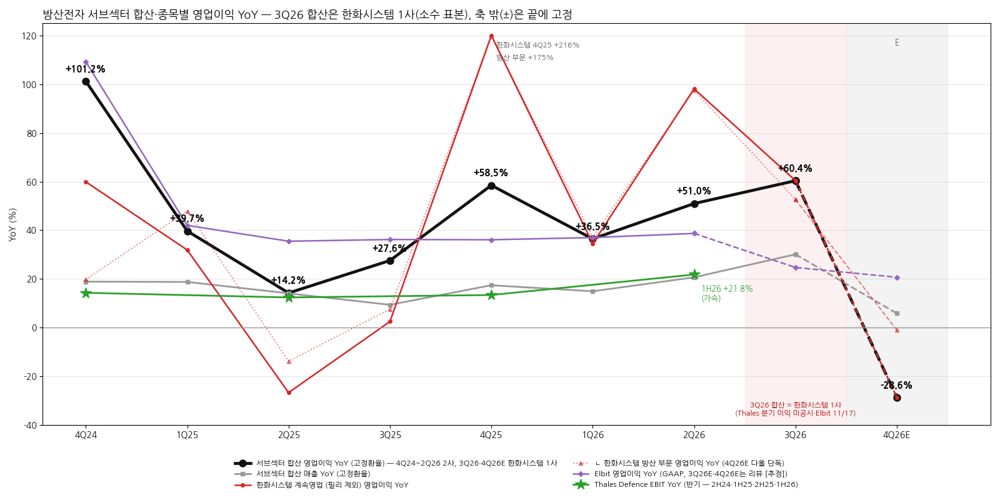

# 방산 · 방산전자 섹터 리뷰

> 현재 상태 (최신 분기 기준)
> 최신 분기: 2026-Q3
> 섹터 델타: 둔화 | 내러티브: 강화
> 모멘텀 신호: 없음
> 활성 테마: 없음
> 포지셔닝: 서브섹터 중립 | 한국 언더퍼폼 | 선호 Thales
> 델타 근거: 3Q 둔화 → 4Q 추가 둔화, 꺾임 경로
> 내러티브 근거: 중동 방공·유럽 재무장 수요가 수주·가이던스로 확인돼 강화
> PM 근거: 수요는 강하나 델타 정점 통과로 중립(축소 대기), 한국 언더퍼폼
> 편입 종목: 한화시스템, Thales, Elbit Systems (3Q26 분기 합산 2사 — Thales 분기 이익 미공시로 제외, 반기 보조 판정에만 편입)
> 갱신 시각: 2026-11-22 23:50 KST

## 누적 시계열

| 분기 | 편입 종목 | 합산 매출 | 합산 영업이익 | OPM | 매출 YoY | 영업이익 YoY | 영업이익 YoY 델타 (%p) | 섹터 델타 | 내러티브 | 모멘텀 신호 | 활성 테마 |
|---|---|---|---|---|---|---|---|---|---|---|---|
| 4Q24 | 2사 (한화시스템·Elbit) — Thales 분기 이익 미공시 | 36,271억원 ($2.60B) | 2,264억원 ($162M) | 6.2 | +24.0 / +18.9 | +110.9 / +101.2 | — | —† | - | - | - |
| 1Q25 | 2사 (동일) | 33,216억원 ($2.29B) | 2,770억원 ($191M) | 8.3 | +27.4 / +18.8 | +49.3 / +39.7 | -61.5 | 둔화 | - | - | - |
| 2Q25 | 2사 (동일) | 33,755억원 ($2.42B) | 2,824억원 ($202M) | 8.4 | +15.8 / +14.1 | +15.7 / +14.2 | -25.5 | 둔화† | - | - | - |
| 3Q25 | 2사 (동일) | 33,022억원 ($2.38B) | 2,993억원 ($216M) | 9.1 | +11.4 / +9.4 | +29.8 / +27.6 | +13.3 | 가속 | - | - | - |
| 4Q25 | 2사 (동일) | 43,768억원 ($3.02B) | 3,705억원 ($256M) | 8.5 | +20.7 / +17.4 | +63.6 / +58.5 | +30.9 | 가속‡ | - | - | - |
| 1Q26 | 2사 (동일) | 38,470억원 ($2.63B) | 3,807억원 ($260M) | 9.9 | +15.8 / +14.9 | +37.5 / +36.5 | -22.0 | 둔화 | - | - | - |
| 2Q26 | 2사 (동일) | 43,200억원 ($2.88B) | 4,510억원 ($300M) | 10.4 | +28.0 / +20.7 | +59.7 / +51.0 | +14.5 | 가속 | - | - | - |
| **3Q26** | **2사 (동일)** | **40,227억원 ($2.84B)** | **4,145억원 ($293M)** | **10.3** | **+21.8 / +19.7** | **+38.5 / +36.1** | **-14.9** | **둔화** | **강화** | **없음** | **없음** |

→ **표기**: YoY 칸은 `원화 환산 / 고정환율`, 판정은 방산 전체 리뷰와 같은 **고정환율 기준**(전년 분기 값을 당해 분기 평균 환율로 환산) [계산]
→ **합산 기준**: 한화시스템 = 필리조선소 제외 계속영업(회사 3Q26 IR p.9 별첨 분기표 재작성치 — 방산 전체 리뷰와 동일), Elbit = 전사 GAAP 영업이익(전사 = 방산, ESLT 리뷰 1-②). **3Q26 Elbit은 미국 자회사 매각 자본이득 $9.9M을 뺀 $222.6M**(보고 $232.5M — ESLT 3Q26 리뷰 1-①). Thales = Defence 부문 Adj. EBIT이지만 **반기만 공시해 분기 합산·판정에서 항상 제외**(전년 동기도 제외 — 동일 표본). Thales는 아래 ① (2) 반기 보조 판정과 ⑦ 국가 렌즈에만 넣었다
→ **†** 4Q24는 소급 첫 행이라 판정 없음. 2Q25는 2개 분기 연속 축소지만 다음 분기(3Q25) 재가속해 정점 통과로 보지 않고 "둔화"로 두었다(방산 전체 리뷰와 같은 처리)
→ **‡** 4Q25 +58.5%는 한화시스템 4Q24 영업이익 291억(OPM 3.1%, 개발비 집중 — 한화시스템 리뷰 1-①)의 저기저 효과가 크다. 판정은 규칙대로 산정
→ 소급 행의 내러티브·모멘텀 신호·테마 열은 당시 섹터 리뷰가 없어 `-`
→ 환율: 방산 전체 리뷰 환율표(Yahoo Finance 일간 종가 분기 평균, 2026-11-14 조회)를 그대로 썼다. USD/KRW 4Q24 1,395.5 / 1Q25 1,449.5 / 2Q25 1,397.1 / 3Q25 1,385.8 / 4Q25 1,447.7 / 1Q26 1,462.9 / 2Q26 1,500.9 / 3Q26 1,417.0 / 4Q26 QTD 1,338.1, EUR/KRW 1H25 1,554.2 / 2H25 1,651.0 / 1H26 1,727.9 / 2H26(3Q26 + 4Q26 QTD) 1,562.4 (반기 = 두 분기 평균 [계산])
→ 작성 이력: 2026-11-15 초안은 3Q26 분기 합산이 한화시스템 1사뿐이라 BT 판단으로 보류했고, Elbit 3Q26(11/17) 발표 후 2사로 다시 계산해 이번에 확정했다

---

## 2026-Q3 섹터 리뷰 — 방산전자 (한화시스템·Thales·Elbit)

> 대상: `earnings-review/2026-Q3_한화시스템_리뷰.md`(2026-11-14), `2026-Q3_ESLT_리뷰.md`(2026-11-22), `2026-Q2_HO_리뷰.md`(Thales 1H26 반기 리뷰 + 3Q26 수주·매출 업데이트 덧붙임)
> 편입 범위: 워치리스트 `방산전자` 서브섹터 — 한화시스템·Thales·Elbit Systems. 국가 = 한국 1 / 유럽 1 / 기타(이스라엘) 1. 트래킹 피어 없음. 참고(합산·판정 제외): Leonardo Defence Electronics 부문(`2026-Q3_LDO_리뷰.md` 1-②)
> 상위 리뷰: `sector-review/방산_섹터리뷰.md`(15사) — 합산 기준·환율·동일 표본 규칙을 그대로 재사용했다
> **표본 주의**: 분기 합산은 2사(한화시스템·Elbit)다. 3Q26 2사 영업이익 중 Elbit이 76%라 **분기 판정은 Elbit 비중이 크고**, 반기 3사 합산은 Thales Defence가 1H26 이익의 64.5%라 **반기 판정은 Thales가 결정한다**

① 섹터 합산 숫자와 델타

(1) 분기 합산 — 한화시스템·Elbit 2사

| 항목 | 4Q24 | 1Q25 | 2Q25 | 3Q25 | 4Q25 | 1Q26 | 2Q26 | **3Q26** | 4Q26E |
|---|---|---|---|---|---|---|---|---|---|
| 합산 매출 (억원) | 36,271 | 33,216 | 33,755 | 33,022 | 43,768 | 38,470 | 43,200 | **40,227** | 45,544 |
| (달러 환산, $B) | 2.60 | 2.29 | 2.42 | 2.38 | 3.02 | 2.63 | 2.88 | **2.84** | 3.40 |
| 합산 영업이익 (억원) | 2,264 | 2,770 | 2,824 | 2,993 | 3,705 | 3,807 | 4,510 | **4,145** | 3,866 |
| (달러 환산, $M) | 162 | 191 | 202 | 216 | 256 | 260 | 300 | **293** | 289 |
| OPM (%) | 6.2 | 8.3 | 8.4 | 9.1 | 8.5 | 9.9 | 10.4 | **10.3** | 8.5 |
| 매출 YoY — 고정환율 (%) | +18.9 | +18.8 | +14.1 | +9.4 | +17.4 | +14.9 | +20.7 | **+19.7** | +10.0 |
| 영업이익 YoY — 원화 환산 (%) | +110.9 | +49.3 | +15.7 | +29.8 | +63.6 | +37.5 | +59.7 | **+38.5** | +4.4 |
| **영업이익 YoY — 고정환율 (%)** | +101.2 | +39.7 | +14.2 | +27.6 | +58.5‡ | +36.5 | +51.0 | **+36.1** | +10.7 |
| **영업이익 YoY 델타 (%p)** | — | -61.5 | -25.5 | +13.3 | +30.9 | -22.0 | +14.5 | **-14.9** | -25.4 |
| 판정 | — | 둔화 | 둔화 | 가속 | 가속 | 둔화 | 가속 | **둔화** | (경로상 꺾임) |
| ㄴ 한화시스템 계속영업 영업이익 YoY (%) | +59.9 | +31.9 | -26.7 | +2.5 | +215.5 | +34.5 | +98.1 | **+60.4** | -28.6 |
| ㄴ 한화시스템 방산 부문 영업이익 YoY (%) | +19.8 | +47.9 | -13.8 | +7.6 | +175.2 | +37.2 | +97.5 | **+52.6** | -1.0 |
| ㄴ Elbit 영업이익 YoY (GAAP, %) | +109.2 | +42.0 | +35.5 | +36.2 | +36.1 | +37.0 | +38.7 | **+29.9** | +24.7 |

→ (출처: 한화시스템 = 리뷰 1-① 계속영업 분기표(회사 3Q26 IR p.9), 4Q26E = 증권사 7곳 평균. 방산 부문 = 리뷰 1-②와 `company-overview/한화시스템_기업개요.md` v1.1 IR 별첨 분기표, 4Q26E = 다올 매출 8,805억 × 방산 OPM 8.6% [계산]. Elbit = ESLT 3Q26 리뷰 1-①(3Q26 자본이득 제외), **4Q26E = 발표 전 연간 컨센 역산 매출 $2,402M × GAAP OPM 10.0% 가정 = $240M `[추정]`**. 원화 환산·합산 [계산])
→ **판정 = 둔화**: 2사 고정환율 영업이익 YoY +51.0% → +36.1%, -14.9%p로 ±5%p 밖 축소 + 플러스 유지. 두 회사 모두 내려왔다 — 한화시스템 +98.1% → +60.4%, Elbit(조정) +38.7% → +29.9%. 증가액(3Q26 환율 고정)은 3Q26 +1,098억원(Elbit +725억, 한화시스템 +373억)으로 2Q26 +1,525억원보다 작다 [계산]
→ **원화 환산으로도 같은 방향**: +59.7% → +38.5%(-21.2%p). 3Q 원화 강세(USD/KRW 1,500.9 → 1,417.0)로 Elbit 원화 환산 이익이 줄어든 효과가 섞였다
→ **컨센 경로상 분기 YoY 정점은 2Q26(+51.0%)**: 4Q26E +10.7%면 2개 분기 연속 둔화 + 정점 통과로 **"꺾임"**이 된다. 한화시스템 4Q26E -28.6%는 자체 투자개발비 집중(회사 예고)이라 조정 성격이 있지만, 이를 빼고 Elbit만 봐도 +38.7% → +29.9% → +24.7%[추정]으로 내려가는 경로다
→ **이익 지표 정의**: 한화시스템 = K-IFRS 영업이익(계속영업), Elbit = US GAAP 영업이익(Non-GAAP 아님 — Non-GAAP 기준 3Q26 YoY +30.7%), Thales = Adjusted EBIT(PPA 상각 등 제외, 회사 주 지표). 레벨(OPM) 비교는 참고용

(2) **반기 보조 판정 — 3사 합산 (Thales 포함)**

| 항목 | 2H24 | 1H25 | 2H25 | **1H26** | 2H26E [추정] |
|---|---|---|---|---|---|
| 3사 합산 매출 (억원, $B) | — | 153,918 ($10.81B) | 186,558 ($13.17B) | **190,784 ($12.87B)** | — |
| 3사 합산 영업이익 (억원, $B) | — | 16,755 ($1.18B) | 21,534 ($1.52B) | **23,434 ($1.58B)** | 23,300\~23,900 |
| OPM (%) | — | 10.9 | 11.5 | **12.3** | — |
| 매출 YoY 원화 환산 / 고정환율 (%) | — | +21.1 / +14.6 | +20.0 / +11.7 | **+24.0 / +15.0** | — |
| 영업이익 YoY 원화 환산 (%) | — | +23.3 | +31.7 | **+39.9** | — |
| **영업이익 YoY 고정환율 (%)** | +22.6 | +16.4 | +21.2 | **+28.9** | +13.1 \~ +16.2 |
| **델타 (%p)** | — | -6.2 | +4.8 | **+7.7** | -12.7 \~ -15.8 |
| **반기 판정** | — | 둔화 | 유지 | **가속** | (둔화 경로) |
| 한화시스템 계속영업 영업이익 YoY (%) | +40.3 | -6.2 | +71.8 | **+66.8** | +7.2 |
| Thales Defence Adj. EBIT YoY (%) | +14.3 | +12.4 | +13.4 | **+21.8** | +8.8 \~ +13.3 |
| Elbit 영업이익 YoY (GAAP, %) | +53.8 | +38.6 | +36.2 | **+37.9** | +27.1 |
| 1H26 영업이익 비중 (원화 환산, %) | | | | 한화시스템 8.7 / **Thales 64.5** / Elbit 26.8 | |

→ (출처: 한화시스템 = 리뷰 1-① 분기 합산 [계산] / Thales Defence = HO 리뷰 1-② 반기 표 / Elbit = ESLT 리뷰 분기 합산 [계산]. 반기 평균 환율로 원화 환산 [계산])
→ **2H26E [추정]**: 한화시스템 = 3Q26 991억 + 4Q26E 655억 = 1,646억(+7.2%) / **Elbit = 3Q26 실적 $222.6M + 4Q26E $240M[추정] = $462.6M(+27.1%)** — 초안(11/15)의 $446M(+22.6%)보다 높아졌다 / Thales Defence = 3Q26 Defence 매출 €3,043m + 4Q26E €4.2\~4.5bn(HO 리뷰 가이던스 역산) × 마진 13.5% = €978\~1,018m(+8.8\~+13.3%) `[추정]`. 3사 합산 +13.1\~+16.2%(중앙 +14.6%) [계산]
→ **1H26이 반기 기준 정점**: Elbit 3Q가 예상보다 좋아 2H26E 범위가 약 +1%p 올랐지만, 1H26 +28.9% 대비 둔화선(+23.9%)에는 여전히 못 미친다. 결정 변수는 Thales 2H Defence 마진 — 14%여도 3사 +17%대 [계산]
→ **방산 전체 대비**: 3Q26 서브섹터(2사) +36.1% vs 방산 전체 13사 +12.1% → **+24.0%p**. 2Q26 기준(2사 +51.0% vs 13사 +18.3%) +32.7%p에서 격차가 줄었다 [계산 — 방산 전체 리뷰 ①(1)]

→ (출처: 각 종목 리뷰·한화시스템 기업개요 [계산]. 검은 굵은 선 = 서브섹터 2사 합산 영업이익 YoY(고정환율), 회색 = 합산 매출 YoY, 빨강 실선 = 한화시스템 계속영업, 빨강 점선 = 한화시스템 방산 부문, 보라 = Elbit(4Q26E [추정] 점선), 초록 별 = Thales Defence 반기 EBIT YoY(2H24·1H25·2H25·1H26을 각 반기 끝 분기에 표시). ±축 밖 값은 끝에 고정)

② 종목별 델타 판정표

| 종목 | 국가 | 매출 YoY | 영업이익 YoY | 영업이익 YoY 델타 | 델타 판정 | 내러티브 | 서브섹터 내 델타 순위 | 한 줄 |
|---|---|---|---|---|---|---|---|---|
| Thales (Defence) (2026-Q2 리뷰, 3Q 업데이트 덧붙임) | 유럽 | H1 +12.9 / Q3 +14.1 (유기적 +12.8) | H1 EBIT +21.8 (분기 미공시) | +8.4%p (반기) | **방산 가속** (그룹 유지) | 강화 | **1위** | Defence 마진 13.8% 반기 최고, 9M 중동 수주 +210%. 그룹은 Cyber & Digital -27%가 희석 |
| Elbit Systems (2026-Q3 리뷰) | 기타 (이스라엘) | +17.2 | +29.9 (자본이득 제외, 보고 +35.7) | -8.8%p | 둔화 | **강화** | **2위** | 35\~39% 고원 이탈, 그러나 2027 high-teens 매출·마진 확대 가이던스, 잔고 $33.0B, FCF $276M |
| 한화시스템 (필리 제외) | 한국 | +30.1 | +60.4 | -37.7%p | 둔화 | 유지 | **3위** | 중동 MFR·ICT로 레벨은 최고, 4Q26E -29%(개발비). 방산 잔고 3분기 연속 감소, UAE 본계약 대기 |
| ㄴ 한화시스템 방산 부문 | 한국 | +28.3 | +52.6 | -44.9%p [계산] | (참고 — 리뷰 판정은 계속영업 기준) | — | — | 방산 OPM 14.8% → 12.3%, 수출 비중 22% |

→ (출처: 각 종목 리뷰 0번 판정·1번 표. Thales는 반기 공시 종목이라 0번 판정이 반기 기준 — 그룹 "유지", 방산(Defence) "가속". 섹터 합산 기준이 Defence라 방산 판정을 썼다)
→ **순위 기준 = 델타 방향 1순위, 내러티브 2순위, 이익 레벨 3순위**(BT 프레임). Elbit과 한화시스템은 둘 다 "둔화"라 내러티브(강화 vs 유지)로 갈렸다. 레벨로만 보면 한화시스템(+60%) > Elbit(+30%) > Thales(+22%)로 순서가 정반대다 — **"레벨이 높은 쪽이 델타가 먼저 꺾이는" 구간**은 초안 그대로다 [판단]
→ **누가 끄나**: 분기 2사 합산은 Elbit(이익 비중 76%)이 받치고 한화시스템이 끌어내렸다(델타 -37.7%p). 반기 합산은 Thales Defence(64.5%)가 결정
→ **선행 종목**: 먼저 꺾이는 쪽 = 한화시스템(2Q26 정점 → 3Q26 둔화 → 4Q26E 마이너스 예고) / 뒤따르는 쪽 = Elbit(3Q26 고원 이탈, 4Q26E +25% [추정]) / 마지막 = Thales(1H26 가속, 2H26 확인은 2027-03) [판단]
→ **초안(11/15) 대비 변화**: Elbit이 "유지·유지"에서 "둔화·강화"로 바뀌었다 — 숫자는 예상대로 내려왔고(컨센 [추정] +25%보다는 높은 +30%), 스토리는 2027 가이던스로 올라갔다

③ 섹터 공통 쟁점

(1) 중동 방공 수요 — 3사 모두, 그러나 숫자로 들어오는 시점이 다르다
→ 한화시스템: UAE·사우디·이라크 3개국 M-SAM MFR 매출 본격화는 **2027년부터**(회사, 신한·다올 Q&A). 3Q26 수출 비중 22%. UAE 통합대공망은 2026-09-15 EDGE 그룹과 Term Sheet 체결 — **본계약은 협상 중**이고 잔고에 미반영(리뷰 쟁점 (4))
→ Thales: 9M 중동 수주 €1,909m(+210% 유기적)·매출 €1,288m(+48.9%) — **이미 수주·매출로 들어왔다**. CEO는 SAMP/T NG가 Patriot보다 납기가 빠르다(2028 vs 2032)며 수출 논의 중(HO 리뷰)
→ Elbit: 3Q26 이스라엘 매출 비중 37.5%, 증분 매출의 62%가 이스라엘(탄약·무인기·전자전 — ESLT 3Q 리뷰 (2-1)). 수요 성격이 "자국 전쟁 소요"라 중동 수출 시장과 결이 다르다. CEO는 미국 군사원조 종료 시 국산화 압력이 기회라고 언급(Reuters 인용)
→ `[판단]` 같은 중동 방공 수요인데 **Thales는 2026년 숫자에 이미 반영됐고, 한화시스템은 2027년 매출·UAE 계약으로 미뤄져 있다**. SAMP/T NG 수출이 붙으면 중동·유럽 장거리 방공에서 천궁-II(한화시스템 MFR 탑재)의 경쟁 상대가 하나 늘어난다

(2) 수주잔고 → 매출 전환 — 방향이 갈린다
→ Elbit: 잔고 $33.0B(+31%, 2Q +34%에서 처음 둔화), 잔고/TTM 매출 3.7배 유지, 단기 수행(잔여 2026+2027) 비중 35%로 하락 — 새 잔고는 2028년 이후 물량 위주. CapEx $300M, 고객이 시설을 직접 대는 사례 첫 등장(ESLT 3Q 리뷰 쟁점 (2))
→ Thales: Defence 잔고 €41.1bn(Defence 매출 3.2년치), 9M Defence 수주 €11,315m(+14%), Book-to-bill 1.21(HO 리뷰)
→ 한화시스템: 방산 잔고 9.30조원(4Q25) → 8.40조원(3Q26, -9.7% YTD, 3분기 연속 감소), 잔고/최근 4분기 방산 매출 3.7배 → 2.9배(리뷰 (2-2))
→ `[판단]` 글로벌 2사는 "잔고는 넘치고 생산이 병목", 한국은 "생산은 되는데 신규 수주가 공백". 방산 전체 리뷰 ③(1)과 같은 그림이다

(3) 마진 레벨업의 지속성 — 레벨은 3사 모두 최고, YoY 개선 폭은 줄어든다
→ Thales Defence 1H 마진 12.3%(1H23) → 12.9 → 12.8 → 13.8%(1H26). 2H26 13.5% 미만이면 믹스 효과, 14% 이상이면 구조적 레벨업(HO 리뷰 (1-3))
→ Elbit: 3Q26 GAAP OPM 9.9%(자본이득 제외)·Non-GAAP 10.8% 사상 최고 — 2Q에 의심받던 "일회성 마진"이 3Q에도 유지됐다. 다만 OPM YoY 개선 폭은 2Q +1.6%p → 3Q +1.0%p로 줄었다(기저 OPM이 이미 8.9\~9.8%). CFO는 5년 연속 마진 확대, 2027에도 확대를 제시(ESLT 3Q 리뷰 쟁점 (1))
→ 한화시스템 방산 OPM 14.6%(1Q26) → 14.8%(2Q26) → 12.3%(3Q26) → 4Q26E 한 자릿수(4Q 개발비 370\~620억, 리뷰 쟁점 (2))
→ `[판단]` 초안의 "1H26 마진 = 정점권" 리스크는 Elbit에서는 빗나갔다(3Q 마진이 더 올랐다). 대신 **이익 증가율은 기저 효과로 정점을 지났다** — 레벨 강화와 델타 둔화가 동시에 맞는 구간이다

(4) 이익 추정은 유지·상향인데 TP는 하향 — 멀티플 디레이팅, Elbit은 반전 신호
→ 한화시스템: 2027E 영업이익 7곳 평균 +10.8%(대부분 필리 제외 효과), 평균 TP 101,667원 → 93,833원(-7.7%)(리뷰 ⑤)
→ Thales: Oddo TP €288 → €287, DZ €298 → €286, 등급 유지. 1H 랠리(+16%)를 4개월 만에 반납(HO 리뷰)
→ Elbit: 2Q 실적일 -8.3%·JPM TP $950 → $885였는데, 3Q 실적일은 프리마켓 +8%. 2027 가이던스(high-teens)가 발표 전 컨센(+12.3%)보다 높아 추정 상향 압력. 실적 후 TP 변경은 미확인(ESLT 3Q 리뷰 ⑤)
→ `[판단]` 3사 모두 직전 TP 하향의 원인은 이익이 아니라 배수다. Elbit은 이번에 "숫자에 주가가 반응"한 첫 분기 — 방산 멀티플 디레이팅이 멈추는지 보는 신호로 쓸 수 있다

(5) 유럽 재무장 노출 — Thales·Elbit은 유럽 신규 수주를 받고, 한화시스템은 유럽 노출이 줄었다
→ Thales: 루마니아 GM200 MM/A 레이더 12기(EU SAFE), 독일군 옵트로닉스(HO 리뷰)
→ Elbit: 3Q 잔고 증가 대부분 유럽, 분기 후 PULS 2건($235M·$260M), 2027 성장 동인으로 PULS·EuroPULS·Iron Fist(유럽·미 Bradley) 지목. 유럽 매출은 +3.9%로 아직 느리다(ESLT 3Q 리뷰)
→ 한화시스템: 3Q 방산 QoQ 감익 원인 중 하나가 폴란드 K2 사격통제시스템 매출 감소(SK, 리뷰 1-②)
→ `[판단]` 방산 전체 리뷰 ③(2)의 SAFE 블록화가 방산전자에서도 보인다 — 유럽 레이더·전자전 신규 물량은 역내(Thales)와 기존 공급망(Elbit)으로 간다

(6) 종목 고유 이슈
→ 한화시스템: 필리조선소 60% 매각(3,251억원)·한화오션 PRS 회수 3.4조원 vs 위성 20조원·AI DC 3조원 투자(2040년까지) — 2027-02 투자 계획이 밸류에이션 분기점(리뷰 쟁점 (5))
→ Thales: Cyber & Digital EBIT -26.9%가 그룹 델타를 깎음, F126 종료 특별손실 약 €450m(Adj. EBIT 제외)(HO 리뷰)
→ Elbit: 미국 자회사 매각 자본이득 $9.9M(영업)·미국 연금 해지 비용 약 $27M(영업외), 실효세율 11.6%(2Q 16.4%), 이스라엘 국방부 지급 지연 보상 합의, 캐나다 수중로봇(ISE) 인수 완료(ESLT 3Q 리뷰)

④ 섹터 판정

(1) 판정 한 줄

> 섹터 델타: **둔화** | 내러티브: **강화** → **이익 레벨과 수요는 방산 전체보다 강하고 더 단단해졌지만(Elbit 2027 가이던스·Thales 중동 수주), 델타는 분기 2Q26(+51.0%)·반기 1H26(+28.9%)에서 정점을 지나 3Q26 2사 +36.1%로 둔화 — 서브섹터 중립, 종목 선별(Thales > Elbit > 한화시스템). 4Q26 2사 고정환율 YoY +31.1% 미만이면 꺾임(컨센 경로 +10.7%)**

(2) 키 차트

→ (출처: 각 종목 리뷰·한화시스템 기업개요 [계산]. 왼쪽 = 2사 분기 합산 영업이익 YoY(고정환율, 검은 선 — 점 색 = 분기별 판정: 초록 가속·주황 둔화, 3Q26 강조), 4Q26E 점선 = 한화시스템 컨센 + Elbit [추정], 빨간 일점쇄선 = 4Q26 꺾임 판정선 +31.1% / 오른쪽 = 반기 3사 합산 영업이익 YoY(검은 선, 2H26E 점선·주황 범위 [추정] +13.1\~16.2%), 막대 = 종목별 반기 영업이익 YoY(빨강 한화시스템·초록 Thales Defence·보라 Elbit, 빗금 = 2H26E), 주황 점선 = 2H26 둔화선 +23.9%)

(3) 근거
→ **델타 = 둔화**: 2사 고정환율 영업이익 YoY +51.0% → +36.1%(-14.9%p), 두 회사 모두 하락. 원화 환산도 -21.2%p. 반기 1H26 3사는 +7.7%p 가속이었지만 3Q 이전 기간의 숫자이고, 3Q 이후 경로(2H26E +13\~16%)는 둔화다 — 초안(11/15)이 쓴 "분기 둔화 × 반기 가속 = 엇갈림 → 유지"는, 분기 표본이 2사가 되면서 현재 분기 판정을 분기 합산으로 내리는 쪽으로 바꿨다 [판단]
→ **다음 분기 예고**: 4Q26E 2사 +10.7%면 2개 분기 연속 둔화 + 2Q26 정점 통과로 "꺾임". 한화시스템 4Q 개발비(-28.6%)를 조정해도 Elbit 단독 경로가 +24.7%[추정]로 내려가 둔화가 이어진다 [계산·판단]
→ **내러티브 = 강화**: 3사 분포 강화 2(Thales·Elbit)·유지 1(한화시스템). 공통 스토리("중동 방공·유럽 재무장 → 레이더·전자전 수요 → 마진 레벨업")가 Thales 중동 수주 +210%와 Elbit 2027 high-teens 가이던스·마진 최고치로 숫자 확인. 한화시스템은 수주 공백(잔고 3분기 연속 감소)·UAE 미확정으로 유지 [판단]
→ **직전 판정 대비**: 첫 서브섹터 리뷰(초안 보류 후 확정). 소급 분기 판정은 2Q26 가속 → 3Q26 둔화, 반기는 2H25 유지 → 1H26 가속. **2Q26(분기)·1H26(반기)이 이번 사이클의 델타 정점**으로 그려진다 [판단]
→ **방산 전체 대비**: 3Q26 서브섹터 +36.1% vs 방산 13사 +12.1% → +24.0%p. 레벨 격차는 크지만 델타는 방산 전체(둔화)와 같은 방향이다

⑤ 모멘텀 신호 (후보 — 판단은 BT)

→ **없음**. 조건 대조: ① 섹터 영업이익 YoY 델타 뚜렷한 확대 — 분기 -14.9%p 미충족(반기 +7.7%p는 직전 반기) ② 편입 종목 과반 가속 — 1/3(Thales) 미충족 ③ 내러티브 형성·강화 — 강화 충족 → 3개 중 1개, 후보로 올리지 않음
→ 활성 테마가 없어 "테마 종료 후보"는 해당 없음
→ **다음에 "델타 급증 후보"로 올릴 조건**: 2H26 3사 합산 YoY +23.9% 이상(= Thales 2H Defence 마진 14%+ & EBIT YoY 20%대 유지) + Elbit 4Q26 영업이익 YoY 30%대 복귀 + 한화시스템 UAE 통합대공망 본계약. 연결될 만한 테마 키워드 제안: **"중동·유럽 방공 센서(MFR·GM200·SAMP/T NG 레이더)"** — 제안일 뿐, 판단은 BT
→ 반대 논거: (a) Elbit 2027 high-teens 매출 + 마진 확대면 영업이익 YoY 20%대 중반에서 안정 — "꺾임"보다 "높은 고원 → 낮은 고원" 이동일 수 있다 (b) 한화시스템 4Q26E -29%는 예고된 개발비 이벤트이고 중동 MFR 3개국은 계약 완료 물량이라 2027 매출이 그려져 있다(7곳 2027E 영업이익 +35%) (c) Thales는 분기 이익이 없어 2H26 실제 숫자가 나오는 2027-03 전까지 반기 추정 오차가 크다

⑥ 다음 분기 섹터 관전 포인트

| 순위 | 무엇을 (변수·임계값) | 어떤 데이터로 | 언제 |
|---|---|---|---|
| 1 | **4Q26 서브섹터 판정선: 2사(한화시스템+Elbit) 고정환율 영업이익 YoY +31.1% — 미만이면 2개 분기 연속 둔화 + 2Q26 정점 통과로 꺾임** (4Q26 환율 기준 4Q25 레벨 3,494억원 × 1.311 = 약 4,580억원). 추정 경로 +10.7%(한화시스템 컨센 655억 + Elbit [추정] $240M). 0% 미만이면 마이너스 전환 꺾임 | 한화시스템 4Q26 잠정실적, Elbit 4Q26 보도자료 | 2027-02 초 / 2027-03 중순 |
| 2 | 반기 보조: 2H26 3사 합산 YoY **+23.9% 미만이면 둔화**(추정 +13.1\~16.2%), 0% 미만이면 꺾임 — 결정 변수 Thales 2H Defence 마진 14%+ vs 13.5% 미만 | Thales FY2026(2H = 연간 − 1H), 2028 마진 목표 재검토 | 2027-03 초 |
| 3 | Elbit 2027 가이던스 숫자화(high-teens 매출·OPM 범위)와 컨센 반영, 유럽 매출 +3.9% → 10%+ | Elbit 4Q 보도자료·컨콜, 셀사이드 컨센 | 2026-11 하순 \~ 2027-03 |
| 4 | UAE 통합대공망 본계약 — 한화시스템 몫(체계종합·MFR·C2)과 금액, EDGE JV | DART 단일판매·공급계약 공시 | 연내 \~ 1Q27 |
| 5 | 한화시스템 1Q27 영업이익 YoY +20% 이상·수출 비중 30% 이상 — 미만이면 리뷰 판정이 "꺾임"으로 바뀜 | 1Q27 IR·컨콜, 관세청 레이다 수출 | 2027-04 하순 |

→ 판정선 근거: 1순위 +31.1% = 3Q26 +36.1% − 5%p(유지 하단) — 방산 전체 리뷰의 4Q 판정선(3Q26 +12.1% − 5%p = +7.1%)과 같은 산식. 2H26 +23.9% = 1H26 +28.9% − 5%p [계산]
→ 초안(11/15)의 1순위 "2사 YoY 0%"는 "마이너스 전환" 기준만 본 값이라, 3Q26이 둔화로 확정된 지금은 "2개 분기 연속 둔화" 기준(+31.1%)으로 바꿨다

⑦ 글로벌 PM 포지셔닝 — 결론

> **서브섹터: 비중 유지 (방산 내, 축소 쪽 대기) — 4Q26 2사 YoY +31.1% 이상이면 유지 확정, 미만(컨센 경로)이면 꺾임 판정으로 축소 검토 / 2H26 3사 +23.9% 이상 + UAE 본계약이면 확대** | **한국: 언더퍼폼 (한화시스템 — 델타 둔화·수주 공백, UAE 본계약 시 중립 검토)** | **선호: Thales (Defence 반기 EBIT YoY 가속·마진 13.8% 최고), 차선 Elbit (둔화지만 내러티브 강화 — 2027 high-teens 가이던스)**

→ 직전 콜 체크: 초안(11/15, 보류)의 확대 조건 ③ "Elbit 3Q26 영업이익 YoY 30%대 유지"는 **경계에서 미충족**(조정 GAAP +29.9%, Non-GAAP +30.7%, 보고 +35.7%). 축소 조건 "Elbit 20% 미만 → 비선호"도 해당 없음. 상위 방산 전체 리뷰(섹터 중립·한국 언더퍼폼)와 같은 방향

(1) 서브섹터 비중 (방산 내) — 확대 / 중립 / 축소

| 판단 축 | 이번 분기 근거 (수치) | 방향 |
|---|---|---|
| 이익 델타 (1순위) | 분기 2사 +51.0% → +36.1% 둔화(두 회사 모두 하락) / 반기 1H26 가속은 직전 반기 | 축소 쪽 |
| YoY 정점 시점 | 분기 정점 2Q26, 반기 정점 1H26. 4Q26E 2사 +10.7%면 꺾임, 2H26E 3사 +13\~16% | 축소 쪽 |
| 방산 전체 대비 레벨 | 3Q26 +36.1% vs 방산 13사 +12.1%(+24.0%p), 반기 3사 +28.9% vs 방산 2Q26 +18.3% | 확대 |
| 수주·잔고 선행지표 | Elbit 잔고 $33.0B(+31%), Thales 9M Defence 수주 +14%·B/B 1.21 / 한화시스템 방산 잔고 -9.7% YTD | 확대 (2/3) |
| 최종 수요 지표 | Thales 9M 중동 수주 +210%, Elbit 2027 high-teens 가이던스·이스라엘 증분 62%, 유럽 SAFE 레이더(GM200), 중동 MFR 3개국 2027 양산 | 확대 |
| 마진 | Elbit 3Q 마진 최고 경신(Non-GAAP 10.8%), Thales Defence 13.8%(1H) / 한화시스템 방산 14.8% → 12.3% | 중립 (확대 쪽) |
| 이벤트·정책 | UAE 통합대공망 본계약, 2027-02 한화시스템 4Q·투자 계획, 2027-03 Thales FY·Elbit 4Q | 중립 (이벤트 전) |
| 밸류에이션·멀티플 (2순위) | 한화시스템·Thales TP 하향(멀티플), Elbit은 3Q 실적일 상승(2Q -8%와 반대), Elbit 2026E P/E 약 40배대 | 중립 |
| 주가 낙폭 | 한화시스템 52주 고점 대비 약 -61%, Elbit 고점($1,016) 대비 약 -27\~30%, Thales 1H 랠리 반납 | 중립 |

→ 결론: **비중 유지(중립), 다음 분기 축소 쪽 대기**. 레벨·수요·잔고·내러티브는 방산 전체보다 확실히 좋고 이번 분기 더 강해졌지만, BT 프레임 1순위인 델타가 분기·반기 모두 정점을 지났고 컨센 경로상 4Q가 꺾임이다 [판단]
→ 델타와 내러티브가 엇갈리는 판단: 내러티브 강화(Elbit 가이던스)는 2027 이익 경로를 높이는 재료라 "꺾임 후 재가속" 시점을 앞당길 수 있다. 서브섹터 베타를 늘리기보다 **델타가 마지막까지 남는 Thales와, 2027 재가속 가능성이 가장 높은 Elbit 쪽으로 서브섹터 안에서 비중 이동**이 맞다 [판단]
→ **확대 전환 조건**: ① 2H26 3사 합산 고정환율 영업이익 YoY +23.9% 이상(Thales FY2026, 2027-03 초) ② UAE 통합대공망 본계약(한화시스템 수주 공백 해소) ③ Elbit 4Q26 영업이익 YoY 30%대 복귀 + 2027 가이던스 숫자화. ①+② 충족 시 확대
→ **축소 전환 조건**: ① 4Q26 2사 고정환율 영업이익 YoY +31.1% 미만(④ 판정선·⑥ 1순위와 같은 값 — 컨센 경로대로면 충족) **그리고** Elbit 단독 4Q YoY 20% 미만(한화시스템 개발비 일회성을 빼도 둔화가 이어지는 경우) 또는 ② 2H26 3사 합산 +10% 미만(Thales 2H Defence 마진 13% 이하). 둘 중 하나면 축소

(2) 한국 vs 글로벌 — 국가 렌즈 (방산전자)

| 국가 | 합산 편입 종목 (3Q26) | 영업이익 YoY 직전 → 이번 | 델타 판정 | 수주·잔고 방향 | 제외 종목 (공시 주기) |
|---|---|---|---|---|---|
| 한국 | 한화시스템 | +98.1% → +60.4% (분기) / +71.8% → +66.8% (반기) | 둔화 | 감소 — 방산 잔고 8.40조원, 3분기 연속 감소 | — |
| 유럽 | — | Thales Defence +13.4% → +21.8% (반기) | 가속 (반기) | 증가 — 9M Defence 수주 +14%, B/B 1.21 | Thales (Q3 매출·수주만) |
| 기타 (이스라엘) | Elbit | +38.7% → +29.9% (조정 GAAP) | 둔화 | 증가 — 잔고 $33.0B, +31% (2Q +34%에서 둔화) | — |
| (참고) 유럽 — Leonardo Defence Electronics | 합산·판정 제외 | 3Q26 EBITA +39.7% (델타 미산출 — 리뷰 부문표가 3Q25부터) | — | 3Q DE 수주 €4,053m (3Q25 €2,305m) | 편입 아님 |

→ (출처: 각 종목 리뷰. Leonardo DE = `2026-Q3_LDO_리뷰.md` 1-②·(2-2) — 3Q26 매출 €2,637m(+30.4%, IDV 인수 포함), EBITA €338m, ROS 12.8%. 방산 전체 리뷰에서는 Leonardo 방산 기준(DE+헬기+Aircraft)으로 합산했고, 이 서브섹터에는 편입하지 않았다)

| 경쟁력 축 | 한국 (한화시스템) | 글로벌 (Thales Defence · Elbit, 참고 Leonardo DE) | 우위 |
|---|---|---|---|
| **델타 방향 (1순위)** | 분기 +98.1% → +60.4% 둔화(-37.7%p), 4Q26E -28.6%(개발비). 리뷰 판정 둔화 | Thales Defence 반기 가속(+8.4%p), Elbit 둔화(-8.8%p, 낙폭은 한국의 1/4) | **글로벌** |
| 이익 레벨 (YoY) | +60.4%(분기), +66.8%(1H) — 3사 중 최고 | Elbit +29.9%, Thales Defence +21.8%, (Leonardo DE +39.7%) | 한국 (레벨) |
| 마진 레벨 | 방산 OPM 3Q 12.3%(1H 14.7%), 계속영업 11.9% | Thales Defence 13.8%(1H), Elbit GAAP 9.9%·Non-GAAP 10.8%, (Leonardo DE 12.8%) | 동급 (Thales ≈ 한국 > Elbit) |
| 마진 방향 | 방산 14.8% → 12.3%(QoQ), 4Q 한 자릿수 예고 | Thales 12.8% → 13.8%(1H YoY), Elbit 8.9% → 9.9%(YoY)·사상 최고 | 글로벌 |
| 수주·잔고 | 방산 잔고 -9.7% YTD, 잔고/매출 3.7배 → 2.9배. UAE Term Sheet(9/15)만, 본계약 대기 | Thales 9M 중동 수주 +210%·Defence 잔고 3.2년치, Elbit 잔고 +31%·3.7배 | **글로벌** |
| 다음 해 성장 가시성 | 2027E 영업이익 7곳 +35%(MFR 3개국 양산) — 셀사이드 추정 | Elbit 2027 high-teens 매출·마진 확대 **회사 가이던스**, Thales 2028 목표 재검토 예정 | 글로벌 (회사 가이던스) |
| 중동 방공 노출 | MFR 3개국 2027 본격화 — 계약 확보, 매출은 2027 | Thales 중동 매출 +49%(9M) — 이미 매출화, SAMP/T NG 수출 논의 | 글로벌 (시점) |
| 관세·규제 | EU SAFE 역내 조달에서 불리, 폴란드 K2 사격통제 매출 감소 | Thales 루마니아 GM200(SAFE) 수혜 / Elbit은 일부 국가 이스라엘산 거래 제한 리스크 | 글로벌 (유럽) |
| 환율 | 원화 강세 — 헤지 포함 외환손실 약 300억원(영업외, 3Q) | 원화 환산 시 Elbit·Thales 이익 축소(USD/KRW 1,500.9 → 1,417.0) — 판정은 고정환율 | 중립 |
| 이익 추정 방향 | 2027E 영업이익 +10.8%(대부분 필리 제외 효과), 필리 이미 제외한 한화 -17.6%·유진 -4.2% 하향 | Elbit 2027 가이던스가 컨센(+12.3%)보다 높아 상향 압력, Thales 연간 EBIT 컨센 변화 미확보 | 글로벌 |
| 밸류에이션·낙폭 (2순위) | 52주 고점 대비 약 -61%, TP 평균 -7.7% | Elbit 2026E P/E 약 40배대·고점 대비 약 -27\~30%, Thales 1H 랠리 반납 | 한국 (2순위) |

→ **결론: 한국 언더퍼폼** (방산전자 서브섹터 안에서). 이유 3개
→ ① **델타**: 한국(한화시스템)은 둔화 폭이 가장 크고(-37.7%p) 4Q 마이너스 예고. 글로벌은 가속(Thales)·완만한 둔화(Elbit -8.8%p). 레벨은 한국이 가장 높지만 BT 프레임에서 레벨은 매수 근거가 아니다
→ ② **이익 추정**: Elbit은 회사가 2027 high-teens를 내며 컨센을 끌어올리는 쪽, 한화시스템은 필리 제외 효과를 빼면 2027E가 하향 쪽이다
→ ③ **수주·규제**: 한화시스템 방산 잔고가 3분기 연속 줄 동안 Thales 중동 수주 +210%, Elbit 잔고 +31%. 유럽 신규 레이더 물량은 SAFE 역내 조달로 Thales 쪽으로 간다
→ **반대 논거**: (a) 마진 레벨은 한국이 밀리지 않는다 — 수출 비중 22%로도 방산 OPM 12%대, 수출 OPM 30% 추정(DS) (b) 고점 대비 -61%로 디레이팅이 이익 경로보다 앞섰고, UAE 본계약 한 건이면 내러티브가 "강화"로 바뀐다(7/7곳이 촉매로 지목) (c) Elbit은 이스라엘 증분 의존(62%)·40배대 멀티플, Thales는 2H 실적 확인이 2027-03. 이 결론은 델타 프레임이며 가치 프레임이면 반대일 수 있다
→ **비교 범위**: 글로벌 편입 종목 2사(Thales — 2026-Q2 반기 리뷰 + 3Q 매출·수주, Elbit — 2026-Q3 리뷰). 둘 다 숫자 중심 리뷰(셀사이드 첨부 0건)라 쟁점 근거는 회사 자료·컨콜·기사다. 국가별 표본이 1사씩이라 **"근거 얇음"** — 편입 후보 제안: Hensoldt(독일 레이더·옵트로닉스), Leonardo DRS(미국), L3Harris(미국 전자전·통신) [제안]

(3) 종목 순위와 선호 종목 (서브섹터 단일 — 종목 순위로)

| 순위 | 종목 | 비중 | 근거 (델타 방향·마진·수요 노출) |
|---|---|---|---|
| 1 | **Thales (Defence)** | 선호 | 방산 가속(반기 EBIT YoY +13.4% → +21.8%), Defence 마진 13.8% 반기 최고, 내러티브 강화, 중동 수주 +210%·SAFE 수혜. 약점: 그룹 EBIT은 Cyber & Digital로 "유지", 2H26 확인 2027-03 |
| 2 | Elbit Systems | 중립 (선호 후보) | 둔화(38.7 → 29.9%, 고원 이탈)지만 내러티브 강화 — 2027 high-teens·마진 확대 가이던스, 마진 최고, FCF $276M. 약점: 이스라엘 증분 62%, 유럽 매출 +3.9%, 40배대 멀티플 |
| 3 | 한화시스템 | 비선호 (델타) | 둔화(+98% → +60%), 4Q26E -29%, 방산 잔고 3분기 연속 감소. 레벨(OPM 11.9%·YoY +60%)과 2027 MFR 매출은 최상위 |

→ **글로벌 선호**: Thales — 델타 가속 + 내러티브 강화를 동시에 가진 유일한 종목 / **글로벌 비선호**: 없음. Elbit은 4Q26 영업이익 YoY 30%대 복귀 또는 2027 가이던스 숫자화 시 선호로 올릴 후보
→ **한국 선호 / 비선호**: 한화시스템 1종목 — 델타 기준 비선호. 방산 전체 리뷰의 한국 5사 내 순위(2위, 중립)는 유지된다
→ **반등 후보 (이벤트 드리븐, 델타 프레임 밖)**: 한화시스템 — UAE 통합대공망 본계약 공시(체계종합 전환, 신한 기준 2028년 매출 2,000억원 반영) + 2027-02 위성 투자 계획에서 증자 우려 해소. 52주 고점 대비 약 -61%

(4) 콜을 바꾸는 조건과 일정

| 시점 | 이벤트 | 서브섹터 비중 | 한국 콜 |
|---|---|---|---|
| 연내 \~ 1Q27 | UAE 통합대공망 본계약 (한화시스템·EDGE) | 확대 조건 ② 충족 | 본계약 시 언더퍼폼 → 중립 검토 |
| 2026-11 하순 \~ 12월 | Elbit 2027 가이던스 반영 — 셀사이드 추정·TP 수정 | Elbit 선호 상향 검토 | — |
| 2027-02 초 | 한화시스템 4Q26 실적·2027 개발비 계획·위성 투자 계획 | 4Q 영업이익이 Elbit과 합쳐 판정선(2사 +31.1%)에 얼마나 미달하는지 | 개발비 2027년 지속·증자 우려 확인 시 언더퍼폼 유지 |
| 2027-03 초 | Thales FY2026 (2H Defence 마진·2027 가이던스·2028 목표 재검토) | 2H26 3사 +23.9% 이상 → 확대 / +10% 미만 → 축소 | Thales 2H 마진 14%+면 글로벌 우위 강화 |
| 2027-03 중순 | Elbit 4Q26 (2027 숫자 가이던스) | 4Q Elbit YoY 20% 미만이면 축소 조건 ① 충족 | — |
| 2027-04 하순 | 한화시스템 1Q27 — 수출 비중 30%+·영업이익 YoY +20%+ | — | 충족 시 한국 중립 상향 조건, 미달 시 리뷰 판정 "꺾임" |

→ 밸류에이션 수치는 각 종목 리뷰 인용(한화시스템 셀사이드 7곳 10/28\~11/02, Elbit stockanalysis·Chartmill·Fiscal.ai 2026-11, Thales Goldesel 10/23)
