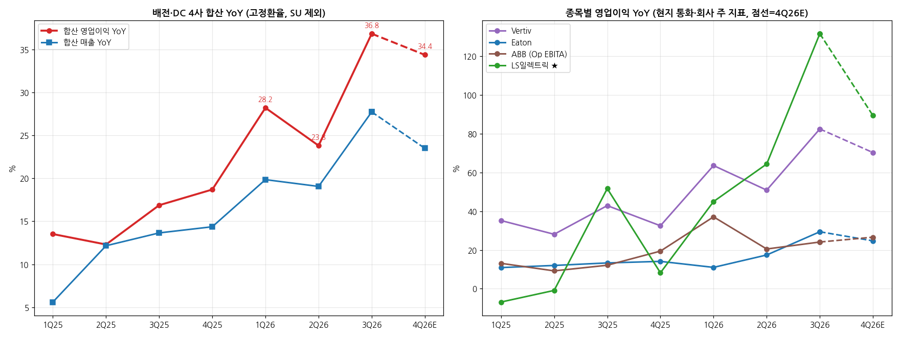
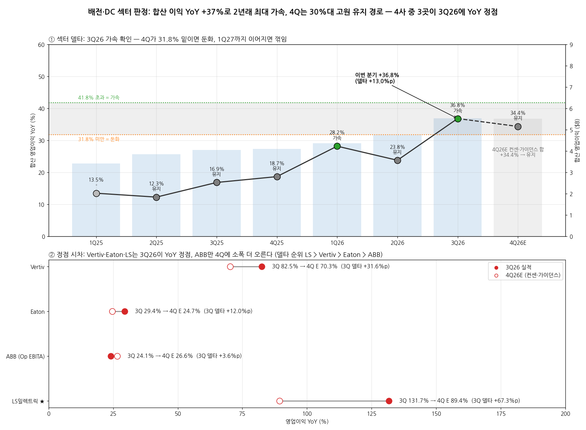

# 전력 인프라 · 배전·DC 전력관리 섹터 리뷰

> 현재 상태 (최신 분기 기준)
> 최신 분기: 2026-Q3
> 섹터 델타: 가속 | 내러티브: 유지
> 모멘텀 신호: 없음
> 활성 테마: 없음
> 포지셔닝: 서브섹터 확대 | 한국 아웃퍼폼 | 1등 LS일렉트릭·Vertiv
> 편입 종목: Eaton, Vertiv, ABB, LS일렉트릭 (합산) + Schneider Electric (분기 이익 미공시 — 비교만)
> 갱신 시각: 2026-11-15 15:00 KST

## 누적 시계열

| 분기 | 편입 종목 | 합산 매출 | 합산 영업이익 | OPM | 매출 YoY | 영업이익 YoY | 영업이익 YoY 델타 (%p) | 섹터 델타 | 내러티브 | 모멘텀 신호 | 활성 테마 |
|---|---|---|---|---|---|---|---|---|---|---|---|
| 1Q24 | ETN·VRT·ABB·LS | 208,603억원 ($15.70B) | 40,050억원 ($3.01B) | 19.2 | — | — | — | — | - | - | - |
| 2Q24 | 동일 | 230,213억원 ($16.79B) | 46,983억원 ($3.43B) | 20.4 | — | — | — | — | - | - | - |
| 3Q24 | 동일 | 227,628억원 ($16.76B) | 47,080억원 ($3.47B) | 20.7 | — | — | — | — | - | - | - |
| 4Q24 | 동일 | 245,269억원 ($17.56B) | 48,362억원 ($3.46B) | 19.7 | — | — | — | — | - | - | - |
| 1Q25 | 동일 | 239,822억원 ($16.51B) | 49,607억원 ($3.41B) | 20.7 | +5.6 | +13.5 | — | — | - | - | - |
| 2Q25 | 동일 | 264,102억원 ($18.81B) | 54,003억원 ($3.85B) | 20.4 | +12.2 | +12.3 | -1.2 | 유지 | - | - | - |
| 3Q25 | 동일 | 263,973억원 ($19.03B) | 56,183억원 ($4.05B) | 21.3 | +13.6 | +16.9 | +4.6 | 유지 | - | - | - |
| 4Q25 | 동일 | 289,416억원 ($20.04B) | 59,288억원 ($4.11B) | 20.5 | +14.4 | +18.7 | +1.8 | 유지 | - | - | - |
| 1Q26 | 동일 | 289,887억원 ($19.77B) | 64,157억원 ($4.38B) | 22.1 | +19.8 | +28.2 | +9.5 | 가속 | - | - | - |
| 2Q26 | 동일 | 335,396억원 ($22.33B) | 71,433억원 ($4.76B) | 21.3 | +19.1 | +23.8 | -4.4 | 유지 | - | - | - |
| **3Q26** | 동일 | **344,824억원 ($24.28B)** | **78,674억원 ($5.54B)** | **22.8** | **+27.7** | **+36.8** | **+13.0** | **가속** | **유지** | **없음** | **없음** |

→ **합산 방식**: 달러 기준 합산. LS일렉트릭(원화)은 분기 평균 원/달러로 환산했고, 원화 금액은 합산 달러를 그 분기 환율로 다시 환산한 값이다
→ **YoY 기준**: 고정환율 — 전년 분기 LS일렉트릭 숫자를 이번 분기 환율로 환산해 계산했다. ABB는 달러 보고 숫자 그대로다(ABB 환율 제외 Op EBITA YoY는 ②에 병기)
→ **종목별 이익 지표**: Eaton 세그먼트 영업이익 / Vertiv 조정 영업이익 / ABB Operational EBITA (4Q26E는 부동산 매각익 제외 $2,010M) / LS일렉트릭 연결 영업이익
→ **Schneider Electric 제외**: 1Q·3Q에는 매출만 발표하고 이익은 반기에만 공시한다. 스킬 규칙(분기 영업이익 미공시 종목은 합산·델타에서 빼고, 전년 동기에서도 같이 뺀다)에 따라 전 분기 모두 SU를 뺀 4사 동일 표본이다. SU는 ③·⑦에 매출·수주 숫자로만 남긴다
→ **통합 리뷰와의 차이**: `전력 인프라_섹터리뷰.md`(11/14)의 배전·DC 행(+7.1 → … → 3Q26 +27.1%)은 SU를 "반기 마진 × 분기 매출"로 추정해 넣고 Vertiv 없이 계산한 숫자다. 이 문서는 SU를 빼고 Vertiv를 넣은 4사 기준이라 숫자가 다르다(3Q26 +36.8%). 통합 리뷰 갱신 시 이 문서 숫자로 바꾼다
→ **적용 환율 (원/달러, 분기 평균)**: 1Q24 1,329 [근사] · 2Q24 1,371 · 3Q24 1,358 · 4Q24 1,397 · 1Q25 1,453 · 2Q25 1,404 · 3Q25 1,387 · 4Q25 1,444 · 1Q26 1,466 · 2Q26 1,502 · 3Q26 1,420 · 4Q26E 1,340 (출처: `전력 인프라_섹터리뷰.md` 환율 행, 1Q24는 근사치)
→ 소급 행 판정은 같은 기준으로 계산했다. 내러티브·신호·테마 열은 당시 리뷰가 없어 `-`

---

## 2026-Q3 섹터 리뷰

> 대상: `earnings-review/2026-Q3_{ETN|VRT|ABB|LS일렉트릭|SU}_리뷰.md` (SU는 비교만)
> 첫 서브섹터 리뷰 — 직전 체크 없음. 상위 문서 `전력 인프라_섹터리뷰.md`(11/14)는 이 리뷰와 송변전·발전 리뷰를 받아 다시 갱신한다
> 이 문서가 답하는 질문: 배전·DC를 전력 섹터 안에서 늘릴지(⑦(1)), 이 서브섹터 안에서 한국이 이기는지(⑦(2)), 1등 종목은 누구인지(⑦(3))

① 섹터 합산 숫자와 델타

| 항목 | 1Q25 | 2Q25 | 3Q25 | 4Q25 | 1Q26 | 2Q26 | **3Q26** | 4Q26E |
|---|---|---|---|---|---|---|---|---|
| 합산 매출 ($B) | 16.51 | 18.81 | 19.03 | 20.04 | 19.77 | 22.33 | **24.28** | 24.85 |
| 합산 영업이익 ($B) | 3.41 | 3.85 | 4.05 | 4.11 | 4.38 | 4.76 | **5.54** | 5.53 |
| OPM (%) | 20.7 | 20.4 | 21.3 | 20.5 | 22.1 | 21.3 | **22.8** | 22.2 |
| 매출 YoY (고정환율) | +5.6 | +12.2 | +13.6 | +14.4 | +19.8 | +19.1 | **+27.7** | +23.5 |
| 영업이익 YoY (고정환율) | +13.5 | +12.3 | +16.9 | +18.7 | +28.2 | +23.8 | **+36.8** | +34.4 |
| **영업이익 YoY 델타 (%p)** | — | -1.2 | +4.6 | +1.8 | +9.5 | -4.4 | **+13.0** | -2.5 |
| 판정 | — | 유지 | 유지 | 유지 | 가속 | 유지 | **가속** | 유지 |

→ (출처: 4사 2026-Q3 리뷰 1-1 분기 표 [계산]. 4Q26E: Eaton 4Q 가이던스 마진 × 신한 매출 추정, Vertiv 4Q 가이던스 중간값, ABB 매각익 제외 역산치, LS일렉트릭 FnGuide 컨센 평균)
→ **이익 레벨**: 3Q26 합산 영업이익 $5.54B(7.9조원), 마진 22.8%로 둘 다 사상 최대다
→ **델타**: 영업이익 YoY가 +23.8% → +36.8%로 13.0%p 커져 2년래 최대 가속이다. 매출 YoY(+19.1% → +27.7%)도 함께 올라 "강한 가속"이다. 2Q26의 일시 둔화(-4.4%p, Vertiv 공급망 차질·ABB 1Q 기저)를 지나 다시 위로 꺾였다
→ **증가분 기여** (3Q26 영업이익 +$1.49B): Eaton +$514M(34%), Vertiv +$491M(33%), ABB +$393M(26%), LS일렉트릭 +$93M(6%) [계산]. 미국 2사(Eaton·Vertiv)가 2/3를 만들었다
→ **컨센 경로상 YoY 정점은 3Q26**이다. 4Q26E +34.4%로 내려오지만 -2.5%p라 "유지" 범위다. 4사 중 3곳(Vertiv·Eaton·LS)이 3Q26에 YoY 정점을 찍고, ABB만 4Q에 소폭 더 오른다. 그래도 합산은 30%대 고원을 지키는 경로다 — 송변전(정점 3Q25 통과)·발전(4Q 급감속)과 다른 점이다

→ (출처: 4사 2026-Q3 리뷰 [계산]. 왼쪽 = 4사 합산 매출·영업이익 YoY(고정환율, SU 제외) / 오른쪽 = 종목별 영업이익 YoY(현지 통화·회사 주 지표, ★ = 한국). 점선 = 4Q26E)

② 종목별 델타 판정표

| 델타 순위 | 종목 | 국가 | 매출 YoY | 영업이익 YoY | 영업이익 YoY 델타 | 델타 판정 | 내러티브 | 한 줄 |
|---|---|---|---|---|---|---|---|---|
| 1 | LS일렉트릭 | 한국 | +54.4% | +131.7% | +67.3%p | 가속 | 강화 | 미국 데이터센터 배전반이 끈 분기 최대 실적, 컨센 대비 영업이익 +20%. OPM 12.4%로 피어 중 가장 낮고, 4Q E +89%로 감속폭이 가장 크다 |
| 2 | Vertiv | 미국 | +61.2% | +82.5% (조정) | +31.6%p | 가속 | 강화 | 2Q 실행력 우려를 지우고 컨센 대비 영업이익 +18%. 유기적 수주 +100% 이상, 가이던스 세 번째 상향. 수주 공시 중단 |
| 3 | Eaton | 미국 | +28.0% | +29.4% (세그먼트) | +12.0%p | 가속 | 강화 | 마진 25.3% 사상 최고, 데이터센터 수주 +101%, 가이던스 세 번째 상향. 롤링 수주 증가율은 41% → 39% |
| 4 | ABB | 유럽 | +14.3% | +24.1% (Op EBITA, 환율 제외 +24%) | +3.6%p (환율 제외 +6%p) | 가속 | 유지 | Electrification 북미 수주 +117%, 마진 20.8%. EPS 미스는 영업 외 항목. 4Q E +27%(매각익 제외)로 4사 중 유일하게 YoY가 더 오른다 |
| — | Schneider Electric | 유럽 | +17.9% (organic +16.9%) | 미공시 (반기) | organic 델타 +0.4%p | 유지 | 유지 | 분기 매출 최대, 연간 마진 가이던스 두 번째 상향. 북미 organic +23% → +20% 감속, PTC 인수 오버행 |

→ (출처: 각 종목 2026-Q3 리뷰 0번 판정 그대로. 순위 = 영업이익 YoY 델타 큰 순. SU는 이익 미공시라 순위 제외)
→ **판정 분포**: 합산 4사 모두 가속, 내러티브는 강화 3(LS·Vertiv·Eaton) · 유지 1(ABB). SU는 유지·유지
→ **델타를 끄는 것은 미국 2사**(이익 증가분의 67%)이고, **델타 폭은 한국 LS가 가장 크다** — 다만 LS는 저마진 기저(3Q25 OPM 8.3%)에서 나온 숫자라 4Q 감속폭(-42%p)도 가장 크다
→ **선행 종목**: 먼저 가속한 쪽은 Vertiv(1Q26 +63.6%)이고, 먼저 감속하는 쪽은 Schneider 북미(organic +23% → +20%)와 Eaton 롤링 수주(+41% → +39%)다. 이익보다 수주 증가율이 먼저 고원에 들어섰다

③ 섹터 공통 쟁점

(1) 북미 데이터센터 수주 — 둔화하고 있나 (5사 공통)

| 종목 | 3Q26 데이터센터·북미 수주 신호 | 해석 |
|---|---|---|
| Vertiv | 유기적 수주 +100% 이상, 미주 파이프라인 분기 증가 속도 사상 최고, 선수금 $4.12B(1년 새 3.6배). 다음 분기부터 수주 미공시 | 가속. 단 선행지표가 사라진다 |
| Eaton | 데이터센터 수주 +101%(12개월 롤링), 파이프라인 307 → 366GW, Electrical Americas 분기 수주 $5B+ 사상 최대. EA 롤링 수주 증가율 41% → 39% | 가속. 증가율만 정점권 |
| ABB | 수주 +40%, Electrification +70%(북미 +117%), 데이터센터 2개 분기 연속 세 자릿수. "선주문 없음, 선수금·취소 조항 보유" | 가속 |
| LS일렉트릭 | 미국 수주 비중 66%, 3분기 누적 수주의 50% 이상이 데이터센터. 잔고 7.04조원 QoQ +0.6%(원화 강세 환산·2Q 선발주) | 레벨 견조, 증가 정체 |
| Schneider | 데이터센터 수주 4개 분기 중 3개 분기 세 자릿수. 북미 organic +23.1% → +19.9% | 고원 |

→ (출처: 각 종목 리뷰 2번 쟁점)
→ **공통 결론: 배전·DC에서는 북미 데이터센터 수주 둔화가 보이지 않는다**. 세 자릿수 증가가 3곳(Vertiv·Eaton·ABB 북미)이고, 둔화 신호는 증가율 지표 2개(Eaton 롤링 41% → 39%, SU 북미 organic 23% → 20%)뿐이다
→ 갈리는 지점: **수요 레벨이 아니라 증가율의 정점**이다. 그리고 수주를 보는 창이 좁아진다 — Vertiv가 수주 공시를 끊었고, SU는 분기 이익을 내지 않는다. 다음 분기부터는 Eaton 롤링 수주·ABB 북미 수주·Vertiv 선수금 세 가지로 읽어야 한다
→ **[판단]** 송변전(HD 수주 -19%)·발전(GEV 데이터센터 수주 $2.4B → $1.4B)에서 나온 "둔화"는 슬롯·납기 문제였다. 배전·DC는 단납기라 수요가 바로 수주·매출로 찍히는 레이어인데 여기서 둔화가 없다는 점이 섹터 전체의 수요 판단에 가장 직접적인 증거다

(2) 정치 이벤트 — 중간선거·텍사스 모라토리엄·12월 FERC (5사 공통, 노출도 최대 서브섹터)

| 종목 | 노출 | 이벤트 후 주가·멀티플 |
|---|---|---|
| Vertiv | 데이터센터가 매출 대부분 | 발표일 +16% 후 11/3 선거 뒤 1주 약 -23%, 실적 발표일 종가 대비 약 -18%. Fwd P/E 5월 55배 → 11/9 약 22배(5년 평균 27배) |
| LS일렉트릭 | 잔고 50%+ 데이터센터, 미국 수주 66% | 고점 대비 -48%. 전력 3사 중 FERC 노출 최대 |
| Eaton | EA 데이터센터 매출 +65% | 고점 대비 -15% |
| ABB | Electrification 데이터센터 비중 상승 | TP 하향(Goldman 82 → 79, LBBW 85 → 75 CHF) |
| Schneider | 그룹 매출 최소 13% 북미 데이터센터 [추정] | PTC 발표 후 -21%(별도 요인) |

→ (출처: 각 종목 리뷰 2번 쟁점·2-4. 일정: FERC RTO 보고 11/16~20, ERCOT 감사 12/10, FERC 반론 시한 12/16)
→ Vertiv CEO: "전력 확보·인허가·모라토리엄·숙련 인력을 속도 조절 요인으로 본다. 상당수는 우리 강점(모듈화·조립식으로 구축 시간 단축)이 통하는 영역이다"
→ **[판단]** 배전·DC는 FERC·주(州) 규제 결론에 가장 직접 노출된 서브섹터다. 강화(데이터센터 비용 부담·모라토리엄 확산) 쪽이면 5사 모두 멀티플이 한 번 더 눌리고, 이 중 온사이트 전원·모듈형(Vertiv·Eaton·LS의 Bloom 연료전지 물량) 비중이 높은 쪽이 계통 우회 수요로 일부 헤지된다. 완화 쪽이면 낙폭이 가장 큰 Vertiv·LS의 반등 탄력이 가장 크다

(3) 이익 추정 상향 + 멀티플 하향 (5사 공통)

| 종목 | 이익 추정 | TP | 주가 |
|---|---|---|---|
| Vertiv | 2027 EPS 컨센 $9.17 → $9.45 | 컨센 TP 7월 $381 → 10월 말 $335 | 선거 후 급락 |
| Eaton | 2026·27 EPS 상향 | $490.7 → 약 $477 | 고점 대비 -15% |
| ABB | 유지 | CHF 80.8 → 78.7 | 고점 대비 -20% |
| LS일렉트릭 | 2026·27 영업이익 +8.8% / +9.7% | 28.2만원 → 27.0만원 | 고점 대비 -48% |
| Schneider | 상향 | JPM OW → Neutral(€345 → €310) | PTC 후 -21% |

→ **[판단]** 5사 모두 TP 하향의 원인은 멀티플이다. 이익 추정을 내린 곳은 없다. 서브섹터 내러티브를 "강화"가 아닌 "유지"로 두는 이유다(기준표상 강화는 TP 상향 동반)

(4) 다음 성장축 — 800V DC·액체냉각·SST (Vertiv·Eaton 공통)

→ Vertiv: 800V DC 중간 단계(사이드카)는 2027년 매출 시작, 네이티브 800V DC는 2027 검증·2028 배치. 액체냉각 비중은 "훨씬 커지고 있다"(수치 미공개), 칠러 2배 증설. 3사 모두 2026~27 이익 추정에는 거의 넣지 않았다
→ Eaton: Boyd(액체냉각) 2026 매출 $1.9B → 2027 최소 $2.7B, 3월부터 organic 편입. 800V DC·SST 파일럿 10개 → 2027 볼륨 전환
→ **[판단]** 2027년 델타를 바꿀 변수는 아니다. 2028년 이후 "델타 재가속" 후보로 ⑥에 둔다. Eaton의 Boyd organic 편입(2027-03)은 2027년 organic 성장률을 숫자로 올리는 효과가 있다

(5) 종목 고유 이슈
→ Schneider: PTC 인수(EV $23.7B)·€6B 증자(주당 €240)·자사주 매입 2027~28년 중단 — 펀더멘털과 무관한 주가 오버행
→ ABB: Rotork 인수 환헤지 평가손·Robotics 중단사업 손실로 EPS 미스, 1월 FY2027 가이던스(백로그 $32.3B 중 약 40% 2027 전환)
→ Vertiv: 수주 공시 중단, 2/10 첫 2027 가이던스(컨센 매출 +32%, 조정 영업이익 +42%)
→ Eaton: Mobility-Dana RMT 종결, 1/2 일반 가격 인상
→ LS일렉트릭: 관세 환급(+)과 중국 법인 손실(-485억원) 상쇄, 초고압변압기 잔고 3.35조 → 3.17조원, 원화 강세

④ 섹터 판정

> 섹터 델타: **가속** | 내러티브: **유지** → **배전·DC 합산 이익 YoY +36.8%로 2년래 최대 가속, 4Q는 +34%대 고원 유지 경로 — 송변전·발전과 달리 정점 이후에도 30%대를 지키는 유일한 서브섹터. 남은 변수는 수요가 아니라 12월 FERC와 멀티플. 4Q26 합산 영업이익 YoY 31.8% 미만이면 둔화**

→ (출처: 4사 2026-Q3 리뷰 [계산]. 상단 = 4사 합산 영업이익 YoY(고정환율, SU 제외. 점 색 = 분기별 판정, 막대 = 합산 영업이익 $B)와 4Q26 판정선(31.8% / 41.8%) / 하단 = 종목별 3Q26 → 4Q26E 영업이익 YoY와 3Q 델타)

→ **델타 판정 근거**: 합산 영업이익 YoY가 2Q26 +23.8%에서 3Q26 +36.8%로 13.0%p 커져 "가속"이다. 합산 4사가 모두 가속이고 매출 YoY도 +19.1% → +27.7%로 같이 올랐다. 컨센 4Q26E는 +34.4%(-2.5%p)로 "유지" 범위다
→ **내러티브 판정 근거**: 종목별로 강화 3, 유지 2(ABB·SU). 섹터 공통 스토리 "AI 데이터센터 전력·열관리 수요 → 단납기 수주 → 증설 → 마진 확장"은 숫자로 확인됐다(수주 세 자릿수 3곳, 마진 사상 최고 3곳, 가이던스 상향 4곳). 그러나 5사 모두 TP가 내려갔다 — 이익 상향과 멀티플 하향이 상쇄돼 "유지"
→ **[판단] 결정적 근거는 정점 이후의 높이다**. 4사 중 3곳이 3Q26에 YoY 정점을 찍지만 감속폭이 크지 않고(Vertiv -12%p, Eaton -5%p) ABB가 오히려 올라 합산은 30%대에 머문다. 송변전(+44% → +32%, 3Q25 정점 통과)·발전(+113% → 4Q +77%)과 비교하면 배전·DC는 "정점 통과 = 급감속"이 아닌 고원이다
→ 직전 판정 대비 변화: 첫 서브섹터 리뷰. 소급 궤적은 유지(2Q25~4Q25) → 가속(1Q26) → 유지(2Q26) → 가속(3Q26)으로, 2025년 +12~19%의 완만한 구간에서 2026년 +24~37%로 한 단계 올라섰다

⑤ 모멘텀 신호

→ **없음** — 활성 테마가 없어 "테마 종료 후보"는 해당하지 않는다
→ 델타 급증 후보 조건 대조
→ ① 섹터 영업이익 YoY 델타 확대 — **충족**. +13.0%p, 2년래 최대 (단 2Q26 -4.4%p로 2개 분기 연속은 아님)
→ ② 편입 종목 과반 가속 — **충족**. 합산 4사 전부 가속
→ ③ 내러티브 형성·강화 — **미충족**. 유지 (5사 TP 하향)
→ 조건 3개 중 2개 충족이지만 후보로 올리지 않는다. 컨센 경로상 3Q26이 YoY 정점이고 4Q가 고원이라 "새 델타 급증"이 아니라 "가속의 마지막 분기 + 고원 진입"으로 본다 [판단]
→ 다음 분기 후보로 올릴 조건: 4Q26 합산 YoY 41.8% 초과(가속 유지) + 12월 FERC 완화 결론 + TP 상향 전환
→ **반대 논거**: (1) 레이어상 하이퍼스케일러 capex의 공급 측이라 capex가 꺾이지 않는 한 고원이 2027년까지 이어질 수 있다(Vertiv 2027 컨센 영업이익 +42%, Boyd organic 편입) (2) 800V DC·액체냉각은 2028년 델타 재가속 후보다
→ 테마 키워드 제안 (제안일 뿐): "AI 데이터센터 전력·열관리 — 단납기 배전·UPS·액체냉각·800V DC" (Vertiv·Eaton·LS 중심)

⑥ 다음 분기 섹터 관전 포인트

| 순위 | 무엇을 (변수·임계값) | 어떤 데이터로 | 언제 |
|---|---|---|---|
| 1 | **4Q26 4사 합산 영업이익 YoY(고정환율) 31.8% 이상 — 미만이면 둔화**. 금액으로는 4Q26 환율 기준 $5.42B 이상. 41.8%($5.83B) 초과면 가속. 컨센·가이던스 합 $5.53B(+34.4%)는 유지 경로. 1Q27까지 둔화가 이어지면 꺾임 | 4사 4Q26 실적 | 1월 말(ABB·LS) ~ 2/10(Vertiv)·2월 초(Eaton) |
| 2 | 12월 FERC·ERCOT·텍사스 모라토리엄 결론 — 배전·DC가 노출도 최대 | FERC RTO 보고(11/16~20), ERCOT 감사(12/10), FERC 반론 시한(12/16), 텍사스 주 의회 동향 | 11월 중순 ~ 12월 중순 |
| 3 | 수주 증가율 고원 여부 — Eaton EA 롤링 수주 35% 이상, ABB 북미 Electrification 수주 세 자릿수 유지, Vertiv 선수금 $4.1B 이상 유지(수주 공시 대체), SU 북미 organic 15% 이상 | 4Q 보도자료·컨콜 | 1월 말 ~ 2월 |
| 4 | 2027 가이던스 — Vertiv(2/10, 컨센 영업이익 +42%), Eaton(2월, organic 두 자릿수·EPS $16+), ABB(1월, comparable 성장), SU(2/18) | 각 사 4Q 발표 | 1월 말 ~ 2/18 |
| 5 | LS일렉트릭 4Q 영업이익 2,457억원(+89%) 이상 + 전력인프라 OPM 유지 — 한국 아웃퍼폼 유지 조건 | LS일렉트릭 4Q 잠정실적 | 1월 말 |

→ 1순위 판정선(31.8%)은 ④ 키 차트와 같다. 근거: 3Q26 +36.8%에서 "유지" 범위(±5%p)를 뺀 값이다. 4Q가 이 아래면 둔화, 1Q27까지 이어지고 정점(3Q26)이 확인되면 꺾임이다

⑦ 글로벌 PM 포지셔닝 — 결론

> **서브섹터: 확대 — 전력 섹터 안에서 비중을 옮겨 올 1순위. 12월 FERC 강화 결론이면 비중 확대 속도 조절** | **한국: 아웃퍼폼 (LS일렉트릭 — 서브섹터 내 델타 1위, 단 4Q 감속폭 최대)** | **1등: LS일렉트릭(델타) · Vertiv(글로벌)**

(1) 서브섹터 판정 — 확대 / 유지 / 축소

| 판단 축 | 3Q26 근거 | 방향 |
|---|---|---|
| 이익 델타 (1순위) | 합산 영업이익 YoY +23.8% → +36.8%, 4사 모두 가속 | 확대 |
| YoY 정점 시점 | 컨센상 정점 3Q26이지만 4Q26E +34.4%로 고원 유지(-2.5%p) | 확대~유지 |
| 수주 선행지표 | 데이터센터 수주 세 자릿수 3곳, 증가율 정점 신호 2개(ETN 롤링·SU 북미) | 확대 |
| 최종 수요 | 하이퍼스케일러 capex 공급 측. 단납기라 수요가 바로 숫자로 찍힘 | 확대 |
| 이벤트·정책 | 12월 FERC·텍사스 모라토리엄에 노출도 최대 | 축소 (이벤트 전) |
| 밸류에이션 (2순위) | Vertiv Fwd P/E 약 22배(5년 평균 27배), Eaton 27~29배, ABB 22배. 5사 모두 멀티플 하향 | 확대 |
| 주가 낙폭 | 고점 대비 -15%(ETN) ~ -48%(LS), Vertiv 선거 후 -18% | 중립 |

→ **결론: 확대** [판단]. 송변전·발전과 비교해 정점 이후에도 30%대 고원을 지키는 유일한 서브섹터다. 전력 섹터 비중을 유지하더라도 섹터 안에서 비중을 옮겨 올 1순위다. 다만 12월 FERC 결론 전까지는 이 서브섹터가 정치 이벤트에 가장 민감하므로, 확대 속도는 이벤트 결과를 보고 조절한다
→ **유지로 내리는 조건**: 4Q26 합산 YoY 31.8% 미만, 또는 FERC·텍사스가 데이터센터 접속 비용 전가·모라토리엄 확산 쪽으로 결론
→ **축소로 내리는 조건**: 위 두 가지 동시 충족, 또는 Eaton 롤링 수주 증가율 30% 미만 + Vertiv 선수금 감소

(2) 서브섹터 안 한국 vs 글로벌

| 국가 | 종목 | 영업이익 YoY 2Q26 → 3Q26 | 델타 | 판정 | 마진 (3Q26) | 4Q26E YoY |
|---|---|---|---|---|---|---|
| 미국 | Eaton·Vertiv | +24.9% → +42.9% [계산] | +18.0%p | 가속 | 25.3% · 25.2% | ETN +24.7% · VRT +70.3% |
| 유럽 | ABB (SU 제외) | +20.5% → +24.1% | +3.6%p | 가속 | 20.8% | +26.6% |
| **글로벌 3사 합** | Eaton·Vertiv·ABB | **+23.0% → +35.1%** | **+12.1%p** | 가속 | — | +33.0% |
| **한국** | **LS일렉트릭** | **+64.4% → +131.7%** | **+67.3%p** | 가속 | **12.4%** | **+89.4%** |

| 경쟁력 축 | 한국 (LS일렉트릭) | 글로벌 (Eaton·Vertiv·ABB·SU) | 우위 |
|---|---|---|---|
| 델타 방향 (1순위) | +67.3%p, 서브섹터 1위 | 글로벌 3사 합 +12.1%p | **한국** |
| 마진 레벨 | 12.4% (전력인프라 17.1%) | 20.8~25.3% | 글로벌 |
| 마진 방향 | +4.1%p YoY, 상승 | 3사 상승 (Eaton·Vertiv 사상 최고) | 비슷 |
| 수주 증가율 | 미국 수주 비중 66%, 잔고 QoQ +0.6% (정체) | 데이터센터 세 자릿수 3곳 | 글로벌 |
| 생산능력·현지화 | 배전반 +30% 증설, 유타 공장 일정 | Eaton 증설 25개 중 18개 완료, Vertiv 칠러 2배 | 글로벌 |
| 관세 | 관세 환급 일회성(+), 미국 수출 품목 관세 부담 | 미국 현지 생산 중심 | 글로벌 |
| 환율 | 원화 강세 — QoQ 매출 약 450억원·잔고 2,100~2,800억원 감소 [추정] | 달러·유로 영향 작음 | 글로벌 |
| 이익 추정 | 2026·27 +8.8% / +9.7% (5사 중 최대 상향폭) | 상향 또는 유지 | 한국 |
| 밸류에이션·낙폭 (2순위) | 고점 대비 -48% | -15% ~ -21%, Vertiv 선거 후 -18% | 한국 |

→ **결론: 서브섹터 안에서 한국 아웃퍼폼** [판단] — 비교 범위: 글로벌 편입 종목 4사(숫자 중심 리뷰) + SU(매출만)
→ 이유 (1) 델타가 서브섹터 1위다. 한국 LS의 영업이익 YoY 델타(+67.3%p)는 글로벌 3사 합(+12.1%p)의 5배 이상이다
→ 이유 (2) 이익 추정 상향폭이 5사 중 가장 크다(+8.8~9.7%)
→ 이유 (3) 낙폭이 가장 커서(고점 대비 -48%) FERC 완화 시 반등 탄력이 가장 크다
→ **반대 논거**: LS의 델타는 저마진 기저(3Q25 OPM 8.3%)에서 나온 숫자다. 마진 레벨은 글로벌의 절반이고, 4Q E 감속폭(-42%p)이 가장 크다. 잔고는 정체(QoQ +0.6%)이고 원화 강세가 이어지면 환산 숫자가 깎인다. "서브섹터 내 효과"는 이번 분기 한국 우위지만 지속성은 4Q에서 확인해야 한다 — 4Q가 +89% 밑이면 아웃퍼폼 근거가 약해진다
→ 통합 리뷰용 메모: 한국의 전력 섹터 언더퍼폼은 **믹스 효과**(한국 종목이 송변전에 쏠림)가 크고, 배전·DC 안에서는 오히려 한국이 이기고 있다

(3) 서브섹터 1등 종목

| 구분 | 종목 | 델타 판정 | 근거 한 줄 |
|---|---|---|---|
| **델타 1위 (서브섹터 전체)** | LS일렉트릭 | 가속 · 강화 | 영업이익 YoY +64% → +132%(+67.3%p), 컨센 대비 +20%. 4Q E +89%로 감속폭이 가장 커 "정점 분기"인 점은 감안 |
| **글로벌 1등** | Vertiv | 가속 · 강화 | 영업이익 YoY +51% → +83%(+31.6%p), 4Q E +70%로 정점 이후 높이가 가장 높다. 수주 +100%+, 선수금 3.6배. 수주 공시 중단·텍사스 노출이 리스크 |
| 글로벌 2등 | Eaton | 가속 · 강화 | 마진 25.3% 사상 최고, 델타 +12.0%p. 4Q E +25%로 감속폭 작고 Boyd organic 편입(2027-03) |
| 글로벌 비선호 | Schneider | 유지 · 유지 | 이익 미공시 분기, 북미 감속, PTC 오버행 |
| 중립 | ABB | 가속 · 유지 | 델타 +3.6%p로 가장 작지만 4Q에 YoY가 더 오르는 유일한 종목. 1월 FY2027 가이던스 대기 |

→ BT 프레임(델타 1순위) 기준 순위: LS일렉트릭 > Vertiv > Eaton > ABB. 정점 이후의 높이(4Q E)까지 보면 Vertiv(+70%) > LS(+89%, 감속폭 -42%p) 순으로 지속성은 Vertiv가 앞선다 [판단]

(4) 콜을 바꾸는 조건과 일정

| 시점 | 이벤트 | 서브섹터 판정 | 한국 콜 |
|---|---|---|---|
| 11/16~20 · 12/10 · 12/16 | FERC RTO 보고 → ERCOT 감사 → FERC 반론 시한 (+ 텍사스 모라토리엄 동향) | 완화 → 확대 유지 / 강화 → 유지로 하향 | 완화 → LS 반등 탄력 최대 / 강화 → LS 노출 최대, 중립 하향 검토 |
| 1월 말 | ABB·LS 4Q 실적, ABB FY2027 가이던스 | 합산 판정 시작 | LS 4Q 영업이익 2,457억원(+89%) 미만이면 중립 하향 |
| 2월 초 ~ 2/10 | Eaton·Vertiv 4Q, 2027 가이던스 | 4사 합산 YoY 31.8% 이상 유지 / 41.8% 초과면 가속 | 글로벌 3사 4Q YoY(+33% E)와 LS 비교 |
| 2/18 | Schneider FY26, 2027 가이던스 | 2H26 마진 20.3%+ 확인 | — |
| 상시 | 원/달러 1,300원대 | — | 원화 강세 지속 시 LS 2027E 하향 → 중립 |

→ 출처: 각 종목 2026-Q3 리뷰 2·4번, Vertiv 리뷰의 밸류에이션 웹 자료(TIKR 10/30·11/10, 삼성증권 10/30)

### (서브) Schneider Electric — 어떻게 되고 있나

→ 합산·판정에는 넣지 않음 (분기 영업이익 미공시). 단독 판정: `성장 델타: 유지 | 내러티브: 유지 → 관망 구간`
→ 3Q26 매출 €11,460M(organic +16.9%), 분기 최대. 연간 adj. EBITA margin 가이던스 19.4~19.7% → 19.7~19.9%로 두 번째 상향. 4Q 내재 organic +4~11%(중간 +7.8%)로 4Q25 고기저 부담
→ 피어 대비: organic 성장률(+16.9%)은 ABB comparable(+14%)보다 높고 Eaton organic(+19%)·Vertiv(+55%)보다 낮다. 북미 organic이 +23% → +20%로 감속해 북미 비중이 큰 Eaton·Vertiv와 방향이 다르다
→ 주가는 PTC 인수(EV $23.7B)·€6B 증자로 펀더멘털과 분리돼 움직인다. 이익 공시가 나오는 2/18(2H26) 리뷰에서 합산 편입 여부와 2H 마진(20.3% 내재)을 확인한다
