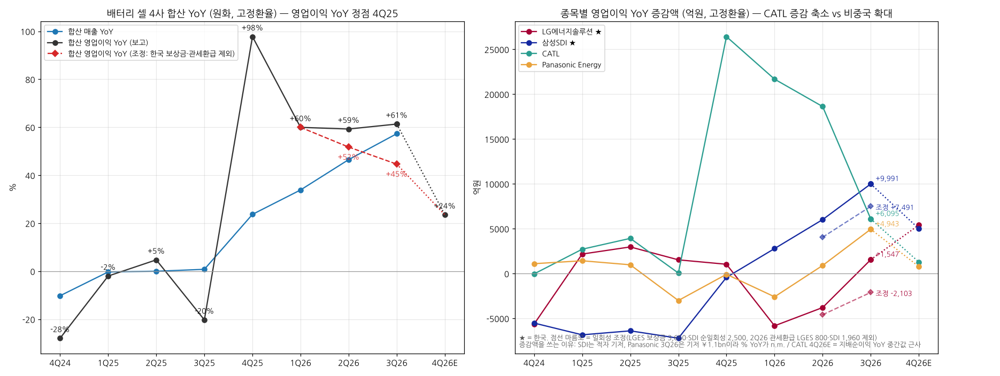
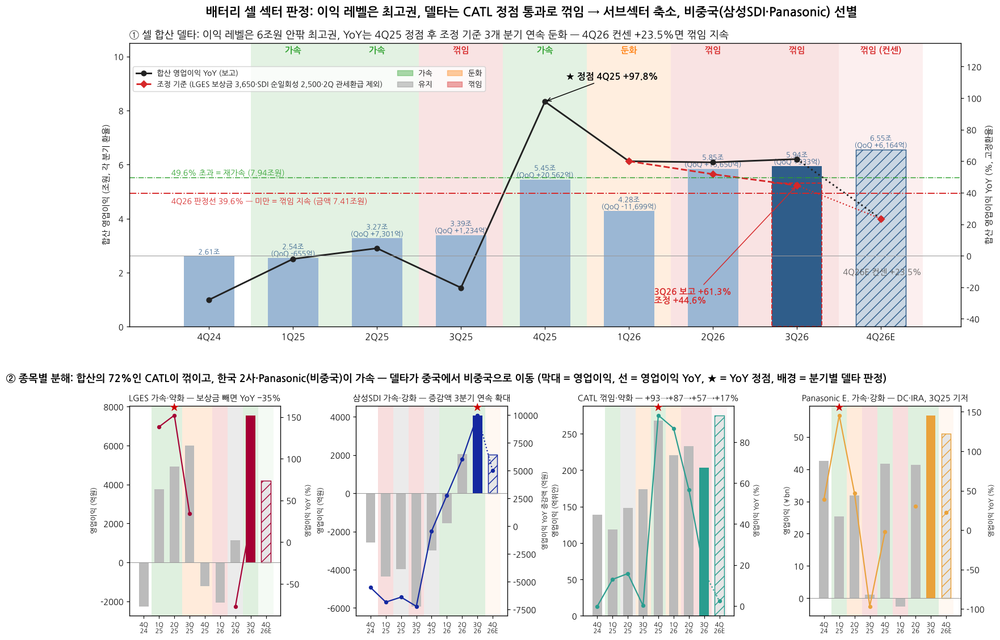

# 배터리 · 배터리 셀 섹터 리뷰

> 현재 상태 (최신 분기 기준)
> 최신 분기: 2026-Q3
> 섹터 델타: 꺾임 | 내러티브: 유지
> 모멘텀 신호: 없음
> 활성 테마: 없음
> 포지셔닝: 서브섹터 축소 | 한국 아웃퍼폼 | 1등 Panasonic Energy
> 델타 근거: 합산 YoY(조정) +51.7→+44.6%(-7.1%p, 일회성 포함 보고 기준은 +2.1%p) → 4Q 컨센 +23.5%로 꺾임 지속
> 내러티브 근거: ESS·DC 물량은 4사 모두 확인, 중국사 단위이익 하락에도 스토리 무게중심이 비중국으로 이동해 유지
> PM 근거: 꺾임이 이익 72%인 CATL발이라 서브섹터 축소. 한국 2사는 적자 기저 회복으로 가속해 셀 안 한국 아웃퍼폼
> 편입 종목: LG에너지솔루션, 삼성SDI, CATL, Panasonic Energy
> 갱신 시각: 2026-11-16 18:40 KST

## 누적 시계열

| 분기 | 편입 종목 | 합산 매출 | 합산 영업이익 | OPM | 매출 YoY | 영업이익 YoY | 영업이익 YoY 델타 (%p) | 섹터 델타 | 내러티브 | 모멘텀 신호 | 활성 테마 |
|---|---|---|---|---|---|---|---|---|---|---|---|
| 4Q24 | LGES·SDI·CATL·PE | 325,359억원 | 26,057억원 | 8.0 | -10.2 | -27.9 | — | — | - | - | - |
| 1Q25 | 동일 | 289,566억원 | 25,402억원 | 8.8 | -0.3 | -2.0 | +25.9 | 가속 | - | - | - |
| 2Q25 | 동일 | 295,479억원 | 32,703억원 | 11.1 | -0.0 | +4.7 | +6.7 | 가속 | - | - | - |
| 3Q25 | 동일 | 314,520억원 | 33,937억원 | 10.8 | +0.8 | -20.3 | -25.0 | 꺾임 | - | - | - |
| 4Q25 | 동일 | 415,912억원 | 54,499억원 | 13.1 | +23.7 | +97.8 | +118.0 | 가속 | - | - | - |
| 1Q26 | 동일 | 400,507억원 | 42,800억원 | 10.7 | +33.9 | +60.0 | -37.8 | 둔화 | - | - | - |
| 2Q26 | 동일 | 469,978억원 | 58,450억원 (조정 55,690) | 12.4 | +46.5 | +59.3 (조정 +51.7) | -0.7 (조정 -8.2) | 꺾임 (조정) | - | - | - |
| **3Q26** | 동일 | **520,022억원** | **59,383억원 (조정 53,233)** | **11.4 (조정 10.2)** | **+57.3** | **+61.3 (조정 +44.6)** | **+2.1 (조정 -7.1)** | **꺾임** | **유지** | **없음** | **없음** |
| 4Q26E | 동일 | — (CATL 매출 E 미확보) | 65,547억원 | — | — | +23.5 | -21.1 (조정 3Q26 대비) | 꺾임 (컨센 경로) | | | |

→ **합산 방식**: 4사 영업이익을 각 분기 평균 환율로 원화 환산해 더했다 (억원). 통화가 셋(원·위안·엔)이라 달러 병기 대신 **억원 기준 + 현지통화 YoY는 ②에 병기**한다
→ **이익 지표**: LGES·삼성SDI = K-IFRS 연결 영업이익 (AMPC 포함, 매출은 AMPC 포함 신기준 재작성). CATL = 리뷰의 **한국식 근사 영업이익** (매출 − 매출원가 − 세금과공과 − 판매비 − 관리비 − R&D. 지분법·보조금·손상 제외). Panasonic Energy = HD의 **Energy 세그먼트 조정 영업이익** (IRA 45X 영업이익 반영분 포함)
→ **YoY는 고정환율 기준**이다. 전년 분기를 이번 분기 환율로 다시 환산했다. 따라서 CATL·Panasonic 몫은 현지통화 YoY가 그대로 반영된다. 3Q26을 당시 환율 그대로 비교하면 +75.0%로, 위안 강세(3Q25 193.65 → 3Q26 210.16원)가 약 +14%p를 부풀린다
→ **조정 기준** (각 종목 리뷰의 일회성 추정치): LGES 3Q26 고객 물량 보상금 3,300\~4,000억 중간값 **3,650억**(삼성·미래), 2Q26 관세 환급 약 800억(삼성) / 삼성SDI 3Q26 순일회성 약 **2,500억**(MS: 보상금 − ESS·소형 충당금), 2Q26 관세 환급 1,960억. CATL·Panasonic은 리뷰에 정량 조정치가 없어 조정하지 않았다
→ **판정은 조정 기준**이다 (스킬 규칙: 일회성 왜곡 시 조정 기준). 보고 기준이면 2Q26 유지(-0.7%p) → 3Q26 유지(+2.1%p)다. 조정 기준은 1Q26 둔화(-37.8) → 2Q26 둔화(-8.2) → 3Q26 둔화(-7.1)로 3개 분기 연속 둔화 + 정점(4Q25 +97.8%) 통과라 2Q26부터 "꺾임"이다. 2Q26 행은 첫 작성 소급 판정이다
→ **3Q25 꺾임**은 YoY 마이너스 전환(+4.7% → -20.3%) 때문이다. Panasonic 3Q25 조정OP ¥1.1bn(관세·Kansas 램프업)과 삼성SDI -5,913억 적자가 겹쳤다. 1Q25 "가속"은 YoY 마이너스 폭 축소(-27.9% → -2.0%)다
→ **4Q26E**: LGES 4,193억(5개사 평균) · 삼성SDI 2,011억(4개사 평균) · CATL = 4Q25 한국식 영업이익 268.4억위안 × (1 + 지배순이익 YoY 중간값 +2.4% [JPM 역산 -6.0%, UBS 역산 +10.8%]) = **274.8억위안 [근사, 계산]** · Panasonic = 회사 2H FY3/27 계획(조정OP ¥101.9bn) **균등 분할 ¥51.0bn**. CATL 매출 E는 리뷰에 없어 합산 매출·OPM을 비웠다
→ **적용 환율** (분기 평균, Yahoo KRW=X ÷ CNY=X 일간 및 JPYKRW=X 일간 [계산]. 3Q26은 각 리뷰 값과 일치)
→ CNY/KRW: 4Q24 194.08 · 1Q25 199.41 · 2Q25 193.17 · 3Q25 193.65 · 4Q25 204.15 · 1Q26 211.26 · 2Q26 220.62 · 3Q26 210.16 · 4Q26E 200.26 (10/1\~11/16 평균)
→ JPY/KRW: 4Q24 9.16 · 1Q25 9.51 · 2Q25 9.67 · 3Q25 9.40 · 4Q25 9.39 · 1Q26 9.32 · 2Q26 9.41 · 3Q26 8.89 · 4Q26E 8.46 (10/1\~11/16 평균)
→ 4Q24 이전은 소급하지 않았다 (YoY 기준점 4Q23부터 표 시작). 내러티브·모멘텀 신호·테마 열은 당시 셀 서브섹터 리뷰가 없어 `-`
→ SK온은 BT 결정(2026-11-14)대로 업황 체크용 — 합산·판정 제외, 본문 끝 (서브) 섹션

---

## 2026-Q3 섹터 리뷰

> 대상: `earnings-review/2026-Q3_{LG에너지솔루션|삼성SDI|300750.SZ|6752.T}_리뷰.md` (+ 업황 체크 `2026-Q3_SK온_리뷰.md`)
> 2층 구조의 서브섹터 리뷰다. 섹터 비중(1단계)과 서브섹터 순위(2단계)는 `배터리_섹터리뷰.md`(통합, 이후 작성)가 맡는다. 이 문서는 셀 판정, 셀 안의 한국 vs 글로벌, 셀 1등 종목(3단계)에 답한다
> 첫 셀 서브섹터 리뷰라 직전 분기 관전 포인트·⑦ 콜 체크는 없다

① 섹터 합산 숫자와 델타

| 항목 | 4Q25 | 1Q26 | 2Q26 | **3Q26** | 4Q26E |
|---|---|---|---|---|---|
| 합산 매출 (억원) | 415,912 | 400,507 | 469,978 | **520,022** | — |
| 합산 영업이익 (억원) | 54,499 | 42,800 | 58,450 | **59,383** | 65,547 |
| └ 조정 기준 | 54,499 | 42,800 | 55,690 | **53,233** | 65,547 |
| OPM (%) | 13.1 | 10.7 | 12.4 | **11.4 (조정 10.2)** | — |
| 매출 YoY (고정환율) | +23.7 | +33.9 | +46.5 | **+57.3** | — |
| 영업이익 YoY (고정환율, 보고) | +97.8 | +60.0 | +59.3 | **+61.3** | +23.5 |
| 영업이익 YoY (조정) | +97.8 | +60.0 | +51.7 | **+44.6** | +23.5 |
| **영업이익 YoY 델타 (%p, 조정)** | +118.0 | -37.8 | -8.2 | **-7.1** | -21.1 |
| 판정 | 가속 | 둔화 | 꺾임 | **꺾임** | 꺾임 (컨센) |
| 참고: AMPC·IRA 제외 합산 영업이익 (억원) | 48,250 | 37,468 | 52,168 | **51,038** | 55,008 |
| 참고: AMPC·IRA 제외 YoY (조정) | — | +99.6 | +71.3 | **+45.6** | +17.0 |
| 참고: 한국 2사 YoY 증감액 (억원, 조정) | +610 | -3,040 | -533 | **+5,388** | +10,416 |
| 참고: 글로벌 2사 YoY (CATL+PE) | +81.3 | +69.8 | +54.6 | **+30.1** | +3.6 |
| 참고: 비중국 3사 YoY 증감액 (억원, 조정: LGES+SDI+PE) | +525 | -5,632 | +371 | **+10,331** | +11,199 |

→ (출처: 4사 2026-Q3 리뷰 1번 분기 표 [계산]. AMPC·IRA 제외 = LGES·SDI AMPC 차감, Panasonic IRA 영업이익 반영분 차감, CATL은 한국식 근사치 그대로 — 삼성SDI 4Q24 AMPC 미확보로 4Q25 YoY 공란. 4Q26E AMPC 제외는 LGES 삼성 추정 −1,961억, SDI DB 기준 269억, PE 2H 계획 균등 분할)
→ **이익 레벨**: 3Q26 합산 영업이익 5.94조원(조정 5.32조)으로 2Q26(5.85조)과 비슷한 최고권이다. 4Q26E 6.55조로 다시 최대 경로지만, CATL 근사치(5.50조)가 84%다
→ **합산의 72%가 CATL이다**: 3Q26 영업이익 비중 CATL 42,705억(71.9%) · LGES 7,560억(12.7%) · Panasonic 5,041억(8.5%) · 삼성SDI 4,078억(6.9%). 매출은 CATL 34.7조(66.8%). 셀 합산 델타는 사실상 CATL 델타다 [계산]
→ **델타**: 영업이익 YoY는 4Q25 +97.8%가 정점이다. 그 뒤 조정 기준 +60% → +52% → +45%로 3개 분기 연속 내려왔다. 보고 기준이 +59\~61%로 평평해 보이는 것은 한국 2사의 보상금·관세 환급이 CATL 둔화를 가렸기 때문이다
→ **컨센 경로상 정점은 이미 4Q25에 지났다**. 4Q26E +23.5%로 한 번 더 크게 둔화한다. 시나리오 범위는 +12\~+34%(LGES 3,530\~4,695억, SDI 1,136\~2,666억, CATL 순이익 역산 -6\~+11%)로 어느 쪽이든 판정선(39.6%) 아래다 [계산]
→ **국가별로 방향이 반대다**: 글로벌 2사(CATL+PE) YoY +54.6% → +30.1%(둔화)인데, 한국 2사 YoY 증감액은 조정 기준 -533억 → +5,388억(가속)이다. 비중국 3사(LGES·SDI·Panasonic)만 묶으면 증감액 +371억 → +10,331억 → 4Q26E +11,199억으로 가속·유지 경로다

→ (출처: 4사 2026-Q3 리뷰 [계산]. 왼쪽 = 셀 4사 합산 매출·영업이익 YoY(고정환율, 빨간 점선 = 조정 기준) / 오른쪽 = 종목별 영업이익 YoY 증감액(억원, 고정환율). 삼성SDI 적자 기저·Panasonic 3Q25 ¥1.1bn 기저로 % YoY가 n.m.라 증감액으로 비교. ★ = 한국. 점선 구간 = 4Q26E)

② 종목별 델타 판정표

| 델타 순위 | 종목 | 국가 | 매출 YoY | 영업이익 YoY | 영업이익 YoY 델타 | YoY 증감액 2Q26 → 3Q26 (억원, 조정) | 델타 판정 | 내러티브 | 한 줄 |
|---|---|---|---|---|---|---|---|---|---|
| 1 | Panasonic Energy | 일본 | +45.8% (¥) | n.m. (+5,055%, 3Q25 ¥1.1bn 기저) · IRA 제외 ¥-22.9bn → ¥23.5bn | n.m. | +904 → +4,943 (**+4,039**) | 가속 | 강화 | 조정 OPM 17.1% 분기 최대, I/C 18.5% 최고, DC 매출 ¥115bn 정체, 이익의 59%가 IRA |
| 2 | 삼성SDI | 한국 | +52.6% | 흑전 (증감액 +9,991억) | n.m. | +4,056 → +7,491 (**+3,435**) · 보고 +6,016 → +9,991 | 가속 | 강화 | ESS 수주 60GWh+ · 연말 +60GWh 목표, BBU 흑전, 순일회성 2,500억 빼도 증감액 확대 |
| 3 | LG에너지솔루션 | 한국 | +59.0% | +25.7% (조정 -35.0%) | +102.7%p (조정 +58.2%p: -93.2% → -35.0%) | -4,589 → -2,103 (**+2,486**) · 보고 -3,789 → +1,547 | 가속 | 약화 | ESS 매출 +399%, 보상금·AMPC 빼면 BEP, ESS AMPC 제외 OPM -4.9%, 2027E -12% |
| 4 | CATL | 중국 | +58.6% (CNY) | +16.7% (한국식, CNY) | **-40.2%p** | +18,620 → +6,095 (**-12,525**) | 꺾임 | 약화 | 판매량 \~265GWh 최대, 단위이익 82위안/kWh(-27%), GPM 20.7%, 소비세 2% |

→ (출처: 각 종목 2026-Q3 리뷰 0번 판정 그대로. 증감액 = 이번 분기 환율 고정 원화 [계산])
→ **델타 순위 기준**: 4사 중 2사(삼성SDI 적자 기저, Panasonic 극저 기저)가 % YoY n.m.라 **영업이익 YoY 증감액(원화, 일회성 조정)의 직전 분기 대비 변화**로 줄을 세웠다
→ **1위 경합 주의**: Panasonic 3Q25 기저에는 관세 -¥12.0bn·Kansas/와카야마 램프업 -¥11.8bn(리뷰의 회사 YoY 요인, 약 2,100억원)이 있다. 이를 기저에서 빼면 Panasonic 증감액 변화는 약 +1,920억으로 3위가 된다 [계산]. 3Q26에도 관세 영향 +¥15.5bn(환급 포함)이 들어 있다. 삼성SDI와 사실상 동률로 본다
→ **섹터 델타를 끌어내린 것은 CATL 하나다**. 3Q26 합산 YoY 증감액(보고) +22,575억 중 CATL +6,095억(27%)으로, 2Q26 +18,620억(86%)에서 급감했다. 같은 기간 비중국 3사는 +3,131억 → +16,481억(보고)으로 늘었다 [계산]
→ **선행 종목은 CATL**이다. 영업이익 YoY 정점이 4Q25(+93.2%)로 가장 먼저 지났고, +87% → +57% → +17%로 3개 분기 연속 하락했다. 한국 2사는 2025년 적자 기저에서 2Q26부터 흑자로 돌아서며 증감액이 커지는 중이다 — 같은 서브섹터 안에서 사이클 위치가 반대다

③ 섹터 공통 쟁점

(1) 서프라이즈의 질 — 자동차 고객 일회성 보상금 (LGES·삼성SDI, SK온 2Q26 포함 한국 3사 공통)

| 종목 | 3Q26 보고 영업이익 | 일회성 추정 | 일회성 제외 본업 | 4Q26E 영업이익 (QoQ) |
|---|---|---|---|---|
| LGES | 7,560억 (컨센 +135%) | 보상금 3,300\~4,000억 (미래·삼성) | AMPC까지 빼면 BEP 안팎 (+90 \~ -600억) | 4,193억 (-45%) |
| 삼성SDI | 4,078억 (컨센 +113%) | 순일회성 약 2,500억 (MS), 보상금 약 4,000억 (DB) | AMPC까지 빼면 +350 \~ -1,000억 | 2,011억 (-51%) |
| SK온 (참고) | -805억 | 2Q26 기타영업수익 약 1.14조(AMPC+보상금) | 2Q26 -3,217억 | 회사 정성 가이던스만 |

→ (출처: 각 리뷰 2-2 ① 표)
→ 공통: 한국 셀 3사의 2Q·3Q26 흑자는 EV 물량 미이행 보상금이 크게 받쳤다. 4Q에는 사라져 한국 2사 합산 영업이익이 11,638억 → 6,204억(-47% QoQ)으로 줄어드는 것이 컨센이다
→ 갈림: 본업의 부호. LGES·SDI 모두 증권사마다 AMPC 제외 본업이 소폭 흑자 vs 소폭 적자로 갈린다
→ **[판단]** 한국 2사의 델타 가속은 조정 기준으로도 유지된다(증감액 -533 → +5,388억). 다만 레벨은 아직 "AMPC가 이익의 대부분"이다. 4Q26은 전년 기저가 적자(LGES -1,220억, SDI -2,992억)라 증감액이 크게 나오지만 기저 효과다

(2) 북미 ESS — 수주와 점유율, 탈중국 규제 (4사 공통)

| 종목 | ESS 숫자 | 북미 ESS 출하 점유율 1H26 (SNE) | 규제 노출 |
|---|---|---|---|
| CATL | ESS 판매 \~66GWh (YoY 약 2배), 1H26 ESS 매출 +87.5% | **38.8%** | EO 14420 시행규칙(12월 말 전후), Ford 라이선스 공장 |
| LGES | ESS 매출 3.13조(+399%), 잔고 160GWh (연말 목표 230GWh 미달) | 13.6% | 전력망 안보 행정명령 수혜 (12월 세부 규칙) |
| 삼성SDI | 10월까지 수주 60GWh+, 연말 +60GWh 목표, 미국 LFP 12월 출하 | 6.1% | 비중국 유일 미국 각형 LFP |
| Panasonic | DC ESS(BBU) 매출 ¥114.9bn(+58%), FY3/29 \~¥1조 목표 | — (BBU) | 45X PFE 가이드라인 12/31 |

→ (출처: CATL 리뷰 2-③ (5), LGES 리뷰 2-2 ④, SDI 리뷰 2-2 ②, Panasonic 리뷰 1-②)
→ 공통: 미국 ESS 수요는 2027년에도 성장하고, 중국산은 규제로 밀려나는 방향이다
→ 갈림: **숫자는 아직 CATL 우위다**. 1H26 북미 ESS 출하는 CATL 38.8% vs 한국 2사 합 19.7%다. 한국 셀의 수주 급증은 2027년 이후 출하에 반영된다
→ **[판단]** "미국 ESS = 한국 셀 독점"은 수주·정책으로는 맞지만 출하 데이터로는 미확인이다. 12월 두 규칙(전력망 안보 행정명령 세부 규칙, EO 14420 시행규칙)이 CATL 셀 ESS를 막는지가 2027년 한국 vs 중국 델타를 가른다

(3) ESS 마진 — 물량은 터지는데 마진이 따라오지 않는다 (LGES·SDI·CATL)

| 종목 | 3Q26 ESS 마진 | 원인 |
|---|---|---|
| LGES | AMPC 제외 OPM -4.9% (삼성 추정, 물량 +60% QoQ에도 확대) | 램프업 고정비 + 팩·링크 외주 변동비 |
| 삼성SDI | ESS OPM 약 1\~3% (AMPC 포함, 충당금 반영) | 기설치 사업장 소화 시스템 충당금 |
| CATL | 1H26 ESS GPM 24.0% (-1.6%p), 3Q 저가 구계약 인도 정점 | 리튬 재상승, 구계약 단가 |
| Panasonic (DC) | I/C OPM 18.5% (사상 최고) | BBU는 모듈·시스템이 가치 — 셀 원가 비중 20% 미만 |

→ (출처: 각 리뷰 사업부 표·쟁점, LGES·SDI는 셀사이드 추정 [추정])
→ **[판단]** 셀 ESS는 "물량 성장 + 마진 정체"가 공통이고, 마진이 나는 곳은 시스템·모듈(Panasonic BBU)이다. 4Q26 LGES ESS 적자율 -2% 이내·SDI ESS OPM 10% 안팎이 셀 ESS 마진 바닥 확인 지표다

(4) 정책 비용·보조금 — 이익의 상당 부분이 정책이다 (4사 공통, 방향은 반대)

→ **비중국 3사는 보조금이 이익을 받친다**: 3Q26 AMPC·IRA는 LGES 4,169억(영업이익의 55%), SDI 1,225억(30%), Panasonic ¥33.2bn(59%, 약 2,953억). 비중국 3사 영업이익 16,679억 중 8,347억(50%)이 보조금이다 [계산]
→ **CATL은 정책이 이익을 깎는다**: 9/1 배터리 소비세 2%(2027-09 4%), 수출 증치세 환급 2027-01 폐지. 3Q 세금과공과 +15.2억위안(9월 1개월분), 4Q가 첫 완전 반영 분기
→ LGES 소형(원통형)도 중국 소비세 재부과로 4Q 마진 하락 전망 (JPM 2027 소형 OPM 8% → 6%)
→ **[판단]** AMPC·IRA 제외 합산 YoY(조정)는 +71% → +46% → 4Q26E +17%로, 보고 기준보다 둔화가 더 뚜렷하다. 45X는 2030년부터 감액되고 PFE 요건이 12/31 확정된다 — 비중국 우위의 상당 부분이 정책 레버리지다

(5) 4Q26 감익 — 3Q26이 분기 고점인가 (4사 공통)

→ LGES 4Q26E 4,193억(QoQ -45%, 보상금 소멸 + Honda JV ESS 초기 비용), SDI 2,011억(-51%), Panasonic 2H 계획 OPM 12.8%(3Q26 17.1%), CATL 4Q 순이익 YoY -6\~+11%(셀사이드 역산)
→ **[판단]** 4사 모두 4Q26 이익이 3Q26보다 낮거나 비슷한 경로다. 합산 레벨이 4Q26E에 최대가 되는 것은 CATL 근사치와 환율 가정 때문이다. 분기 숫자 모멘텀보다 12월 정책·수주 뉴스가 주가를 끄는 구간이다

(6) 멀티플 — 발표 후 4사 모두 주가 하락

| 종목 | 평균 TP 변화 | 이익 추정 방향 | 주가 |
|---|---|---|---|
| LGES | 501,600 → 485,300원 (-3.3%), 하향 6건 | 2026E +7%, 2027E -12% | 발표일 -5.1%, 12M KOSPI 대비 -47%p |
| 삼성SDI | 777,000 → 801,000원 (+3.0%), 상향 4건 | 2026E +37%, 2027E +8% | 10/29 → 11/13 -10.8% |
| CATL | A주 -6.8%, H주 -14.0%, 하향 6건 | EPS -4\~-14% | 발표 2거래일 -14.9%, ATH 대비 -49% |
| Panasonic | 셀사이드 [미확보] | 회사 Energy 계획 +15.6% | 8월 고점 대비 -32%, 11/4\~6 -19.6% |

→ (출처: 각 리뷰 2-4·⑤·④ 표)
→ **[판단]** 이익 추정이 오른 곳(SDI·Panasonic)도 주가는 빠졌다. 셀 전체가 디레이팅 중이고, 이익 추정 방향은 비중국(SDI·PE) 상향 vs CATL·LGES 하향으로 갈린다

(7) 종목 고유 이슈
→ LGES: 영업외손실 9,872억(파생·이자·소형 IT 파우치 손상), 3Q OCF -3,380억, 순차입금비율 82%, JPM 등급 하향
→ 삼성SDI: EV 최대 고객 BMW 물량 감소(2028년 신규 프로젝트 전까지), ESS 충당금 반복 여부
→ CATL: 3Q 영업CF 약 14억위안(2Q 265억), CapEx 재가속, 리튬 연동 재고 손상
→ Panasonic: 테슬라 의존(9M26 사용량 34.9GWh가 테슬라 북미향), 매매 수단은 Panasonic HD(6752 — FY3/27 계획상 Energy가 그룹 조정OP의 약 26%)

④ 섹터 판정

> 섹터 델타: **꺾임** | 내러티브: **유지** → **이익 레벨은 5.9조원대 최고권이지만, 합산 영업이익 YoY는 4Q25 +98% 정점 후 조정 기준 +60% → +52% → +45%로 3개 분기 연속 둔화 = 꺾임. 꺾임은 합산 이익의 72%인 CATL(+57% → +17%) 하나가 만들었고, 한국 2사·Panasonic(비중국)은 가속 — 서브섹터 베타는 줄이고 비중국으로 옮기는 구간. 4Q26 합산 YoY 39.6% 미만이면 꺾임 지속(컨센 +23.5%)**

→ (출처: 4사 2026-Q3 리뷰 [계산]. 상단 = 셀 4사 합산 영업이익(막대, 조원, 각 분기 환율 / 3Q26 빨간 점선 박스 = 조정 기준) + QoQ 증가액 + 합산 영업이익 YoY(검정 = 보고, 빨강 = 조정, 고정환율) + 분기별 섹터 델타 판정 배경색, 4Q26 판정선 39.6%·재가속선 49.6% / 하단 = 종목별 영업이익(막대, 현지통화) + 영업이익 YoY(선, 삼성SDI는 적자 기저라 YoY 증감액) + ★ 정점 + 분기별 델타 배경색. 하단 배경색의 3Q26은 각 종목 리뷰 0번 판정, 과거 분기는 같은 기준의 기계적 계산 [계산])

→ **델타 판정 근거**: 합산 영업이익 YoY(조정)가 2Q26 +51.7%에서 3Q26 +44.6%로 7.1%p 줄었다. 1Q26(-37.8%p)·2Q26(-8.2%p)에 이어 3개 분기 연속 둔화이고 정점(4Q25)을 지났으므로 "꺾임"이다. 보고 기준은 +59.3% → +61.3%(+2.1%p) "유지"지만 한국 2사 일회성 6,150억이 들어 있다. 컨센 4Q26E +23.5%(-21.1%p)로 경로상 꺾임이 이어진다
→ **내러티브 판정 근거**: 종목별 내러티브는 강화 2(SDI·Panasonic), 약화 2(LGES·CATL)다. 셀 공통 스토리 "ESS·AI 데이터센터 전력이 EV 공백을 메운다"는 4사 모두 물량으로 확인됐다(LGES ESS +399%, CATL ESS 판매 2배, SDI 수주 60GWh+, PE DC +58%). 반면 "마진도 따라온다"는 CATL 단위이익 -27%, LGES ESS 적자로 약해졌다. 이익 비중으로는 약화(CATL·LGES 85%)가 크지만, 스토리의 무게중심이 비중국으로 옮겨가는 과정이라 서브섹터 전체로는 "유지"로 둔다 [판단]
→ **[판단] 결정적 근거는 국가 간 사이클 위치 차이다**. CATL은 2025년 이익 고성장을 지나 정책 비용·단위이익 하락 국면에 들어갔고, 한국 2사·Panasonic은 2025년 적자·저이익 기저에서 ESS·DC·보조금으로 회복 초입이다. 합산은 CATL 비중 때문에 꺾였지만, 셀 안에서 델타는 중국 → 비중국으로 이동하고 있다
→ 직전 판정 대비: 셀 서브섹터 판정은 처음이다. 소급 궤적은 가속(1Q25·2Q25) → 꺾임(3Q25, 마이너스 전환) → 가속(4Q25, 정점 +98%) → 둔화(1Q26) → 꺾임(2Q26·3Q26, 조정)이다

⑤ 모멘텀 신호

→ **없음** — 활성 테마가 없어 "테마 종료 후보"는 해당하지 않는다
→ 델타 급증 후보 조건 대조
→ ① 섹터 영업이익 YoY 델타 확대 — **미충족** (조정 -7.1%p)
→ ② 편입 종목 과반 가속 — **충족** (가속 3/4: LGES·SDI·Panasonic)
→ ③ 내러티브 형성·강화 — **미충족** (유지)
→ 다음 분기 후보로 올릴 조건: 4Q26 합산 영업이익 YoY 49.6% 초과(재가속, 컨센상 어려움) 또는 — BT가 비중국 바스켓을 별도 단위로 본다면 — 비중국 3사 4Q26 YoY 증감액 +10,000억 이상 유지 + 12월 규칙이 CATL 셀 ESS를 배제 + 삼성SDI 연말 수주 30GWh+
→ **참고 (BT 판단 필요)**: 비중국 3사만 묶으면 ① 증감액 +371억 → +10,331억 확대 ② 가속 3/3 ③ 강화 2/3으로 조건을 거의 충족한다. 연결 가능한 테마 키워드 제안: "북미 탈중국 ESS·AI 데이터센터 백업전원(BBU)" — 제안일 뿐이며 테마를 열지 않는다
→ **반대 논거**
→ (1) 한국 가속의 상당 부분은 보상금(3Q)·AMPC(이익의 30\~55%)다. 보상금이 빠지는 4Q26 한국 2사 영업이익은 QoQ -47%가 컨센이다. 4Q26 증감액 확대는 4Q25 적자 기저 효과다
→ (2) 출하 점유율은 아직 CATL이 북미 ESS 38.8%로 1위다. 규칙이 신규 설치만 막고 기존 계약·라이선스 공장(Ford 미시간)을 허용하면 한국 셀 독점 시나리오는 1\~2년 늦어진다

⑥ 다음 분기 섹터 관전 포인트

| 순위 | 무엇을 (변수·임계값) | 어떤 데이터로 | 언제 |
|---|---|---|---|
| 1 | **4Q26 셀 4사 합산 영업이익 YoY(고정환율) 39.6% 이상 — 미만이면 꺾임 지속**. 금액으로는 4Q26 환율(CNY 200.26·JPY 8.46원) 기준 7.41조원 이상. 49.6%(7.94조원) 초과면 재가속. 컨센 합 6.55조(+23.5%), 시나리오 +12\~+34%는 모두 꺾임 지속. 종목별 꺾임선: LGES 3,500억 미만, SDI 1,000억 미만, CATL 4Q 지배순이익 231.7억위안 미만(YoY 마이너스), Panasonic DC 매출 ¥120bn 이하 | LGES 잠정(1월 초)·확정, SDI 실적(1월 말), Panasonic FY3/27 3Q(2월 초), CATL 연차보고서(3월 중순, 업적예고 시 1월) | 2027-01 초 \~ 03 중순 |
| 2 | **비중국 3사 YoY 증감액 +10,000억 이상 유지 vs CATL 4Q GPM 21% 이상** — 비중국 증감액이 유지되고 CATL GPM이 20% 아래면 서브섹터 내 한국·일본 우위 강화. CATL GPM 21%+·소비세 분담 합의면 중국 바닥 | 같은 실적, CATL 투자자관계 기록 | 2027-01 \~ 03 |
| 3 | **12월 미국 규칙 2건** — 전력망 안보 행정명령 세부 시행규칙, EO 14420 시행규칙(배터리 ESS·라이선스 공장 포함 여부), 45X PFE 가이드라인(12/31) | 미 상무부·에너지부·재무부 발표 | 2026-12 |
| 4 | **ESS 수주·출하 점유율** — SDI 연말 추가 수주 30GWh+(목표 60), LGES 잔고 180GWh+, SNE 북미 ESS 출하 점유율 CATL 38.8% 하락 여부 | DART 단일판매 공시, 보도, SNE | 2026-12 \~ 2027-02 |
| 5 | **ESS·본업 마진** — LGES ESS AMPC 제외 적자율 -2% 이내·AMPC 제외 연결 -1,000억 이내, SDI ESS OPM 10% 안팎·충당금 재발 없음, Panasonic I/C OPM 15%+ | 4Q 컨콜·셀사이드 사업부 추정 | 2027-01 말 \~ 02 초 |

→ 1순위 판정선(39.6%)은 ④ 키 차트와 같다. 근거: 3Q26 조정 기준 +44.6%에서 "유지" 범위(±5%p)를 뺀 값이다. 4Q26은 일회성 보상금이 없어 보고 기준을 그대로 대조한다. 이 아래면 둔화가 4개 분기째 이어져 꺾임 지속, 39.6\~49.6%면 "유지"(꺾임 멈춤), 49.6% 초과면 재가속이다
→ 4Q26 판정은 CATL 연차보고서(3월 중순)가 나와야 확정된다. 한국 2사·Panasonic이 먼저 나오므로 2월 초에 비중국 3사 중간 판정을 먼저 적는다

⑦ 글로벌 PM 포지셔닝 — 결론

> **서브섹터: 축소 — 4Q26 합산 YoY 39.6% 이상(꺾임 멈춤) 또는 CATL GPM 21%+·소비세 분담 합의면 유지로 상향** | **서브섹터 내: 한국 아웃퍼폼 (CATL 대비 서브섹터 내 효과 큼, 예외 LGES)** | **1등: Panasonic Energy (글로벌) / 삼성SDI (한국)**

(1) 서브섹터 판정 — 확대 / 유지 / 축소

| 판단 축 | 3Q26 근거 | 방향 |
|---|---|---|
| 이익 델타 (1순위) | 합산 영업이익 YoY(조정) +51.7% → +44.6%, 3개 분기 연속 둔화, 꺾임 | 축소 |
| YoY 정점 시점 | 정점 4Q25(+97.8%) 통과, 4Q26E +23.5%로 추가 둔화. 정점 지난 종목: CATL (한국 2사·PE는 회복 초입) | 축소 |
| 수주·잔고 선행지표 | LGES ESS 잔고 160GWh(목표 230 미달), SDI 수주 60GWh+(연 120 목표), PE DC FY3/29 \~¥1조 상향, CATL 건설 중 CAPA 764GWh | 유지 (비중국 확대) |
| 최종 수요 | 2027 글로벌 배터리 수요 +20\~30%(CATL), 미국 ESS 2027 155GWh(JPM, 하향), 북미 EV 약세(30D 폐지) | 유지 |
| 가격·단위이익 | CATL 단위 순이익 112 → 82위안/kWh(-27%), 리튬 21만 위안/톤 돌파 | 축소 |
| 이벤트·정책 | 12월 미국 규칙 2건·45X PFE, 중국 소비세 4%(2027-09)·수출환급 폐지(2027-01) | 중립 (중국 불리, 비중국 유리) |
| 밸류에이션 (2순위) | CATL A주 2027 P/E 10\~12x(ATH -49%), LGES PBR 3배대·SDI P/B +1SD | 중립 |
| 이익 추정 방향 | 하향 2(CATL EPS -4\~14%, LGES 2027E -12%), 상향 2(SDI 2027E +8%, PE 계획 +15.6%) — 이익 가중이면 하향 | 축소 |

→ **결론: 서브섹터 축소** [판단]. 셀 합산 델타는 꺾였고 컨센 경로도 꺾임 지속이다. 델타 1순위 프레임에서 셀 전체 베타를 늘릴 이유가 없다. 다만 축소의 원인이 CATL 한 종목의 정책 비용·단위이익이라, 셀 안에서는 비중국(SDI·Panasonic)으로 비중을 옮긴다
→ **유지로 상향 조건**: ① 4Q26 합산 YoY 39.6% 이상(꺾임 멈춤, 3월 중순 확정) 또는 ② CATL 4Q GPM 21%+ 반등 + 소비세·환급 비용 고객 분담 합의 공시 + 비중국 3사 증감액 +10,000억 유지. ① 또는 ②
→ **추가 축소 조건**: CATL 4Q26 지배순이익 YoY 마이너스(JPM 경로) + 한국 2사 4Q26 영업이익 합 5,000억 미만(컨센 6,204억 하회) — 비중국 회복까지 흔들리는 경우

(2) 같은 서브섹터 안 한국 vs 글로벌 — 서브섹터 내 효과

| 국가 | 합산 편입 종목 (이번 분기) | 영업이익 YoY 직전 → 이번 | 델타 판정 | 수주·잔고 방향 | 제외 종목 |
|---|---|---|---|---|---|
| 한국 | LGES·삼성SDI | 증감액 -533억 → +5,388억 (조정, % n.m. — 3Q25 기저 100억) | 가속 (2/2) | ESS 수주 확대 (SDI 60GWh+, LGES 160GWh) | SK온 (업황 체크용, BT 결정) |
| 중국 | CATL | +56.8% → +16.6% (원화 고정환율, CNY +16.7%) | 꺾임 | 비공개, 북미 ESS 출하 38.8% | — |
| 일본 | Panasonic Energy | +30.2% → n.m. (증감액 +904억 → +4,943억) | 가속 | DC 목표 상향, 북미 차재 46GWh 유지 | — |
| 글로벌 합 | CATL·PE | +54.6% → +30.1% | 둔화 | | |

| 경쟁력 축 | 한국 (LGES·SDI) | 글로벌 (CATL 중심, PE 병기) | 우위 |
|---|---|---|---|
| 델타 방향 (1순위) | 증감액 -533 → +5,388억(조정), 가속 2/2 | 글로벌 합 +54.6% → +30.1%, CATL 꺾임 / PE 가속 | 한국 |
| 마진 레벨 | OPM LGES 7.8%·SDI 8.7% (AMPC 제외 3.5%·6.1%, 보상금까지 빼면 0% 안팎) | CATL 12.3%, PE 17.1% (IRA 제외 6.4%) | 글로벌 |
| 마진 방향 | 상승 (LGES 1.5 → 7.8%, SDI 5.3 → 8.7%) | CATL 하락 (15.8 → 12.3%, GPM -2.5%p QoQ), PE 상승 | 한국 |
| 물량·점유율 | 비중국 EV 한국 3사 합 38.2% → 26.5%, 북미 ESS LGES 13.6%·SDI 6.1% | CATL 판매 \~265GWh(+44\~60%), 비중국 EV 33.7%, 북미 ESS 38.8% | 글로벌 (CATL) |
| 수주 | 북미 ESS 신규 수주 확대 (SDI 연 120GWh 목표) | CATL 신규 CAPA 수주 커버율 미공개, PE BBU 고객 집중 | 한국 |
| 생산능력·현지화 | 북미 ESS CAPA LGES 50GWh+(2026말) → 70GWh+, SDI SPE LFP 10월 가동 | CATL 헝가리·독일·스페인, 미국은 라이선스만 | 한국 (북미) |
| 관세·규제 | 미국 탈중국 규칙 수혜, AMPC | 중국 소비세 2→4%, 수출환급 폐지, 미국 EO 14420 | 한국 |
| 보조금 의존 | AMPC가 영업이익의 30\~55% | CATL 0%, PE IRA 59% | 글로벌 (CATL) |
| 환율 | 원/달러 2Q26 1,502 → 3Q26 1,417원 원화 강세 — 달러 매출·AMPC 원화 환산에 역풍 | 위안 4Q 약세(210 → 200원)는 원화 환산 CATL 이익 축소 | 중립 |
| 이익 추정 방향 | SDI 상향(+8%), LGES 하향(2027E -12%) | CATL 하향(-4\~14%), PE 계획 상향 | 비슷 (한국 SDI·일본 PE 상향) |
| 밸류에이션·낙폭 (2순위) | LGES 12M KOSPI 대비 -47%p·PBR 3배대, SDI 발표 후 -10.8%·P/B +1SD | CATL A주 2027 P/E 10\~12x·ATH -49%, PE 8월 고점 -32% | 글로벌 (CATL 저평가) |

→ **결론: 셀 안에서 한국 아웃퍼폼** [판단]. 서브섹터 내 효과가 크다. 같은 셀 업종인데 이번 분기 한국 2사는 이익 증감액이 커지고(가속 2/2) CATL은 3개 분기 연속 감속했다
→ 이유 (1) 델타 방향이 반대다. 한국은 적자 기저에서 회복 초입, CATL은 2025년 고성장 뒤 정점 통과
→ 이유 (2) 정책 방향이 반대다. 미국 탈중국 규칙·AMPC는 한국 쪽, 중국 소비세·수출환급 폐지는 CATL 비용이다. 4Q26·2027년 상반기에 정책 비용이 계단식으로 커진다
→ 이유 (3) 북미 ESS 수주가 한국 셀로 몰리기 시작했다(SDI 60GWh+). 출하 점유율 반영은 2027년이다
→ **반대 논거**: 마진 레벨은 CATL이 2배(12.3% vs 보조금 제외 한국 3\~6%)이고, 출하 점유율도 CATL이 압도한다. 한국 가속의 상당 부분은 보상금·AMPC다. CATL A주는 P/E 10\~12x로 싸다. 언더퍼폼 쪽(CATL)이 이벤트(소비세 분담 합의)로 반등할 여지가 있다 — 아웃퍼폼은 델타 프레임 결론이며 가치 프레임이면 반대일 수 있다
→ **예외 종목: LG에너지솔루션** — 판정은 가속이지만 내러티브 약화, 보상금을 빼면 영업이익 YoY -35%, 2027E -12% 하향, JPM 등급 하향. 한국 아웃퍼폼 콜의 몸통은 삼성SDI다
→ **비교 범위**: 글로벌 편입 종목 2개(CATL·Panasonic, 숫자 중심 리뷰, 셀사이드는 보도 인용). 중국 표본이 CATL 1개라 국가별 2\~3개 원칙에 못 미친다 — 편입 후보: **EVE Energy(亿纬锂能 300014.SZ)** — ESS 셀 상위, A주 분기 손익 공시. BYD(FinDreams 미분리)·CALB(반기 공시)는 부적합. 편입 여부는 BT 결정

(3) 셀 1등 종목

| 구분 | 종목 | 델타 판정 | 근거 한 줄 |
|---|---|---|---|
| **글로벌 1등 (서브섹터 1등)** | Panasonic Energy | 가속 · 강화 | 델타 순위 1위(증감액 변화 +4,039억), 조정 OPM 17.1%·I/C 18.5% 최고, DC 목표 \~¥1조. 단 3Q25 저기저·IRA 59%·매매 수단은 Panasonic HD(Energy 비중 약 26%) — SDI와 사실상 동률 |
| **한국 1등** | 삼성SDI | 가속 · 강화 | 델타 순위 2위(+3,435억, 조정), 증감액 3개 분기 연속 확대, 수주 60GWh+ · 연말 +60GWh, 이익 추정 상향. 순수 셀 종목 중 유일한 가속·강화 |
| 한국 2위 | LG에너지솔루션 | 가속 · 약화 | 델타 순위 3위, 보상금 제외 YoY -35%. 4Q26은 전년 적자 기저로 증감액이 커지지만(+5,413억) 기저 효과 |
| 글로벌 2위 | CATL | 꺾임 · 약화 | 델타 순위 4위(-40.2%p), 단위이익 -27%, 정책 비용 4Q 첫 완전 반영 |

→ **선호 / 비선호** (셀 안)
→ 선호: 삼성SDI (한국, 직접 매매 가능한 순수 셀 1등), Panasonic Energy (글로벌 1등, 모회사 6752로만 노출)
→ 반등 후보 (이벤트 드리븐, 델타 프레임 밖): LGES — 4Q26 AMPC 제외 손실 -1,000억 이내·ESS 적자율 -2% 이내 확인 시(1월 말). CATL — 소비세·환급 비용 고객 분담 합의 공시 + 4Q GPM 21%+ 확인 시
→ 비선호: CATL (매매 제외 구간, 단위이익 바닥 확인 전까지)

(4) 콜을 바꾸는 조건과 일정

| 시점 | 이벤트 | 서브섹터 판정 | 서브섹터 내 한국 콜 |
|---|---|---|---|
| 2026-12 | 미국 전력망 안보 행정명령 세부 규칙, EO 14420 시행규칙(12월 말 전후) | CATL 셀 ESS 배제 → 축소 유지(중국 몫 감소) / 완화 → 변화 없음 | 배제 → 한국 아웃퍼폼 강화 / 기존 계약·라이선스 허용 → 중립 쪽 |
| 2026-12 | SDI 추가 수주(30GWh+), LGES 연말 잔고(180GWh+), Panasonic Investor Day | — | 미달 시 SDI 1등 재검토 |
| 2026-12-31 | 45X PFE 가이드라인 | 비중국 보조금 레버리지 확인 | 강화 → 한국·일본 유지 / 축소 → 아웃퍼폼 약화 |
| 2027-01-01 | 중국 수출 증치세 환급 폐지 | CATL 1Q27 비용 증가 | 한국 우위 |
| 2027-01 초 \~ 말 | LGES 4Q 잠정·확정, SDI 4Q 실적 | — | 한국 2사 합 5,000억 미만 → 중립 / 6,200억 이상 → 유지 |
| 2027-02 초 | Panasonic FY3/27 3Q | — | DC ¥140bn+ → PE 1등 유지 / ¥120bn 이하 → SDI로 1등 이동 |
| 2027-03 중순 (업적예고 시 1월) | CATL 연차보고서 → 4Q26 합산 확정 | 합산 YoY 39.6% 이상 → 유지 상향 / 미만 → 축소 유지 | CATL GPM 21%+·분담 합의 → 중립 |

→ 출처: 각 종목 2026-Q3 리뷰 4번 항목, CATL 리뷰 2-③ (2)·(5)(정책 일정), Panasonic 리뷰 2-③ (3)

### (서브) SK온 — 업황 체크

→ **합산·판정에는 넣지 않음** (BT 결정 2026-11-14: SK이노베이션 배터리 부문 데이터로 업황 체크용만). SK온 리뷰 단독 판정: **꺾임 | 약화 → 매매 제외 구간** (비상장, SK이노베이션 매매 시 할인 근거)

| 항목 | 3Q25 | 1Q26 | 2Q26 | **3Q26** |
|---|---|---|---|---|
| 매출 (억원, AMPC 포함 재작성) | 19,810 | 18,701 | 29,460 | **15,263** |
| 영업이익 (억원) | -1,248 | -3,492 | 8,218 | **-805** |
| OPM | -6.3% | -18.7% | 27.9% | **-5.3%** |
| 매출 YoY | +32.8% | +5.3% | +23.7% | **-23.0%** |
| AMPC·보상금 등 제외 영업이익 | -2,979 | -4,282 | -3,217 | [미확보 — 회사 미공시] |

→ (출처: `2026-Q3_SK온_리뷰.md` 1번 표 — SK이노베이션 IR '배터리 사업', 기타영업수익은 정기보고서 누적 차감)
→ **업황 시그널 (1) — 북미 EV는 아직 바닥이 아니다**: SK온 비중국 EV 사용량 1\~9월 -17.9%, 북미 -46.7%, 가동률 36.4%(1H26). 북미 EV 의존이 가장 큰 한국 셀이 3Q26 유일한 적자다. LGES·SDI의 "EV 보상금"도 같은 뿌리다 — 완성차가 물량 약속을 못 지켜 돈으로 메우는 구간
→ **업황 시그널 (2) — 한국 셀의 ESS 전환은 1\~2년 시차로 줄 서 있다**: LGES(ESS 매출 비중 30% 초반) > SDI(수주 60GWh+, LFP 12월 출하) > SK온(확정 약 11GWh+, 매출 2027년부터). ESS가 EV 공백을 메우는 속도가 종목 델타 순위와 같다
→ **SK온을 넣으면 한국 델타는 평평해진다**: 한국 3사 YoY 증감액(보고)은 2Q26 +11,109억 → 3Q26 +11,981억이다(SK온 2Q26 보상금·AMPC 포함). 한국 아웃퍼폼 콜은 "한국 셀 전체"가 아니라 ESS 전환이 앞선 SDI·LGES에 해당한다 [계산·판단]
→ 다음 체크: SK이노 3Q26 분기보고서(11/16 전후)의 9M 기타영업수익 → 3Q26 AMPC 제외 손익, 4Q26 매출 1.8조+ 회복, ESS 수주 누적 20GWh
