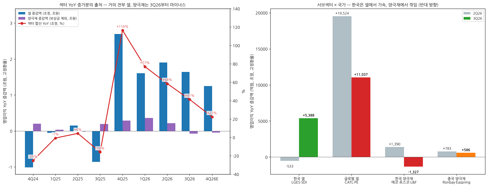
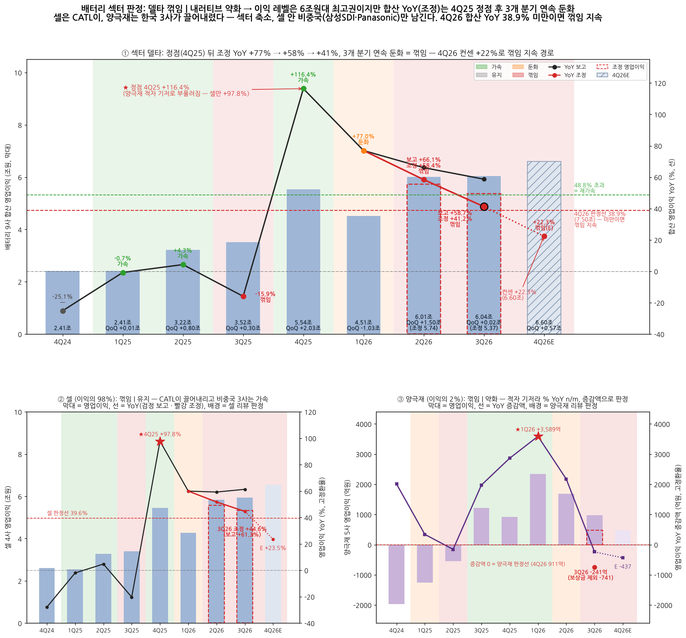
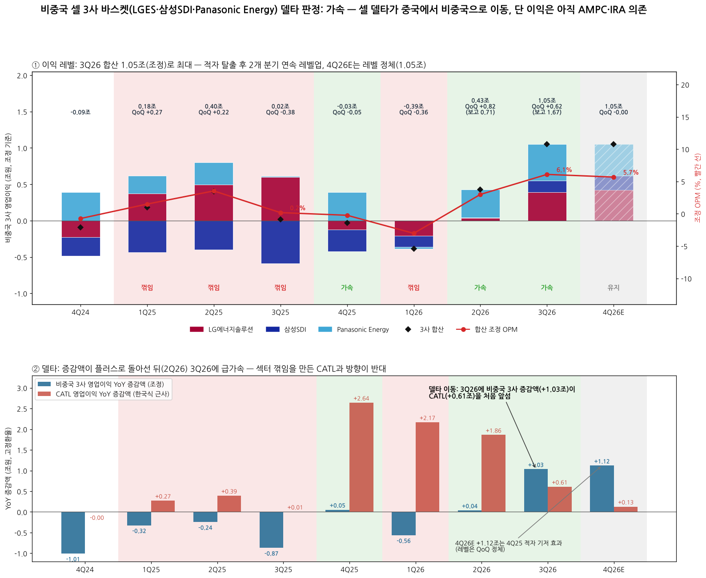

# 배터리 · 글로벌 섹터 통합 리뷰

> 현재 상태 (최신 분기 기준)
> 최신 분기: 2026-Q3
> 섹터 델타: 꺾임 | 내러티브: 약화
> 모멘텀 신호: 델타 급증 후보 — 북미 탈중국 ESS·AI 데이터센터 BBU (비중국 셀 3사 한정, 셀 리뷰 제안 이월 · BT 판단 필요 — 섹터 합산은 꺾임)
> 활성 테마: 없음
> 포지셔닝: 섹터 축소 | 한국 아웃퍼폼 | 선호 Panasonic Energy, 삼성SDI
> 편입 종목: 9사 — 셀 4사(LG에너지솔루션, 삼성SDI, CATL, Panasonic Energy) + 양극재 5사(에코프로비엠, 포스코퓨처엠, 엘앤에프, Ronbay, Easpring) / 업황 체크만 SK온
> 갱신 시각: 2026-11-16 18:50 KST

## 누적 시계열

| 분기 | 편입 종목 | 합산 매출 | 합산 영업이익 | OPM | 매출 YoY | 영업이익 YoY (증감액) | 영업이익 YoY 델타 (%p) | 섹터 델타 | 내러티브 | 모멘텀 신호 | 활성 테마 |
|---|---|---|---|---|---|---|---|---|---|---|---|
| 4Q24 | 셀 4사 + 양극재 5사 | 348,803억원 | 24,083억원 | 6.9 | -13.1 | -25.1 (-8,088억) | — | — | - | - | - |
| 1Q25 | 동일 | 314,287억원 | 24,148억원 | 7.7 | -3.2 | -0.7 (-179억) | +24.4 | 가속 | - | - | - |
| 2Q25 | 동일 | 322,846억원 | 32,161억원 | 10.0 | -0.7 | +4.3 (+1,323억) | +5.0 | 가속 | - | - | - |
| 3Q25 | 동일 | 343,680억원 | 35,158억원 | 10.2 | +1.4 | -15.9 (-6,657억) | -20.2 | 꺾임 | - | - | - |
| 4Q25 | 동일 | 442,019억원 | 55,416억원 | 12.5 | +22.7 | +116.4 (+29,806억) | +132.3 | 가속 | - | - | - |
| 1Q26 | 동일 | 435,851억원 | 45,141억원 | 10.4 | +34.3 | +77.0 (+19,633억) | -39.4 | 둔화 | - | - | - |
| 2Q26 | 동일 | 511,900억원 | 60,143억원 (조정 57,383) | 11.7 (조정 11.2) | +46.4 | +66.1 (+23,924억) · 조정 +58.4 (+21,164억) | -10.9 (조정 -18.5) | 꺾임 | - | - | - |
| **3Q26** | 동일 | **565,974억원** | **60,365억원 (조정 53,715)** | **10.7 (조정 9.5)** | **+56.9** | **+58.7 (+22,335억) · 조정 +41.2 (+15,685억)** | **-7.3 (조정 -17.2)** | **꺾임** | **약화** | **델타 급증 후보 — 비중국 셀 3사 한정 (BT 판단 필요)** | **없음** |
| 4Q26E | 동일 | — (CATL 매출 E 미확보) | 66,021억원 | — | — | +22.3 (+12,043억) | -18.9 (조정 3Q26 대비) | 꺾임 (컨센 경로) | | | |

서브섹터별 시계열 (섹터 합산 바로 아래 — 서브섹터 리뷰 누적 시계열 그대로 인용)

| 분기 | 셀 4사 영업이익 (억원) | 셀 영업이익 YoY (조정) | 셀 판정 | 양극재 5사 영업이익 (억원) | 양극재 YoY 증감액 (억원) | 양극재 판정 | 셀 : 양극재 이익 비중 |
|---|---|---|---|---|---|---|---|
| 4Q24 | 26,057 | -27.9 | — | -1,974 | +2,008 (n/m) | — | 108 : -8 |
| 1Q25 | 25,402 | -2.0 | 가속 | -1,254 | +340 | 둔화 | 105 : -5 |
| 2Q25 | 32,703 | +4.7 | 가속 | -542 | -156 | 꺾임 | 102 : -2 |
| 3Q25 | 33,937 | -20.3 | 꺾임 | 1,221 | +1,975 | 가속 | 97 : 3 |
| 4Q25 | 54,499 | +97.8 | 가속 | 917 | +2,864 | 가속 | 98 : 2 |
| 1Q26 | 42,800 | +60.0 | 둔화 | 2,341 | +3,589 ★ | 가속 | 95 : 5 |
| 2Q26 | 58,450 (조정 55,690) | +51.7 (보고 +59.3) | 꺾임 | 1,693 | +2,173 | 둔화 | 97 : 3 |
| **3Q26** | **59,383 (조정 53,233)** | **+44.6 (보고 +61.3)** | **꺾임** | **982 (조정 482)** | **-241 (조정 -741), % -19.7** | **꺾임** | **98 : 2** |
| 4Q26E | 65,547 | +23.5 | 꺾임 (컨센) | 474 | -437, % -48.0 | 꺾임 (E) | 99 : 1 |

→ **합산 방식**: 두 서브섹터 리뷰(`배터리 셀_섹터리뷰.md`, `양극재_섹터리뷰.md`)의 합산 매출·영업이익을 그대로 더했다(억원, 각 분기 평균 환율). 종목 중복은 없다 — 셀 4사와 양극재 5사는 겹치지 않고, 포스코퓨처엠은 양극재 리뷰대로 **에너지소재 부문**만 넣었다
→ **이익 지표** (서브섹터 리뷰와 같음): 한국 5사 = K-IFRS 연결 영업이익(셀은 AMPC 포함 신기준 매출), 포스코퓨처엠 = 에너지소재 부문 영업이익 / CATL·Ronbay·Easpring = 각 리뷰의 **한국식 근사 영업이익** / Panasonic Energy = Energy 세그먼트 **조정 영업이익**(IRA 45X 포함)
→ **YoY는 고정환율 기준**이다. 전년 분기 위안·엔 숫자를 이번 분기 환율로 다시 환산했다. 서브섹터 리뷰와 같은 방식이다. 전년 분기 금액은 종목 리뷰 12분기 표에서 다시 환산해 더했다 [계산]. 셀 리뷰의 YoY와는 소수 첫째 자리까지 같다
→ **조정 기준** = 셀 리뷰의 조정을 그대로 쓰고(LGES 3Q26 보상금 3,650억·2Q26 관세 환급 800억, 삼성SDI 3Q26 순일회성 2,500억·2Q26 관세 환급 1,960억), 여기에 **양극재 포스코퓨처엠 3Q26 고객 보상금 약 500억**(양극재 리뷰 ① 조정 ①)을 같은 "고객 일회성 보상금" 원칙으로 뺐다. 양극재 리뷰는 보고 기준으로 판정했지만, 이 500억을 빼도 양극재 판정(꺾임)은 같다. 섹터 YoY에 주는 영향은 -1.3%p다 [계산]
→ **판정은 조정 기준**이다 (스킬 규칙: 일회성 왜곡 시 조정). 다만 이번 분기는 보고 기준으로도 꺾임이다 — 보고 YoY가 +77.0% → +66.1% → +58.7%로 3개 분기 연속 둔화했고 정점(4Q25)을 지났다. 셀 단독 보고 기준이 "유지"(+59.3% → +61.3%)였던 것과 다르다. 차이는 양극재다 (① 근거)
→ **% YoY를 쓸 수 있는 이유**: 양극재는 2025년 상반기까지 적자라 단독 % YoY가 n/m이다. 섹터 합산은 셀이 이익의 95\~98%라 전년 기저가 늘 플러스(2.4조\~5.4조원)여서 % YoY가 성립한다. 판정은 %로 하고 증감액을 옆에 둔다
→ **4Q25 +116.4%는 부풀려진 값이다**: 4Q24 양극재 기저가 -3,982억(고정환율)이라 분모가 작아졌다. 셀만 보면 +97.8%다. 정점 분기 판단(4Q25)은 같다
→ **4Q26E**: 셀 65,547억(셀 리뷰 — LGES·SDI 컨센, CATL 순이익 역산 근사, Panasonic 2H 계획 균등 분할) + 양극재 474억(양극재 리뷰 — 한국 3사 컨센, 중국 2사 순이익 대용). 셀·양극재 모두 4Q26 매출 E가 일부 없어 합산 매출·OPM은 비웠다
→ **적용 환율** (분기 평균, 셀·양극재 리뷰와 같음): CNY/KRW 4Q24 194.08 · 1Q25 199.41 · 2Q25 193.17 · 3Q25 193.65 · 4Q25 204.15 · 1Q26 211.26 · 2Q26 220.62 · 3Q26 210.16 · 4Q26E 200.26 (양극재 리뷰는 200.0 — 474억에 주는 차이 1억 미만). JPY/KRW 4Q24 9.16 · 1Q25 9.51 · 2Q25 9.67 · 3Q25 9.40 · 4Q25 9.39 · 1Q26 9.32 · 2Q26 9.41 · 3Q26 8.89 · 4Q26E 8.46 (Yahoo 일별 평균 [계산])
→ 내러티브·모멘텀 신호·테마 열은 소급 분기에 섹터 리뷰가 없어 `-`

---

## 2026-Q3 섹터 리뷰

> 대상: 2026-Q3 서브섹터 리뷰 2건 — `배터리 셀_섹터리뷰.md`(꺾임 | 유지, 서브섹터 축소 · 한국 아웃퍼폼 · 1등 Panasonic Energy / 한국 1등 삼성SDI), `양극재_섹터리뷰.md`(꺾임 | 약화, 서브섹터 축소 · 한국 언더퍼폼 · 1등 포스코퓨처엠). 종목 리뷰 9건 + SK온 — `earnings-review/2026-Q3_{LG에너지솔루션|삼성SDI|300750.SZ|6752.T|에코프로비엠|포스코퓨처엠|엘앤에프|688005.SS|300073.SZ|SK온}_리뷰.md`
> 2층 구조: 서브섹터 리뷰가 서브섹터 판정·서브섹터 내 한국 vs 글로벌·1등 종목(3단계)을 맡고, 이 통합 리뷰는 섹터 비중(1단계)·서브섹터 순위(2단계)·서브섹터 × 국가 프레임을 맡는다. 숫자·판정은 서브섹터 리뷰를 그대로 받았고, 새로 계산한 것은 섹터 합산과 서브섹터 간 비교뿐이다
> 첫 배터리 통합 리뷰 — 직전 분기 관전 포인트·⑦ 콜 체크 없음
> **국가 프레임 구멍** (BT 외출 중이라 시작 전 확인 없이 진행): ① 셀의 중국 표본이 CATL 1개 — 편입 후보 **EVE Energy(亿纬锂能 300014.SZ)** ② 양극재 글로벌 표본이 중국 2사뿐(일본·유럽 없음) — 편입 후보 **Umicore(UMI.BR)**, **Sumitomo Metal Mining(5713.T)**. 비교는 빈칸 없이 됐지만 "글로벌 = 중국 중심"으로 읽어야 한다. 편입 여부는 BT 결정

① 섹터 합산 숫자와 델타

| 항목 | 4Q25 | 1Q26 | 2Q26 | **3Q26** | 4Q26E |
|---|---|---|---|---|---|
| 합산 매출 (억원) | 442,019 | 435,851 | 511,900 | **565,974** | — |
| 합산 영업이익 — 보고 (억원) | 55,416 | 45,141 | 60,143 | **60,365** | 66,021 |
| 합산 영업이익 — 조정 (억원) | 55,416 | 45,141 | 57,383 | **53,715** | 66,021 |
| OPM — 보고 (조정) | 12.5 | 10.4 | 11.7 (11.2) | **10.7 (9.5)** | — |
| 매출 YoY (고정환율) | +22.7 | +34.3 | +46.4 | **+56.9** | — |
| 영업이익 YoY — 보고 | +116.4 | +77.0 | +66.1 | **+58.7** | +22.3 |
| **영업이익 YoY — 조정 (판정 기준)** | +116.4 | +77.0 | +58.4 | **+41.2** | +22.3 |
| 영업이익 YoY 증감액 — 보고 / 조정 (억원) | +29,806 | +19,633 | +23,924 / +21,164 | **+22,335 / +15,685** | +12,043 |
| **영업이익 YoY 델타 (%p, 조정)** | +132.3 | -39.4 | -18.5 | **-17.2** | -18.9 |
| 판정 | 가속 | 둔화 | 꺾임 | **꺾임** | 꺾임 (컨센) |
| └ 셀 4사 영업이익 (억원, 조정) | 54,499 | 42,800 | 55,690 | **53,233** | 65,547 |
| └ 셀 영업이익 YoY (조정) / 델타 | +97.8 / +118.0 | +60.0 / -37.8 | +51.7 / -8.2 | **+44.6 / -7.1** | +23.5 / -21.1 |
| └ 양극재 5사 영업이익 (억원, 조정) | 917 | 2,341 | 1,693 | **482** (보고 982) | 474 |
| └ 양극재 YoY 증감액 (억원, 조정) / 델타 | +2,864 / +889 | +3,589 / +725 | +2,173 / -1,416 | **-741** (보고 -241) **/ -2,914** | -437 / +304 |

서브섹터별 합산 행 (서브섹터 리뷰 ① 표 인용)

| 서브섹터 (합산 종목) | 3Q26 매출 (억원) | 3Q26 영업이익 (억원) | OPM | 영업이익 YoY 2Q26 → 3Q26 | 델타 | 4Q26E | 판정 |
|---|---|---|---|---|---|---|---|
| 셀 (LGES·SDI·CATL·PE) | 520,022 | 59,383 (조정 53,233) | 11.4 (조정 10.2) | 조정 +51.7% → **+44.6%** | -7.1%p | +23.5% | 꺾임 · 유지 |
| 양극재 (에코·포스코 에너지소재·엘앤에프·Ronbay·Easpring) | 45,952 | 982 | 2.1 | 증감액 +2,173억 → **-241억** (% n/m → -19.7%) | -2,414억 | -437억 (-48.0%) | 꺾임 · 약화 |
| **9사 합산** | **565,974** | **60,365 (조정 53,715)** | **10.7 (조정 9.5)** | 조정 +58.4% → **+41.2%** | **-17.2%p** | +22.3% | **꺾임** |

→ (출처: 서브섹터 리뷰 2건 ① 표 [계산]. 조정 = 셀 리뷰 조정 + 포스코퓨처엠 보상금 500억)
→ **이익 레벨**: 3Q26 합산 영업이익 6.04조원(조정 5.37조)은 2Q26(6.01조)과 같은 최고권이다. 매출 56.6조원은 분기 최대다. 4Q26E 6.60조원으로 레벨은 다시 최대 경로지만, 그중 CATL 근사치가 5.50조(83%)다
→ **섹터 = 셀**: 3Q26 이익의 98.4%, 매출의 91.9%가 셀이다. 셀 안에서는 CATL이 72%다. 그래서 섹터 레벨은 사실상 CATL 레벨이다 [계산]
→ **델타**: 조정 영업이익 YoY가 4Q25 정점(+116.4%, 셀만 +97.8%) 뒤 +77.0% → +58.4% → +41.2%로 3개 분기 연속 둔화했다. 2Q26부터 꺾임이다. 매출 YoY는 +34% → +46% → +57%로 계속 올라간다 — 물량은 늘고 이익 증가율은 내려가는 구간이다
→ **YoY 둔화(-17.2%p)의 출처 [계산]** (기여도 = 서브섹터 증감액 ÷ 섹터 전년 영업이익): 셀 -9.2%p(+52.4% → +43.2%), **양극재 -7.9%p**(+6.0% → -1.9%). 이익 비중 2%인 양극재가 둔화폭의 46%를 만들었다. 증감액이 +2,173억에서 -741억으로 뒤집혔고, 전년 기저가 적자(-481억)에서 흑자(+1,223억)로 바뀌었기 때문이다. 보고 기준이면 둔화폭 -7.3%p 중 -6.6%p가 양극재다
→ **컨센 경로상 섹터 정점은 이미 4Q25에 지났다**. 4Q26E +22.3%(-18.9%p)로 4개 분기 연속 둔화 경로다. 정점 지난 서브섹터: 셀(4Q25)·양극재(1Q26) 둘 다다

→ (출처: 서브섹터 리뷰 2건 [계산]. 왼쪽 = 서브섹터별 영업이익 YoY 증감액(조원, 조정, 고정환율)과 섹터 합산 영업이익 YoY(조정) / 오른쪽 = 서브섹터 × 국가 영업이익 YoY 증감액 2Q26 vs 3Q26(억원, 조정 — LGES·SDI·포스코 보상금·관세 환급 제외))

② 서브섹터 델타 순위

| 순위 | 서브섹터 | 영업이익 YoY 2Q26 → 3Q26 | 델타 | 판정 (서브섹터 리뷰) | 4Q26E 경로 | 서브섹터 1등 종목 (서브섹터 리뷰 ⑦(3)) |
|---|---|---|---|---|---|---|
| 1 | 셀 | 조정 +51.7% → **+44.6%** (증감액 +18,991억 → +16,425억) | **-7.1%p** | 꺾임 · 유지 | +23.5% (꺾임 지속) | 글로벌 **Panasonic Energy** (가속·강화) · 한국 **삼성SDI** (가속·강화) — 사실상 동률 |
| 2 | 양극재 | 증감액 +2,173억 → **-241억** (% n/m → -19.7%) | **-2,414억** | 꺾임 · 약화 | -437억 (-48.0%, 2개 분기 연속 감익) | 한국·서브섹터 1등 **포스코퓨처엠** (둔화·형성) · 글로벌 1등 Ronbay (꺾임·약화, 매매 대상 아님) |

→ (출처: 서브섹터 리뷰 2건 ④·⑦ 판정 그대로)
→ **둘 다 꺾임이지만 질이 다르다**. 셀은 YoY가 아직 +45%(조정) 플러스이고, 꺾임은 이익의 72%인 CATL 하나(+57% → +17%)가 만들었다. 셀 안 비중국 3사(LGES·SDI·Panasonic)는 증감액 +371억 → +10,331억으로 가속했다. 양극재는 이익 증가가 아예 멈췄고(증감액 마이너스), 5사 중 가속이 0이며, 5사 이익 추정이 전부 내려갔다. 그래서 순위는 셀 > 양극재다 [판단]
→ **선행 서브섹터는 셀**이다. 셀 YoY 정점이 4Q25로 양극재(1Q26)보다 한 분기 빨랐다. 다만 이번 꺾임의 원인은 서로 다르다 — 셀은 중국 정책 비용·단위이익 하락(CATL), 양극재는 리튬 래깅 역풍과 EV 고객 물량(한국 3사)이다
→ **서브섹터 판정 시차의 함의**: 셀의 ESS 수주(SDI 60GWh+, LGES 잔고 160GWh)가 양극재 LFP 물량(포스코 2027 약 50kt, 엘앤에프 최대 25만톤 계약)으로 넘어오는 것은 2027년이다. 공급망 순서상 양극재 반등은 셀보다 늦다 [판단]

③ 섹터 공통 쟁점

(1) EV 고객 물량 미이행 보상금 — 셀에서 양극재까지 같은 뿌리 (LGES·SDI·포스코퓨처엠, SK온 2Q26)

| 종목 | 3Q26 일회성 (추정) | 3Q26 보고 영업이익 | 일회성 비중 | 4Q26E (QoQ) |
|---|---|---|---|---|
| LGES | 보상금 3,300\~4,000억 (중간값 3,650억) | 7,560억 | 48% | 4,193억 (-45%) |
| 삼성SDI | 순일회성 약 2,500억 | 4,078억 | 61% | 2,011억 (-51%) |
| 포스코퓨처엠 (에너지소재) | 보상금 약 500억 | 518억 | 97% | 110억 (HSBC, 부문) |
| SK온 (참고) | 2Q26 기타영업수익 약 1.14조 (AMPC + 보상금) | -805억 | — | 회사 정성 가이던스 |

→ (출처: 셀 리뷰 ③(1), 양극재 리뷰 ③(3))
→ 공통: 완성차가 EV 물량 약속을 못 지켜 돈으로 메운다. 셀(LGES·SDI)이 받고, 셀이 다시 양극재(포스코)에 물량을 못 가져가 보상한다 — 같은 수요 약세가 공급망 두 단계에 동시에 일회성 이익으로 찍혔다
→ 섹터 합산 영향: 3Q26 일회성 합 6,650억원 = 보고 영업이익의 11%. 이를 빼면 섹터 YoY가 +58.7% → +41.2%로 17.5%p 내려간다
→ **[판단]** 보상금은 이익이지만 내용은 EV 수요 약세 신호다. 4Q26에는 사라져 한국 셀 2사 합산이 11,638억 → 6,204억(-47% QoQ)으로 줄어드는 것이 컨센이다. 섹터 판정을 조정 기준으로 내리는 이유다

(2) 북미 탈중국 ESS — 셀 수주가 양극재 LFP 수주로 이어진다 (셀 4사 + 포스코·엘앤에프·Ronbay)

| 단계 | 한국 | 중국 | 정책 변수 |
|---|---|---|---|
| 셀 (ESS) | SDI 수주 60GWh+(연말 +60GWh 목표, 미국 LFP 12월 출하), LGES ESS 매출 +399%·잔고 160GWh | CATL 북미 ESS 출하 점유율 38.8%(1H26, SNE), ESS 판매 약 2배 | 전력망 안보 행정명령 세부 규칙·EO 14420 시행규칙(12월 말 전후) |
| 양극재 (LFP) | 포스코 SDI 6.05조·SK온 1.1조·LGES 72만톤 MoU, 2027 약 50kt / 엘앤에프 최대 25만톤(약 100GWh)·LGES 1조 | Easpring LFP +40% QoQ(톤당 이익 1/4), Ronbay 한국 공장 AKB 이전 | 45X PFE 가이드라인(12/31) — non-PFE LFP 프리미엄의 크기 |

→ (출처: 셀 리뷰 ③(2), 양극재 리뷰 ③(2))
→ 공통: 미국 ESS에서 중국산을 밀어내는 규칙이 한국 셀 → 한국 LFP 양극재로 물량을 넘긴다. 같은 정책이 두 서브섹터의 한국 종목에 같은 방향으로 작용한다
→ 갈림: **물량 시점과 이익 시점이 다르다**. 셀은 수주가 2027년 출하로 바로 이어지지만, LFP 양극재는 판가가 삼원계의 약 1/3이라 2027년엔 매출만 늘고 이익 기여는 2028년부터다(양극재 리뷰 ③(2)). 출하 점유율은 아직 CATL이 1위다
→ **[판단]** 이 쟁점이 셀 리뷰가 올린 "북미 탈중국 ESS·AI 데이터센터 BBU" 후보의 실체다. 수혜 순서는 셀(SDI·LGES) → 시스템(Panasonic BBU) → 양극재(포스코·엘앤에프) 순이고, 12월 규칙 두 건과 12/31 PFE 가이드라인이 크기를 정한다

(3) 리튬 가격 — 같은 변수가 셀과 양극재에 반대로 작용한다 (CATL vs 양극재 5사)

| 서브섹터 | 3Q26 리튬 영향 | 방향 |
|---|---|---|
| 셀 (CATL) | 리튬 상승(2025 중반 6만 → 2026-06 21만 위안/톤)이 연동 조항 시차로 GPM을 눌렀다 (20.7%, -2.5%p QoQ). 리튬 연동 재고 손상 17.1억위안 | 리튬 하락 = 원가 부담 완화 (시차 후) |
| 양극재 (5사) | 9월 급락(8월 고점 ¥16.29만 → 9월 ¥11.70만, -28%)으로 역래깅·재고평가손실 — 엘앤에프 -426억, Ronbay 약 -0.8억·Easpring -0.56억위안 | 리튬 하락 = 재고평가손 (즉시) |

→ (출처: CATL 리뷰 2-③(1)·(4), 양극재 리뷰 ③(1). 두 리뷰가 인용한 리튬 가격 경로는 출처와 시점이 달라 수치를 직접 잇지 않았다)
→ **[판단]** 리튬이 내리면 양극재는 바로 손실, 셀은 몇 개월 뒤 원가 이익이다. 11월 추가 하락(DB -29%)이면 4Q26은 양극재에 두 번째 역풍 분기, CATL에는 GPM 반등(21%+) 재료가 된다. 리튬이 12월에 반등하면 반대다 — 양극재는 1Q27에 래깅 이익으로 돌아서고 CATL 마진 회복은 늦어진다. 섹터 합산은 셀 비중 때문에 리튬 하락 쪽이 유리하지만, 한국 종목만 보면 양극재 3사가 가장 큰 음(-)의 민감도를 가진다

(4) 중국 정책 비용 — 소비세·수출환급 폐지 (CATL·Easpring·Ronbay)

→ CATL: 9/1 배터리 소비세 2%(2027-09 4%), 수출 증치세 환급 2027-01-01 폐지. 4Q26이 소비세 첫 완전 반영 분기다 (셀 리뷰 ③(4))
→ Easpring: 배터리 수출환급 9% → 6%(4월) → 2027-01 완전 취소. 해외(한국 셀) 계약 GPM 9.6%로 이미 내수보다 낮다 (양극재 리뷰 ⑦(4))
→ **[판단]** 2027년 1월에 중국 셀·양극재 모두 수출 비용이 한 번 더 오른다. 같은 서브섹터 안 한국 상대 우위의 정책 요인이며, ⑦(2)의 "서브섹터 내 효과"가 2027년 상반기에 커질 쪽이다

(5) 이익 추정은 내려가고 주가도 빠졌다 (9사 공통 — 상향은 2사뿐)

| 서브섹터 | 이익 추정 상향 | 이익 추정 하향 | 주가 |
|---|---|---|---|
| 셀 | 삼성SDI(2027E +8%), Panasonic(회사 Energy 계획 +15.6%) | CATL(EPS -4\~-14%), LGES(2027E -12%) | 4사 모두 발표 후 하락 — CATL ATH 대비 -49%, PE 8월 고점 -32%, SDI 발표 후 -10.8% |
| 양극재 | 없음 | 5사 전부 (에코 2027E -28%, 엘앤에프 -26.5%, 포스코 -5.6%, Ronbay 2026E -68%, Easpring -30%) | 엘앤에프 고점 -63%, Easpring -54%, 에코·Ronbay 52주 저점권 |

→ (출처: 셀 리뷰 ③(6), 양극재 리뷰 ⑦(1))
→ **[판단]** 9사 중 7사가 하향, 이익 가중으로는 CATL·LGES가 들어 있어 섹터 이익 추정은 내려가는 중이다. 상향 2사(SDI·Panasonic)는 모두 셀 비중국이다 — ②의 "셀 안 비중국 가속"과 같은 결론이 추정 방향에서도 나온다

(6) 서브섹터 고유 이슈
→ 셀: 보조금 의존 — 비중국 3사 영업이익의 50%가 AMPC·IRA(셀 리뷰 ③(4)). 45X는 2030년부터 감액
→ 셀: ESS 마진 — 물량은 늘지만 LGES ESS AMPC 제외 OPM -4.9%, SDI ESS 1\~3%. 마진은 시스템(Panasonic I/C 18.5%)에서 난다
→ 양극재: 재무 — 에코프로비엠 유상증자 8,861억(11/5 상장), 엘앤에프 부채비율 372%, 포스코퓨처엠 순차입금비율 78%
→ 양극재: 고객 집중 — 엘앤에프 1위 고객 88%(공급 이원화 우려), 에코프로비엠 삼성SDI 유럽(BMW) 재고조정

④ 섹터 판정

> 섹터 델타: **꺾임** | 내러티브: **약화** → **이익 레벨은 6조원대 최고권이지만, 합산 영업이익 YoY(조정)는 4Q25 정점 후 +77% → +58% → +41%로 3개 분기 연속 둔화 = 꺾임 (보고 기준도 꺾임). 셀은 CATL이(이익의 72%), 양극재는 한국 3사가 끌어내렸고 이익 비중 2%인 양극재가 YoY 둔화폭의 46%를 만들었다. 섹터 베타는 줄이고, 남길 것은 셀 안 비중국(삼성SDI·Panasonic Energy)뿐인 구간. 4Q26 합산 영업이익 YoY 38.9%(7.50조원) 미만이면 꺾임 지속 — 컨센 +22.3%**

→ (출처: 서브섹터 리뷰 2건 [계산]. 상단 = 9사 합산 영업이익(막대, 조원, 각 분기 환율 / 2Q26·3Q26 빨간 점선 박스 = 조정 기준) + QoQ 증가액 + 합산 영업이익 YoY(검정 = 보고, 빨강 = 조정, 고정환율) + 분기별 섹터 델타 판정 배경색, 4Q26 판정선 38.9%(꺾임 지속)·48.8%(재가속), 컨센 +22.3% / 하단 왼쪽 = 셀 4사 영업이익(막대, 조원) + YoY(선, 보고·조정) + ★ 정점 + 셀 리뷰 판정 배경색, 셀 판정선 39.6% / 하단 오른쪽 = 양극재 5사 영업이익(막대, 억원) + YoY 증감액(선, % n/m이라 증감액) + ★ 정점 + 양극재 리뷰 판정 배경색, 판정선 = 증감액 0(4Q26 911억))

→ **델타 판정 근거**: 합산 영업이익 YoY(조정)가 2Q26 +58.4%에서 3Q26 +41.2%로 17.2%p 줄었다. 1Q26(-39.4%p)·2Q26(-18.5%p)에 이어 3개 분기 연속 둔화이고 정점(4Q25)을 지났으므로 "꺾임"이다. 보고 기준(+66.1% → +58.7%, -7.3%p)도 3개 분기 연속 둔화라 결론이 같다. 컨센 4Q26E +22.3%(-18.9%p)로 경로상 꺾임이 이어진다. 두 서브섹터 판정도 모두 꺾임이다
→ **내러티브 판정 근거**: 서브섹터 내러티브는 유지 1(셀), 약화 1(양극재)이다. 종목 단위로는 강화 2(SDI·Panasonic), 형성 1(포스코), 약화 6(LGES·CATL·에코·엘앤에프·Ronbay·Easpring)이다. 섹터 공통 스토리 "ESS·AI 데이터센터가 EV 공백을 메운다"는 셀 물량(ESS +399%, 수주 60GWh+)과 양극재 LFP 계약으로 확인됐다. 그러나 "이익도 따라온다"는 CATL 단위이익 -27%, 양극재 래깅 역풍, 9사 중 7사 추정 하향으로 깨졌다. 셀 리뷰가 "유지"로 둔 이유(무게중심이 비중국으로 이동)는 섹터 전체로는 소수 종목의 이야기다 → "약화" [판단]
→ **[판단] 결정적 근거는 "꺾임의 출처가 둘"이라는 점이다**. 셀 하나만 보면 보고 기준 "유지"였다(한국 보상금이 CATL 둔화를 가림). 섹터로 묶자 양극재의 증감액 반전(+2,173 → -741억)이 더해져 보고 기준까지 꺾였다. 셀(중국 정책·단위이익)과 양극재(리튬·EV 고객) — 원인이 다른 두 꺾임이 같은 분기에 겹쳤고, 4Q26 컨센도 두 서브섹터 모두 꺾임 지속이다. 반대로 섹터 안에서 가속하는 덩어리는 비중국 셀 3사(이익의 28%)뿐이다
→ 직전 판정 대비: 첫 통합 판정이다. 소급 궤적은 가속(1Q25·2Q25) → 꺾임(3Q25, 마이너스 전환) → 가속(4Q25, 정점 +116%) → 둔화(1Q26) → 꺾임(2Q26·3Q26)이다. 셀 궤적과 같고, 양극재가 4Q25·1Q26에 함께 가속하며 정점을 키운 뒤 2Q26부터 같이 내려왔다

(1) 비중국 셀 3사 바스켓 — 섹터 안에서 유일하게 가속하는 덩어리

> 비중국 셀 3사(LGES·삼성SDI·Panasonic Energy) 델타: **가속** — 3Q26 영업이익 YoY 증감액(조정) +371억 → **+1.03조원**으로 CATL(+0.61조)을 처음 앞섰다. 단 4Q26E는 레벨 정체(1.05조 → 1.05조)라 증감액 확대는 4Q25 적자 기저 효과이고, 이익은 아직 AMPC·IRA 의존

→ (출처: 셀 리뷰 4사 숫자 [계산]. 상단 = 3사 영업이익(막대, 조원, 조정 기준 = LGES 3Q 보상금 3,650억·SDI 3Q 순일회성 2,500억·2Q 관세 환급 LGES 800억·SDI 1,960억 제외, Panasonic은 Energy 부문 조정 영업이익 × 분기 평균 JPY/KRW) + QoQ 증가액 + 합산 조정 OPM(빨간 선) + 분기별 바스켓 델타 판정 배경색, 4Q26E 빗금 = 컨센(LGES 4,193억·SDI 2,011억·Panasonic 2H 계획 균등 분할 ¥51.0bn) / 하단 = 영업이익 YoY 증감액(조원, 고정환율) — 파랑 = 비중국 3사, 빨강 = CATL 한국식 근사)
→ **판정 방법**: 3사 합산 영업이익의 전년 기저가 0 근처(3Q25 203억, 4Q25 -296억)라 % YoY가 n/m이다. 그래서 양극재와 같이 **YoY 증감액**으로 판정했다 — 증감액 마이너스 = 꺾임 / 플러스이면서 직전 대비 +10% 넘게 확대 = 가속 / ±10% 이내 = 유지 / 10% 넘게 축소했지만 플러스 = 둔화 [이 문서에서 정한 기준]
→ **궤적**: 꺾임(1Q25\~3Q25, 3사 합산 감익) → 가속(4Q25, 증감액 +525억으로 플러스 전환) → 꺾임(1Q26, -5,631억) → 가속(2Q26 +371억) → **가속(3Q26 +10,331억)** → 유지(4Q26E +11,199억, +8%). 레벨로는 2Q26 4,307억 → 3Q26 10,529억(조정 OPM 3.0% → 6.1%)으로 사상 최대다
→ **[판단] 의미와 한계**: 셀 델타가 중국(CATL 증감액 +1.86조 → +0.61조 → 4Q26E +0.13조)에서 비중국(+0.04조 → +1.03조 → +1.12조)으로 넘어가는 것이 숫자로 처음 확인됐다. 다만 ① 4Q26E 레벨이 QoQ 정체라 "가속"은 기저 효과가 만든 것이고 ② LGES·SDI는 보상금·AMPC를 빼면 손익분기 안팎, Panasonic은 이익의 59%가 IRA다 — 정책 이익을 걷어낸 본업 마진은 아직 증명 전이다. 바스켓이 섹터 판정(꺾임)을 뒤집으려면 3사 합산이 4Q26 1.05조원 레벨을 지키고 1Q26 기저(-3,867억)를 딛고 1Q27에도 증감액 1조원+를 이어가야 한다
→ 이 바스켓이 ⑤ 델타 급증 후보의 근거다 (BT 판단 필요)

⑤ 모멘텀 신호

→ **델타 급증 후보 — 북미 탈중국 ESS·AI 데이터센터 BBU** (셀 리뷰 ⑤ "참고 (BT 판단 필요)"를 이월. 섹터·셀 합산 기준으로는 조건 미충족이라, **비중국 셀 3사 바스켓 한정 후보**로 올린다. 테마를 열지 않는다 — BT 판단 필요)

| 근거 | 섹터 9사 합산 | 비중국 셀 3사 (LGES·SDI·Panasonic) |
|---|---|---|
| ① 영업이익 YoY 델타 확대 | 미충족 (조정 -17.2%p) | **충족** — 증감액 +371억 → +10,331억(조정), 4Q26E +11,199억 |
| ② 편입 종목 과반 가속 | 미충족 (가속 3/9) | **충족** (가속 3/3) |
| ③ 내러티브 형성·강화 | 미충족 (약화) | 대체로 충족 (강화 2/3, LGES 약화) |

→ (출처: 셀 리뷰 ① 참고 행·⑤)
→ 활성 테마가 없어 "테마 종료 후보"는 해당하지 않는다
→ 연결 테마 키워드 제안 (제안일 뿐): "북미 탈중국 ESS·AI 데이터센터 백업전원(BBU)" — 셀(삼성SDI·LGES) → 시스템(Panasonic BBU) → non-PFE LFP 양극재(포스코퓨처엠·엘앤에프, 2028년 이익). 전력 인프라 섹터 리뷰의 "AI 데이터센터 배전·온사이트 전원" 키워드와 같은 수요처다
→ 바스켓 후보를 확인하는 다음 분기 조건: 비중국 3사 4Q26 YoY 증감액 +10,000억 이상 유지 + 12월 규칙이 CATL 셀 ESS를 배제 + 삼성SDI 연말 수주 30GWh+ (셀 리뷰 ⑤와 같음)
→ **반대 논거**
→ (1) 비중국 가속의 상당 부분이 보조금(AMPC·IRA가 영업이익의 50%)과 적자 기저다. 4Q26 증감액 +11,199억은 4Q25 한국 2사 적자(-4,212억) 기저 효과가 크다
→ (2) 출하 점유율은 아직 CATL이 북미 ESS 38.8%로 1위다. 12월 규칙이 기존 계약·라이선스 공장(Ford 미시간)을 허용하면 한국 셀 독점 시나리오는 1\~2년 늦어진다
→ (3) 섹터 단위로 테마를 열 근거는 없다. 섹터 합산·두 서브섹터 모두 꺾임이고, 양극재로는 이익 기여가 2028년이다

⑥ 다음 분기 섹터 관전 포인트

| 순위 | 무엇을 (변수·임계값) | 어떤 데이터로 | 언제 |
|---|---|---|---|
| 1 | **4Q26 배터리 9사 합산 영업이익 YoY(고정환율) 38.9% 이상 — 미만이면 꺾임 지속**. 금액으로 4Q26 환율(CNY 200.26·JPY 8.46원) 기준 **7.50조원 이상** (= 셀 판정선 7.41조 + 양극재 판정선 911억). 48.8%(8.03조) 초과면 재가속. 컨센 6.60조(+22.3%)는 꺾임 지속 | 9사 4Q26 실적 | 2027-01 초(LGES 잠정) \~ 03 중순(CATL 연차보고서) |
| 2 | **서브섹터 판정선** — 셀 39.6%(7.41조, 종목별 LGES 3,500억·SDI 1,000억·CATL 4Q 지배순이익 231.7억위안·Panasonic DC ¥120bn) / 양극재 911억(한국 3사만이면 629억, 종목별 에코 416억·엘앤에프 825억) | 서브섹터 리뷰 ⑥ 1순위 | 2027-01 \~ 03 |
| 3 | **12월 미국 규칙 2건 + 45X PFE** — 전력망 안보 행정명령 세부 규칙, EO 14420 시행규칙(CATL 셀 ESS·라이선스 공장 포함 여부), 45X PFE 가이드라인(12/31, non-PFE LFP 인정 범위·Ronbay AKB 구조) | 미 상무부·에너지부·재무부 발표 | 2026-12 |
| 4 | **리튬 가격 방향** — 탄산리튬 11월 $13.5/kg 대비 12월 반등 여부. 하락 지속 = 양극재 4Q 재고손 반복(엘앤에프 200억 이상) + CATL 4Q GPM 21%+ 반등 / 반등 = 양극재 1Q27 래깅 이익 + CATL 마진 회복 지연 | Fastmarkets·SMM·广期所, 각 사 4Q 실적 | 매주 \~ 2027-01 |
| 5 | **비중국 바스켓 (⑤ 후보)** — 비중국 셀 3사 4Q26 증감액 +10,000억 이상, SDI 연말 수주 30GWh+, LGES 잔고 180GWh+, 포스코 LFP 12월 초도 1.5kt·엘앤에프 4Q LFP 2,000톤+ | DART 단일판매 공시, 컨콜, SNE | 2026-12 \~ 2027-02 |

→ 1순위 판정선(38.9%)은 ④ 키 차트와 같다. 근거: 두 서브섹터 판정선을 동시에 지키는 섹터 금액(셀 7.41조 + 양극재 911억 = 7.50조)을 섹터 4Q25 전년 금액(5.40조, 고정환율)과 비교한 값이다 [계산]. 3Q26 조정 +41.2%에서 "유지" 범위(±5%p)를 뺀 기계적 판정선은 36.2%다. 36.2\~38.9% 구간은 산식상 "유지"지만 서브섹터 하나 이상이 판정선을 못 넘은 상태라 꺾임 지속으로 본다
→ 4Q26 섹터 판정은 CATL 연차보고서(3월 중순, 업적예고 시 1월)가 나와야 확정된다. CATL이 섹터 이익의 83%(4Q26E)라서다. 1월 말\~2월 초에 한국 5사·Panasonic·중국 양극재 2사(업적예고)로 중간 판정을 먼저 적는다

⑦ 글로벌 PM 포지셔닝 — 결론

> **섹터: 비중 축소 — 4Q26 합산 YoY 38.9% 이상(꺾임 멈춤) + 12월 미국 규칙이 CATL 셀 ESS 배제면 중립으로 상향** | **서브섹터: 셀 축소(비중국으로 이동) > 양극재 축소(사실상 제외)** | **한국: 아웃퍼폼 (삼성SDI 중심, 예외 LGES·양극재 3사) = 믹스 효과 작다 + 서브섹터 내 효과 크다**

(1) 섹터 비중 — 확대 / 중립 / 축소

| 판단 축 | 3Q26 근거 | 방향 |
|---|---|---|
| 이익 델타 (1순위) | 합산 영업이익 YoY(조정) +58.4% → +41.2%, 3개 분기 연속 둔화, 보고 기준도 꺾임 | 축소 |
| YoY 정점 시점 | 섹터 정점 4Q25 통과, 4Q26E +22.3%. 정점 지난 서브섹터 2/2(셀 4Q25, 양극재 1Q26), 정점 지난 종목: CATL·양극재 5사 | 축소 |
| 수주·물량 선행지표 | 셀 ESS 수주 확대(SDI 60GWh+, LGES 잔고 160GWh — 목표 230 미달), 양극재 LFP 장기계약(포스코·엘앤에프), CATL 건설 중 CAPA 764GWh | 유지 (비중국 확대) |
| 최종 수요 | 2027 글로벌 배터리 수요 +20\~30%(CATL), 미국 ESS 2027 155GWh(JPM, 하향), 북미 EV 약세(SK온 북미 -46.7%, 에코 EV -34% QoQ) | 중립 |
| 가격·메탈 | CATL 단위이익 -27%, 양극재 리튬 래깅 역풍(11월 추가 -29%) | 축소 |
| 이벤트·정책 | 12월 미국 규칙 2건·45X PFE(비중국 유리), 중국 소비세·수출환급 폐지 2027-01(중국 불리) | 중립 (섹터 합산엔 CATL 비중 때문에 음(-)) |
| 이익 추정 방향 | 하향 7/9 (CATL·LGES·양극재 5사), 상향 2/9 (SDI·Panasonic) | 축소 |
| 밸류에이션·낙폭 (2순위) | CATL A주 2027 P/E 10\~12x·ATH -49%, 엘앤에프 -63%, Easpring -54%, LGES 12M KOSPI 대비 -47%p / 포스코 2027E PER 194배(HSBC) | 중립 (낙폭은 크나 이익 경로가 더 나쁨) |

→ **결론: 섹터 비중 축소** [판단]. 델타 1순위 프레임에서 두 서브섹터가 모두 꺾였고, 컨센 경로도 4Q26까지 꺾임 지속이다. 이익 추정은 9사 중 7사가 내려갔다. 낙폭이 크지만 이익 경로보다 앞섰다는 근거(추정 상향 전환)가 아직 없다. 섹터 안에서는 셀 비중국으로 남길 것만 남긴다
→ **중립 상향 조건**: ① 4Q26 합산 YoY 38.9% 이상(꺾임 멈춤, 3월 중순 확정 — 1월 말 중간 판정) ② 12월 미국 규칙이 CATL 셀 ESS를 배제하고 45X PFE가 non-PFE LFP를 인정. ①+②면 중립. ①만이면 셀 비중국만 중립
→ **추가 축소 조건 (사실상 섹터 제외)**: CATL 4Q26 지배순이익 YoY 마이너스(JPM 경로) + 한국 셀 2사 4Q26 영업이익 합 5,000억 미만 + 양극재 한국 3사 4Q26 합산 적자(컨센 -106억) 확인 — 비중국 회복까지 흔들리는 경우

(2) 국가 프레임 — 서브섹터 × 국가

| 서브섹터 | 한국 (종목 · 영업이익 YoY 증감액 2Q26 → 3Q26, 조정) | 글로벌 (종목 · 영업이익 YoY 2Q26 → 3Q26) | 서브섹터 내 우위 | 한국 매출 비중 (3Q26) | 한국 이익 비중 (3Q26, 보고 / 조정) |
|---|---|---|---|---|---|
| 셀 | LGES·SDI — **-533억 → +5,388억** (가속 2/2, % n/m — 3Q25 기저 100억) | CATL·Panasonic — +54.6% → **+30.1%** (증감액 +19,524 → +11,037억, CATL 꺾임 / PE 가속) | **한국** | 27.6% (143,290 / 520,022억) | 19.6% / 10.3% |
| 양극재 | 에코·포스코(에너지소재)·엘앤에프 — **+1,390억 → -1,327억** (보고 -827억, 꺾임 2·둔화 1) | Ronbay·Easpring — +783억 → **+586억** (한국식 근사, 리뷰 판정은 2사 모두 꺾임) | **중국** | **41.2%** (18,919 / 45,952억) | 38.0% / n/m (-127억) |
| **합계 (섹터)** | 한국 5사 **+857억 → +4,061억** (보고 +3,617 → +10,711억) | 글로벌 4사 **+56.0% → +31.6%** (+20,307 → +11,624억) | **한국** | 28.7% (162,209 / 565,974억) | 19.9% / 10.0% |

→ (출처: 서브섹터 리뷰 2건 ⑦(2), 종목 리뷰 12분기 표 [계산]. 한국 % YoY는 3Q25 기저가 100억(셀)·1,300억(5사)이라 n/m — 증감액으로 비교)
→ **한국의 서브섹터 노출**: 한국 5사 매출의 11.7%가 양극재다(글로벌 4사는 6.7%). 전년 동기 매출 기준으로는 16.5% vs 4.8%다. 한국은 델타가 더 나쁜 양극재에 글로벌보다 3배 넘게 쏠려 있다. 하지만 이익으로는 양극재가 한국 5사 보고 영업이익의 3.1%(373 / 12,011억)에 그친다 — 쏠림은 매출에 있고 이익에는 거의 없다
→ **분해 [계산]**: % YoY가 한국 쪽에서 n/m이라, 서브섹터마다 **영업이익 YoY 증감액 ÷ 전년 동기 매출(%p)**로 바꿔 쓰고, 그 값의 2Q26 → 3Q26 변화(델타)를 전년 매출 비중으로 가중했다

| 국가 × 서브섹터 | 증감액 ÷ 전년 매출 2Q26 → 3Q26 (%p, 조정) | 변화 (델타) | 전년 매출 비중 (국가 내) |
|---|---|---|---|
| 한국 셀 | -0.58 → +5.90 | **+6.47** | 83.5% |
| 한국 양극재 | +8.61 → -7.33 | **-15.93** | 16.5% |
| 글로벌 셀 | +8.55 → +4.61 | -3.93 | 95.2% |
| 글로벌(중국) 양극재 | +6.12 → +4.89 | -1.23 | 4.8% |
| **한국 5사 / 글로벌 4사** | | **+2.77 / -3.80 (격차 +6.57)** | |

→ **믹스 효과 +0.3%p**: 한국이 글로벌과 같은 서브섹터별 델타를 냈다고 가정하면 격차는 +0.3%p뿐이다. 한국이 양극재에 쏠려 있어도, 글로벌(중국) 양극재 자체가 크게 꺾이지 않았고(-1.2%p) 양극재가 매출의 6분의 1이라 쏠림이 거의 비용이 되지 않았다
→ **서브섹터 내 효과 +6.3%p**: 셀에서 한국이 글로벌보다 10.4%p 좋아 **+8.7%p**, 양극재에서 한국이 중국보다 14.7%p 나빠 **-2.4%p**. 방향이 반대인 두 효과 중 셀이 이겼다
→ 참고 — 델타가 아닌 3Q26 YoY 레벨(증감액 ÷ 전년 매출)로 같은 분해를 하면 한국 3.7%p vs 글로벌 4.6%p로 한국이 소폭 뒤진다(믹스 +0.0, 서브섹터 내 -1.0 = 셀 +1.1, 양극재 -2.0). 레벨은 아직 비슷하고 **방향(델타)이 한국 쪽**이라는 뜻이다. 보고 기준이면 레벨도 한국 우위(9.8 vs 4.6%p)다
→ **결론: 한국 아웃퍼폼 = 믹스 효과 작다(+0.3%p) + 서브섹터 내 효과 크다(+6.3%p — 셀 +8.7%p, 양극재 -2.4%p)** [판단]
→ 시사점: 한국 아웃퍼폼은 "한국 종목이 같은 업종 안에서 이겨서"다. 셀에서 한국 2사가 적자 기저 회복 + 탈중국 정책으로 CATL과 반대 사이클에 있다. 양극재 쏠림은 한국 매출 비중으로는 크지만(41%) 섹터 이익 풀이 작아(2%) 결론을 바꾸지 못한다. 그래서 한국 콜은 "한국 배터리 전체"가 아니라 셀 종목 선택이다
→ **반대 논거**: (a) 한국 셀 가속의 상당 부분이 보상금(조정에서 뺌)과 AMPC(영업이익의 30\~55%)다 (b) 마진 레벨은 CATL(12.3%)이 보조금 제외 한국 셀(3\~6%)의 2배다 (c) 한국 시가총액으로는 양극재 3사 비중이 매출 비중보다 크다 — 시가총액 가중 한국 바스켓이면 양극재 언더퍼폼이 더 크게 반영될 수 있다(시가총액 가중 분해는 하지 않았다) (d) CATL A주 P/E 10\~12x로 싸고, 소비세 분담 합의 시 반등 여지가 있다. 아웃퍼폼은 델타 프레임 결론이다
→ **예외 종목**: LG에너지솔루션(셀, 가속이지만 보상금 제외 YoY -35%·2027E -12%·내러티브 약화), 양극재 한국 3사(언더퍼폼 — 그중 포스코퓨처엠은 상대 선호)
→ **비교 범위**: 글로벌 편입 종목 4사 숫자 중심 리뷰(CATL·Panasonic·Ronbay·Easpring, 셀사이드는 보도·점평 인용). 셀 중국은 CATL 1개, 양극재 글로벌은 중국 2사뿐이라 근거가 얇다 — 편입 후보: 셀 **EVE Energy(300014.SZ, ESS 셀 상위·A주 분기 손익 공시)** / 양극재 **Umicore(UMI.BR, 반기 손익·분기 매출)**, **Sumitomo Metal Mining(5713.T, 배터리 소재 부문 — Panasonic·테슬라 NCA)**. 편입 여부는 BT 결정

(3) 서브섹터 순위와 비중

| 순위 | 서브섹터 | 비중 | 근거 (델타·마진·수요 노출) |
|---|---|---|---|
| 1 | 셀 | **축소 — 단, 셀 안에서 비중국으로 이동** | 조정 YoY +51.7% → +44.6% 꺾임이지만 아직 +45% 플러스. 꺾임은 CATL 하나, 비중국 3사는 증감액 +10,331억 가속·이익 추정 상향 2사. OPM 10\~11%로 섹터 마진의 원천. 미국 탈중국 ESS 규칙의 직접 수혜 |
| 2 | 양극재 | **축소 (사실상 제외)** | 증감액 마이너스 전환(-241억), 4Q26E도 -437억으로 2개 분기 연속 감익, 가속 0/5, 추정 하향 5/5. 1차 변수가 물량이 아니라 리튬 가격. LFP 이익은 2028년. 반등 트리거(12월 리튬 반등)는 이벤트 드리븐 |

→ **셀 > 양극재**인 이유 [판단]: 둘 다 꺾임이지만 셀은 "플러스 성장의 둔화 + 안에서 가속하는 덩어리(비중국)가 있다", 양극재는 "성장 정지 + 가속 종목 없음"이다. 섹터 축소 안에서 남길 서브섹터는 셀뿐이다
→ 공급망 시차 메모: 셀 ESS 수주 → 양극재 LFP 물량은 2027년, 이익은 2028년이다. 리튬이 바닥을 치는 분기에 양극재는 래깅 환입 + LFP 물량이 겹쳐 델타 전환이 빠를 수 있다 — 그때 순위가 바뀔 수 있다

(4) 서브섹터별 1등 종목

| 서브섹터 | 글로벌 1등 | 한국 1등 | 비중 판단 |
|---|---|---|---|
| 셀 | **Panasonic Energy** — 가속·강화, 델타 순위 1위(증감액 변화 +4,039억), 조정 OPM 17.1%·I/C 18.5% 최고, DC 목표 \~¥1조. 단 3Q25 저기저·IRA 59%·매매 수단은 Panasonic HD(Energy 비중 약 26%) | **삼성SDI** — 가속·강화, 델타 순위 2위(+3,435억, 조정), 수주 60GWh+, 이익 추정 상향. 순수 셀 중 유일한 가속·강화 | **선호** (두 종목 사실상 동률 — 직접 매매 수단은 SDI) |
| 양극재 | Ronbay — 꺾임·약화, 꺾임 4사 중 증감액 델타 1위지만 저기저·중국식 적자·AKB 이전 — **매매 대상 아님** | **포스코퓨처엠** — 둔화·형성, 5사 중 유일한 둔화·형성, LFP 2027 약 50kt. 단 보상금 제외 시 감익, 평균 TP < 주가 | 상대 선호만 (서브섹터 축소 안에서 남길 1종목) |

→ (출처: 셀 리뷰 ⑦(3), 양극재 리뷰 ⑦(3) 그대로)
→ **글로벌 선호**: Panasonic Energy(셀). **비선호**: CATL(단위이익 바닥 확인 전), Ronbay(지배구조·연결 단절), Easpring(해외 마진 하락·수출환급 취소)
→ **한국 선호**: 삼성SDI(셀 — 섹터 전체에서 직접 매매 가능한 1등). **상대 선호**: 포스코퓨처엠(양극재). **비선호**: 에코프로비엠(2028년까지 본업 회복 근거 약함)
→ **반등 후보 (이벤트 드리븐, 델타 프레임 밖)**: LGES — 4Q26 AMPC 제외 손실 -1,000억 이내·ESS 적자율 -2% 이내(1월 말) / 엘앤에프 — 12월 리튬 반등 + 4Q 재고손 200억 미만 / CATL — 소비세·환급 비용 고객 분담 합의 + 4Q GPM 21%+ / 에코프로비엠 — 글로벌 OEM 본계약 공시 + 헝가리 정상 가동
→ 상태 블록 선호 종목 순서: 스킬 규칙(2단계 1위 서브섹터의 1등 종목 우선)대로 셀 1등 Panasonic Energy를 먼저, 한국 1등 삼성SDI를 다음에 적었다

(5) 콜을 바꾸는 조건과 일정

| 시점 | 이벤트 | 섹터 비중 | 한국 콜 |
|---|---|---|---|
| 2026-12 | 미국 전력망 안보 행정명령 세부 규칙, EO 14420 시행규칙 (12월 말 전후) | CATL 셀 ESS 배제 → 중립 상향 조건 ② 일부 충족 / 완화 → 축소 유지 | 배제 → 한국 아웃퍼폼 강화 / 기존 계약·라이선스 허용 → 셀 서브섹터 내 효과 축소, 중립 쪽 |
| 2026-12 | 탄산리튬 12월 가격 | 반등 → 양극재 1Q27 래깅 이익(양극재 축소 → 유지 검토) / 하락 → 양극재 4Q 재고손 반복 | 반등 → 양극재 3사 언더퍼폼 완화(엘앤에프 탄력 최대) |
| 2026-12 | SDI 추가 수주 30GWh+, LGES 연말 잔고 180GWh+, 포스코 LFP 초도 1.5kt, Panasonic Investor Day | — | 미달 시 SDI 1등 재검토 |
| 2026-12-31 | 45X PFE 가이드라인 | non-PFE LFP 인정 → 중립 상향 조건 ② 충족 | 강화 → 한국 셀·양극재 모두 우호 / 축소 → 아웃퍼폼 약화 |
| 2027-01-01 | 중국 수출 증치세 환급 폐지 (셀·양극재) | CATL·Easpring 1Q27 비용 증가 → 섹터 합산엔 음(-) | 서브섹터 내 효과 확대 (한국 우위) |
| 2027-01 초 \~ 말 | LGES 4Q 잠정·확정, SDI 4Q 실적, 한국 양극재 3사 4Q 잠정, Ronbay·Easpring 연간 업적예고 | 1월 말 중간 판정 — 비중국·양극재 몫이 판정선 경로인지 | 한국 셀 2사 합 5,000억 미만 → 중립 / 6,200억 이상 → 아웃퍼폼 유지. 양극재 한국 3사 629억 이상 → 양극재 내 중립 |
| 2027-02 초 | Panasonic FY3/27 3Q, 에코·엘앤에프 4Q 컨콜 | — | Panasonic DC ¥120bn 이하 → 셀 1등을 SDI로 이동 |
| 2027-03 중순 (업적예고 시 1월) | CATL 연차보고서 → 4Q26 섹터 합산 확정 | 합산 YoY 38.9% 이상 → 중립 상향 검토 / 미만 → 축소 유지 / 컨센(+22%) 하회 + CATL 순이익 YoY 마이너스 → 추가 축소 | CATL GPM 21%+·분담 합의 → 셀 내 한국 콜 중립 쪽 |

→ 출처: 서브섹터 리뷰 2건 ⑦(4), 셀 리뷰 ⑥, 양극재 리뷰 ⑥. 밸류에이션 수치는 각 종목 리뷰가 인용한 셀사이드·보도 기준(10월 말\~11월 중순)

### (서브) SK온 — 업황 체크 (셀 리뷰 인용)

→ **합산·판정에는 넣지 않음** (BT 결정 2026-11-14: SK이노베이션 배터리 부문 데이터로 업황 체크용만). 단독 판정: **꺾임 | 약화 → 매매 제외 구간** (`2026-Q3_SK온_리뷰.md`)
→ 3Q26 매출 15,263억원(YoY -23.0%), 영업이익 -805억원(OPM -5.3%). 2Q26 흑자 8,218억원은 기타영업수익 약 1.14조원(AMPC + 보상금) 덕이었다 — ③(1) 보상금 쟁점의 가장 큰 사례다
→ 업황 시그널: 북미 EV 의존이 가장 큰 한국 셀(비중국 EV 사용량 1\~9월 -17.9%, 북미 -46.7%, 가동률 36.4%)이 3Q26 유일한 적자다. 한국 셀의 ESS 전환은 LGES > SDI > SK온 순서로 1\~2년 시차가 있고, 그 순서가 종목 델타 순위와 같다
→ 섹터 시사점: SK온을 넣으면 한국 셀 3사 YoY 증감액(보고)은 2Q26 +11,109억 → 3Q26 +11,981억으로 평평해진다(셀 리뷰 (서브)). ⑦(2) 한국 아웃퍼폼은 "한국 셀 전체"가 아니라 ESS 전환이 앞선 SDI·LGES에 해당한다
→ 다음 체크: SK이노 3Q26 분기보고서의 9M 기타영업수익 → 3Q26 AMPC 제외 손익, 4Q26 매출 1.8조+ 회복, ESS 수주 누적 20GWh
