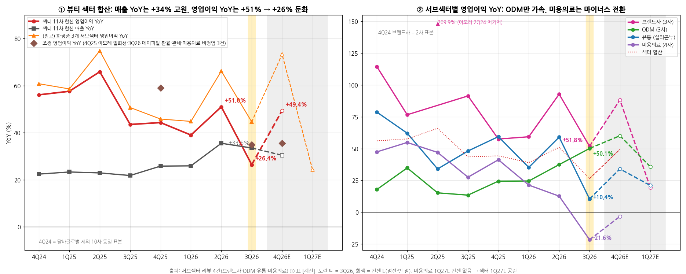
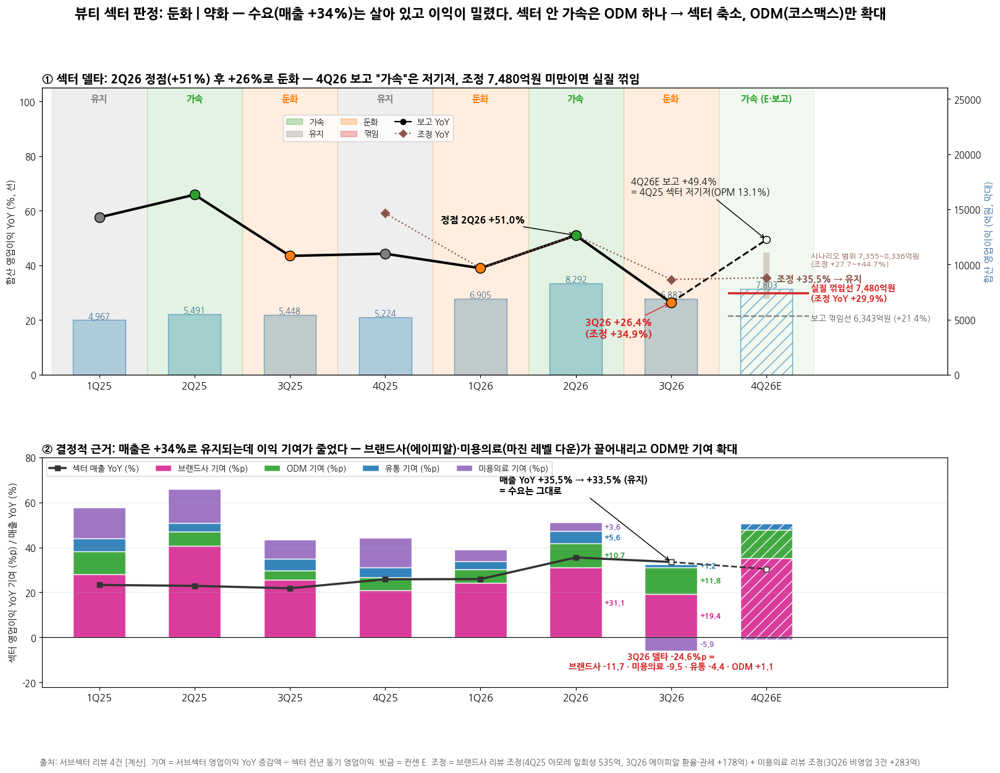

# 뷰티 섹터 리뷰 (섹터 통합)

> 현재 상태 (최신 분기 기준)
> 최신 분기: 2026-Q3
> 섹터 델타: 둔화 | 내러티브: 약화
> 모멘텀 신호: 없음
> 활성 테마: 없음
> 포지셔닝: 섹터 축소 | 한국 해당 없음 | 선호 코스맥스
> 편입 종목: 11사 — 브랜드사(에이피알, 달바글로벌, 아모레퍼시픽) + ODM(코스맥스, 한국콜마, 코스메카코리아) + 유통(실리콘투) + 미용의료(파마리서치, 클래시스, 엘앤씨바이오, 휴젤)
> 갱신 시각: 2026-11-22 22:31 KST

## 누적 시계열

| 분기 | 편입 종목 | 합산 매출 | 합산 영업이익 | OPM | 매출 YoY | 영업이익 YoY | 영업이익 YoY 델타 (%p) | 섹터 델타 | 내러티브 | 모멘텀 신호 | 활성 테마 |
|---|---|---|---|---|---|---|---|---|---|---|---|
| 1Q24 | 11사 | 27,197억원 | 3,151억원 | 11.6 | — | — | — | — | - | - | - |
| 2Q24 | 11사 | 29,263억원 | 3,309억원 | 11.3 | — | — | — | — | - | - | - |
| 3Q24 | 11사 | 29,668억원 | 3,796억원 | 12.8 | — | — | — | — | - | - | - |
| 4Q24 | 11사 (YoY = 달바글로벌 제외 10사 동일 표본) | 31,764억원 | 3,619억원 | 11.4 | +22.4 (10사) | +56.1 (10사) | — | — | - | - | - |
| 1Q25 | 11사 | 33,547억원 | 4,967억원 | 14.8 | +23.3 | +57.6 | −0.8 (10사 기준) | 유지 | - | - | - |
| 2Q25 | 11사 | 35,973억원 | 5,491억원 | 15.3 | +22.9 | +65.9 | +8.3 | 가속 | - | - | - |
| 3Q25 | 11사 | 36,143억원 | 5,448억원 | 15.1 | +21.8 | +43.5 | −22.4 | 둔화 | - | - | - |
| 4Q25 | 11사 | 39,958억원 | 5,224억원 | 13.1 | +25.8 | +44.3 | +0.8 | 유지 (조정 가속¹) | - | - | - |
| 1Q26 | 11사 | 42,223억원 | 6,905억원 | 16.4 | +25.9 | +39.0 | −5.3 | 둔화 | - | - | - |
| 2Q26 | 11사 | 48,761억원 | 8,292억원 | 17.0 | +35.5 | +51.0 | +12.0 | 가속 | - | - | - |
| **3Q26** | **11사** | **48,245억원** | **6,887억원** | **14.3** | **+33.5** | **+26.4** | **−24.6** | **둔화** | **약화** | **없음** | **없음** |

→ **합산 방식**: 서브섹터 리뷰 4건(`브랜드사_섹터리뷰.md`, `ODM_섹터리뷰.md`, `유통_섹터리뷰.md`, `미용의료_섹터리뷰.md`)의 합산 매출·영업이익(억원)을 그대로 더했다. 11사 모두 한국 상장사라 원화 단순 합산이고 환율 환산은 없다. 종목 중복은 없다 — 11사는 서브섹터 하나에만 들어가 있다. 한국콜마는 ODM 리뷰대로 **연결 보고 기준**(HK이노엔 포함)이다. HK이노엔을 다른 섹터에 넣지 않았으므로 중복 합산은 없다
→ **이익 지표**: 각 서브섹터 리뷰의 판정 기준 그대로다. 에이피알만 2026 IFRS 18 조기적용(2025 분기는 회사 재작성치)이고 나머지 10사는 K-IFRS 연결 보고치(IFRS 18 미적용)다 — 외화 환손실이 에이피알만 영업이익 안에 있다 (③ (1))
→ **동일 표본**: 달바글로벌은 2023년 분기 숫자가 없어(2025-05 상장) 4Q24 YoY는 **달바글로벌 제외 10사**끼리 계산했다(4Q23 브랜드사 2사 기저 = 브랜드사 리뷰 2024 YoY 역산 551억원). 1Q25부터는 11사 대 11사다. 1Q25 델타는 10사 기준끼리 비교했다(10사 1Q25 +55.3% vs 4Q24 +56.1%). 1Q24\~3Q24 행은 레벨만 두었다 — ODM·미용의료 리뷰의 YoY가 4Q24부터라 섹터 YoY를 낼 수 없다
→ **¹ 조정 기준**: 4Q25 섹터 영업이익에는 아모레퍼시픽 일회성 약 −535억원(브랜드사 리뷰 조정 — 정상화 1,060억원)이 있다. 정상화하면 4Q25 합산 5,759억원, YoY +59.1%로 "가속"이고, 1Q26(+39.0%)은 "둔화"다 [계산]
→ **소급 판정**: 서브섹터 리뷰와 같은 규칙(확대 = 가속 / ±5%p 이내 = 유지 / 축소 + 플러스 = 둔화 / 마이너스 전환 또는 2개 분기 연속 둔화 + 정점 통과 = 꺾임)을 섹터 합산에 적용했다. 내러티브·모멘텀·테마 열은 당시 섹터 리뷰가 없어 `-`
→ **BT 마이너스 YoY 표기 규칙(2026-11-22)**: 섹터 합산 영업이익 YoY가 마이너스였던 분기는 없다 — 꺾임(개선)/꺾임(악화) 해당 없음. 서브섹터로는 미용의료 3Q26(−21.6%)이 꺾임(악화)다

---

## 2026-Q3 섹터 리뷰

> 대상: 서브섹터 리뷰 4건 (모두 2026-11-22 검수 완료본) — 브랜드사(둔화 | 약화, 서브섹터 축소 · 1등 달바글로벌), ODM(가속 | 유지, 서브섹터 확대 · 1등 코스맥스), 유통(둔화 | 약화, 서브섹터 축소 · 1등 실리콘투), 미용의료(꺾임 | 약화, 서브섹터 축소 · 1등 엘앤씨바이오). 종목 리뷰 11건 — `earnings-review/2026-Q3_{에이피알|달바글로벌|아모레퍼시픽|코스맥스|한국콜마|코스메카코리아|실리콘투|파마리서치|클래시스|엘앤씨바이오|휴젤}_리뷰.md`
> 2층 구조의 **섹터 통합 리뷰**다. 이 문서는 섹터 비중(1단계)·서브섹터 순위(2단계)·서브섹터 × 국가 프레임을 맡는다. 숫자·판정은 서브섹터 리뷰를 그대로 받았고, 새로 계산한 것은 섹터 합산과 서브섹터 간 비교뿐이다
> 첫 뷰티 통합 리뷰 — 직전 분기 관전 포인트·⑦ 콜 체크 없음
> **미용의료 합산 방식**: 워치리스트 `뷰티 | 뷰티` 행이 11사(미용의료 4사 포함)라 **섹터 판정은 11사 합산**으로 낸다. 스킬의 "대분류끼리 합산하지 않는다" 규칙은 대분류(소비재 등) 단위의 금지이고, 미용의료는 같은 뷰티 섹터의 서브섹터라 합산 대상이다. 다만 미용의료는 화장품과 사이클·이익 구조(OPM 30\~45%)가 달라, **화장품 3개 서브섹터(브랜드사·ODM·유통) 합산을 참고 행으로 분리해 병기**한다(판정에는 쓰지 않음). 두 기준의 판정이 같은지 ④에서 확인한다
> **국가 프레임 구멍**: 11사 모두 한국이다. 네 서브섹터 모두 글로벌 편입 종목이 없어 서브섹터 내 한국 vs 글로벌 비교는 전부 `비교 불가 — 편입 종목 없음`이다. BT에게 시작 전 확인할 수 없어(서브에이전트 작업) 구멍을 둔 채 진행했고, 서브섹터 리뷰들이 제안한 글로벌 편입 후보를 ⑦(2)에 한 표로 모았다 (BT 결정용)
> 활성 테마: 없음 (`theme-review\`·`earnings-theme\`에 뷰티 테마 문서 없음)

① 섹터 합산 숫자와 델타

| 항목 | 4Q24 | 1Q25 | 2Q25 | 3Q25 | 4Q25 | 1Q26 | 2Q26 | **3Q26** | 4Q26E |
|---|---|---|---|---|---|---|---|---|---|
| 합산 매출 (억원) | 31,764 | 33,547 | 35,973 | 36,143 | 39,958 | 42,223 | 48,761 | **48,245** | 52,096 |
| 합산 영업이익 (억원) | 3,619 | 4,967 | 5,491 | 5,448 | 5,224 | 6,905 | 8,292 | **6,887** | 7,803 |
| OPM (%) | 11.4 | 14.8 | 15.3 | 15.1 | 13.1 | 16.4 | 17.0 | **14.3** | 15.0 |
| 매출 YoY (%) | +22.4² | +23.3 | +22.9 | +21.8 | +25.8 | +25.9 | +35.5 | **+33.5** | +30.4 |
| 영업이익 YoY (%) | +56.1² | +57.6 | +65.9 | +43.5 | +44.3 | +39.0 | +51.0 | **+26.4** | +49.4 |
| **영업이익 YoY 델타 (%p)** | — | −0.8² | +8.3 | −22.4 | +0.8 | −5.3 | +12.0 | **−24.6** | +23.0 |
| 판정 | — | 유지 | 가속 | 둔화 | 유지 | 둔화 | 가속 | **둔화** | 가속 (보고, E) |
| 참고: 조정 영업이익 YoY (%) | | | | | +59.1 | +39.0 | +51.0 | **+34.9** | +35.5 |
| 참고: 조정 기준 판정 | | | | | 가속 | 둔화 | 가속 | **둔화** | 유지 (E) |
| 참고: 화장품 3개 서브섹터 영업이익 (억원) | 2,465 | 3,746 | 3,937 | 3,950 | 3,595 | 5,424 | 6,542 | **5,712** | 6,230 |
| 참고: 화장품 3개 서브섹터 영업이익 YoY (%) | +60.8² | +58.6 | +74.8 | +50.7 | +45.8 | +44.8 | +66.2 | **+44.6** | +73.3 (조정 +50.8) |
| 참고: 화장품 3개 서브섹터 매출 YoY (%) | +21.4² | +21.9 | +21.4 | +21.3 | +25.5 | +25.8 | +36.2 | **+35.7** | +31.2 |
| 참고: 미용의료 4사 영업이익 YoY (%) | +47.4 | +54.8 | +47.0 | +27.5 | +41.2 | +21.3 | +12.6 | **−21.6** | −3.4 |

→ (출처: 서브섹터 리뷰 4건 ① 표 [계산]. ² 4Q24 = 달바글로벌 제외 10사(화장품은 9사) 동일 표본, 1Q25 델타 = 10사 기준. 4Q26E = 서브섹터 리뷰 컨센 합 — 브랜드사 3,906억원(에이피알 7곳·달바 6곳·아모레 9곳 평균), ODM 1,756억원, 유통 568억원(6곳), 미용의료 1,573억원)
→ **1Q27E는 섹터 합산을 비웠다**: 미용의료 4사 중 2사만 추정이 있다(미용의료 리뷰). 화장품 3개 서브섹터만 보면 1Q27E 6,741억원, YoY +24.3%(매출 +20.6%)다 — 브랜드사 1Q27E는 3사 모두 1\~2곳 추정이라 소수 의견에 좌우된다
→ **조정 기준** [계산]: 서브섹터 리뷰가 판정에 함께 쓴 조정만 옮겼다 — ① 브랜드사: 3Q26 에이피알 환율 영향 +278억원·미국 관세 환급 −100억원(조정 3,270억원), 4Q25 아모레퍼시픽 일회성 +535억원 ② 미용의료: 3Q26 파마리서치 CG USA 인수비용 +35억원·클래시스 남미 비용 +30억원·휴젤 Benev 재고 환입 정상화(조정 1,458억원). ODM(비영업 조정 시 +53\~55%, 판정 동일)·유통(환율 고정 약 +25%, 신뢰도 낮음)은 서브섹터 리뷰가 보고 기준으로 판정해 조정하지 않았다. → 조정 3Q26 7,348억원(+34.9%), 4Q25 기저 5,759억원
→ **인수 편입 효과**: 인수 주도 가속 종목은 없다. 클래시스 브라질 MedSystems 연결은 미용의료 합산 매출 YoY를 약 +3.1%p 올렸지만 이익에는 마이너스였다(미용의료 리뷰). 섹터 합산 매출 YoY 기여는 약 +0.3%p, 영업이익 YoY는 올리지 않았다 [계산]
→ **저기저 플래그**: 3Q26 — 달바글로벌(3Q25 OPM 14.6%)·엘앤씨바이오(3Q25 29억원). 두 종목을 양쪽 분기에서 빼면 9사 3Q26 영업이익 YoY는 +22.9%로 더 낮다 — 판정(둔화) 같음 [계산]. 4Q26 — **섹터 전체가 저기저**다. 4Q25 섹터 OPM 13.1%는 1Q25 이후 최저이고, 네 서브섹터 모두 리뷰에서 4Q25 저기저를 플래그했다(아모레 일회성 535억원, ODM OPM 7.6%, 실리콘투 OPM 13.9%, 파마리서치 OPM 36.2%·엘앤씨바이오 20억원). 조정은 아모레만 수치화돼 있어 **조정 4Q26E +35.5%도 기저 효과를 다 걷어낸 값이 아니다**
→ **이익 레벨**: 3Q26 합산 영업이익 6,887억원은 2Q26(8,292억원, 최대) 대비 −17% QoQ이고, 1Q26과 비슷한 레벨이다. 매출 4.82조원은 2Q26(4.88조원)에 이은 두 번째다. 섹터 OPM은 17.0% → 14.3%(YoY −0.8%p)로 내려왔다
→ **이익 비중 (3Q26)**: 브랜드사 44.9% · ODM 27.9% · 미용의료 17.1% · 유통 10.1%. 매출 비중은 브랜드사 42.7% · ODM 40.4% · 유통 8.8% · 미용의료 8.1%다. **섹터 이익 델타는 브랜드사가 정하고(에이피알이 섹터 이익의 23%), 미용의료는 매출 8%로 이익 17%를 쥔다** [계산]
→ **컨센 경로상 정점**: 보고 기준 섹터 YoY는 2Q26(+51.0%)이 정점이고, 4Q26E(+49.4%)에 다시 그 근처로 튄다 — 4Q25 섹터 저기저가 만든 숫자다. 조정 기준 정점은 4Q25(+59.1%) → 2Q26(+51.0%)로 낮아지는 고점이고, 4Q26E 조정 +35.5%는 3Q26(+34.9%)과 같은 레벨이다. 화장품 3개 서브섹터의 1Q27E(+24.3%)까지 보면 **섹터 YoY는 2Q26 정점을 지나 +20\~30%대로 내려가는 경로**다 [판단]

서브섹터별 합산 행 (서브섹터 리뷰 ① 표 인용)

| 서브섹터 (합산 종목) | 3Q26 매출 (억원) | 3Q26 영업이익 (억원) | OPM | 매출 YoY | 영업이익 YoY 2Q26 → 3Q26 | 델타 (%p) | 4Q26E 영업이익 YoY | 판정 · 내러티브 |
|---|---|---|---|---|---|---|---|---|
| 브랜드사 (에이피알·달바글로벌·아모레퍼시픽) | 20,582 | 3,092 (조정 3,270) | 15.0 | +35.7 | +92.8 → **+51.8** (조정 +60.5) | −41.0 | +88.3 (조정 +49.7) | 둔화 · 약화 |
| ODM (코스맥스·한국콜마·코스메카코리아) | 19,515 | 1,924 | 9.9 | +34.5 | +37.4 → **+50.1** | **+12.7** | +60.1 | **가속** · 유지 |
| 유통 (실리콘투) | 4,244 | 696 | 16.4 | +41.7 | +59.0 → **+10.4** | −48.6 | +34.0 (저기저) | 둔화 · 약화 |
| 미용의료 (파마리서치·클래시스·엘앤씨바이오·휴젤) | 3,904 | 1,175 (조정 1,458) | 30.1 | +12.5 | +12.6 → **−21.6** (조정 −2.7) | −34.2 | −3.4 | 꺾임(악화) · 약화 |
| (참고) 화장품 3개 서브섹터 | 44,341 | 5,712 | 12.9 | +35.7 | +66.2 → **+44.6** | −21.6 | +73.3 (조정 +50.8) | 둔화 (참고) |
| **섹터 11사 합산** | **48,245** | **6,887 (조정 7,348)** | **14.3** | **+33.5** | +51.0 → **+26.4** (조정 +34.9) | **−24.6** | +49.4 (조정 +35.5) | **둔화 · 약화** |

→ (출처: 서브섹터 리뷰 4건 ①·④ 그대로. 화장품·섹터 합산 [계산])
→ **섹터 YoY 둔화(−24.6%p)의 출처** [계산] (기여 = 서브섹터 영업이익 YoY 증감액 ÷ 섹터 전년 동기 영업이익): 브랜드사 +31.1 → +19.4%p(**−11.7%p**), 미용의료 +3.6 → −5.9%p(**−9.5%p**), 유통 +5.6 → +1.2%p(−4.4%p), ODM +10.7 → +11.8%p(**+1.1%p**). 둔화폭의 48%가 브랜드사(그중 에이피알이 브랜드사 리뷰상 −27.1%p/−41.0%p, 약 2/3), 39%가 미용의료(휴젤·클래시스)다. 기여를 늘린 서브섹터는 ODM 하나다
→ **매출과 이익이 갈렸다**: 섹터 매출 YoY는 +35.5% → +33.5%(유지)인데 영업이익 YoY는 +51.0% → +26.4%다. 화장품만 보면 매출 YoY +36.2% → +35.7%로 거의 같고, 영업이익 YoY가 +66.2% → +44.6%로 내려왔다. 화장품 OPM의 YoY 확장 폭이 2Q26 +2.7%p(12.1 → 14.8%)에서 3Q26 +0.8%p(12.1 → 12.9%)로 줄었다. 미용의료는 OPM 자체가 43.2% → 30.1%로 −13.1%p 내려왔다 [계산]

→ (출처: 서브섹터 리뷰 4건 ① 표 [계산]. 왼쪽 = 섹터 11사 합산 영업이익 YoY(빨강)·매출 YoY(회색), 화장품 3개 서브섹터 영업이익 YoY(주황, 참고), 조정 영업이익 YoY(갈색 마름모) / 오른쪽 = 서브섹터별 합산 영업이익 YoY(브랜드사 2Q25 +269.9%는 아모레 2Q24 저기저라 상한 표시, 4Q24 브랜드사는 2사 표본), 빨간 점선 = 섹터 합산. 노란 띠 = 3Q26, 회색 음영·점선·빈 점 = 컨센 E. 종목별 영업이익 YoY 선은 각 서브섹터 리뷰 `_yoy.png`에 있다)

② 서브섹터 델타 순위표

| 순위 | 서브섹터 | 합산 영업이익 YoY 2Q26 → 3Q26 | 델타 | 판정 · 내러티브 (서브섹터 리뷰) | 4Q26 경로 (컨센) | 서브섹터 1등 종목 (서브섹터 리뷰 ⑦(3)) | 서브섹터 비중 의견 |
|---|---|---|---|---|---|---|---|
| 1 | **ODM** | +37.4% → **+50.1%** | **+12.7%p** | **가속** · 유지 (2개 분기 연속 가속, 가속 종목 1/3) | +60.1% (가속, 정점 4Q26E) → 1Q27E +35.8% | **코스맥스** (가속 · 강화) | 확대 (코스맥스 집중) |
| 2 | 브랜드사 | +92.8% → **+51.8%** (조정 +60.5%) | −41.0%p | 둔화 · 약화 | 보고 +88.3% (가속, 아모레 저기저) / 조정 +49.7% (실질 꺾임 경로) | **달바글로벌** (가속 — 저기저 주도 · 약화) | 축소 |
| 3 | 유통 | +59.0% → **+10.4%** | −48.6%p | 둔화 · 약화 | +34.0% (가속, 4Q25 저기저) → 1Q27E +21.0% | **실리콘투** (둔화 · 약화, 유일) | 축소 |
| 4 | 미용의료 | +12.6% → **−21.6%** (조정 −2.7%) | −34.2%p | **꺾임(악화)** · 약화 (2개 분기 연속 꺾임) | −3.4% (꺾임(개선), 저기저·일회성 소멸) | **엘앤씨바이오** (둔화 · 약화) | 축소 |

→ (출처: 서브섹터 리뷰 4건 상태 블록·④·⑦ 그대로)
→ **순위 기준** [판단]: 스킬 기본 순서는 델타 큰 순(동률이면 판정 → 마진 방향)이다. 델타 숫자만으로는 미용의료(−34.2%p)가 브랜드사(−41.0%p)·유통(−48.6%p)보다 위다. 그러나 미용의료는 YoY가 **마이너스로 전환**해 판정 단계가 한 칸 아래(꺾임(악화))이고, 브랜드사·유통은 플러스 성장의 둔화다. %p 델타는 출발 레벨(+93%·+59% vs +13%)이 달라 그대로 비교하면 왜곡된다. 그래서 **판정 → 델타 순**으로 놓았다(가속 > 둔화 > 꺾임). 둔화 2개 중에서는 브랜드사가 델타(−41.0 vs −48.6%p)·레벨(+51.8% vs +10.4%) 모두 유통보다 낫다
→ **선행 서브섹터** — 이익 YoY 사이클의 정점 순서는 **유통 → 브랜드사 → ODM**이다. 유통은 매출 YoY 정점이 1Q24(+158%)로 가장 빨랐고 이번 사이클 이익 YoY 고점이 +59\~60%에서 막혀 있다. 브랜드사는 선행 종목 에이피알이 3Q25(+250%)에 정점을 지났고 서브섹터 조정 정점은 2Q26이다. ODM은 컨센상 4Q26E(+60.1%)가 정점이다. 미용의료는 화장품과 별도로 1Q25(+54.8%)에 정점을 지났다
→ **[판단] ODM 가속은 "선행"이 아니라 "후행" 가속이다**: K-뷰티 물량 흐름은 ODM 수주 → 브랜드 출하 → 유통 순이지만, 이익 델타 사이클은 반대로 유통이 먼저, ODM이 마지막에 정점을 찍는다. ODM 이익은 국내 공장 풀가동(가동률 82\~85%+)의 영업 레버리지라 물량 사이클의 후반부에 가장 크게 나온다. 그래서 ODM 가속은 "다음 사이클의 시작"으로 읽지 않는다 — 1Q27E +35.8%로 바로 둔화가 컨센에 있다

③ 섹터 공통 쟁점 (서브섹터 리뷰 2개 이상에 나온 것)

(1) K-뷰티 수출 수요는 살아 있다 — 둔화는 마진이다 (밸류체인 교차 검증, 화장품 3개 서브섹터)

| 밸류체인 단계 | 3Q26 매출 신호 | 3Q26 이익 신호 | 이익을 깎은 것 |
|---|---|---|---|
| 수출 총량 (HS 3304) | 3Q 평균 약 +38%, 10월 +57%(잠정), 11월 1\~10일 +64% | — | — |
| ODM (국내 법인 = 수출 브랜드 생산) | 국내 3사 매출 +49.8% (2Q26 +31.3%) | 국내 영업이익 +65.4% (가속) | 해외 법인 영업이익 −14.5%, 캐파 외주·특근 비용 (코스메카·한국콜마) |
| 브랜드사 | 3사 매출 +35.7% (에이피알 +100%, 유럽 +738%) | 영업이익 +51.8% (둔화) | 원화 강세(에이피알 −278억원, IFRS 18), 물류·수수료·마케팅, 북미 프라임데이 공백 |
| 유통 (실리콘투) | 매출 +41.7% ≈ 수출 +38% | 영업이익 +10.4% (둔화) | 원화 강세(GPM −3.3%p QoQ), 유럽 3개 분기 감속(브랜드 직진출), 대손 23억원 |

→ (출처: ODM 리뷰 ③(1)·(2), 브랜드사 리뷰 ③(1)·(2)·(4), 유통 리뷰 ③(1)·(2)·(3). 수출 = 코스맥스 리뷰 인용 NH·TRASS)
→ **가설 검증 — "수출 수요는 살아 있고, 둔화는 원화 강세 마진·채널 이동이다"** [판단]
→ (a) **수요 축 — 검증됨**: 화장품 3개 서브섹터 합산 매출 YoY는 +36.2% → +35.7%로 그대로다. 유통 매출(+42%)이 수출(+38%)과 같은 속도이고, ODM 국내 매출은 오히려 +31% → +50%로 가속했다. 10\~11월 수출(+57\~64%)은 3Q보다 강하다
→ (b) **환율 축 — 절반 검증**: 영업이익 안에 들어온 원화 강세 효과(에이피알 278억원 + 실리콘투 환율 고정 기준 약 93억원 [계산, 유통 리뷰 참고치 — 신뢰도 낮음])를 되돌리면 화장품 3Q26 영업이익 YoY는 +44.6% → 약 +54%다. 2Q26 +66.2% 대비 여전히 −12%p 둔화다 — **환율은 화장품 둔화폭(−21.6%p)의 약 45%만 설명한다**
→ (c) **채널 이동 — 부분 검증**: 유럽에서 유통 감속(+99 → +62 → +58%)과 브랜드 직진출 가속(에이피알 +334 → +738%)이 동시에 나왔다(유통 리뷰 ③(3)). 이것은 섹터 안에서 이익이 유통 → 브랜드로 옮겨 가는 것이라 섹터 합산 기준으로는 중립에 가깝다. 반면 채널 확장 비용(브랜드 물류·판매수수료, 유통 저마진 대형 거래선, ODM 해외 법인)은 섹터 합산 이익을 깎았다
→ (d) **나머지 — 북미 성장 정상화**: 브랜드사 3사 북미 YoY가 일제히 내려왔다(프라임데이 2Q 인식, 오프라인 리오더 미확인 — 브랜드사 리뷰 ③(2)). 이건 환율도 채널도 아닌 **브랜드 자체 성장률 정상화**다
→ **결론**: 가설은 "수요 = 검증, 둔화 원인 = 환율 약 절반 + 채널 확장 비용 + 북미 정상화"로 고쳐 적는다. 환율만 돌아와도 화장품 델타가 복원되는 구조는 아니다

(2) 해외 확장 비용이 손익계산서로 들어오는 단계 — 네 서브섹터 공통 (4/4)

| 서브섹터 | 해외 확장 방식 | 3Q26 이익에 준 영향 |
|---|---|---|
| 브랜드사 | 아마존·틱톡샵·유럽·북미 오프라인 리테일 | 에이피알 운반비율 +1.6%p QoQ, 달바 판매수수료율 +2.2%p, 아모레 해외 OPM 13.0% → 9.8% (QoQ) |
| ODM | 미국·중국·동남아 현지 법인 | 해외 법인 합산 영업이익 117 → 100억원(−14.5%), 코스맥스 미국만 흑자 전환 |
| 유통 | 내셔널 리테일러 여신·중남미 대형 거래선 | GPM 하락 일부·매출채권 1,112억원·첫 대손 23억원 |
| 미용의료 | 해외 직판·현지 법인 인수(브라질·미국) | OPM 43% → 30%, 클래시스 남미 7개월 순손실 175억원, 휴젤 美 직판 판관비 +206억원 |

→ (출처: 서브섹터 리뷰 4건 ③)
→ 공통: 네 서브섹터 모두 매출 성장 축이 "국내·대리점"에서 "해외 직접 확장"으로 옮겨 가고, 그 비용이 매출보다 먼저 나온다. 서브섹터 리뷰의 대체 축 결론도 같은 방향이다 — 브랜드사(D2C 2사 < 아모레, 델타 기준), ODM(국내 법인 > 해외 법인), 유통(유럽은 브랜드 직진출 우위), 미용의료(직판 전환 2사 < 국내·대리점 2사)
→ **[판단]** 2027년 섹터 델타는 "해외 확장 비용이 고정비로 흡수되는 시점"이 정한다. 그 전까지는 매출 YoY > 영업이익 YoY 구간이 이어질 가능성이 크다(미용의료 2027E 매출 +23% vs 영업이익 +18% — 파마리서치, 화장품 3개 서브섹터 1Q27E 매출 +20.6% vs 영업이익 +24.3%로 레버리지 폭 축소). 이익이 매출보다 빨리 크는 곳은 국내 공장 레버리지를 쓰는 ODM 국내 법인뿐이다

(3) 원화 강세와 IFRS 18 — 같은 손실, 다른 회계 위치 (4/4)

| 서브섹터 | 영업이익 안 | 영업외 (순이익만) |
|---|---|---|
| 브랜드사 | 에이피알 −278억원 (IFRS 18 조기적용 외화 매출채권 환손실 + 환산 효과) | 달바 −47억원, 아모레 영업외 −442억원(대부분 외환) |
| ODM | — | 코스맥스 외화 관련 −277억원, 코스메카 외화환산 약 −103억원 |
| 유통 | 실리콘투 GPM −3.3%p QoQ (원가 원화·매출 외화 구조) | 실리콘투 외환 손실 −577억원 |
| 미용의료 | — | 파마리서치 영업외 −185억원, 클래시스 외환 순손실 −151억원, 휴젤 외화평가손실 |

→ (출처: 서브섹터 리뷰 4건 ③, 각 종목 리뷰 ⚠ 플래그)
→ **섹터 합산 판정에 주는 영향** [판단]: 에이피알 환율을 되돌린 조정 기준(+34.9%)으로도 2Q26(+51.0%) 대비 둔화다. 반대로 다른 종목의 외환 손실까지 영업이익에 넣으면 3Q26은 더 낮아진다(영업외 외환 관련 손실 합은 위 표 기준 약 1,780억원 이상 — 단 IFRS 18에서도 영업 범주로 가는 것은 영업 관련 외화 항목뿐이라 전액이 아니다). **어느 기준으로도 판정은 둔화**다
→ **2027 단절 주의**: 2027년 IFRS 18 의무 적용 후에는 10사의 영업 관련 외환손익이 영업이익으로 들어온다. 2027 분기 YoY는 2026 재작성치 기준으로 다시 비교해야 하고, 원화 방향이 섹터 델타를 직접 흔드는 변수가 된다. 분기말 원/달러(12/31)는 4Q26 에이피알·실리콘투 영업이익에 바로 들어간다

(4) 4Q26 섹터 저기저 — 보고 YoY가 일제히 커 보이는 분기 (4/4)
→ 4Q25 저기저: 브랜드사 아모레 일회성 약 535억원, ODM 합산 OPM 7.6%(한국콜마 해외 −130억원), 유통 OPM 13.9%(성과급·운반비), 미용의료 파마리서치 OPM 36.2%·엘앤씨바이오 20억원. 섹터 4Q25 OPM 13.1%
→ 결과: 4Q26E 보고 YoY는 브랜드사 +88%·ODM +60%·유통 +34%로 모두 "가속", 미용의료는 "꺾임(개선)", 섹터는 +49.4%로 "가속"이 찍힌다
→ **[판단]** 네 서브섹터 리뷰 모두 "4Q 보고 가속만으로 델타 급증 후보를 올리지 않는다"고 적었다. 섹터 판정도 조정 기준(아모레 정상화 기저 5,759억원)을 함께 본다. 조정 4Q26E +35.5%는 3Q26 조정(+34.9%)과 같은 레벨 = "유지"다

(5) TP 하향은 멀티플 주도 — 시장은 성장률 방향을 산다 (4/4)

| 서브섹터 | TP 변화 (평균) | 2027E 이익 추정 | 12MF PER · 낙폭 |
|---|---|---|---|
| 브랜드사 | 에이피알 −11.4% · 달바 −22.5% · 아모레 −2.3% | −4.8% · −3.5% · +1.3% | 에이피알 약 12배(−49%), 달바 10\~11배(−53%), 아모레 −24\~−25% |
| ODM | 코스맥스 +5.4% · 한국콜마 −5.6% · 코스메카 −0.3% | 3사 합 +1.0% | 코스맥스 −9%, 한국콜마 2027E 약 11배(−36%), 코스메카 −41% |
| 유통 | 실리콘투 −26.1% | −6% | 약 6배(−56%) |
| 미용의료 | 파마 −10.4% · 클래시스 −41.8% · 휴젤 −15.1% · 엘앤씨 산출 불가 | 클래시스 −21.5%, 휴젤 −13.1%, 파마 2026E −3.9% | 10\~13.6배, 고점 대비 −63\~−69% |

→ (출처: 서브섹터 리뷰 4건 ③·⑦)
→ 공통: 화장품은 이익 추정이 거의 안 바뀌었는데 멀티플이 내려갔고, 미용의료는 이익 추정과 멀티플이 같이 내려갔다. 11사 중 TP가 오른 곳은 델타가 가장 좋은 코스맥스 하나다 — 주가·TP 반응이 델타 순위와 같은 방향이다
→ **[판단]** 섹터 전체가 "고성장 → 안정 성장" 재분류 구간이다. 낙폭(−36\~−69%)은 이미 크지만, 추정 상향 전환(이익 경로가 멀티플보다 먼저 돌아서는 증거) 없이 "싸다"는 BT 프레임 2순위 근거다

(6) 미용의료는 화장품과 다른 사이클 (미용의료 vs 화장품 3개 서브섹터)
→ 정점: 화장품 3개 서브섹터 합산 영업이익 YoY 정점은 2Q26(+66.2%, 2Q25 +74.8%는 아모레 저기저), 미용의료는 1Q25(+54.8%)로 1년 이상 빠르다. 3Q26 방향도 화장품은 "플러스 성장의 둔화", 미용의료는 "마이너스 전환"이다
→ 원인: 화장품은 수출 물량 사이클, 미용의료는 마진 레벨(직판 전환 비용)과 국내 카테고리 점유율 이동(리쥬란·슈링크 → ECM·hADM 스킨부스터·국산 EBD)이다. 같은 원화 강세·해외 확장 쟁점을 공유하지만 이익 사이클을 정하는 변수가 다르다
→ **[판단] 판정에 미치는 영향**: 미용의료를 빼도(화장품 +66.2% → +44.6%) 섹터 판정은 둔화로 같다. 미용의료는 섹터 둔화폭의 39%(−9.5%p)를 보탰지만 판정 방향을 바꾸지는 않았다. 다음 분기에는 반대가 될 수 있다 — 화장품이 4Q26 조정 기준 둔화로 가도 미용의료가 꺾임(개선)으로 기여를 되돌린다(4Q26E 기여 −5.9 → −1.1%p)

(7) 서브섹터 고유 이슈 (1줄씩 — 상세는 서브섹터 리뷰)
→ 브랜드사: 에이피알 재고 4,980억원(2025말의 3배)·디바이스 첫 역성장 / 달바 영업외 순손실 약 87억원 구성 미확인 / 아모레 중화권 4Q 플러스 전환 가이던스
→ ODM: 2027 델타 상한 = 증설 일정(코스맥스 1Q27·한국콜마 7월·코스메카 2H27) / 한국콜마 HK이노엔(연결 영업이익의 13.5%) 처리
→ 유통: 매출채권 급증·RCS 3,000억원 사용처 미공개 / 상위 브랜드 직유통 전환(조선미녀 한성USA 인수)
→ 미용의료: 휴젤 4Q26부터 美 매출 sell-out 인식(매출 YoY 기준 단절) / 클래시스 12월 중국 볼뉴머 NMPA / 엘앤씨바이오 CAPA 월 8만 → 15만개

④ 섹터 판정

> 섹터 델타: **둔화** | 내러티브: **약화** → **K-뷰티 수요는 그대로(섹터 매출 YoY +35.5% → +33.5%)인데 합산 영업이익 YoY가 +51.0%(2Q26 정점) → +26.4%로 둔화 — 둔화폭의 48%는 브랜드사(에이피알 정점 통과), 39%는 미용의료(마진 레벨 다운·마이너스 전환)이고, 섹터 안에서 기여를 늘린 건 ODM 하나다. 4Q26 보고 +49%는 섹터 전체 4Q25 저기저(OPM 13.1%) 착시이고 조정 기준은 +35%대 유지 → 섹터 베타는 줄이고 ODM(코스맥스)만 남기는 구간. 4Q26 합산 영업이익 7,480억원(조정 YoY +29.9%) 미만이면 실질 꺾임 (보고 기준 꺾임선 6,343억원)**

→ (출처: 서브섹터 리뷰 4건 [계산]. 상단 = 패널 A 델타 궤적: 섹터 11사 합산 영업이익(막대, 억원, 빗금 = 4Q26E 컨센) + 합산 영업이익 YoY(검정 선, 점 색·배경 = 분기별 섹터 델타 판정, 4Q26E 배경 = 보고 기준 컨센 판정) + 조정 YoY(갈색 마름모·점선) + 4Q26 판정선(빨강 = 실질 꺾임선 조정 +29.9% = 7,480억원, 회색 점선 = 보고 꺾임선 +21.4% = 6,343억원) + 시나리오 범위(브랜드사 컨센 고정 + ODM·유통·미용의료 증권사 추정 범위 7,355\~8,336억원) / 하단 = 패널 B 결정적 근거: 섹터 영업이익 YoY의 서브섹터별 기여(%p, 누적 막대, 빗금 = 컨센 E)와 섹터 매출 YoY(선) — 매출은 유지, 이익 기여만 줄었다)

→ **델타 판정 근거**: 합산 영업이익 YoY가 2Q26 +51.0%에서 3Q26 +26.4%로 24.6%p 줄었지만 플러스다. 1Q26 → 2Q26이 확대(+12.0%p)였으므로 2개 분기 연속 둔화가 아니고, 규칙상 "꺾임"이 아니라 **"둔화"**다. 조정 기준(+51.0% → +34.9%)도 둔화다. 화장품 3개 서브섹터만으로도(+66.2% → +44.6%) 둔화라 미용의료 포함 여부가 판정을 바꾸지 않는다
→ **다음 분기 판정 예고**: 보고 기준 컨센 4Q26E 7,803억원(+49.4%)은 "가속"이다. 그러나 아모레 일회성을 정상화한 기저(5,759억원)로는 +35.5%로 3Q26 조정(+34.9%)과 같은 "유지"다. 3Q26이 이미 둔화라, 4Q26 조정 YoY가 +29.9%(7,480억원) 미만이면 2개 분기 연속 둔화 + 정점(2Q26) 통과 = **실질 꺾임**이다. 판정선 7,480억원은 네 서브섹터 판정선 합(브랜드사 4,060 + ODM 1,592 + 유통 447 + 미용의료 1,277 = 7,376억원)과 거의 같다 — 서브섹터가 하나씩 판정선을 지키면 섹터도 지킨다. 시나리오 범위(7,355\~8,336억원)가 판정선을 걸친다
→ **내러티브 판정 근거**: 서브섹터 내러티브는 유지 1(ODM), 약화 3(브랜드사·유통·미용의료)이다. 종목 단위로는 강화 1(코스맥스) · 유지 3(아모레퍼시픽·한국콜마·코스메카코리아) · 약화 6(에이피알·달바글로벌·실리콘투·파마리서치·엘앤씨바이오·휴젤) · 훼손 1(클래시스)이다. 섹터 공통 스토리 "K-뷰티 글로벌 확장 → 고성장 + 고마진"에서 **글로벌 확장(매출 +34%, 수출 +38\~64%)은 숫자로 강화됐고, 고마진은 깨졌다**(화장품 마진 확장 폭 축소, 미용의료 OPM −13%p). 수요 전제가 살아 있어 훼손이 아니라 **약화**다 [판단]
→ **[판단] 결정적 근거 — 매출은 유지, 이익 기여만 줄었다 (패널 B)**: 섹터 매출 YoY는 +35%대로 그대로인데 이익 기여는 브랜드사(31.1 → 19.4%p)와 미용의료(3.6 → −5.9%p)에서 빠졌다. ODM만 기여가 늘었다(10.7 → 11.8%p). 4Q26E 컨센에서도 브랜드사 기여 반등(35.1%p)의 상당 부분이 아모레 저기저다
→ **직전 판정 대비**: 첫 뷰티 통합 판정이다. 소급 궤적은 유지(1Q25) → 가속(2Q25) → 둔화(3Q25) → 유지(4Q25, 조정 가속) → 둔화(1Q26) → 가속(2Q26) → **둔화(3Q26)**다. 2025년 이후 가속과 둔화가 번갈아 나오는 톱니 궤적이고, 톱니의 고점이 +66%(2Q25) → +51%(2Q26)로 낮아지고 있다. 조정 기준으로도 +59%(4Q25) → +51%(2Q26) → +35%(3Q26)로 고점이 내려온다

⑤ 모멘텀 신호

→ **없음** — 활성 테마가 없어 "테마 종료 후보"는 해당하지 않는다
→ 델타 급증 후보 조건 대조
→ ① 섹터 영업이익 YoY 델타 뚜렷한 확대 — **미충족** (−24.6%p, 조정 −16.1%p)
→ ② 편입 종목 과반 가속 — **미충족** (서브섹터 가속 1/4, 종목 가속 2/11 — 코스맥스, 달바글로벌(저기저 주도))
→ ③ 내러티브 형성·강화 — **미충족** (약화)
→ BT 턴어라운드 규칙(마이너스 폭 2개 분기 연속 축소): 섹터 합산은 플러스라 해당 없음. 서브섹터로는 미용의료가 4Q26E −3.4%(축소 1회) → 1Q27이 개선이면 조건 충족 — 미용의료 리뷰 ⑤가 다음 분기 확인 대상으로 적었다
→ **ODM 레이어 메모** (후보 아님): ODM은 ① 2개 분기 연속 확대는 충족, ② 가속 1/3·③ 유지로 미충족이다(ODM 리뷰 ⑤). ② 순서상 이익 사이클의 마지막 층이고 컨센 정점이 4Q26E라, 4Q26에 ①·②가 채워져도 "정점 직전 후보"가 될 위험이 크다 [판단]
→ 다음 분기에 섹터를 후보로 올릴 조건: 4Q26 조정 YoY가 3Q26 조정(+34.9%)보다 5%p 넘게 확대(8,057억원 이상, 조정 +39.9%) + 서브섹터 2개 이상 가속(조정 기준) + 2027 가이던스(1\~2월)에서 이익 추정 상향. 셋이 겹치면 "고성장 → 안정 성장" 재분류가 뒤집힌다
→ **반대 논거**
→ (1) 수요 지표는 3Q보다 4Q가 강하다 — 10월 수출 +57%, 11월 1\~10일 +64%. 매출 서프라이즈가 나면 4Q 마진(고정비 레버리지)이 컨센보다 좋을 수 있다
→ (2) 4Q26 보고 기준은 거의 확실히 "가속"(+49%)으로 찍힌다. 기계적 판정만 보는 시장 반응은 단기 반등일 수 있다 — 단 BT 프레임은 조정 기준을 같이 본다
→ (3) 원화 약세 전환 시 에이피알(IFRS 18)·실리콘투(GPM)의 영업이익이 바로 돌아온다. 환율이 섹터 둔화폭의 일부(화장품 기준 약 45%)를 설명하므로, 환율 한 변수로 4Q 델타가 위로 뒤집힐 수 있다

⑥ 다음 분기 섹터 관전 포인트

| 순위 | 무엇을 (변수·임계값) | 어떤 데이터로 | 언제 |
|---|---|---|---|
| 1 | **4Q26 섹터 11사 합산 영업이익 7,480억원 이상 (조정 YoY +29.9% = 3Q26 조정 +34.9% − 5%p, 기저 = 아모레 정상화 5,759억원) — 미만이면 2개 분기 연속 둔화 + 정점(2Q26) 통과로 실질 꺾임.** 8,057억원(조정 +39.9%) 초과면 조정 기준 가속. 보고 기준 꺾임선은 6,343억원(+21.4%). 컨센 7,803억원(보고 +49.4% 가속 / 조정 +35.5% 유지), 시나리오 범위 7,355\~8,336억원 | 11사 4Q26 잠정실적 | 파마리서치·에이피알 \~2/3 → 휴젤 \~2/10 → 클래시스 \~2/12 → 코스메카 \~2/19 → 코스맥스 \~2/23 → 한국콜마 \~2/25 → 엘앤씨바이오 \~2/26 → 실리콘투 2월 말 (2027, 캘린더 추정). 달바·아모레 미확정 |
| 2 | **서브섹터 판정선** — 브랜드사 4,060억원(조정 +55.5%, 에이피알 가이던스 하단 2,365억원이 관건) / ODM 1,592억원(둔화선)·1,701억원(가속선) / 유통 447억원(꺾임선)·489억원(가속선) + GPM 29.5% / 미용의료 1,277억원(악화선)·1,629억원(플러스 복귀) | 서브섹터 리뷰 ⑥ 1순위 | 2027-02 |
| 3 | **수요 vs 마진 분리 지표** — 한국 화장품 수출(HS 3304) 월간 YoY +30% 이상 유지 + 화장품 3개 서브섹터 매출 YoY +30% 이상. 수출이 +20% 아래면 수요 축 재검토(ODM 확대 콜 하향). 유통 매출 YoY가 수출 YoY를 10%p 이상 밑돌면 직유통 전환이 유통 몫을 잠식 | 관세청 수출입 통계(12/1·1/1·2/1, 중순 잠정), 4Q IR | 2026-12 \~ 2027-02 |
| 4 | **원화 환율과 IFRS 18** — 12/31 분기말 원/달러가 3Q말(1,358원)보다 내려가면 에이피알 환손실·실리콘투 GPM 역풍 반복. 2027 IFRS 18 의무 적용 시 10사의 2026 재작성치(영업 관련 외환손익 이동 규모) | 서울외국환중개 고시 환율, 4Q 사업보고서·1Q27 재작성 공시 | 2026-12-31 / 2027-03 \~ 05 |
| 5 | **해외 확장 비용 흡수 시점** — 코스맥스 미국 OPM 5%+, 휴젤 美 sell-out 분기 350억원+, 클래시스 남미 분기 200억원+·연결 GPM 75%+, 에이피알 운반비율 8% 이하 | 각 사 4Q IR 법인·지역별 표, 휴젤 2027 가이던스(1월 JPMHC) | 2027-01 \~ 02 |

→ 1순위 판정선(7,480억원)은 ④ 키 차트의 빨간 선과 같다. 근거: 3Q26 조정 YoY +34.9%(7,348 / 5,448억원)에서 유지 밴드 하단(−5%p)을 뺀 +29.9%를 4Q25 조정 기저 5,759억원에 적용 [계산]. 네 서브섹터 판정선 합(7,376억원)과 104억원 차이다
→ 다음 섹터 리뷰(2026-Q4)는 이 목록을 먼저 체크한다

⑦ 글로벌 PM 포지셔닝 — 결론

> **섹터: 비중 축소 — 4Q26 합산 영업이익 7,480억원 이상(실질 꺾임 회피) + ODM 가속 지속 + 미용의료 꺾임(개선)이면 중립으로 상향** | **서브섹터: ODM 확대 > 브랜드사 축소 > 유통 축소 > 미용의료 축소** | **한국: 해당 없음 (11사 모두 한국 — 글로벌 편입 종목 없음, 편입 후보 표는 (2))**

(1) 섹터 비중 — 확대 / 중립 / 축소 → **축소** [판단]

| 판단 축 | 3Q26 근거 (수치) | 방향 |
|---|---|---|
| 이익 델타 (1순위) | 합산 영업이익 YoY +51.0% → +26.4% (조정 +34.9%) 둔화. 서브섹터 가속 1 · 둔화 2 · 꺾임 1 | 축소 |
| YoY 정점 시점 | 섹터 보고 정점 2Q26 통과, 조정 고점은 4Q25 → 2Q26 → 3Q26로 하락. 정점 지난 서브섹터 3/4(유통·브랜드사·미용의료), ODM은 4Q26E. 화장품 1Q27E +24.3% | 축소 |
| 수주·물량 선행지표 | ODM 국내 매출 +49.8%·가동률 82\~85%+ 풀가동, 코스맥스 "신규 수주 둔화 없음" | 확대 |
| 최종 수요 지표 | 한국 화장품 수출 3Q +38% → 10월 +57%·11월 초 +64%, 화장품 매출 YoY +36% 유지 / 북미 브랜드 성장 정상화, 국내 미용의료 점유율 이동 | 확대 (화장품) · 중립 (미용의료) |
| 마진 | 화장품 OPM YoY 확장 폭 +2.7%p → +0.8%p, 미용의료 OPM −13.1%p. 매출·마진 동시 개선(QoQ 마진 기준)은 ODM 코스맥스·미용의료 엘앤씨바이오뿐, 브랜드사 0/3 | 축소 |
| 이벤트·환율 | 4Q 누적 원화 3Q 대비 약 −6% 추가 강세(유통 리뷰), 12/31 분기말 환율, 2027 IFRS 18, 2027 가이던스(1\~2월) | 중립\~축소 |
| 이익 추정 방향 | 상향 2: 코스맥스·아모레(소폭) / 하향 8: 에이피알·달바·한국콜마·코스메카·실리콘투·파마리서치(2026E)·클래시스·휴젤 (화장품은 소폭, 미용의료는 −13\~−22%) / 미확인 1: 엘앤씨바이오(발표 후 리포트 0건) | 축소 |
| 밸류에이션·멀티플 (2순위) | TP 하향은 화장품 = 멀티플, 미용의료 = 이익 + 멀티플. 12MF PER 6\~13.6배 | 중립 (하방 제한) |
| 주가 낙폭 | 고점 대비 −9%(코스맥스) \~ −69%(클래시스), 대부분 −36\~−69% — 디레이팅이 이익 경로보다 먼저 왔다 | 반대 논거 |

→ **결론: 섹터 비중 축소** [판단]. 델타 1순위 프레임에서 섹터 합산이 둔화이고, 네 서브섹터 중 셋이 정점을 지났으며 서브섹터 리뷰 셋이 "축소"다. 수요(매출 +34%)는 살아 있지만 이익이 매출을 따라가지 못하는 구간이고, 4Q26 보고 가속은 저기저라 근거로 쓰지 않는다. 이익 추정은 11사 중 8사가 내려갔다(상향 2, 미확인 1)
→ **델타 방향과 정점 시점이 엇갈리는 지점**: 4Q26 보고 YoY(+49%)는 가속으로 나온다. 그러나 정점(2Q26)은 지났고 조정 기준은 유지(+35%)다. 섹터 베타는 줄이고, 섹터 안에서 아직 가속 중인 ODM으로 비중을 옮긴다 — 다만 ODM도 컨센 정점이 4Q26E라 "한 분기 남은 가속"이다
→ **중립 상향 조건**: ① 4Q26 합산 영업이익 7,480억원 이상(실질 꺾임 회피) ② ODM 1,701억원 초과(3개 분기 연속 가속) ③ 미용의료 1,277억원 이상(꺾임(개선)) + 1Q27 연속 개선 경로. ①+②면 중립, ③까지 겹치면 중립 확정. **확대 조건**: 조정 YoY +39.9%(8,057억원) 초과 + 2027 가이던스에서 화장품 이익 추정 상향
→ **추가 축소 조건**: 4Q26 합산 7,480억원 미만(실질 꺾임) — 특히 에이피알 2,000억원 미만(꺾임 확정) + ODM 1,592억원 미만(둔화 전환)이 겹치면 섹터 안에서 남길 서브섹터가 사라진다

(2) 국가 프레임 — 서브섹터 × 국가

| 서브섹터 | 한국 (종목 · 영업이익 YoY 델타) | 글로벌 (종목 · 영업이익 YoY 델타) | 서브섹터 내 우위 | 한국 매출 비중 (3Q26) |
|---|---|---|---|---|
| 브랜드사 | 에이피알 −65.5%p(꺾임) · 달바글로벌 +39.1%p(가속, 저기저 주도) · 아모레퍼시픽 −33.8%p(둔화) / 합산 −41.0%p | 비교 불가 — 편입 종목 없음 | — | 100% |
| ODM | 코스맥스 +73.7%p(가속) · 한국콜마 −9.7%p(둔화) · 코스메카코리아 −39.2%p(꺾임) / 합산 +12.7%p | 비교 불가 — 편입 종목 없음 | — | 100% |
| 유통 | 실리콘투 −48.6%p(둔화) | 비교 불가 — 편입 종목 없음 | — | 100% |
| 미용의료 | 엘앤씨바이오 n/m(둔화) · 파마리서치 −17.8%p(꺾임) · 클래시스 −30.4%p(꺾임(악화)) · 휴젤 −60.7%p(꺾임(악화)) / 합산 −34.2%p | 비교 불가 — 편입 종목 없음 | — | 100% |

→ (출처: 서브섹터 리뷰 4건 ② 판정표 그대로)
→ **결론: 한국 해당 없음** — 섹터 편입 11사가 모두 한국이라 한국 vs 글로벌의 믹스 효과·서브섹터 내 효과를 판단할 수 없다. 국가 판단은 결론에서 뺀다
→ **대체 관찰 (국가 대신 서브섹터 믹스)** [판단]: 한국 뷰티의 이익은 브랜드사(45%)·ODM(28%)에 몰려 있다. 델타가 좋은 ODM의 이익 비중이 28%뿐이라, 섹터 합산은 브랜드사·미용의료의 둔화에 끌려간다. 글로벌 피어가 편입되면 "K-뷰티 브랜드 vs 글로벌 프레스티지 브랜드", "한국 ODM vs Intercos" 비교로 서브섹터 내 효과를 처음 낼 수 있다
→ **비교 범위**: 한국 종목 리뷰 11건과 서브섹터 리뷰 4건만 썼다. 글로벌 숫자는 없다 — 근거 없음(국가 비교 불가)

**글로벌 편입 후보 — BT 결정용** (서브섹터 리뷰 4건 ⑦(2) 제안 통합. 노션 실적 캘린더 발표일은 확인하지 못했다 — 편입하면 숫자 중심 earnings-review부터 작성)

| 서브섹터 | 후보 | 국가 | 맞붙는 한국 종목 · 선정 근거 | 공시 주기 (스킬 규칙 영향) | 서브섹터 리뷰 제안 방식 | 우선순위 [판단] |
|---|---|---|---|---|---|---|
| 브랜드사 | Estée Lauder (EL) | 미국 | 아모레퍼시픽 — 프레스티지·중국·면세 사이클 대표 (고점 −83%) | 분기 영업이익 (6월 결산 → 캘린더 분기 정렬) | 글로벌 편입 | **1** (분기 손익 + 직접 경쟁) |
| 브랜드사 | e.l.f. Beauty (ELF) | 미국 | 에이피알·달바글로벌 — 미국 매스 뷰티 D2C·아마존·리테일 매대 | 분기 영업이익 (3월 결산 → 캘린더 정렬) | 글로벌 편입 | **1** (K-뷰티 미국 경쟁의 직접 비교) |
| 브랜드사 | Shiseido (4911.T) | 일본 | 아모레퍼시픽·달바(일본 15.9%) — 아시아 대형 브랜드, 중국·면세 | 분기 영업이익 (core OP) | 글로벌 편입 | 2 |
| 브랜드사 | L'Oréal (OR.PA) | 프랑스 | 글로벌 1위, 사이클 기준점 | 반기 이익 + 분기 매출 (1·3분기 합산 제외) | 트래킹 피어 | 2 (트래킹) |
| ODM | Intercos (ICOS.MI) | 이탈리아 | 코스맥스·한국콜마 — 글로벌 MNC 색조 오더 직접 경쟁, 코스메카 밸류에 PER 인용 | 분기 손익 공시 범위 확인 필요 (반기 손익만이면 반기 공시 규칙) | 글로벌 편입 | **1** (ODM 글로벌 유일 후보) |
| ODM | 青松股份 (300132.SZ, Nox Bellcow) | 중국 | 코스맥스 중국 법인 — 중국 화장품 ODM 대형사 | A주 분기 손익 | 글로벌 편입 [불확실] | 3 |
| 유통 | Ulta Beauty (ULTA) | 미국 | 실리콘투 북미 핵심 거래처 — K-뷰티 북미 오프라인 수요의 하류 지표 | 분기 (1월 결산, FY3Q 12월 초 발표) | 트래킹 피어 (사업모델 상이) | 2 (트래킹) |
| 유통 | Douglas (DOU.DE) | 독일 | 실리콘투 2027 유럽 직거래 추진처 — 유럽 수요 하류 지표 | 분기 (9월 결산) | 트래킹 피어 | 3 (트래킹) |
| 미용의료 | Evolus (EOLS) | 미국 | 휴젤 Letybo — 美 톡신 직접 경쟁 | 분기 영업이익 | 글로벌 편입 | **1** ((a)+(b) 교집합) |
| 미용의료 | InMode (INMD) | 이스라엘 (미국 상장) | 클래시스 — RF·EBD 장비 경쟁 | 분기 영업이익 | 글로벌 편입 | **1** |
| 미용의료 | Galderma (GALD.SW) | 스위스 | 휴젤·파마리서치·엘앤씨 — 톡신·필러·스킨부스터 글로벌 대표 | 분기 매출 + 반기 손익 (1·3분기 합산 제외) | 글로벌 편입 (매출 비교) | 2 |
| 미용의료 | (참고) AbbVie Allergan Aesthetics | 미국 | 톡신·필러 1위 | 사업부 영업이익 미공시 | 트래킹 피어 (매출만) | 3 |

→ **최소 편입 세트 제안** [판단]: 서브섹터 내 효과를 내려면 서브섹터마다 분기 손익을 내는 글로벌 종목이 1개 이상 필요하다 — 브랜드사 EL + e.l.f., ODM Intercos(분기 손익 범위 확인 후), 미용의료 Evolus + InMode. 유통은 직접 대응하는 상장 피어가 없어 Ulta 트래킹만으로 하류 수요를 본다. 이 5사가 들어오면 미국(EL·e.l.f.·Evolus·InMode)·유럽(Intercos) 국가별 델타 표를 2개 국가로 쓸 수 있다
→ 편입 여부·순서는 BT 결정이다. 편입하지 않으면 다음 분기에도 (2)는 `한국 해당 없음`으로 유지한다

(3) 서브섹터 순위와 비중

| 순위 | 서브섹터 | 비중 | 근거 (델타 방향·마진·수요 노출) |
|---|---|---|---|
| 1 | **ODM** | **확대 (코스맥스 집중)** | 유일한 가속(+37.4% → +50.1%, 2개 분기 연속), 매출·이익 동반 가속(매출 +34.5%), 국내 공장 레버리지가 섹터에서 유일하게 이익을 매출보다 빨리 키움. 수출 +57\~64%의 직접 수혜. 단 가속 종목 1/3, 컨센 정점 4Q26E, 이익 사이클의 마지막 층 |
| 2 | 브랜드사 | 축소 | 둔화(+92.8% → +51.8%), 조정 기준 4Q26E 꺾임 경로. 매출은 +36%로 빠르지만 물류·수수료·환율로 마진과 함께 가지 못함. 섹터 이익의 45%라 섹터 델타를 정함 |
| 3 | 유통 | 축소 | 둔화(+59.0% → +10.4%), 환율 베타 최대(매출 98% 외화), 유럽에서 브랜드 직진출에 몫을 내줌. 4Q26 447억원 미만이면 꺾임 |
| 4 | 미용의료 | 축소 | 꺾임(악화)(+12.6% → −21.6%), 조정 기준도 −2.7%, OPM 43% → 30% 구조적 레벨 다운. 4Q26E 꺾임(개선)은 저기저·일회성 소멸. 턴어라운드 후보 확인은 1Q27 |

→ **ODM > 브랜드사 > 유통 > 미용의료**인 이유 [판단]: 같은 K-뷰티 수요를 받는 세 화장품 서브섹터 중 수요를 이익으로 가장 깨끗하게 바꾸는 곳이 ODM(원화 매출·국내 공장)이고, 환율·채널 비용을 가장 크게 맞는 곳이 유통이다. 미용의료는 수요는 강하지만(수출 +15\~62%) 사이클이 화장품보다 1년 먼저 꺾였고 마진 레벨이 구조적으로 내려왔다
→ **서브섹터 비중의 한계**: ODM은 섹터 이익의 28%뿐이고, 1Q27E에 +35.8%로 둔화가 컨센에 있다. ODM 확대는 섹터 축소 안에서의 상대 비중이다

(4) 서브섹터별 1등 종목

| 서브섹터 | 비중 | 1등 종목 (한국 = 서브섹터 1등) | 델타 판정 · 내러티브 | 근거 (서브섹터 리뷰 ⑦(3)) | 글로벌 1등 |
|---|---|---|---|---|---|
| ODM | 확대 | **코스맥스** | 가속 · 강화 | 델타 +73.7%p, 영업이익 YoY +95%·매출 +50%, 미국 흑자 전환, 국내 OPM 11.0%, 11사 중 유일하게 TP 상향. 4Q26 797억원 이상이어야 가속 연장(컨센 755억원은 둔화) | 비교 불가 |
| 브랜드사 | 축소 | 달바글로벌 | 가속(저기저 주도) · 약화 | 델타 순위 1위(+39.1%p), OPM 21.5%. 매출 YoY 3개 분기 감속, 4Q26E +52%로 둔화 예정 — "덜 나쁜" 상대 1등 | 비교 불가 |
| 유통 | 축소 | 실리콘투 | 둔화 · 약화 | 유일 편입. 매출 7분기 연속 최대, 영업이익 YoY +10%. 서브섹터 축소라 선호로 올리지 않음 | 없음 |
| 미용의료 | 축소 | 엘앤씨바이오 | 둔화 · 약화 | 4사 중 유일하게 꺾임 아님, OPM 25.6% 사상 최고. 4Q26 인체조직 300억원 이상 확인 조건부 | 비교 불가 |

→ **선호**: **코스맥스** — 스킬 규칙(2단계 1위 서브섹터의 1등 종목 우선)이자 11사 중 유일한 가속·강화 종목. 상태 블록 선호 종목
→ **상대 선호 (축소 서브섹터 안에서 남길 1종목)**: 달바글로벌(브랜드사, 저기저 주의), 엘앤씨바이오(미용의료, 조건부)
→ **비선호**: 에이피알(브랜드사 선행 꺾임 — 단 반등 후보), 코스메카코리아(ODM 선행 꺾임), 휴젤·클래시스(미용의료 꺾임(악화))
→ **반등 후보 (이벤트 드리븐, 델타 프레임 밖)**: 에이피알 — 4Q26 가이던스 하단 2,365억원 + OPM 24% 복귀 + 2027 가이던스(2월) / 한국콜마 — 1H27 CAPA 확보 공시 + 4Q 704억원 이상 / 실리콘투 — 12/31 원화 약세 전환(미실현 환산손실 약 390억원 환입) / 클래시스 — 12월 중국 볼뉴머 NMPA / 휴젤 — 4Q 美 sell-out 350억원+·1월 2027 가이던스. 모두 확인 이벤트 전까지 비중을 두지 않는다

(5) 콜을 바꾸는 조건과 일정

| 시점 | 이벤트 | 섹터 비중 | 서브섹터 · 선호 종목 |
|---|---|---|---|
| 2026-11 말\~12 | 블프·사이버먼데이 아마존 뷰티 순위 | 3사 상위권 유지 → 브랜드사 4Q 가이던스 신뢰 상승 (콜 변화 없음) | 달바 순위 하락 시 브랜드사 1등 재검토 |
| 2026-12-01 / 2027-01-01 (+중순 잠정) | 관세청 11·12월 화장품 수출 | +30% 이상 → 수요 축 유지 / +20% 미만 → 축소 강화 | +20% 미만이면 ODM 확대 → 유지 하향 |
| 2026-12 초 | Ulta Beauty FY3Q (트래킹 후보) | K-뷰티 북미 오프라인 코멘트 — 유통·브랜드 북미 리오더 판단 | 편입 시 |
| 2026-12 | 클래시스 중국 볼뉴머 NMPA | 영향 작음 | 미용의료 반등 후보 |
| 2026-12-31 | 분기말 원/달러 (3Q말 1,358원 대비) | 원화 약세 → 에이피알·실리콘투 4Q 영업이익 순풍, 중립 상향 확률 상승 / 강세 지속 → 축소 유지 | 에이피알·실리콘투 반등 후보 |
| 2027-01 중순 | 휴젤 2027 가이던스 (JPMHC 전후) | 미용의료 턴어라운드 경로 신뢰 | — |
| \~2027-02-03 | 에이피알·파마리서치 4Q26 | 에이피알 2,365억원+ & OPM 24% → 브랜드사 판정선 통과 가능 / 2,000억원 미만 → 섹터 추가 축소 | 에이피알 가속 복귀 시 브랜드사 1등 교체 검토 |
| \~2027-02-19 \~ 02-25 | 코스메카·코스맥스·한국콜마 4Q26 | ODM 1,701억원 초과 → 중립 상향 조건 ② 충족 / 1,592억원 미만 → ODM 확대 → 유지 하향 | 코스맥스 797억원 이상 → 선호 유지 / 755억원 → 둔화(+85%)지만 델타 1위 유지 가능 |
| \~2027-02 말 | 엘앤씨바이오·실리콘투 4Q26, 달바·아모레(미확정) — 11사 합산 확정 | **7,480억원 이상 → 실질 꺾임 회피(중립 상향 검토) / 미만 → 꺾임, 축소 유지** | 엘앤씨 인체조직 300억원 미만 → 미용의료 1등 재검토 |
| 2027-05 | 1Q27 실적 | 화장품 컨센 +24.3% 경로면 섹터 둔화 지속 / 미용의료 2개 분기 연속 개선이면 턴어라운드 후보 | ODM 1Q27E +35.8% 둔화 → 축소 전환 검토 |

→ 출처: 서브섹터 리뷰 4건 ⑥·⑦(4), `earnings_calendar.md`(4Q26 발표일은 추정 — 달바글로벌·아모레퍼시픽 미등재)
→ 밸류에이션 숫자는 서브섹터·종목 리뷰에 인용된 증권사 리포트(11월 발간) 기준이며 웹 자료는 쓰지 않았다
