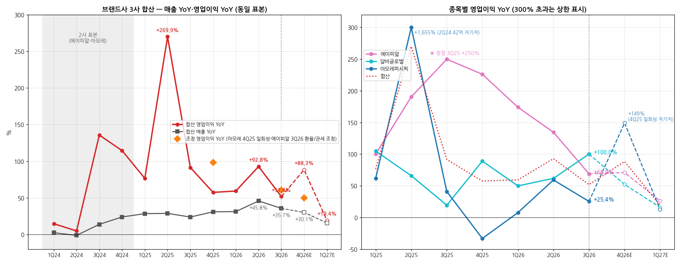
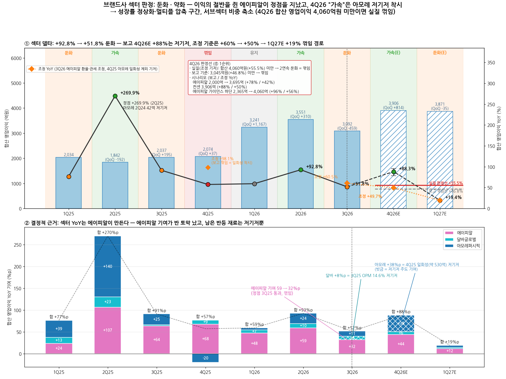

# 뷰티 · 브랜드사 섹터 리뷰

> 현재 상태 (최신 분기 기준)
> 최신 분기: 2026-Q3
> 섹터 델타: 둔화 | 내러티브: 약화
> 모멘텀 신호: 없음
> 활성 테마: 없음
> 포지셔닝: 서브섹터 축소 | 한국 해당 없음 | 1등 달바글로벌
> 편입 종목: 에이피알, 달바글로벌, 아모레퍼시픽
> 갱신 시각: 2026-11-22 22:16 KST

## 누적 시계열

| 분기 | 편입 종목 | 합산 매출 | 합산 영업이익 | OPM | 매출 YoY | 영업이익 YoY | 영업이익 YoY 델타 (%p) | 섹터 델타 | 내러티브 | 모멘텀 신호 | 활성 테마 |
|---|---|---|---|---|---|---|---|---|---|---|---|
| 1Q24 | 2사 (에이피알·아모레퍼시픽) | 10,604억원 | 1,005억원 | 9.5 | +2.4 | +14.7 | +43.8 | 가속 | - | - | - |
| 2Q24 | 2사 | 10,603억원 | 322억원 | 3.0 | −1.2 | +4.9 | −9.8 | 둔화 | - | - | - |
| 3Q24 | 2사 | 11,513억원 | 924억원 | 8.0 | +13.9 | +135.7 | +130.8 | 가속 | - | - | - |
| 4Q24 | 2사 | 13,359억원 | 1,182억원 | 8.8 | +23.9 | +114.5 | −21.2 | 둔화 | - | - | - |
| 1Q25 | 3사 (에이피알·달바글로벌·아모레퍼시픽) | 14,473억원 | 2,034억원 | 14.1 | +28.5 | +76.6 | −42.1 (2사 기준) | 둔화 | - | - | - |
| 2Q25 | 3사 | 14,611억원 | 1,842억원 | 12.6 | +28.8 | +269.9 | +193.3 | 가속 | - | - | - |
| 3Q25 | 3사 | 15,170억원 | 2,037억원 | 13.4 | +23.8 | +91.4 | −178.5 | 둔화 | - | - | - |
| 4Q25 | 3사 | 18,744억원 | 2,074억원 | 11.1 | +31.0 | +57.5 | −33.9 | 꺾임 (조정 가속¹) | - | - | - |
| 1Q26 | 3사 | 19,004억원 | 3,241억원 | 17.1 | +31.3 | +59.3 | +1.8 | 유지 (조정 둔화¹) | - | - | - |
| 2Q26 | 3사 | 21,303억원 | 3,551억원 | 16.7 | +45.8 | +92.8 | +33.5 | 가속 | - | - | - |
| **3Q26** | **3사** | **20,582억원** | **3,092억원** | **15.0** | **+35.7** | **+51.8** | **−41.0** | **둔화** | **약화** | **없음** | **없음** |

→ **합산 방식**: 3사 모두 한국 상장사라 원화(억원) 단순 합산이다. 환율 환산은 하지 않았다. 영업이익은 각 종목 리뷰의 판정 기준 그대로 썼다. 에이피알은 회사 재작성 기준(2026 IFRS 18 조기적용, 2025 분기는 IFRS 18 재작성치 556·813·951·1,294억원)을 썼다. 달바글로벌과 아모레퍼시픽은 K-IFRS 연결 보고치(IFRS 18 미적용)다. 달바글로벌 3Q25 매출은 재작성치(1,142억원, 러시아 판매장려금 순액법)를 썼다
→ **동일 표본**: 달바글로벌은 2023년 분기 숫자가 없다(2025-05 상장, 리뷰 표가 1Q24부터 시작). 그래서 2024년 행은 **에이피알·아모레퍼시픽 2사 표본**으로 계산했고, 매출·영업이익 레벨도 2사 합이다. 2023년 분기 값은 두 종목 리뷰의 2024년 YoY로 역산했다 [계산]. 1Q25부터는 3사다. 1Q25 델타(−42.1%p)는 2사 기준끼리 비교했다(2사 1Q25 +72.4%)
→ **¹ 조정 기준**: 아모레퍼시픽 4Q25 영업이익 525억원에는 일회성 약 −530억원(구딸 사업 종료 비용·연말 인센티브 충당금, MS 추정, 일회성 제외 1,060억원)이 있다. 이 기저를 정상화하면 4Q25 합산 YoY는 +98.1%(가속)다. 그 기준으로 1Q26 +59.3%는 둔화다 [계산]. 보고 기준 4Q25 "꺾임"은 일회성이 만든 판정이다
→ **소급 판정**: 1Q24\~2Q26은 이번에 소급 산정했다. 규칙은 직전 분기 대비 ±5%p 이내 = 유지, 확대 = 가속, 축소 + 플러스 = 둔화, 2개 분기 연속 둔화 + 정점 통과 = 꺾임이다. 내러티브·모멘텀·테마 열은 당시 섹터 리뷰가 없어 `-`로 뒀다
→ 2Q25 +269.9%는 아모레퍼시픽 2Q24 영업이익 42억원(중국 구조조정기)이 만든 저기저다. 이 분기는 정점으로 읽지 않는다

---

## 2026-Q3 섹터 리뷰

> 대상: `earnings-review/2026-Q3_{에이피알|달바글로벌|아모레퍼시픽}_리뷰.md` (2026-11-17 작성, 통합 검수 완료). 워치리스트 "섹터 리뷰 단위" 표의 `뷰티 | 브랜드사` 행이다. 브이티는 커버리지가 없어 BT가 편입 종목에서 뺐다
> 2층 구조의 서브섹터 리뷰다. 뷰티 섹터 비중(1단계)과 서브섹터 순위(2단계: 브랜드사·ODM·유통·미용의료)는 `뷰티_섹터리뷰.md`(통합 리뷰)가 맡는다. 이 문서는 브랜드사 판정과 브랜드사 1등 종목(3단계)에 답한다
> 첫 브랜드사 섹터 리뷰라 직전 분기 관전 포인트와 ⑦ 콜 체크는 없다
> **국가 프레임 구멍**: 편입 3사가 모두 한국이다. 글로벌 브랜드사 피어가 없어 서브섹터 안의 한국 vs 글로벌 비교는 `비교 불가 — 편입 종목 없음`이다. BT에게 시작 전 확인할 수 없어 구멍을 둔 채 진행했다. 편입 후보는 ⑦(2)에 적었다
> 활성 테마: 없음 (`theme-review\`·`earnings-theme\`에 뷰티 테마 분석·테마 리뷰 없음. `뷰티_산업기초.md`만 있음)

① 섹터 합산 숫자와 델타

| 항목 | 1Q25 | 2Q25 | 3Q25 | 4Q25 | 1Q26 | 2Q26 | **3Q26** | 4Q26E | 1Q27E |
|---|---|---|---|---|---|---|---|---|---|
| 합산 매출 (억원) | 14,473 | 14,611 | 15,170 | 18,744 | 19,004 | 21,303 | **20,582** | 24,387 | 22,018 |
| 합산 영업이익 (억원) | 2,034 | 1,842 | 2,037 | 2,074 | 3,241 | 3,551 | **3,092** | 3,906 | 3,871 |
| OPM (%) | 14.1 | 12.6 | 13.4 | 11.1 | 17.1 | 16.7 | **15.0** | 16.0 | 17.6 |
| 매출 YoY (%) | +28.5 | +28.8 | +23.8 | +31.0 | +31.3 | +45.8 | **+35.7** | +30.1 | +15.9 |
| 영업이익 YoY (%) | +76.6 | +269.9 | +91.4 | +57.5 | +59.3 | +92.8 | **+51.8** | +88.3 | +19.4 |
| **영업이익 YoY 델타 (%p)** | −42.1 (2사) | +193.3 | −178.5 | −33.9 | +1.8 | +33.5 | **−41.0** | +36.5 | −68.9 |
| 판정 | 둔화 | 가속 | 둔화 | 꺾임 | 유지 | 가속 | **둔화** | 가속 (E) | 둔화 (E) |
| 참고: 조정 영업이익 YoY (%) | | | | +98.1 | +59.3 | +92.8 | **+60.5** | +49.7 | +19.4 |
| 참고: 조정 기준 판정 | | | | 가속 | 둔화 | 가속 | **둔화** | 둔화 → 꺾임 (E) | 꺾임 (E) |
| 참고: 신흥 D2C 2사(에이피알+달바) 영업이익 YoY | +101.6 | +142.3 | +171.4 | +191.2 | +130.3 | +115.2 | **+73.5** | +67.8 | +23.8 |
| 참고: 아모레퍼시픽 영업이익 YoY | +61.9 | +1,654.8 | +41.0 | −33.1 | +7.6 | +59.2 | **+25.4** | +149.0 | +12.7 |

→ (출처: 3사 2026-Q3 리뷰 1번 분기 표 [계산]. 4Q26E = 에이피알 7곳 평균 2,211억원 / 달바글로벌 6곳 평균 388억원 / 아모레퍼시픽 9곳 평균 1,307억원. 1Q27E = 에이피알 한화 단독 1,920억원 / 달바글로벌 NH·다올 평균 523억원 / 아모레퍼시픽 메리츠 단독 1,428억원. **1Q27E는 3사 모두 1\~2곳 추정이라 소수 의견에 크게 좌우된다**)
→ **조정 기준** [계산]: ① 3Q26 에이피알 = 환율 영향 278억원 가산, 미국 관세 환급 100억원 차감한 1,784억원 (에이피알 리뷰 ⚠ 플래그, 참고치). 합산 3,270억원, YoY +60.5% ② 4Q25 아모레퍼시픽 = 일회성 제외 1,060억원(MS). 4Q25 합산 기저는 2,074억원에서 2,609억원이 된다. 이 기준으로 4Q26E 컨센 3,906억원은 YoY +49.7%다 ③ 달바글로벌 3Q26 가속은 저기저(3Q25 OPM 14.6%)가 주원인이지만 조정값은 넣지 않았다. 리뷰가 조정 영업이익을 내지 않았다. 대신 영향 크기만 본다: 달바 3Q26 영업이익 YoY가 2Q26 수준(+61.6%)이었다면 합산 YoY는 +48.7%다. 판정(둔화)은 같다
→ **영업이익 범위 차이 (비교 주의)**: 에이피알만 IFRS 18을 조기적용해 외화 매출채권 환손실(약 −147\~−161억원)이 영업이익 안에 있다. 달바글로벌(외환 손실 47억원)과 아모레퍼시픽(영업외손익 −442억원, 대부분 외환손실)은 같은 원화 강세 손실이 영업외에 있다. 달바 외환 손실을 영업이익에 넣으면 합산 3,045억원, YoY +49.5%다 [계산]. 2027년 IFRS 18 의무 적용 후에는 3사의 영업이익 범위가 같아진다
→ **인수 편입 효과**: 없음. 아모레퍼시픽 코스알엑스는 2024-05 연결 편입이라 2Q25 이후 YoY는 같은 연결 범위다
→ **이익 비중**: 3Q26 합산 영업이익 3,092억원 중 에이피알 52%(1,606억원), 아모레퍼시픽 37%(1,152억원), 달바글로벌 11%(334억원)이다. 매출은 아모레퍼시픽이 55%다. **섹터 이익 델타는 에이피알이 정한다**
→ **컨센 경로상 정점**: 보고 기준 섹터 YoY는 4Q26E(+88.3%)에 다시 튄다. 아모레퍼시픽 4Q25 일회성 저기저(+38%p 기여)와 에이피알 4Q 반등이 만든 숫자다. 조정 기준 정점은 2Q26(+92.8%)이고, 이미 지났다. 1Q27E는 +19.4%로 3사 모두 10\~20%대로 내려간다. 2Q24 저기저 분기(2Q25 +270%)를 빼면, 이번 사이클의 실질 정점은 3Q25(+91%)\~2Q26(+93%) 고원이다 [판단]

→ (출처: 3사 2026-Q3 리뷰 [계산]. 왼쪽 = 합산 매출 YoY·영업이익 YoY (회색 음영 = 2024년 2사 표본, 주황 마름모 = 조정 영업이익 YoY) / 오른쪽 = 종목별 영업이익 YoY (300% 초과는 상한에 표시), 빨간 점선 = 합산. 점선·빈 점 = 컨센 E)

② 종목별 델타 판정표

| 델타 순위 | 종목 | 매출 YoY | 영업이익 YoY | 영업이익 YoY 델타 (2Q26 → 3Q26) | 델타 판정 | 내러티브 | 비영업 요인 | 한 줄 |
|---|---|---|---|---|---|---|---|---|
| 1 | 달바글로벌 | +36.3% | +100.7% | +61.6 → +100.7% (+39.1%p) | **가속 (저기저 주도 — 섹터 집계에서도 가속으로 셈, BT 결정 2026-11-23)** | 약화 | 이례적 저기저(3Q25 OPM 14.6%, 마케팅 선행투자). OPM 개선 +6.9%p 중 +8.1%p가 광고판촉비율 하락. 2년 전 대비 연환산 +54%로 1Q26(+75%)·2Q26(+64%)보다 낮음. 영업외 순손실 약 134억원(외환 47억원, 순이익만 영향) | 이익은 두 배, 매출은 +36%로 3개 분기 연속 감속. 북미 +174% → +32%. 컨센 경로상 영업이익 YoY 정점이 이번 분기(4Q26E +52%) |
| 2 | 아모레퍼시픽 | +11.1% | +25.4% | +59.2 → +25.4% (−33.8%p) | 둔화 | 유지 | 3Q26 일회성 없음. 영업외 −442억원(외환, 순이익 −14%). 4Q26E는 4Q25 일회성 약 530억원 저기저 → 보고 YoY +149% 예고(정상화 기저 대비 +23%) | 국내 영업이익 +42%(OPM 13.6%)가 끌고 해외 +13.6%가 쉬었다. 2Q+3Q 합산 +40%, 1\~3Q 누적 +27% "안정 성장주" 경로 |
| 3 | 에이피알 | +100.3% | +68.9% | +134.4 → +68.9% (−65.5%p) | 꺾임 | 약화 | IFRS 18 조기적용 외화 환손실·원화 환산 효과 −278억원, 미국 관세 환급 +100억원(일회성). 조정 영업이익 1,784억원, YoY +87.6% — 판정 동일 | 매출은 분기 최대인데 OPM 24.8% → 20.8%로 처음 무너졌다. 영업이익 YoY 4개 분기 연속 둔화, 정점 3Q25(+250%) 통과 |

→ (출처: 각 종목 2026-Q3 리뷰 0번 판정·⚠ 비영업 요인 플래그 그대로. 이 문서에서 다시 판정하지 않았다)
→ **델타 순위 기준**: 스킬 기본 규칙대로 영업이익 YoY 델타가 큰 순서다. 달바글로벌의 가속은 리뷰 플래그가 "저기저 주도 가속"이다. 그래서 인수 주도 가속 규칙을 준용해, 섹터 집계·1등 종목·델타 급증 후보에서는 가속으로 세지 않고 유지로 본다 [판단 — 스킬은 인수 주도만 명시]. 유지로 봐도 순위는 같다(유지 > 둔화 > 꺾임). 달바 리뷰도 "매출·영업이익 방향이 엇갈리면 유지" 조항상 유지 가능성을 적고 BT 확인을 남겨 뒀다
→ **BT 신규 표기 규칙(2026-11-22) 적용**: 3사 모두 3Q26 영업이익 YoY가 플러스라 "꺾임(개선)/꺾임(악화)" 표기와 턴어라운드 후보는 해당 없다. 섹터 합산도 플러스다. 참고로 아모레퍼시픽 4Q25(−33.1%) → 1Q26(+7.6%)은 마이너스 한 분기 뒤 바로 플러스로 돌아 해당 이력이 없다
→ **섹터 델타를 끌어내린 것은 에이피알이다**. 합산 YoY 변화 −41.0%p를 종목별 기여로 나누면 에이피알 −27.1%p(59.3 → 32.2%p), 아모레퍼시픽 −12.3%p(23.7 → 11.4%p), 달바글로벌 −1.6%p(9.8 → 8.2%p)다 [계산]. 달바는 자체 YoY가 가속했지만 기저 대비 비중이 작아 섹터 기여는 오히려 줄었다
→ **선행 종목은 에이피알이다**. 영업이익 YoY 정점이 3Q25(+250%)로 가장 빨랐고, 4개 분기 연속 둔화 끝에 3Q26에 첫 컨센 미스(−11.5%)와 마진 하락이 겹쳤다. 다음이 달바글로벌이다. 매출 YoY 정점은 2Q25(+73.8%)로 이미 지났고, 영업이익 YoY 정점은 컨센상 이번 분기다. 아모레퍼시픽은 기저가 크게 흔들려 정점이 정의되지 않는다. 실질 성장률은 +20%대 고원이다
→ **같은 분기, 정반대 모양**: 에이피알은 매출 +100%·마진 하락, 달바글로벌은 매출 감속·마진 상승, 아모레퍼시픽은 국내 이익 상승·해외 이익 정체다. 세 종목 모두 성장과 마진 중 하나만 얻었다 (달바 리뷰 3-③ 판단과 같은 방향)

③ 섹터 공통 쟁점

(1) 원화 강세 — 3사 모두 맞았는데 회계 위치가 달라 보고 영업이익에 다르게 찍혔다 (3/3)

| 종목 | 3Q26 환율 영향 | 영업이익 반영 위치 | 4Q 방향 |
|---|---|---|---|
| 에이피알 | 영업이익 −278억원 (IFRS 18 외화 매출채권 환손실 OPM −1.9%p + 원화 환산 매출 감소·원가율 상승 −1.7%p). 해외 매출 94%, 환헤지 없음 | **영업이익 안** (IFRS 18 조기적용) | 4Q 분기말 원/달러가 3Q말(1,358원)보다 내려가면 환손실이 반복된다 |
| 달바글로벌 | 매출 −9%(2Q말 환율 적용 시 1,705억원 = 컨센과 같음), 영업외 외환 손실 47억원 | 매출은 영업이익에 반영, 외환손익은 **영업외** | 해외 75%. 원화 강세 지속 시 환산 매출이 다시 −5\~−10% 깎인다 |
| 아모레퍼시픽 | 영업외손익 −442억원(대부분 외환손실) → 순이익 −14.3% YoY | **영업외** | 회사 4Q 가이던스는 현재 환율을 가정했다. 2027 IFRS 18 의무 적용 후 보고 영업이익 변동성 확대 가능 (아모레 리뷰 [판단]) |

→ (출처: 각 종목 2026-Q3 리뷰 1·2번)
→ 공통: 9월까지 1년간 오른 원/달러 상승분의 대부분을 3Q26 한 분기에 반납했다(에이피알 IR: 14.8% 상승분 중 12.6% 반납). 3사의 3Q 숫자가 모두 이 영향을 받았다
→ 갈림: 셀사이드는 에이피알의 환율 효과를 "일시적"으로 본다. 9곳 중 MS·씨티·하나는 실질 OPM 24% 유지, NH·DB·JPM은 물류비로 약 1%p 구조적 하락으로 본다. 달바는 "환율+계절"(하나·다올)과 "채널 효율 문제"(DB·신한·NH)로 갈린다
→ **[판단]** 섹터 합산 판정에 주는 영향: 에이피알 환율·관세 조정을 넣으면 3Q26 합산 YoY는 +51.8%에서 +60.5%로 오르지만 여전히 2Q26(+92.8%) 대비 둔화다. 반대로 달바 외환 손실까지 영업이익에 넣어 범위를 맞추면 +49.5%다. **어느 기준으로도 판정은 둔화다.** 다만 원화 강세가 4Q에도 이어지면 에이피알만 보고 영업이익이 다시 깎인다. 3사 비교에서 에이피알이 회계상 불리하다는 점은 기억해 둔다

(2) 서구권 성장 정상화 — 프라임데이 공백, 그리고 오프라인 리오더가 갈랐다 (3/3)

| 종목 | 북미(미주) 3Q26 | 2Q26 대비 | 오프라인 |
|---|---|---|---|
| 에이피알 | 북미 3,556억원, YoY +117.5%, QoQ −5.5%. 온라인 QoQ 약 −18% [추정] | 2Q26 +265% → +117% | 북미 오프라인 1,010억원(+50% QoQ, 씨티), 북미 매출의 약 30%. 온라인 공백을 메웠다 |
| 달바글로벌 | 북미 232억원, YoY +31.8%, QoQ −33.3% | 2Q26 +174% → +32% | 오프라인 +8%. 코스트코 225 → 400점으로 늘었는데 리오더가 없었다(NH) |
| 아모레퍼시픽 | 미주 1,832억원, YoY +16.8%, QoQ −12.9% | 2Q26 +56.5% → +16.8% (2Q 프라임데이 인식) | 라네즈 −10%대, 에스트라·이니스프리·일리윤이 메움. 북미 온라인 +50%(GS) |

→ (출처: 각 종목 2026-Q3 리뷰 2번 쟁점. 에이피알 북미 2Q26 YoY = 3,763억원 / 2Q25 1,032억원 [계산])
→ 공통: 3사 모두 2Q에 아마존 프라임데이 매출이 들어갔고, 3Q에는 대형 행사가 없었다. 서구권 YoY가 일제히 내려왔다
→ 갈림: 오프라인 리오더다. 에이피알은 오프라인이 공백을 메웠지만 리테일러 매대 채우기(초도 입고)가 섞여 있고, 재고는 2025말 1,655억원에서 4,980억원으로 3배가 됐다. 달바는 초도 입고 뒤 리오더가 이어지지 않았다. 아모레는 브랜드 교체(라네즈 → 신규)로 매출은 늘었지만 북미 영업이익은 줄었다(하나 −41%)
→ **[판단]** 브랜드사 3사의 북미 성장은 "온라인 확장 → 오프라인 초도 입고"까지 왔고, 다음 단계는 리오더다. 4Q 블프에서 아마존 순위와 1Q27 리오더(에이피알 코스트코·CVS, 달바 코스트코 100억원+)가 확인돼야 2027 매출 컨센(에이피알 +35%, 달바 +27\~33%)이 유지된다. 확인되지 않으면 서구권 성장률은 한 단계 더 내려간다

(3) TP 하향은 3사 모두 멀티플 때문 — 시장은 브랜드사를 "성장률"로 줄 세운다 (3/3)

| 종목 | 평균 TP 변화 | 2026E / 2027E 영업이익 추정 변화 | 주가 (리뷰 기준일) | 12MF PER |
|---|---|---|---|---|
| 에이피알 | 49.7만 → 44.0만원 (−11.4%), 하향 7/9 | −2.4% / −4.8% | 고점 46.45만원 대비 −49% (11/13 23.6만원) | 약 12배 (목표 PER 27\~28배 → 18.5\~25배) |
| 달바글로벌 | 28.2만 → 21.8만원 (−22.5%), 하향 6/6 | −1.6% / −3.5% | 7/29 고점 26.5만원 대비 −53% (11/12 12.56만원, 52주 최저) | 약 10\~11배 |
| 아모레퍼시픽 | 18.1만 → 17.7만원 (−2.3%), 하향 2/9 | +0.2% / +1.3% | 52주 고점 대비 −24\~−25% (11/13 12.62만원) | — (목표 PER 20\~26배) |

→ (출처: 각 종목 2026-Q3 리뷰 2-⑤)
→ 공통: 3사 모두 셀사이드는 전원 매수인데, TP 하향 폭이 이익 추정 하향 폭보다 훨씬 크다. HSBC(10/22)도 에이피알(EV/EBITDA 26.2배)과 달바글로벌(20배)의 멀티플 차이를 성장률 차이(CAGR 50% vs 38%)로 설명했다
→ 갈림: 하향 폭이 영업이익 YoY 감속 폭과 같은 순서다. 달바(매출 YoY 3개 분기 감속) −22.5% > 에이피알(영업이익 YoY +250% → +69%) −11.4% > 아모레(+20%대 안정) −2.3%다
→ **[판단]** 이것은 델타 프레임과 같은 방향이다. 시장은 고성장 D2C 2사의 "성장률 정상화"를 멀티플 압축으로 먼저 반영했다. 영업이익이 두 배가 된 달바가 52주 최저를 쓴 것은 시장이 이익 레벨이 아니라 매출 성장률의 방향을 산다는 뜻이다. 브랜드사 서브섹터 전체가 "성장률 정상화 → 멀티플 압축" 구간이다

(4) 성장과 마진의 맞바꿈 — 물류·마케팅·수수료 (3/3)

| 종목 | 비용 변화 (3Q26) | 결과 |
|---|---|---|
| 에이피알 | 운반비율 9%, +1.6%p QoQ (유럽 항공 운송·풀필먼트, NH). 1H27까지 지속 | 환율 빼고도 실질 OPM 약 1%p 하락 |
| 달바글로벌 | 광고판촉비율 27.3% → 19.2%(−8.1%p YoY), 판매수수료율 +2.2%p, 운반비율 12.1%(해운 전환으로 방어) | OPM +6.9%p, 대신 매출 감속 |
| 아모레퍼시픽 | 서구권 디지털 마케팅 확대, 코스알엑스 OPM 25% → 20\~22% | 해외 OPM 13.0% → 9.8% (YoY로는 3Q25 9.7%와 같음) |

→ (출처: 각 종목 2026-Q3 리뷰 2번 쟁점)
→ 공통: 아마존·틱톡샵·오프라인 리테일로 채널이 옮겨 갈수록 판매수수료·물류비가 오른다. 3사 모두 "매출 성장 vs 마진"의 트레이드오프를 숫자로 보여줬다
→ **[판단]** 3Q26은 브랜드사 3사 중 매출과 마진이 동시에 좋아진 곳이 없는 분기다. 다음 분기 판정선은 "누가 둘 다 지키는가"다. 에이피알 4Q OPM 24% 복귀, 달바 광고판촉비율 20% 안팎에서 매출 +25%, 아모레 해외 OPM 10% 이상이 그 기준이다

(5) 4Q26 기저 왜곡 — 보고 YoY가 일제히 커 보이는 분기 (2/3: 달바·아모레, 에이피알은 가이던스 반등)
→ 아모레퍼시픽: 4Q25 일회성 약 530억원 → 4Q26E 보고 YoY +149%, 정상화 기저 대비 +23%
→ 달바글로벌: 4Q25 OPM 15.6%(블프·메가와리 마케팅 집중) 저기저. 그래도 컨센 4Q26E YoY는 +52%로 이번 분기(+100.7%)보다 낮다
→ 에이피알: 회사 가이던스 내재 4Q 영업이익 2,365\~2,465억원(YoY +83\~91%), 셀사이드 평균 2,211억원(+71%)
→ **[판단]** 4Q26 섹터 보고 YoY(+88%)는 "가속"으로 찍힐 가능성이 크다. 그중 약 38%p가 아모레퍼시픽 일회성 저기저다. ⑤ 델타 급증 후보 판단과 ⑥ 판정선은 조정 기준을 함께 본다

(6) 종목 고유 이슈
→ 에이피알: 디바이스 −18% YoY(첫 역성장, 마케팅 자원을 화장품으로 이동). 재고 4,980억원(2025말의 3배). 유럽 1,778억원(+738%)이 새 1번 엔진. 의료미용(HIFU) 2026 말\~2027 진출
→ 달바글로벌: 영업외 순손실 134억원 중 약 87억원의 구성이 확인되지 않았다(3Q 분기보고서 확인 필요). 국내 −4.1%(미스트 리뉴얼 공백, 온라인 −20%). 독일 로스만 입점 1H27로 이연
→ 아모레퍼시픽: 국내 OPM 13.6%(면세 +17%·크로스보더 +27%, 관광객 효과 vs 고정비 절감). 중화권 −1.5%로 낙폭 축소, 4Q 플러스 전환 가이던스. 코스알엑스가 해외 영업이익의 54\~62%

④ 섹터 판정

> 섹터 델타: **둔화** | 내러티브: **약화** → **브랜드사 합산 영업이익 YoY +92.8% → +51.8% 둔화 — 이익의 52%를 쥔 에이피알이 정점(3Q25)을 지나 꺾였고, 달바의 가속은 저기저, 아모레는 +20%대 안정 성장이다. 4Q26 보고 YoY +88%는 다시 "가속"처럼 찍히지만 아모레 4Q25 일회성 저기저가 만든 숫자이고, 조정 기준은 +60% → +50% → 1Q27E +19%로 꺾임 경로다. 3사 모두 TP 하향의 주원인이 멀티플 = 성장률 정상화·멀티플 압축 구간 → 서브섹터 비중 축소. 4Q26 합산 영업이익 4,060억원(조정 YoY +55.5%) 미만이면 실질 꺾임 (보고 기준 꺾임선 3,045억원)**

→ (출처: 3사 2026-Q3 리뷰 [계산]. 상단 = 합산 영업이익(막대, 억원, QoQ 증가액 라벨, 빗금 = 컨센 E) + 합산 영업이익 YoY(선, 점 색·배경 = 분기 판정) + 조정 YoY(주황 마름모·점선) + 4Q26 판정선(빨강 = 실질 +55.5% = 4,060억원, 회색 점선 = 보고 꺾임선 +46.8% = 3,045억원) + 시나리오 범위 / 하단 = 합산 영업이익 YoY의 종목별 기여(%p, 누적 막대, 빗금 = 저기저 주도 기여))

→ **델타 판정 근거**: 합산 영업이익 YoY가 2Q26 +92.8%에서 3Q26 +51.8%로 41.0%p 줄었지만 플러스다. 1Q26 → 2Q26은 확대(+33.5%p)였으므로 2개 분기 연속 둔화가 아니고, 보고 기준 컨센 경로(4Q26E +88.3%)도 다시 올라간다. 그래서 규칙상 "꺾임"이 아니라 "둔화"다. 조정 기준(에이피알 환율·관세)으로도 +92.8% → +60.5%로 둔화다
→ **다음 분기 판정 예고**: 보고 기준이면 4Q26E +88.3%로 "가속"이다. 그러나 아모레퍼시픽 4Q25 일회성을 정상화한 기저로 보면 4Q26E는 +49.7%다. 3Q26 조정 +60.5%보다 10.8%p 낮아 2개 분기 연속 둔화가 된다. 1Q27E +19.4%까지 더하면 조정 정점(2Q26)을 지난 꺾임 경로다. 스킬 규칙("기저효과·일회성으로 왜곡되면 조정 기준으로 판정하고 병기")에 따라 4Q26은 두 기준을 함께 판정한다
→ **내러티브 판정 근거**: 종목별 내러티브는 약화 2(에이피알·달바글로벌), 유지 1(아모레퍼시픽)이다. 섹터 공통 스토리 "K뷰티 2.0 — 아마존·틱톡·유럽 리테일로 매출 +50\~100%와 OPM 20%대를 동시에"는 3Q에 반쪽만 확인됐다. 매출(에이피알 유럽, 달바 신흥 권역)은 확인됐고, 마진·매출의 동시 성장은 깨졌다. 셀사이드 추정은 크게 안 바뀌었는데 멀티플이 3사 모두 내려갔다. 추정치 하향이 아니라 멀티플 하향이라 "훼손"이 아니라 "약화"다
→ **[판단] 결정적 근거는 에이피알의 기여 축소다**. 하단 패널대로 섹터 YoY의 절반 이상은 늘 에이피알이 만들었다(2Q26 59%p / 93%p). 그 기여가 32%p로 반 토막 났다. 4Q26E에 남은 반등 재료는 에이피알 가이던스(+44%p)와 아모레 저기저(+38%p)뿐이다. 1Q27E에는 3사 기여 합이 19%p로 줄어든다
→ 직전 판정 대비: 첫 브랜드사 섹터 리뷰다. 소급 궤적은 가속(2Q25, 아모레 저기저) → 둔화(3Q25) → 꺾임(4Q25, 아모레 일회성 착시 — 조정 가속) → 유지(1Q26) → 가속(2Q26) → **둔화(3Q26)**다. 판정이 분기마다 흔들린 것은 아모레퍼시픽 기저(2Q24 42억원, 4Q25 525억원) 탓이다. 조정 기준으로 보면 3Q25\~2Q26 +90%대 고원 → 3Q26 +60%로 내려오는 첫 분기다

⑤ 모멘텀 신호

→ **없음** — 활성 테마가 없어 "테마 종료 후보"는 해당하지 않는다
→ 델타 급증 후보 조건 대조
→ ① 섹터 영업이익 YoY 델타 뚜렷한 확대 — **미충족** (−41.0%p)
→ ② 편입 종목 과반 가속 — **미충족** (가속 1/3 — 달바글로벌, 저기저 주도 가속이지만 가속으로 셈)
→ ③ 내러티브 형성·강화 — **미충족** (약화 2, 유지 1)
→ BT 신규 규칙(턴어라운드 후보 — 마이너스 폭 2개 분기 연속 축소): 섹터·종목 모두 영업이익 YoY 플러스라 해당 없음
→ **4Q26 주의**: 4Q26 보고 기준 합산 YoY는 +88%로 델타가 +36%p 커질 것이 거의 확실하다. 그러나 아모레 저기저(+38%p 기여)를 빼면 델타는 마이너스다. 4Q26 보고 숫자만으로 "델타 급증 후보"를 올리지 않는다 [판단]
→ 다음 분기에 후보로 올릴 조건: 조정 기준 4Q26 합산 YoY가 3Q26 조정치(+60.5%)보다 커진다(합산 영업이익 4,190억원 이상) + 에이피알 OPM 24% 복귀 + 2027 가이던스(2월)에서 에이피알 매출 +35% 이상·달바 +30% 이상. 셋이 겹치면 "성장률 정상화" 내러티브가 뒤집힌다
→ **반대 논거**
→ (1) 4Q26E는 에이피알 가이던스(2,365\~2,465억원)가 셀사이드 평균(2,211억원)보다 높다. 가이던스대로면 합산 4,060\~4,160억원, 조정 YoY +56\~59%로 유지 밴드 상단까지 간다. 회사가 맞으면 "꺾임 경로"는 한 분기 미뤄진다
→ (2) 레이어로 보면 브랜드사의 마진 압박(물류·수수료·마케팅)은 유통(실리콘투)·ODM(코스맥스·한국콜마)에는 물량 증가일 수 있다. 브랜드사 매출은 +36%로 여전히 빠르다. 브랜드사 이익 델타 둔화가 뷰티 섹터 전체의 수요 둔화를 뜻하지는 않는다 (뷰티 통합 리뷰에서 확인). 한국 화장품 수출은 2026년 1\~9월 111.4억달러, +30.8%다 (`뷰티_산업기초.md`)

⑥ 다음 분기 섹터 관전 포인트

| 순위 | 무엇을 (변수·임계값) | 어떤 데이터로 | 언제 |
|---|---|---|---|
| 1 | **4Q26 브랜드사 합산 영업이익 4,060억원 이상 (조정 YoY +55.5% = 3Q26 조정 +60.5% − 5%p) — 미만이면 조정 기준 2개 분기 연속 둔화 + 정점(2Q26) 통과로 실질 꺾임.** 보고 기준 꺾임선은 3,045억원(+46.8%)이다(사실상 통과). 컨센 3,906억원은 실질 판정선 바로 밑이다. 종목 판정선: 에이피알 2,365억원 이상 가속 / 2,211억원 유지 / 2,000억원 미만 꺾임 확정. 달바글로벌 500억원 이상 유지 / 388억원 둔화 / 255억원 미만 꺾임. 아모레퍼시픽 1,300억원(보고 가속, ⚠ 저기저) — 정상화 기저 1,060억원 대비 +20%대 유지 여부 | 3사 4Q26 잠정실적·IR, 증권사 4Q 프리뷰(1월) | 에이피알 \~2027-02-03 (캘린더 추정), 달바·아모레 2027-01 말\~02 (미확정 — 노션 캘린더 확인 필요) |
| 2 | **원화 환율과 IFRS 18 영향** — 4Q 분기말 원/달러가 3Q말 1,358원보다 내려가는지. 에이피알 기타영업손익(외환) 부호, 달바 "전분기말 환율 적용 매출"과의 차이, 아모레 영업외 외환손실 반복 여부 | 서울외국환중개 고시 환율(12/31), 3사 4Q IR | 2026-12-31 / 2027-02 |
| 3 | **북미 오프라인 리오더** — 에이피알 북미 4Q 4,500억원+(씨티 4,750억원)·재고자산/매출 비율 하락, 달바 북미 350억원+·코스트코 리오더 100억원+(1Q27), 아모레 미주 YoY 두 자릿수 유지 | 블프·사이버먼데이 아마존 뷰티 순위, 관세청 대미 화장품 수출(12/1·1/1), 리테일러 입점 뉴스 | 2026-11 말\~12 / 2027-02 |
| 4 | **"매출과 마진 동시"를 지키는 종목** — 에이피알 OPM 24% 복귀·운반비율 8% 이하, 달바 광고판촉비율 20% 안팎 + 매출 YoY +25%, 아모레 해외 OPM 10%+·해외 영업이익 600억원+ | 3사 4Q IR 비용 항목 | 2027-02 |
| 5 | **2027 가이던스** — 에이피알 매출 +35%·OPM 24% 이상(2월, 첫 2027 가이던스), 달바 2027 매출(6곳 평균 +33%, 신한 제외 +27%), 아모레 BY27 매출 +10%·OPM 11\~12% 유지·상향. 1Q27E 합산 3,871억원(+19.4%, 소수 추정)이 셀사이드 신규 추정으로 어디로 움직이는지 | 3사 4Q 실적 IR·컨콜, 1월 증권사 2027 전망 | 2027-01 말\~02 |

→ 1순위 판정선(4,060억원)은 ④ 키 차트의 빨간 선과 같다. 근거: 3Q26 조정 합산 YoY +60.5%에서 −5%p(유지 밴드 하단) = +55.5%, 조정 4Q25 기저 2,609억원 × 1.555 = 4,057억원 [계산]. 에이피알 가이던스 하단(2,365억원) + 달바·아모레 컨센(388억원·1,307억원) = 4,060억원과 같다. **에이피알이 회사 가이던스 하단을 맞추느냐가 브랜드사 실질 판정을 가른다**

⑦ 글로벌 PM 포지셔닝 — 결론

> **서브섹터: 축소 — 4Q26 합산 영업이익 4,060억원 이상 + 에이피알 OPM 24% 복귀 + 2027 가이던스 매출 +30%대면 유지로 상향** | **서브섹터 내 한국 vs 글로벌: 비교 불가 (글로벌 브랜드사 피어 미편입)** | **1등: 달바글로벌 (한국·서브섹터 1등, 상대 — 저기저 주의) / 글로벌 1등: 비교 불가**

(1) 서브섹터 판정 — 확대 / 유지 / 축소

| 판단 축 | 3Q26 근거 | 방향 |
|---|---|---|
| 이익 델타 (1순위) | 합산 영업이익 YoY +92.8% → +51.8% (조정 +60.5%). 4Q26E 보고 +88%, 조정 +50% | 축소 |
| YoY 정점 시점 | 조정 정점 2Q26 통과. 종목별: 에이피알 3Q25 통과, 달바 3Q26(컨센), 아모레는 저기저로 정의 불가(실질 +20%대 고원). 1Q27E 3사 모두 +13\~26% | 축소 |
| 선행지표 (수출·채널) | 한국 화장품 수출 1\~9월 +30.8%(역대 최대 증가액). 유럽(에이피알 +738%, 달바 +163%)·신흥 권역 고성장. 북미 오프라인 점포는 늘었는데 리오더는 미확인 | 유지 |
| 최종 수요 | 아마존 순위 상위권 유지(에이피알 미국·유럽 Top100 최다 SKU), 10월 빅딜데이 최대 일매출. 반면 북미 3사 YoY 일제히 감속, 국내 온라인 약세(달바 −20%) | 중립 |
| 마진 | 3사 중 매출·마진 동시 개선 0곳. 물류(에이피알)·수수료(달바)·마케팅(아모레 해외) 비용 상승 | 축소 |
| 이벤트·환율 | 원화 강세(4Q 분기말 환율), 블프(11\~12월), 2027 가이던스(2월) | 중립 |
| 이익 추정 방향 | 2027E 영업이익: 에이피알 −4.8%, 달바 −3.5%, 아모레 +1.3%. 매출 추정은 에이피알 상향·달바 −6.4% | 중립\~축소 |
| 밸류에이션·낙폭 (2순위) | 에이피알 12MF PER 약 12배·고점 −49%, 달바 10\~11배·−53%(52주 최저), 아모레 고점 −24\~−25%. 디레이팅이 이익 경로보다 먼저 왔다 | 낙폭 큼 (반등 여지) |

→ **결론: 서브섹터 축소** [판단]. 이익 델타가 둔화했고, 저기저를 걷어낸 조정 기준으로는 다음 분기 꺾임 경로다. 내러티브는 3사 중 2사가 약화다. 매출 성장은 살아 있지만 마진과 함께 가지 못한다. 1Q27E 합산 +19%는 "고성장 서브섹터"에서 "안정 성장 서브섹터"로 넘어가는 경로다. 델타 1순위 프레임에서 브랜드사는 뷰티 안에서 비중을 줄일 서브섹터 후보다. ODM·유통·미용의료와의 순위는 통합 리뷰에서 정한다
→ 델타 방향과 정점 시점이 엇갈리는 지점: 4Q26 보고 YoY는 가속으로 나온다. 하지만 정점 시점(조정 2Q26)은 이미 지났다. 그래서 4Q 보고 가속은 비중 확대 근거로 쓰지 않는다
→ **유지로 상향 조건**: ① 4Q26 합산 영업이익 4,060억원 이상(에이피알 가이던스 하단 달성) ② 에이피알 4Q OPM 24% 복귀(환율 안정 가정) ③ 2027 가이던스(2월)에서 에이피알 매출 +35% 이상·달바 +30% 이상. ①+②면 유지, ③까지 겹치면 확대 검토
→ **추가 축소 조건**: 4Q26 합산 3,700억원 미만(에이피알 2,000억원 미만 = 꺾임 확정) + 원화 추가 강세로 1Q27 컨센 하향

(2) 같은 서브섹터 안 한국 vs 글로벌 — 서브섹터 내 효과

→ **비교 불가 — 편입 종목 없음**. 편입 3사가 모두 한국이고, 워치리스트 브랜드사 행에 확장·트래킹 피어가 없다. 서브섹터 내 국가 판단은 결론에서 뺀다
→ **편입 후보 제안** (BT 판단 필요 — 편입 시 그 종목 실적 리뷰(숫자 중심)부터 작성. 노션 캘린더 발표일은 이번 작업에서 확인하지 못함)

| 후보 | 국가 | 선정 근거 | 공시 주기 | 편입 방식 제안 |
|---|---|---|---|---|
| Estée Lauder (EL) | 미국 | 프레스티지 글로벌 대형, 중국·면세 사이클 대표(고점 −83%, `뷰티_산업기초.md`). 아모레퍼시픽과 설화수·중국·면세에서 직접 경쟁 | 분기 영업이익 (회계연도 6월 결산 → 캘린더 분기 정렬) | 글로벌 편입 |
| e.l.f. Beauty (ELF) | 미국 | 미국 매스 뷰티 고성장 D2C·아마존·리테일. 에이피알·달바와 미국 매대·아마존에서 직접 경쟁 | 분기 영업이익 (회계연도 3월 결산) | 글로벌 편입 |
| Shiseido (4911.T) | 일본 | 아시아 대형 브랜드사, 중국·면세 노출. 아모레와 아시아 경쟁, 일본 시장(달바 15.9%·아모레 기타아시아)에서 경쟁 | 분기 영업이익 (core operating profit) | 글로벌 편입 |
| L'Oréal (OR.PA) | 프랑스 | 글로벌 1위, 분산 채널의 대표(고점 대비 최대 −47%). 사이클 기준점 | 반기 이익 + 분기 매출 | 트래킹 피어 (1·3분기는 매출만 — 합산 제외 규칙) |

→ 대안 축 (참고, 국가 판단 대신): 같은 한국 안에서 **신흥 해외 D2C 2사(에이피알·달바) vs 레거시 멀티브랜드(아모레)**를 비교한다

| 축 | 신흥 D2C 2사 | 아모레퍼시픽 | 우위 |
|---|---|---|---|
| 델타 방향 (1순위) | 영업이익 YoY +115.2% → +73.5% (−41.7%p), 정점 4Q25(+191%) 통과 후 3개 분기 연속 둔화 | +59.2% → +25.4% (−33.8%p), 실질 +20%대 고원 | 아모레 (덜 나쁨) |
| 레벨 | 3Q26 영업이익 1,940억원 (섹터의 63%), OPM 20.8\~21.5% | 1,152억원, OPM 10.2% | D2C |
| 마진 방향 | 에이피알 −4.0%p QoQ, 달바 −3.8%p QoQ (+6.9%p YoY) | 10.0% → 10.2% | 아모레 |
| 다음 분기 경로 | 4Q26E +67.8% → 1Q27E +23.8% | 4Q26E +149%(저기저, 정상화 +23%) → 1Q27E +12.7% | 비슷 (둘 다 둔화) |
| 이익 추정 방향 (2027E) | −4.8% / −3.5% | +1.3% | 아모레 |
| 밸류·낙폭 (2순위) | PER 10\~12배, 고점 −49\~−53% | 고점 −24\~−25% | D2C (반등 여지) |

→ 결론: D2C 2사가 섹터 델타를 끌어내렸다(합산 YoY 변화 −41.0%p 중 −28.7%p). 아모레는 레벨은 낮지만 델타 변화폭과 추정 방향에서 덜 나빴다. 그러나 아모레도 실질 성장률이 +20%대라 델타 프레임에서 "들고 갈" 종목은 아니다

(3) 브랜드사 1등 종목

| 구분 | 종목 | 델타 판정 | 근거 한 줄 |
|---|---|---|---|
| **한국 1등 (서브섹터 1등)** | 달바글로벌 | 가속 (저기저 주도) · 약화 | 델타 순위 1위(+39.1%p), 유일한 가속. 유일한 가속 종목. OPM 21.5%로 마진 방어. **단 4Q26E +52%로 다음 분기 둔화가 컨센에 들어 있고, 매출 YoY 3개 분기 연속 감속** |
| 글로벌 1등 | 비교 불가 | — | 글로벌 브랜드사 피어 미편입 |
| 한국 2위 | 아모레퍼시픽 | 둔화 · 유지 | 3사 중 유일한 내러티브 유지, 2027E 추정 상향. 4Q26E 보고 가속은 저기저(⚠). 실질 +20%대 안정 성장이라 델타 매매 대상은 아님 |
| 한국 3위 | 에이피알 | 꺾임 · 약화 | 델타 최하위(−65.5%p), 섹터 선행 꺾임. 단 1Q27E +26%(한화 단독)로 3사 중 가장 높고 4Q 가이던스 반등 여지 |

→ **선호 / 비선호** (브랜드사 안)
→ 선호: 달바글로벌 — 상대 선호(서브섹터 축소 안에서 남길 종목). 델타 1위이지만 저기저 주도라 절대 매수 근거는 약하다. 4Q 매출 YoY +25% 이상·북미 350억원+ 확인 전까지는 "덜 나쁜" 1등이다
→ 중립: 아모레퍼시픽 — 내러티브 유지·추정 상향으로 하방은 가장 단단하다. 그러나 델타 프레임 밖(안정 성장)이다
→ 비선호 (델타 기준): 에이피알 — 섹터 선행 꺾임
→ **반등 후보 (이벤트 드리븐, 델타 프레임 밖)**: 에이피알 — 4Q26 영업이익이 가이던스 하단 2,365억원(YoY +83%)을 넘으면 보고 YoY가 +69%에서 다시 커져 종목 판정이 "가속"으로 돌아간다. 2027 가이던스(2월)와 함께 확인. 12MF PER 약 12배·고점 −49%로 멀티플이 이미 약세 시나리오(MS 25만원)에 가깝다. 확인 이벤트: 블프 아마존 순위 → 4Q 잠정(\~2/3) → 2027 가이던스

(4) 콜을 바꾸는 조건과 일정

| 시점 | 이벤트 | 서브섹터 판정 | 1등 종목 콜 |
|---|---|---|---|
| 2026-11 말\~12 | 블프·사이버먼데이 아마존 순위 (메디큐브·달바·라네즈·코스알엑스) | 3사 모두 상위권 유지 → 축소 유지(4Q 가이던스 신뢰 상승) | 달바 순위 하락(다올 지적) 시 1등 재검토 |
| 2026-12-01 / 2027-01-01 | 관세청 월간 화장품 수출 (미국·영국·네덜란드) | 대미 수출 YoY 둔화 지속 → 축소 강화 | — |
| 2026-12-31 | 분기말 원/달러 (3Q말 1,358원 대비) | 추가 원화 강세 → 에이피알 IFRS 18 환손실 반복, 실질 판정선 미달 확률 상승 | 에이피알 반등 후보 약화 |
| \~2027-02-03 | 에이피알 4Q26 잠정 + 2027 가이던스 | 2,365억원+ & OPM 24% → 합산 판정선 통과 가능, 유지 상향 검토 / 2,000억원 미만 → 추가 축소 | 에이피알 가속 복귀 시 1등 교체 검토 |
| 2027-01 말\~02 (미확정) | 아모레퍼시픽 4Q26 잠정 + BY27 가이던스 | 보고 가속(저기저)은 판정에 쓰지 않음. 정상화 기저 +20%대·해외 OPM 10%+ 확인 | — |
| 2027-02 (미확정) | 달바글로벌 4Q26 잠정 + 2027 가이던스 | 매출 YoY +25% 미만 → 내러티브 추가 약화 | 영업이익 500억원+ → 1등 유지 / 388억원 → 둔화, 1등 재검토 |

→ 출처: 각 종목 2026-Q3 리뷰 4번 항목, `earnings_calendar.md`(에이피알 4Q26 \~2027-02-03 추정. 달바·아모레 4Q26 일정 미등재)
