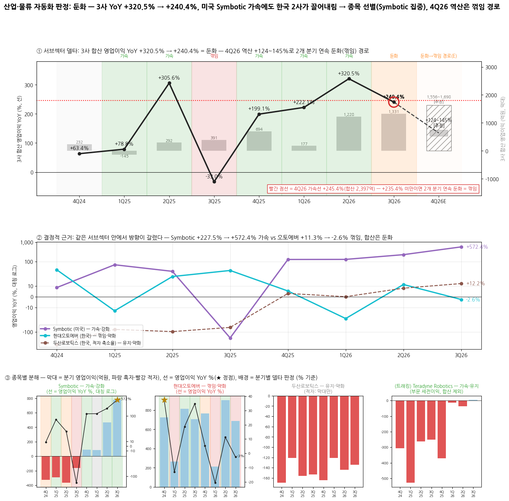

# 로봇 · 산업·물류 자동화 섹터 리뷰

> 현재 상태 (최신 분기 기준)
> 최신 분기: 2026-Q3
> 섹터 델타: 둔화 | 내러티브: 약화
> 모멘텀 신호: 없음
> 활성 테마: 없음
> 포지셔닝: 서브섹터 유지 | 한국 중립 | 1등 두산로보틱스
> 델타 근거: 2사 합산 YoY +15.7→0.0%(-15.7%p) 둔화(ITO 이연 타이밍발) → 4Q 컨센 +26.3%(오토에버 단독)로 재가속 예상
> 내러티브 근거: 2사 모두 TP 멀티플 하향·수주잔고 감소로 약화, 로봇 이익 레버는 2027-28년으로 멀다
> PM 근거: 둔화가 이연 타이밍발이고 4Q 반등 컨센이 있어 유지(잠정). 한국 콜은 글로벌 편입사 발표 전이라 중립 보류
> 편입 종목: 합산 2사 — 현대오토에버, 두산로보틱스 · Symbotic(FY26 Q4, 11/23 미국 장후 발표 — 추가 예정) · 트래킹 Teradyne(Robotics 부문)
> 갱신 시각: 2026-11-23 14:30 KST

## 누적 시계열

| 분기 | 편입 종목 | 합산 매출 | 합산 영업이익 | OPM | 매출 YoY | 영업이익 YoY | 영업이익 YoY 델타 (%p) | 섹터 델타 | 내러티브 | 모멘텀 신호 | 활성 테마 |
|---|---|---|---|---|---|---|---|---|---|---|---|
| 4Q24 | 2사 (오토에버·두산로보틱스) | 11,711억원 | 558억원 | 4.8 | +27.8% | +12.0% | n.m. | — | - | - | - |
| 1Q25 | 2사 | 8,383억원 | 146억원 | 1.7 | +12.9% | -38.7% | -50.7%p | 꺾임 | - | - | - |
| 2Q25 | 2사 | 10,466억원 | 658억원 | 6.3 | +12.2% | +8.6% | +47.2%p | 가속 | - | - | - |
| 3Q25 | 2사 | 10,645억원 | 555억원 | 5.2 | +16.4% | +29.4% | +20.8%p | 가속 | - | - | - |
| 4Q25 | 2사 | 13,357억원 | 601억원 | 4.5 | +14.1% | +7.7% | -21.7%p | 둔화 | - | - | - |
| 1Q26 | 2사 | 9,510억원 | 91억원 | 1.0 | +13.4% | -37.7% | -45.4%p | 꺾임 | - | - | - |
| 2Q26 | 2사 | 12,684억원 | 761억원 | 6.0 | +21.2% | +15.7% | +53.3%p | 가속 | - | - | - |
| **3Q26** | **2사 (Symbotic 추가 예정, Teradyne 트래킹)** | **12,409억원** | **555억원** | **4.5** | **+16.6%** | **+0.0%** | **-15.7%p** | **둔화** | **약화** | **없음** | **없음** |

→ **합산 방식**: 2사 실적 리뷰 1번 ① 표의 K-IFRS 연결 매출·영업이익(억원) 단순 합산 — 한국 2사라 원화 그대로. 두산로보틱스 3Q26은 회사 IR 잠정치(분기보고서 확인 전), 오토에버는 분기보고서 확정치
→ **3Q26 0.0%**: 3Q26 555억원(689 − 134) = 3Q25 555억원(708 − 153) — 증가율이 사라졌지만 마이너스 전환은 아니라 기준표상 **둔화(꺾임 경계)**. 두산로보틱스 잠정치가 확정치에서 1억만 바뀌어도 판정이 꺾임으로 갈 수 있다 [판단]
→ **이익 비중**: 합산 영업이익 555억원 = 오토에버 689억 + 두산로보틱스 -134억 — 합산 델타는 오토에버 ITO·SI 사이클이 정한다. 오토에버 로봇 매출은 분리 공시 없음(로봇 SI·관제 2027 설비·2028 양산이 셀사이드 공통 시간표)
→ **Symbotic 추가 예정**: FY26 Q4(= 캘린더 3Q26) 실적이 2026-11-23 미국 장 마감 후 발표 예정(`earnings_calendar.md` — 컨센 매출 $760\~780M·조정 EBITDA $100M+) → 리뷰 작성 후 이 표 3Q26 행을 3사 기준으로 갱신하고 원화 환산($1 = 1,419원) 합산을 덧붙인다. 그때 통화 혼합 → `억원 (달러)` 표기로 바뀐다
→ 4Q26E: 오토에버만(7개사 평균 966억) — 두산로보틱스 컨센 미확보 → 4Q25도 오토에버 단독으로 계산 [계산]

## 2026-Q3 섹터 리뷰

> 분석 대상 파일: `earnings-review/2026-Q3_현대오토에버_리뷰.md`(풀, 셀사이드 8건), `2026-Q3_두산로보틱스_리뷰.md`(숫자 중심, IR 잠정치), `2026-Q3_TER_리뷰.md`(Teradyne Robotics 부문, 숫자 중심 — 트래킹). Symbotic 리뷰 미작성(발표 전)

① 서브섹터 합산 숫자와 델타

| 구분 (억원) | 4Q24 | 1Q25 | 2Q25 | 3Q25 | 4Q25 | 1Q26 | 2Q26 | 3Q26 | 4Q26E |
|---|---|---|---|---|---|---|---|---|---|
| **산업·물류 2사** 매출 | 11,711 | 8,383 | 10,466 | 10,645 | 13,357 | 9,510 | 12,684 | 12,409 | 14,529 (오토에버) |
| 산업·물류 2사 영업이익 | 558 | 146 | 658 | 555 | 601 | 91 | 761 | 555 | 966 (오토에버) |
| 산업·물류 2사 OPM | 4.8 | 1.7 | 6.3 | 5.2 | 4.5 | 1.0 | 6.0 | 4.5 | 6.6 |
| 산업·물류 2사 매출 YoY | +27.8% | +12.9% | +12.2% | +16.4% | +14.1% | +13.4% | +21.2% | +16.6% | +9.8% |
| 산업·물류 2사 영업이익 YoY | +12.0% | -38.7% | +8.6% | +29.4% | +7.7% | -37.7% | +15.7% | +0.0% | +26.3% |
| 산업·물류 2사 영업이익 YoY 델타 | n.m. | -50.7%p | +47.2%p | +20.8%p | -21.7%p | -45.4%p | +53.3%p | -15.7%p | +26.3%p |
| (참고·트래킹) Teradyne Robotics 부문 세전이익 ($M) | -21.5 | -37.2 | -18.5 | -17.6 | -26.1 | -1.0 | -2.6 | +0.3 | — |
| (참고·트래킹) Teradyne Robotics 매출 YoY | -23.6% | -21.3% | -17.0% | -15.3% | -9.1% | +32.3% | +33.4% | +27.6% | — |

→ (출처: 2사 실적 리뷰 1번 ① 표 [계산], Teradyne 10-Q 부문 정보(TER 리뷰). 4Q26E = 오토에버 첨부 7개사 평균)
→ **톱니형**: 합산 영업이익 YoY가 1Q마다 마이너스(1Q25 -38.7%, 1Q26 -37.7%) — 오토에버 1Q 계절 저점 + ITO 단가 협상 반영 시점. 분기 판정이 다음 분기에 뒤집힐 확률이 높은 서브섹터 [판단]
→ 3Q26 둔화 원인: 오토에버 ITO 운영 계약·연례 청구단가 협상 지연으로 매출 약 200억 4Q 이연(회사 컨콜) — **영업 내 타이밍 요인**, 인수·일회성 아님. 판정은 보고 기준 그대로(2026-11-16 규칙: 이연 보정 금지)
→ 컨센 경로: 4Q26E +26.3%(이연분 + 단가 소급) → 1Q27E는 2곳 추정 편차 3배(712억 vs 244억)라 신뢰도 낮음. 연간 2027E 영업이익 +21.2%(오토에버) — 컨센은 2027년 재가속을 그린다 [전망]

→ (출처: 2사 실적 리뷰로 계산. 굵은 빨강 = 2사 합산 영업이익 YoY, 파랑 점선 = 합산 매출 YoY, 가는 선 = 오토에버 영업이익 YoY. 두산로보틱스는 적자라 YoY 선 없음)

② 종목별 델타 판정표

| 델타 순위 | 종목 | 국가 | 매출 YoY | 영업이익 YoY | 영업이익 YoY 델타 | 델타 판정 | 내러티브 | 비영업 요인 | 한 줄 |
|---|---|---|---|---|---|---|---|---|---|
| 1 | 두산로보틱스 | 한국 | +59.1% | 적자 축소 (-153억 → -134억, 축소율 +7.9% → +12.2%) | +4.3%p (축소율) | 유지 | 약화 | ONExia 연결(2025.09\~) 매출 기저 — 손익 판정 영향 작음 | 북미 수주잔고 $14.9M → $9.1M 2개 분기 감소, 순현금 한 분기 -440억 |
| 2 | 현대오토에버 | 한국 | +16.2% | -2.6% (2Q26 +11.3%) | -13.9%p | 꺾임 | 약화 | ⚠ ITO 매출 약 200억 4Q 이연(타이밍), 영업외 외환손실 101억(순이익만) | 매출 3분기 최대인데 영업이익 컨센 -9.9% 미스, TP 하향은 멀티플·신사업 가치 |
| 트래킹 | Teradyne Robotics | 미국 | +27.6% | 흑자 전환 (-$17.6M → +$0.3M) | 손익 개선액 +$16.0M → +$17.9M | 유지 | 유지 | 없음 (전년 적자 기저) | 11개 분기 만에 부문 흑자(이익률 0.4%), 피지컬 AI "2027 파일럿, 2028 채택" |
| 추가 예정 | Symbotic | 미국 | — | — | — | — | — | — | FY26 Q4 11/23 장후 발표 — 리뷰 후 편입 |

→ 판정·내러티브는 각 종목 리뷰 0번 그대로. 델타 순위는 영업이익 YoY 델타(두산은 적자 축소율 델타) 큰 순 — 판정 기준으로도 유지 > 꺾임
→ **선행 종목**: 오토에버가 먼저 꺾임(3Q26), 두산로보틱스는 적자 축소 4개 분기 연속이지만 폭이 작다(매출 1.6배, 적자 -12%)

③ 섹터 공통 쟁점

(1) **로봇 매출은 아직 계획 단계** — 오토에버·두산로보틱스·Teradyne
(1-1) 오토에버 로봇 SI·관제 매출 분리 공시 없음, 증권사 추정 2027 매출이 448억(NH)부터 9,300억(삼성, 아틀라스 5천 대 가정)까지 20배 편차 / 두산로보틱스 "DRA 2026년 +50% 이상" 이후 2027 성장 연료(북미 수주잔고)가 감소 / Teradyne "피지컬 AI 2027 파일럿, 2028 본격 채택" (각 리뷰)
(1-2) [판단] 산업·물류 자동화의 로봇 이익 레버는 2027\~2028년 — 2026년 숫자는 IT 서비스(오토에버)와 협동로봇 판매(두산·UR)의 경기순환

(2) **TP 하향 = 멀티플·신사업 가치 조정** — 오토에버·두산로보틱스
(2-1) 오토에버 7개사 평균 TP 49.4만 → 42.6만(-14%), 2026E 영업이익 -4% — 하향 대부분은 멀티플 / 두산로보틱스 실적 후 2거래일 -10%, 고점 대비 -69%, CEO 교체 (각 리뷰)

(3) **매출 성장 ↔ 비용 동반 증가** — 두산로보틱스·Teradyne
(3-1) 두산 매출 +59%에 판관비(북미 사업장·AI R&D 인력) 동반 증가로 적자 12% 축소에 그침 / Teradyne YoY 개선 $17.9M 중 82%가 매출총이익 증가(물량·믹스) — 레버리지 초입 (각 리뷰)

→ 종목 고유 이슈: 오토에버 — GPUaaS(HMG AI 팩토리 지분 26%, 지분법) / 두산로보틱스 — 2Q26 장기차입금 500억, 순현금 2,024억 → 1,584억 / Teradyne — Robotics 가이던스 미제공

④ 섹터 판정

> 섹터 델타: **둔화** | 내러티브: **약화** → **합산 영업이익 YoY +15.7% → 0.0%로 성장이 멈췄다(꺾임 경계). 오토에버 ITO 이연(톱니형)이 원인이라 4Q26E +26%로 되돌림 컨센이지만, 로봇 레버는 2027\~2028년이고 두산로보틱스는 적자 유지 — Symbotic 반영 전 잠정 판정**

→ (출처: 2사 실적 리뷰·Teradyne 10-Q로 계산. 상단 = 2사 합산 영업이익 YoY(선)·합산 영업이익과 QoQ(막대)·판정 배경색, 점선 = 4Q26E(오토에버 단독), 빨간 점선 = 4Q26 판정선 0%·5% / 중단 = 결정적 근거 — 오토에버 영업이익 YoY 톱니 vs 두산로보틱스 적자 축소율 / 하단 = 종목별 분해(Teradyne은 트래킹))

→ 델타 판정 근거: +15.7%(2Q26) → **+0.0%**(3Q26), -15.7%p 축소·마이너스 전환은 아님 = **둔화**. 4Q26 0% 미만이면 꺾임, 5% 초과면 가속 — 컨센 +26.3%(오토에버)는 가속 예고 [전망]
→ 비영업 요인 영향: 오토에버 이연 200억을 3Q에 되돌리면 합산 YoY는 플러스지만, 2026-11-16 규칙상 보정하지 않는다 — 판정은 둔화 그대로. 인수 주도 가속 없음
→ 내러티브 근거: 2사 모두 약화(오토에버 TP 멀티플 하향·로봇 SI 추정 20배 편차, 두산 수주잔고 감소·CEO 교체), 트래킹 Teradyne 유지 → **약화**
→ 직전 분기 대비: 가속(2Q26) → 둔화(3Q26). 소급 궤적: 꺾임(1Q25) → 가속(2Q25\~3Q25) → 둔화(4Q25) → 꺾임(1Q26) → 가속(2Q26) → 둔화(3Q26) — 1년 주기 톱니. 이 서브섹터는 "연속 가속" 확인이 매매 조건이 되어야 한다 [판단]

⑤ 모멘텀 신호

→ 없음 (활성 테마 없음 — 피지컬AI 테마 sunset 2026-11-23 BT)
→ 조건 대조 — 델타 급증 후보: ① 섹터 델타 확대 — 미충족(둔화) ② 편입 종목 과반 가속 — 0/2 ③ 내러티브 형성·강화 — 미충족 → 후보로 올리지 않음
→ 반대 논거: Teradyne Robotics(UR·MiR)가 11개 분기 만에 흑자, 매출 3개 분기 연속 +27\~33% — 글로벌 협동로봇 수요는 바닥을 지났다. Symbotic(Walmart $6B 약정 RPO)까지 가속이면 글로벌 물류 자동화 쪽은 다른 그림일 수 있다
→ 다음 분기 후보 조건: Symbotic 가속 + 4Q26 오토에버 영업이익 900억 이상 + 두산로보틱스 분기 적자 -100억 이내

⑥ 다음 분기 섹터 관전 포인트

| 순위 | 무엇을 (변수·임계값) | 어떤 데이터로 | 언제 |
|---|---|---|---|
| 1 | **4Q26 합산 영업이익 YoY 판정선 — 0% 미만이면 꺾임, 5% 초과면 가속**(컨센 +26.3% = 오토에버 966억 vs 4Q25 765억 — E 표본은 오토에버 단독, 2사 4Q25 기저는 601억원 [계산]) | 오토에버·두산로보틱스 4Q26 실적 | 2027년 1월 말\~2월 초 |
| 2 | **Symbotic FY26 Q4** — 매출 $760\~780M·조정 EBITDA $100M+ 컨센 대비, GAAP 영업이익 YoY → 3사 합산 재판정 | Symbotic 8-K·컨콜 | 2026-11-23 장후 (KST 11/24) |
| 3 | 오토에버 4Q ITO 매출 YoY 15% 이상(이연 200억 회수) + 그룹 로봇 SI·관제 첫 수주 공시 | 오토에버 4Q26 실적·공시 | 2027년 1월 말 |
| 4 | 두산로보틱스 DRA 북미 수주잔고 $12M 이상 반등 + 분기 적자 -100억 이내 | 두산로보틱스 4Q26 IR | 2027년 2월 초 |
| 5 | Teradyne Robotics 4Q26 부문 흑자 유지 + 매출 YoY +20% 이상 | Teradyne 4Q26 10-K | 2027년 1월 말 |

⑦ 글로벌 PM 포지셔닝 — 결론 (서브섹터 리뷰)

> **서브섹터: 유지 (잠정 — Symbotic 반영 후 재판정) — 4Q26 합산 YoY 마이너스면 축소** | **한국: 중립 (비교 보류 — 글로벌 편입 종목 Symbotic 발표 전)** | **1등: 두산로보틱스 (델타 판정 기준, 적자 유지)**

(1) 서브섹터 판정 — 유지 (잠정) [판단]
→ 델타 둔화(0.0%)는 오토에버 이연 타이밍발이고 4Q26E 반등 컨센(+26%)이 있어 축소하기엔 이르다. 그러나 2사 모두 약화, 로봇 이익 레버는 2027\~2028 → 확대 근거도 없다 → **유지(잠정)**
→ 축소 전환: 4Q26 합산 YoY 마이너스(오토에버 4Q 765억 미만) 또는 Symbotic 꺾임
→ 확대 전환: Symbotic 가속 + 오토에버 4Q 900억 이상 + 두산 적자 -100억 이내

(2) 같은 서브섹터 안 한국 vs 글로벌 — 비교 보류
→ 글로벌 편입 종목은 Symbotic 하나인데 발표 전 → **비교 불가 — 편입 종목 실적 미발표**. 트래킹 Teradyne Robotics(유지·유지, 흑자 전환)와 비교하면 한국 순수 로봇(두산 유지, 적자 -134억·OPM -82.9%)보다 이익 방향은 비슷하고 마진 레벨은 글로벌 우위(+0.4% vs -82.9%) — 근거 얇음(트래킹 피어 1개)
→ 상태 블록의 "한국 중립"은 판단 보류의 자리값 — Symbotic 리뷰 후 갱신

(3) 서브섹터 1등 종목
→ **1등 두산로보틱스** — 유지·약화. 2사 중 판정이 나은 쪽(적자 축소 4개 분기 연속)이지만 이익 델타로 매매할 대상은 아니다 — "덜 나쁜 1등"
→ 현대오토에버 — 꺾임·약화. **반등 후보 (이벤트 드리븐)**: 확인 이벤트 4Q26 영업이익 900억 이상(이연 회수) — 톱니형 반복이면 다음 리뷰에서 플러스 복귀
→ 글로벌 1등: Symbotic 리뷰 후 결정 (트래킹 Teradyne은 1등 후보에서 제외)

(4) 콜을 바꾸는 조건과 일정

| 시점 | 이벤트 | 서브섹터 비중 | 1등 종목 |
|---|---|---|---|
| 2026-11-24 (KST) | Symbotic FY26 Q4 실적 | 가속이면 확대 검토, 꺾임이면 축소 | Symbotic 가속이면 글로벌 1등 = 서브섹터 1등 |
| 2027-01 말 | 오토에버 4Q26 실적, Teradyne 4Q26 | 오토에버 765억 미만이면 축소 | 오토에버 900억+면 1등 교체 검토 |
| 2027-02 초 | 두산로보틱스 4Q26 IR | 적자 -150억 이상이면 꺾임 → 축소 쪽 | 1등 재검토 |

→ 직전 분기 콜 체크: 첫 섹터 리뷰 — 직전 콜 없음

### (트래킹) Teradyne Robotics — 숫자 표

| 분기 | 부문 매출 ($M) | 부문 세전이익 ($M) | 세전이익률 | 매출 YoY | 손익 YoY 증감 ($M) | 방향 | 출처 등급 |
|---|---|---|---|---|---|---|---|
| 1Q26 | 91.3 | -1.0 | -1.1% | +32.3% | +36.2 | 개선 | 10-Q 원문 |
| 2Q26 | 99.9 | -2.6 | -2.6% | +33.4% | +16.0 | 개선 | 10-Q 원문 |
| **3Q26** | **95.8** | **+0.3** | **+0.4%** | **+27.6%** | **+17.9** | **개선 (흑자 전환)** | 10-Q 원문 |
| 4Q26E | — | — | — | — | — | — | 부문 가이던스 없음 |

→ 원화 환산 3Q26 매출 1,359억원·세전이익 4억원($1 = 1,419원) — 합산 제외(트래킹 피어). 판정은 직전 대비 방향까지만
