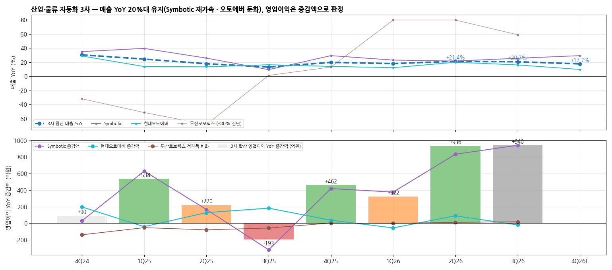

# 로봇 · 산업·물류 자동화 섹터 리뷰

> 현재 상태 (최신 분기 기준)
> 최신 분기: 2026-Q3
> 섹터 델타: 유지 | 내러티브: 유지
> 모멘텀 신호: 없음
> 활성 테마: 없음
> 포지셔닝: 서브섹터 유지 | 한국 언더퍼폼 | 1등 Symbotic
> 델타 근거: 미국 1위사 가속이 한국 둔화를 상쇄 → 4Q 가이던스 매출 가속
> 내러티브 근거: 미국은 대형 계약으로 강화, 한국 2사는 멀티플 하향으로 약화
> PM 근거: 유지하되 미국 1위사 집중, 같은 서브섹터 안에서 한국이 열위
> 편입 종목: 합산 3사 — 현대오토에버, 두산로보틱스, Symbotic · 트래킹 Teradyne(Robotics 부문)
> 갱신 시각: 2026-11-24 11:30 KST (v2 — Symbotic 3Q26(FQ4 26) 편입, "잠정" 해제)

## 누적 시계열

| 분기 | 편입 종목 | 합산 매출 | 합산 영업이익 | OPM | 매출 YoY | 영업이익 YoY | 영업이익 YoY 델타 (%p) | 섹터 델타 | 내러티브 | 모멘텀 신호 | 활성 테마 |
|---|---|---|---|---|---|---|---|---|---|---|---|
| 4Q24 | 2사 (오토에버·두산로보틱스) | 11,711억원 | 558억원 | 4.8 | +27.8% | +12.0% | n.m. | — | - | - | - |
| 1Q25 | 2사 | 8,383억원 | 146억원 | 1.7 | +12.9% | -38.7% | -50.7%p | 꺾임 | - | - | - |
| 2Q25 | 2사 | 10,466억원 | 658억원 | 6.3 | +12.2% | +8.6% | +47.2%p | 가속 | - | - | - |
| 3Q25 | 2사 | 10,645억원 | 555억원 | 5.2 | +16.4% | +29.4% | +20.8%p | 가속 | - | - | - |
| 4Q25 | 2사 | 13,357억원 | 601억원 | 4.5 | +14.1% | +7.7% | -21.7%p | 둔화 | - | - | - |
| 1Q26 | 2사 | 9,510억원 | 91억원 | 1.0 | +13.4% | -37.7% | -45.4%p | 꺾임 | - | - | - |
| 2Q26 | 2사 | 12,684억원 | 761억원 | 6.0 | +21.2% | +15.7% | +53.3%p | 가속 | - | - | - |
| **3Q26** | **3사 (오토에버·두산로보틱스·Symbotic, Teradyne 트래킹)** | **23,443억원 ($1.65B)** | **1,331억원 ($94M)** | **5.7** | **+20.7%** | **+240.4% (증감액 +940억원)** | **-80.1%p (증감액 +936억 → +940억)** | **유지** | **유지** | **없음** | **없음** |

→ **합산 방식 (3Q26부터 3사)**: 3사 실적 리뷰 1번 ① 표 합산. 한국 2사는 K-IFRS 연결 매출·영업이익(억원), Symbotic은 GAAP 매출·영업이익($M, 캘린더 분기 정렬 — 3Q26 = FQ4 26)을 **고정 환율 $1 = 1,419원**(로봇 섹터 통합 리뷰와 같은 값, 3Q26 평균)으로 원화 환산해 더했다 — 통화 혼합이라 `억원 (달러)` 표기. 전 분기 같은 환율이라 YoY에 환율 효과 없음 [계산]
→ **과거 행(4Q24\~2Q26)은 2사 기준 그대로 둔다** (누적 표 원칙 — 정정하지 않음). 3사 소급 숫자는 아래 ① 표에 따로 둔다
→ 두산로보틱스 3Q26은 회사 IR 잠정치, 오토에버는 분기보고서 확정치, Symbotic은 8-K 보도자료(주식보상 배분 변경 후 재작성 기준 — 3Q25 -$11.6M)
→ **3Q26 판정 방식**: 3사 합산 영업이익 YoY는 +320.5%(2Q26) → +240.4%(3Q26)로 %상 -80.1%p지만, 전년 분모(2Q25 292억·3Q25 391억)가 Symbotic 적자(-366억·-164억)로 눌려 있어 %가 부풀려졌다. 전년 적자 구간 규칙(earnings-review)과 같은 방식으로 **영업이익 YoY 증감액**을 판정 기준으로 쓴다 — +936억 → **+940억(+0.4%, 보합) = 유지**. %로 기계 판정하면 "둔화"다 — 병기 [판단]

## 2026-Q3 섹터 리뷰

> 분석 대상 파일: `earnings-review/2026-Q3_현대오토에버_리뷰.md`(풀, 셀사이드 8건), `2026-Q3_두산로보틱스_리뷰.md`(숫자 중심, IR 잠정치), `2026-Q3_SYM_리뷰.md`(숫자 중심, 8-K·10-K — 2026-11-24 편입), `2026-Q3_TER_리뷰.md`(Teradyne Robotics 부문, 숫자 중심 — 트래킹)

① 서브섹터 합산 숫자와 델타

| 구분 (억원, 고정환율) | 4Q24 | 1Q25 | 2Q25 | 3Q25 | 4Q25 | 1Q26 | 2Q26 | 3Q26 | 4Q26E |
|---|---|---|---|---|---|---|---|---|---|
| **산업·물류 3사** 매출 | 18,617 | 16,183 | 18,868 | 19,421 | 22,297 | 19,110 | 22,913 | **23,443 ($1.65B)** | 26,094 (오토에버 컨센 + SYM 가이던스 중간값) |
| 산업·물류 3사 영업이익 | 232 | -145 | 292 | 391 | 694 | 177 | 1,228 | **1,331 ($94M)** | — (SYM 영업이익 가이던스 없음) |
| 산업·물류 3사 OPM | 1.2 | -0.9 | 1.5 | 2.0 | 3.1 | 0.9 | 5.4 | **5.7** | — |
| 산업·물류 3사 매출 YoY | +30.5% | +24.5% | +17.9% | +13.2% | +19.8% | +18.1% | +21.4% | **+20.7%** | +17.7% (2사 동일 표본) |
| 산업·물류 3사 영업이익 YoY | +63.4% | n.m. | +305.6% | -33.0% | +199.1% | n.m. | +320.5% | **+240.4%** | — |
| **산업·물류 3사 영업이익 YoY 증감액 (억원, 판정 기준)** | +90 | +538 | +220 | -193 | +462 | +322 | +936 | **+940** | 판정선 +940 |
| 3사 판정 (증감액 기준, 소급) | — | 가속 | 둔화 | 꺾임 | 가속 | 둔화 | 가속 | **유지** | |
| (참고) 2사 영업이익 (오토에버·두산) | 558 | 146 | 658 | 555 | 601 | 91 | 761 | 555 | 966 (오토에버) |
| (참고) 2사 영업이익 YoY | +12.0% | -38.7% | +8.6% | +29.4% | +7.7% | -37.7% | +15.7% | +0.0% | +26.3% |
| Symbotic 매출 (억원 / $M) | 6,906 / 486.7 | 7,800 / 549.7 | 8,402 / 592.1 | 8,776 / 618.5 | 8,940 / 630.0 | 9,600 / 676.5 | 10,229 / 720.8 | **11,034 / 777.6** | 11,565 / 815 (가이던스 중간값) |
| Symbotic GAAP 영업이익 (억원 / $M) | -326 / -23.0 | -291 / -20.5 | -366 / -25.8 | -164 / -11.6 | 93 / 6.5 | 86 / 6.1 | 467 / 32.9 | **776 / 54.7** | 역산 약 724\~866 / 51\~61 [추정] |
| Symbotic 영업이익 YoY 증감액 ($M) | +2.1 | +44.4 | +11.8 | -22.5 | +29.5 | +26.6 | +58.7 | **+66.3** | 가속선 +66.3 |
| (참고·트래킹) Teradyne Robotics 부문 세전이익 ($M) | -21.5 | -37.2 | -18.5 | -17.6 | -26.1 | -1.0 | -2.6 | +0.3 | — |
| (참고·트래킹) Teradyne Robotics 매출 YoY | -23.6% | -21.3% | -17.0% | -15.3% | -9.1% | +32.3% | +33.4% | +27.6% | — |

→ (출처: 3사 실적 리뷰 1번 ① 표, 고정환율 $1 = 1,419원 환산 [계산]. 4Q24\~3Q25의 YoY·증감액은 전년(4Q23\~3Q24) 3사 합산 — 오토에버·두산 리뷰 12분기 표 + Symbotic 기업 개요(변경 전 기준) — 으로 계산해 Symbotic 주식보상 배분 기준이 섞여 있다(FY24 영향 작음). Teradyne 10-Q 부문 정보(TER 리뷰). 4Q26E 매출 = 오토에버 7개사 평균 + Symbotic 가이던스 중간값(두산 컨센 미확보 → 4Q25도 2사로 YoY))
→ **이익 비중 (3Q26)**: 합산 영업이익 1,331억원 = Symbotic 776억(58%) + 오토에버 689억(52%) + 두산로보틱스 -134억 — **Symbotic 편입으로 합산 델타의 주인이 오토에버(ITO·SI 사이클)에서 미국 물류 자동화로 바뀌었다**
→ **YoY % 왜곡**: 3사 전년 합산이 Symbotic 적자로 0 근처(1Q25 -145억, 2Q25 292억, 3Q25 391억)라 3사 영업이익 YoY %는 n.m.·세 자릿수로 출렁인다 — 이 서브섹터는 Symbotic 4Q25 흑자 전환 기저가 다 차는 **2026-Q4까지 증감액 기준으로 판정**한다 [판단]
→ 비영업 요인 영향: Symbotic 구조조정비는 양쪽 분기(3Q26 $5.4M·3Q25 $6.5M)에 있어 대칭 — 빼도 판정 불변. 오토에버 ITO 200억 4Q 이연(타이밍)은 보정하지 않는다(2026-11-16 규칙). **비영업 주도 가속 없음**
→ 컨센·가이던스 경로: 4Q26E 매출 YoY +17.7%(2사 동일 표본) — Symbotic 가이던스 +27.8\~31.0%(가속) + 오토에버 컨센 +9.8%. 영업이익은 오토에버 966억(+26.3%, 이연 회수) + Symbotic 역산 724\~866억 [추정] + 두산(직전 -134억 가정) → 3사 약 1,556\~1,698억 → 증감액 +862\~1,004억으로 **판정선(+940억) 바로 근처** [추정]

→ (출처: 3사 실적 리뷰로 계산, 고정환율. 상단 = 3사 합산 매출 YoY(파랑 점선)·종목별 매출 YoY, 하단 = 영업이익 YoY 증감액(억원) — 3사 합산 막대 + 종목별 선. 전년 적자 종목이 있어 영업이익 YoY %는 쓰지 않음)

② 종목별 델타 판정표

| 델타 순위 | 종목 | 국가 | 매출 YoY | 영업이익 YoY | 영업이익 YoY 델타 | 델타 판정 | 내러티브 | 비영업 요인 | 한 줄 |
|---|---|---|---|---|---|---|---|---|---|
| 1 | **Symbotic** | 미국 | +25.7% (2Q26 +21.7%) | 흑자 확대 (-$11.6M → +$54.7M, n/m) | 증감액 +$58.7M → +$66.3M (+$7.6M) | **가속** | **강화** | 구조조정비 양쪽 분기(대칭) · 소규모 인수 2건 기여 미공시 — 가속의 원인 아님 | OPM 7.0% 사상 최고, Walmart EMAA $6B(잔고 최대 +$6.9B), 4Q 매출 가이던스 +28\~31% · Systems GPM은 21.4%로 하락 |
| 2 | 두산로보틱스 | 한국 | +59.1% | 적자 축소 (-153억 → -134억, 축소율 +7.9% → +12.2%) | +4.3%p (축소율) | 유지 | 약화 | ONExia 연결(2025.09\~) 매출 기저 — 손익 판정 영향 작음 | 북미 수주잔고 $14.9M → $9.1M 2개 분기 감소, 순현금 한 분기 -440억 |
| 3 | 현대오토에버 | 한국 | +16.2% | -2.6% (2Q26 +11.3%) | -13.9%p | 꺾임 | 약화 | ⚠ ITO 매출 약 200억 4Q 이연(타이밍), 영업외 외환손실 101억(순이익만) | 매출 3분기 최대인데 영업이익 컨센 -9.9% 미스, TP 하향은 멀티플·신사업 가치 |
| 트래킹 | Teradyne Robotics | 미국 | +27.6% | 흑자 전환 (-$17.6M → +$0.3M) | 손익 개선액 +$16.0M → +$17.9M | 유지 | 유지 | 없음 (전년 적자 기저) | 11개 분기 만에 부문 흑자(이익률 0.4%), 피지컬 AI "2027 파일럿, 2028 채택" |

→ 판정·내러티브는 각 종목 리뷰 0번 그대로. 델타 순위는 판정 순(가속 > 유지 > 꺾임) — Symbotic·Teradyne·두산은 전년 적자라 증감액·축소율로 비교
→ **선행 종목**: 미국 2사(Symbotic·Teradyne)가 먼저 흑자 구간에 들어갔고, 한국은 오토에버가 먼저 꺾임(3Q26). 같은 서브섹터 안에서 **미국 = 이익 개선 진행, 한국 = 둔화·적자 유지**로 방향이 갈렸다

③ 섹터 공통 쟁점

(1) **로봇 매출이 이익이 되는 시점** — 오토에버·두산로보틱스·Teradyne·Symbotic
(1-1) 오토에버 로봇 SI·관제 매출 분리 공시 없음, 증권사 추정 2027 매출이 448억(NH)부터 9,300억(삼성, 아틀라스 5천 대 가정)까지 20배 편차 / 두산로보틱스 "DRA 2026년 +50% 이상" 이후 2027 성장 연료(북미 수주잔고)가 감소 / Teradyne "피지컬 AI 2027 파일럿, 2028 본격 채택" (각 리뷰)
(1-2) **예외 — Symbotic**: 물류 로봇 시스템 매출 $777.6M·GAAP 영업이익 $54.7M으로 **로봇 매출이 이미 이익이 된 유일한 편입 종목**. 수주잔고 $22.3B(+ EMAA 최대 $6.9B)로 2027\~2028 매출 가시성도 가장 높다 (SYM 리뷰)
(1-3) [판단] 한국 2사의 로봇 이익 레버는 2027\~2028년, 미국 물류 자동화는 2026년에 이미 레버리지 구간 — 같은 서브섹터 안 "시간차"가 국가 콜을 가른다

(2) **TP 하향 = 멀티플·신사업 가치 조정** — 오토에버·두산로보틱스
(2-1) 오토에버 7개사 평균 TP 49.4만 → 42.6만(-14%), 2026E 영업이익 -4% — 하향 대부분은 멀티플 / 두산로보틱스 실적 후 2거래일 -10%, 고점 대비 -69%, CEO 교체 (각 리뷰). Symbotic은 셀사이드 TP 미확보(숫자 중심), 주가는 2025-11 고점 대비 -60%(11/13, 기업 개요)

(3) **매출 성장 ↔ 비용 구조** — 두산로보틱스·Teradyne·Symbotic
(3-1) 두산 매출 +59%에 판관비(북미 사업장·AI R&D 인력) 동반 증가로 적자 12% 축소에 그침 / Teradyne YoY 개선 $17.9M 중 82%가 매출총이익 증가 / Symbotic YoY 개선 $66.3M 중 70%가 매출총이익, 27%가 R&D 감소(엔지니어 고객 프로젝트 배치) — Systems GPM은 21.4%로 하락 (각 리뷰)
(3-2) [판단] 미국 2사 모두 "매출 레버리지 + 비용 재배치"로 이익을 냈다. 다음 단계는 제품 마진(Symbotic Systems GPM, Teradyne GPM) 개선 확인

→ 종목 고유 이슈: 오토에버 — GPUaaS(HMG AI 팩토리 지분 26%, 지분법) / 두산로보틱스 — 2Q26 장기차입금 500억, 순현금 2,024억 → 1,584억 / Symbotic — Walmart 매출 86.7%(집중 심화), 매출채권 고객 B 25.5% 등장, 내부통제 취약점 개선 진행 / Teradyne — Robotics 가이던스 미제공

④ 섹터 판정

> 섹터 델타: **유지** | 내러티브: **유지** → **3사 합산 영업이익 YoY 증감액 +936억 → +940억 보합 = 유지. 미국 Symbotic 가속(흑자 확대·매출 재가속)이 한국 2사 둔화(오토에버 꺾임, 두산 적자 유지)를 상쇄했다 — 서브섹터 베타가 아니라 종목 선별 구간(Symbotic 집중). 4Q26은 증감액 +940억(합산 1,634억)이 판정선이고 가이던스 역산상 바로 근처**

→ (출처: 3사 실적 리뷰로 계산, 고정환율 $1 = 1,419원. 상단 = 3사 합산 영업이익(막대)·영업이익 YoY 증감액(선, 판정 기준)·분기별 판정 배경색(증감액 기준 소급), 빨간 점선 = 4Q26 가속선 +940억, 회색 범위 = 4Q26 가이던스·컨센 역산 [추정] / 중단 = 결정적 근거 — 종목별 영업이익 YoY 증감액(Symbotic 상승 vs 오토에버 하락) / 하단 = 종목별 분해(막대 영업이익, 배경 분기 판정))

→ 델타 판정 근거: 3사 합산 증감액 +936억(2Q26) → **+940억**(3Q26), ±5% 이내 보합 = **유지**. % 기준이면 +320.5% → +240.4%(둔화)지만 Symbotic 적자 기저로 왜곡돼 쓰지 않는다. 종목별로는 Symbotic 가속(증감액 +$58.7M → +$66.3M) vs 오토에버 꺾임(+11.3% → -2.6%) — **방향이 엇갈린 유지**
→ 비영업 요인 영향: 없음 — Symbotic 가속은 매출총이익·R&D 재배치(영업 내), 구조조정비 대칭. 오토에버 이연 200억은 보정하지 않음. 인수·비영업 주도 가속 없음
→ 내러티브 근거: Symbotic 강화(EMAA $6B, 매출 가속 가이던스) / 오토에버·두산 약화 / 트래킹 Teradyne 유지 → 이익 비중 58%가 강화, 종목 수로는 약화 다수 → **유지**
→ 직전 분기 대비: v1(2사, 2026-11-23) "둔화(꺾임 경계, 잠정)" → **유지**(3사 확정). 2사만 보면 +15.7% → 0.0% 둔화 그대로다 — 판정이 바뀐 이유는 표본 확대(Symbotic). 3사 소급 궤적(증감액 기준): 가속(1Q25) → 둔화 → 꺾임(3Q25) → 가속(4Q25) → 둔화 → 가속(2Q26) → 유지(3Q26) — 2사 때와 같은 톱니형이라 "연속 가속" 확인이 매매 조건 [판단]

⑤ 모멘텀 신호

→ 없음 (활성 테마 없음 — 피지컬AI 테마 sunset 2026-11-23 BT)
→ 조건 대조 — 델타 급증 후보: ① 섹터 델타 확대 — 미충족(유지) ② 편입 종목 과반 가속 — 1/3(Symbotic) ③ 내러티브 형성·강화 — 미충족(유지) → 후보로 올리지 않음
→ 반대 논거: Symbotic(가속·강화)과 트래킹 Teradyne(흑자 전환)까지 미국 물류·협동로봇 쪽은 이익 개선이 진행 중 — 4Q26에 Symbotic이 가속선($72.8M)을 넘기고 RPO가 $28B+로 뛰면 "미국 물류 자동화" 단독 레이어로는 델타 급증 후보 조건에 가까워진다
→ 다음 분기 후보 조건: 3사 증감액 +940억 초과(합산 1,634억+) + Symbotic 가속 유지 + 오토에버 900억 이상(이연 회수)

⑥ 다음 분기 섹터 관전 포인트

| 순위 | 무엇을 (변수·임계값) | 어떤 데이터로 | 언제 |
|---|---|---|---|
| 1 | **4Q26 3사 합산 영업이익 YoY 증감액 판정선 +940억 — 합산 1,634억(4Q25 694억 + 940억) 이상이면 가속, 694억 미만(증감액 마이너스)이면 꺾임, 사이면 유지·둔화**. 역산 추정 1,556\~1,698억으로 판정선 근처 [추정] | 오토에버·두산로보틱스 4Q26 실적, Symbotic FQ1 27 8-K | 2027년 1월 말\~2월 초 |
| 2 | **Symbotic GAAP 영업이익 $72.8M(1,033억) 이상** — 종목 가속선. 조정 EBITDA 가이던스 $110\~120M 역산 $51\~61M이면 둔화 + RPO $28B 이상(EMAA 반영) | Symbotic FQ1 27 8-K·10-Q | 2027-02 초 (\~02-03 AMC) |
| 3 | 오토에버 4Q ITO 매출 YoY 15% 이상(이연 200억 회수) — 영업이익 900억 이상 + 그룹 로봇 SI·관제 첫 수주 공시 | 오토에버 4Q26 실적·공시 | 2027년 1월 말 |
| 4 | 두산로보틱스 DRA 북미 수주잔고 $12M 이상 반등 + 분기 적자 -100억 이내 | 두산로보틱스 4Q26 IR | 2027년 2월 초 |
| 5 | Teradyne Robotics 4Q26 부문 흑자 유지 + 매출 YoY +20% 이상 | Teradyne 4Q26 10-K | 2027년 1월 말 |

⑦ 글로벌 PM 포지셔닝 — 결론 (서브섹터 리뷰)

> **서브섹터: 유지 (Symbotic 집중) — 4Q26 3사 증감액 +940억 초과 + Symbotic 가속 유지면 확대 검토, 3사 합산 694억 미만이면 축소** | **한국: 언더퍼폼 (서브섹터 내 효과 — 같은 서브섹터 안에서 미국이 이익 개선, 한국은 둔화·적자)** | **1등: Symbotic (가속·강화)**

(1) 서브섹터 판정 — 유지 [판단]
→ 3사 합산은 유지(증감액 보합)지만 속은 갈렸다: 이익의 58%를 내는 Symbotic은 가속·강화, 한국 2사는 꺾임·유지에 모두 약화 → 서브섹터 베타를 늘릴 근거는 아니고 **서브섹터 안에서 Symbotic으로 비중 이동**
→ 축소 전환: 4Q26 3사 합산 694억 미만(증감액 마이너스) 또는 Symbotic 꺾임(영업이익 $6.5M 미만)
→ 확대 전환: 3사 증감액 +940억 초과 + Symbotic 가속 유지 + 오토에버 900억 이상

(2) 같은 서브섹터 안 한국 vs 글로벌 — 한국 언더퍼폼

| 경쟁력 축 | 한국 (오토에버·두산로보틱스) | 글로벌 (Symbotic · 트래킹 Teradyne) | 우위 |
|---|---|---|---|
| 델타 방향 (1순위) | 2사 합산 YoY +15.7% → 0.0% (둔화), 오토에버 꺾임·두산 유지 | Symbotic 증감액 +$58.7M → +$66.3M (가속), Teradyne 유지(흑자 전환) | 글로벌 |
| 마진 레벨 | 2사 OPM 4.5% (오토에버 5.6%, 두산 -82.9%) | Symbotic OPM 7.0% (Teradyne 부문 0.4%) | 글로벌 |
| 마진 방향 | 오토에버 OPM 6.7% → 5.6% (YoY 하락) | Symbotic -1.9% → 7.0% (+8.9%p) | 글로벌 |
| 매출 성장 | 2사 +16.6% | Symbotic +25.7% (가이던스 +28\~31%) | 글로벌 |
| 수주·잔고 | 두산 북미 수주잔고 $9.1M(2개 분기 감소), 오토에버 로봇 수주 미공시 | Symbotic RPO $22.3B + EMAA 최대 $6.9B | 글로벌 |
| 이익 추정 방향 | 오토에버 2026E -4%, TP -14%(멀티플) | Symbotic 셀사이드 미확보 — 회사 가이던스 가속 | 글로벌 (근거: 가이던스) |
| 집중 리스크 | 오토에버 현대차그룹 의존 | Walmart 86.7% | 비슷 |
| 밸류에이션·낙폭 (2순위) | 두산 고점 대비 -69% | Symbotic 고점 대비 -60%(11/13) | — |

→ 결론: **한국 언더퍼폼 = 서브섹터 내 효과**(같은 산업·물류 안에서 미국 1위사가 이익 개선 진행, 한국은 둔화·적자)
→ 이유 3개: ① 델타 — 한국 2사 둔화 vs Symbotic 가속 ② 이익 추정 — 한국은 TP·추정 하향(멀티플), Symbotic은 다음 분기 매출 가속 가이던스 ③ 구조 — Symbotic은 로봇 시스템 매출이 이미 이익(잔고 $22B+), 한국 2사의 로봇 이익 레버는 2027\~2028
→ 반대 논거: Symbotic 이익 가이던스(조정 EBITDA QoQ 보합)상 4Q26 이익 델타는 둔화 가능성이 크고, 오토에버는 4Q 이연 회수로 +26% 컨센 — **4Q26 한 분기는 방향이 반대로 나올 수 있다**. 델타 프레임 결론
→ 비교 범위: 글로벌 편입 종목 Symbotic 1사(숫자 중심 리뷰, 셀사이드 0건) + 트래킹 Teradyne(부문) / 한국 2사(오토에버 풀 8건, 두산 숫자 중심) — 글로벌 편입이 1사라 **근거 얇음**. 편입 후보: KION(Dematic)·AutoStore(분기 공시, 유럽 물류 자동화) — BT 판단

(3) 서브섹터 1등 종목
→ **서브섹터 1등 = 글로벌 1등: Symbotic** — 가속·강화. 가속이 영업 내(매출총이익·R&D 재배치)라 선호 종목 원칙(비영업발 가속 제외)에 걸리지 않는다. 확인 이벤트: 4Q26 영업이익 $72.8M+, RPO $28B+
→ **한국 1등: 두산로보틱스** — 유지·약화. "덜 나쁜 1등"(적자 축소 4개 분기 연속, 폭 작음) — 이익 델타로 매매할 대상은 아님
→ 현대오토에버 — 꺾임·약화. **반등 후보 (이벤트 드리븐)**: 확인 이벤트 4Q26 영업이익 900억 이상(이연 회수)
→ 트래킹 Teradyne은 1등 후보에서 제외

(4) 콜을 바꾸는 조건과 일정

| 시점 | 이벤트 | 서브섹터 비중 | 1등 종목 |
|---|---|---|---|
| 2027-01 말 | 오토에버 4Q26 실적, Teradyne 4Q26 | 오토에버 765억 미만이면 축소 쪽 | 오토에버 900억+면 한국 1등 교체 검토 |
| 2027-02 초 | Symbotic FQ1 27 (\~02-03), 두산로보틱스 4Q26 IR | 3사 1,634억+면 확대 검토 / 694억 미만이면 축소 | Symbotic $6.5M 미만(꺾임)이면 1등 교체 |
| 수시 | Symbotic EMAA 사이트 착공·신규 고객 공시 | 이벤트 — 숫자 콜 영향 없음 | — |

→ 직전 콜 체크 (v1, 2026-11-23): "Symbotic 가속이면 확대 검토, 꺾임이면 축소 / Symbotic 가속이면 글로벌 1등 = 서브섹터 1등" → Symbotic 가속 확인 → **1등 Symbotic으로 교체(이행)**. 확대 조건 중 오토에버 900억·두산 -100억은 4Q26 확인 사항이라 서브섹터 비중은 유지

### (트래킹) Teradyne Robotics — 숫자 표

| 분기 | 부문 매출 ($M) | 부문 세전이익 ($M) | 세전이익률 | 매출 YoY | 손익 YoY 증감 ($M) | 방향 | 출처 등급 |
|---|---|---|---|---|---|---|---|
| 1Q26 | 91.3 | -1.0 | -1.1% | +32.3% | +36.2 | 개선 | 10-Q 원문 |
| 2Q26 | 99.9 | -2.6 | -2.6% | +33.4% | +16.0 | 개선 | 10-Q 원문 |
| **3Q26** | **95.8** | **+0.3** | **+0.4%** | **+27.6%** | **+17.9** | **개선 (흑자 전환)** | 10-Q 원문 |
| 4Q26E | — | — | — | — | — | — | 부문 가이던스 없음 |

→ 원화 환산 3Q26 매출 1,359억원·세전이익 4억원($1 = 1,419원) — 합산 제외(트래킹 피어). 판정은 직전 대비 방향까지만
