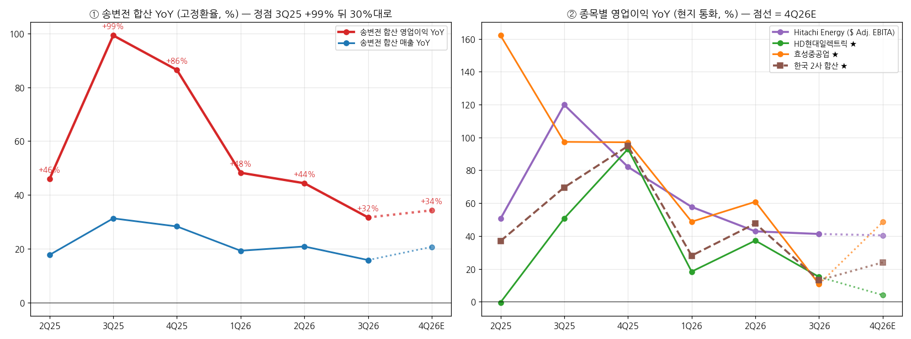
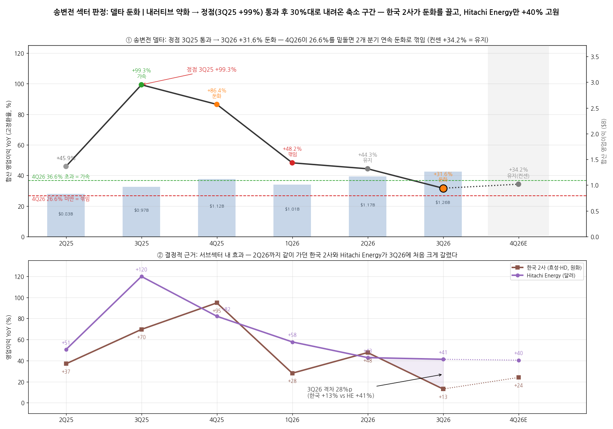

# 전력 인프라 · 송변전 섹터 리뷰

> 현재 상태 (최신 분기 기준)
> 최신 분기: 2026-Q3
> 섹터 델타: 둔화 | 내러티브: 약화
> 모멘텀 신호: 없음
> 활성 테마: 없음
> 포지셔닝: 서브섹터 축소 | 한국 언더퍼폼 | 1등 Hitachi Energy
> 델타 근거: 3Q 3사 영업이익 YoY +44.3→+31.6%(−12.7%p) 둔화, 한국 일회성 포함 → 4Q 컨센 +34.2%로 유지 경로
> 내러티브 근거: 수요·잔고는 확인됐으나 매출은 슬롯에 묶이고 한국 2사 마진·추정·멀티플이 함께 내려가 약화
> PM 근거: 서브섹터 축소, 전력 인프라 안에서 정점을 가장 먼저 지났고 한국 2사 이익 YoY(+13%)가 HE(+41%)에 크게 뒤져 언더퍼폼
> 편입 종목: 효성중공업, HD현대일렉트릭, Hitachi Energy
> 갱신 시각: 2026-11-15 14:30 KST

## 누적 시계열

| 분기 | 편입 종목 | 합산 매출 | 합산 영업이익 | OPM | 매출 YoY | 영업이익 YoY | 영업이익 YoY 델타 (%p) | 섹터 델타 | 내러티브 | 모멘텀 신호 | 활성 테마 |
|---|---|---|---|---|---|---|---|---|---|---|---|
| 2Q24 | 효성·HD·HE | 72,054억원 ($5.26B) | 7,827억원 ($0.57B) | 10.9 | — | — | — | — | - | - | - |
| 3Q24 | 동일 | 69,293억원 ($5.10B) | 6,645억원 ($0.49B) | 9.6 | — | — | — | — | - | - | - |
| 4Q24 | 동일 | 80,036억원 ($5.73B) | 8,503억원 ($0.61B) | 10.6 | — | — | — | — | - | - | - |
| 1Q25 | 동일 | 85,369억원 ($5.88B) | 9,938억원 ($0.68B) | 11.6 | — | — | — | — | - | - | - |
| 2Q25 | 동일 | 86,231억원 ($6.14B) | 11,596억원 ($0.83B) | 13.4 | +17.7 | +45.9 | — | — | - | - | - |
| 3Q25 | 동일 | 92,355억원 ($6.66B) | 13,407억원 ($0.97B) | 14.5 | +31.3 | +99.3 | +53.4 | 가속 | - | - | - |
| 4Q25 | 동일 | 105,073억원 ($7.28B) | 16,200억원 ($1.12B) | 15.4 | +28.3 | +86.4 | -12.9 | 둔화 | - | - | - |
| 1Q26 | 동일 | 102,468억원 ($6.99B) | 14,819억원 ($1.01B) | 14.5 | +19.2 | +48.2 | -38.2 | 꺾임 | - | - | - |
| 2Q26 | 동일 | 109,396억원 ($7.28B) | 17,529억원 ($1.17B) | 16.0 | +20.8 | +44.3 | -3.9 | 유지 | - | - | - |
| **3Q26** | 동일 | **108,725억원 ($7.66B)** | **17,918억원 ($1.26B)** | **16.5** | **+15.8** | **+31.6** | **-12.7** | **둔화** | **약화** | **없음** | **없음** |

→ **합산 방식**: 효성중공업·HD현대일렉트릭은 연결 영업이익(억원), Hitachi Energy는 달러 Adj. EBITA다. 세 회사를 분기 평균 원/달러로 달러 합산했다. 원화 금액은 그 분기 환율로 다시 환산한 값이다. 방법은 `전력 인프라_섹터리뷰.md`(글로벌 9사 통합 리뷰)와 같아서 송변전 행 숫자도 그 문서와 일치한다
→ **YoY는 고정환율 기준**이다. 전년 분기를 이번 분기 환율로 다시 환산했다. 한국 2사는 원화 YoY, HE는 달러 YoY가 그대로 반영된다
→ **Hitachi Energy 분기 달러값**
→ 회사가 공시한 분기 달러값을 우선 썼다 (2Q25·3Q25·2Q26·3Q26)
→ 2Q24~1Q25는 엔화 Power Grids 실적을 분기 평균 엔/달러로 나눴다 (155.9·149.0·152.4·152.6, [근사])
→ 4Q25·1Q26은 FY25 하반기 달러 합계 $10.62B·$1.45B를 엔화 분기 비율로 나눴다 [계산]
→ 4Q26E는 하반기 가이던스 $12.65B·$2.02B를 균등 분할했다
→ **적용 환율** (원/달러, 분기 평균): 2Q24 1,371 · 3Q24 1,358 · 4Q24 1,397 · 1Q25 1,453 · 2Q25 1,404 · 3Q25 1,387 · 4Q25 1,444 · 1Q26 1,466 · 2Q26 1,502 · 3Q26 1,420 · 4Q26E 1,340 (통합 리뷰와 같은 값)
→ HE 분기 숫자가 2Q24부터 있어 YoY는 2Q25부터 낸다
→ **1Q26 "꺾임"은 판정 규칙을 그대로 적용한 결과**다. 2개 분기 연속 둔화(4Q25 -12.9%p, 1Q26 -38.2%p)에 정점(3Q25) 통과가 겹쳤다. 다만 YoY는 +48%로 여전히 높았고, 이후 +44%(유지) → +32%(둔화)로 고원 아래로 계단식으로 내려오는 중이다
→ 내러티브·모멘텀 신호·테마 열은 당시 송변전 단독 리뷰가 없어 `-`로 두었다

---

## 2026-Q3 섹터 리뷰

> 대상: `earnings-review/2026-Q3_{효성중공업|HD현대일렉트릭|HE}_리뷰.md`
> 2층 구조의 서브섹터 리뷰다. 섹터 비중(1단계)과 서브섹터 순위(2단계)는 `전력 인프라_섹터리뷰.md`가 맡는다. 이 문서는 송변전 판정, 송변전 안의 한국 vs 글로벌, 송변전 1등 종목(3단계)에 답한다
> 첫 송변전 단독 리뷰라 직전 분기 관전 포인트 체크는 없다. 11/3 한국 3사판과 11/14 글로벌 9사판의 송변전 관련 판단은 아래 ③·⑦에서 이어 받는다

① 섹터 합산 숫자와 델타

| 항목 | 2Q25 | 3Q25 | 4Q25 | 1Q26 | 2Q26 | **3Q26** | 4Q26E |
|---|---|---|---|---|---|---|---|
| 합산 매출 ($B) | 6.14 | 6.66 | 7.28 | 6.99 | 7.28 | **7.66** | 8.97 |
| 합산 영업이익 ($B) | 0.83 | 0.97 | 1.12 | 1.01 | 1.17 | **1.26** | 1.55 |
| 합산 영업이익 (억원) | 11,596 | 13,407 | 16,200 | 14,819 | 17,529 | **17,918** | 20,743 |
| OPM (%) | 13.4 | 14.5 | 15.4 | 14.5 | 16.0 | **16.5** | 17.3 |
| 매출 YoY (고정환율) | +17.7 | +31.3 | +28.3 | +19.2 | +20.8 | **+15.8** | +20.7 |
| 영업이익 YoY (고정환율) | +45.9 | +99.3 | +86.4 | +48.2 | +44.3 | **+31.6** | +34.2 |
| **영업이익 YoY 델타 (%p)** | — | +53.4 | -12.9 | -38.2 | -3.9 | **-12.7** | +2.6 |
| 판정 | — | 가속 | 둔화 | 꺾임 | 유지 | **둔화** | 유지 (컨센) |
| 참고: 한국 2사 영업이익 YoY (원화) | +37.0 | +69.6 | +94.8 | +28.1 | +47.6 | **+13.1** | +24.0 |
| 참고: Hitachi Energy Adj. EBITA YoY (달러) | +50.5 | +119.8 | +82.1 | +57.7 | +42.9 | **+41.3** | +40.4 |

→ (출처: 3사 2026-Q3 리뷰 1-1 분기 표 [계산]. 4Q26E는 효성·HD FnGuide 컨센, HE 하반기 가이던스 균등 분할)
→ **이익 레벨**: 3Q26 합산 영업이익 $1.26B(1.79조원)로 분기 최대이고, OPM 16.5%도 최고다. 4Q26E $1.55B(OPM 17.3%)로 다시 최대를 갱신하는 경로다
→ **델타**: 영업이익 YoY는 3Q25 +99%가 정점이다. 그 뒤로 +86% → +48% → +44% → +32%로 계단식으로 내려왔다. 매출 YoY도 +31%(3Q25) → +16%로 반 토막이다
→ **컨센 경로상 정점은 이미 3Q25에 지났다**. 4Q26E +34.2%는 3Q26 대비 +2.6%p로 "유지"다. 효성 이연분(2,650억원) 인식이 4Q26E를 받치고 있고, HD는 +4.1%로 한 번 더 둔화한다. 송변전은 9사 중 가장 먼저 정점을 지난 서브섹터다 (통합 리뷰: 배전·DC·발전은 3Q26 가속)

→ (출처: 3사 2026-Q3 리뷰 [계산]. 왼쪽 = 송변전 합산 영업이익·매출 YoY(고정환율) / 오른쪽 = 종목별 영업이익 YoY(현지 통화) + 한국 2사 합산(점선 사각). ★ = 한국. 점선 구간 = 4Q26E)

② 종목별 델타 판정표

| 델타 순위 | 종목 | 국가 | 매출 YoY | 영업이익 YoY | 영업이익 YoY 델타 | 델타 판정 | 내러티브 | 한 줄 |
|---|---|---|---|---|---|---|---|---|
| 1 | Hitachi Energy | 글로벌 (스위스·일본) | +17.4% ($) | +41.3% ($ Adj. EBITA) | -1.6%p | 유지 | 강화 | 마진 15.9%로 6개 분기 연속 상승, 수주 +50%, 잔고 $66.9B, FY30 마진 목표 19~21%로 상향 |
| 2 | HD현대일렉트릭 | 한국 | +18.5% | +15.1% | -22.1%p | 둔화 | 약화 | 매출 사상 최대, OPM 24.1%(BESS·원화 강세로 -1.0%p), 수주 -19%는 생산 슬롯 소진 |
| 3 | 효성중공업 | 한국 | +7.2% | +10.8% | -50.1%p | 둔화 | 약화 | 매출 2,650억원 4Q 이연 + 건설 충당금 400억원, 수주 +122%·잔고 18.9조원은 사상 최대 |

→ (출처: 각 종목 2026-Q3 리뷰 0번 판정 그대로. HE는 달러 기준 — 엔화 기준이면 Power Grids EBITA YoY +58% → +52%(-6.4%p, 둔화)이지만 엔화 약세 환산 효과가 섞여 HE 리뷰는 달러로 판정했다)
→ **델타 순위 기준**: 영업이익 YoY 델타가 큰 순서다. HE(-1.6%p)만 고원을 지켰고, 한국 2사는 -22%p·-50%p로 급감했다
→ **섹터 델타를 끌어내린 것은 한국 2사다**. 3Q26 합산 영업이익 YoY 증가분 $0.30B 중 HE가 $0.26B(86%)다. 한국 2사는 합쳐 $0.04B(14%)에 그쳤다 [계산: 고정환율]. 2Q26에는 한국 2사가 증가분의 약 1/3($0.12B)을 냈다
→ **선행 종목은 효성중공업**이다. 이익 YoY 정점이 2Q25(+162%)로 가장 빨랐다. 다음이 HD(4Q25 +93%), HE(3Q25 +120%)다. 정점 시점은 HE가 HD보다 빨랐지만, 이후 내려온 속도는 HE가 가장 느리다(+120% → +41%, 고원 3개 분기)

③ 섹터 공통 쟁점

(1) 수주는 사상 최대인데 매출 성장은 생산능력에 묶였다 (3사 공통)

| 종목 | 3Q26 수주 | 잔고 | 생산능력 일정 | 매출 YoY |
|---|---|---|---|---|
| Hitachi Energy | Power Grids ¥1,507bn(+50%), Book-to-bill 1.69x | $66.9B (6개월 +16%, 매출 약 3년치) | 증설분 가동 중, "납기 단축 어려움" | +17.4% ($) |
| 효성중공업 | 중공업 3.2조원(+122%), 미국 +308% | 18.9조원 (+71%, 미국 60%) | 멤피스 2026년 말 4억달러 → 2028년 6월 7억달러 | +7.2% (이연 2,650억원) |
| HD현대일렉트릭 | 9.8억달러(-19% YoY, -32% QoQ) | 88.4억달러 (2026E 송배전 매출의 2.9배) | 울산 신공장 11월, 알라바마 증설 2Q27 | +18.5% |

→ (출처: 3사 2026-Q3 리뷰 1-2·2번 쟁점)
→ 공통: 수요 둔화의 증거는 없다. 3사 모두 잔고가 사상 최대다. HD의 수주 감소는 슬롯 소진(공급 제약)으로 회사와 증권사 대다수가 해석한다
→ 갈리는 지점: 증설이 매출로 들어오는 시점이다. HE는 이미 들어오고 있고, 한국 2사는 2027~28년이다
→ **[판단]** 2027년 송변전 델타는 수주 공시보다 증설 가동 일정이 정한다. 한국 2사의 4Q26~1H27 YoY는 슬롯에 묶여 HE보다 낮게 나올 가능성이 크다

(2) 변압기가 먼저 둔화되는 것은 산업 구조인가 — 단품 수출 vs 시스템·프로젝트

(2-1) 구조적으로 변압기가 먼저 둔화되기 쉬운 이유 [판단]
→ **부족 사태가 가장 먼저 왔다**: 2022~23년 북미 계통 투자·노후 교체로 변압기 부족이 전력기기 중 가장 먼저 터졌고, 가격·마진도 가장 먼저 올랐다. 먼저 오른 만큼 기저효과로 YoY도 먼저 꺾인다. HD·효성 마진은 2023~25년에 한 자릿수에서 20%대(HD)·두 자릿수(효성)로 뛰었다
→ **증설이 상대적으로 쉽다**: 변압기는 2~3년이면 증설이 된다. 가스터빈(핵심 부품)이나 HVDC(기술 장벽)보다 공급 반응이 빨라 가격 프리미엄이 먼저 줄어드는 구조다. 한국·인도·중국·멕시코의 북미향 증설이 2026~28년에 몰려 있다
→ **수주에서 매출까지가 짧다**: 변압기는 수주 후 2~4년, 가스터빈은 2029~30년 슬롯까지 차 있다. 고가 수주가 변압기에서는 먼저 매출로 소진되고, 가스터빈은 이제 들어오기 시작한다. 통합 리뷰의 3Q26 서브섹터 델타 순서(발전 +113% > 배전·DC +27% > 송변전 +32%, 송변전만 정점 통과)와 맞다
→ **과거 사이클**: 2008~2012년 사이클에서도 변압기는 증설 물량이 들어오면서 가격이 다른 전력기기보다 먼저 꺾였다. 한국 중전기 이익도 2009~2010년부터 먼저 내려왔다

(2-2) 구조만으로는 설명되지 않는 부분
→ **같은 변압기 글로벌 1위인 Hitachi Energy는 고원을 지켰다**: 달러 Adj. EBITA YoY +43% → +41%. "변압기 = 먼저 둔화"가 전부라면 HE도 같이 꺾였어야 한다
→ **차이는 사업 구성이다**: HE는 HVDC·대형 시스템 프로젝트 비중이 크고 잔고가 매출 약 3년치다. 유럽 HVDC(TenneT 2GW×2, Elmed)와 유틸리티 송전이 몸통이고 데이터센터는 매출의 10%대 초반이다. 한국 2사는 단품 변압기·차단기 수출 비중이 높다. 같은 송변전 안에서도 **시스템·프로젝트는 늦게, 단품 수출은 먼저 꺾인다** [판단]
→ **이번 분기 한국 숫자에는 일회성이 섞였다**: 효성 건설 충당금 400억원·매출 이연 약 2,650억원, HD 안좌 BESS 1,250억원(저마진)·북미 납품 타이밍(비중 47.5% → 38.0%), 공통 원화 강세(3Q26 1,420원, 2Q26 1,502원). 수요 둔화 신호는 아니다. 효성 이연분이 4Q에 인식되면 한국 2사 YoY는 +13% → +24%(컨센)로 일부 되돌아온다

(2-3) [판단]
→ 한국이 먼저 둔화되는 흐름은 "단품 변압기 수출"이라는 사업 구성에서 오는 구조적 경향이 맞다. ⑦ 한국 언더퍼폼 콜의 방향성 근거다
→ 다만 3Q26 둔화 폭은 일회성으로 과장됐을 수 있다. 구조적 둔화인지는 세 선행지표로 확인한다 (⑥ 4순위). 하나라도 확인되면 일회성이 아니라 구조적 둔화로 본다
→ 미국 변압기 가격(BLS PPI)이 횡보에서 하락으로 바뀌는지
→ 대형 변압기 납기가 짧아지는지
→ 한국 2사 신규 수주 단가가 기존 잔고 단가를 밑도는지

(3) 마진 — HE는 올라가고 한국은 내려갔다

| 종목 | 2Q26 마진 | 3Q26 마진 | 방향 | 원인 |
|---|---|---|---|---|
| HD현대일렉트릭 | 25.1% | 24.1% | ↓ | BESS 믹스, 북미 비중 하락, 원화 강세. BESS 제외 시 25.8~27.0% [추정] |
| Hitachi Energy | 14.8% ($) | 15.9% ($) | ↑ | ERP·AI 생산성, 대형 프로젝트 원가 관리(예비비 내). 정상화 기준 +250bp |
| 효성중공업 | 15.7% | 14.0% | ↓ | 건설 충당금(약 -1.5%p). 중공업 OPM 19.8%로 방어 |

→ (출처: 3사 2026-Q3 리뷰)
→ **[판단]** 마진 레벨은 HD(24%)가 송변전 최고다. 한국의 문제는 레벨이 아니라 방향이다. HE는 6개 분기 연속 올랐고, 한국 2사는 3Q26에 같이 내려갔다. 한국 쪽 원인(환율·믹스·충당금)은 4Q·2027년에도 일부 남는다(HD 원화 역풍 4Q26 약 200억원, 2027년 약 1,000억원 — 골드만)

(4) 중간선거 이후 — 텍사스 모라토리엄과 12월 FERC·ERCOT

→ 11/3 중간선거 뒤 텍사스 주지사 당선인이 신규 데이터센터 모라토리엄을 공약했다(1/19 취임). 텍사스는 미국 계획 데이터센터 전력의 약 27~30%다. 텍사스는 9월부터 전력망 감사를 이유로 주 인허가를 멈춘 상태다 (`2026-Q3_VRT_리뷰.md` 2번 (4), Trefis·TIKR 11/4~5 인용)
→ 배전·DC 대표주 Vertiv는 선거 후 1주일 새 약 -23%였다. 송변전 3사는 이 이벤트 전에 이미 고점 대비 크게 빠져 있었다(효성 -61%, HD -68%, Hitachi 6501 발표 후 1주 -12%)
→ 송변전 안의 노출도:

| 종목 | 데이터센터 직접 노출 | 12월 FERC·ERCOT / 텍사스 모라토리엄의 의미 |
|---|---|---|
| HD현대일렉트릭 | 빅테크 A사 1.12조원 + B·C·D사 장기공급계약 11월 말 확정 예정 | 두 번째 성장축(빅테크 패키지)의 할인율. 노출 송변전 최대 |
| 효성중공업 | 하이퍼스케일러 직접 발주 4억달러+ (잔고의 약 3%) | 일부 물량 할인율. 765kV·STATCOM 등 규제 투자가 몸통 |
| Hitachi Energy | 데이터센터 매출 10%대 초반, FY27 데이터센터 수주 5배 목표 | 영향 작음. HVDC·유틸리티 송전 중심 |

→ **[판단]** 모라토리엄은 "신규 승인"이 대상이다. 송변전 잔고(2~3년치)에는 영향이 없고, 영향이 나온다면 2027년 하반기 이후 데이터센터향 신규 수주다. 오히려 계통 접속 비용을 데이터센터에 전가하는 결론은 765kV·유틸리티 송전 투자(규제 자산)에는 중립~우호적이다. 송변전은 배전·DC보다 이 이벤트의 하방이 작다. 다만 한국 2사 중 HD는 빅테크 패키지 노출이 커서 송변전 안에서는 가장 민감하다

(5) 멀티플 — TP 하향은 3사 모두 멀티플 때문

| 종목 | 평균 TP 변화 | 이익 추정 방향 | 주가 (고점 대비) | 밸류에이션 |
|---|---|---|---|---|
| Hitachi (6501) | 컨센 TP ¥6,600 변화 없음 (15명) | 가이던스 2회 상향 | 발표 후 1주 -12% | PER 30배 (그룹 전체) |
| 효성중공업 | 371만원 → 315만원 (-15.2%) | 하향 (2026E -4.1%, 2027E -5.0%) | -61% | 2027F PER 15~16배 |
| HD현대일렉트릭 | 104만원 → 81만원 (-21.7%) | 하향 (2026E -2.7%, 2027E -3.5%) | -68% | 12M Fwd PER 15배 |

→ (출처: 각 종목 리뷰 2-4 표, 통합 리뷰 ③ (2))
→ **[판단]** 한국 2사는 이익 추정도 내려갔고(-3~5%) 멀티플은 더 많이 내려갔다(JPM 전력기기 PER 30배 → 25배). HE는 이익이 올라갔다. 송변전 안에서 "이익 하향 + 멀티플 하향"이 겹친 것은 한국 2사뿐이다

(6) 종목 고유 이슈
→ Hitachi Energy: 엔화 환산 왜곡(엔화 기준이면 둔화). 매매 수단이 모회사 Hitachi 6501이라 순수 노출이 아니다(Energy 매출 비중 약 1/3). DSS 일회성 손실 ¥9bn
→ 효성중공업: 중동 이연분 700~800억원의 4Q 인식 불확실(JPM), 건설 부문 추가 충당 여부, SST 초도 수주
→ HD현대일렉트릭: 빅테크 B·C·D 장기공급계약 11월 말 확정 여부, 배전 확대에 따른 마진 희석 논쟁

④ 섹터 판정

> 섹터 델타: **둔화** | 내러티브: **약화** → **송변전은 정점(3Q25 +99%)을 가장 먼저 지난 서브섹터 — 이익 레벨은 사상 최고지만 델타는 +44% → +32%로 둔화했고, 둔화는 한국 2사(+48% → +13%)가 만들었다. Hitachi Energy만 +41% 고원을 지킨다. 4Q26 합산 영업이익 YoY 26.6% 미만이면 2개 분기 연속 둔화로 꺾임**

→ (출처: 3사 2026-Q3 리뷰 [계산]. 상단 = 송변전 합산 영업이익 YoY(고정환율. 점 색 = 분기별 판정, 막대 = 합산 영업이익 달러)와 4Q26 판정선 / 하단 = 한국 2사(원화) vs Hitachi Energy(달러) 영업이익 YoY — 서브섹터 내 효과)

→ **델타 판정 근거**: 합산 영업이익 YoY가 2Q26 +44.3%에서 3Q26 +31.6%로 12.7%p 줄었고 플러스를 유지해 "둔화"다. 2Q26이 "유지"였기 때문에 2개 분기 연속 둔화는 아니다. 컨센 4Q26E는 +34.2%(+2.6%p)로 "유지" 경로다. 4Q가 26.6% 미만이면 2개 분기 연속 둔화에 정점(3Q25) 통과가 겹쳐 "꺾임"이다
→ **내러티브 판정 근거**: 종목별 내러티브는 약화 2(효성·HD), 강화 1(HE)이다. 송변전 공통 스토리는 "북미·유럽 계통 투자 + 데이터센터 → 잔고 → 증설 → 가격·마진 확장"이다. 수요와 잔고는 3사 모두 숫자로 확인됐다. 그러나 매출 성장은 슬롯에 묶였고, 한국 2사는 마진 후퇴·이익 추정 하향·멀티플 하향이 겹쳤다. 합산 이익 비중이 큰 쪽(한국 2사 + HE 중 HE가 약 70%)은 강화지만, 송변전에 투자 가능한 순수 종목(한국 2사)이 모두 약화라 "약화"로 둔다 [판단]
→ **[판단] 결정적 근거는 서브섹터 내 효과다**. 2Q26까지는 한국 2사와 HE의 이익 YoY가 비슷했다(+48% vs +43%). 3Q26에 처음 크게 갈렸다(+13% vs +41%, 격차 28%p). 송변전 둔화는 "업황"보다 "한국 단품 수출 모델"의 둔화다
→ 직전 판정 대비: 송변전 단독 판정은 처음이다. 11/3 한국 3사판의 "송변전 2사만 보면 +48% → +13%, 꺾임에 가까운 둔화" 판단과, 11/14 글로벌 9사판의 송변전 "둔화" 판정을 그대로 잇는다. 소급 궤적은 가속(3Q25) → 둔화 → 꺾임 → 유지 → 둔화(3Q26)다

⑤ 모멘텀 신호

→ **없음** — 활성 테마가 없어 "테마 종료 후보"는 해당하지 않는다
→ 델타 급증 후보 조건 대조
→ ① 섹터 영업이익 YoY 델타 확대 — **미충족** (-12.7%p)
→ ② 편입 종목 과반 가속 — **미충족** (가속 0/3)
→ ③ 내러티브 형성·강화 — **미충족** (약화)
→ 다음 분기 후보로 올릴 조건: 4Q26 합산 영업이익 YoY 36.6% 초과(가속) + 한국 2사 중 1곳 이상 가속 + 12월 FERC 결론이 데이터센터 접속 허용·비용 분담 명확화 쪽
→ **반대 논거**
→ (1) 4Q26은 효성 이연분(2,650억원) 인식으로 효성 YoY가 +11% → +49%(컨센)로 튀는 분기다. 숫자상 효성 단독 "가속"이 나올 수 있지만, 이연분 인식은 기저 정상화이지 새 델타가 아니다
→ (2) 레이어로 보면 송변전은 데이터센터·계통 투자의 공급 측이다. 수요는 꺾이지 않았고 병목은 생산능력이다. 한국 2사 증설(HD 울산 11월·알라바마 2Q27, 효성 멤피스 2026년 말)이 매출로 들어오는 1H27~2H27에 재가속 여지가 있다

⑥ 다음 분기 섹터 관전 포인트

| 순위 | 무엇을 (변수·임계값) | 어떤 데이터로 | 언제 |
|---|---|---|---|
| 1 | **4Q26 송변전 합산 영업이익 YoY(고정환율) 26.6% 이상 — 미만이면 꺾임**. 금액으로는 4Q26 환율(1,340원) 기준 $1.46B 이상. 36.6%($1.58B) 초과면 가속. 컨센·가이던스 합 $1.55B(+34.2%)는 유지. 종목별로는 효성 3,500억원·HD 3,200억원 미만이면 각 종목 꺾임선 | 효성·HD 4Q26 잠정실적, Hitachi 3Q(FY26) 실적의 Hitachi Energy 박스 | 2027-01 말 |
| 2 | **한국 2사 vs HE 격차 축소 여부** — 한국 2사 합산 영업이익 YoY(원화) 24%(컨센) 이상, HE 달러 Adj. EBITA YoY +35% 이상·마진 16% 이상. 격차가 20%p 아래로 줄면 서브섹터 내 효과 완화 | 같은 실적 | 2027-01 말 |
| 3 | **12월 FERC·ERCOT 결론 + 1/19 텍사스 주지사 취임 후 첫 조치** — 데이터센터 접속 비용 전가·신규 모라토리엄 방향. 송변전 노출 HD > 효성 > HE | FERC RTO 보고(11/16~20), ERCOT 감사(12/10), FERC 반론 시한(12/16), 텍사스 행정명령 | 11월 중순 ~ 1월 말 |
| 4 | **변압기 선행 둔화가 구조적인지** — 미국 변압기 PPI 횡보 → 하락 전환, 대형 변압기 납기 단축, 한국 2사 신규 수주 단가 < 기존 잔고 단가. 하나라도 확인되면 송변전 축소·한국 언더퍼폼 강화 | 미국 BLS PPI(전력·특수 변압기), 업계 납기 조사, 한국 2사 컨콜 수주 단가 코멘트, 관세청 HS 8504 수출 단가 | 매월 PPI·수출 통계, 1월 말 컨콜 |
| 5 | **수주 이벤트** — HD 빅테크 B·C·D 장기공급계약(11월 말), 효성 765kV·STATCOM 추가 수주·연간 수주 12조원 초과, HE Power Grids Book-to-bill 1.3x 이상·잔고 $70B 돌파 | 수주 공시, Hitachi 분기 수주 표 | 11월 말 ~ 2027-01 말 |

→ 1순위 판정선(26.6%)은 ④ 키 차트와 같다. 근거: 3Q26 +31.6%에서 "유지" 범위(±5%p)를 뺀 값이다. 이 아래면 3Q26에 이어 2개 분기 연속 둔화이고, 정점(3Q25)을 이미 지났으므로 꺾임이다. 36.6%는 +5%p 위 "가속" 경계다

⑦ 글로벌 PM 포지셔닝 — 결론

> **서브섹터: 축소 — 4Q26 YoY 36.6% 초과 + FERC 완화면 유지로 상향** | **서브섹터 내: 한국 언더퍼폼 (HE 대비 서브섹터 내 효과 큼)** | **1등: Hitachi Energy (글로벌) / HD현대일렉트릭 (한국)**

(1) 서브섹터 판정 — 확대 / 유지 / 축소

| 판단 축 | 3Q26 근거 | 방향 |
|---|---|---|
| 이익 델타 (1순위) | 합산 영업이익 YoY +44.3% → +31.6% 둔화, 정점 3Q25 통과 | 축소 |
| YoY 정점 시점 | 정점 3Q25로 전력 인프라 서브섹터 중 가장 이름. 4Q26E +34.2%(유지)는 효성 이연분이 받침 | 축소 |
| 수주·잔고 선행지표 | 3사 잔고 사상 최대(HE $66.9B, 효성 18.9조원, HD 88.4억달러), 효성·HE 수주 +122%·+50%. HD -19%(슬롯) | 유지 |
| 최종 수요 | 북미·유럽 계통 투자와 HVDC는 견조, 데이터센터 노출은 HD만 큼 | 유지 |
| 이벤트·정책 | 12월 FERC·ERCOT, 1/19 텍사스 모라토리엄 — 송변전은 배전·DC보다 하방이 작음 | 중립 |
| 밸류에이션 (2순위) | 한국 2사 PER 15~16배(고점 -61~-68%), HE 모회사 PER 30배 | 유지 (한국 저평가) |
| 이익 추정 방향 | 한국 2사 하향(-3~5%), HE 상향 | 축소 |

→ **결론: 서브섹터 축소** [판단]. 송변전은 전력 인프라 안에서 정점을 가장 먼저 지났고, 3Q26에 배전·DC·발전이 가속할 때 혼자 둔화했다. 델타 1순위 프레임에서는 섹터 안 비중을 다른 서브섹터로 옮기는 것이 맞다. 통합 리뷰의 "송변전 축소" 순위와 같은 결론이다
→ **유지로 상향 조건**: ① 4Q26 합산 영업이익 YoY 36.6% 초과(1월 말) ② 12월 FERC 결론이 데이터센터 접속 허용·비용 분담 명확화 쪽 ③ 한국 2사 이익 추정 상향 전환. ①+② 충족 시
→ **추가 축소 조건 (사실상 비중 제외)**: 4Q26 26.6% 미만(꺾임) 또는 변압기 PPI 하락 전환·납기 단축 확인

(2) 같은 서브섹터 안 한국 vs 글로벌 — 서브섹터 내 효과

| 경쟁력 축 | 한국 2사 (효성·HD) | 글로벌 (Hitachi Energy) | 우위 |
|---|---|---|---|
| 델타 방향 (1순위) | 영업이익 YoY +47.6% → +13.1% (-34.5%p), 둘 다 둔화 | +42.9% → +41.3% (-1.6%p), 유지 | 글로벌 |
| 마진 레벨 | HD 24.1%, 효성 14.0% (중공업 19.8%) | 15.9% | 한국 (HD) |
| 마진 방향 | 둘 다 하락 (믹스·환율·충당금) | 6개 분기 연속 상승, FY30 목표 19~21% | 글로벌 |
| 수주 증가율 | 효성 +122%, HD -19% (슬롯) | +50%, Book-to-bill 1.69x | 비슷 |
| 생산능력·현지화 | 미국 capa 2027~28년 가동 (효성 멤피스, HD 알라바마) | 증설분 가동 중, 미국·유럽 현지 공장 | 글로벌 |
| 사업 구성 | 단품 변압기·차단기 수출 중심 | HVDC·시스템 프로젝트 중심, 잔고 3년치 | 글로벌 (사이클 후행) |
| 환율 | 원화 강세 역풍 (HD 2027년 약 1,000억원) | 엔화 약세는 엔화 숫자에 순풍, 달러 기준은 중립 | 글로벌 |
| 이익 추정 방향 | 하향 (-3~5%) | 상향 (가이던스 2회) | 글로벌 |
| 밸류에이션·낙폭 (2순위) | PER 15~16배, 고점 -61~-68% | 모회사 PER 30배 | 한국 |

→ **결론: 송변전 안에서 한국 언더퍼폼** [판단]. 서브섹터 내 효과가 크다. 같은 변압기·초고압 업종인데 3Q26 이익 YoY 격차가 28%p(+13% vs +41%)로 처음 크게 벌어졌다
→ 이유 (1) 델타 방향이 반대다. HE는 고원, 한국 2사는 동시 둔화
→ 이유 (2) 이익 추정이 내려간 곳도 한국 2사뿐이다. 원화 강세·믹스 같은 통제 밖 변수가 4Q·2027년에도 남는다
→ 이유 (3) 사업 구성 차이다. 단품 수출은 시스템·프로젝트보다 사이클에서 먼저 꺾인다 (③ (2))
→ 반대 논거: 밸류에이션 할인이 크다(PER 15배 vs 30배). 4Q26에는 효성 이연분 인식으로 한국 2사 YoY가 +24%(컨센)로 되돌아오고, HD 빅테크 계약이 11월 말 확정되면 반등 탄력은 한국이 더 크다. 또 HE는 매매 수단이 Hitachi 6501이라 송변전 순수 노출이 아니다 — 실제 포트폴리오에서는 "HE가 이긴다"를 사는 방법이 제한적이다. 언더퍼폼은 델타 프레임 결론이며 가치 프레임이면 반대일 수 있다
→ **비교 범위**: 글로벌 편입 종목은 HE 1개(숫자 중심 리뷰, 셀사이드 미확보)다. 글로벌 쪽 표본이 한 회사라 일회성에 휘둘릴 수 있다 — Siemens Energy Grid Technologies(발전 서브섹터에 합산)와 GE Vernova Electrification이 송변전 성격의 비교 근거로 남아 있다. 둘 다 3Q26 가속(ENR GT 영업이익 YoY +89%, 마진 20.1%)이라 결론 방향은 같다

(3) 송변전 1등 종목

| 구분 | 종목 | 델타 판정 | 근거 한 줄 |
|---|---|---|---|
| **글로벌 1등 (서브섹터 1등)** | Hitachi Energy | 유지 · 강화 | 델타 순위 1위(-1.6%p), 달러 Adj. EBITA +41% 고원, 마진 6개 분기 연속 상승, 잔고 $66.9B. 단 매매 수단은 Hitachi 6501 |
| **한국 1등** | HD현대일렉트릭 | 둔화 · 약화 | 델타 순위 2위(-22.1%p, 효성 -50.1%p보다 덜 꺾임), 마진 24.1%로 송변전 최고 레벨. 빅테크 B·C·D 계약(11월 말)이 이벤트 |
| 한국 2위 | 효성중공업 | 둔화 · 약화 | 이연·충당금으로 이번 분기 델타 최하위. 4Q26 컨센상 YoY +49%로 반등 경로라 다음 분기 한국 1등이 바뀔 수 있다 |

→ **선호 / 비선호** (송변전 안)
→ 선호: Hitachi Energy (모회사 6501로만 노출)
→ 반등 후보 (이벤트 드리븐, 델타 프레임 밖): HD현대일렉트릭 — 11월 말 빅테크 장기계약 확정, 12월 FERC 결론 확인 후. 효성중공업 — 1월 말 4Q 잠정실적에서 이연분 2,650억원 인식 확인 후
→ 비선호: 효성중공업 (이연분 인식 확인 전까지)

(4) 콜을 바꾸는 조건과 일정

| 시점 | 이벤트 | 서브섹터 판정 | 서브섹터 내 한국 콜 |
|---|---|---|---|
| 11월 말 | HD 빅테크 B·C·D 장기공급계약 | — | 확정 시 HD를 중립으로 (한국 1등 유지) |
| 11/16~20, 12/10, 12/16 | FERC RTO 보고 → ERCOT 감사 → FERC 반론 시한 | 완화 → 축소에서 유지로 검토 / 강화 → 축소 유지 (송변전은 배전·DC보다 하방 작음) | 완화 → 한국 반등 탄력 최대 / 강화 → HD 할인 확대 |
| 2027-01-19 이후 | 텍사스 주지사 첫 조치 (모라토리엄) | 실행 시 데이터센터향 신규 수주 둔화 — HD 영향 최대 | 한국 언더퍼폼 강화 |
| 2027-01 말 | 효성·HD 4Q 잠정, Hitachi 3Q(FY26) | 합산 YoY 36.6% 초과 → 유지 상향 / 26.6% 미만 → 꺾임 | 한국 2사 YoY가 HE와 격차 20%p 아래로 줄면 중립 |
| 매월 | 미국 변압기 PPI·수출 단가 | 하락 전환 → 축소 강화 | 언더퍼폼 강화 |
| 2027-04 말 | Hitachi FY27 가이던스 | 마진 17% 이상이면 HE 1등 유지 | — |

→ 출처: 각 종목 2026-Q3 리뷰 4번 항목, `2026-Q3_VRT_리뷰.md`(중간선거·텍사스), `전력 인프라_섹터리뷰.md`(통합 리뷰 환율·9사 합산)
