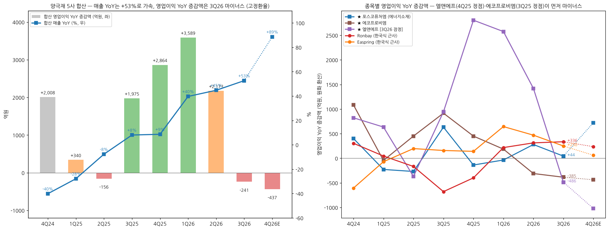
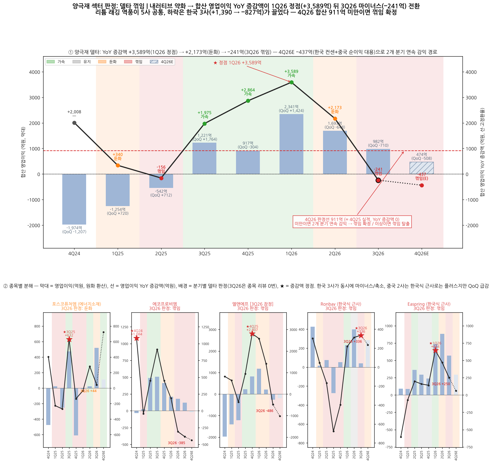

# 배터리 · 양극재 섹터 리뷰

> 현재 상태 (최신 분기 기준)
> 최신 분기: 2026-Q3
> 섹터 델타: 꺾임 | 내러티브: 약화
> 모멘텀 신호: 없음
> 활성 테마: 없음
> 포지셔닝: 서브섹터 축소 | 한국 언더퍼폼 | 1등 포스코퓨처엠
> 편입 종목: 에코프로비엠, 포스코퓨처엠, 엘앤에프, Ronbay, Easpring
> 갱신 시각: 2026-11-16 18:40 KST

## 누적 시계열

| 분기 | 편입 종목 | 합산 매출 | 합산 영업이익 | OPM | 매출 YoY | 영업이익 YoY | 영업이익 YoY 델타 (%p) | 섹터 델타 | 내러티브 | 모멘텀 신호 | 활성 테마 |
|---|---|---|---|---|---|---|---|---|---|---|---|
| 4Q24 | 에코·포스코(에너지소재)·엘앤에프·Ronbay·Easpring | 23,444억원 | −1,974억원 | −8.4 | −40.2 | n/m (증감액 +2,008억) | — | — | - | - | - |
| 1Q25 | 동일 | 24,721억원 | −1,254억원 | −5.1 | −27.9 | n/m (+340억) | −1,668억 | 둔화 | - | - | - |
| 2Q25 | 동일 | 27,367억원 | −542억원 | −2.0 | −7.7 | n/m (−156억) | −496억 | 꺾임 | - | - | - |
| 3Q25 | 동일 | 29,160억원 | 1,221억원 | 4.2 | +8.0 | n/m (+1,975억) | +2,131억 | 가속 | - | - | - |
| 4Q25 | 동일 | 26,107억원 | 917억원 | 3.5 | +8.6 | n/m (+2,864억) | +889억 | 가속 | - | - | - |
| 1Q26 | 동일 | 35,344억원 | 2,341억원 | 6.6 | +39.7 | n/m (+3,589억) | +725억 | 가속 | - | - | - |
| 2Q26 | 동일 | 41,922억원 | 1,693억원 | 4.0 | +44.8 | n/m (+2,173억) | −1,416억 | 둔화 | - | - | - |
| **3Q26** | 동일 (엘앤에프 [잠정]) | **45,952억원** | **982억원** | **2.1** | **+52.7** | **−19.7 (−241억)** | **−2,414억** | **꺾임** | **약화** | **없음** | **없음** |

→ **합산 방식**: 한국 3사는 K-IFRS 연결 영업이익(억원). 포스코퓨처엠은 **에너지소재 부문**(양극재+음극재) 매출·영업이익을 썼다 (사업부 기준 합산 — 기초소재(내화물·라임화성)는 양극재가 아니다). 연결 기준은 ① 아래 참고 행에 병기. Ronbay·Easpring은 각 리뷰의 **한국식 영업이익 근사**(= 매출총이익 − 세금및부가 − 판매·관리·R&D, 중국식 营业利润과 다름)를 분기 평균 CNY/KRW로 원화 환산했다
→ **YoY는 고정환율 기준**이다 (전년 분기 중국 2사 숫자를 이번 분기 환율로 다시 환산). 3Q26 원화 명목 기준이면 매출 YoY +57.6%, 영업이익 증감액 −239억으로 결론이 같다 [계산]
→ **영업이익 YoY %가 n/m인 이유**: 합산 영업이익이 3Q24까지 적자라 전년 기저가 마이너스다. 그래서 종목 리뷰(에코프로비엠·포스코퓨처엠·엘앤에프·Ronbay 모두 증감액 판정)와 같은 방식으로 **영업이익 YoY 증감액(억원)**으로 델타를 판정했다. "영업이익 YoY 델타" 열은 증감액의 직전 분기 대비 변화(억원)다. 판정 규칙: 증감액 마이너스 = 꺾임 / 직전보다 200억 넘게 확대 = 가속 / ±200억 이내 = 유지 / 200억 넘게 축소했지만 플러스 = 둔화 [계산 규칙, 이 문서에서 정함]
→ **적용 환율** (CNY/KRW, 분기 평균): 4Q23 183.13 · 1Q24 185.71 · 2Q24 189.24 · 3Q24 189.04 · 4Q24 194.08 · 1Q25 199.41 · 2Q25 193.17 · 3Q25 193.65 · 4Q25 204.15 · 1Q26 211.26 · 2Q26 220.62 · 3Q26 210.16 · 4Q26E 200.0 (10/1\~11/14 평균 200.26). 출처: Yahoo USD/KRW ÷ USD/CNY 일별 평균 [계산] — 3Q26 값은 Ronbay·Easpring·CATL 리뷰의 210.16과 일치
→ **소급 분기 내러티브·모멘텀·테마 열**은 당시 양극재 섹터 리뷰가 없어 `-`로 두었다
→ **엘앤에프 편입 결정** (워치리스트 "확장" → 합산 포함): ① 3Q26 매출 8,744억원으로 한국 양극재 중 최대(에코프로비엠 5,579억, 포스코 에너지소재 4,596억) ② 양극재 단일 사업(100%)이라 순수 노출 ③ SNE 1H26 삼원 적재량 한국 1위(글로벌 3위, Ronbay 리뷰 인용) ④ 셀 3사 LFP 수주(100GWh)로 섹터 공통 쟁점의 중심. 빼면 한국 표본이 2사로 줄고 한국 대표성이 깨진다. **단 판정 민감도가 크다** — 엘앤에프를 빼면 3Q26 합산(4사) 증감액은 +753 → +245억(둔화)이다 (① 아래 참고 행). 그래도 보상금·중국 재고손을 조정하면 4사도 마이너스라 "꺾임" 결론은 유지된다

---

## 2026-Q3 섹터 리뷰

> 대상: `earnings-review/2026-Q3_{에코프로비엠|포스코퓨처엠|엘앤에프|688005.SS|300073.SZ}_리뷰.md` (모두 2026-11-14\~16 작성. 엘앤에프 3Q26은 잠정 공정공시 기준)
> 2층 구조의 서브섹터 리뷰다. 배터리 섹터 비중(1단계)과 서브섹터 순위(2단계)는 `배터리_섹터리뷰.md`(통합 리뷰)가 맡는다. 이 문서는 양극재 판정, 양극재 안의 한국 vs 글로벌(중국), 양극재 1등 종목(3단계)에 답한다
> 워치리스트의 `양극재`(한국)·`양극재 글로벌`(중국) 두 행을 한 문서로 묶었다. 첫 양극재 섹터 리뷰라 직전 분기 관전 포인트·⑦ 콜 체크는 없다
> 국가 프레임 점검: 한국 3사 / 글로벌 2사(모두 중국). 일본(Sumitomo Metal Mining·Nichia)·유럽(Umicore) 피어는 없다 — "글로벌 = 중국"으로 읽어야 한다

① 섹터 합산 숫자와 델타

| 항목 | 4Q24 | 1Q25 | 2Q25 | 3Q25 | 4Q25 | 1Q26 | 2Q26 | **3Q26** | 4Q26E |
|---|---|---|---|---|---|---|---|---|---|
| 합산 매출 (억원) | 23,444 | 24,721 | 27,367 | 29,160 | 26,107 | 35,344 | 41,922 | **45,952** | 37,555* |
| 합산 영업이익 (억원) | −1,974 | −1,254 | −542 | 1,221 | 917 | 2,341 | 1,693 | **982** | 474 |
| OPM (%) | −8.4 | −5.1 | −2.0 | 4.2 | 3.5 | 6.6 | 4.0 | **2.1** | — |
| 매출 YoY (고정환율, %) | −40.2 | −27.9 | −7.7 | +8.0 | +8.6 | +39.7 | +44.8 | **+52.7** | +88.6* |
| 영업이익 YoY (%) | n/m | n/m | n/m | n/m | n/m | n/m | n/m | **−19.7** | −48.0 |
| **영업이익 YoY 증감액 (억원)** | +2,008 | +340 | −156 | +1,975 | +2,864 | **+3,589 ★** | +2,173 | **−241** | −437 |
| 증감액 델타 (억원) | — | −1,668 | −496 | +2,131 | +889 | +725 | −1,416 | **−2,414** | −196 |
| 판정 | — | 둔화 | 꺾임 | 가속 | 가속 | 가속 | 둔화 | **꺾임** | 꺾임 (E) |
| 참고: 포스코 **연결** 기준 합산 영업이익 / 증감액 | −1,912 / +1,930 | −1,107 / +359 | −279 / +93 | 1,414 / +1,996 | 1,011 / +2,896 | 2,529 / +3,630 | 1,935 / +2,152 | **1,285 / −131** | 652 / −353 |
| 참고: 한국 3사 영업이익 / 증감액 (억원) | −2,492 / +2,309 | −1,356 / +364 | −977 / −187 | 1,200 / +2,494 | 629 / +3,121 | 1,371 / +2,727 | 413 / +1,390 | **373 / −827** | −106 / −735 |
| 참고: 중국 2사 영업이익 / 증감액 (억위안) | 2.67 / −1.55 | 0.51 / −0.12 | 2.25 / +0.16 | 0.11 / −2.68 | 1.41 / −1.26 | 4.59 / +4.08 | 5.80 / +3.55 | **2.90 / +2.79** | 2.90 / +1.49 (대용) |
| 참고: 엘앤에프 제외 4사 증감액 (억원) | +1,185 | −295 | +214 | +1,030 | +57 | +1,013 | +753 | **+245** | +584 |

→ (출처: 5사 2026-Q3 리뷰 1번 분기 표 [계산]. 포스코퓨처엠 에너지소재 4Q23\~2Q25는 리뷰가 인용한 `포스코퓨처엠_기업개요.md` 사업부 분기 표(회사 IR p.10), 3Q25\~3Q26은 리뷰 1-② 표)
→ **4Q26E**: 한국 3사 = 리뷰의 발표 후 셀사이드 평균 (에코프로비엠 7개사 −20억, 엘앤에프 6개사 −196억, 포스코 에너지소재 = HSBC 110억 — 리뷰가 제시한 유일한 부문 추정. 연결은 6개사 평균 288억). **중국 2사 4Q26E는 리뷰에 한국식 영업이익 추정이 없어 东吴 지배순이익 추정을 대용치로 넣었다** (Ronbay 1.43억, Easpring 1.47억위안 — 동오 2026E − 9M26 역산) [대용·계산]. *매출 4Q26E는 Easpring 추정이 없어 4사 합(Easpring 제외)이고, 매출 YoY도 4사 동일 표본이다. OPM은 표본이 달라 비워 뒀다
→ **조정 기준 (3Q26)**: ① 포스코퓨처엠 고객 미이행 보상금 약 500억(삼성·MS 추정, 회사 비공개)을 빼면 합산 482억, 증감액 **−741억** ② 여기에 중국 2사 재고평가손실(Ronbay 약 0.8억, Easpring 0.56억위안 ≈ 286억원)을 K-IFRS처럼 영업이익에 넣으면 합산 약 196억, 증감액 약 **−1,027억** [계산]. 반대로 에코프로비엠 개발비 자산화 약 140억(DB)을 빼면 더 내려간다. **어느 조정에서도 3Q26 증감액은 마이너스**다. 3Q25 기저에도 일회성(에코프로비엠 인니 투자이익 418억, 포스코·엘앤에프 재고 환입 금액 미공개)이 있어 조정 YoY 수치는 정밀하지 않다
→ **이익 레벨**: 3Q26 합산 영업이익 982억(OPM 2.1%)은 1Q26 2,341억(6.6%)의 42%다. 매출은 4.6조원으로 분기 최대인데 이익은 3개 분기 전 수준이다. 매출을 키운 건 중국 2사(+125%)고, 이익을 깎은 건 한국 3사(QoQ −40억, YoY −827억)와 중국 2사의 마진 붕괴(QoQ −52%)다
→ **델타**: 합산 증감액은 1Q26 +3,589억이 정점이다. 그 뒤 +2,173억(둔화) → −241억(꺾임)으로 2개 분기 연속 축소 끝에 마이너스로 돌았다. 영업이익이 전년 대비 늘지 않은 건 2Q25 이후 5개 분기 만이다
→ **컨센 경로상 정점은 1Q26에 이미 지났다**. 4Q26E 합산 474억(−437억)은 2개 분기 연속 감익이다. 한국 3사 4Q26E는 −106억(적자)이고, 포스코 에너지소재만 4Q25 적자 기저(−612억) 덕에 +722억으로 튄다 — 기저효과다

→ (출처: 5사 2026-Q3 리뷰 [계산]. 왼쪽 = 합산 영업이익 YoY 증감액(막대, 색 = 분기 판정)과 합산 매출 YoY(선, 고정환율. 4Q26E는 Easpring 제외 4사) / 오른쪽 = 종목별 영업이익 YoY 증감액(원화 환산, ★ = 한국). 점선 = 4Q26E, 중국 2사 E는 순이익 대용)

② 종목별 델타 판정표

| 델타 순위 | 종목 | 국가 | 매출 YoY | 영업이익 (YoY 증감액) | 증감액 델타 (2Q26 → 3Q26) | 델타 판정 | 내러티브 | 한 줄 |
|---|---|---|---|---|---|---|---|---|
| 1 | 포스코퓨처엠 (에너지소재) | 한국 | −13.8% (연결 −4.6%) | 518억 (+44억) / 연결 821억 (+154억) | +280 → +44억 (−236억) / 연결 +259 → +154억 (−105억) | 둔화 | 형성 | 보상금 약 500억 제외 시 에너지소재 약 18억(OPM 0.4%, YoY −456억). LFP 셀 3사 계약으로 2027 출하 약 10만톤 가이드 |
| 2 | Ronbay | 중국 | +114.9% (위안) | 한국식 0.19억위안 (+1.60억, ≈ +336억원) | +1.42 → +1.60억위안 (+0.18억 ≈ +38억원) | 꺾임 | 약화 | 증감액은 3Q25 적자 기저(−1.41억) 덕. QoQ −89%, OPM 0.3%, 중국식 −1.19억·순손실, 재고손 반영 시 약 −0.6억 |
| 3 | 에코프로비엠 | 한국 | −10.7% | 120억 (−385억, −76.2%) | −310 → −385억 (−75억) | 꺾임 | 약화 | EV −34% QoQ, 개발비 자산화 약 140억 빼면 본업 소폭 적자. 4Q26E −20억(적전) |
| 4 | Easpring | 중국 | +135.3% (위안) | 한국식 2.71억위안 (+1.19억, ≈ +250억원, +78.1%) | +2.13 → +1.19억위안 (−0.94억 ≈ −198억원) | 꺾임 | 약화 | GPM 7.5% 사상 최저, 营业利润 −35%·순이익 −36% YoY. 해외(한국 셀) GPM 9.6% |
| 5 | 엘앤에프 [잠정] | 한국 | +34.1% | −265억 (−486억, 적전) | +1,420 → −486억 (−1,906억) | 꺾임 | 약화 | 재고평가 −426억 + 환율 −220억. 둘 빼면 381억(OPM 4.4%)으로 2Q26과 같음 — 늘지 않았다 |

→ (출처: 각 종목 2026-Q3 리뷰 0번 판정 그대로. 원화 환산 = 3Q26 CNY/KRW 210.16)
→ **델타 순위 기준** [이 문서에서 정함]: 판정(둔화 > 꺾임)을 먼저 두고, 같은 판정 안에서 증감액 델타(원화) 큰 순서. 스킬 기본 규칙(델타 먼저)과 다르게 한 이유는 이익 부호가 흑자·적자로 섞이고 중국 2사는 한국식 근사와 중국식 영업이익의 방향이 반대라, 증감액 델타 하나로 줄 세우면 Ronbay처럼 저기저 효과가 1위로 올라오기 때문이다. 델타만으로 줄 세우면 Ronbay(+38억) > 에코프로비엠(−75억) > 포스코 연결(−105억) > Easpring(−198억) > 포스코 에너지소재(−236억) > 엘앤에프(−1,906억)
→ **판정 주의 — 중국 2사**: 한국식 근사 증감액은 Ronbay 유지·Easpring 둔화로 나오지만, 두 리뷰는 중국식 영업이익·순이익(Ronbay 순이익 증감액 +1.51 → +0.10억, Easpring 营业利润 YoY −35%)과 QoQ 마진 붕괴로 "꺾임"을 판정했다. 합산의 중국 기여(+586억)는 리뷰 판정보다 좋게 보이는 숫자다
→ **섹터 델타를 끌어내린 것은 한국 3사다**. 3Q26 합산 증감액 변화 −2,414억 중 한국 3사가 −2,217억(+1,390 → −827억), 중국 2사가 −197억이다 [계산]. 한국 안에서는 엘앤에프 혼자 −1,906억이다 (1Q26 재고 환입 926억의 반대 방향)
→ **선행 종목은 에코프로비엠**이다. 증감액 정점이 3Q25(+917억)로 가장 빨랐고 2Q26에 가장 먼저 마이너스로 돌았다. 다음이 엘앤에프(정점 4Q25 +2,807억 → 3Q26 마이너스), Easpring(정점 1Q26 +3.05억위안 → 둔화 2개 분기)이다. 포스코 에너지소재는 정점이 없는 들쭉날쭉한 흐름(적자·흑자 반복)이고, Ronbay는 증감액상 3Q26이 정점이지만 중국식·순이익 기준 정점은 2Q26이다

③ 섹터 공통 쟁점

(1) 리튬 급락 → 재고평가손실·래깅 역풍 (5사 공통)

| 종목 | 3Q26 메탈가 영향 | 4Q26 방향 (리뷰 판단) |
|---|---|---|
| 엘앤에프 | 재고평가손실 **−426억** + 환율 손실 약 −220억 → 영업이익 −265억 | 탄산리튬 3Q말 $19.1 → 11월 $13.5/kg(DB). 회사 "축소", DB·NH "확대" — 리뷰는 4Q 적자 쪽 |
| Ronbay | 재고평가손실 약 **−0.8억위안**(≈ −168억원), GPM 9.4% → 5.3% | 재고 50억위안. 메탈가 반락 지속 시 반복 |
| Easpring | 재고평가손실 **−0.56억위안**(≈ −118억원), GPM 11.6% → 7.5%(사상 최저) | 4Q GPM 10% 회복이 판정 1순위 |
| 에코프로비엠 | 오히려 재고평가손실 **환입 약 +40억**(DS) — 래깅 수혜 마지막 분기 | 수산화리튬 22.0$(3월) → 18.0$(9월)/kg. 4Q부터 역풍 쪽 [리뷰 판단] |
| 포스코퓨처엠 | 음극재 재고평가손. 양극재는 손실(DB·HSBC) vs 과거 평가손 제품 환입(하나)으로 해석이 갈림 — 보상금이 가렸다 | 4Q 양극재 판가 QoQ 하락(회사 가이드), 보상금 없이 래깅을 맨몸으로 받는 첫 분기 |

→ (출처: 각 종목 2026-Q3 리뷰 1·2번. 탄산리튬 8월 고점 ¥16.29만/t → 9월 ¥11.70만(−28%, Easpring 리뷰 인용 新华财经))
→ 공통: 3Q 마진을 깎은 1순위는 9월 리튬 급락이다. 판가는 월평균 시세로 먼저 내려가고 원가에는 고가 재고가 남는 역래깅이다. 5사의 3Q26 본업 마진은 0\~4%대로 같다 (Ronbay 리뷰: "볼륨 성장은 Ronbay가 압도적, 마진은 4사 모두 얇다")
→ 갈림: 래깅이 한 분기에 끝나는가. 회사들(엘앤에프 "축소", Easpring 동오 "4Q 순이익 +13.5%")은 4Q 완화를 말하고, DB·NH는 11월 추가 하락(−29%)을 근거로 반복을 본다. 에코프로비엠·포스코퓨처엠은 3Q를 환입·보상금으로 넘겨 4Q가 첫 역풍이다
→ **[판단]** 11월 추가 하락폭(−29%)이 3Q 손실을 낸 하락폭(−28%)과 비슷하다. 4Q26은 5사 모두 래깅 역풍을 받는 분기가 될 가능성이 크다. 4Q 판정선(911억) 미달 쪽에 무게를 둔다. 반대로 12월에 리튬이 반등하면 1Q27에 5사가 동시에 래깅 이익으로 돌아선다 — 양극재 이익 델타의 1차 변수는 아직 업황(물량)이 아니라 메탈가다

(2) LFP 전환 — 셀 3사 수주로 물량 스토리는 생겼고, 마진은 아직 없다

| 종목 | LFP 수주·물량 | 2027 물량 가정 | 마진 가정 |
|---|---|---|---|
| 포스코퓨처엠 | SK온 약 1.1조(2027\~29), 삼성SDI 약 6.05조(2027\~32), LGES 양·음극재 72만톤 MoU(2027\~33). 포항 105kt 전환(1H27), 12월 초도 1.5kt | 회사 약 50kt (DB 20kt \~ 하나 60kt) | 하나 OPM 6.1%, Citi 정상화 7\~8% vs JPM "muted" |
| 엘앤에프 | 셀 3사 + 해외 1사 최대 25만톤(ESS 약 100GWh), LGES 1조(2028\~31). 3Q말 북미 ESS 첫 공급 | 약 4만톤 (컨콜) — IR은 5만톤 | 대신 2027 LFP OPM 약 2% |
| 에코프로비엠 | 인니 최대 5만톤 증설 결정, 국내 4천톤 파일럿 | 2028 판매 시작 — 2027 기여 없음 | 미반영 (JPM "후발 — 엘앤에프·포스코가 셀 3사 선점") |
| Easpring | 3Q LFP 4.5\~4.8만톤(+40% QoQ, 동오 추정), 윈난 15만톤 | 2027 약 35만톤 (동오) | 톤당 순이익 0.2 → 0.05만위안 (재고평가손실) |
| Ronbay | LFP 1차 라인 시운전, LMFP 판매 감소, 나트륨 분기 2천톤 | 2027 나트륨 7\~8만톤 (동오) | 나트륨 적자 |

→ (출처: 각 종목 2026-Q3 리뷰 2번 쟁점)
→ 공통: 한국 셀 3사의 미국 ESS용 비중국(non-PFE) LFP 수요가 한국 양극재 2사(포스코·엘앤에프)에 물량을 줬다. 셀사이드는 물량은 모델에 넣기 시작했지만 2027E 영업이익은 오히려 내렸다 (포스코 −5.6%, 엘앤에프 −26.5%)
→ 갈림: LFP 판가가 삼원계의 약 1/3(하나: 9.8$/kg vs 29.5$/kg)이라 매출은 늘어도 이익 기여는 작다. 중국 Easpring은 LFP 물량이 40% 늘어도 톤당 이익이 1/4로 줄었다 — 물량 ≠ 이익의 실례다
→ **[판단]** LFP는 2027년 양극재 "매출 델타"는 바꾸지만 "이익 델타"는 2028년부터다 (포스코 하나·HSBC 경로, 엘앤에프 대신 경로). 이번 분기 내러티브에서 포스코퓨처엠만 "형성"인 이유가 이것이고, 엘앤에프는 같은 LFP 스토리를 갖고도 기존 NCM 이원화 우려가 겹쳐 "약화"다. 한국 2사의 non-PFE 포지션은 중국 2사가 가질 수 없는 구조적 우위다 (Ronbay는 한국 공장을 상장사 밖 AKB로 옮겨 대응)

(3) 고객 리스크 — 물량 미이행 보상금·재고조정·공급 이원화

| 종목 | 고객 이슈 | 이익 영향 |
|---|---|---|
| 포스코퓨처엠 | 고객 물량 미이행 **보상금 약 500억**(금액 비공개, 삼성·MS 추정) — 3Q 영업이익의 약 60% | 4Q 소멸. 4Q26E 288억(−65% QoQ) |
| 에코프로비엠 | 삼성SDI 유럽(BMW) 재고조정 → EV 매출 −34% QoQ, 2027 출하 하향(삼성 −22%) | 본업 BEP 아래. 출하 회복은 2028년 |
| 엘앤에프 | 1위 고객(비중 88%, 테슬라향 울트라 하이니켈) **공급 이원화** 우려 — NH·DB가 20\~30% 이전을 추정에 반영 | 2027 NCM +10%(이원화) vs +40%(없음) |
| Ronbay | 1위 고객 비중 55%, CATL 협약 관련 감독당국 처분(2026-04) | 공시 신뢰 할인 |
| Easpring | LGES·SK온 장기계약 물량 확대 — 해외 GPM 9.6%(2024 21% → 내수 15.2%보다 낮아짐) | 해외 대형 계약의 가격이 낮다는 가설 |

→ (출처: 각 종목 2026-Q3 리뷰 2번 쟁점)
→ 공통: 5사 모두 고객 집중도가 높고, 고객(셀사)의 EV 계획 변경이 양극재 물량·가격에 그대로 넘어온다. 셀사는 EV 물량 공백을 보상금(포스코)이나 공급선 다변화(엘앤에프·Easpring)로 처리하고 있다
→ **[판단]** 보상금은 "셀사가 약속 물량을 못 가져간다"는 신호다. 일회성 이익이지만 내용은 수요 약세다. 그리고 한국 셀사가 중국 Easpring 물량을 GPM 10% 아래로 늘리는 것은 한국 양극재와의 가격 경쟁이 "출혈형"이라는 뜻이다 (Easpring 리뷰 판단). 한국 양극재의 협상력은 LFP(non-PFE)에서만 확인된다

(4) 재무구조 — 증자·부채·운전자본

| 종목 | 3Q26 재무 | 이벤트 |
|---|---|---|
| 에코프로비엠 | 순차입금비율 122%(사상 최고), 차입금 2.68조 | **유상증자 8,861억**(11/5 신주 상장, 발행가 89,500원) — BNSI 니켈 제련소 7,650억 |
| 포스코퓨처엠 | 순차입금비율 78%(80% 경계), 순차입 3.46조 | POSCO홀딩스 지분 처분 최대 2027년 말 연기(DB) |
| 엘앤에프 | 부채비율 372%, 현금 2,825억(−22% QoQ) | 12만톤 증설(2H28) Capex 약 3,600억(대신) — 자회사 정책금융·FI vs 메자닌 |
| Ronbay | 순차입 53.8억위안, 재고 50억위안 | LFP·나트륨 Capex, 해외 지분 투자유치 |
| Easpring | 순현금 80.3 → 45.2억위안(9개월), 9M 영업CF −1.50억 | 핀란드·윈난 Capex |

→ (출처: 각 종목 2026-Q3 리뷰)
→ **[판단]** 5사 모두 이익이 얇은데 LFP·업스트림 Capex를 동시에 늘리는 구간이다. 한국 3사는 증자(에코)·부채비율(엘앤에프)·오버행(포스코)이 주가 변수로 겹친다. 이익 델타가 꺾인 구간에 자금 조달 이벤트가 겹치면 희석이 주가 하방을 키운다 (에코프로비엠 11/9 52주 최저 75,900원 — 발행가 −15%)

(5) 종목 고유 이슈
→ 에코프로비엠: 헝가리 2개 라인 가동 중단(9\~10월) → 4Q 본격 양산 재설정, 글로벌 OEM 수조원 공급계약 "최종 단계", BNSI 2027 상반기 가동
→ 포스코퓨처엠: 음극재 재고평가손·적자 확대, 국내 Buy 4사 vs 해외 4사 전원 Sell/UW, 9개사 평균 TP 17.1만원 < 주가 173,500원
→ 엘앤에프: 46파이 비중 10% → 2027 최대 40%, 1H27 이후 고객 도급 방식으로 재고 리스크 구조적 축소 (회사)
→ Ronbay: 한국 충주 공장(6.7만톤) 실소유주 관련회사 AKB 임대 → 2027 연결 매출 단절(东吴 2027E −23.5%), LG화학 특허 가처분
→ Easpring: 중국 배터리 수출환급 9% → 6%(4월) → 2027-01 완전 취소, 핀란드 1기 2026 말 가동

④ 섹터 판정

> 섹터 델타: **꺾임** | 내러티브: **약화** → **양극재는 합산 영업이익 YoY 증감액이 1Q26(+3,589억)을 정점으로 2개 분기 연속 줄다 3Q26 마이너스(−241억)로 돌았다 — 매출은 +53%로 분기 최대지만 리튬 래깅 역풍에 이익은 1Q26의 42%다. 하락은 한국 3사(+1,390 → −827억)가 끌었고, 중국 2사도 한국식 근사로만 플러스일 뿐 QoQ 이익이 반 토막이다. 4Q26 합산 영업이익 911억 미만이면 2개 분기 연속 감익으로 꺾임 확정 — 매매 제외 구간**

→ (출처: 5사 2026-Q3 리뷰 [계산]. 상단 = 합산 영업이익(막대, 억원, QoQ 증가액 라벨) + 합산 영업이익 YoY 증감액(선, 고정환율, 점 색·배경 = 분기 판정) + 4Q26 판정선 911억 / 하단 = 종목별 영업이익(막대) + YoY 증감액(선), ★ = 증감액 정점, 배경 = 분기별 판정(3Q26은 리뷰 0번, 그 전은 같은 증감액 규칙 ±100억 [계산]))

→ **델타 판정 근거**: 합산 영업이익 YoY 증감액이 2Q26 +2,173억에서 3Q26 −241억으로 마이너스 전환이다. 1Q26 정점 이후 2개 분기 연속 축소와 정점 통과가 겹쳐 규칙상 "꺾임"이다. 포스코 연결 기준(−131억), 보상금 제외(−741억), 중국 재고손 반영(약 −1,027억) 어느 쪽도 마이너스다. 엘앤에프를 빼면 +245억(둔화)이지만 조정하면 마이너스다. 컨센·대용 4Q26E는 474억(−437억)으로 2개 분기 연속 감익 경로다
→ **내러티브 판정 근거**: 종목별 내러티브는 약화 4(에코·엘앤에프·Ronbay·Easpring), 형성 1(포스코)이다. 섹터 공통 스토리 "EV 하이니켈 → 메탈가 회복기 래깅 이익 + 유럽·북미 현지화 프리미엄"은 3Q에 숫자로 깨졌다 (EV 물량 감소·래깅 역전·현지화 지연). 새 스토리 "non-PFE LFP for 미국 ESS"는 한국 2사에서 물량으로 확인됐지만 이익은 아직이다. 5사 모두 2026\~27E 이익 추정이 하향됐다(상향 0) → "약화" [판단]
→ **[판단] 결정적 근거는 메탈가다**. 매출은 5사 합산 +53%로 커졌는데 영업이익이 줄었다. 물량은 있는데 판가-원가 스프레드가 메탈 하락 국면에서 마이너스다. 이 구간에서 양극재 이익 델타는 "누가 더 많이 파느냐"가 아니라 "재고를 얼마나 비싸게 들고 있느냐"가 정한다 — 그래서 하단 패널의 3Q26 판정이 국적과 관계없이 거의 같다(꺾임 4, 둔화 1)
→ 직전 판정 대비: 양극재 단독 판정은 처음이다. 소급 궤적은 둔화(1Q25) → 꺾임(2Q25) → 가속 3개 분기(3Q25\~1Q26, 메탈가 반등 + 적자 기저) → 둔화(2Q26) → 꺾임(3Q26)이다. 2025\~26 가속은 이익 레벨이 아니라 적자 탈출의 기저효과가 컸다 (합산 OPM 최고 6.6%)

⑤ 모멘텀 신호

→ **없음** — 활성 테마가 없어 "테마 종료 후보"는 해당하지 않는다
→ 델타 급증 후보 조건 대조
→ ① 섹터 영업이익 YoY 델타 확대 — **미충족** (증감액 −2,414억)
→ ② 편입 종목 과반 가속 — **미충족** (가속 0/5)
→ ③ 내러티브 형성·강화 — **미충족** (형성 1/5, 섹터 약화)
→ 다음 분기 후보로 올릴 조건: 4Q26 합산 영업이익 911억 이상(증감액 플러스 복귀) + 12월 탄산리튬 반등(1Q27 래깅 이익) + LFP 초도 출하 정상(포스코 1.5kt, 엘앤에프 2,000톤+). 이 셋이 겹치면 1Q27에 5사 동시 재가속 가능
→ **반대 논거**
→ (1) 4Q26 포스코 에너지소재는 4Q25 적자 기저(−612억)라 숫자상 +722억으로 튄다. 기저효과이지 새 델타가 아니다
→ (2) 레이어로 보면 양극재는 셀(특히 ESS)의 공급 측이다. 셀 3사의 ESS 수주(같은 날 셀 리뷰)가 양극재 LFP 물량으로 넘어오는 것은 2027년이다. 메탈가가 바닥을 치면 래깅 환입과 LFP 물량이 같은 분기에 겹칠 수 있어, 반등이 오면 델타 전환 속도는 빠르다

⑥ 다음 분기 섹터 관전 포인트

| 순위 | 무엇을 (변수·임계값) | 어떤 데이터로 | 언제 |
|---|---|---|---|
| 1 | **4Q26 양극재 합산 영업이익 911억 이상 (4Q25 실적, CNY/KRW 200 기준) — 미만이면 2개 분기 연속 감익으로 꺾임 확정**. 현재 경로 474억(−437억). 한국 3사만 보면 629억 이상이어야 하는데 컨센은 −106억. 종목 판정선: 에코프로비엠 416억, 엘앤에프 825억, 포스코 에너지소재 −612억(사실상 통과), Ronbay 0.25억·Easpring 1.16억위안(한국식) | 한국 3사 4Q26 잠정실적·IR, Ronbay·Easpring 2026 연간 업적예고(순이익 범위) | 2027-01 중순 \~ 02 초 |
| 2 | **리튬 가격과 4Q 재고평가손** — 탄산리튬 11월 $13.5/kg 대비 12월 반등 여부. 엘앤에프 재고평가손 200억 미만, Easpring GPM 10% 이상, Ronbay 자산손상 0.3억위안 이하면 래깅 역풍 완화 | Fastmarkets·SMM·广期所 탄산리튬, 각 사 4Q 실적 | 매주 \~ 2027-01 |
| 3 | **LFP 램프** — 포스코 12월 1.5kt 초도 출하·1Q27 분기 5kt(DB 바닥) vs 10kt+(회사 가이드), 엘앤에프 4Q 2,000\~3,000톤·1Q27 5,000톤+, Easpring LFP 톤당 이익 0.05 → 0.2만위안 | 회사 공시·컨콜, 산업부 LFP 수출 통계, 동오 점평 | 2026-12 \~ 2027-02 |
| 4 | **고객 물량** — 에코 헝가리 2개 라인 정상 가동·글로벌 OEM 본계약 공시, 엘앤에프 1위 고객 이원화 크기(1Q27 하이니켈 QoQ), 포스코 4Q 양극재 출하 +50% QoQ 중 저가재고 비중 | DART 공급계약 공시, 4Q 컨콜, 관세청 양극재 수출 | 2026-12 \~ 2027-02 |
| 5 | **정책·재무** — 미국 PFE 세부 규칙(연말, Ronbay AKB 구조 인정 여부 = 한국 non-PFE 프리미엄의 크기), 중국 수출환급 2027-01 완전 취소, 엘앤에프 증설 조달 구조, 포스코 순차입금비율 80% | 미 재무부·IRS 지침, Ronbay 주총 공고, DART 주요사항보고서 | 2026-12 \~ 2027-01 |

→ 1순위 판정선(911억)은 ④ 키 차트와 같다. 근거: 3Q26 증감액이 이미 마이너스라 4Q26도 마이너스(= 911억 미만)면 2개 분기 연속 감익 + 정점(1Q26) 통과로 꺾임이 확정된다. 911억 이상이면 증감액이 플러스로 돌아와 "꺾임 탈출"로 다시 본다. 4Q26E 474억은 한국 3사 셀사이드 평균 + 중국 2사 순이익 대용이라 중국 쪽 숫자는 거칠다

⑦ 글로벌 PM 포지셔닝 — 결론

> **서브섹터: 축소 — 4Q26 합산 911억 이상 + 리튬 반등이면 유지로 상향** | **서브섹터 내: 한국 언더퍼폼 (예외 포스코퓨처엠)** | **1등: 포스코퓨처엠 (한국·서브섹터 1등) / Ronbay (글로벌, 매매 대상 아님)**

(1) 서브섹터 판정 — 확대 / 유지 / 축소

| 판단 축 | 3Q26 근거 | 방향 |
|---|---|---|
| 이익 델타 (1순위) | 합산 영업이익 YoY 증감액 +2,173 → −241억, 정점 1Q26 통과 | 축소 |
| YoY 정점 시점 | 정점 1Q26. 4Q26E −437억(2개 분기 연속 감익). 정점 지난 종목 5/5 (Ronbay는 중국식 기준) | 축소 |
| 수주·물량 선행지표 | LFP 수주 — 포스코 SDI 6.05조·SK온 1.1조·LGES MoU 72만톤, 엘앤에프 25만톤(100GWh)·LGES 1조. 중국 2사 물량 +81\~135% | 유지 (2027 물량은 확보) |
| 최종 수요 | EV 약세(에코 EV −34% QoQ, 엘앤에프 미드니켈 −32%), ESS·P/A·BBU는 성장(에코 P/A +50% YoY) | 중립 |
| 메탈가 | 탄산리튬 8→9월 −28%, 11월 추가 하락(DB −29%) — 4Q 래깅 역풍 2분기째 | 축소 |
| 이벤트·정책 | 미국 PFE 세칙(연말), 중국 수출환급 취소(2027-01) — 둘 다 한국 상대 우위 쪽 | 중립 (한국에 우호) |
| 이익 추정 방향 | 5사 모두 하향 — 2027E 에코 −28%, 엘앤에프 −26.5%, 포스코 −5.6%, Ronbay 2026E −68%, Easpring −30% | 축소 |
| 밸류에이션·낙폭 (2순위) | 엘앤에프 고점 −63%, Easpring −54%, 에코·Ronbay 52주 저점권. 포스코는 평균 TP(17.1만) < 주가, 2027E PER 194배(HSBC) | 한국 2사·중국 2사는 낙폭 큼 / 포스코는 부담 |

→ **결론: 서브섹터 축소** [판단]. 이익 델타가 꺾였고, 다음 분기도 메탈가 역풍으로 감익 경로이며, 5사 추정이 전부 내려갔다. 물량(LFP)은 2027년 매출을 받치지만 이익 델타는 2028년이다. 델타 1순위 프레임에서 양극재는 배터리 섹터 안에서 비중을 줄일 서브섹터다 (셀과의 순위는 통합 리뷰에서)
→ **유지로 상향 조건**: ① 4Q26 합산 영업이익 911억 이상(1월 중순\~2월 초) ② 12월 탄산리튬이 11월 저점 대비 반등 ③ 1Q27 LFP 출하가 가이드 경로(포스코 분기 10kt, 엘앤에프 5,000톤). ①+②면 유지, ③까지 겹치면 확대 검토
→ **추가 축소 조건 (사실상 비중 제외)**: 4Q26 한국 3사 합산 적자(컨센 −106억) 확인 + 리튬 추가 하락으로 1Q27 컨센 하향

(2) 같은 서브섹터 안 한국 vs 글로벌(중국) — 서브섹터 내 효과

| 국가 | 합산 편입 종목 (3Q26) | 영업이익 YoY 증감액 직전 → 이번 | 델타 판정 | 물량 방향 | 제외 종목 |
|---|---|---|---|---|---|
| 한국 | 에코프로비엠·포스코(에너지소재)·엘앤에프 | +1,390 → −827억 (−68.9% YoY) | 꺾임 | 매출 YoY +10.8% → +4.5%, 물량 정체(에코 −10% QoQ, 엘앤에프 NCM −5% QoQ) | 없음 |
| 중국 | Ronbay·Easpring | +3.55 → +2.79억위안 (≈ +783 → +586억원) | 산식상 유지(−197억, 밴드 끝) / 리뷰 판정은 2사 모두 꺾임 | 매출 YoY +87.6% → +125.4%, 삼원 +81%·LFP +40% QoQ | 없음 |

| 경쟁력 축 | 한국 3사 | 중국 2사 | 우위 |
|---|---|---|---|
| 델타 방향 (1순위) | 증감액 마이너스 전환(−827억), 판정 둔화 1·꺾임 2 | 증감액 플러스 유지(+586억)이나 QoQ 이익 −52%, 판정 꺾임 2 | 중국 |
| 마진 레벨 (3Q26) | 에코 2.2%, 포스코 에너지소재 11.3%(보상금 제외 0.4%), 엘앤에프 −3.0% | Ronbay 0.3%(재고손 반영 약 −1.0%), Easpring 3.9%(K-IFRS 유사 3.1%) | 비슷 (0\~4%) |
| 마진 방향 | 3사 모두 QoQ 하락(보상금 제외) | 2사 모두 QoQ 하락(GPM −4%p) | 비슷 |
| 물량 증가율 | 정체·감소 | +81\~135% YoY | 중국 |
| 생산능력·현지화 | 헝가리(에코), 북미 non-PFE LFP(포스코·엘앤에프) | Ronbay 한국 공장 → AKB 이전, Easpring 핀란드 2026 말 | 한국 |
| 가격 | 셀 3사 LFP 장기계약(non-PFE 프리미엄 기대) | 해외 계약 GPM 9.6% — 출혈형 | 한국 |
| 관세·규제 | 미국 PFE·FEOC 수혜, EU IAA 기대 | 미국 시장 접근 제한, 수출환급 취소(2027) | 한국 |
| 환율 | 원화 강세 역풍(엘앤에프 환율 손실 약 −220억) | 위안 강세 환손실(Easpring 9M 재무비용 1.94억) | 비슷 |
| 이익 추정 방향 | 하향 3/3 | 하향 2/2 (확보 범위) | 비슷 |
| 밸류에이션·낙폭 (2순위) | 엘앤에프 −63%, 에코 52주 저점권, 포스코 PER 100배+ | Easpring −54%, Ronbay 52주 저점 | 비슷 |

→ **결론: 양극재 안에서 한국 언더퍼폼** [판단]. 서브섹터 내 효과가 크다. 같은 래깅 역풍을 맞았는데 중국은 물량(+81\~135%)이 마진 손실을 일부 메웠고, 한국은 물량까지 정체라 증감액이 마이너스로 먼저 돌았다
→ 이유 (1) 델타 방향 — 섹터 델타 변화 −2,414억 중 −2,217억(92%)이 한국 3사다
→ 이유 (2) 이익 추정 — 한국 3사 모두 2027E 하향(−5.6\~−28%), 셀사이드 TP도 에코 −25%, 엘앤에프 −20.5%
→ 이유 (3) 구조 — 한국 EV 고객(삼성SDI 유럽·테슬라)의 재고조정·이원화가 물량을 막고 있고, LFP 물량이 이익이 되는 2028년까지 공백이다
→ **반대 논거**: 중국 2사의 플러스 증감액은 한국식 근사(재고손 제외)와 3Q25 적자 기저(Ronbay)가 만든 부분이 크다 — 리뷰 판정은 둘 다 꺾임이다. 구조 축(non-PFE·관세·수출환급)은 모두 한국 우위라, 메탈가가 반등하고 LFP가 램프하는 2027 하반기 이후에는 한국이 이길 구조다. 언더퍼폼은 델타 프레임의 4Q26\~1Q27 결론이며, 구조·가치 프레임이면 반대일 수 있다
→ **예외 종목**: 포스코퓨처엠 — 한국 3사 중 유일하게 증감액 플러스(+44억)·판정 둔화·내러티브 형성(LFP 셀 3사 계약). 단 보상금 제외 시 YoY −456억이라 "덜 나쁜" 예외이고, 밸류에이션(평균 TP < 주가)이 부담이다
→ **비교 범위**: 글로벌 편입 종목은 중국 2사(숫자 중심 리뷰, 셀사이드는 东吴·동오 점평 각 1건)다. 일본·유럽 양극재 피어가 없어 "글로벌 = 중국"이다. 근거 얇음 — 편입 후보: Umicore(UMI.BR, 유럽 양극재·반기 공시+분기 매출), Sumitomo Metal Mining(5713.T, 배터리 소재 부문 — 파나소닉·테슬라 NCA). 편입 여부는 BT 판단

(3) 양극재 1등 종목

| 구분 | 종목 | 델타 판정 | 근거 한 줄 |
|---|---|---|---|
| **한국 1등 (서브섹터 1등)** | 포스코퓨처엠 | 둔화 · 형성 | 델타 순위 1위 — 5사 중 유일한 둔화·형성. 증감액 +44억(에너지소재)/+154억(연결). LFP 2027 출하 약 50kt 가이드. 단 보상금 제외 시 감익, 4Q26E 288억(−65% QoQ) |
| **글로벌 1등** | Ronbay | 꺾임 · 약화 | 꺾임 4사 중 증감액 델타 1위(+0.18억위안), 4Q26E 순이익 1.43억(4Q25 0.16억 대비 +1.27억)으로 증익 경로. 단 3Q25 적자 기저 효과, 중국식 영업이익 적자, 2027 한국 공장 AKB 이전으로 연결 단절 — 매매 대상 아님 |
| 한국 2위 | 에코프로비엠 | 꺾임 · 약화 | 증감액 −385억(델타 −75억). 4Q26E 적전(−20억). 반등 트리거는 글로벌 OEM 본계약 공시 |
| 글로벌 2위 | Easpring | 꺾임 · 약화 | 이익 레벨은 5사 중 가장 안정(OPM 3.9%)이지만 GPM 사상 최저·营业利润 −35%. 4Q GPM 10% 회복이 관건 |
| 한국 3위 | 엘앤에프 [잠정] | 꺾임 · 약화 | 델타 최하위(−1,906억). 본업(재고·환율 제외) OPM 4.4% 정체, 4Q26E −196억 |

→ **선호 / 비선호** (양극재 안)
→ 선호: 포스코퓨처엠 — 상대 선호(서브섹터 축소 안에서 남길 종목). 판정 둔화·형성이 유일하다. 단 4Q 보상금 소멸·밸류 부담으로 절대 매수 근거는 약하다
→ 반등 후보 (이벤트 드리븐, 델타 프레임 밖): 엘앤에프 — 12월 리튬 반등 + 4Q 재고손 200억 미만 + 1Q27 흑자(1H27 도급 전환 후 재고 리스크 구조적 축소). 에코프로비엠 — 글로벌 OEM 수조원 본계약 공시 + 헝가리 정상 가동
→ 비선호: Ronbay(지배구조·연결 단절), Easpring(해외 마진 하락·수출환급 취소). 한국 안에서는 에코프로비엠(2028년까지 본업 회복 근거 약함)

(4) 콜을 바꾸는 조건과 일정

| 시점 | 이벤트 | 서브섹터 판정 | 서브섹터 내 한국 콜 |
|---|---|---|---|
| 2026-12 | LFP 초도 출하 (포스코 1.5kt, 엘앤에프 삼성SDI향 개시) | 정상 → 1Q27 물량 경로 확인 | 정상이면 포스코 선호 유지 |
| 2026-12 | 탄산리튬 12월 가격 | 반등 → 축소에서 유지 검토 / 추가 하락 → 축소 유지 | 반등 시 엘앤에프 반등 탄력 최대(재고 민감도 최대) |
| 2026 연말 | 미국 PFE 세칙, Ronbay AKB 임대 주총 | — | AKB 구조 불인정 → 한국 non-PFE 프리미엄 확대(중립 쪽) |
| 2027-01-01 | 중국 배터리 수출환급 완전 취소 | — | 중국 해외 마진 추가 하락 → 한국 상대 개선 |
| 2027-01 중순 \~ 02 초 | Ronbay·Easpring 연간 업적예고, 한국 3사 4Q26 잠정 | 합산 911억 이상 → 유지 상향 / 미만 → 꺾임 확정, 축소 유지 | 한국 3사 증감액 플러스 복귀(629억 이상) → 중립 |
| 2027-02 초 | 에코·엘앤에프 4Q 컨콜 (헝가리 가동률, 이원화, 2027 가이던스) | — | 에코 OEM 본계약 or 엘앤에프 단독 공급 유지 → 한국 중립 |

→ 출처: 각 종목 2026-Q3 리뷰 4번 항목, 같은 폴더 셀 리뷰(LGES·삼성SDI ESS 수주 맥락)
