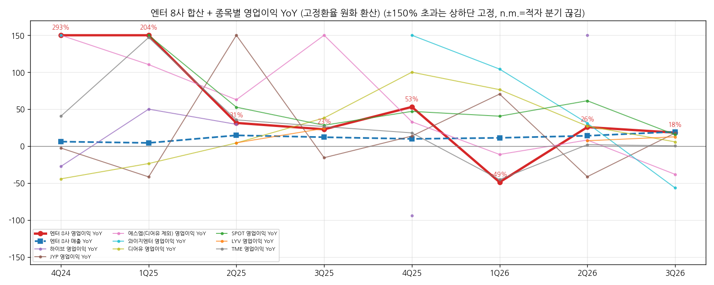
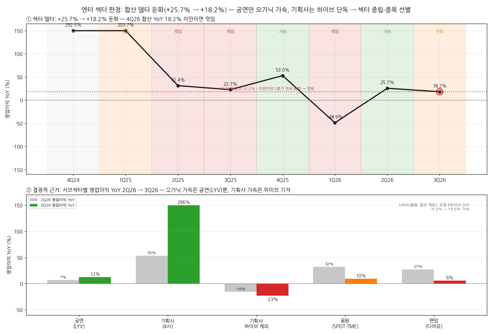

# 엔터 섹터 리뷰 (섹터 통합)

> 현재 상태 (최신 분기 기준)
> 최신 분기: 2026-Q3
> 섹터 델타: 둔화 | 내러티브: 유지
> 모멘텀 신호: 없음
> 활성 테마: 없음
> 포지셔닝: 섹터 중립 | 한국 언더퍼폼 | 선호 Live Nation, 하이브
> 편입 종목: 9사 — 기획사(하이브, JYP, 에스엠, 와이지엔터) + 팬덤 플랫폼(디어유) + 음원 글로벌(UMG, Spotify, Tencent Music) + 공연 글로벌(Live Nation). 합산 8사: UMG 제외(분기 영업이익 미공시)
> 갱신 시각: 2026-11-23 12:40 KST

## 누적 시계열

| 분기 | 편입 종목 | 합산 매출 | 합산 영업이익 | OPM | 매출 YoY | 영업이익 YoY | 영업이익 YoY 델타 (%p) | 섹터 델타 | 내러티브 | 모멘텀 신호 | 활성 테마 |
|---|---|---|---|---|---|---|---|---|---|---|---|
| 4Q24 | 8사 (UMG 제외, 에스엠은 디어유 제외) | 177,016억원 | 10,681억원 | 6.0 | +6.0% | +292.5% | n.m. | — | - | - | - |
| 1Q25 | 8사 (UMG 제외, 에스엠은 디어유 제외) | 140,039억원 | 20,814억원 | 14.9 | +4.3% | +203.7% | -88.9%p | 둔화 | - | - | - |
| 2Q25 | 8사 (UMG 제외, 에스엠은 디어유 제외) | 197,153억원 | 21,393억원 | 10.9 | +14.6% | +31.4% | -172.3%p | 꺾임 | - | - | - |
| 3Q25 | 8사 (UMG 제외, 에스엠은 디어유 제외) | 220,929억원 | 26,997억원 | 12.2 | +12.0% | +22.7% | -8.7%p | 꺾임 | - | - | - |
| 4Q25 | 8사 (UMG 제외, 에스엠은 디어유 제외) | 194,263억원 | 16,341억원 | 8.4 | +9.7% | +53.0% | +30.3%p | 가속 | - | - | - |
| 1Q26 | 8사 (UMG 제외, 에스엠은 디어유 제외) | 155,661억원 | 10,644억원 | 6.8 | +11.2% | -48.9% | -101.9%p | 꺾임 | - | - | - |
| 2Q26 | 8사 (UMG 제외, 에스엠은 디어유 제외) | 224,701억원 | 26,882억원 | 12.0 | +14.0% | +25.7% | +74.5%p | 가속 | - | - | - |
| **3Q26** | **8사 (UMG 제외, 에스엠은 디어유 제외)** | **263,642억원** | **31,917억원** | **12.1** | **+19.3%** | **+18.2%** | **-7.4%p** | **둔화** | **유지** | **없음** | **없음** |

→ **합산 방식**: 종목 실적 리뷰 1-1 표의 보고 기준 매출·영업이익을 **고정환율(3Q26 평균)로 원화 환산**해 합산 — $1 = 1,419원(한국은행, MBW 인용), €1 = 1,590원(Spotify 3Q26 €4.969B = $5.569B 역산), RMB 1 = 211원(TME 3Q26 RMB 8.94B = $1.33B 역산) [계산]. 분기마다 환율을 바꾸지 않아 YoY에 환율 효과가 섞이지 않는다(현지 통화 YoY와 같은 성격)
→ **UMG 제외**: UMG는 1·3분기에 IFRS 영업이익을 공시하지 않아(조정 EBITDA만) 같은 표본 원칙대로 모든 분기에서 뺐다. UMG 단독 판정(조정 EBITDA 기준 가속)은 ② 순위표와 ⑦에만 쓴다
→ **중복 제거**: 에스엠은 2Q25부터 디어유를 연결 → 에스엠 숫자에서 디어유 몫을 빼고 디어유는 팬덤 플랫폼에 따로 넣었다
→ **이익 비중**: 3Q26 합산 영업이익 31,917억원 중 Live Nation 40%·Spotify 33%·TME 18%·한국 5사 9% [계산] — **섹터 합산 델타는 사실상 글로벌 하류(공연·음원)가 정한다**
→ 1Q26 합산 −48.9%: Live Nation 반독점 소송 충당금(영업손실 −$371M), 하이브 주식증여 비용 2,550억, TME 1Q25 간주처분이익 고기저가 겹친 분기 — 모두 보고 기준 그대로 판정(꺾임)

## 2026-Q3 섹터 리뷰

① 섹터 합산 숫자와 서브섹터별 합산

| 구분 (억원, 고정환율) | 4Q24 | 1Q25 | 2Q25 | 3Q25 | 4Q25 | 1Q26 | 2Q26 | 3Q26 | 4Q26E |
|---|---|---|---|---|---|---|---|---|---|
| **엔터 합산(8사)** 매출 | 177,016 | 140,039 | 197,153 | 220,929 | 194,263 | 155,661 | 224,701 | 263,642 | — |
| 엔터 합산(8사) 영업이익 | 10,681 | 20,814 | 21,393 | 26,997 | 16,341 | 10,644 | 26,882 | 31,917 | — |
| 엔터 합산(8사) 매출 YoY | +6.0% | +4.3% | +14.6% | +12.0% | +9.7% | +11.2% | +14.0% | +19.3% | — |
| 엔터 합산(8사) 영업이익 YoY | +292.5% | +203.7% | +31.4% | +22.7% | +53.0% | -48.9% | +25.7% | +18.2% | — |
| 엔터 합산(8사) 영업이익 YoY 델타 | n.m. | -88.9%p | -172.3%p | -8.7%p | +30.3%p | -101.9%p | +74.5%p | -7.4%p | |
| **기획사** 매출 | 13,032 | 9,730 | 13,045 | 14,322 | 14,160 | 12,871 | 20,871 | 22,151 | 18,524 |
| 기획사 영업이익 | 1,362 | 833 | 1,674 | 692 | 1,130 | -1,149 | 2,564 | 2,744 | 2,196 |
| 기획사 매출 YoY | +15.7% | +20.9% | +20.8% | +39.9% | +8.7% | +32.3% | +60.0% | +54.7% | +30.8% |
| 기획사 영업이익 YoY | -0.1% | +47.4% | +126.5% | -38.4% | -17.0% | n.m. | +53.2% | +296.5% | +94.3% |
| 기획사 영업이익 YoY 델타 | n.m. | +47.6%p | +79.1%p | -164.9%p | +21.3%p | n.m. | n.m. | +243.4%p | |
| **팬덤 플랫폼** 매출 | 178 | 175 | 202 | 223 | 238 | 234 | 234 | 228 | 248 |
| 팬덤 플랫폼 영업이익 | 49 | 55 | 74 | 87 | 98 | 97 | 94 | 92 | 96 |
| 팬덤 플랫폼 매출 YoY | -14.8% | -13.8% | +5.8% | +26.0% | +33.7% | +33.7% | +15.8% | +2.2% | +4.2% |
| 팬덤 플랫폼 영업이익 YoY | -44.3% | -23.6% | +4.2% | +38.1% | +100.0% | +76.4% | +27.0% | +5.7% | -2.0% |
| 팬덤 플랫폼 영업이익 YoY 델타 | n.m. | +20.7%p | +27.8%p | +33.9%p | +61.9%p | -23.6%p | -49.3%p | -21.3%p | |
| **음원 글로벌(SPOT·TME)** 매출 | 83,184 | 82,142 | 84,482 | 85,782 | 90,276 | 88,733 | 94,803 | 97,873 | — |
| 음원 글로벌(SPOT·TME) 영업이익 | 12,667 | 18,297 | 12,739 | 14,972 | 17,138 | 16,953 | 16,818 | 16,424 | — |
| 음원 글로벌(SPOT·TME) 매출 YoY | +14.1% | +13.9% | +11.7% | +9.7% | +8.5% | +8.0% | +12.2% | +14.1% | — |
| 음원 글로벌(SPOT·TME) 영업이익 YoY | +422.4% | +168.9% | +43.7% | +27.5% | +35.3% | -7.3% | +32.0% | +9.7% | — |
| 음원 글로벌(SPOT·TME) 영업이익 YoY 델타 | n.m. | -253.4%p | -125.2%p | -16.2%p | +7.8%p | -42.6%p | +39.4%p | -22.3%p | |
| **공연 글로벌** 매출 | 80,622 | 47,992 | 99,424 | 120,602 | 89,589 | 53,823 | 108,793 | 143,390 | — |
| 공연 글로벌 영업이익 | -3,397 | 1,629 | 6,906 | 11,246 | -2,025 | -5,257 | 7,406 | 12,657 | — |
| 공연 글로벌 매출 YoY | -2.4% | -11.0% | +16.3% | +11.1% | +11.1% | +12.1% | +9.4% | +18.9% | — |
| 공연 글로벌 영업이익 YoY | n.m. | n.m. | +4.5% | +23.9% | n.m. | n.m. | +7.2% | +12.5% | — |
| 공연 글로벌 영업이익 YoY 델타 | n.m. | n.m. | n.m. | +19.4%p | n.m. | n.m. | n.m. | +5.3%p | |
| **한국 합계** 매출 | 13,210 | 9,905 | 13,247 | 14,545 | 14,398 | 13,105 | 21,105 | 22,379 | 18,772 |
| 한국 합계 영업이익 | 1,411 | 888 | 1,748 | 779 | 1,228 | -1,052 | 2,658 | 2,836 | 2,292 |
| 한국 합계 매출 YoY | +15.2% | +20.0% | +20.5% | +39.6% | +9.0% | +32.3% | +59.3% | +53.9% | +30.4% |
| 한국 합계 영업이익 YoY | -2.8% | +39.4% | +115.8% | -34.3% | -13.0% | n.m. | +52.1% | +264.1% | +86.6% |
| 한국 합계 영업이익 YoY 델타 | n.m. | +42.2%p | +76.4%p | -150.1%p | +21.3%p | n.m. | n.m. | +212.0%p | |
| **글로벌 합계** 매출 | 163,806 | 130,134 | 183,906 | 206,384 | 179,865 | 142,556 | 203,596 | 241,263 | — |
| 글로벌 합계 영업이익 | 9,270 | 19,926 | 19,645 | 26,218 | 15,113 | 11,696 | 24,224 | 29,081 | — |
| 글로벌 합계 매출 YoY | +5.4% | +3.3% | +14.1% | +10.5% | +9.8% | +9.5% | +10.7% | +16.9% | — |
| 글로벌 합계 영업이익 YoY | +630.5% | +220.5% | +26.9% | +25.9% | +63.0% | -41.3% | +23.3% | +10.9% | — |
| 글로벌 합계 영업이익 YoY 델타 | n.m. | -410.0%p | -193.6%p | -1.0%p | +37.1%p | -104.3%p | +64.6%p | -12.4%p | |

→ (출처: 9사 실적 리뷰 1-1 표, 고정환율 원화 환산 [계산]. 4Q26E는 컨센·가이던스가 있는 종목만: 한국 5사 국내 증권사 컨센 평균, Spotify 회사 가이던스(영업이익 €820M). Live Nation·TME는 분기 E 없음 → 섹터 합산 4Q26E는 공란)
→ 컨센이 있는 표본(한국 5사 + Spotify)의 4Q26E 영업이익 YoY는 +23.9% [계산] — 다만 4Q는 Live Nation이 매년 영업적자(4Q25 −$143M)인 분기라 이 표본으로는 섹터 판정을 예고하기 어렵다
→ 컨센 경로상 섹터 YoY 정점: 한국 기획사는 3Q26(하이브 기저)이 정점, 2027E 감익. 글로벌은 4Q25(+63%)가 정점이었고 2026년은 10\~20%대 — **섹터 합산 YoY의 정점은 이미 지났다(4Q25 +53%)**

→ (출처: 9사 실적 리뷰로 계산. 굵은 빨강 = 8사 합산 영업이익 YoY, 파랑 점선 = 합산 매출 YoY, 가는 선 = 종목별)

② 서브섹터 델타 순위표

| 순위 | 서브섹터 | 합산 영업이익 YoY 2Q26 → 3Q26 | 델타 | 판정 | 1등 종목 | 비고 |
|---|---|---|---|---|---|---|
| 1 | 공연 글로벌 | +7.2% → +12.5% | +5.3%p | 가속 | Live Nation (가속·강화) | 관객 +19%, 해외 +29% — 오가닉 가속 |
| 2 | 기획사 | +53.2% → +296.5% | +243.4%p | 가속 (하이브 단독) | 하이브 (가속·약화) | 하이브 제외 3사 −15.8% → −22.9% (꺾임) — `기획사_섹터리뷰.md` |
| 3 | 음원 글로벌 | +32.0% → +9.7% (SPOT·TME) | −22.3%p | 둔화 | UMG (가속·유지, 조정 EBITDA — 합산 제외) | Spotify 둔화(+61% → +16%), TME 유지(+0.4%) |
| 4 | 팬덤 플랫폼 | +27.0% → +5.7% | −21.3%p | 꺾임 (종목 판정) | 디어유 (꺾임·약화) | 3개 분기 연속 둔화 + 4Q26E −1.6% |

→ 판정은 각 종목 리뷰·기획사 서브섹터 리뷰 그대로. 팬덤 플랫폼은 1종목이라 디어유 리뷰 판정(꺾임)을 따른다
→ 비영업 요인: 기획사 가속 = 하이브 3Q25 적자 기저 / 음원 TME = Ximalaya 인수 편입(오가닉 분리 불가)·기타이익 / UMG = Downtown 인수(제외해도 +7.8%) / 공연 Live Nation = 3Q26 해당 없음 — **인수 주도 가속으로 집계를 바꿀 종목은 없음**
→ **선행 종목**: 와이지(3Q25)·에스엠(본사 1Q26)·디어유(4Q25 정점)가 먼저 꺾였고, 글로벌은 Spotify가 3Q26에 둔화 시작. 가속은 Live Nation(오가닉)·하이브(기저)·UMG(회복 초입)·JYP(4Q 꺾임 예고)

③ 섹터 공통 쟁점

(1) **가격이 성장을 끈다** — Spotify·UMG·TME
(1-1) Spotify Premium ARPU +9.3%(매출 성장의 절반이 가격) / UMG 오가닉 구독 성장의 1/3 이상이 가격(Streaming 2.0) / TME 멤버십 +9.2%는 SVIP(5배 요금) 믹스 (각 리뷰)
(1-2) [판단] 음원 하류는 가입자보다 **가격**으로 크는 국면. 가격 인상 1년 경과(2027년 1H)에 기저가 붙으면 음원 서브섹터 매출 성장률이 한 단계 내려갈 위험

(2) **투어·공연 사이클** — 하이브·와이지·JYP·Live Nation
(2-1) 하이브 공연 +197%(BTS) / 와이지 −57%(BLACKPINK 기저) / JYP 콘서트 −31% / Live Nation 관객 +19%, 3만석 이상 스타디움 성장률 최고(Pollstar — BTS가 최고 흥행 투어 헤드라이너) (각 리뷰)
(2-2) [판단] 같은 '공연'이라도 기획사는 IP별 투어 유무로 출렁이고, Live Nation은 수천 개 공연의 합이라 매끄럽다. 2027년 BTS 투어 종료는 하이브에는 기저 부담, Live Nation에는 라인업 하나의 공백일 뿐 — **상류는 변동, 하류는 분산**

(3) **팬덤 수익화 — MD·플랫폼** — 기획사 4사·디어유·TME
(3-1) 기획사 4사 MD 모두 +23\~99% / 디어유 버블 구독 197만으로 2개 분기 정체, 성장분은 QQ뮤직 로열티뿐 / TME SVIP·아티스트 MD·공연 매출(마케팅·소비 +12.1%) (각 리뷰)
(3-2) [판단] 팬덤 지출은 늘지만 그 돈이 **현장·굿즈(MD)** 로 가고 **구독형 플랫폼(버블)** 으로는 덜 간다. 디어유 꺾임과 기획사 MD 성장이 같은 흐름의 양면

(4) **비용·마진 압박** — Spotify·Live Nation·TME·디어유
(4-1) Spotify 영업비용 +19%(마케팅·클라우드·AI) / Live Nation AOI 마진 11.7%(전년 12.2%) / TME 영업비용 +16.9% / 디어유 뉴욕 버블 하우스 손실 약 −17억 (각 리뷰)
(4-2) [판단] 매출은 가속(합산 +19.3%)하는데 영업이익 YoY는 둔화(+18.2%) — 섹터 전반에서 **매출 레버리지가 비용 투자로 상쇄**되는 중

(5) **원화 강세 외화평가손실** — 하이브·에스엠·디어유 (영업외, 판정 무관)

→ 종목 고유 이슈: Live Nation — 반독점 구제 판결 / UMG — Pershing 인수 제안 거절 후 재평가 촉매 / TME — KPI 공시 중단·Ximalaya 오가닉 불명 / JYP — TWICE 재계약 / 에스엠 — IR 잠정 vs 확정 차이

④ 섹터 판정

> 섹터 델타: **둔화** | 내러티브: **유지** → **합산 영업이익 YoY는 +25.7% → +18.2%로 둔화, 섹터 YoY 정점(4Q25)은 이미 지났다. 이익의 90%인 글로벌 하류는 공연만 가속하고 음원은 둔화, 한국 상류는 하이브 단독 — 섹터 베타가 아니라 종목 선별 구간**

→ (출처: 9사 실적 리뷰로 계산, 고정환율 원화 환산. 상단 = 8사 합산 영업이익 YoY와 분기별 판정 색, 빨간 점선 = 4Q26 판정선 18.2% / 하단 = 서브섹터별 영업이익 YoY 2Q26 vs 3Q26)

→ 델타 판정 근거: 합산 영업이익 YoY +25.7%(2Q26) → **+18.2%**(3Q26), −7.5%p 축소·플러스 유지 = **둔화**. 4Q26 합산 YoY가 18.2% 미만이면 2개 분기 연속 둔화 + 정점(4Q25) 통과로 **꺾임** — 4Q는 Live Nation 계절 적자가 커서 판정이 크게 흔들릴 수 있다 [전망]
→ 비영업 요인 영향: 하이브 3Q25 적자 기저를 빼고(하이브 제외 7사) 다시 계산해도 2Q26 +21.4% → 3Q26 +9.5%로 둔화 판정은 같다(축소 폭은 더 큼) [계산]
→ 내러티브 근거: 9사 중 강화 1(Live Nation)·유지 3(Spotify·UMG·에스엠)·약화 5(하이브·JYP·와이지·디어유·TME). 종목 수로는 약화지만 이익 가중(글로벌 91%)으로는 유지 — 공연·음원 구독의 구조 성장 스토리는 숫자로 확인 중 → **유지** [판단]
→ 직전 분기 대비: 가속(2Q26) → 둔화(3Q26). 소급 궤적은 꺾임(2Q25\~3Q25) → 가속(4Q25) → 꺾임(1Q26, 일회성 집중) → 가속(2Q26) → 둔화(3Q26) — 일회성이 많아 분기마다 출렁이는 섹터

⑤ 모멘텀 신호

→ 없음 (활성 테마 없음)
→ 조건 대조 — 델타 급증 후보: ① 섹터 델타 확대 — 미충족(둔화) ② 편입 종목 과반 가속 — 4/9(Live Nation·하이브·JYP·UMG)로 미충족 ③ 내러티브 형성·강화 — Live Nation만 → 후보로 올리지 않음
→ 반대 논거: 공연 서브섹터는 2개 분기 연속 영업이익 YoY 확대 + 2027년 선판매 두 자릿수 — 공연 하나만 보면 델타 확대 중. 4Q26·1Q27에도 Live Nation 가속이 이어지고 하이브 2027년 BTS 활동이 확정되면 '라이브 엔터테인먼트' 축으로 후보 검토 가능 [판단]
→ 다음 분기 후보 조건: 4Q26 섹터 합산 YoY 23.2% 이상(+5%p 이상 확대) + 편입 종목 5사 이상 가속

⑥ 다음 분기 섹터 관전 포인트

| 순위 | 무엇을 (변수·임계값) | 어떤 데이터로 | 언제 |
|---|---|---|---|
| 1 | **4Q26 섹터 합산 영업이익 YoY 18.2% 판정선** — 미만이면 꺾임, 23.2% 이상이면 가속 (4Q25 기저 16,341억원 → 판정선 19,315억원 [계산]) | 9사 4Q26 실적 (Live Nation 4Q 계절 적자 규모가 핵심) | 2027년 2월 |
| 2 | Live Nation 2027 가이던스·이연매출 — 공연 서브섹터 가속 지속 여부, 반독점 구제 판결 | Live Nation 4Q26 8-K | 2027년 2월 말 |
| 3 | 음원 가격 레버 — Spotify 2027 1Q 가이던스 OPM, UMG Apple Streaming 2.0 계약 | Spotify 4Q26 실적, UMG FY26 실적 | 2027년 2\~3월 |
| 4 | 기획사 4Q26 합산 YoY 0% 판정선 + 하이브 2027년 BTS 활동 공지 | 기획사 4사 4Q26 잠정실적·컨콜 | 2027년 2월 |
| 5 | 디어유 평균 구독 200만 회복·TME 핵심 영업이익 YoY 플러스 복귀 — 팬덤 플랫폼·중국 축 | 디어유·TME 4Q26 실적 | 2027년 2\~3월 |

⑦ 글로벌 PM 포지셔닝 — 결론

> **섹터: 비중 유지(중립) — 4Q26 합산 YoY 18.2% 미만이면 축소** | **서브섹터: 공연 확대 > 기획사(하이브) 유지 > 음원 유지 > 팬덤 축소** | **한국: 언더퍼폼 (예외 하이브)**

(1) 섹터 비중 — 중립 [판단]

| 판단 축 | 이번 분기 근거 (수치) | 방향 |
|---|---|---|
| 이익 델타 (1순위) | 합산 영업이익 YoY +25.7% → +18.2%, 둔화 | 중립 |
| YoY 정점 시점 | 섹터 정점 4Q25(+53%) 통과, 이번 분기 정점 통과 종목 5사(와이지·에스엠·디어유·Spotify·TME) | 축소 쪽 |
| 선행지표 | Live Nation 이연매출 $3.8B(+8%)·2027 선판매 두 자릿수 / Spotify 4Q 가이던스 영업이익 +17% | 중립\~확대 |
| 최종 수요 | 관객 +19%, 유료 구독 Spotify 3.06억(+9%) — 수요는 견조, 성장은 가격 의존 | 중립 |
| 이벤트·정책 | Live Nation 반독점 구제 판결, UMG Apple 계약, 하이브 BTS 2027 활동 | 양방향 |
| 밸류에이션 (2순위) | 하이브 TP 하향은 멀티플, JYP 외국계는 실적 하향 | 축소 쪽 |
| 주가 낙폭 | 하이브 고점 대비 −62%, JYP −68%, UMG 제안가 대비 −42% | 디레이팅 선행 |

→ 델타는 둔화지만 플러스이고, 이익 비중이 큰 공연(Live Nation)이 가속 중이라 섹터 전체를 줄일 근거는 아직 약하다 → **중립**. 섹터 베타보다 공연·하이브로 비중을 옮기는 구간
→ 축소 전환: 4Q26 합산 YoY 18.2% 미만(꺾임) 또는 Live Nation 반독점 구제가 티켓마스터 분리로 결론
→ 확대 전환: 4Q26 합산 YoY 23.2% 이상 + Live Nation 2027 가이던스 두 자릿수 + 하이브 2027년 BTS 활동 확정

(2) 한국 vs 글로벌 — 한국 언더퍼폼 [판단]

| 국가 | 합산 편입 종목 (이번 분기) | 영업이익 YoY 2Q26 → 3Q26 | 델타 판정 | 제외 종목 |
|---|---|---|---|---|
| 한국 | 하이브·JYP·에스엠(디어유 제외)·와이지·디어유 | +52.1% → +264.1% (하이브 제외 −12.9% → −20.8%) | 가속 (하이브 단독, 나머지 꺾임) | — |
| 미국 | Live Nation | +7.2% → +12.5% | 가속 | — |
| 유럽 | Spotify (UMG 제외) | +61.3% → +15.5% | 둔화 | UMG (분기 IFRS 영업이익 미공시) |
| 중국 | TME | +1.9% → +0.4% | 유지 | — |

→ (하이브 제외 한국 4사: 2Q26 949억 vs 2Q25 1,089억, 3Q26 951억 vs 3Q25 1,201억 [계산])

**서브섹터 × 국가 (밸류체인 상류 vs 하류)**

| 서브섹터 | 한국 (종목 · 영업이익 YoY 델타) | 글로벌 (종목 · 영업이익 YoY 델타) | 서브섹터 내 우위 | 한국 매출 비중 |
|---|---|---|---|---|
| 기획사 (IP 상류) | 하이브 n.m.(흑전), JYP +59.0%p, 에스엠 −41.4%p, 와이지 −87.6%p | 비교 불가 — 편입 종목 없음 | — | 100% |
| 팬덤 플랫폼 | 디어유 −21.3%p | 비교 불가 — 편입 종목 없음 (Weverse는 하이브 내부) | — | 100% |
| 음원 글로벌 (유통 하류) | 비교 불가 — 편입 종목 없음 | Spotify −45.8%p, TME −1.5%p, UMG +10.1%p(조정 EBITDA) | — | 0% |
| 공연 글로벌 (현장 하류) | 비교 불가 — 편입 종목 없음 | Live Nation +5.3%p | — | 0% |

→ 결론: **한국 언더퍼폼 = 믹스 효과 크다 + 서브섹터 내 효과 판단 불가.** 한국 종목은 전부 IP 상류(기획사·팬덤)에 있고, 상류는 투어 사이클로 출렁이며 2027년 감익 컨센이다. 하류(공연·음원)는 수천 개 IP의 합이라 델타가 매끄럽다. 같은 서브섹터 안 비교는 구조상 불가
→ 이유 3개: ① 델타 — 하이브 제외 한국 4사는 2개 분기 연속 마이너스, 글로벌은 4사 중 2사 가속(Live Nation·UMG) ② 이익 추정 — 한국은 외국계 JYP·와이지 실적 하향, 하이브 2027E 감익 / 글로벌은 Live Nation 가이던스 3분기 연속 상향(Ticketing), Spotify 4Q 가이던스 +17% ③ 구조 — 한국 IP 이익은 소수 아티스트 투어에 집중(하이브 공연 매출 +197%가 증가분의 60%)
→ 반대 논거: 한국 기획사 주가는 이미 고점 대비 60%대 하락(하이브 −62%, JYP −68%)으로 2027년 감익을 상당 부분 반영했다. 하이브 2027년 하반기 BTS 활동이 확정되면 가장 크게 반등할 수 있는 건 한국 쪽 — **델타 프레임 결론이며 가치 프레임이면 반대일 수 있다**
→ 예외 종목: **하이브** — 한국 언더퍼폼 안에서 유일하게 다음 분기(4Q26E)까지 YoY 증가 경로
→ 비교 범위: 글로벌 4사 모두 숫자 중심 실적 리뷰가 있는 편입 종목(셀사이드 첨부 0건) / 한국 5사는 셀사이드 첨부 풀 리뷰. 근거 깊이가 한국 쪽이 두껍다

(3) 서브섹터 순위와 선호 종목

| 순위 | 서브섹터 | 비중 | 근거 |
|---|---|---|---|
| 1 | 공연 글로벌 | 확대 | 유일한 오가닉 가속(+7.2% → +12.5%), 관객 +19%·2027 선판매 두 자릿수. 마진 정체(AOI 11.7%)는 감점 |
| 2 | 기획사 | 유지 | 하이브 단독 가속, 나머지 3사 꺾임 — 하이브만 보유 |
| 3 | 음원 글로벌 | 유지 | Spotify 둔화·TME 정체, UMG 회복 초입(조정 EBITDA 가속) — 가격 레버 유효, 레버리지 정체 |
| 4 | 팬덤 플랫폼 | 축소 | 디어유 꺾임, 구독 정체 — 팬덤 지출이 플랫폼보다 MD·현장으로 이동 |

→ **글로벌 선호**: Live Nation (가속·강화 — 매출 +19%, 영업이익 YoY 2분기 연속 확대) / **글로벌 비선호**: TME (유지·약화 — 핵심 영업이익 −3.4%, KPI 공시 중단)
→ **한국 선호**: 하이브 (가속·약화 — 4Q26E까지 성장 경로, 2027년 감익은 리스크) / **한국 비선호**: 와이지엔터 (꺾임·약화 — 본업 영업이익 −48%), 디어유 (꺾임·약화)
→ **반등 후보 (이벤트 드리븐)**: UMG — 조정 EBITDA 가속 + Pershing 제안가(€30.40) 대비 −42% / 확인 이벤트: FY26 실적에서 4Q 조정 EBITDA 두 자릿수, Apple Streaming 2.0 체결. 에스엠 — 2027 증익 컨센 / 확인 이벤트: 1Q27 영업이익 YoY 플러스 복귀

(4) 콜을 바꾸는 조건과 일정

| 시점 | 이벤트 | 섹터 비중 | 한국 콜 |
|---|---|---|---|
| 2027-02 초 | Spotify 4Q26 실적·1Q27 가이던스 | 영업이익 €820M 상회 + OPM 개선이면 유지, 하회면 축소 쪽 | 영향 없음 |
| 2027-02 초\~중 | 한국 기획사 4사·디어유 4Q26 잠정실적 | 기획사 합산 YoY 마이너스면 축소 쪽 | 하이브 4Q 1,000억 미만이면 한국 언더퍼폼 강화 |
| 2027-02 | 하이브 컨콜 — 2027 BTS 활동 계획 | 확정이면 확대 검토 | 확정이면 한국 중립으로 상향 검토 |
| 2027-02 말 | Live Nation 4Q26 실적·2027 가이던스 | 가이던스 두 자릿수면 확대 검토 | 영향 없음 |
| 2027-03 | UMG FY26 실적, TME 4Q26 실적 | 음원 서브섹터 재평가 | 영향 없음 |
| 2027년 상반기 | Live Nation 반독점 구제 판결 | 티켓마스터 분리면 축소 | 영향 없음 |

→ 직전 분기 콜 체크: 첫 섹터 리뷰 — 직전 콜 없음
